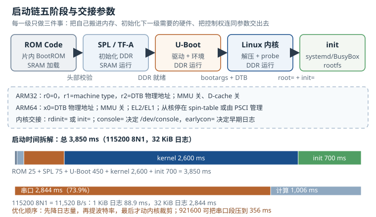

# 启动链：从 ROM Code 到 init Boot Flow: From ROM Code to init

所谓启动链（Boot Flow），就是上电到用户空间第一个进程跑起来的全过程。它由五级接力组成：片内 ROM、SPL 或 TF-A、U-Boot、Linux 内核、init。每一级只做三件事——**把自己搬进内存、初始化下一级需要的硬件、把控制权连同约定好的参数交出去**。任何一级没接住，现象几乎都一样：串口安静，板子"没反应"。

这条链之所以难排查，是因为**前两级按设计就没有串口输出**。ROM 和 SPL 跑在几十到几百 KiB 的片内 SRAM 里，没有驱动、没有文件系统、没有控制台；等 U-Boot 把串口初始化好，已经过去了几十毫秒。把"没有输出"当成"芯片没启动"，是 bring-up 阶段最常见的误判。

## 动机：为什么"串口无输出"是最贵的故障

一块新板第一次上电，最常见的问题是"串口什么都没有"。没有输出意味着没有任何线索，工程师只能从电源、时钟、复位、启动模式一路猜下去。更麻烦的是，同一个现象可能来自五个完全不同的阶段：

| 观察到的现象 | 可能停在哪一级 | 典型原因 |
|---|---|---|
| 完全没有字符，TX 引脚无波形 | ROM / SPL | 供电、时钟、复位、启动模式引脚、SPL 没初始化调试串口 |
| 有波形但全是乱码 | SPL / U-Boot | 波特率不匹配、UART 时钟源频率错、TTL 与 RS-232 电平接错 |
| U-Boot 有输出，停在 `Starting kernel ...` | 内核入口 | bootargs 的 console 与真实串口不符、earlycon 缺失、内核没编串口驱动 |
| 内核日志停在 `Waiting for root device` | 内核挂载 rootfs | `root=` 分区号错、MMC 驱动没编、缺 `rootwait` |
| 内核日志停在 `No working init found` | init 交接 | `init=` 路径不存在、rootfs 缺动态加载器、架构不对 |
| 内核日志正常，但没有登录提示 | init / getty | getty 开在别的 tty、`/dev/console` 不对、inittab 缺行 |

这张表的价值在于：**它把"没输出"变成了"停在哪一级"**。只要知道每一级的输入输出约定，就能用最少的测量把范围缩到一级之内。

::: motivation 一次"换根线就好了"的教训
某团队调试一块新板，串口完全没有输出，怀疑 DDR 初始化失败，换了两版 SPL、量了三天电源纹波。最后发现是调试串口的 TX 被 pinmux 复用成了 GPIO——SPL 里根本没把 UART 引脚配出来，而 U-Boot 的串口初始化代码又在更后面。更早的验证方式其实很简单：用示波器看 SoC 的 UART TX 引脚在上电后 100 ms 内有没有任何电平变化，没有就说明问题在"引脚/时钟"而不是"启动镜像"。

这个教训说明：**先确认物理层，再确认协议层，最后才怀疑镜像**。三层混在一起猜，是 bring-up 最大的时间黑洞。
:::

## 定义与直观：五级启动链与四次交接

### 2.1 五个阶段各自在做什么

**ROM Code（片内启动代码）**固化在 SoC 内部，出厂后不可修改。上电复位后，CPU 从 ROM 的固定地址开始执行，ROM 读取启动模式（strap 引脚或 eFuse），按优先级尝试 SD、eMMC、SPI NOR、NAND、USB、UART 等介质，把第一级镜像搬到片内 SRAM，做完整性/签名校验，然后跳转。它的代码空间通常只有几十 KiB，能做的事非常有限：初始化最少的时钟、配置启动介质控制器、搬运数据。

**SPL（Secondary Program Loader，二级程序加载器）**运行在片内 SRAM（通常 64–256 KiB），核心任务是**初始化 DDR**。DDR 初始化需要读 SPD/训练参数、跑时序训练，代码量和数据量都超过 ROM 的能力，所以必须由 SPL 完成。DDR 可用之后，SPL 把 U-Boot 主体搬到 DDR，跳转过去。ARMv8 平台上，这一角色常由 **TF-A（Trusted Firmware-A）** 承担：BL1 在 SRAM 运行，BL2 加载 BL31（EL3 运行时）与 BL33（即 U-Boot），BL31 常驻 EL3 提供 PSCI 服务。

**U-Boot** 是功能完整的引导器：驱动模型、文件系统、网络、USB、显示、命令行、环境变量。它从 eMMC/SD/网络加载内核镜像与设备树（Device Tree），按 `bootargs` 组装内核命令行，最后跳转到内核入口。U-Boot 还负责设备树的最后修补：填内存大小、写 `/chosen/bootargs`、设置 `stdout-path`、为 OP-TEE 预留内存。

**Linux 内核**接手时，MMU 还没开、缓存还没开、只有一个 CPU 在跑。它先解压（若是 zImage）、建立页表、初始化内存管理、解析设备树、probe 驱动，最后挂载根文件系统（rootfs）或解压 initramfs，启动第一个用户空间进程。

**init** 是用户空间的第一个进程（PID 1）。systemd、BusyBox init、OpenRC 都行；它负责挂载文件系统、启动服务、拉起 getty，让人能看到登录提示。

### 2.2 四次交接的约定

启动链的每一次交接都有明确的寄存器与内存约定，这些约定是排查的"检查点"：

**ROM → SPL**：没有寄存器参数，约定完全由镜像格式定义。i.MX6 在启动介质偏移 `0x400` 处放 IVT（Image Vector Table），其中 DCD（Device Config Data）描述 DDR 控制器配置；AM335x 的 ROM 读取 GP header（含加载地址与长度），把 MLO 搬到 SRAM 的固定地址；Allwinner 用 eGON.BT0 头；Rockchip 把 idbloader 放在扇区 64。**这一级的失败没有软件日志**，只能靠电流、USB 枚举、存储介质波形判断。

**SPL → U-Boot**：约定是"DRAM 已经可用、U-Boot 被搬到 DRAM 的某个地址、栈已切换"。SPL 与 U-Boot 的加载地址由 `CONFIG_SPL_TEXT_BASE` 一类的配置决定，两者必须匹配；地址错了，跳过去就是取指异常。

**U-Boot → 内核**：这是少数有公开文档的硬件级约定。ARM32 要求：

- `r0 = 0`；
- `r1 = machine type`（机器 ID，与内核的 `MACH_TYPE` 匹配；使用设备树时仍需填写）；
- `r2 =` 设备树（DTB）或 ATAGS 的物理地址；
- MMU 关闭、数据缓存关闭、CPU 处于 SVC 模式。

ARM64 要求：

- `x0 =` DTB 的物理地址；
- MMU 关闭、数据缓存关闭；
- CPU 处于 EL2 或 EL1；
- 从核（secondary CPU）必须停在 spin-table 自旋，或由 PSCI 管理，不能自行乱跑。

**内核 → init**：内核在 `kernel_init` 里按顺序尝试：若存在 initramfs 且其中能找到 `rdinit=` 指定的文件（默认 `/init`），先执行它；否则执行 `init=` 指定的程序；再否则按 `/sbin/init`、`/etc/init`、`/bin/init`、`/bin/sh` 的顺序尝试。全部失败就 panic，打印 `No working init found`。



图中下方的两条时间条是本章定量分析的核心：**启动时间并不全是"计算"，很大一部分是"等串口把字打完"**。这一点在下一节展开。

### 2.3 控制台是怎么选出来的

控制台（console）在启动链里换过三次"主人"，这是"内核起来后突然没输出"的根源：

1. **U-Boot 的控制台**：由 `CONFIG_CONS_INDEX`、`CONFIG_BAUDRATE` 和板级 `board_init` 里的 UART 初始化决定，与内核完全无关。
2. **内核的早期控制台**：由 `earlycon=` 参数或设备树 `/chosen/stdout-path` 决定，在正式串口驱动 probe 之前就能输出，是调试"内核早期崩溃"最直接的手段。
3. **内核的正式控制台**：由 `console=` 参数决定。可以写多次，内核会把 printk 输出到所有已注册的控制台，但 `/dev/console` 只指向**最后一个** `console=`。

三个名字必须对齐。不同 SoC 的串口设备名并不统一：

| SoC 家族 | 常见设备名 | 备注 |
|---|---|---|
| NXP i.MX | `ttymxc0` | 调试串口通常是 UART1 |
| TI AM335x / OMAP | `ttyO0`（旧内核）、`ttyS0`（新内核） | 内核版本不同，名字会变 |
| ARM PL011（BCM283x 等） | `ttyAMA0` | 设备树 aliases 决定编号 |
| Samsung Exynos | `ttySAC0` | |
| Xilinx Zynq | `ttyPS0` | |

一个完整的 `bootargs` 例子：

```
console=ttyS0,115200n8 earlycon=uart8250,mmio32,0x44e09000 root=PARTUUID=6b1f2c3d-04 rootfstype=squashfs ro rootwait init=/sbin/init
```

逐段解释：`console=ttyS0,115200n8` 指定正式控制台与波特率（8 数据位、无校验、1 停止位）；`earlycon=uart8250,mmio32,0x44e09000` 让内核在串口驱动 probe 之前就能用 MMIO 直接打印；`root=PARTUUID=...` 用分区 UUID 而不是设备名，避免枚举顺序变化；`rootfstype=squashfs` 明确文件系统类型；`ro` 只读挂载；`rootwait` 等待异步 probe 的 MMC 设备；`init=` 指定第一个用户进程。

`earlycon` 有两种写法：显式指定控制器类型、寄存器宽度与物理地址；或只写 `earlycon`，由内核读取设备树的 `/chosen/stdout-path`。后者更省事，但要求设备树正确——而设备树往往是 bring-up 阶段最容易出错的部分。

## 定量关系：启动时间、串口带宽与镜像大小

### 3.1 启动时间的加性模型

把启动时间按阶段拆开，得到

$$T_{\mathrm{boot}}=\sum_{s=1}^{5}T_s=T_{\mathrm{rom}}+T_{\mathrm{spl}}+T_{\mathrm{uboot}}+T_{\mathrm{k}}+T_{\mathrm{init}}$$

其中 $T_s$ 为第 $s$ 个阶段的墙钟时间，ms。这个模型假设阶段之间没有重叠——对"打印日志"这种独占 UART 的操作，假设基本成立；对"计算与 IO 并行"的部分，可以用一个重叠系数修正：

$$T_{\mathrm{boot}}=\sum_{s}T_s^{\mathrm{comp}}+\alpha\sum_{s}T_s^{\mathrm{uart}}$$

其中 $T_s^{\mathrm{comp}}$ 为计算与 IO 时间，$T_s^{\mathrm{uart}}$ 为串口输出时间，$\alpha\in[0,1]$ 为重叠系数。轮询式 UART（earlycon 与多数 SPL/U-Boot 控制台）没有 DMA，CPU 逐字节等待发送完成，$\alpha\approx1$；带 FIFO/DMA 或异步 printk 线程时，$\alpha$ 可降到 0.3–0.5。

### 3.2 串口带宽：启动日志的硬上限

UART 在 8N1 格式下每字节占 10 位（1 起始位 + 8 数据位 + 1 停止位），所以有效吞吐为

$$R=\frac{f_{\mathrm{baud}}}{10}$$

$f_{\mathrm{baud}}=115200$ 时 $R=11520\ \mathrm{B/s}$，即每个字节 86.8 µs。输出 $B$ 字节需要

$$T_{\mathrm{uart}}=\frac{10B}{f_{\mathrm{baud}}}$$

这个式子看起来平淡，代入真实日志量就很有冲击力：**1 KiB 日志要 88.9 ms，32 KiB 日志要 2.84 s**。启动日志不是"免费的调试信息"，它直接占用启动时间预算。

### 3.3 内核加载与解压

内核镜像有两种形态：压缩的 zImage（ARM32）或 Image.gz（ARM64），以及未压缩的 Image。加载加解压的时间为

$$T_{\mathrm{k}}^{\mathrm{load}}=\frac{S_{\mathrm{img}}}{R_{\mathrm{store}}}+\frac{S_{\mathrm{raw}}}{R_{\mathrm{dec}}}$$

其中 $S_{\mathrm{img}}$ 为存储介质上镜像的字节数；$R_{\mathrm{store}}$ 为存储读取带宽，MiB/s；$S_{\mathrm{raw}}$ 为解压后大小；$R_{\mathrm{dec}}$ 为解压速度，MiB/s。

### 3.4 initramfs 的体积与内存

initramfs 是一个 cpio 归档（通常再压缩），每个文件在 newc 格式下有一个 110 字节的头部，加上文件名与 4 字节对齐填充。设文件数为 $N$、平均文件名长度 $\ell$，则归档大小为

$$S_{\mathrm{cpio}}\approx\sum_j b_j+N\left(110+\ell+p\right)$$

其中 $p$ 为对齐填充，平均约 2 字节；$b_j$ 为文件内容字节数。压缩后体积为 $S_{\mathrm{cpio}}/r$，但**运行时占用的是解压后的 $S_{\mathrm{cpio}}$**，外加载入内存的页表与 tmpfs 开销。

## 典型计算：4 秒启动预算怎么拆

### 算例 1：3,850 ms 的启动时间都花在哪

某 Cortex-A7 板实测从上电到登录提示 3,850 ms，按阶段拆解如下：

| 阶段 | 墙钟 (ms) | 其中串口 (ms) | 其中计算/IO (ms) | 日志量 (KiB) |
|---|---|---|---|---|
| ROM Code | 25 | 0 | 25 | 0 |
| SPL | 75 | 0 | 75 | 0 |
| U-Boot | 450 | 356 | 94 | 4 |
| 内核 | 2,600 | 2,133 | 467 | 24 |
| init | 700 | 356 | 344 | 4 |
| 合计 | 3,850 | 2,845 | 1,005 | 32 |

验算串口部分：4 KiB 日志

$$T_{\mathrm{uart}}=\frac{10\times4096}{115200}=0.3556\ \mathrm{s}=356\ \mathrm{ms}$$

24 KiB 日志

$$T_{\mathrm{uart}}=\frac{10\times24576}{115200}=2.1333\ \mathrm{s}=2{,}133\ \mathrm{ms}$$

合计 $356+2133+356=2{,}845\ \mathrm{ms}$，占总时间的

$$\eta_{\mathrm{uart}}=\frac{2845}{3850}=0.739$$

也就是 **73.9% 的启动时间在等串口**。这个结论会颠覆很多人的直觉：优化启动时，第一刀不该砍在内核配置上，而该砍在日志上。

如果只把日志从 32 KiB 压到 8 KiB，串口时间变成

$$\frac{10\times8192}{115200}=0.711\ \mathrm{s}=711\ \mathrm{ms}$$

总时间降到 $1{,}005+711=1{,}716\ \mathrm{ms}$，省 2.13 s。如果把波特率从 115200 提到 921600，同样 32 KiB 日志的时间变成

$$\frac{10\times32768}{921600}=0.3556\ \mathrm{s}=356\ \mathrm{ms}$$

总时间降到 $1{,}005+356=1{,}361\ \mathrm{ms}$，省 2.49 s。两者同时做（8 KiB 日志 + 921600 波特率），串口段只剩

$$\frac{10\times8192}{921600}=0.0889\ \mathrm{s}=89\ \mathrm{ms}$$

总时间 $1{,}005+89=1{,}094\ \mathrm{ms}$。注意此时**计算与 IO 的 1,005 ms 成了新的瓶颈**——再压日志已经没有意义，必须去优化 DDR 训练、内核解压、驱动 probe 的串行依赖。

### 算例 2：zImage 还是未压缩 Image

设内核解压后 12 MiB，zImage 4 MiB；eMMC 读取 40 MiB/s，SPI NOR 读取 8 MiB/s；LZ4 解压 110 MiB/s，gzip 解压 30 MiB/s；解压后还要把 12 MiB 整体 memcpy 一次，按 200 MiB/s 计。

eMMC + zImage + LZ4：

$$T=\frac{4}{40}+\frac{12}{110}+\frac{12}{200}=0.100+0.109+0.060=0.269\ \mathrm{s}$$

eMMC + zImage + gzip：

$$T=\frac{4}{40}+\frac{12}{30}+\frac{12}{200}=0.100+0.400+0.060=0.560\ \mathrm{s}$$

eMMC + 未压缩 Image：

$$T=\frac{12}{40}=0.300\ \mathrm{s}$$

在 eMMC 上，zImage + LZ4 比未压缩快约 31 ms，而 gzip 版本反而慢 260 ms。换到 SPI NOR：

- zImage + LZ4：$4/8+12/110+12/200=0.500+0.109+0.060=0.669\ \mathrm{s}$；
- 未压缩：$12/8=1.500\ \mathrm{s}$。

差距扩大到 831 ms，压缩镜像仍然明显更优。但若解压速度只有 8 MiB/s（低端 CPU 上的 gzip），eMMC 上 zImage 的加载时间是 $0.100+1.500+0.060=1.660\ \mathrm{s}$，反而比未压缩的 0.300 s 慢 1.36 s（约 5.5 倍）。**结论取决于实测的 $R_{\mathrm{dec}}$ 与 $R_{\mathrm{store}}$，不能照搬别人的配置**。

### 算例 3：initramfs 要占多少内存与启动时间

设 initramfs 打包 1,842 个文件、内容合计 9.4 MiB、平均文件名 32 字节。cpio 头部开销：

$$N(110+\ell+p)=1842\times(110+32+2)=1842\times144=265{,}248\ \mathrm{B}\approx259\ \mathrm{KiB}$$

归档总大小约 $9.4+0.25=9.65\ \mathrm{MiB}$。用 gzip 压缩（压缩比 2.8）后约 $9.65/2.8=3.45\ \mathrm{MiB}$，可以塞进 4 MiB 的分区。

启动时的代价有两笔：解压 9.65 MiB（gzip 30 MiB/s）约

$$\frac{9.65}{30}=0.322\ \mathrm{s}=322\ \mathrm{ms}$$

加上内核把 cpio 解包到 tmpfs（1,842 个文件，按每个 20 µs 计）约 37 ms，合计约 359 ms。运行时这 9.65 MiB 常驻内存，再叠加 tmpfs 的页表开销。对 256 MiB 内存的板子可以接受；对 64 MiB 的板子，initramfs 里塞完整 rootfs 会直接挤压应用内存。

### 算例 4：DDR 训练时间对启动预算的影响

DDR 训练（read/write leveling、gate training）在 SPL 中通常占 40–120 ms，且随温度与电压变化。取 80 ms 计算，它占 3,850 ms 的

$$\frac{80}{3850}=0.0208\approx2.1\%$$

看似不大，但它是**不可压缩的硬件时间**：日志可以砍、驱动可以裁剪、DDR 训练不能跳过（除非把训练参数固化到 SPL，代价是换一批内存颗粒就要重调）。做启动预算时，应当把这类"硬件地板"单独列出，剩下的才是软件可优化的空间。

## 工程含义：可观测性与量产设计

### 5.1 为"看不见的阶段"设计观测手段

既然 ROM 与 SPL 按设计没有串口输出，就必须用非串口手段观测它们：

- **电流曲线**：ROM 搬运镜像时电流有阶跃，DDR 初始化时电流上升。用可编程电源记录上电后 200 ms 的电流波形，能区分"完全没动"与"跑到 DDR 训练"。
- **存储介质波形**：eMMC 的 CLK/CMD/DAT 线、SPI NOR 的 SCK/MOSI，用逻辑分析仪抓上电后前 100 ms，能确认 ROM 是否在读镜像。
- **USB 枚举**：支持 USB 启动的 SoC，ROM 会在无有效镜像时枚举为下载设备。主机 `lsusb` 能看到厂商 ID，就说明 ROM 活着。
- **GPIO 翻转**：在 SPL 的最早几条指令里翻转一个空闲 GPIO，用示波器看；这是最便宜的"printf"。
- **JTAG**：能连上就说明 CPU 在跑；停在哪个地址就知道卡在哪。

U-Boot 侧则要打开 `CONFIG_BOOTSTAGE`，它记录每个阶段的进入/退出时间，启动后用 `bootstage report` 打印；内核侧用 `initcall_debug` 看每个驱动的 probe 耗时，用 `earlycon` 抓早期崩溃，用 `pstore`/`ramoops` 把 panic 日志留到下一次启动。

### 5.2 开发镜像与量产镜像的分叉

开发阶段需要"话多"，量产阶段需要"话少、启动快、攻击面小"。合理的做法是同一套代码、两份配置：

| 维度 | 开发镜像 | 量产镜像 |
|---|---|---|
| U-Boot 控制台 | 打开，`bootdelay=3` | 关闭或 `bootdelay=0` |
| 内核日志级别 | `loglevel=7`，`ignore_loglevel` | `quiet`，`loglevel=4` |
| earlycon | 打开 | 关闭 |
| 串口登录 | 允许 root shell | 关闭，或只留受限恢复模式 |
| 看门狗 | 可关 | 必须开，配合 bootcount 回滚 |
| 调试符号 | 随镜像 | 单独归档 |

关键是**两份配置都要进构建系统**，而不是在产线上手工改环境变量。手工改的那一份，往往会在下一次换板时被忘掉。

### 5.3 启动失败的自动回滚

量产设备不能靠人按复位键。常见的三重保护是：

1. **看门狗（watchdog）**：内核启动后由用户空间喂狗；启动过程中由 U-Boot 或硬件看门狗计时，超时复位。
2. **启动计数（bootcount）**：U-Boot 每次启动把计数器加一，成功进入用户空间后清零；连续失败 N 次就切到备份分区。
3. **A/B 分区**：两个可启动槽位，升级只写非当前槽；启动失败由 bootloader 切换 `bootslot` 环境变量回滚。

这三者的组合把"启动失败"从"变砖"降级为"一次重启"。代价是 flash 要留双份空间——回到镜像预算那一章，16 MiB 是放不下 A/B 的，这也是很多产品在选型阶段就要把 flash 定到 32 MiB 的原因。

## 常见坑

::: pitfall 坑一：U-Boot 有输出，`Starting kernel ...` 之后彻底安静
**现象**：U-Boot 命令行、环境变量、加载地址都正常，打印 `Starting kernel ...` 后串口再无任何字符，板子也不重启。

**原因**：内核已经接手，但它的控制台与 U-Boot 不是同一个。常见有三类：`bootargs` 里的 `console=` 写错设备名（比如 U-Boot 用 `ttyO0`，内核里是 `ttyS0`）；内核没编对应串口的驱动（`CONFIG_SERIAL_OMAP` 之类）；`earlycon` 缺失，内核在串口驱动 probe 之前就崩溃了，而崩溃信息无处可打。

**解决**：先在 `bootargs` 里加 `earlycon`（显式地址或依赖设备树 `stdout-path`），确认能看到早期日志；再检查 `console=` 与设备树 aliases 是否一致；用 `CONFIG_DEBUG_LL` 做更早期的调试输出。若加了 `earlycon` 仍无输出，用 JTAG 或 `pstore` 确认内核是否真的执行到了 `start_kernel`。
:::

::: pitfall 坑二：完全没有输出，但 eMMC 上有读写波形
**现象**：串口一个字符都没有，示波器却在 eMMC 的 CLK/CMD 线上看到上电后的读写活动。

**原因**：ROM 已经在读镜像，说明供电、时钟、启动模式都正常；问题出在 SPL 没有把调试串口初始化出来。常见原因是 UART 引脚被 pinmux 复用为 GPIO 或其他功能、UART 时钟源没使能、SPL 配置里根本没开 `CONFIG_SPL_SERIAL`，或者板子的调试串口不是默认的 `CONFIG_CONS_INDEX`。

**解决**：对照原理图与 pinmux 表确认调试 UART 的引脚复用；在 SPL 里显式调用 `debug_uart_init()` 并打开 `CONFIG_DEBUG_UART`；用逻辑分析仪直接看 SoC 的 UART TX 引脚，区分"没配置"与"配置了但没数据"。注意有些 SoC 的 ROM 会用同一个 UART 输出少量信息，先确认 ROM 阶段是否有输出，能大幅缩小范围。
:::

::: pitfall 坑三：串口输出乱码
**现象**：有输出，但全是 `�` 或乱码；偶尔能辨认出几个字符。

**原因**：波特率不匹配（U-Boot 115200、内核 1500000）、UART 输入时钟频率配置错误导致实际波特率偏差、TTL 电平与 RS-232 电平混接、或者数据位/校验位设置不一致。还有一种隐蔽情况：SoC 的 UART 时钟源在 Linux 里被改成与 U-Boot 不同的频率，分频系数没跟着改。

**解决**：先用示波器量一个已知字符（比如 `U`）的位宽，反推实际波特率；确认 U-Boot 的 `CONFIG_BAUDRATE` 与内核 `console=` 的波特率一致；检查设备树里 UART 节点的时钟源与 `assigned-clock-rates`；TTL 调试串口不要直接接 RS-232 电平，中间要有电平转换。
:::

::: pitfall 坑四：内核停在 `Waiting for root device`
**现象**：内核日志正常，最后反复打印 `Waiting for root device /dev/mmcblk0p2...`，30 秒后 panic。

**原因**：`root=` 指定的设备不存在或分区号错；MMC 控制器驱动没编进内核；设备树里 MMC 节点没使能；eMMC 的供电/复位 GPIO 没配对；根文件系统类型与 `rootfstype=` 不符；没有 `rootwait`，内核在 MMC 异步 probe 完成前就尝试挂载。

**解决**：先加 `rootwait`；把 `root=` 从设备名改成 `PARTUUID=`，避免枚举顺序变化；用 initramfs 救援 shell 进去看 `/proc/partitions` 与 `dmesg`；确认 `CONFIG_MMC`、`CONFIG_MMC_SDHCI` 与对应 SoC 的驱动都已编入；检查设备树 `status = "okay"`。
:::

::: pitfall 坑五：挂载成功却报 `No working init found`
**现象**：内核成功挂载 rootfs，随后 panic：`No working init found. Try passing init= option to kernel`。

**原因**：`init=` 指向的文件不存在；rootfs 里的 `/sbin/init` 是动态链接的，但缺少 `/lib/ld-linux-armhf.so.3`；init 的架构与内核不匹配（比如把 aarch64 的 busybox 放进 arm32 rootfs）；rootfs 挂载成了空目录（分区选错）。

**解决**：用 `rdinit=/bin/sh` 或 `init=/bin/sh` 先进去；`ls -l /sbin/init` 确认存在与权限；`file` 与 `readelf -l` 确认架构与解释器；静态链接的 BusyBox 可以排除加载器问题；确认 `root=` 指向的分区确实是 rootfs 而不是 boot 分区。
:::

## 自测题

<details><summary>题一：画出五级启动链，并说明每一级的运行位置、由谁加载、失败时的可观测现象。</summary>

五级与交接：

1. **ROM Code**：运行在片内 BootROM/SRAM，由复位向量启动，从启动介质加载 SPL；失败时无串口输出，可观测现象是电流无阶跃、存储介质无波形、USB 不枚举。
2. **SPL / TF-A**：运行在片内 SRAM，由 ROM 加载；负责初始化 DDR 并加载 U-Boot（TF-A 则是 BL2 加载 BL31/BL33）。失败时通常无输出（除非开了调试 UART），可观测现象是电流停在 DDR 训练附近、U-Boot 永不出现。
3. **U-Boot**：运行在 DDR，由 SPL 加载；加载内核与 DTB、组装 bootargs。失败时有 U-Boot 输出，能进命令行，可观测现象是加载地址错、`booti` 报错。
4. **Linux 内核**：运行在 DDR，由 U-Boot 跳转进入；解压、建页表、probe 驱动、挂载 rootfs。失败时若 earlycon 可用则有早期日志，否则静默；可观测现象是 `Starting kernel ...` 后停止。
5. **init**：运行在用户空间，由内核 `kernel_init` 执行；拉起服务与 getty。失败时内核 panic `No working init found`，或没有登录提示。

关键点：前两级"没有输出"是设计使然，不能用串口静默判断芯片没启动。
</details>

<details><summary>题二：115200 8N1 下，32 KiB 启动日志要打多久？若把日志压到 8 KiB、波特率提到 921600，各能省多少时间？</summary>

8N1 每字节 10 位，115200 波特率下有效吞吐 $115200/10=11520\ \mathrm{B/s}$。

32 KiB：$10\times32768/115200=2.844\ \mathrm{s}$。

8 KiB：$10\times8192/115200=0.711\ \mathrm{s}$，比 32 KiB 省 $2.844-0.711=2.133\ \mathrm{s}$。

921600 下 32 KiB：$10\times32768/921600=0.356\ \mathrm{s}$，省 $2.844-0.356=2.488\ \mathrm{s}$。

两者同时做：$10\times8192/921600=0.089\ \mathrm{s}$，比原始省 $2.755\ \mathrm{s}$。

但要注意：若计算与 IO 本身要 1,005 ms，那么日志压到 89 ms 后总时间是 1,094 ms，瓶颈已经转移到计算段，继续压日志的收益趋近于零。
</details>

<details><summary>题三：4 MiB zImage（解压后 12 MiB）、12 MiB 未压缩 Image，eMMC 40 MiB/s、SPI NOR 8 MiB/s，LZ4 解压 110 MiB/s、gzip 30 MiB/s、memcpy 200 MiB/s。分别算 eMMC 与 SPI NOR 上的加载时间，说明什么时候该用未压缩镜像。</summary>

eMMC：

- zImage + LZ4：$4/40+12/110+12/200=0.100+0.109+0.060=0.269\ \mathrm{s}$；
- zImage + gzip：$4/40+12/30+12/200=0.100+0.400+0.060=0.560\ \mathrm{s}$；
- 未压缩：$12/40=0.300\ \mathrm{s}$。

SPI NOR：

- zImage + LZ4：$4/8+12/110+12/200=0.500+0.109+0.060=0.669\ \mathrm{s}$；
- 未压缩：$12/8=1.500\ \mathrm{s}$。

在 eMMC 上，LZ4 压缩只是略优（快约 31 ms），gzip 已经比未压缩慢 260 ms；在 SPI NOR 上 LZ4 的优势约 831 ms。只有当解压速度足够低时，未压缩才可能反超：若解压只有 8 MiB/s，eMMC 上 zImage 为 $0.100+1.500+0.060=1.660\ \mathrm{s}$，比未压缩的 0.300 s 慢 1.36 s。所以选择依据是实测的存储带宽与解压速度，而不是"压缩一定更快"。
</details>

<details><summary>题四：U-Boot 有输出、内核无输出，给出五步定位顺序，并说明每一步的判据。</summary>

1. **确认内核是否真的被跳转**：看 U-Boot 是否打印 `Starting kernel ...`，以及 `booti`/`bootz` 的返回值；用 JTAG 读 PC 是否落在内核入口。
2. **确认 `console=` 是否指向真实串口**：对照设备树 aliases 与 SoC 手册，确认 `ttyS0`/`ttyO0`/`ttymxc0` 的名字；临时改成 `console=tty0` 看是否有输出（有显示器时）。
3. **加 `earlycon`**：显式写 `earlycon=uart8250,mmio32,<地址>` 或依赖 `stdout-path`；若 earlycon 有输出，说明问题在正式串口驱动或 console 参数，而不是内核没跑。
4. **确认设备树**：`/chosen/stdout-path` 是否指向正确节点，UART 节点 `status` 是否为 `okay`，pinmux 是否配置。
5. **确认内核配置**：`CONFIG_SERIAL_*`、`CONFIG_SERIAL_EARLYCON`、`CONFIG_DEBUG_LL` 是否编入；用 `zcat /proc/config.gz` 或构建目录的 `.config` 核对。

判据的核心是"在哪一步第一次出现输出"：earlycon 有输出而 console 没有，问题在驱动/参数；两者都没有，问题在内核入口之前（加载地址、DTB、CPU 状态）。
</details>

<details><summary>题五：为什么 ROM 与 SPL 阶段没有串口输出不能说明芯片没启动？给出至少三种非串口证据。</summary>

因为 ROM 的代码空间极小，通常只初始化启动介质与最少时钟，不包含通用 UART 驱动；SPL 的首要任务是 DDR 初始化，调试串口往往要显式配置才会输出。两者"静默"是设计选择，不是故障指征。

三种非串口证据：

1. **电流曲线**：ROM 搬运镜像、SPL 训练 DDR 都会产生可区分的电流阶跃；用可编程电源记录上电后 200 ms 的波形。
2. **存储介质活动**：eMMC 的 CLK/CMD/DAT 或 SPI NOR 的 SCK/MOSI 上出现读写波形，说明 ROM 已经在读第一级镜像。
3. **USB 枚举**：支持 USB 下载启动的 SoC，在找不到有效镜像时会枚举为下载设备；主机能看到厂商 ID 就说明 ROM 在运行。

补充证据：SPL 里翻转 GPIO 用示波器看、JTAG 读 PC、测量复位引脚是否释放、测量主时钟是否起振。把这些证据与串口结合，才能把"没输出"定位到具体一级。
</details>

## 参考资料

- Linux 内核文档 `Documentation/arch/arm/booting.rst`：ARM32 启动协议，`r0/r1/r2` 的约定、MMU 与缓存状态、DTB 传递方式。
- Linux 内核文档 `Documentation/arch/arm64/booting.rst`：ARM64 启动协议，`x0` 传 DTB、异常级别要求、从核停放与 PSCI。
- Linux 内核文档 `Documentation/admin-guide/kernel-parameters.txt`：`console=`、`earlycon=`、`root=`、`rootwait`、`init=`、`rdinit=`、`loglevel=` 的完整语义与优先级。
- Linux 内核文档 `Documentation/filesystems/ramfs-rootfs-initramfs.rst` 与 `Documentation/driver-api/early-userspace/early_userspace_support.rst`：initramfs 的 cpio 格式、`/init` 的执行顺序、与 initrd 的区别。
- U-Boot 文档 `doc/develop/bootstd.rst` 与 `doc/README.distro`：bootflow、distro boot、extlinux 配置与 `bootargs` 的生成规则。
- ARM Trusted Firmware-A 文档 *Firmware Design*：BL1/BL2/BL31/BL33 的分工与异常级别；TI AM335x TRM（SPRUH73）Chapter 32 *Initialization* 与 NXP i.MX6 RM Chapter 8 *System Boot*：ROM 启动序列、IVT/DCD 与启动模式。
