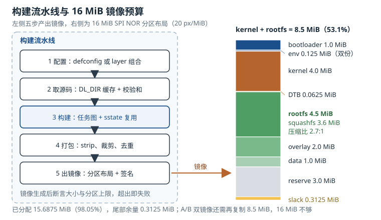

# 构建系统：Buildroot 与 Yocto Build Systems: Buildroot and Yocto

一块量产的嵌入式板子，根文件系统（rootfs）里通常有 150 到 400 个软件包、几十个补丁、若干厂商二进制固件。手工下载、打补丁、`make`、`make install` 到某个目录，在第一个星期看起来可行；到第三个月，没人能说清"这台机器上的镜像为什么和那台不一样"。构建系统（Build System）要解决的正是这个问题：**把"一堆积木"变成"一份可复现、可审计、可裁剪的配方"**。

嵌入式领域有两个主流答案：**Buildroot** 与 **Yocto**。它们经常被放在一起比较，但定位并不相同——Buildroot 是"用 Make 写成的固件工厂"，Yocto 是"用元数据描述的发行版工厂"。选错的代价不是多学一个工具，而是项目后期被构建时间和维护成本拖住。

## 动机：为什么需要构建系统

先看不用构建系统会发生什么。一个中等规模的网关，rootfs 里有 BusyBox、OpenSSL、MQTT 客户端、Modbus 库、几个自研守护进程，以及无线模组的固件 blob。手工流程通常是这样：从各项目官网下载 tar 包，解压到 `~/work`，`./configure --host=arm-linux-gnueabihf --prefix=/opt/rootfs`，`make`，`make install`。第一个包能跑通，第二个包依赖第一个包的头文件，于是开始手动加 `-I`；第三个包要求特定版本的 OpenSSL，而系统里装的是另一个版本，于是开始改 `LD_LIBRARY_PATH`；换一台机器，路径全变，编译报错，于是把整个 `~/work` 打包发过去。

这套流程有四个结构性问题：

1. **依赖关系没有被记录**。谁依赖谁、先编谁后编谁，只存在于当事人的记忆里。
2. **宿主机污染**。`configure` 会自动探测宿主机上装了什么，同一份源码在两台机器上编出不同的功能集。
3. **补丁不可追溯**。为了适配板子改的那三行代码，半年后没人记得改在哪、为什么改。
4. **产物不可复现**。没有清单、没有版本锁定，镜像哈希每次都不同。

构建系统把这四件事分别变成：任务图、隔离的构建环境、可版本化的补丁集、可复现的输出。Buildroot 与 Yocto 的实现路径不同，但目标一致。

::: motivation 一次"手工构建"的返工
某团队用手工方式维护 rootfs，产品出货 8 个月后发现 OpenSSL 有一个高危漏洞需要升级。升级 OpenSSL 后，依赖它的 MQTT 客户端和 VPN 组件全部需要重编，而这两个组件的编译参数只存在于一位已离职工程师的 shell 历史里。团队最终花了两周重建整条构建链，并在此后引入了带完整配方记录的构建系统。

这个故事的教训不是"要用 Yocto"，而是"**构建过程本身必须是可交付的资产**"。构建系统真正的产出不是镜像，而是"能再次产出同一个镜像的能力"。
:::

## 定义与直观：两种范式的分界

### 2.1 Buildroot：一份配置，一棵输出树

**Buildroot** 是一个基于 GNU Make 的构建框架。它的核心概念只有三个：

- **配置**：`make menuconfig` 生成的 `.config`（或 `make xxx_defconfig` 加载的 defconfig），用 `BR2_*` 变量描述目标架构、工具链、内核、包选择、文件系统类型。
- **包配方**：`package/<pkg>/<pkg>.mk` 描述如何下载、解压、配置、编译、安装这个包；`Config.in` 描述它在 menuconfig 里的选项与依赖。
- **输出树**：`output/` 目录，里面有 `build/`（各包的构建目录）、`host/`（宿主工具）、`target/`（目标 rootfs 的草稿）、`images/`（最终镜像）。

一条 `make` 命令会遍历所有选中的包，按依赖顺序构建，最后把 `target/` 打包成 ext4、squashfs、ubifs 或 cpio。整个过程没有守护进程、没有数据库、没有服务端，就是 Make 的并行调度。

Buildroot 的扩展方式是 **`BR2_EXTERNAL`**：把公司的板级配置、私有包、补丁放在仓库外的一棵树里，用 `make BR2_EXTERNAL=/path/to/tree <board>_defconfig` 把它引入配置。这样上游 Buildroot 可以整体升级，私有内容不污染上游目录。对一个产品线来说，这棵树通常包含：`board/<vendor>/<board>/`（设备树、内核配置、genimage 配置）、`configs/<board>_defconfig`、`package/<私有包>/`。

Buildroot 的哲学是"**一次构建，一个镜像**"：它不追求生成可长期演进的发行版，而是把"当前配置"编译成一个可以烧进设备的固件。这也解释了它的取舍——构建快、配置直观、学习曲线平缓，但没有原生的多 SKU 管理、没有运行时包管理的完整生态、没有 layer 叠加机制。

### 2.2 Yocto：元数据、layer 与任务图

**Yocto 项目**建立在 OpenEmbedded 之上，核心是 BitBake 这个元数据驱动的任务执行引擎。它的核心概念比 Buildroot 多一层：

- **配方（recipe，`.bb`）**：描述一个软件包的元数据与构建步骤，等价于 Buildroot 的 `.mk`，但表达力更强（版本、许可证校验、补丁、配置项、打包拆分）。
- **追加（`.bbappend`）**：在不修改原配方的前提下追加或覆盖内容，通常放在 BSP 层里，用来给上游配方打补丁、改配置。
- **层（layer）**：一组配方、类（class）、配置的集合，带 `conf/layer.conf` 声明优先级与兼容性。层可以叠加，优先级高的层覆盖低的层。
- **配置**：`local.conf`（本机构建配置）、`distro.conf`（发行版策略）、`machine.conf`（板级描述），三者共同决定最终产物。
- **任务图**：BitBake 把每个配方展开成 `do_fetch → do_unpack → do_patch → do_configure → do_compile → do_install → do_package → do_package_write_* → do_rootfs → do_image_*` 的任务链，按依赖关系调度执行。
- **共享状态缓存（sstate）**：每个任务的输入哈希命中缓存时直接复用产物，这是 Yocto 增量构建的核心。

一个最小配方通常包含这些字段：

| 字段 | 作用 | 常见错误 |
|---|---|---|
| `SUMMARY` / `DESCRIPTION` | 包的说明 | 留空，导致包管理器里全是一行 "UNKNOWN" |
| `LICENSE` / `LIC_FILES_CHKSUM` | 许可证声明与源文件校验 | 校验和写错，`do_fetch` 直接失败 |
| `SRC_URI` / `SRCREV` | 源码位置与锁定提交 | 用分支名而不锁提交，构建不可复现 |
| `DEPENDS` / `RDEPENDS` | 构建期依赖 / 运行期依赖 | 把运行期依赖写成构建期依赖，镜像里缺库 |
| `do_install` | 安装到目标目录 | 路径写死，`D` 变量没用到，打包为空 |
| `FILES` | 声明文件归属哪个子包 | 文件没被任何包认领，镜像里丢失 |
| `PACKAGECONFIG` | 可选特性开关 | 全开导致依赖膨胀 |

层与配方的关系可以这样理解：**配方回答"这个包怎么编"，层回答"哪些配方一起构成这个产品"**。BSP 层提供内核、U-Boot、设备树与板级驱动；发行版层提供 libc 选择、初始化系统、包管理策略；产品层提供应用与品牌配置。一个产品 = 若干层的叠加，而不是一份巨大的配置文件。

图中的右侧值得单独看：**镜像是一个固定大小的容器，所有分区之和必须小于闪存容量**。构建系统只负责把内容做出来，是否放得下要由预算表来裁决。下一节的定量模型就是围绕这张预算表展开的。

### 2.3 包管理与可复现构建：两条路线的交汇点

**包管理（Package Management）**在嵌入式上有两种截然不同的用法：

- **构建期包管理**：Yocto 的 `PACKAGE_CLASSES` 把每个配方拆成 ipk、rpm 或 deb 包，再组装成 rootfs。包在这里是"构建的中间产物"，好处是可以做包级增量、生成软件源（feed）、按包裁剪。
- **运行期包管理**：设备上跑 `opkg`、`dnf` 或 `apt`，从 feed 安装/升级单个包。Yocto 用 `PACKAGE_CLASSES` 把每个配方直接产出成包并组织成 feed；Buildroot 则把每个包**直接安装进 `target/`**，不产出逐包归档，`BR2_PACKAGE_OPKG` 只是把 opkg 客户端编进镜像，feed 要另行制作。这是两条路线在包管理上最实质的差别。

运行期包管理在只读 rootfs 上需要配合 **overlayfs**：底层 squashfs 只读，上层 tmpfs 或可写分区记录变更，掉电后变更可丢可留。它的好处是升级粒度细，坏处是"设备上的实际文件状态"不再等于"镜像里的状态"，可复现性被打破。多数量产设备最终会选择 **A/B 整镜像升级**，把包管理限制在开发阶段——这是可靠性与灵活性之间的取舍。

**可复现构建（Reproducible Builds）**是两条路线共同面对的问题：同样的源码、同样的配置，两次构建应产出逐字节相同的镜像。破坏可复现性的因素有固定的几类：

| 因素 | 表现 | 处理 |
|---|---|---|
| 时间戳 | `ar` 归档、gzip 头、cpio 头里写入当前时间 | 设 `SOURCE_DATE_EPOCH`，工具链按该值写时间 |
| 构建路径 | 调试信息、`__FILE__` 里嵌入 `/home/alice/...` | `-ffile-prefix-map`，或在容器内固定路径构建 |
| 并行顺序 | 打包时文件遍历顺序随文件系统变化 | `tar --sort=name`、固定 locale 与 umask |
| 主机信息 | 用户名、主机名、内核版本进入产物 | 构建容器固定这些值，或让配方显式覆盖 |
| 网络内容 | 下载的源码/固件随时间变化 | 校验和锁定、本地镜像 `DL_DIR` |

Buildroot 用 `BR2_REPRODUCIBLE` 统一处理大部分时间戳问题；Yocto 用 `reproducible` 类为每个配方计算 `SOURCE_DATE_EPOCH`，并通过 sstate 的输入哈希保证"输入相同则产物相同"。两者都只能消除"已知的"非确定性，真正的验收标准只有一条：**两次独立构建，镜像 SHA-256 相同**。

## 定量关系：镜像体积与构建时间

### 3.1 镜像体积模型

设闪存容量为 $S_{\mathrm{flash}}$，镜像由若干分区组成，则约束是

$$S_{\mathrm{img}}=S_{\mathrm{boot}}+S_{\mathrm{env}}+S_{\mathrm{k}}+S_{\mathrm{dtb}}+S_{\mathrm{rootfs}}+S_{\mathrm{ovl}}+S_{\mathrm{data}}+S_{\mathrm{rsv}}\leq S_{\mathrm{flash}}$$

其中 $S_{\mathrm{boot}}$ 为引导加载器分区，MiB；$S_{\mathrm{env}}$ 为环境变量分区（通常双份冗余）；$S_{\mathrm{k}}$ 为内核镜像；$S_{\mathrm{dtb}}$ 为设备树；$S_{\mathrm{rootfs}}$ 为根文件系统；$S_{\mathrm{ovl}}$ 为可写覆盖层；$S_{\mathrm{data}}$ 为应用数据；$S_{\mathrm{rsv}}$ 为预留（未来功能、坏块、A/B 备份）。

rootfs 的体积取决于压缩方式与文件构成：

$$S_{\mathrm{rootfs}}\approx\frac{\sum_j b_j}{r}+m$$

其中 $b_j$ 为第 $j$ 个文件的字节数；$r$ 为压缩比（squashfs + xz 在混合内容上典型为 2.5–3.0）；$m$ 为元数据开销（inode 表、目录、压缩块索引），MiB。

如果不用压缩文件系统而用 ext4，体积模型变成

$$S_{\mathrm{ext4}}=\sum_j\left\lceil\frac{b_j}{4096}\right\rceil\times4096+N_{\mathrm{inode}}\times256+J+O$$

其中 $\lceil\cdot\rceil$ 表示按 4 KiB 块向上取整；$N_{\mathrm{inode}}$ 为 inode 数量；每个 inode 占 256 字节；$J$ 为日志大小（默认最小 1024 个块，即 4 MiB）；$O$ 为超级块、块位图、组描述符等固定开销。

### 3.2 构建时间模型

设共有 $n$ 个包，第 $i$ 个包的构建耗时为 $t_i$（CPU·分钟），并行度为 $J$，并行效率为 $e$（受依赖链、I/O、串行阶段影响，通常 0.7–0.9），则墙钟时间近似为

$$T=\frac{\sum_{i=1}^{n}t_i}{J\,e}$$

若使用共享状态缓存，命中率为 $h$，则增量构建时间为

$$T'=(1-h)\,T$$

$h$ 的工程含义是"有多少任务被缓存直接复用"。它取决于配方、配置、工具链、`MACHINE`、`DISTRO` 是否变化——任意一项变了，相关任务的输入哈希就变，缓存失效。

### 3.3 层复用的定量描述

设基础层有 $r_0$ 个配方，每个板级层有 $r_b$ 个，每个产品层有 $r_p$ 个，产品数为 $P$。不用层而复用同一份巨型配置时，每个产品都要复制全部配方；用层叠加时，独有配方数为

$$N_{\mathrm{uniq}}=r_0+P\left(r_b+r_p\right)$$

而"每个产品各维护一份完整配置"的配方实例数为

$$N_{\mathrm{inst}}=P\left(r_0+r_b+r_p\right)$$

复用率为

$$\rho=1-\frac{N_{\mathrm{uniq}}}{N_{\mathrm{inst}}}$$

它衡量的是"层把多少重复劳动变成了共享"。

## 典型计算：16 MiB 闪存的预算账

### 算例 1：分区布局与余量

某产品用 16 MiB SPI NOR，规划如下：

| 区域 | 起始偏移 | 大小 | 占 16 MiB |
|---|---|---|---|
| bootloader（SPL + U-Boot） | `0x000000` | 1.0 MiB | 6.25% |
| env（主 + 备） | `0x100000` | 0.125 MiB | 0.78% |
| kernel（zImage） | `0x120000` | 4.0 MiB | 25.00% |
| DTB | `0x520000` | 0.0625 MiB | 0.39% |
| rootfs（squashfs） | `0x530000` | 4.5 MiB | 28.13% |
| overlay（可写） | `0x9B0000` | 2.0 MiB | 12.50% |
| data（日志/配置） | `0xBB0000` | 1.0 MiB | 6.25% |
| 预留（A/B 或未来功能） | `0xCB0000` | 3.0 MiB | 18.75% |
| 尾部余量 | `0xFB0000` | 0.3125 MiB | 1.95% |

求和验证：

$$1.0+0.125+4.0+0.0625+4.5+2.0+1.0+3.0+0.3125=16.0\ \mathrm{MiB}$$

已分配 15.6875 MiB，占比 $15.6875/16=98.05\%$，只剩 0.3125 MiB（320 KiB）。这个布局的结论是：**16 MiB 做单镜像刚好，做 A/B 双镜像不够**——A/B 需要把 kernel + rootfs 复制一份，即再要 8.5 MiB，除非把 rootfs 压到 2 MiB 以内或换 32 MiB 闪存。预算表的价值就在于把这种"到后期才发现"的问题提前到选型阶段。

### 算例 2：同样 9.4 MiB 内容，squashfs 与 ext4 的差别

设 rootfs 内容合计 9.4 MiB、1,842 个文件，构成为：libc 与基础库 2.6 MiB、BusyBox 与应用 2.1 MiB、内核模块 1.4 MiB、固件 blob 1.8 MiB、证书与配置 1.5 MiB。

squashfs + xz，压缩比 $r=2.7$，元数据 $m=0.12$ MiB：

$$S_{\mathrm{sq}}=\frac{9.4}{2.7}+0.12=3.48+0.12=3.60\ \mathrm{MiB}$$

放进 4.5 MiB 分区，占用率 $3.60/4.5=80.0\%$，余量 0.9 MiB。这是健康的——留下 25% 的余量给下一版功能。

ext4 则完全是另一笔账。平均每个文件 $9.4/1842\approx5.2\ \mathrm{KiB}$，按 4 KiB 块分配，平均内部碎片约 2 KiB：

$$\sum_j\left\lceil\frac{b_j}{4096}\right\rceil\times4096\approx9.4+1842\times\frac{2}{1024}=9.4+3.6=13.0\ \mathrm{MiB}$$

inode 按每 4 KiB 一个（`-i 4096`）需要 $13.0\times1024/4\approx3328$ 个，取 3,328 个：

$$N_{\mathrm{inode}}\times256=3328\times256\ \mathrm{B}=832\ \mathrm{KiB}\approx0.81\ \mathrm{MiB}$$

日志取最小值 4 MiB，固定开销约 0.2 MiB，于是

$$S_{\mathrm{ext4}}=13.0+0.81+4.0+0.2=18.01\ \mathrm{MiB}$$

**同样的内容，ext4 要 18 MiB，squashfs 只要 3.6 MiB**。这就是为什么嵌入式 rootfs 普遍用只读压缩文件系统：闪存贵、擦写寿命有限、掉电风险高，而 rootfs 在量产设备上本来就很少需要原地修改。

这里还埋着一个 inode 陷阱。`mke2fs` 默认按每 16 KiB 一个 inode 分配，对一个 4.5 MiB 分区：

$$N_{\mathrm{inode}}^{\mathrm{default}}=\frac{4.5\times1024}{16}=288$$

288 个 inode 远少于 1,842 个文件。`mkfs` 不会报错，`mount` 也正常，但拷贝到第 289 个文件时就会报 `No space left on device`——块还有很多，inode 用完了。修法是 `mkfs.ext4 -i 4096` 或 `-N 2500`，并把"inode 数 ≥ 文件数 × 1.2"写进镜像构建脚本的断言。

### 算例 3：Buildroot 与 Yocto 的构建时间

设 Buildroot 配置选中 180 个包，合计 1,250 CPU·分钟。8 核构建机、并行效率 0.85：

$$T_{\mathrm{BR}}=\frac{1250}{8\times0.85}=\frac{1250}{6.8}=183.8\ \mathrm{min}\approx3.1\ \mathrm{h}$$

Yocto 的元数据会展开出更多任务（配置、打包、QA 检查），设合计 4,800 CPU·分钟，16 核、效率 0.7：

$$T_{\mathrm{Yocto}}=\frac{4800}{16\times0.7}=\frac{4800}{11.2}=428.6\ \mathrm{min}\approx7.1\ \mathrm{h}$$

首次构建 Yocto 明显更慢。但 Yocto 的 sstate 命中率通常很高。设第二次构建命中 92%：

$$T'_{\mathrm{Yocto}}=(1-0.92)\times428.6=34.3\ \mathrm{min}$$

反过来，若要把增量构建压到 60 分钟以内，需要的命中率是

$$h\geq1-\frac{60}{428.6}=0.860$$

即 86.0%。这个数字解释了 Yocto 项目为什么把 `SSTATE_DIR`、`DL_DIR` 的持久化看得比什么都重：**缓存目录丢失一次，等于退回 7 小时**。Buildroot 的对应数字更朴素——改一个包后重编该包并重打 rootfs 约 6 分钟，相对全量 183.8 分钟是 30.7 倍加速，代价是它没有跨机器的任务级缓存。

### 算例 4：三层结构对三个 SKU 的复用率

设基础层 40 个配方，每个板级层 12 个，每个产品层 5 个，共 3 个产品（3 个 SKU，其中两个共用同一块板）。按"每个产品一份完整配置"计算：

$$N_{\mathrm{inst}}=3\times(40+12+5)=171$$

按层叠加、共用基础层与板级层计算（两个 SKU 共用同一 BSP，故板级层只算 2 份）：

$$N_{\mathrm{uniq}}=40+2\times12+3\times5=40+24+15=79$$

复用率：

$$\rho=1-\frac{79}{171}=0.538$$

约 53.8% 的配方实例被层消掉了。这个数字会随 SKU 数量线性增长：SKU 越多，层的收益越大；只有一个产品时，层的抽象成本（多写 `layer.conf`、多维护兼容性声明）可能高于收益。这也回答了"小项目要不要上 Yocto"——**先数 SKU，再数 BSP 数量，最后看团队是否有人能维护元数据**。

## 工程含义：选型、裁剪与可复现

### 5.1 选型：不是"哪个更好"，而是"哪个更匹配"

| 维度 | Buildroot | Yocto |
|---|---|---|
| 学习曲线 | 低，会 Make 就能读懂 | 高，需要理解 layer、配方、任务图、sstate |
| 首次构建 | 30–60 分钟（视包数） | 3–8 小时（视机器与包数） |
| 增量构建 | 包级重建，简单直接 | 任务级 sstate，命中时很快 |
| 多 SKU | 靠多份 defconfig 与 `BR2_EXTERNAL` 手工管理 | layer 叠加，天然支持 |
| BSP 生态 | 芯片厂商多提供 defconfig 与补丁 | 主流厂商提供 BSP layer，社区维护活跃 |
| 运行时包管理 | 可编入 opkg 客户端，默认不产出逐包归档与 feed | ipk/rpm/deb + feed，体系完整 |
| SDK | `make sdk` 生成工具链 | `populate_sdk` 生成安装器，含完整 sysroot |
| 许可证合规 | `make legal-info` 输出清单 | 许可证清单 + `cve-check` 类 |
| 可复现 | `BR2_REPRODUCIBLE` | `reproducible` 类 + sstate 哈希 |
| 适用 | 单产品、包数少、追求构建速度与可读性 | 多 SKU、长周期维护、需要发行版级治理 |

一个实用的判断顺序是：

1. **SKU 数量**：1–2 个且短期不变，Buildroot 足够；3 个以上或持续衍生型号，Yocto 的层模型更省心。
2. **BSP 来源**：芯片厂商只给 Yocto BSP，硬上 Buildroot 等于自己重写 BSP 层；反之厂商只给 defconfig，上 Yocto 要自己写配方。
3. **团队能力**：有没有人能读懂 BitBake 的变量展开与任务哈希？没有的话，Yocto 的排错成本会高于收益。
4. **维护周期**：产品要维护 5 年以上、要持续打 CVE 补丁，Yocto 的 LTS 版本与包治理更成熟。

### 5.2 裁剪：从预算倒推，而不是从功能正推

裁剪的正确顺序是"**先定预算，再量现状，再归因，再砍，再复量**"。以 4.5 MiB 的 rootfs 分区、目标占用 80% 为例，预算是 3.6 MiB。拿到一个 5.2 MiB 的镜像后，按下面的顺序归因：

- **内核模块**：先看 `modules.dep` 与实际加载列表，删掉从未被 `modprobe` 的模块。典型能省 60%–80%，本例中全量 6.2 MiB、实际需要 1.4 MiB，砍掉 4.8 MiB。
- **调试符号**：`strip` 后应用与库通常缩小 60%–80%；调试信息单独归档，不要进镜像。
- **固件 blob**：无线、GPU、DSP 的固件常被整包拷贝，实际只用到其中一两个；按需裁剪能省 0.5–1.5 MiB。
- **locale 与文档**：`/usr/share/locale`、`/usr/share/doc`、`/usr/share/man` 在嵌入式上几乎无用，删除通常省 5%–10%。
- **重复库**：静态链接与动态链接混用、同一库的多个版本并存，是常见的"看不见的浪费"。

每砍一刀都要复量，并把数字写进预算表。**没有进入预算表的裁剪，下一次构建就会长回来**。

### 5.3 可复现：把"应该一样"变成"验证过一样"

可复现构建在工程上有三个层次：

1. **同机可复现**：同一台机器、同一份缓存，连续两次构建哈希相同。这一层最容易做到，也最容易被误当成全部。
2. **跨机可复现**：两台路径不同、用户名不同的机器，构建结果相同。需要 `-ffile-prefix-map`、固定 `SOURCE_DATE_EPOCH`、固定 locale/umask。
3. **跨时间可复现**：半年后从 git 重新检出，仍能构建出同一镜像。需要锁定上游源码（`SRCREV` 而非分支名）、锁定工具链（见工具链一章的清单）、锁定下载源（`DL_DIR` 镜像或校验和）。

验收方式只有一条：CI 里跑两次独立构建（不同工作目录、不同用户），比较 `sha256sum`；不一致时用 `diffoscope` 定位差异文件。把这条断言放进流水线，比写十页规范都有效。

### 5.4 许可证与合规

Buildroot 的 `make legal-info` 会把每个包的源码、许可证文本、`LICENSE` 字段汇总到 `legal-info/`；Yocto 在 `tmp/deploy/licenses/` 下生成每个包的许可证清单，并可用 `cve-check` 类扫描已知漏洞。两者都不能替代法律审查，但能保证"清单是完整的"。

需要特别注意的几类许可证：

- **GPLv3 与 LGPLv3** 的"安装信息"（Installation Information）条款，对锁定安全启动的设备有额外要求；
- **GPLv2-only** 与 **GPLv2-or-later** 的区别，影响能否升级到 GPLv3 组件；
- **厂商 blob** 的再分发条款，常与"整包开源"冲突。

这些信息应当随镜像一起归档，而不是等项目被收购时才补。

## 常见坑

::: pitfall 坑一：开发机构建成功，CI 上必失败
**现象**：本地 `make` 一遍过，推到 CI 后某个包在 `configure` 阶段报找不到头文件或命令；换一台开发机又好了。

**原因**：宿主机污染。Buildroot 的部分包会探测宿主机工具（Python、pkg-config、bison、flex），Yocto 虽然用 `HOSTTOOLS` 做了隔离，但 `local.conf` 里手工加的路径仍可能泄漏。另一类原因是 `DL_DIR` 里有旧 tarball，CI 重新下载拿到的是上游重新打包过的"同版本"源码。

**解决**：构建放进固定镜像的容器；Buildroot 打开 `BR2_COMPILER_PARANOID_UNSAFE_PATH`，让宿主路径泄漏直接报错；固定 `DL_DIR` 并校验哈希；CI 与开发机使用同一份工具链清单。Yocto 侧检查 `bitbake -e` 展开后的 `PATH` 与 `HOSTTOOLS_DIR`，确认没有混入宿主路径。
:::

::: pitfall 坑二：改了一个包，却触发全量重建
**现象**：只想改一个应用，结果 Buildroot 重编了 40 分钟，Yocto 的 sstate 命中率从 90% 掉到 10%。

**原因**：Buildroot 侧常见于改了 `.config` 里的工具链选项或 `BR2_EXTERNAL` 路径，导致 `output/build` 下所有包的 stamp 失效；Yocto 侧常见于 `TMPDIR`、`SSTATE_DIR` 换了路径，或 `MACHINE`、`DISTRO`、`SRCREV` 变化，导致任务输入哈希全变。另一个隐蔽原因是配方里用了 `AUTOREV` 或未锁定的分支，每次解析都得到新提交。

**解决**：Buildroot 用 `make <pkg>-rebuild` 只重建单个包，避免动全局配置；Yocto 用 `bitbake -S none <image>` 导出任务签名，再用 `bitbake-diffsigs` 找出是哪个变量变了；`SSTATE_DIR` 与 `DL_DIR` 放在持久化卷上，路径固定；配方锁定 `SRCREV`，不用 `AUTOREV`。
:::

::: pitfall 坑三：镜像超出分区，启动时挂载失败
**现象**：构建成功，烧录也成功，但内核报 `VFS: Cannot open root device` 或 `squashfs: ... failed to read`；或者烧录工具提示"image too large for partition"。

**原因**：rootfs 超过了分区大小，或者 genimage 配置里的分区大小与构建脚本里的预算表不同步。常见触发点是内核模块全量打包、固件 blob 整包拷贝、调试符号没 strip、locale 没删。

**解决**：把预算表做成构建脚本的断言（镜像生成后 `stat` 比对分区上限，超出即失败）；用 `du -sk` 与 `ncdu` 归因到目录；打开 `BR2_STRIP_strip`、删除 `gdb`/`gdbserver`、按需裁剪模块；Yocto 侧收敛 `IMAGE_INSTALL`，用 `IMAGE_FEATURES` 控制调试特性。
:::

::: pitfall 坑四：两次构建哈希不同，A/B 升级校验失败
**现象**：同一份代码，两次构建的镜像 SHA-256 不同；签名校验偶尔失败；差分包每次都是全量。

**原因**：时间戳、构建路径、并行顺序、主机名/用户名、locale 进入产物。典型位置是 `ar` 归档头、gzip 头、cpio 头、调试信息里的源文件路径。

**解决**：设 `SOURCE_DATE_EPOCH`（Buildroot 用 `BR2_REPRODUCIBLE`，Yocto 用 `reproducible` 类）；`-ffile-prefix-map` 消除路径；`tar --sort=name --mtime` 固定打包顺序与时间；CI 跑两次独立构建比对哈希，用 `diffoscope` 定位残余差异。
:::

::: pitfall 坑五：设备上 opkg 安装报架构不兼容
**现象**：`opkg install` 报 `incompatible architecture` 或依赖冲突，但包明明是同一次构建产出的。

**原因**：feed 里的包与设备上的 rootfs 来自不同构建（架构优先级、版本号、依赖版本不同）；或者设备 `/etc/opkg/*.conf` 指向了旧的 feed 地址；或者包架构字段是 `all` 与 `armv7ahf` 混用导致优先级判断错误。

**解决**：feed 与镜像必须同一次构建产出、同一批次发布；设备上的 feed 地址由镜像生成时写入，不手工改；用 `opkg print-architecture` 确认优先级顺序；升级前先 `opkg update`，并保留回滚镜像。
:::

## 自测题

题一：Buildroot 与 Yocto 的定位差异是什么？给出三个能决定选型的判据。

Buildroot 是"一份配置、一棵输出树"的固件工厂：基于 Make，配置即 `.config`，包配方是 `.mk` + `Config.in`，产物是单一镜像，优势是构建快、结构直观、学习曲线低。Yocto 是"元数据 + 层 + 任务图"的发行版工厂：BitBake 按配方执行任务，层负责组合与覆盖，sstate 提供任务级缓存，产物除镜像外还有包、feed、SDK，优势是多 SKU 治理与长期维护。

三个判据：

1. **SKU 数量**：1–2 个用 Buildroot 足够；3 个以上、持续衍生型号用 Yocto 的层叠加更省维护成本。
2. **BSP 来源**：厂商提供 Yocto BSP layer 就用 Yocto；只提供 defconfig 与补丁就用 Buildroot。逆着 BSP 生态走，等于自己重写板级支持。
3. **团队与维护周期**：需要 5 年以上维护、持续 CVE 治理、对外发 SDK，Yocto 的 LTS 与包治理更成熟；团队里没人能读懂 BitBake 变量展开与任务哈希，则 Yocto 的排错成本可能高于收益。

题二：9.4 MiB 内容、1,842 个文件，squashfs 压缩比 2.7、元数据 0.12 MiB，体积是多少？换成 ext4（4 KiB 块、平均碎片 2 KiB/文件、每 4 KiB 一个 inode、日志 4 MiB）又是多少？

squashfs：$9.4/2.7=3.48\ \mathrm{MiB}$，加元数据 $3.48+0.12=3.60\ \mathrm{MiB}$。

ext4：块分配约 $9.4+1842\times2/1024=9.4+3.6=13.0\ \mathrm{MiB}$；inode 数约 $13.0\times1024/4=3328$ 个，inode 表 $3328\times256\ \mathrm{B}=832\ \mathrm{KiB}\approx0.81\ \mathrm{MiB}$；加日志 4 MiB 与固定开销 0.2 MiB，合计 $13.0+0.81+4.0+0.2=18.01\ \mathrm{MiB}$。

同样的内容，squashfs 只要 3.6 MiB，ext4 要 18 MiB，相差 5 倍。原因是 squashfs 压缩且按压缩块组织，ext4 不压缩、按 4 KiB 块分配还要预留日志与 inode 表。这也解释了为什么 4.5 MiB 分区只能放 squashfs。

补充陷阱：若用 `mke2fs` 默认的每 16 KiB 一个 inode，4.5 MiB 分区只有 288 个 inode，拷贝第 289 个文件就会 `No space left on device`，此时块还有大量空闲。

题三：Buildroot 1,250 CPU·分钟、8 核、效率 0.85；Yocto 4,800 CPU·分钟、16 核、效率 0.7。各自墙钟时间是多少？Yocto 要把增量构建压到 60 分钟内，sstate 命中率至少要多少？

Buildroot：$T=1250/(8\times0.85)=1250/6.8=183.8$ 分钟，约 3.1 小时。

Yocto：$T=4800/(16\times0.7)=4800/11.2=428.6$ 分钟，约 7.1 小时。

命中率要求：$h\geq1-60/428.6=1-0.140=0.860$，即 86.0%。若命中 92%，增量时间为 $(1-0.92)\times428.6=34.3$ 分钟。

这说明 Yocto 的 sstate 缓存不是"锦上添花"，而是日常开发能否忍受的前提；缓存目录换路径或丢失，构建时间会直接退回 7 小时量级。

题四：为什么"层"能降低多 SKU 的维护成本？用 40 + 3×12 + 3×5 的例子算复用率，并说明层的代价。

层把配方按"基础 / 板级 / 产品"分组，产品配置只声明"叠加哪些层"，而不是复制全部配方。基础层的 40 个配方被所有产品共享，板级层被同板产品共享，只有产品层是独有的。

按每产品一份完整配置：$3\times(40+12+5)=171$ 个配方实例。按层叠加且两个 SKU 共用一块板：$40+2\times12+3\times5=79$ 个独有配方。复用率 $1-79/171=53.8\%$。

代价有三项：一是抽象成本，每个层要维护 `layer.conf`、兼容性声明、优先级，层多了之后"最终生效的是哪个配方"需要 `bitbake-layers show-recipes` 才能看清；二是调试成本，`.bbappend` 覆盖失败往往不报错，只是"没生效"；三是升级成本，层与上游 Yocto 版本有兼容矩阵，跨版本升级要逐层验证。SKU 少时这些成本可能高于收益。

题五：可复现构建的三个层次是什么？给出每一层的最小必要措施与验收方法。

三个层次：

1. **同机可复现**：同一台机器连续两次构建哈希相同。措施：固定 `SOURCE_DATE_EPOCH`、固定并行度与 locale、清理构建目录。验收：连续两次构建比对哈希。
2. **跨机可复现**：两台路径、用户名不同的机器结果相同。措施：`-ffile-prefix-map` 消除路径、容器内固定用户名/主机名、`tar --sort=name`。验收：两台机器各构建一次，比对哈希，`diffoscope` 定位差异。
3. **跨时间可复现**：半年后重新检出仍能构建同一镜像。措施：`SRCREV` 锁定提交、工具链哈希锁定、`DL_DIR` 镜像或校验和锁定、构建脚本随代码入库。验收：在干净环境从 tag 重新构建，与归档镜像比对。

三层缺一不可。只做第一层，换机器就失效；只做前两层，上游源码被重新打包就失效。真正的验收标准是可执行的断言，而不是文档里的承诺。

## 参考资料

- Buildroot 用户手册，*Buildroot configuration* 与 *Package recipes*：`make menuconfig`、`make savedefconfig`、`package/<pkg>/<pkg>.mk` 与 `Config.in` 的写法，以及 `BR2_EXTERNAL` 外部树机制。
- Buildroot 用户手册，*Reproducible builds* 与 *Legal info*：`BR2_REPRODUCIBLE` 的行为、`make legal-info` 生成的许可证清单结构。
- Yocto Project Overview and Concepts Manual，*The Yocto Project OpenEmbedded Build System Concepts* 章节：layer、recipe、configuration、任务执行与 sstate 的概念模型。
- Yocto Project Reference Manual，*Yocto Project Terms* 与 *Variables Glossary*：`BBFILE_PRIORITY`、`SSTATE_DIR`、`DL_DIR`、`PACKAGE_CLASSES`、`SOURCE_DATE_EPOCH` 等变量的语义。
- BitBake User Manual，*Metadata*：`.bb` 配方、`.bbappend` 追加、`SRC_URI` 与任务执行模型；配合 `bitbake-layers show-recipes`、`bitbake -S` 的调试方法。
- Reproducible Builds 项目规范，*SOURCE_DATE_EPOCH*：时间戳归一化的约定；man 手册 `mkfs.ext4(8)` 的 bytes-per-inode 与日志大小；内核文档 `Documentation/filesystems/squashfs.rst` 的压缩块与元数据说明。
