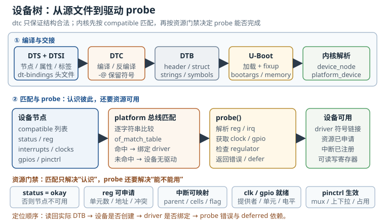

# 设备树：从 DTS 到驱动 probe Device Tree

设备树（Device Tree）是引导固件交给 Linux 内核的一份**硬件描述契约**。它不执行代码，也不直接操作寄存器；它只告诉内核：这块板上有哪些设备、每个设备占哪段地址、用哪根中断线、由哪个时钟供频、哪个 GPIO 负责复位、当前是否启用。内核再依据这些描述创建设备，把设备与驱动匹配起来。

这也是设备树最容易被低估的地方。很多“驱动不 probe”的问题，最终既不是驱动写错，也不是硬件坏掉，而是 DTS 里的一个 `status`、一个 `compatible` 字符串、一组地址单元，或者一个没有就绪的时钟提供者。读懂设备树，等于拿到了内核看待硬件的**第一手视图**。

## 动机：为什么驱动“不 probe”

在设备树成为标准之前，ARM Linux 大量使用板级文件（board file）：每块板在 `arch/arm/mach-*` 下写一份 C 代码，把 I2C 设备、SPI 设备、GPIO、时钟频率、内存大小硬编码进去。板子一多，内核里就堆满“某客户定制版”的 `#ifdef`；改一根引脚，可能要把整个内核重新编译一遍；同一份内核镜像也很难同时支持多个硬件变体。

设备树把“硬件差异”从内核代码里抽出来，变成可独立编译、可独立升级的数据：

- **一块内核支持多块板**：驱动只写硬件无关的逻辑，板级差异放在 DTS 中。
- **引导器可以修补**：U-Boot 能在启动时填入实际内存大小、`bootargs`、MAC 地址和保留内存区域。
- **硬件描述可审查**：DTS 是文本，可以 diff、可以 code review、可以进版本库。
- **外设可以叠加**：overlay 允许在不改基础 DTB 的情况下描述附加板或可选模块。

代价是：硬件描述与驱动代码分离之后，**错误也分离了**。驱动作者假设“资源属性一定存在”，DTS 作者假设“驱动会自己处理缺省值”，中间没有任何编译器能同时检查两边。`dtc` 只能保证语法和基本结构合法，不能保证 `compatible` 真的有驱动、`reg` 真的不重叠、时钟真的存在。

一次典型的误判是这样的：驱动模块已经加载，`compatible` 看起来也一致，但设备就是没有 `driver` 符号链接。工程师花两天在驱动里加打印，最后发现基础 DTSI 里该节点是 `status = "disabled"`，板级 DTS 忘了覆盖。设备树的问题往往没有“编译错误”这种明显信号，只表现为设备不存在或 probe 返回一个模糊的错误码。

因此，本章不把设备树当作“配置语法”来讲，而是按一条可验证的链路组织：**源文件如何变成 DTB，DTB 如何描述资源，内核如何匹配驱动，匹配失败时如何定位**。

## 定义与直观：DTS、DTSI、DTC 与 DTB

### 2.1 四个名字的分工

- **DTS（Device Tree Source）**：人写的设备树源文件，通常一块板一个 `.dts`，作为最终编译入口。
- **DTSI（Device Tree Source Include）**：被包含的公共片段，通常描述 SoC 级控制器、引脚复用或某颗外设的默认配置。板级 DTS 通过 `/include/` 或 C 预处理器 `#include` 引入 DTSI，再用标签覆盖其中的节点。
- **DTC（Device Tree Compiler）**：把 DTS 编译成 DTB 的工具，也负责反编译和结构检查。它不执行驱动，也不验证绑定语义。
- **DTB（Device Tree Blob）**：扁平化二进制（Flattened Device Tree），由头部、内存保留表、结构块和字符串块组成，是 U-Boot 实际传递给内核的形态。
- **DTO / DTBO（Device Tree Overlay）**：叠加片段，描述“在某个已有节点上增加或修改什么”。基础 DTB 通常需要 `-@` 保留符号信息，overlay 才能在运行时按标签定位；应用可以由引导器或内核完成。

一条常见的构建链是：

```text
board.dts + soc.dtsi + dt-bindings/*.h
        │  cpp + dtc
        ▼
board.dtb ──► U-Boot 加载、修补 ──► 内核解析 ──► device + driver 匹配
        │
board-overlay.dts ── dtc -@ ──► board.dtbo ──► 启动时 fdt apply 或 configfs
```

`dtc` 的典型命令是：

```bash
# DTS 编译为 DTB；-@ 生成 __symbols__，供 overlay 按标签定位
dtc -@ -I dts -O dtb -o board.dtb board.dts

# 从运行中的系统或镜像反编译，确认实际生效的内容
dtc -I dtb -O dts board.dtb
```

反编译出来的 DTS 通常没有标签、宏和注释，数字也全部展开。它是**验证工具**，不是维护源码。拿反编译结果去改生产 DTS，下一次重新编译就会丢失。

### 2.2 节点、属性与标签

设备树是一棵树。根节点 `/` 下挂 `chosen`、`memory`、`cpus`、`soc` 等节点；每个节点由节点名和可选的单元地址组成，例如 `serial@30800000`。节点内的键值对叫属性，例如 `compatible = "acme,soc-uart";`。

一个最小但包含主要资源类型的例子：

```dts
/dts-v1/;

#include <dt-bindings/interrupt-controller/arm-gic.h>
#include <dt-bindings/interrupt-controller/irq.h>
#include <dt-bindings/gpio/gpio.h>
#include "soc.dtsi"

/ {
    model = "Acme Gateway G1";
    compatible = "acme,g1", "acme,soc-a";
    #address-cells = <2>;
    #size-cells = <2>;

    chosen {
        bootargs = "console=ttyS0,115200n8 root=PARTUUID=6b1f2c3d-04 rootwait";
    };

    memory@80000000 {
        device_type = "memory";
        reg = <0x0 0x80000000 0x0 0x10000000>;
    };

    soc {
        compatible = "simple-bus";
        #address-cells = <2>;
        #size-cells = <1>;
        ranges;

        uart0: serial@30800000 {
            compatible = "acme,soc-uart", "ns16550a";
            reg = <0x0 0x30800000 0x1000>;
            interrupt-parent = <&gic>;
            interrupts = <GIC_SPI 42 IRQ_TYPE_LEVEL_HIGH>;
            clocks = <&clk_uart>;
            clock-names = "baud";
            pinctrl-names = "default";
            pinctrl-0 = <&uart0_pins>;
            reset-gpios = <&gpio1 12 GPIO_ACTIVE_LOW>;
            status = "okay";
        };
    };
};
```

示例中的 `gic`、`clk_uart`、`gpio1` 和 `uart0_pins` 由 `soc.dtsi` 或其他被包含的 DTSI 提供；如果这些标签不存在，`dtc` 会在编译阶段直接报错。这段代码里有几个关键点：

- **`uart0:` 是标签，不是节点名。** 标签用于在别处引用节点，`&uart0` 会被 `dtc` 解析成 phandle（节点引用）。节点名是 `serial`，单元地址是 `30800000`。节点名应使用小写字母、数字和连字符；有 `reg` 时，单元地址通常取首个 `reg` 地址的十六进制形式，不带 `0x` 和前导零。
- **`compatible` 是字符串列表，从最具体到最通用。** 设备侧写 `"acme,soc-uart", "ns16550a"`，驱动可以匹配前者，也可以用通用的 `ns16550a` 兼容驱动。厂商前缀应使用已注册的前缀，避免 `"my-uart"` 这类容易冲突的写法。
- **`#address-cells` 和 `#size-cells` 描述的是“子节点”的 `reg` 格式。** 它们属于父节点，不属于设备自己。这是设备树最常见的理解错误之一。
- **`status` 决定节点是否可用。** `"okay"` 表示启用；`"disabled"` 表示存在但当前不使用。基础 DTSI 常把可选控制器设为 `disabled`，板级 DTS 再按需覆盖为 `okay`。
- **`chosen` 不是硬件设备。** 它承载 `bootargs`、`stdout-path` 等引导参数；`memory` 描述物理内存；`aliases` 给设备起稳定的别名。它们由内核基础设施消费，不需要驱动。
- **`ranges;` 为空表示 1:1 映射。** 如果省略 `ranges`，表示该总线没有到父地址空间的映射；如果写了非空元组，则按元组进行地址翻译。

设备树描述的“节点”最终会变成内核里的 `struct device_node`；其中可被枚举为平台设备的节点，会继续变成 `struct platform_device`。驱动通过 `of_match_table` 与节点的 `compatible` 比较，匹配成功后才调用 `probe()`。这条链可以用下图概括：



图中下半部分尤其重要：**匹配成功不等于 probe 成功**。`compatible` 只负责“驱动和设备认识彼此”，`reg`、`interrupts`、`clocks`、`gpios`、`pinctrl`、供电和 `status` 才决定 probe 能不能走完。很多“已经匹配但不 probe”的问题，实际卡在资源门禁，而不是匹配表。

### 2.3 五类资源属性的写法

设备树里最常写的资源可以归为五类。下表给出格式和最常见的失败点：

| 属性 | 典型写法 | 单元数由谁决定 | 常见失败点 |
|---|---|---|---|
| `reg` | `reg = <0x0 0x30800000 0x1000>;` | 父节点的 `#address-cells` 与 `#size-cells` | 单元数不匹配、地址重叠、单元地址与首地址不一致 |
| `interrupts` | `interrupts = <GIC_SPI 42 IRQ_TYPE_LEVEL_HIGH>;` | 中断父节点的 `#interrupt-cells` | 中断父节点缺失、触发类型写反、把硬件中断号当 Linux 虚拟中断号 |
| `clocks` | `clocks = <&clk_uart>;` | 时钟提供者的 `#clock-cells` | 时钟提供者未就绪、`clock-names` 顺序错、漏写 consumer |
| `gpios` | `reset-gpios = <&gpio1 12 GPIO_ACTIVE_LOW>;` | GPIO 控制器的 `#gpio-cells` | 控制器没声明 `gpio-controller`、漏了 `#gpio-cells`、有效电平写反 |
| `pinctrl-0` | `pinctrl-0 = <&uart0_pins>;` | 引脚控制节点的 phandle 列表 | 引脚被别的外设占用、pinctrl 节点没启用、只配了 mux 没配电气属性 |

再补充两类经常被忽略的依赖：

- **供电**：`vcc-supply = <&reg_3v3>;`、`vddio-supply = <&reg_1v8>;`。驱动通过 regulator API 取得电源；提供者没注册时，probe 可能一直 deferred。
- **DMA 与保留内存**：`dmas = <&dmac 7 1>;`、`memory-region = <&display_reserved>;`。这些属性同样依赖父节点或提供者的单元格式。

写设备树时，最有效的自检不是“看起来像”，而是反问三个问题：**这个属性的单元数由谁定义？这个 phandle 由谁提供？提供者什么时候就绪？** 三问答不上来，节点即使编译通过，也很可能在 probe 阶段失败。

### 2.4 驱动侧：compatible 如何参与匹配

设备树只描述“我是什么”，驱动侧则描述“我能接什么”。一个 platform 驱动通常这样声明匹配表：

```c
static const struct of_device_id acme_uart_of_match[] = {
    { .compatible = "acme,soc-uart" },
    { .compatible = "ns16550a" },
    { }
};
MODULE_DEVICE_TABLE(of, acme_uart_of_match);

static struct platform_driver acme_uart_driver = {
    .probe = acme_uart_probe,
    .driver = {
        .name = "acme-uart",
        .of_match_table = acme_uart_of_match,
    },
};
```

匹配是**字符串精确比较**：设备节点的 `compatible` 列表中只要有任一字符串与驱动表的某一项完全相同，就可以绑定。列表顺序表达“具体到通用”的优先级，方便人阅读和绑定文档约束，但内核不会因为设备列表第一项没命中就放弃后面的项。`MODULE_DEVICE_TABLE(of, ...)` 会生成模块别名，用户空间的 udev 或 mdev 才能按设备树自动加载模块；漏掉它时，驱动即使编译成模块也不会自动出现。

`driver.name` 主要服务于 platform 设备和 sysfs 命名，不替代 `compatible` 匹配。把所有逻辑都押在 `name` 上，是另一种常见的“设备树写了但驱动不认”的原因。

## 定量关系：地址单元、中断号与 DTB 体积

设备树不是“没有数字的配置文件”。相反，它的核心就是一组有严格位宽和单元数的二进制编码。理解这些编码，才能手工验算 DTS，而不是靠试错。

### 3.1 `reg` 的字节数与地址拼接

设某个节点的父节点声明 `#address-cells = N_addr`、`#size-cells = N_size`，该节点有 $n$ 组 `reg` 元组，则 `reg` 属性占用的字节数为：

$$B_{\text{reg}}=4n(N_{\text{addr}}+N_{\text{size}})$$

其中 $N_{\text{addr}}$、$N_{\text{size}}$ 是单元个数，$n$ 是“地址 + 长度”元组的数量，每个单元固定 4 字节、按大端存放。$B_{\text{reg}}$ 的单位是字节。

当地址由两个 32 位单元表示时，完整地址为：

$$a=a_{\text{hi}}\cdot2^{32}+a_{\text{lo}}$$

其中 $a_{\text{hi}}$ 是高 32 位，$a_{\text{lo}}$ 是低 32 位，$a$ 是 64 位物理地址。例如 `<0x0 0x30800000 ...>` 表示地址 `0x30800000`；`<0x1 0x00000000 ...>` 表示 `0x100000000`。

### 3.2 `ranges` 与地址翻译

总线节点的 `ranges` 属性把子地址空间映射到父地址空间。一个元组由“子地址、父地址、长度”组成。对落在某个映射窗口内的子地址，翻译公式为：

$$a_{\text{parent}}=p_{\text{base}}+(a_{\text{child}}-c_{\text{base}})$$

其中 $a_{\text{child}}$ 是子节点看到的地址，$c_{\text{base}}$ 是该窗口的子地址基址，$p_{\text{base}}$ 是父地址基址，$a_{\text{parent}}$ 是 CPU 侧看到的地址。适用条件是：

$$c_{\text{base}}\le a_{\text{child}}<c_{\text{base}}+L$$

$L$ 是窗口长度。超出窗口的地址不会被翻译，驱动拿到的资源就是无效的。`ranges` 为空表示 1:1 映射；完全省略 `ranges` 表示不可映射。这两者的区别经常被忽略。

### 3.3 中断说明符与 GIC 中断号

中断属性的单元数由 `interrupt-parent` 指向的中断控制器决定。以常见的 ARM GIC 为例，`#interrupt-cells = <3>`，三个单元依次是：

1. 中断类型：`GIC_SPI`（共享外设中断）或 `GIC_PPI`（私有外设中断）；
2. 该类型内的中断编号；
3. 触发类型与电平标志，例如 `IRQ_TYPE_LEVEL_HIGH`。

对 SPI，硬件中断号（INTID）与设备树中的编号相差 32：

$$I_{\text{INTID}}=32+n_{\text{SPI}}$$

对 PPI：

$$I_{\text{INTID}}=16+n_{\text{PPI}}$$

其中 $n_{\text{SPI}}$、$n_{\text{PPI}}$ 是设备树里的 0 基编号。注意，**Linux 虚拟中断号（virq）不是这个 INTID**。virq 由 irq domain 在运行时分配，可能随内核配置和 irqchip 初始化顺序变化；驱动应使用 `platform_get_irq()` 或 `irq_of_parse_and_map()` 取得，而不是把 `/proc/interrupts` 里的数字写死。

### 3.4 DTB 的体积构成

DTB 的头部是固定的 40 字节，之后是内存保留表、结构块和字符串块。结构块与字符串块都要按 4 字节对齐。一个简化但可复算的模型是：

$$S_{\text{dtb}}=40+16(N_{\text{reserve}}+1)+\text{align}_4(S_{\text{struct}})+\text{align}_4(S_{\text{strings}})$$

其中 $N_{\text{reserve}}$ 是内存保留条目数，加 1 是终止项；$\text{align}_4(x)$ 表示向上取整到 4 的倍数。$S_{\text{struct}}$ 由节点和属性组成：

$$S_{\text{node}}=4+\text{align}_4(\ell_{\text{name}}+1)+4$$

$$S_{\text{prop}}=12+\text{align}_4(L_{\text{value}})$$

$S_{\text{node}}$ 中第一个 4 是开始节点 token，$\ell_{\text{name}}$ 是节点名长度，加 1 是结尾 NUL，最后一个 4 是结束节点 token。$S_{\text{prop}}$ 中 12 字节是属性 token、值长度和名字偏移，$L_{\text{value}}$ 是属性值字节数。字符串块会去重，但每个不同的属性名仍要占一份。

这个模型没有计入 `-@` 生成的 `__symbols__`、`__fixups__` 和 `__local_fixups__`。生产环境如果使用 overlay，必须把这些节点算进去；否则会低估 DTB 体积和加载时间。

### 3.5 解析复杂度

内核解析 DTB 的成本随节点数、属性数和字符串块大小增长，可以写成：

$$T_{\text{parse}}=O(N_{\text{node}}+N_{\text{prop}}+S_{\text{strings}})$$

其中 $N_{\text{node}}$ 是节点数，$N_{\text{prop}}$ 是属性数，$S_{\text{strings}}$ 是字符串块字节数。这个式子只说明增长趋势，不能直接当毫秒预算；真实启动时间还受缓存、内存带宽和驱动 probe 影响。实际工程中更值得关注的是**DTB 与内核是否匹配**，而不是几十 KiB 的解析开销。

## 典型计算：从 DTS 到可验证数字

### 算例 1：解码一个 `reg` 属性

某总线节点的父节点配置为 `#address-cells = <2>`、`#size-cells = <1>`，设备节点写：

```dts
reg = <0x0 0x30800000 0x1000>,
      <0x0 0x30810000 0x1000>;
```

共有 $n=2$ 组元组，每组 2 个地址单元加 1 个长度单元，因此：

$$B_{\text{reg}}=4\times2\times(2+1)=24\ \text{B}$$

第一组地址是 `0x0 << 32 | 0x30800000 = 0x30800000`，长度 `0x1000`；第二组是 `0x30810000`，长度 `0x1000`。两个窗口不重叠，共占用 8 KiB 地址空间。

如果父节点实际是 `#address-cells = <1>`、`#size-cells = <1>`，那么每个元组只有 2 个单元，共 16 字节。此时多写一个单元，`dtc` 可能只给警告，内核解析出的地址和长度会整体错位——**单元数不匹配是 reg 类故障最常见的根因**。

### 算例 2：用 `ranges` 翻译子地址

根节点 `#address-cells = <2>`、`#size-cells = <1>`；总线节点 `axi` 声明：

```dts
#address-cells = <1>;
#size-cells = <1>;
ranges = <0x0 0x0 0x40000000 0x100000>;
```

`ranges` 有 4 个单元：子地址基址 `0x0`（1 个单元）、父地址基址 `0x0 0x40000000`（2 个单元）、长度 `0x100000`（1 个单元）。子节点写 `reg = <0x20000 0x1000>;`，其 CPU 侧地址为：

$$a_{\text{parent}}=0x40000000+(0x20000-0)=0x40020000$$

窗口范围是 `0x0` 到 `0xFFFFF`，`0x20000` 在范围内，翻译有效。长度 `0x100000` 是 1 MiB，而设备只占 4 KiB，剩余窗口可以分配给同一总线上的其他设备；但不能与已有窗口重叠，否则驱动申请资源时会失败。

### 算例 3：解码 GIC 中断说明符

```dts
interrupt-parent = <&gic>;
interrupts = <GIC_SPI 42 IRQ_TYPE_LEVEL_HIGH>;
```

假设 GIC 的 `#interrupt-cells = <3>`，宏展开后是 `<0 42 4>`：类型 0 表示 SPI，编号 42，标志 4 表示高电平触发。硬件 INTID 为：

$$I_{\text{INTID}}=32+42=74$$

这个值用于对照 GIC 文档和寄存器，不是 Linux 的 virq。若换成 `GIC_PPI 8`，则 INTID 为 `16+8=24`。如果把 PPI 写成 SPI，或者把触发类型从电平改成边沿，驱动可能能拿到中断号，但永远不会收到预期中断——这类问题在 `/proc/interrupts` 里表现为计数不增长，而不是 probe 报错。

### 算例 4：估算一块 DTB 的大小

某板 DTB 有 180 个节点、620 个属性；节点名含 NUL 平均 20 字节，属性值平均 16 字节且都已对齐；去重后的属性名字符串块为 3,840 字节；有 2 个内存保留条目。

结构块中，节点开始与结束：

$$180\times(4+20+4)=180\times28=5040\ \text{B}$$

属性部分：

$$620\times(12+16)=620\times28=17360\ \text{B}$$

结构块合计：

$$S_{\text{struct}}=5040+17360=22400\ \text{B}$$

加上头部和保留表：

$$S_{\text{dtb}}=40+16\times(2+1)+22400+3840=40+48+22400+3840=26328\ \text{B}$$

约为 $26328/1024=25.71$ KiB。这个体积对启动时间影响很小，但如果使用 `-@` 并叠加多个 overlay，`__symbols__` 和 fixup 信息会让它明显增长。更重要的是：**DTB 不是越大越好，也不是越小越好，关键是它与内核、板卡和 overlay 的版本一致**。

## 工程含义：绑定、版本与板级维护

### 5.1 绑定文档是设备树的“类型系统”

`dtc` 只检查语法，`dt-schema` 才检查语义。Linux 内核的 `Documentation/devicetree/bindings/` 下，每个设备类型通常有一份 YAML 绑定，声明需要哪些属性、`compatible` 的合法值、`reg` 的单元数、时钟和中断的名称。构建时运行：

```bash
make ARCH=arm64 CROSS_COMPILE=aarch64-linux-gnu- dtbs_check
```

它会把 DTS 与 YAML schema 对照，报告缺失属性、错误单元数、未声明的 compatible 等问题。厂商 BSP 里常见“能启动但过不了 dtbs_check”的 DTS，因为它在绑定之外加了私有属性，或者绕过了标准资源描述。私有属性不是不能用，但应该写进自己的绑定文档，并加上厂商前缀。

绑定也是内核与设备树的接口约定。内核升级时，绑定可能收紧；旧 DTS 可能仍然能启动，但会在 `dtbs_check` 中报错，或者在新驱动中因为缺少某个资源而 deferred。把 DTS 纳入内核版本管理，比把它当成“板级补丁”更可靠。

### 5.2 源码组织与参数化

推荐的设备树组织方式是：

- SoC 公共部分放 `soc.dtsi`，包含 CPU、GIC、时钟控制器、引脚控制器和大多数外设的默认节点，默认 `status = "disabled"`。
- 板级 DTS 包含 SoC DTSI，只做三件事：启用实际使用的外设、补充板级资源（晶振频率、稳压器、GPIO、引脚复用）、覆盖差异（内存大小、MAC、分区）。
- 可选模块用 overlay，而不是在每个板级 DTS 里复制一份完整节点。

参数化的常用手段包括：

- **C 预处理器宏**：包含 `dt-bindings` 头文件，用 `GIC_SPI`、`GPIO_ACTIVE_LOW`、`IRQ_TYPE_LEVEL_HIGH` 等符号代替裸数字；构建系统按板型传宏。
- **标签覆盖**：在板级 DTS 末尾写 `&uart0 { status = "okay"; };`，只覆盖需要变化的属性，不复制整个节点。
- **删除属性/节点**：`/delete-property/` 与 `/delete-node/` 可以移除 DTSI 中不需要的内容，但要谨慎，删除被其他节点引用的标签会造成编译错误。
- **多 DTS 入口**：为不同内存容量、不同面板、不同无线模组各建一个 DTS，共享 DTSI，而不是在运行时猜硬件。

参数化不等于“把所有差异塞进一个 DTS 再用宏开关”。每增加一个条件分支，就多一种需要验证的组合。量产项目应把组合数控制在可测试的范围内，并为每个出货变体保留独立的 DTB 构建目标。

还要区分“内核构建”和“手工 dtc”：内核构建系统会先对 DTS 运行 C 预处理器，因此 `#include` 与 `-D` 宏可用；直接把 DTS 交给 `dtc` 时不会自动运行预处理器，带 `#define` 的文件可能直接报语法错误。不要假设任何一条 `dtc` 命令都能处理宏。

### 5.3 引导器修补与版本一致性

U-Boot 在把 DTB 交给内核之前，通常会做几类修补：

- 把实际内存大小写入 `/memory/reg`；
- 把 `bootargs` 写入 `/chosen/bootargs`；
- 设置 `/chosen/stdout-path`，让内核知道早期控制台；
- 为 OP-TEE、GPU 或显示预留内存，修改 `/reserved-memory`；
- 写入 MAC 地址、序列号等板级信息。

这些修补让一份 DTB 可以适配同一板型的多个配置，但也带来一个风险：**你在 DTS 里写的值，可能被 U-Boot 覆盖**。排查时不要只看源码，必须从运行中的系统读回实际设备树。反过来，如果 U-Boot 的修补逻辑依赖某个节点而节点被删掉，启动可能在很早的阶段就失败。

版本一致性比单点正确更重要。内核、DTB、U-Boot 和 rootfs 是一个整体：新内核可能要求新的绑定，新 DTB 可能引用旧内核不认识的属性，新 U-Boot 可能改变 `bootargs` 的生成方式。建议把内核与 DTB 放进同一个 FIT 镜像或同一个升级槽位，签名和回滚都以这个整体为单位。

### 5.4 现场定位工具

设备树的调试不靠猜，靠“读回实际值”。常用入口如下：

| 目的 | 命令或路径 | 说明 |
|---|---|---|
| 查看节点是否存在 | `find -L /proc/device-tree -name '*uart*'` | `/proc/device-tree` 是指向实际 DTB 的符号链接 |
| 读取字符串属性 | `tr '\0' '\n' < /proc/device-tree/soc/serial@30800000/compatible` | 字符串属性以 NUL 分隔 |
| 反编译运行中的 DTB | `dtc -I dtb -O dts /sys/firmware/fdt` | 需要内核导出 `/sys/firmware/fdt` |
| 查看设备是否绑定驱动 | `ls -l /sys/bus/platform/devices/*/driver` | 没有 `driver` 符号链接通常表示未匹配或未 probe |
| 查看 deferred probe | `cat /sys/kernel/debug/devices_deferred` | 需要 debugfs；不同内核路径可能不同 |
| 查看驱动匹配日志 | 在 `dmesg` 输出中过滤 `probe`、`defer`、`of:` | 先看错误码，再改 DTS |
| 查看中断计数 | `cat /proc/interrupts` | 计数不增长说明中断没到或没使能 |
| 查看地址资源 | `cat /proc/iomem` | 可发现地址冲突或未申请区域 |
| 查看引脚复用 | `cat /sys/kernel/debug/pinctrl/*/pinmux-pins` | 需要 pinctrl debugfs |
| 查看 GPIO | `cat /sys/kernel/debug/gpio` 或 `gpioinfo` | 确认方向、电平和占用者 |

调试顺序应是：**节点是否存在 → 节点是否 available → 资源是否被正确解析 → 驱动是否匹配 → probe 返回什么错误**。每一步都有对应的文件或日志，不需要靠“改一版试试”。

### 5.5 overlay 的适用边界

一个最小的 overlay 由 `/plugin/;` 标记和若干 fragment 组成。每个 fragment 指定目标节点，并在 `__overlay__` 中写要增加或修改的属性：

```dts
/dts-v1/;
/plugin/;

/ {
    fragment@0 {
        target = <&uart0>;
        __overlay__ {
            status = "okay";
            reset-gpios = <&gpio1 12 GPIO_ACTIVE_LOW>;
        };
    };
};
```

编译命令与普通 DTB 类似，但更依赖符号信息：

```bash
# 基础 DTB 必须带 -@；overlay 也用 -@ 生成所需的符号与修正信息
dtc -@ -I dts -O dtb -o board.dtb board.dts
dtc -@ -I dts -O dtb -o board-uart.dtbo board-uart.dtso
```

overlay 很适合开发阶段启用附加板、切换显示面板、调整参数，但它不是通用的热插拔机制：

- 基础 DTB 必须用 `-@` 编译，保留 `__symbols__`，否则按标签定位会失败；
- overlay 只能修改已有节点或增加新节点，不能随意删除被引用的节点；
- 应用 overlay 时，相关驱动可能已经 probe，新增设备可以注册，但移除 overlay 时若设备仍在使用，可能失败；
- 生产环境应把最终 overlay 合并进基础 DTB，或者把 overlay 作为受控启动流程的一部分，而不是让用户在运行时随意加载。

如果只是板级差异，优先在 DTS 中解决；只有“同一个基础镜像要适配可选硬件”时，才值得引入 overlay 的复杂度。

### 5.6 跨分册的衔接

设备树里的地址、中断和引脚，最终都落在硬件分册讲的物理信号上；设备树里的时钟和电源域，又与硬件分册的电源树、时钟树对应。MCU 分册讲的是寄存器级时序和实时性，本分册讲的是 Linux 如何把这些硬件抽象成设备和驱动。遇到“设备树看起来对，但硬件就是不动”的问题，应该回到原理图、数据手册和示波器，而不是继续在 DTS 里加属性。

## 常见坑：驱动不 probe 的设备树原因

::: pitfall compatible 或 status 写错，驱动根本没有机会运行
**现象**：模块已加载，`/sys/bus/platform/devices` 下能看到设备，但没有 `driver` 符号链接；`dmesg` 里也没有该驱动的 probe 日志。
**原因**：`compatible` 与驱动 `of_match_table` 的字符串不完全一致（大小写、连字符、厂商前缀）；节点继承自 DTSI 的 `status = "disabled"`，板级 DTS 忘了覆盖；或者设备节点根本不在被枚举的总线下。
**解决**：从 `/proc/device-tree` 读回实际 `compatible` 和 `status`，与驱动源码中的匹配表逐字比对；确认节点父链上有 `simple-bus` 或对应总线；先解决“设备是否被创建”，再谈 probe。
:::

::: pitfall `reg` 单元数不匹配，资源整体错位
**现象**：驱动能匹配，也能进入 probe，但 `platform_get_resource()` 返回空、地址明显不对，或者 `devm_ioremap_resource()` 报地址冲突。
**原因**：父节点的 `#address-cells`/`#size-cells` 与 DTS 中 `reg` 的单元数不一致；节点名中的单元地址与首个 `reg` 地址不一致；多个设备地址窗口重叠；`ranges` 缺失或窗口不覆盖子地址。
**解决**：按父节点单元数重新计算 `reg` 字节数，逐项解码地址和长度；用 `/proc/iomem` 检查冲突；确认 `ranges` 的窗口确实覆盖目标地址，而不是只写了 `ranges;` 就假设万事大吉。
:::

::: pitfall 时钟或供电提供者没就绪，probe 永远 deferred
**现象**：`dmesg` 反复出现 `deferred probe`，设备在 `/sys/kernel/debug/devices_deferred` 中；驱动本身没有报错。
**原因**：`clocks` 指向的时钟控制器节点是 disabled、驱动未加载或 probe 顺序靠后；`vcc-supply` 指向的稳压器不存在；`clock-names` 与驱动请求的名字不一致。
**解决**：先确认提供者设备本身已经 probe，再检查 phandle 是否指向正确节点、`#clock-cells`/`#gpio-cells` 是否匹配；用 `clk_summary` 和 regulator summary 确认时钟与电压真实存在。deferred 不是错误，而是“等依赖”，不能靠加大延时解决。
:::

::: pitfall 中断说明符格式错误，中断永远不来
**现象**：probe 成功，设备也能读写寄存器，但 `cat /proc/interrupts` 对应计数不增长，或者 `platform_get_irq()` 返回负值。
**原因**：`interrupt-parent` 缺失或指向错误控制器；`interrupts` 的单元数与父节点 `#interrupt-cells` 不一致；把 SPI 与 PPI 类型写反；触发方式与硬件实际电平/边沿不符；GPIO 中断控制器与 GIC 的说明符混用。
**解决**：对照中断控制器绑定，逐项展开说明符；确认 INTID 与数据手册一致；检查 `interrupt-names` 与驱动请求顺序；用示波器确认引脚上确实有边沿或电平变化，再判断是软件还是硬件问题。
:::

::: pitfall 只配了 pinctrl 节点，却没配到设备上
**现象**：驱动 probe 成功，时钟和寄存器访问都正常，但 UART 没有数据、I2C 没有 ACK、SPI 没有波形。
**原因**：`pinctrl-0` 没写、写成了错误的引脚状态、引脚被其他外设占用，或者只配置了 mux 而漏了上下拉/驱动强度；有些平台还需要 `pinctrl-names = "default"`。
**解决**：查看 pinctrl debugfs 中每个引脚的实际 owner 和 mux；确认设备节点引用了正确的 pinctrl 状态；用示波器观察引脚是否真的切换功能。probe 成功不代表引脚已经接通。
:::

::: pitfall overlay 没有 `-@` 或目标不存在，应用时静默失败
**现象**：启动日志没有明显错误，但 overlay 中的设备没有出现；`fdt apply` 返回失败，或 configfs 写入报 `No such file or directory`。
**原因**：基础 DTB 编译时没有加 `-@`，缺少 `__symbols__`；overlay 的 `target` 标签在基础 DTB 中不存在；U-Boot 没有先 `fdt resize` 就应用 overlay；运行时内核没有启用 `CONFIG_OF_OVERLAY` 或 configfs。
**解决**：确认基础 DTB 包含 `__symbols__`，用 `dtc -I dtb -O dts` 检查；确认目标标签在当前 DTB 中唯一存在；在 U-Boot 中按 `fdt addr`、`fdt resize`、`fdt apply` 的顺序操作；运行时应用前先确认内核配置和 configfs 挂载。
:::

::: pitfall `dtc` 编译通过，就以为绑定正确
**现象**：DTS 编译零错误，板子也能启动，但驱动行为异常；升级内核后问题才暴露。
**原因**：`dtc` 只检查语法和树结构，不检查属性语义；缺少必填属性、单元数错误、compatible 不在绑定允许列表内，都可能编译通过。
**解决**：运行 `dtbs_check`，对照 YAML 绑定逐项检查；把厂商私有属性写进自己的绑定文档；在内核升级时重新跑 schema 校验，而不是只看能否启动。
:::

## 自测题

<details><summary>DTS、DTSI、DTC、DTB 和 DTO 分别是什么？一块板从源文件到内核可用设备树，经过哪些步骤？</summary>
DTS 是板级源文件，DTSI 是可被包含的公共源片段，DTC 是编译器，DTB 是编译后的扁平化二进制，DTO 是描述节点增删改的 overlay。流程是：板级 DTS 包含 SoC DTSI 与 dt-bindings 头文件，经 C 预处理器和 dtc 编译成 DTB；U-Boot 加载并可能修补 DTB，按启动协议把地址交给内核；内核展开 DTB，创建设备并与驱动匹配。overlay 需要基础 DTB 保留符号信息，再由引导器或内核应用。
</details>

<details><summary>父节点 `#address-cells = <2>`、`#size-cells = <1>`，子节点 `reg = <0x0 0x30800000 0x1000>, <0x0 0x30810000 0x1000>;` 占多少字节？两个地址窗口是什么？</summary>
每组元组有 2 个地址单元加 1 个长度单元，共 3 个单元、12 字节；两组共 24 字节。第一组地址是 `0x30800000`，长度 `0x1000`；第二组是 `0x30810000`，长度 `0x1000`。二者不重叠。若父节点实际只有 1 个地址单元，单元数就错位，必须按父节点声明重新编码。
</details>

<details><summary>设备树节点已经存在、`compatible` 也匹配，驱动仍然没有 probe。按什么顺序排查？</summary>
先确认节点 `status` 是 `okay` 且设备已经被创建；再确认 `reg`、`interrupts`、`clocks`、`gpios`、`pinctrl` 等资源能被解析，相关提供者已经 probe；然后确认驱动模块已加载、匹配表与 compatible 完全一致；最后看 probe 返回的错误码和 deferred 列表。顺序不能倒：如果设备根本没创建，改驱动没有意义。
</details>

<details><summary>为什么 overlay 要求基础 DTB 用 `-@` 编译？应用 overlay 时还需要注意什么？</summary>
`-@` 会让 dtc 生成 `__symbols__` 节点，记录标签到节点路径的映射。overlay 里的 `target = <&label>` 在应用时需要靠这份符号表定位目标；没有它，按标签定位会失败。此外还要确认目标节点存在且唯一、U-Boot 有足够的 FDT 空间（必要时先 resize）、内核启用了 overlay 支持，并注意移除 overlay 时设备可能仍被占用。
</details>

<details><summary>`interrupts = <GIC_SPI 42 IRQ_TYPE_LEVEL_HIGH>;` 中 42 是 Linux 中断号吗？硬件 INTID 是多少？</summary>
42 不是 Linux 虚拟中断号，而是 GIC SPI 类型内的 0 基编号。GIC 的 SPI 硬件 INTID 为 32 加该编号，因此是 74；第三个单元表示高电平触发。Linux virq 由 irq domain 在运行时分配，驱动应通过 `platform_get_irq()` 一类接口取得，不能把固定数字写死。
</details>

## 参考资料

- Devicetree Specification v0.4：设备树的节点与属性模型、`compatible`、`reg`/`ranges`、中断说明符、phandle 和 overlay 的规范定义，是判断“写法是否合法”的最终依据。
- Linux 内核文档 `Documentation/devicetree/usage-model.rst`：内核如何展开 DTB、创建 platform device、匹配驱动，以及 `chosen`、`memory`、`aliases` 等基础设施节点的作用。
- Linux 内核文档 `Documentation/devicetree/bindings/writing-bindings.rst` 与 `writing-schema.rst`：绑定文档的结构、必填属性、`compatible` 命名和 dt-schema 校验规则，对应本章的工程实践部分。
- Linux 内核绑定 `Documentation/devicetree/bindings/interrupt-controller/arm,gic.yaml`、`gpio/gpio-consumer.yaml`、`clock/clock-bindings.txt`：GIC 中断说明符、GPIO 消费端与时钟单元的格式，支撑文中的中断与资源计算。
- Linux 内核文档 `Documentation/devicetree/overlay-notes.rst`：overlay 的目标解析、运行时应用限制和生命周期约束，对应 overlay 的适用边界。
- device-tree-compiler 的 `dtc(1)` 手册与 dt-schema 项目文档：编译、反编译、`-@` 符号保留、警告选项与 YAML 校验的实际用法。
