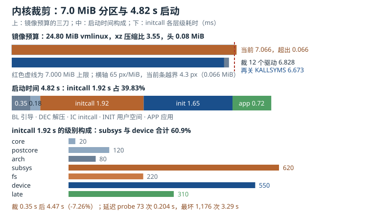

# 内核配置与裁剪：Kconfig、模块与启动时间

一块量产板的内核配置，往往是从芯片厂商的 `vendor_defconfig` 开始的。它能启动，能点亮屏幕，能认出 eMMC，于是被原样收进项目仓库。半年后，镜像从 4.1 MiB 长到 7.1 MiB，内核分区只有 7.0 MiB；启动时间从 3.2 秒涨到 4.8 秒；安全审计问“为什么打开了 47 个从未使用的文件系统”，没有人能回答。

内核配置（kernel configuration）不是“编译前的一次勾选”，而是一份**关于硬件、启动路径和攻击面的声明**。Kconfig（内核配置语言）把这些声明组织成依赖图，默认配置（defconfig）把图裁剪成一个种子，编译器再把种子变成字节。裁剪要做的，是让每一类字节都能对应到一条真实的硬件需求或启动需求；对应不上的，就是预算里的噪声。

这一章沿着“配置语言 → 裁剪证据 → 模块取舍 → 启动时间 → 镜像预算”的顺序展开。所有容量和时间都给出可复算的模型，最后落在一个 32 MiB SPI NOR、7.0 MiB 内核分区的具体板子上。

## 1. 动机：默认配置是一份“全量保险”

厂商 defconfig 的默认值不是为量产准备的，而是为“尽可能多的人能启动”准备的。芯片厂商不知道产品用哪一颗 PMIC、哪一路 MIPI、哪一片 WiFi，于是把能打开的驱动都打开；不知道客户要不要 NFS、FUSE、NFTables，于是把常见子系统都编进去；不知道客户会不会用调试工具，于是 `KALLSYMS`、`FTRACE`、`KPROBES` 一并保留。结果是一份“全量保险”：启动概率最大，体积和启动时间最差。

这份保险的代价可以分成四笔账：

1. **闪存账**。未压缩的内核镜像（`vmlinux`）每多 1 MiB，xz 压缩后的 `Image.gz` 大约多 0.28 MiB。一个 7.0 MiB 的内核分区，余量往往只有几百 KiB，几次“先打开再说”就会把余量吃光。
2. **启动账**。内建驱动在每次启动时都要走一遍初始化调用（initcall）。一个从未使用的触摸屏驱动，如果 probe 里有一次 20 ms 的复位延时，它就在每次启动时白白花掉 20 ms；十个这样的驱动就是 200 ms。
3. **攻击面账**。每一个编进内核的文件系统、协议栈、ioctl 都是一段可以被本地或远程触发的代码。未使用的代码不会因为“没挂载”就消失，它仍在内核地址空间里。
4. **维护账**。配置项越多，升级内核版本时 `make olddefconfig` 引入的新默认值越多，行为差异越难解释。一个 2,800 项的 `.config`，没有人能逐项 review。

::: motivation 一次“只改一个驱动”的返工
某网关产品要加一颗新的温湿度传感器，工程师在 `menuconfig` 里打开了 `CONFIG_SENSOR_FOO` 和它依赖的 `CONFIG_REGMAP_I2C`，本地编译、烧录、读数都正常。两周后做 OTA 时发现，新内核的 `Image.gz` 比分区上限多了 48 KiB，升级包写入备用槽时被截断，设备回滚到旧版本。

排查后发现，`CONFIG_SENSOR_FOO` 的 Kconfig 里有一行 `select REGMAP_I2C`，而 `REGMAP_I2C` 又 `depends on I2C`、`select REGMAP`，一次勾选带进来 11 个符号、约 190 KiB 未压缩代码。真正需要的新代码只有 9 KiB。返工的做法不是删掉传感器，而是把传感器改成模块，并把 `SENSOR_FOO` 对 `REGMAP_I2C` 的 `select` 改成 `depends on`，让配置者看到依赖，而不是被依赖悄悄拖进来。
:::

这个故事的教训有两条。第一，**Kconfig 的 `select` 会放大一次勾选的体积**，裁剪时必须看展开后的符号集，而不是看菜单上的一行。第二，**镜像预算必须在合并代码前检查**，而不是在 OTA 失败后倒查。

## 2. 直观：Kconfig 是依赖语言，defconfig 是种子

### 2.1 Kconfig 的常用类型

Kconfig 不是 Makefile 的宏，它有自己的类型系统和求值规则。最常用的类型有：

| 类型 | 取值 | 典型用途 | 写进 `.config` 的形式 |
|---|---|---|---|
| `bool` | `y` / `n` | 架构特性、核心子系统 | `CONFIG_X=y` 或 `# CONFIG_X is not set` |
| `tristate` | `y` / `m` / `n` | 驱动、文件系统、协议 | `CONFIG_X=y`、`CONFIG_X=m`、未设置 |
| `int` | 整数 | 缓冲区大小、超时 | `CONFIG_X=64` |
| `string` | 字符串 | 命令行、路径、版本后缀 | `CONFIG_X="..."` |
| `hex` | 十六进制 | 地址、大小 | `CONFIG_X=0x1000` |

`tristate` 的 `m` 只对“可以编成模块”的符号有意义。一个 `bool` 符号不能取 `m`；一个 `tristate` 符号只有在 `CONFIG_MODULES=y` 时才能取 `m`，否则 Kconfig 会把它降为 `y` 或 `n`。这就是为什么有些驱动在关闭模块支持后“自动变成内建”。

依赖关系有三种写法，语义完全不同：

- `depends on A`：本符号只有在 `A` 成立时才可见、才可被选中。它表达“没有 A 就没有我”。
- `select B`：本符号被选中时，强制把 `B` 设为 `y`（或 `m`，取决于 `B` 的类型和上下文）。它表达“我需要 B，替我打开”。
- `imply B`：本符号被选中时，给 `B` 一个默认值，但用户仍可关掉。它表达“建议打开”。

`select` 是最容易出问题的一个。它**绕过 `B` 的依赖检查**：如果 `B` 依赖 `C`，而 `C` 没开，`select B` 仍然会把 `B` 设为 `y`，然后在编译或链接阶段报错。Kconfig 语言文档明确建议：对用户可见的符号用 `depends on`，对不可见的、纯辅助的符号才用 `select`。裁剪时看到一个菜单项带进来一长串符号，第一件事就是查它的 `select` 链。

一个最小的 Kconfig 条目长这样：

```kconfig
config SENSOR_FOO
    tristate "Foo temperature and humidity sensor"
    depends on I2C
    select REGMAP_I2C
    help
      Say Y here to build in the Foo sensor driver.
      Say M to build it as a module.
```

对应的 `.config` 片段是：

```text
CONFIG_SENSOR_FOO=y
# CONFIG_SENSOR_BAR is not set
```

注意第二行的形式：未选中的 `bool` 不是“不存在”，而是以注释形式记录“明确关掉”。`savedefconfig` 会把这些“与默认值相同”的行删掉，只留下偏离默认值的部分。这正是 defconfig 能很小的原因。

### 2.2 defconfig 是“偏离默认值的集合”

`make vendor_defconfig` 做两件事：先按 `Kconfig` 的 `default` 求出一份完整配置，再叠加 `arch/arm64/configs/vendor_defconfig` 里的行。所以 defconfig 不是完整配置，它只是**种子**。完整配置在 `.config` 里，约 2,000 到 4,000 行；defconfig 通常只有 200 到 600 行。

这条区别带来三个常见操作：

```bash
# 1. 从当前 .config 反向生成最小 defconfig
make ARCH=arm64 CROSS_COMPILE=aarch64-linux-gnu- savedefconfig

# 2. 把新内核的默认值合并进现有配置，不交互
make ARCH=arm64 CROSS_COMPILE=aarch64-linux-gnu- olddefconfig

# 3. 看两个配置到底差在哪
scripts/diffconfig .config.old .config
```

`olddefconfig` 的语义是“对每个没有显式设置的符号取默认值”，它不会问你问题，适合 CI。`oldconfig` 会逐个询问新符号，适合人工升级。`savedefconfig` 输出的是“相对默认值的最小集合”，所以**不要手写完整 `.config` 当 defconfig 用**——那会把默认值固化，下次内核升级时新默认值进不来。

工程上推荐“defconfig + 片段（fragment）”两层结构：

```bash
# 片段只写产品差异，例如关闭调试、打开某个驱动
scripts/kconfig/merge_config.sh -m arch/arm64/configs/vendor_defconfig trim.fragment
make ARCH=arm64 CROSS_COMPILE=aarch64-linux-gnu- olddefconfig
```

Buildroot 用 `BR2_LINUX_KERNEL_CONFIG_FRAGMENT_FILES`，Yocto 用 `.cfg` 片段和 `do_kernel_configcheck`，本质相同：**基线配置跟随上游，产品差异单独可审**。片段冲突时，`merge_config.sh` 会警告“值被覆盖”，这比在一份巨大 `.config` 里猜“谁最后生效”可靠得多。

### 2.3 必选与可选：先画启动路径，再谈裁剪

判断一个选项“必选”还是“可选”，不要从菜单分类出发，而要从**启动路径**出发。问三个问题：

1. 没有它，内核能不能走到 `init`？
2. 没有它，产品的某个不可替代功能能不能工作？
3. 没有它，安全或合规要求能不能满足？

第一个问题决定“启动必选”，第二个决定“功能必选”，第三个决定“合规必选”。三类之外，才是可裁剪的候选。

| 类别 | 典型选项 | 为什么必选 | 漏掉的后果 |
|---|---|---|---|
| 架构与 SoC | `CONFIG_ARM64`、`CONFIG_ARCH_*`、`CONFIG_PINCTRL_*` | 决定指令集、内存模型、引脚复用 | 内核根本不编译或早期无串口 |
| 时钟与定时 | `CONFIG_COMMON_CLK`、`CONFIG_ARM_ARCH_TIMER` | 提供时间基准与调度节拍 | 启动卡死或时间漂移 |
| 中断 | `CONFIG_GIC`、`CONFIG_IRQCHIP` | 外设中断的路由 | 设备 probe 超时 |
| 控制台 | `CONFIG_SERIAL_*`、`CONFIG_SERIAL_EARLYCON` | 最直接的启动日志 | 出问题只能猜 |
| 根文件系统（rootfs） | `CONFIG_BLK_DEV_INITRD`、`CONFIG_EXT4_FS`、`CONFIG_SQUASHFS` | 挂载 `/` | `VFS: Cannot open root device` |
| 设备模型 | `CONFIG_DEVTMPFS`、`CONFIG_TMPFS`、`CONFIG_SYSFS`、`CONFIG_PROC_FS` | 用户空间看到设备与状态 | udev/systemd 起不来 |
| 模块 | `CONFIG_MODULES`、`CONFIG_MODULE_SIG_FORCE` | 加载外部驱动与签名校验 | 模块全部失效或无法校验 |
| 安全启动 | `CONFIG_CRYPTO_SHA256`、`CONFIG_CRYPTO_RSA`、`CONFIG_DM_VERITY` | 校验镜像与运行时完整性 | 验签链断掉 |
| 容器 | `CONFIG_NAMESPACES`、`CONFIG_CGROUPS`、`CONFIG_OVERLAY_FS` | 隔离与分层存储 | 容器运行时直接失败 |

可选项的清单则长得多：未使用的触摸屏、第二路以太网、NFS、FUSE、NFTables、蓝牙、声卡、摄像头、调试用的 `KPROBES` / `FTRACE` / `BPF_SYSCALL`。它们不是“坏东西”，只是**没有证据表明这台设备需要**。

裁剪的判定方法，是把“证据”按可信度排序：

1. **原理图与 BOM**：板上有没有这颗芯片、这路接口。这是最强的证据。
2. **设备树**：最终烧录的 DTB 里有没有对应的 `compatible` 节点。设备树是“内核会去匹配的硬件清单”，比原理图更接近运行时。
3. **运行时**：`/proc/modules`、`lsmod`、`dmesg` 里是否真的 probe 成功；`/sys/bus/*/devices` 是否有实例。
4. **启动 trace**：`initcall_debug` 里每个 initcall 的耗时，决定“留着它要花多少毫秒”。
5. **体积归因**：`nm --size-sort`、`bloat-o-meter`、`size -A` 决定“删掉它能省多少字节”。

没有第 1、2 条证据的选项，只能算“可能有用的猜测”；没有第 3、4 条证据的选项，无法判断收益。**裁剪不是把菜单关小，而是把每条证据变成一行配置。**

### 2.4 模块 vs 内建：不是“越小越好”，而是“谁承担启动成本”

`tristate` 给了一个中间态：`m`。模块（module，`.ko`）不进入内核镜像，放在 rootfs 里，需要时由 `modprobe` 加载。它和内建的差别不只是“在哪个文件里”：

| 维度 | 内建 `y` | 模块 `m` |
|---|---|---|
| 存放位置 | `vmlinux` / `Image.gz` | rootfs 的 `/lib/modules/<ver>/` |
| 启动成本 | 每次启动都执行 initcall | 只在加载时执行 `module_init` |
| 存储成本 | 压缩进内核镜像，共享压缩比 | 单独压缩，通常 xz/zstd，另有 `modules.dep` 元数据 |
| 依赖解析 | 链接期解决，缺符号直接编译失败 | 运行期 `modprobe` 解析，缺依赖加载失败 |
| 可替换性 | 换驱动必须换内核 | 可以单独替换 `.ko`（需签名策略允许） |
| 安全 | 攻击面常驻内核 | 不加载就不在内核里 |
| 调试 | `initcall_debug` 可见 | 加载时机由用户空间决定 |

决策规则可以压缩成四句话：

- **启动路径上的**（存储、控制台、根文件系统、PMIC、时钟）→ `y`。
- **可能不存在的外设**（USB 摄像头、蓝牙、第二路网卡）→ `m`。
- **确定不存在的** → `n`，并写进裁剪记录。
- **安全敏感的**（dm-verity、签名校验、LSM）→ `y`，且不要给用户空间卸载的机会。

一个常见的误区是“模块一定省空间”。模块本身也要存进 rootfs，压缩后未必比内建小；它省的是**内核镜像的连续预算**，不是总存储。更隐蔽的是模块的元数据成本：每个 `.ko` 都有 ELF 头、符号表、`modinfo`、依赖描述，1,000 个小模块的元数据可以到几 MiB。对 32 MiB SPI NOR 这种“每 KiB 都要算”的平台，模块化常常是**用 rootfs 的空间换内核分区的余量**，不是净节省。

模块还有两个启动期成本。第一，`modprobe` 要读 `modules.dep`、解析依赖、做签名校验，冷启动时每批模块几十毫秒。第二，如果模块在 initramfs 里就要用，它必须打进 initramfs，等于把“模块的存储成本”又搬回启动镜像。**把启动必需的驱动做成模块，通常是最差的组合**：既没有省掉内核空间的链接，又增加了 initramfs 的体积和加载延迟。

### 2.5 启动时间：初始化调用（initcall）的顺序与收敛

内核启动到用户空间，时间可以拆成六段：

$$T_{\mathrm{boot}}=T_{\mathrm{rom}}+T_{\mathrm{bl}}+T_{\mathrm{dec}}+T_{\mathrm{ic}}+T_{\mathrm{init}}+T_{\mathrm{app}}$$

其中 $T_{\mathrm{rom}}$ 是 ROM Code 与一级引导，$T_{\mathrm{bl}}$ 是 U-Boot 等二级引导，$T_{\mathrm{dec}}$ 是内核解压与重定位，$T_{\mathrm{ic}}$ 是所有 initcall 的总耗时，$T_{\mathrm{init}}$ 是用户空间 init 到关键服务就绪，$T_{\mathrm{app}}$ 是应用自身初始化。裁剪能直接影响的是 $T_{\mathrm{dec}}$ 和 $T_{\mathrm{ic}}$：镜像越小，解压越短；内建驱动越少，initcall 越短。

initcall 按“级别”执行，级别由链接段决定，顺序固定：

| 级别 | 名称 | 典型内容 |
|---|---|---|
| 0 | `early_initcall` | 极早期、依赖已手工初始化 |
| 1 | `core_initcall` | 核心子系统 |
| 2 | `postcore_initcall` | 总线、平台设备 |
| 3 | `arch_initcall` | 架构相关 |
| 4 | `subsys_initcall` | 子系统注册 |
| 5 | `fs_initcall` | 文件系统 |
| 6 | `device_initcall` | 绝大多数驱动；`module_init` 默认落到这里 |
| 7 | `late_initcall` | 依赖前面全部完成的工作 |

同一级别内，执行顺序由链接顺序决定，而链接顺序又由 `Makefile` 中目标文件的排列和 `built-in.a` 的归档顺序决定。这带来一个反直觉的结论：**在同一个级别里，驱动的 probe 顺序不是设备树顺序，而是链接顺序**。如果驱动 A 的 probe 依赖驱动 B 先注册，而 A 在链接顺序上排在 B 前面，A 就会拿到 `-EPROBE_DEFER`，进入延迟 probe 队列。

延迟 probe（deferred probe）的收敛过程值得单独建模。设初始有 $n$ 个设备处于 pending 状态，每轮重试尝试所有 pending 设备；最坏情况下每轮只有一个设备的依赖被满足，于是总尝试次数为

$$N_{\mathrm{probe}}=\frac{n(n+1)}{2}$$

若单次 probe 平均耗时 $c$，则最坏情况下的延迟 probe 总时间为

$$T_{\mathrm{dp}}=c\,N_{\mathrm{probe}}$$

$n=48$、$c=2.8\ \mathrm{ms}$ 时，$N_{\mathrm{probe}}=1{,}176$，$T_{\mathrm{dp}}=3.29\ \mathrm{s}$。这个数字比很多板子的整个 initcall 预算还大。它当然是病态上界，但它说明了一件事：**延迟 probe 不是“免费的异步”，它会把启动时间变成依赖图的函数**。实际收敛通常是 3 轮：第一轮 48 个、第二轮 19 个、第三轮 6 个，共 73 次尝试，约 0.204 s。差别来自“依赖是否成链”：链越长，轮数越多。

收敛的工程手段有四条：

1. **供应商先注册**：时钟、regulator、pinctrl、GPIO 控制器必须比消费者早。用 `fw_devlink` 让内核根据设备树 phandle 自动建立 device link，消费者会被推迟到供应商 probe 之后，而不是盲目重试。
2. **减少环**：A 等 B 的 GPIO、B 等 A 的时钟，就是死锁。设备树里把“谁提供什么”画出来，环上的一个边必须改成 late init 或用户空间加载。
3. **把非关键 probe 移出启动路径**：屏幕背光、音频 codec、第二个网口可以 `late_initcall` 或模块，只要业务启动不依赖它们。
4. **用证据收敛**：`initcall_debug` 给出每个 initcall 的耗时，`ftrace` 的 `function_graph` 给出内部调用树；先修最长的 10 个，再谈微优化。

`initcall_debug` 的输出形如：

```text
initcall 0xffff8000809a1b40 returned 0 after 12456 usecs
```

打开方式是把 `initcall_debug` 加到内核命令行，然后用 `dmesg` 过滤。`scripts/bootgraph.pl` 可以把 dmesg 转成时间轴 SVG：

```bash
dmesg > boot.log
perl scripts/bootgraph.pl boot.log > boot.svg
```

需要提醒的是，`initcall_debug` 本身会增加开销（每个 initcall 前后读时间戳、打印日志），所以它给出的绝对值偏大，但**相对排序仍然有效**。真正的绝对值要用关闭日志后的 `ftrace` 或 GPIO 翻转加示波器测量。

### 2.6 镜像大小预算：先定容器，再装内容



图中上半部分是 7.0 MiB 内核分区的三刀：当前 7.066 MiB 越界，裁掉 12 个未使用驱动后 6.828 MiB，再关掉 `KALLSYMS` 后 6.673 MiB。中间是 4.82 s 启动时间的构成，initcall 占 39.83%。下半部分是 initcall 各级别的毫秒数，`subsys` 与 `device` 两级合计 1,170 ms，是裁剪的主要目标。

镜像大小预算的第一步不是“算内核多大”，而是“算分区能有多大”。设第 $i$ 个分区大小为 $s_i$，闪存总容量为 $S_{\mathrm{flash}}$，分区表与对齐保留为 $S_{\mathrm{tab}}$，则

$$\sum_i s_i+S_{\mathrm{tab}}\leq S_{\mathrm{flash}}$$

内核镜像本身还要满足

$$S_{\mathrm{img}}\leq S_{\mathrm{part}}-S_{\mathrm{guard}}$$

其中 $S_{\mathrm{guard}}$ 是给压缩比波动、对齐填充、未来补丁留的余量。工程上 $S_{\mathrm{guard}}$ 取分区大小的 3% 到 5%，小于 2% 的余量在下次改配置时几乎必然被击穿。

压缩后的内核大小近似为

$$S_{\mathrm{img}}=\frac{S_{\mathrm{raw}}}{r}+h+p$$

其中 $S_{\mathrm{raw}}$ 是 `vmlinux` 的未压缩大小，$r$ 是压缩比，$h$ 是自解压头与架构相关头，$p$ 是对齐填充。$r$ 取决于压缩算法与内容：gzip 在 ARM64 内核上通常 2.8 到 3.1，zstd 3.1 到 3.4，xz 3.4 到 3.7。**压缩算法不是“越强越好”**：xz 解压慢，会拉长 $T_{\mathrm{dec}}$；zstd 在解压速度和压缩率之间更平衡，是很多量产设备的默认选择。

一个 32 MiB SPI NOR 的预算表可以写成：

| 区域 | 大小 MiB | 当前占用 | 说明 |
|---|---|---|---|
| 引导加载器（bootloader，SPL + U-Boot） | 1.000 | 0.82 | 含环境变量备份 |
| env | 0.125 | 0.06 | 双份 U-Boot 环境 |
| kernel（Image.gz） | 7.000 | 6.673 | 裁剪后的目标 |
| DTB | 0.125 | 0.09 | 单板 DTB |
| rootfs（squashfs） | 12.000 | 10.80 | 只读根文件系统 |
| overlay | 2.000 | 0.40 | 可写覆盖层 |
| data | 4.000 | 1.20 | 配置与日志 |
| 预留 | 5.750 | 0.00 | 未来功能与坏块 |
| 合计 | 32.000 | — | 分区表必须严格相等 |

这张表的关键不是数字，而是**每一行都有负责人和复算方式**。内核行的 6.673 MiB 来自下一节的裁剪算例；rootfs 行的 10.80 MiB 来自 `du -sm` 加压缩比；预留行的 5.750 MiB 是“不许动”的安全垫。预算表一旦进入 CI，任何一次配置变更都会在合并前暴露超出，而不是在 OTA 现场暴露。

## 3. 定量关系：字节、毫秒与收益

### 3.1 从 Kconfig 符号到镜像字节

一个内核符号对镜像的贡献，可以拆成四部分：

$$S_{\mathrm{raw}}=\sum_{j\in\mathrm{text}} s_j+\sum_{j\in\mathrm{data}} s_j+\sum_{j\in\mathrm{rodata}} s_j+\sum_{j\in\mathrm{init}} s_j$$

其中 `text` 是可执行代码，`data` 是可写数据，`rodata` 是只读常量，`init` 是 `.init.text` 与 `.init.data`（启动后释放，但仍占镜像）。裁剪一个驱动，通常同时减少 text、data、rodata 和 init 四段；只减少 `.init` 的选项对运行时内存有帮助，对镜像压缩后的体积帮助较小。

压缩后的边际成本是

$$\Delta S_{\mathrm{img}}=\frac{\Delta S_{\mathrm{raw}}}{r}$$

$r=3.55$ 时，未压缩 1 MiB 的代码只增加约 0.282 MiB 镜像。反过来，要省 0.1 MiB 镜像，需要裁掉约 0.355 MiB 未压缩代码。这个换算关系是裁剪讨论的“汇率”：**菜单上看起来很大的一个子系统，压缩后可能只有几百 KiB；一个不起眼的调试选项，可能因为字符串表而占到同样多**。

### 3.2 initcall 时间模型

设第 $\ell$ 级 initcall 的总耗时为 $t_\ell$，则

$$T_{\mathrm{ic}}=\sum_{\ell=0}^{7}t_\ell$$

initcall 占整个启动时间的比例为

$$\eta_{\mathrm{ic}}=\frac{T_{\mathrm{ic}}}{T_{\mathrm{boot}}}$$

裁掉某个内建驱动后，启动时间的变化近似为

$$\Delta T_{\mathrm{boot}}\approx\Delta T_{\mathrm{ic}}+\Delta T_{\mathrm{dec}}$$

其中 $\Delta T_{\mathrm{dec}}$ 来自镜像变小后的解压时间，通常只占 $\Delta T_{\mathrm{ic}}$ 的 5% 到 15%。所以“裁驱动”的主要收益是 initcall，不是解压。

延迟 probe 的收敛时间已经在上一节给出。把两个模型合起来，可以得到“启动时间预算”：

$$T_{\mathrm{boot}}\leq T_{\mathrm{target}}$$

$$T_{\mathrm{ic}}\leq T_{\mathrm{target}}-T_{\mathrm{rom}}-T_{\mathrm{bl}}-T_{\mathrm{dec}}-T_{\mathrm{init}}-T_{\mathrm{app}}$$

这个不等式右侧通常只剩几百毫秒。**启动时间优化不是“让每个 initcall 都快”，而是“让总和落在预算内”**；一个 80 ms 的驱动，如果不在启动路径上，做成模块比把它优化到 40 ms 更有效。

### 3.3 裁剪的收益与代价

设裁掉一个选项节省的镜像为 $\Delta S$，节省的启动时间为 $\Delta T$，则单位镜像换来的启动收益为

$$R=\frac{\Delta T}{\Delta S}$$

$R$ 越大，越值得裁。工程上可以把候选选项排成一张表：

| 选项 | 未压缩节省 MiB | 压缩后节省 MiB | 启动节省 ms | $R$（ms/MiB） |
|---|---|---|---|---|
| 未使用触摸屏驱动 | 0.42 | 0.118 | 38 | 322 |
| 第二路以太网 | 0.31 | 0.087 | 24 | 276 |
| `KALLSYMS` | 0.55 | 0.155 | 0 | 0 |
| 未使用文件系统（4 个） | 0.45 | 0.127 | 6 | 47 |
| 调试 trace 选项 | 0.38 | 0.107 | 0 | 0 |

这张表说明：**启动收益和体积收益不是同一件事**。`KALLSYMS` 和 trace 选项能省体积，但对启动几乎无贡献；触摸屏驱动两项都贡献，是最优裁剪对象。裁剪顺序应该先做“双高”，再做“只省体积”，最后才考虑“只省启动”（通常是把内建改模块）。

### 3.4 模块化的总成本

把一组驱动从内建改为模块，总存储成本为

$$S_{\mathrm{mod,total}}=S_{\mathrm{kernel}}+S_{\mathrm{rootfs}}+S_{\mathrm{mod}}$$

其中 $S_{\mathrm{kernel}}$ 是缩小后的内核镜像，$S_{\mathrm{rootfs}}$ 是原有 rootfs，$S_{\mathrm{mod}}$ 是模块及其元数据压缩后的大小。与内建方案比较：

$$\Delta S=S_{\mathrm{mod,total}}-S_{\mathrm{builtin,total}}$$

$\Delta S>0$ 表示模块化更占存储，$\Delta S<0$ 表示更省。很多团队只比较 $S_{\mathrm{kernel}}$，忽略了 $S_{\mathrm{mod}}$，于是得出“模块一定省”的错误结论。

模块化的启动成本则是

$$T_{\mathrm{mod}}=T_{\mathrm{load}}+T_{\mathrm{verify}}+T_{\mathrm{probe}}$$

其中 $T_{\mathrm{load}}$ 是读 `.ko` 与解压，$T_{\mathrm{verify}}$ 是签名校验，$T_{\mathrm{probe}}$ 是驱动 probe。对启动路径上的驱动，这三项都要算进预算；对按需加载的外设，它们不占启动时间。

## 4. 算例：24.8 MiB 的 vmlinux 塞进 7.0 MiB 分区

### 4.1 现状：差 0.066 MiB

某板子的 `vmlinux` 未压缩 24.80 MiB，xz 压缩比 3.55，自解压头 0.08 MiB，内核分区 7.00 MiB。压缩后：

$$S_{\mathrm{img}}=\frac{24.80}{3.55}+0.08=6.986+0.080=7.066\ \mathrm{MiB}$$

超出分区 $7.066-7.000=0.066\ \mathrm{MiB}$，约 67.6 KiB。这个数字很小，但足以让 `genimage` 报错，或者让 OTA 写入时截断。此时有三条路：扩大分区、换压缩算法、裁代码。扩大分区要动整个布局；换算法会改变压缩率与解压时间（例如 xz→zstd 解压更快，但压缩率更低），未必能省出这 0.066 MiB；先看裁代码。

### 4.2 第一刀：12 个未使用驱动

从设备树和 BOM 对照，确认 12 个驱动对应的硬件不存在。每个驱动平均 72 KiB 未压缩代码（text + data + rodata），合计

$$\Delta S_{\mathrm{raw}}=12\times72\ \mathrm{KiB}=864\ \mathrm{KiB}=0.844\ \mathrm{MiB}$$

裁剪后未压缩 23.956 MiB，压缩后：

$$S_{\mathrm{img}}=\frac{23.956}{3.55}+0.08=6.748+0.080=6.828\ \mathrm{MiB}$$

余量 $7.000-6.828=0.172\ \mathrm{MiB}$，占用率 97.55%。余量仍然不到 3%，下一次加功能就会再次击穿。按 3% 的安全垫（0.21 MiB），还差 0.038 MiB。

### 4.3 第二刀：关闭 `KALLSYMS`

`KALLSYMS` 把内核符号表编进镜像，供 oops 解析和 `kallsyms_lookup_name` 使用，未压缩约 0.55 MiB。关闭后：

$$S_{\mathrm{img}}=\frac{23.956-0.550}{3.55}+0.08=\frac{23.406}{3.55}+0.08=6.593+0.080=6.673\ \mathrm{MiB}$$

余量 $7.000-6.673=0.327\ \mathrm{MiB}$，占用率 95.33%，达到 4.7% 的安全垫。代价是 oops 里只有地址没有符号；解决办法是保留 `vmlinux` 与 `System.map` 归档，用 `addr2line` 或 `scripts/faddr2line` 还原。对量产设备，这是可接受的交换；对开发板，建议保留 `KALLSYMS`，用更大的调试分区。

压缩比对结果很敏感。若 xz 的实际压缩比只有 3.40：

$$S_{\mathrm{img}}=\frac{23.406}{3.40}+0.08=6.884+0.080=6.964\ \mathrm{MiB}$$

余量只剩 0.036 MiB，几乎贴边。

若换 zstd，其压缩比区间是 3.1 到 3.4，整体低于 xz 的 3.4 到 3.7。按区间上端 3.40 算：

$$S_{\mathrm{img}}=\frac{23.406}{3.40}+0.08=6.964\ \mathrm{MiB}$$

与 xz 的最差情况持平，仍比 3.55 基线的 6.673 MiB 大 0.291 MiB，并没有更小。按 3.30 算：

$$S_{\mathrm{img}}=\frac{23.406}{3.30}+0.08=7.093+0.080=7.173\ \mathrm{MiB}$$

超出分区 0.173 MiB。按下端 3.10 算：

$$S_{\mathrm{img}}=\frac{23.406}{3.10}+0.08=7.550+0.080=7.630\ \mathrm{MiB}$$

超出 0.630 MiB。**“换 zstd 省 0.27 MiB”不成立**：在 3.4 时它最多与 xz 的最差情况打平，压缩比再低就直接越界。zstd 的优势是解压比 xz 快、能缩短 $T_{\mathrm{dec}}$，不是压缩率更高；要不要换取决于启动时间预算和实测压缩比。无论选哪种，预算都必须按最差压缩比算，而不是按最好的一次构建算。这就是 $S_{\mathrm{guard}}$ 存在的原因。

### 4.4 模块化对比：省内核不等于省总存储

假设把上述 12 个、合计 0.844 MiB 的未压缩驱动改成模块，模块压缩后 1.60 MiB，rootfs 当前 10.80 MiB、分区 12.00 MiB。改成模块后：

$$S_{\mathrm{kernel}}=\frac{23.956-0.844}{3.55}+0.08=\frac{23.112}{3.55}+0.08=6.510+0.080=6.590\ \mathrm{MiB}$$

内核余量变成 $7.000-6.590=0.410\ \mathrm{MiB}$，看起来比内建的 0.172 MiB 宽裕了一些；但 rootfs 变成

$$S_{\mathrm{rootfs}}=10.80+1.60=12.40\ \mathrm{MiB}$$

超出 12.00 MiB 分区 0.40 MiB，直接导致镜像构建失败。总存储：

$$S_{\mathrm{builtin}}=6.828+10.80=17.628\ \mathrm{MiB}$$

$$S_{\mathrm{mod}}=6.590+12.40=18.990\ \mathrm{MiB}$$

模块化反而多占 1.362 MiB。结论很明确：**在这块板子上，这批驱动应该内建，而不是模块化**。模块化适合“启动时不需要、可以按需加载”的外设；对启动路径上的存储、网络、显示驱动，内建更省总存储，也更少启动不确定性。

### 4.5 启动时间：4.82 s 的归因

这块板子的启动时间是 4.82 s，分解如下：

| 阶段 | 耗时 s | 占比 |
|---|---|---|
| ROM + SPL | 0.35 | 7.26% |
| 内核解压 | 0.18 | 3.73% |
| initcall | 1.92 | 39.83% |
| 用户空间 init | 1.65 | 34.23% |
| 应用就绪 | 0.72 | 14.94% |
| 合计 | 4.82 | 100.00% |

initcall 的 1.92 s 又按级别分解为：

| 级别 | 耗时 ms | 占 initcall |
|---|---|---|
| core | 20 | 1.0% |
| postcore | 120 | 6.2% |
| arch | 80 | 4.2% |
| subsys | 620 | 32.3% |
| fs | 220 | 11.5% |
| device | 550 | 28.6% |
| late | 310 | 16.1% |
| 合计 | 1,920 | 100.0% |

`subsys` 和 `device` 两级合计 1,170 ms，占 initcall 的 60.9%。如果把 12 个未使用驱动和 3 个非关键外设裁掉，initcall 缩短 0.35 s，则：

$$T_{\mathrm{ic}}'=1.92-0.35=1.57\ \mathrm{s}$$

$$T_{\mathrm{boot}}'=4.82-0.35=4.47\ \mathrm{s}$$

initcall 自身的降幅为 $0.35/1.92=18.23\%$，整机启动降幅为 $0.35/4.82=7.26\%$，启动速度提升为 $4.82/4.47=1.078$ 倍。**7.26% 看起来不多，但它是在不换硬件、不改用户空间的前提下拿到的**；而且同一轮裁剪把镜像余量从 0 拉到 0.327 MiB，其中 0.155 MiB 来自关闭 `KALLSYMS`。

延迟 probe 的实际收敛是 73 次尝试、0.204 s；如果依赖链退化成最坏的 1,176 次，时间会变成 3.29 s，直接吃掉全部优化收益。所以裁剪和收敛必须一起做：**删掉不用的驱动，同时把留下的依赖图拉直**。

## 5. 工程含义：把配置当成代码来管理

### 5.1 一条可重复的裁剪流程

裁剪不是一次性的“菜单大扫除”，而是一条可以重复的流水线：

1. **冻结基线**：把当前 `.config`、`vmlinux`、`Image.gz`、`System.map`、`dtb` 归档，记录 SHA-256。
2. **建立证据表**：从 BOM、DTB、`dmesg`、`/proc/modules` 生成“硬件—驱动—选项”三方对照表。
3. **按收益排序**：用 `nm --size-sort` 和 `initcall_debug` 填出上一节的 $R$ 表，先裁双高项。
4. **一次只改一组**：每次只动一组相关选项，重新构建、测量、记录差值。一次改 200 项，出问题无法归因。
5. **过预算门禁**：CI 里比较 `Image.gz` 大小与分区上限，超出即失败；同时比较 `initcall` 总耗时，回退超过 5% 即告警。
6. **写裁剪记录**：每个被关闭的选项写明“为什么不需要、什么条件下重新打开”，放进仓库，而不是留在工程师的脑子里。

第 6 步最容易被省略，也最贵。半年后有人要加回 WiFi，看到 `CONFIG_CFG80211 is not set`，不知道是“板子没有 WiFi”还是“当时为了省 80 KiB 临时关的”，只能重新试。**裁剪记录是配置的一部分**，它让“关掉”成为一个有依据的决策，而不是一个谜。

### 5.2 配置分层：基线、SoC、产品、调试

一个可维护的配置结构通常有四层：

- **基线层**：内核版本对应的 `defconfig`，跟随上游升级。
- **SoC 层**：`arch/arm64/configs/<soc>_defconfig`，描述 SoC 必选项。
- **产品层**：`<product>.fragment`，描述板级外设、分区、安全策略。
- **调试层**：`debug.fragment`，只在开发镜像里合并，量产镜像不包含。

合并顺序是“基线 → SoC → 产品 → 调试”，后者覆盖前者。每一层都可以单独 review、单独测试。Buildroot 和 Yocto 都支持这种片段机制；即使不用构建系统，`merge_config.sh` 也能做同样的事。

需要小心的是**片段的“删除”语义**。Kconfig 片段里写 `# CONFIG_X is not set` 是“关掉”，写 `CONFIG_X=n` 在部分工具里不会被识别；`merge_config.sh` 对两者的处理不同。最稳妥的做法是用 `scripts/config --disable CONFIG_X` 生成片段，再人工检查合并后的 `.config`。

### 5.3 安全：裁剪是减少攻击面，不是关闭防护

裁剪和安全经常被混为一谈。裁掉未使用的驱动确实减少攻击面，但**不能靠裁剪替代防护**。量产配置至少应确认：

- `CONFIG_STRICT_KERNEL_RWX=y`：内核 text/rodata 不可写。
- `CONFIG_STRICT_MODULE_RWX=y`：模块 text/rodata 不可写。
- `CONFIG_RANDOMIZE_BASE=y`：KASLR，增加 ROP 难度。
- `CONFIG_STACKPROTECTOR_STRONG=y`：栈溢出检测。
- `CONFIG_FORTIFY_SOURCE=y`：常用字符串函数边界检查。
- `CONFIG_INIT_ON_ALLOC_DEFAULT_ON=y`：堆分配清零，减少信息泄漏。
- `CONFIG_MODULE_SIG_FORCE=y`：只加载签名模块；密钥在构建时锁定。

这些选项会增加少量体积和运行开销，但它们是“默认应该开”的安全基线。反过来，`CONFIG_DEBUG_KERNEL`、`CONFIG_KPROBES`、`CONFIG_FTRACE`、`CONFIG_BPF_SYSCALL` 这些调试与可观测性选项，在量产镜像里应按需关闭；它们不是漏洞，但会扩大可被利用的接口。

裁剪与安全的正确关系是：**先关掉不需要的代码，再打开需要的防护，最后用签名和运行时校验兜底**。顺序反了，就会出现“关掉了 dm-verity 以省 200 KiB”的荒唐决策。

### 5.4 启动时间优化的优先级

启动时间优化有一条经验顺序，按投入产出比排列：

1. **测量**：先有 `initcall_debug` / `ftrace` / GPIO 翻转的基线，否则不知道 4.82 s 花在哪。
2. **删除**：把不存在的硬件驱动关掉，把非关键驱动改模块。收益最大，风险最低。
3. **推迟**：把不阻塞业务的外设放到 `late_initcall`、工作队列或用户空间加载。
4. **并行**：对独立的外设使用 `async_schedule` 或并行 probe；注意并发带来的锁竞争和 probe 顺序问题。
5. **收敛**：修 deferred probe 的依赖链，减少轮数；用 `fw_devlink` 替代盲目重试。
6. **微优化**：减少 `mdelay`、合并寄存器访问、改用 `read_poll_timeout`。这一层收益最小，最容易引入时序 bug。

很多团队直接从第 6 步开始，因为他“看到了一个 20 ms 的延时”。正确做法是先做第 2、3 步，把 20 ms 的驱动移出启动路径，而不是在启动路径上省 10 ms。

### 5.5 可复现：配置也是构建输入

内核镜像的可复现性，取决于配置、工具链、源码、构建环境四类输入。配置侧最常见的破坏因素是：

- `CONFIG_LOCALVERSION_AUTO=y`：把 git 提交号写进版本字符串，每次提交都变。
- `CONFIG_IKCONFIG=y`：把 `.config` 编进镜像，配置变则镜像变（这通常是想要的，但要记录）。
- `KBUILD_BUILD_TIMESTAMP` 未固定：`uname -v` 里的构建时间每次不同。
- `KBUILD_BUILD_USER` / `KBUILD_BUILD_HOST` 未固定：编译主机信息进入 `linux_banner`。

修法是显式设置：

```bash
export KBUILD_BUILD_TIMESTAMP="2026-01-01 00:00:00 UTC"
export KBUILD_BUILD_USER="builder"
export KBUILD_BUILD_HOST="ci"
export SOURCE_DATE_EPOCH=1767225600
```

`SOURCE_DATE_EPOCH` 的秒数要与 `KBUILD_BUILD_TIMESTAMP` 一致，否则不同工具读到不同的“构建时间”。验收方式仍然是两次独立构建比对 `Image.gz` 的 SHA-256；不一致时用 `diffoscope` 或 `cmp -l` 定位到具体段落。

## 6. 常见坑

::: pitfall 坑一：改了 defconfig，构建出来的还是旧配置
**现象**：在 `arch/arm64/configs/vendor_defconfig` 里加了 `CONFIG_SENSOR_FOO=y`，`make vendor_defconfig` 后 `grep` `.config` 却是 `# CONFIG_SENSOR_FOO is not set`；删掉 `output/` 重新构建仍然如此。

**原因**：`vendor_defconfig` 里的符号被 Kconfig 的依赖挡住了。`SENSOR_FOO` 依赖 `I2C`，而基线配置里 `CONFIG_I2C` 没开；Kconfig 在读取 defconfig 时发现依赖不满足，直接把该符号丢弃，且默认不报错。另一种原因是构建系统用了缓存的 `.config`，`make` 没有重新跑 `olddefconfig`。

**解决**：先 `make vendor_defconfig`，再 `make olddefconfig` 看是否有警告；用 `scripts/config --state CONFIG_I2C` 确认依赖；在 defconfig 里同时打开依赖项，或把 `depends on I2C` 改成 `depends on I2C || COMPILE_TEST`（仅编译测试用）。构建脚本里加一步 `grep -q '^CONFIG_SENSOR_FOO=y' .config || exit 1`，让配置丢失在构建前暴露。
:::

::: pitfall 坑二：`select` 把依赖绕过去，链接时才报错
**现象**：打开一个驱动后，编译报 `undefined reference to clk_get` 或 `implicit declaration of regmap_write`；`menuconfig` 里依赖项看起来都是灰的，无法手动打开。

**原因**：驱动的 Kconfig 用 `select REGMAP_I2C`，但 `REGMAP_I2C` 又依赖 `I2C`；`select` 强制把 `REGMAP_I2C` 设为 `y`，却没有把 `I2C` 设为 `y`，于是 `REGMAP_I2C` 在依赖不满足的情况下被编译，符号缺失。Kconfig 对这种“select 与依赖冲突”只给 warning，不阻止构建。

**解决**：把用户可见符号的 `select` 改成 `depends on`，让依赖在菜单里显式可见；对确实需要强制打开的辅助符号，在 Kconfig 里补 `depends on` 或 `select` 的完整闭包。用 `scripts/kconfig/conf --olddefconfig Kconfig` 查看 warning，把 warning 当 error 处理。
:::

::: pitfall 坑三：裁掉一个文件系统，设备挂在 `VFS: Cannot open root device`
**现象**：内核编译成功、烧录成功，启动日志停在 `VFS: Cannot open root device "PARTLABEL=rootfs"`，或者 `squashfs: ... failed to read`；换回旧内核就正常。

**原因**：裁剪时按“菜单里看起来没用”关掉了 `CONFIG_SQUASHFS` 或 `CONFIG_EXT4_FS`，但 rootfs 正是 squashfs；或者关掉了 `CONFIG_BLK_DEV_INITRD`，而启动依赖 initramfs 里的驱动。另一种原因是把存储驱动改成了模块，但模块在 initramfs 里没有打包。

**解决**：把“根文件系统类型、存储控制器、initramfs 解压”列为不可裁项，写进配置规范；裁剪后用 `extract-ikconfig` 或 `/proc/config.gz` 核对最终配置；在 CI 里用 QEMU 或板子跑一次“从分区挂载 rootfs”的冒烟测试，而不是只检查编译通过。
:::

::: pitfall 坑四：initcall 优化后，deferred probe 反而更慢
**现象**：把一批驱动改成模块、把另一些改成 `late_initcall` 后，启动时间没有下降，`dmesg` 里出现大量 `deferred probe pending`，某些外设要等到用户空间才可用。

**原因**：驱动之间的依赖没有随加载顺序调整。消费者在供应商之前 probe，拿到 `-EPROBE_DEFER`；每轮重试都遍历所有 pending 设备，依赖链越长，轮数越多。把供应商也改成模块后，模块加载顺序由 `modules.dep` 决定，可能比原来的链接顺序更差。

**解决**：用 `fw_devlink` 让设备树 phandle 自动建立依赖；检查 `dmesg | grep deferred` 的 pending 列表，找出没有供应商的设备；对启动关键供应商保持内建且早注册；把非关键消费者移到用户空间加载。修改后用 `initcall_debug` 复测总时长和轮数，而不是只看单个驱动的 probe 时间。
:::

::: pitfall 坑五：镜像刚好卡满分区，下一次构建就失败
**现象**：当前 `Image.gz` 6.99 MiB，分区 7.00 MiB，构建通过；改了一行配置后变成 7.02 MiB，`genimage` 报 `image too large`，但代码改动看起来无关紧要。

**原因**：没有预留压缩比波动和对齐填充的余量；压缩比会随代码内容变化，新增字符串、调试信息、函数对齐都可能让压缩后体积跳变。另一个原因是构建脚本只比较了 `vmlinux` 大小，没有比较最终 `Image.gz`。

**解决**：预算按最差压缩比计算，保留 3% 到 5% 的 `S_guard`；CI 直接 `stat -c %s arch/arm64/boot/Image.gz` 与分区字节数比较；把“镜像大小”作为 PR 的必过检查，超出时要求同时提交裁剪方案或分区调整方案。
:::

## 7. 自测题

<details><summary>题一：Kconfig 的 `bool`、`tristate`、`depends on`、`select` 分别在表达什么？为什么说 `select` 容易制造“看不见的依赖”？</summary>

`bool` 只有 `y/n` 两个值，用于不可编成模块的核心特性；`tristate` 有 `y/m/n`，`m` 表示编成模块，但只有在 `CONFIG_MODULES=y` 时才有意义。

`depends on A` 表示“本符号只在 A 成立时可见、可选”，它把依赖暴露给配置者；`select B` 表示“本符号被选中时强制把 B 设为 y”，它绕过 B 的依赖检查，替配置者做决定。

`select` 的问题在于：它只保证 B 被选中，不保证 B 的依赖 C 被选中。如果 B 依赖 C，而 C 没开，B 会在依赖不满足的情况下被编译，错误推迟到编译或链接阶段。并且 `select` 链会放大一次勾选的体积：选中一个驱动可能带进 regmap、i2c、gpio、reset 等一长串辅助符号。正确做法是：用户可见符号用 `depends on`，不可见的纯辅助符号才用 `select`，并保证 select 的闭包完整。
</details>

<details><summary>题二：`vmlinux` 24.80 MiB，xz 压缩比 3.55，头 0.08 MiB，内核分区 7.00 MiB。先裁掉 12 个驱动、每个 72 KiB，再关掉 0.55 MiB 的 `KALLSYMS`，分别算压缩后大小与余量。</summary>

初始：

$$S=\frac{24.80}{3.55}+0.08=6.986+0.080=7.066\ \mathrm{MiB}$$

超出 0.066 MiB。

裁掉 12 个驱动：

$$\Delta S_{\mathrm{raw}}=12\times72\ \mathrm{KiB}=864\ \mathrm{KiB}=0.844\ \mathrm{MiB}$$

$$S=\frac{24.80-0.844}{3.55}+0.08=\frac{23.956}{3.55}+0.08=6.748+0.080=6.828\ \mathrm{MiB}$$

余量 0.172 MiB，占用率 97.55%。

再关 `KALLSYMS`：

$$S=\frac{23.956-0.550}{3.55}+0.08=\frac{23.406}{3.55}+0.08=6.593+0.080=6.673\ \mathrm{MiB}$$

余量 0.327 MiB，占用率 95.33%。

注意压缩比若降到 3.40，同样内容变成 6.964 MiB，余量只剩 0.036 MiB。所以预算要按最差压缩比算，不能按某一次构建的最好结果算。
</details>

<details><summary>题三：启动 4.82 s，其中 initcall 1.92 s；initcall 各级为 core 20 ms、postcore 120 ms、arch 80 ms、subsys 620 ms、fs 220 ms、device 550 ms、late 310 ms。求 initcall 占比、两级最大项占比；裁掉 0.35 s 后整机启动降幅是多少？</summary>

initcall 占比：

$$\eta_{\mathrm{ic}}=\frac{1.92}{4.82}=0.3983=39.83\%$$

`subsys` 与 `device` 合计 $620+550=1{,}170$ ms，占 initcall 的 $1{,}170/1{,}920=60.94\%$。

裁掉 0.35 s 后：

$$T_{\mathrm{ic}}'=1.92-0.35=1.57\ \mathrm{s},\qquad T_{\mathrm{boot}}'=4.82-0.35=4.47\ \mathrm{s}$$

整机降幅 $0.35/4.82=7.26\%$，启动速度提升 $4.82/4.47=1.078$ 倍。initcall 自身降幅 $0.35/1.92=18.23\%$。

这说明“initcall 占比高”不等于“整机降幅大”：initcall 只占 39.83%，即使把它砍掉 18.23%，整机也只快 7.26%。优化前先算清楚分母。
</details>

<details><summary>题四：把上述 12 个、合计 0.844 MiB 的未压缩驱动从内建改成模块，模块压缩后 1.60 MiB；内核原始 23.956 MiB、压缩比 3.55、头 0.08 MiB；rootfs 10.80 MiB、分区 12.00 MiB。模块化后内核、rootfs、总存储各是多少？结论是什么？</summary>

模块化后的内核：

$$S_{\mathrm{k}}=\frac{23.956-0.844}{3.55}+0.08=\frac{23.112}{3.55}+0.08=6.510+0.080=6.590\ \mathrm{MiB}$$

内核余量 $7.000-6.590=0.410$ MiB。

rootfs：

$$S_{\mathrm{rootfs}}=10.80+1.60=12.40\ \mathrm{MiB}$$

超出 12.00 MiB 分区 0.40 MiB，镜像构建会失败。

总存储：

$$S_{\mathrm{builtin}}=6.828+10.80=17.628\ \mathrm{MiB}$$

$$S_{\mathrm{mod}}=6.590+12.40=18.990\ \mathrm{MiB}$$

模块化反而多占 1.362 MiB。结论：这批驱动在这块板子上应保持内建；模块化只适合“启动不需要、可按需加载”的外设，不能只看内核镜像变小就下结论。
</details>

<details><summary>题五：延迟 probe 有 48 个设备，单次 probe 2.8 ms。最坏情况下总尝试次数和总时间是多少？实际 3 轮收敛（48、19、6 次）又是多少？这个模型对启动优化有什么含义？</summary>

最坏情况每轮只解决一个依赖，尝试次数：

$$N_{\mathrm{probe}}=\frac{48\times49}{2}=1{,}176$$

时间：

$$T_{\mathrm{dp}}=2.8\ \mathrm{ms}\times1{,}176=3{,}292.8\ \mathrm{ms}=3.29\ \mathrm{s}$$

实际 3 轮：

$$N=48+19+6=73,\qquad T=2.8\times73=204.4\ \mathrm{ms}=0.204\ \mathrm{s}$$

含义有三点。第一，延迟 probe 的耗时与依赖链长度成平方关系，链越长越危险；第二，优化目标不是“减少 pending 数量”，而是“减少轮数”，用 `fw_devlink` 让供应商先注册比反复重试有效；第三，最坏情况 3.29 s 足以吃掉所有裁剪收益，所以裁剪和依赖图整理必须同时做。
</details>

## 8. 参考资料

- Linux 内核文档 `Documentation/kbuild/kconfig-language.rst`：`bool`/`tristate` 类型、`depends on`、`select`、`imply`、`choice` 与 `default` 的完整语义，以及 `select` 绕过依赖的警告。
- Linux 内核文档 `Documentation/kbuild/kconfig.rst`：`menuconfig`、`defconfig`、`savedefconfig`、`olddefconfig`、`KCONFIG_ALLCONFIG` 的行为与文件位置。
- Linux 内核文档 `Documentation/admin-guide/kernel-parameters.txt`：`initcall_debug`、`initcall_blacklist`、`console`、`root`、`init` 等启动参数的优先级与格式。
- Linux 内核源码 `scripts/bootgraph.pl`、`scripts/kconfig/merge_config.sh`、`scripts/diffconfig`：initcall 时间轴生成、配置片段合并与配置差异查看。
- Linux 内核文档 `Documentation/process/reproducible-builds.rst`：`KBUILD_BUILD_TIMESTAMP`、`KBUILD_BUILD_USER`、`KBUILD_BUILD_HOST` 与 `SOURCE_DATE_EPOCH` 对可复现构建的影响。
- Bootlin "Embedded Linux system development" 培训材料：内核配置、裁剪、启动时间测量与 initcall 调试的实践章节。
- Yocto Project Linux Kernel Development Manual：内核配置片段（`.cfg`）、`do_kernel_configcheck` 与 `do_kernel_menuconfig` 的用法。
- Linux 内核源码 `scripts/bloat-o-meter`、`nm(1)`、`size(1)`：符号大小排序与镜像体积归因。
