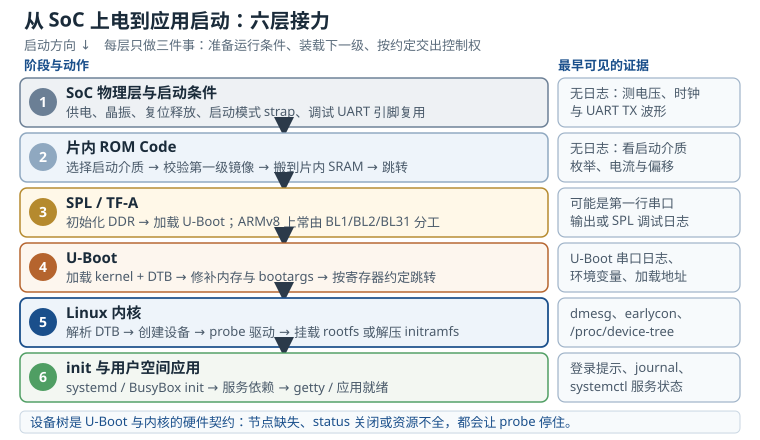

# 嵌入式 Linux 全景：从 SoC 上电到应用启动

> 本章是全书导读：说明这本手册解决什么问题、怎么读、与其他分册的关系。
> 具体章节的定量结论与来源在各章正文内给出。

嵌入式 Linux 不是一套可以单独安装的“操作系统”，而是一条从芯片复位一直铺到应用进程的系统集成链。它包含工具链、引导固件、内核、设备树、根文件系统和用户空间服务；任何一层只完成自己的一半，最终现象往往只有一句话：**板子没反应，或者串口停住了**。本章先建立这条链的整体图像，再给出可以量化、可以复现的观察方法。

## 动机：为什么需要整机视角

嵌入式 Linux 最昂贵的故障，通常不是“某个 API 用错”，而是**层与层之间的约定没有被验证**。SoC 上电后，ROM 从哪种介质读第一级镜像，SPL 有没有把 DDR 训练成功，U-Boot 把内核和设备树放到了哪里，内核按哪一份 DTB 创建 platform device，根文件系统又从哪个分区挂载——这些环节中任意一个不成立，屏幕和串口给出的信息都可能完全相同。

更麻烦的是，这条链的早期阶段按设计就没有日志。片内 ROM 和 SPL 运行在几十到几百 KiB 的 SRAM 里，没有文件系统、没有完整驱动，甚至没有可用的控制台。等 U-Boot 把串口初始化好，已经过去几十毫秒；如果工程师把“没有输出”直接解释成“芯片坏了”，就会跳过电源、时钟、复位、启动模式这些更基础、也更常见的检查点。

整机视角的价值，是把一个模糊的“起不来”拆成四个可以分别回答的问题：

1. **硬件是否给了运行条件？** 供电、参考时钟、复位释放、启动模式 strap 是否正确。
2. **固件是否完成了交接？** ROM 找到 SPL，SPL 初始化 DDR，U-Boot 找到内核和 DTB。
3. **内核是否理解了硬件？** 设备树节点、绑定、时钟、中断、GPIO 是否都能解析，驱动是否 probe。
4. **用户空间是否接住了控制权？** rootfs 是否挂载，init 是否可执行，服务依赖是否满足。

这四个问题分别对应硬件、固件、内核、用户空间四类证据。先确定“停在哪一层”，再在该层内做最小验证，比反复重烧镜像快得多。这也是本手册坚持每章给出可复现检查步骤的原因。

### 1.1 学习路径表：从系统到板级实战

学习路径按六个阶段展开。下表把每一阶段对应的内容、应能回答的问题和可交付产物放在一起，使它既能当目录，也能当验收清单。

| 阶段 | 本分册对应内容 | 读完应能回答 | 可交付的产物 |
|---|---|---|---|
| 第一篇 系统与构建 | 全景、交叉编译、Buildroot 与 Yocto、启动链、设备树 | 一份可启动镜像由哪些文件组成，谁在什么时候加载谁 | 能从零构建并启动的最小镜像 |
| 第二篇 内核与驱动 | 内核模块、字符设备、platform 总线、probe 与设备树绑定 | 驱动为什么绑定成功或失败，资源从哪来 | 一个可加载、可卸载、可观测的驱动 |
| 第三篇 用户空间与调试 | init、systemd 与 BusyBox、日志、网络、性能分析 | 登录提示为什么没出现，服务为什么起不来 | 能定位启动失败与性能瓶颈的 rootfs |
| 第四篇 硬件接口与板级支持 | I2C、SPI、MMC、显示、音频、pinctrl 与电源域 | 一个外设从原理图到 `/dev` 还缺哪几步 | 外设 bring-up 记录与可复现测试 |
| 第五篇 可靠性与升级 | 看门狗、日志持久化、A/B 升级、回滚、安全启动 | 掉电、升级失败、镜像损坏时如何恢复 | 可回滚、可审计的升级方案 |
| 第六篇 板级实战 | 新板适配、量产测试、故障树与交付清单 | 从空板到量产还差哪些验证 | 一块新板的软件适配报告 |

这张表对应的不是“读完就会”，而是“做完才算”。例如第一篇的产物不是看懂的笔记，而是一个能从存储介质启动、能从串口看到 init 的镜像；第五篇的产物不是一份升级脚本，而是一次真实断电后仍能回到可用系统的演练记录。

学习顺序也有取舍。驱动当然重要，但**驱动没 probe 的原因，多数不在驱动代码里**：设备树节点没有使能、`compatible` 拼错、时钟或电源域没打开、pinctrl 复用被别的外设占用，都会让一个逻辑完全正确的驱动安静地留在模块列表里。先把启动链和设备树学通，再看驱动，排查成本会低一个数量级。

::: motivation 一次“换一块板就好了”的误判
某团队的新板在实验室能启动，到了产线却有三成板卡停在 U-Boot。最初判断是“这批 SoC 有问题”，于是换芯片、换批次，问题依旧。后来把故障板与良板对照，发现故障板从 SPI NOR 启动时，U-Boot 读到的 DTB 是旧版本，里面的 DDR 容量节点与这批板卡的 512 MiB 配置不符；内核在早期内存初始化时越界，日志还没来得及输出就复位了。

真正的问题既不在 SoC，也不在 U-Boot 代码，而在“镜像、DTB、板卡配置三者没有绑定”。这类故障的共同点是：**单看任何一层都正常，只有把交接物放在一起比对才会暴露**。
:::

## 定义与直观：五层栈与四次交接

嵌入式 Linux 系统可以画成一条纵向栈：

- **硬件与 SoC 层**：CPU、DDR、存储控制器、时钟树、复位控制器、电源域、引脚复用。
- **引导固件层**：片内 ROM、SPL 或 TF-A、U-Boot。它们负责把系统从“复位状态”带到“内核可以接管的状态”。
- **内核层**：进程调度、内存管理、虚拟文件系统、网络协议栈、设备模型与各类驱动。
- **硬件描述层**：DTS、DTSI、DTB 与绑定文档。它不是运行中的一层，而是引导器交给内核的**硬件契约**。
- **用户空间层**：init、系统服务、库、应用与数据分区。

概念上这是五层，其中“硬件描述层”是横跨引导器与内核的契约，不是常驻运行层。启动图把引导固件拆成 ROM、SPL/TF-A、U-Boot 三个执行阶段，因此视觉上呈现六段接力；它们仍属于同一类“为内核准备运行条件”的工作。

图中把启动方向画成自上而下，执行顺序也是从上到下；但**依赖方向不能倒着看**：内核依赖 U-Boot 准备好的内存与 DTB，U-Boot 又依赖 SPL 初始化好的 DDR。分层图容易让人误以为每层独立；实际恰恰相反，每一层都在替下一层准备前提条件。ROM 不初始化 DDR，SPL 就无法把 U-Boot 搬进大内存；U-Boot 不把正确的 DTB 地址放进寄存器，内核就只能按错误的硬件描述启动。

### 2.1 四次交接与各自的“合同”

| 交接 | 上游交付物 | 下游的硬假设 | 最早可见的证据 |
|---|---|---|---|
| ROM → SPL/TF-A | 带厂商头的第一级镜像 | 镜像放在约定偏移、校验通过、加载地址正确 | 电流、USB 枚举、存储介质波形；通常无串口日志 |
| SPL/TF-A → U-Boot | 已初始化的 DDR 与 U-Boot 镜像 | DDR 可用、栈已切换、入口地址匹配 | SPL 的调试串口或 U-Boot 第一行输出 |
| U-Boot → 内核 | 内核镜像、DTB、bootargs、入口寄存器 | MMU/缓存关闭、DTB 地址有效、控制台参数正确 | `Starting kernel ...` 之后的内核早期日志 |
| 内核 → init | 已挂载的 rootfs 与可执行的 init | `/init` 或 `init=` 存在、动态加载器匹配、架构一致 | `Run /sbin/init as init process` 或 `No working init found` |

这张表最实用的一列是“最早可见的证据”。如果 U-Boot 有输出而内核没有，问题就不该再往电源和 DDR 上找；如果内核日志停在 `Waiting for root device`，说明内核已经跑起来，问题在存储驱动、分区标识或 rootfs 本身。**证据出现的位置，就是故障所在层的上界**。

设备树位于第三次交接的中心。它既不是驱动，也不是普通的配置文件：内核在启动早期解析它，为其中的可用设备节点创建 platform device，再用 `compatible` 把设备与驱动匹配起来。设备树节点写错，驱动可能根本不执行；设备树资源写错，驱动可能执行到一半返回 `-EPROBE_DEFER`。这两种现象都容易被误判成“驱动有问题”。

### 2.2 与 MCU 分册、硬件分册的分工

硬件分册关心电源、时钟、复位、信号完整性和器件选型；MCU 分册关心寄存器级控制、中断延迟和裸机/RTOS 的实时性；本分册关心 Linux 提供的抽象，以及这些抽象如何与真实板卡对接。

三者的共同点是：**都要回到数据手册、时序图和实测波形**。不同点在于，Linux 把很多硬件细节藏进了驱动模型和设备树。工程师看到的是 `platform_get_irq()` 和 `devm_clk_get()`，但这些调用能否成功，取决于设备树里的中断父节点、时钟提供者和电源域是否已经就绪。只读驱动代码，无法回答这些前提是否存在。

因此，读本分册时建议始终带着两张图：一张是**启动时间轴**（谁先谁后），一张是**资源依赖图**（谁给谁提供时钟、中断、电源和引脚）。后面的定量分析，基本都建立在这两张图上。

## 定量关系：启动时间、镜像体积与内存预算

整机视角要落到数字上，才有工程价值。下面三个模型分别回答“启动够不够快”“存储放不放得下”“内存会不会不够”。它们都是**预算模型**，不是精确仿真；作用是在做板子之前发现数量级错误。

### 3.1 启动时间的加性模型

把启动时间按阶段拆开：

$$T_{\text{boot}}=\sum_{s\in\{\text{rom},\text{spl},\text{bl},\text{k},\text{init}\}} T_s$$

其中 $T_s$ 是第 $s$ 个阶段的墙钟时间，单位 s；下标依次表示 ROM、SPL/TF-A、U-Boot、内核、init。这个模型假设各阶段串行执行，适合做保守预算。

日志输出会额外占用时间。UART 在 8N1 格式下每字节占 10 位，输出 $B_{\text{log}}$ 字节需要：

$$T_{\text{log}}=\frac{10B_{\text{log}}}{f_{\text{baud}}}$$

其中 $f_{\text{baud}}$ 是波特率，单位 bit/s；$B_{\text{log}}$ 是字节数。$f_{\text{baud}}=115200$ 时，每字节约 86.8 µs，1 KiB 日志约 88.9 ms，32 KiB 日志约 2.84 s。串口日志占总启动时间的比例为：

$$\eta_{\text{log}}=\frac{T_{\text{log}}}{T_{\text{boot}}}$$

如果日志是同步轮询输出，CPU 在等待发送完成时不能做别的事，$\eta_{\text{log}}$ 可以直接从预算里扣；如果使用 DMA 或异步 printk，日志与计算部分重叠，应按实际重叠程度修正。**优化启动时先量 $\eta_{\text{log}}$，再决定砍日志、提波特率还是裁剪内核**，顺序反过来往往白忙。

### 3.2 镜像体积与 A/B 预算

一次完整镜像通常由引导固件、内核、设备树、根文件系统和元数据组成：

$$S_{\text{img}}=S_{\text{bl}}+S_{\text{k}}+S_{\text{dtb}}+S_{\text{rootfs}}+S_{\text{meta}}$$

其中各项单位统一为 MiB。$S_{\text{bl}}$ 包含 ROM 之后需要落盘的所有引导阶段（SPL、U-Boot、TF-A 等），$S_{\text{k}}$ 是内核镜像，$S_{\text{dtb}}$ 是一块或多块设备树，$S_{\text{rootfs}}$ 是根文件系统，$S_{\text{meta}}$ 是分区表、环境变量、校验和与升级状态等。

A/B 双分区把可启动槽位乘以二：

$$S_{\text{ab}}=2S_{\text{slot}}+S_{\text{meta}}$$

$S_{\text{slot}}$ 是一个槽位中需要整体切换的全部内容。注意 A/B 不是“把 rootfs 复制两份”这么简单：内核、DTB、引导参数、甚至部分固件都可能需要成对更新，否则会出现“新内核配旧 DTB”的错配。存储预算必须按**一次完整可启动集合**计算，而不是只算最大的那个分区。

### 3.3 内存的可用预算

DDR 容量不等于 Linux 可用内存。安全固件、GPU/VPU、显示 framebuffer、DMA 一致性区域和预留内存会先被扣掉：

$$M_{\text{usable}}=M_{\text{ddr}}-M_{\text{reserved}}$$

在用户空间稳定运行的最低预算可以写成：

$$M_{\text{need}}=M_{\text{k}}+M_{\text{dtb}}+M_{\text{rootfs}}+M_{\text{app}}+M_{\text{headroom}}$$

其中 $M_{\text{ddr}}$、$M_{\text{reserved}}$、$M_{\text{k}}$、$M_{\text{dtb}}$、$M_{\text{rootfs}}$、$M_{\text{app}}$、$M_{\text{headroom}}$ 的单位均为 MiB；$M_{\text{rootfs}}$ 指常驻内存的 rootfs（例如 initramfs 或 tmpfs 中的内容），如果 rootfs 在块设备上，则只计算页缓存中难以回收的部分。$M_{\text{headroom}}$ 是给突发分配、内核缓存和升级过程留的余量，经验上不要低于 DDR 的 10% 到 15%。

这个模型只给下界。Linux 会把空闲内存用于页缓存，看起来“内存快满了”并不等于故障；真正要看的是 MemAvailable、slab 增长、匿名页和 OOM 记录。把 `MemFree` 当成剩余内存，是另一个常见误判。

## 典型计算：4,000 ms 启动预算与 256 MiB 内存

### 算例 1：串口日志吃掉多少启动预算

某 Cortex-A7 板目标从上电到应用就绪不超过 4,000 ms。实测非日志部分（ROM、DDR 训练、镜像加载、驱动 probe、init）合计 900 ms，当前日志量为 32 KiB，波特率 115200。

32 KiB 等于 $32\times1024=32768$ 字节，日志时间：

$$T_{\text{log}}=\frac{10\times32768}{115200}=2.844\ \text{s}=2844\ \text{ms}$$

总时间为 $900+2844=3744$ ms，距离 4,000 ms 只剩 256 ms。若下一版驱动多打 4 KiB 日志，就会超出预算：

$$\frac{10\times4096}{115200}=0.3556\ \text{s}=356\ \text{ms}$$

所以真正可用的日志余量只有约 3 KiB，而不是“看起来还有 256 ms”。

反过来，如果要求总时间不超过 3,000 ms，日志预算只有 2,100 ms。115200 下最多能输出的字节数为：

$$B_{\max}=\frac{2100\times115200}{10\times1000}=24192\ \text{B}=23.625\ \text{KiB}$$

也就是说日志必须压到 23 KiB 以内（24 KiB 会达到 2,133 ms，超出 33 ms）。若把波特率提高到 921600，同样 32 KiB 日志只需：

$$\frac{10\times32768}{921600}=0.3556\ \text{s}=356\ \text{ms}$$

总时间降到约 1,256 ms，余量立刻变成 2,744 ms。代价是引导阶段、内核 earlycon 和用户空间 getty 必须使用同一个波特率，且长线缆或光电隔离可能不支持高波特率；这不是纯软件开关。

### 算例 2：256 MiB DDR 还剩多少给应用

某网关的 DDR 为 256 MiB，预留安全固件 32 MiB、GPU 16 MiB、framebuffer 8 MiB，则：

$$M_{\text{usable}}=256-32-16-8=200\ \text{MiB}$$

内核与常驻驱动 24 MiB，DTB 64 KiB（0.0625 MiB），常驻 initramfs 72 MiB，应用常驻 40 MiB，按 15% 留 headroom：

$$M_{\text{headroom}}=0.15\times256=38.4\ \text{MiB}$$

当前占用为 $24+0.0625+72+40=136.0625$ MiB，剩余 $200-136.0625=63.9375$ MiB，大于 38.4 MiB，方案成立。若应用预算涨到 80 MiB，占用变成 176.0625 MiB，只剩 23.9375 MiB，低于 headroom，应该选择裁剪 initramfs、增加 DDR 或把 rootfs 移到块设备，而不是继续压缩 headroom。

应用可用的上限也可以反算：

$$M_{\text{app,max}}=200-24-0.0625-72-38.4=65.5375\ \text{MiB}$$

这解释了为什么“256 MiB 够用”必须带上 rootfs 形态和预留配置一起说。同样是 256 MiB，使用块设备 rootfs 与使用 72 MiB 常驻 initramfs，结论可能完全不同。

### 算例 3：8 GiB eMMC 的 A/B 空间

设一个槽位包含 rootfs 1,024 MiB、内核 32 MiB、DTB 1 MiB、引导固件 16 MiB，元数据 64 MiB：

$$S_{\text{slot}}=1024+32+1+16=1073\ \text{MiB}$$

$$S_{\text{ab}}=2\times1073+64=2210\ \text{MiB}$$

8 GiB 等于 $8\times1024=8192$ MiB，占用约 $2210/8192=27.0\%$，还剩 5,982 MiB。这个结果说明 A/B 对 8 GiB 存储是可以接受的；但如果 rootfs 是 3 GiB，两个槽位就要 6 GiB 以上，再叠加日志、缓存和恢复分区，余量会非常紧张。**A/B 的存储代价必须在产品定义阶段算，而不是在量产前才发现 eMMC 选小了**。

## 工程含义：把启动链当作可观测系统

### 5.1 排查顺序：从物理层到应用层

一个可复用的 bring-up 顺序是：

1. **电源与复位**：核心电压、IO 电压、DDR 电压、复位释放时间、晶振起振。
2. **启动模式**：strap 引脚或 eFuse 是否选中了预期介质，镜像是否放在 ROM 约定的偏移。
3. **调试串口物理层**：TX 是否有波形、电平是否正确、波特率与引脚复用是否匹配。
4. **DDR 与 U-Boot**：SPL 是否完成训练，U-Boot 是否拿到正确的环境与镜像地址。
5. **内核早期**：`earlycon` 是否工作，DTB 是否被加载到正确地址，`console=` 是否指向真实设备。
6. **设备与驱动**：设备树节点是否可用，资源是否解析，驱动是否绑定，是否停在 deferred probe。
7. **rootfs 与 init**：分区标识、文件系统类型、动态加载器、init 路径与权限。
8. **应用与服务**：依赖、配置、网络、权限、看门狗是否在启动阶段误触发。

这个顺序的原则是“**先证明输入，再证明输出**”。在电源没稳之前分析内核日志，或者在 DTB 没确认之前修改驱动，都是把变量混在一起。

### 5.2 版本矩阵：每个产物都要能追溯

嵌入式项目最容易在半年后失控的，不是代码，而是“这块板当时烧的是哪一版”。建议把下列产物纳入同一份版本清单：

| 产物 | 生产者 | 消费者 | 失配时的典型症状 |
|---|---|---|---|
| 工具链 | SDK 或构建系统 | 内核、U-Boot、应用 | 启动即非法指令、浮点 ABI 不兼容 |
| 引导固件 | U-Boot/SPL 构建 | SoC ROM | 无输出、DDR 初始化失败 |
| 内核 | 内核构建 | U-Boot 加载 | 解压失败、早期 panic、驱动缺失 |
| DTB | 内核源码中的 DTS 构建 | U-Boot 传递、内核解析 | 设备缺失、资源错误、驱动不 probe |
| rootfs | Buildroot/Yocto 或发行版 | 内核挂载 | `No working init found`、库缺失 |
| bootargs | U-Boot 环境或 DTB `/chosen` | 内核 | 控制台错、root 分区找不到 |

这张表可以直接变成发布检查单：每个镜像打上构建号，记录 Git 提交、工具链版本、内核配置、DTS 文件和 rootfs 清单。只记录“内核版本”不够，因为同一内核配不同 DTB 就是两个产品。

### 5.3 取舍：启动时间、内存、存储与可维护性

整机设计很少能同时优化所有指标：

- 为了缩短启动时间，可以减少日志、改用 initramfs、并行 probe；代价是可观测性下降、内存占用上升。
- 为了简化升级，可以用 A/B 双分区；代价是存储翻倍、镜像构建与签名流程更复杂。
- 为了缩小 rootfs，可以裁掉调试工具和动态库；代价是现场排障必须依赖预先准备的调试包。
- 为了支持多块板，可以共用内核、用不同 DTB 区分硬件；代价是 DTB 与板卡的绑定关系必须严格管理，错烧 DTB 的症状往往比错烧内核更隐蔽。

这些取舍没有统一答案，但可以用本章的预算模型量化。**先算清楚，再决定“省”在哪里**，比事后靠经验补丁可靠。

### 5.4 跨分册的阅读方式

读到电源、时钟、复位和信号完整性细节时，应回到硬件分册；读到寄存器级时序、裸机中断和 RTOS 调度时，应回到 MCU 分册；本分册只保留与 Linux 集成有关的部分。三册的术语和符号并不完全相同，遇到冲突时以数据手册的原始定义为准，再回到对应分册核对上下文。

同样，本分册内部也不要跳着读。启动链、设备树、platform 驱动三章是连续的三步：先有镜像，才有内核；先有设备树，才有 platform device；先有 device 与 driver 的匹配，才有 probe。把其中任何一步当成“配置细节”，后面都会付出重复调试的代价。

## 常见坑：从现象反推层级

::: pitfall 串口完全无输出，就重烧镜像
**现象**：上电后串口一个字符都没有，换了几版 U-Boot 仍然无输出。
**原因**：问题可能在上电之前——核心电压未建立、晶振未起振、复位被按住、启动模式选错，或者调试 UART 的引脚被复用成 GPIO。此时镜像根本没有被执行，重烧不会改变任何东西。
**解决**：先量电源、时钟、复位和 UART TX 波形，确认 SoC 已经取指；再核对启动介质与镜像偏移。只有在 U-Boot 至少输出一个字符之后，才把怀疑范围收缩到镜像内容。
:::

::: pitfall 改了 DTS，板子行为却没变
**现象**：设备树里把节点改成 `status = "okay"`，重新编译内核后设备仍然不存在。
**原因**：U-Boot 加载的是存储介质上另一份旧 DTB；或者构建系统没有重新编译 DTS；或者内核使用的是内置 DTB，而不是你改的那一份。
**解决**：从运行中的系统读回实际设备树，与构建产物逐字节或逐节点比对；确认 U-Boot 的加载地址、分区和文件名；把 DTB 的构建号写进启动日志或 `/chosen`，让“当前生效的是哪一份”可见。
:::

::: pitfall 驱动代码没问题，却始终不 probe
**现象**：模块已加载，`compatible` 看起来也对，但 `/sys/bus/platform/devices` 下没有对应设备，或者设备没有 `driver` 符号链接。
**原因**：设备树节点 `status` 为 disabled、`compatible` 拼写与驱动表不一致、父节点资源不完整、时钟或稳压器提供者尚未就绪，甚至节点根本不在被扫描的总线下。
**解决**：按“节点是否存在 → 是否 available → 资源是否可解析 → 驱动是否匹配”的顺序检查；用 `/proc/device-tree` 和 debugfs 的 deferred 列表定位，而不是先改驱动。
:::

::: pitfall 内核起来了，却停在 Waiting for root device
**现象**：内核日志正常，最后反复打印 `Waiting for root device PARTUUID=...`，没有进入 init。
**原因**：`root=` 指向的分区不存在、存储控制器驱动没编进内核、分区表类型不匹配、eMMC 枚举较慢但没有 `rootwait`，或者 initramfs 没有把真实根挂载好。
**解决**：先确认内核是否看到块设备，再核对 PARTUUID/LABEL 与分区表，最后检查根文件系统类型和 initramfs 的挂载脚本。不要在设备树里盲目添加节点来“试试看”。
:::

::: pitfall A/B 升级做了，就不再担心变砖
**现象**：升级脚本成功写入备用槽，但设备重启后仍然停在旧版本，或者两块槽位都不可启动。
**原因**：启动器没有根据回滚状态选择槽位；升级只写了 rootfs，没有同步内核和 DTB；引导成功标志在应用真正可用之前就被置位；看门狗在升级过程中复位。
**解决**：把“可启动”定义为可验证的状态（内核、rootfs、关键服务都通过），用启动计数和回滚阈值驱动切换；在实验室做断电、坏镜像、错 DTB 三类故障注入。A/B 是恢复机制，不是免测理由。
:::

## 自测题

为什么嵌入式 Linux 要先学启动链，而不是先学写驱动？

因为驱动没 probe 的原因，多数不在驱动代码里——可能是设备树节点没使能、时钟或电源域没打开、pinctrl 复用没配对，也可能是 U-Boot 加载了错误的 DTB。启动链决定了这些前提是否存在，也决定了你能从哪一层拿到证据。不理解启动链与设备树，就只能靠“改一行、重启、看串口”的盲试；理解之后，才能先用日志和寄存器把范围缩到一层，再改代码。

A/B 升级为什么比“覆盖写入”更可靠？

覆盖写入在掉电时会留下半个镜像，设备直接变砖；A/B 双分区保证任何时刻至少有一份完整可启动镜像，失败可以回滚。代价是需要双倍存储与一次重启，而且必须让引导器真正根据启动结果选择槽位、同步更新内核和 DTB、在关键服务可用后才确认成功。若这些条件不成立，A/B 也会出现“两个槽都起不来”的情况。

某板 115200 8N1 输出 24 KiB 启动日志，非日志启动时间为 900 ms，总时间是多少？若目标 3,000 ms，最直接的两个改法各能省多少？

24 KiB 为 24,576 字节，日志时间 $10\times24576/115200=2.133$ s，总时间约 3,033 ms。改法一：把日志降到 23 KiB，日志时间约 2,044 ms，总时间约 2,944 ms，省约 89 ms。改法二：把波特率提高到 921600，24 KiB 日志约 267 ms，总时间约 1,167 ms，省约 1,866 ms。后者还要求整条控制台链路支持该波特率。

U-Boot 打印完 Starting kernel ... 后内核没有任何输出，应按什么顺序排查？

先确认内核镜像和 DTB 是否真的被加载到约定地址，再检查入口寄存器与架构是否正确；然后确认 `console=` 与 `earlycon=` 指向的串口和真实硬件一致。若这些都正确，再检查内核是否在解压或早期内存初始化阶段崩溃（可用 JTAG、RAM 日志或打开早期调试）。此时不应先怀疑用户空间或应用，因为内核连第一条日志都还没发出来。

## 参考资料

- Linux 内核文档 `Documentation/arch/arm64/booting.rst` 与 `Documentation/arch/arm/booting.rst`：引导器交给内核的寄存器、MMU/缓存状态和 DTB 地址约定，是判断“内核为什么没起来”的原始依据。
- Linux 内核文档 `Documentation/admin-guide/kernel-parameters.txt`：`console=`、`earlycon=`、`root=`、`rootwait`、`init=`、`rdinit=` 的语义与优先级，对应本章的控制台与 init 交接部分。
- U-Boot 文档 `doc/develop/bootstd.rst` 与 `doc/README.distro`：bootflow、distro boot、镜像与设备树加载流程，支撑 U-Boot 阶段的行为分析。
- Buildroot 用户手册的 "Buildroot configuration" 与 "Filesystem image" 章节：工具链、内核、rootfs 和最终镜像的装配关系，对应镜像体积预算。
- Yocto Project Overview and Concepts Manual：layer、recipe、machine 配置与镜像产出的组织方式，用于理解多板共构建和版本追溯。
- Bootlin "Embedded Linux system development" 培训材料：启动链、存储布局、设备树与系统架构的入门总览，可作为本章的延伸阅读。
- Devicetree Specification 与 Linux 内核 `Documentation/devicetree/usage-model.rst`：设备树在启动交接中的角色、节点与属性的基本语义，为后续设备树章提供规范背景。
