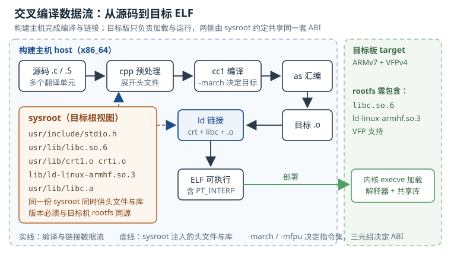

# 交叉编译与工具链 Cross Compilation and Toolchains

一块 Cortex-A7 的板子跑起一个 hello world，屏幕背后其实是五份互相锁死的产物：编译器、汇编器与链接器（binutils）、C 库（libc）、内核头文件、动态加载器（dynamic loader）。它们的版本、字节序、浮点调用约定必须全部对齐，任何一处错位，现象都不是"报个编译错误"，而是板子上的一声不吭、一条 `Illegal instruction`，或者更糟——程序跑起来了，浮点结果全错。

**交叉编译（Cross Compilation）**指在一种机器（构建主机，host）上生成另一种机器（目标机，target）可执行的代码。**工具链（Toolchain）**就是完成这件事的一整套程序与库的组合。本章按"三元组认机器、sysroot 认文件、ABI 认调用约定"三条线，把工具链拆开讲清楚，最后给出选型与版本锁定的可执行做法。

## 动机：为什么不能在板子上直接编译

最直接的理由是算力。以一块 800 MHz 单核 Cortex-A7、256 MiB DDR 的典型工控板为例，编译一次 Linux 内核约需 1,200 CPU·分钟；构建主机是 8 核 x86_64，按单核性能约为目标的 3 倍计算，墙钟时间约

$$T_{\mathrm{host}}=\frac{1200}{8\times 3}=50\ \text{min}$$

而目标板单核跑同样的编译，墙钟时间约 1,200 分钟，也就是 20 小时。这还没有算上 256 MiB 内存下链接器频繁换页、eMMC 写入寿命被编译中间文件消耗这些副作用。所以交叉编译不是"图方便"，而是最现实的工程路径。

但交叉编译把"编译期"和"运行期"拆到了两台机器上，错误也因此被推迟到运行期才暴露。下面这张表几乎是每个嵌入式团队都交过学费的清单：

| 板上的现象 | 真正出问题的那一层 | 典型根因 |
|---|---|---|
| `Illegal instruction` | 编译器指令集选择 | `-march=armv7-a` 编出的指令跑到 ARMv5 芯片上 |
| `No such file or directory`，但文件明明存在 | 动态加载器 | ELF 的 `INTERP` 指向目标机上不存在的 `ld-linux-armhf.so.3` |
| `version 'GLIBC_2.34' not found` | C 库符号版本 | 用新 sysroot 编译，目标机的根文件系统（rootfs）里是旧 glibc |
| 整型日志正常，浮点结果离谱 | 浮点调用约定 | 硬浮点主程序链接了软浮点库，参数没有落在约定的寄存器里 |
| 结构体大小、字段偏移对不上 | 数据模型 | arm32 的 `long` 是 4 字节，aarch64 是 8 字节，共享内存协议被悄悄改写 |
| 链接时报 `undefined reference`，头文件却找得到 | sysroot 混用 | 头文件来自一份 sysroot，库来自另一份，或宿主机路径泄漏进来 |

::: motivation 一次浮点 ABI 不一致的代价
某项目用芯片厂商提供的软浮点工具链编译应用，又用另一份硬浮点工具链编译了一个第三方算法库。整型参数、日志、CRC 全部正常，唯独滤波后的采样值全是噪声。团队先怀疑算法，再怀疑传感器，最后用 `readelf -A` 看到两份 ELF 的 `Tag_ABI_VFP_args` 一个是 `VFP registers`、一个是 `Tag_ABI_VFP_args: 0`，才定位到根因：调用方把浮点参数放在整数寄存器 r0–r3，被调用方却去 VFP 的 s0–s3 取参数，取到的是上一次运算的残值。

这类问题的麻烦之处在于：链接器不报错，加载器不报错，程序也不崩溃。它只是安静地算错。这也是本章要强调"工具链是一个整体"的原因——编译器、库、加载器必须来自同一次构建。
:::

真正需要建立的心智模型是：**工具链不是"一个 gcc 命令"，而是"一套共同约定"**。三元组声明这套约定服务的机器，sysroot 声明这套约定依赖的文件，ABI 声明这套约定如何在寄存器和内存之间传递数据。三者任一错位，都会在运行期以完全不相干的现象出现。

## 定义与直观：三元组、sysroot 与链接路径

### 2.1 三元组：给目标机一个规范名字

**三元组（Target Triplet）**是工具链用来标识目标平台的规范字符串，标准形式是四段：

$$\langle \mathrm{arch}\rangle\text{-}\langle \mathrm{vendor}\rangle\text{-}\langle \mathrm{os}\rangle\text{-}\langle \mathrm{abi}\rangle$$

很多平台把后两段合并成三段，所以"三元组"这个名字沿用了下来。以最常见的 `arm-linux-gnueabihf` 为例，它其实是三段式：

| 段 | 取值 | 含义 |
|---|---|---|
| arch | `arm` | 32 位小端 ARM 指令集家族；具体微架构由 `-march` 决定 |
| vendor | `linux`（此处被省略为中间段） | 供应商标记，一般为 `unknown`、`buildroot` 或发行商名 |
| os | `linux` | 操作系统是 Linux，决定系统调用与 ELF 格式 |
| abi | `gnueabihf` | GNU EABI，硬浮点（hard-float）调用约定 |

把 ABI 段拆开看：`gnu` 表示使用 GNU 工具链约定，`eabi` 表示 ARM 的嵌入式应用二进制接口（EABI，Embedded Application Binary Interface），`hf` 是 hard-float 的缩写。少了 `hf` 的 `arm-linux-gnueabi` 就是软浮点版本。两者生成的机器码可以互相"看起来像"，但函数调用约定不同，不能混链。

常见三元组对照：

| 三元组 | 位宽 / 字节序 | 浮点约定 | 典型芯片 |
|---|---|---|---|
| `arm-linux-gnueabihf` | 32 位小端 | 硬浮点，参数走 VFP 寄存器 | Cortex-A7/A9/A15 |
| `arm-linux-gnueabi` | 32 位小端 | 软浮点，参数走通用寄存器 | ARM9、Cortex-A5 无 FPU 配置 |
| `armeb-linux-gnueabi` | 32 位大端 | 软浮点 | 网络设备中的大端 ARM |
| `aarch64-linux-gnu` | 64 位小端 | 硬浮点，AAPCS64 | Cortex-A53/A72、瑞芯微 RK3399 |
| `arm-none-eabi` | 32 位小端 | 软浮点 | Cortex-M 单片机，无操作系统 |
| `riscv64-linux-gnu` | 64 位小端 | LP64D 双精度 | RISC-V 应用处理器 |

这里有一个容易误解的点：三元组里的 `arm` 不区分 ARMv5、ARMv7、ARMv8-AArch32，也不区分有没有 NEON。**三元组描述的是"家族 + ABI"，微架构选择是编译选项的事**，由 `-march=armv7-a`、`-mtune=cortex-a7`、`-mfpu=neon-vfpv4` 这一组参数表达。所以同一份 `arm-linux-gnueabihf` 工具链，既能编出跑在 Cortex-A7 上的代码，也能编出跑在 Cortex-A15 上的代码；反过来，若 `-march` 选高了，工具链本身不会阻止你，芯片会用 `SIGILL` 告诉你。

工具链的所有可执行文件都带这个前缀：`arm-linux-gnueabihf-gcc`、`arm-linux-gnueabihf-ld`、`arm-linux-gnueabihf-objcopy`、`arm-linux-gnueabihf-readelf`、`arm-linux-gnueabihf-gdb`。用 `gcc -dumpmachine` 可以打印当前编译器自认的三元组，它应当与文件名前缀完全一致：

```
arm-linux-gnueabihf-gcc -dumpmachine
# 输出：arm-linux-gnueabihf
```

如果这条输出和你的预期不符，那说明 PATH 里混进了另一份工具链，后面所有的排查都建立在错误前提上。这是拿到一块新板子时值得先跑的一条命令，成本五秒，能省掉半天。

### 2.2 sysroot：目标根文件系统的开发视图

**sysroot（系统根目录）**是一棵按目标机根文件系统布局组织的目录树，里面放编译和链接需要的头文件、库、启动文件。它的结构大致如下：

```
sysroot/
├── lib/
│   └── ld-linux-armhf.so.3        # 动态加载器（运行时解释器）
├── usr/
│   ├── include/
│   │   ├── stdio.h
│   │   ├── linux/                 # 内核头文件
│   │   └── ...
│   └── lib/
│       ├── crt1.o crti.o crtn.o   # 启动/收尾目标文件
│       ├── libc.so                # 链接期脚本（不是运行时库）
│       ├── libc.so.6              # 运行时共享库
│       ├── libc.a                 # 静态库
│       └── libm.so / libm.so.6
└── ...
```

编译器在构建时通过 `--with-sysroot=` 记录一个默认 sysroot，运行 `gcc -print-sysroot` 可以打印出来。sysroot 有三个消费者，对应三个不同的阶段：

1. **预处理阶段**读 `<sysroot>/usr/include`，决定 `#include <stdio.h>` 找到的是哪一份头文件；
2. **链接阶段**读 `<sysroot>/usr/lib` 与 `<sysroot>/lib`，取 `crt1.o`、`libc.so`、`libm.so`；
3. **运行阶段**由内核按 ELF 的 `PT_INTERP` 段加载 `<sysroot>/lib/ld-linux-armhf.so.3`，再由它按 `DT_NEEDED` 找 `libc.so.6`。

**`--sysroot` 与 `-I`/`-L` 不是一回事**。`-I` 和 `-L` 只是往搜索路径前面插目录，编译器的默认搜索路径（包括宿主机的 `/usr/include`、`/usr/lib`）依然在列表里；而 `--sysroot` 会把整套默认路径重定向到目标根下。只加 `-I`/`-L` 的典型后果是：头文件用对了，链接时 `ld` 却从宿主机拿了 x86_64 的 `crt1.o`，报 `wrong ELF class`；或者更隐蔽——宿主机恰好有一份同名库，链接静默通过，运行时才炸。

用 `-v` 可以看到真实的搜索顺序：

```
arm-linux-gnueabihf-gcc --sysroot=/opt/sysroot/armv7hf -v -o hello hello.c
...
#include <...> search starts here:
 /opt/sysroot/armv7hf/usr/lib/gcc/arm-linux-gnueabihf/12.3.0/include
 /opt/sysroot/armv7hf/usr/include
...
 /usr/include                      # 宿主机会话，若出现说明隔离失败
```

最后一行如果出现宿主机的 `/usr/include`，就说明隔离没做干净。对使用 `pkg-config` 的项目，还要额外隔离三件事，否则 `pkg-config --cflags openssl` 会老老实实返回宿主机的 `-I/usr/include`：

```
export PKG_CONFIG_SYSROOT_DIR=/opt/sysroot/armv7hf
export PKG_CONFIG_LIBDIR=/opt/sysroot/armv7hf/usr/lib/pkgconfig:/opt/sysroot/armv7hf/usr/share/pkgconfig
unset PKG_CONFIG_PATH
```

`PKG_CONFIG_PATH` 是"追加"语义，保留它等于给宿主机留了一扇后门；`PKG_CONFIG_LIBDIR` 是"替换"语义，才是隔离。用 CMake 的项目则要设 `CMAKE_SYSROOT`，并把 `CMAKE_FIND_ROOT_PATH_MODE_PROGRAM` 设为 `NEVER`、`CMAKE_FIND_ROOT_PATH_MODE_LIBRARY` 与 `CMAKE_FIND_ROOT_PATH_MODE_INCLUDE` 设为 `ONLY`，否则 `find_package` 会在宿主机上找到一堆用不了的依赖。



图中的关键信息是：**sysroot 只在两个位置进入流水线**——预处理阶段提供头文件，链接阶段提供启动文件与库；编译与汇编阶段只认 `-march`/`-mfpu` 这类目标描述，不认 sysroot。理解这一点，就能明白为什么"头文件对了但链接错了"是可能的。

### 2.3 静态链接与动态链接：三样东西的区别

一条动态链接的可执行文件里，有三样东西经常被混为一谈：

- **启动文件**：`crt1.o`（程序入口 `_start`，负责调用 `__libc_start_main`）、`crti.o`/`crtn.o`（`.init`/`.fini` 段边界）、`crtbegin.o`/`crtend.o`（C++ 全局构造析构）。它们由编译器驱动在链接命令行里自动加入，最终交给 `ld` 参与链接。
- **链接期库**：`libc.so` 往往不是真正的共享库，而是一个文本脚本，内容类似 `GROUP ( /lib/libc.so.6 /usr/lib/libc_nonshared.a AS_NEEDED ( /lib/ld-linux-armhf.so.3 ) )`。它告诉链接器"运行时用 `libc.so.6`，静态部分用 `libc_nonshared.a`"。
- **运行时库与解释器**：`libc.so.6` 和 `ld-linux-armhf.so.3`，由内核与动态加载器在程序启动时按路径加载。

`-static` 改变的是这三者的组合方式：链接器改取 `libc.a`，不再写入 `PT_INTERP`，产物没有解释器、没有 `DT_NEEDED`，`ldd` 会直接告诉你 `not a dynamic executable`。`-shared` 生成共享库（需要 `-fPIC`），`-pie` 生成位置无关可执行文件（需要 `-fPIE`），后者在嵌入式上常被用来配合 ASLR，代价是多一次重定位。

| 维度 | 静态链接 | 动态链接 |
|---|---|---|
| 单程序体积 | 大（把 libc 相关代码搬进来） | 小（只留引用） |
| 多程序总体积 | 线性增长 | 共享库只存一份，近似常数 |
| 启动开销 | 无加载器、无重定位 | 加载器解析符号、重定位 |
| 内存占用 | 每个进程各一份代码页 | 代码页可被多进程共享 |
| 升级 libc | 需重新链接所有程序 | 替换共享库即可（有兼容风险） |
| 故障面 | 无解释器缺失问题 | 解释器路径、库版本、`LD_LIBRARY_PATH` 都可能是坑 |
| 典型场景 | initramfs、救援 shell、单文件工具 | 常规 rootfs、多进程系统 |

对 C 库的选择会放大这些差异。**glibc** 功能全、兼容性好、有符号版本机制，但共享库约 1.9 MiB，静态链接后每个程序接近 760 KiB，且静态程序里 `getpwnam`、`getaddrinfo` 这类走 NSS（Name Service Switch）的调用可能仍需要运行时 `dlopen` 对应的 NSS 模块，官方在链接时会给出警告。**musl** 走另一条路：共享库约 600 KiB，静态 hello 约 34 KiB，没有符号版本、没有 NSS 动态模块，静态链接是它的一等公民；代价是 locale、`iconv`、部分 GNU 扩展较弱，某些依赖 glibc 行为的程序需要打补丁。

这也解释了为什么很多救援 initramfs 选择 musl 静态 BusyBox：一个 34 KiB 的静态二进制不依赖任何解释器，能在 rootfs 损坏时独立跑起来。

## 定量关系：ABI、浮点与体积的账

### 3.1 体积模型与盈亏点

设根文件系统里有 $N$ 个可执行文件，单个动态可执行文件体积为 $s_{\mathrm{exe}}$，共享库总体积为 $\sum_i s_{\mathrm{lib},i}$，静态链接后单个可执行文件体积为 $s_{\mathrm{exe}}+s_{\mathrm{libc}}^{\mathrm{stat}}$，则

$$S_{\mathrm{dyn}}=N\,s_{\mathrm{exe}}+\sum_{i=1}^{M}s_{\mathrm{lib},i}$$

$$S_{\mathrm{stat}}=N\left(s_{\mathrm{exe}}+s_{\mathrm{libc}}^{\mathrm{stat}}\right)$$

符号与单位：$S$ 为总体积，KiB；$N$ 为可执行文件个数，无量纲；$s_{\mathrm{exe}}$ 为单个动态可执行文件体积，KiB；$s_{\mathrm{libc}}^{\mathrm{stat}}$ 为静态链接时 libc 被搬进每个程序的增量，KiB；$M$ 为共享库个数。

令两式相等，得到静态与动态的盈亏点：

$$N^{*}=\frac{\sum_{i=1}^{M}s_{\mathrm{lib},i}}{s_{\mathrm{libc}}^{\mathrm{stat}}-s_{\mathrm{exe}}}$$

它的工程含义很直白：**共享库越大、单程序增量越小，静态链接就越不划算**。$N<N^{*}$ 时静态更省，$N>N^{*}$ 时动态更省。注意这个模型只算闪存占用，没算运行时内存共享带来的收益——动态链接的代码页在多个进程间共享，实际 RAM 收益通常比闪存收益更显著。

### 3.2 浮点调用约定与 CPU 占用

ARM 的浮点有三档约定，编译器选项是 `-mfloat-abi=`：

- `soft`：完全用整数指令模拟浮点，每次运算调用 `__aeabi_fmul`、`__aeabi_fadd` 这类运行时函数；
- `softfp`：函数调用约定仍是软浮点（参数走 r0–r3 与栈），但函数内部允许用 VFP/NEON 指令计算，进出函数时用 `vmov` 搬运；
- `hard`：参数直接走 VFP 寄存器 s0–s15/d0–d7，返回走 s0/d0，函数内部直接用 VFP 指令。

三者的关键区别在**调用边界**，不在运算本身。`softfp` 能与软浮点库混链，是因为它的 ABI 与 `soft` 一致；`hard` 则要求所有参与链接的库（包括 libc、libm、libstdc++）都用硬浮点重建，否则就会出现开头那个"整型正常、浮点全错"的故事。

对一个每样本 $T$ 个抽头、每秒 $f_s$ 个样本的 FIR 滤波器，每秒的乘加次数为 $f_sT$。设每次乘加在软浮点下需要 $c_{\mathrm{call}}$ 个时钟周期（乘、加各一次函数调用），在硬浮点下用一条 `VMLA.F32` 完成、每周期一条，则 CPU 占用率为

$$\eta=\frac{f_s\,T\,c_{\mathrm{MAC}}}{f_{\mathrm{clk}}}$$

其中 $f_s$ 为采样率，Hz；$T$ 为抽头数；$c_{\mathrm{MAC}}$ 为单次乘加的周期数，软浮点取 $2c_{\mathrm{call}}$，硬浮点取 1；$f_{\mathrm{clk}}$ 为 CPU 主频，Hz；$\eta$ 为无量纲的占用率。

### 3.3 数据模型与结构体布局

跨架构通信（共享内存、网络协议、持久化结构）出问题，往往不是"算错了"，而是"两边对同一个结构体的理解不同"。布局由两条规则决定：每个字段按自身对齐要求放置，整个结构体按最大对齐要求补齐。写成递推式：

$$\mathrm{off}_k=\left\lceil\frac{\mathrm{off}_{k-1}+\mathrm{sz}_{k-1}}{a_k}\right\rceil a_k$$

$$\mathrm{sz}(S)=\left\lceil\frac{\mathrm{off}_n+\mathrm{sz}_n}{a_{\max}}\right\rceil a_{\max}$$

其中 $\mathrm{off}_k$ 为第 $k$ 个字段的字节偏移；$\mathrm{sz}_k$ 为字段大小；$a_k$ 为字段对齐要求，通常等于其大小（64 位类型在 AAPCS32 下按 8 字节对齐）；$a_{\max}$ 为结构体最大对齐；$\lceil\cdot\rceil$ 表示向上取整到对齐边界。

以这个结构体为例：

```c
struct hdr {
    uint8_t  magic;
    long     seq;
    void    *ptr;
};
```

在 arm32（ILP32，`long` 4 字节、指针 4 字节）下：`magic` 占 0，`seq` 需 4 字节对齐故偏移 4，`ptr` 偏移 8，总大小 12。在 aarch64（LP64，`long` 8 字节、指针 8 字节）下：`magic` 占 0，`seq` 需 8 字节对齐故偏移 8，`ptr` 偏移 16，总大小 24。**同一个源文件、同一个结构体，两个架构下的偏移与大小全部不同**。如果这块内存通过共享内存或 SPI 帧在两类处理器之间传递，接收方读到的 `seq` 就是垃圾。

修法不是"把结构体改小"，而是把跨边界的数据类型全部换成定宽类型（`uint32_t`、`uint64_t`），并显式规定字节序与打包方式；在编译期加 `_Static_assert(sizeof(struct hdr) == 24, "...")`，让不一致在编译期而不是现场暴露。

## 典型计算：四笔可以复算的账

### 算例 1：30 个程序的根文件系统，静态还是动态

某网关 rootfs 有 30 个可执行文件。实测单个动态 hello 为 15.5 KiB；glibc 共享库合计 1.9 MiB；静态链接 glibc 后单个 hello 为 760 KiB；换成 musl 静态后单个为 34 KiB，musl 共享库 0.6 MiB。

动态 glibc：

$$S_{\mathrm{dyn}}=30\times 15.5\ \mathrm{KiB}+1.9\times 1024\ \mathrm{KiB}=465+1945.6=2410.6\ \mathrm{KiB}\approx 2.35\ \mathrm{MiB}$$

静态 glibc：

$$S_{\mathrm{stat}}=30\times 760\ \mathrm{KiB}=22800\ \mathrm{KiB}\approx 22.3\ \mathrm{MiB}$$

静态 musl：

$$S_{\mathrm{musl}}=30\times 34\ \mathrm{KiB}=1020\ \mathrm{KiB}\approx 1.0\ \mathrm{MiB}$$

盈亏点复核：对 glibc，

$$N^{*}=\frac{1945.6}{760-15.5}=\frac{1945.6}{744.5}\approx 2.61$$

也就是说，只要程序超过约 3 个，动态 glibc 在闪存上就更省。对 musl，

$$N^{*}=\frac{614.4}{34-15.5}=\frac{614.4}{18.5}\approx 33.2$$

要超过 33 个程序，动态 musl 才比静态 musl 省。结论很清楚：**常规多进程 rootfs 用动态 glibc；单用途 initramfs 或救援镜像用静态 musl**。这与"静态一定更小"的直觉相反——静态 glibc 反而是三者里最大的。

### 算例 2：48 kHz、128 抽头的滤波器，软浮点撑得住吗

设采样率 $f_s=48\ \mathrm{kHz}$，抽头数 $T=128$，主频 $f_{\mathrm{clk}}=800\ \mathrm{MHz}$。每秒乘加次数：

$$f_sT=48000\times 128=6{,}144{,}000\ \text{MAC/s}$$

软浮点下，每次乘加按两次函数调用、每次 24 个周期估算，$c_{\mathrm{MAC}}=48$：

$$\eta_{\mathrm{soft}}=\frac{6.144\times10^{6}\times 48}{800\times10^{6}}=0.3686\approx 36.9\%$$

硬浮点下 `VMLA.F32` 每周期一条，$c_{\mathrm{MAC}}=1$：

$$\eta_{\mathrm{hard}}=\frac{6.144\times10^{6}\times 1}{800\times10^{6}}=0.00768\approx 0.77\%$$

两者相差约 48 倍。换成每样本时间看更直观：软浮点每样本 $128\times48=6144$ 周期，在 800 MHz 下是 7.68 µs；采样周期 $1/48000=20.83\ \mu s$，所以光这一个滤波器就吃掉 36.9% 的 CPU。硬浮点每样本 128 周期、160 ns，占用 0.77%。

这个算例的工程含义是：**在 Cortex-A7 这类带 VFP 的核上，软浮点不是"慢一点"，而是把实时余量直接吃光**。若系统里还有 MPU 解码、协议栈、UI 刷新，36.9% 的基线占用会让抖动迅速失控。反过来，如果芯片本身没有 FPU（如 ARM9），那就只能软浮点，此时应在架构上避免高抽头数的浮点滤波，改用定点运算。

### 算例 3：12 套工具链的磁盘账

假设一个产品线要覆盖 3 个架构（armv7 硬浮点、armv7 软浮点、aarch64）、2 种 C 库（glibc、musl）、2 种优化档（调试、发布），共 $3\times2\times2=12$ 套配置。每套解压后 1.2 GiB：

$$S=12\times1.2\ \mathrm{GiB}=14.4\ \mathrm{GiB}$$

如果按"架构 × C 库"去重，优化档只是同一套工具链的不同编译参数，则只需 $3\times2=6$ 套：

$$S'=6\times1.2=7.2\ \mathrm{GiB}$$

省下的 7.2 GiB 不是重点，重点是**版本管理的复杂度从 12 份降到 6 份**。每多一份工具链，就多一份"这台机器上编出来的镜像和别人不一样"的概率。工程上更常见的做法是：工具链只按"架构 × C 库"准备，优化档、调试符号、`-march` 这些差异全部放进构建系统的配置里，而不是复制工具链目录。

### 算例 4：版本漂移如何毁掉差分包

设某镜像 12 MiB，正常情况下每次发布只有约 2% 的字节变化，差分包约

$$12\ \mathrm{MiB}\times2\%=245\ \mathrm{KiB}$$

若换了一版编译器（比如从 GCC 12.2 升到 13.3），同一份源码的 `.text` 只差 6,656 字节，看似只有 0.55%，但这些差异散布在大量函数里，二进制差分工具无法再找到长匹配段，差分包会膨胀到接近全量。按 30 倍估算：

$$245\ \mathrm{KiB}\times30=7.35\ \mathrm{MiB}$$

对于走蜂窝网络、按流量计费的现场设备，这意味着单次升级成本上升一个数量级。**版本锁定不只是"可复现"的学术要求，它直接决定 OTA 的经济性**。

## 工程含义：工具链怎么选、版本怎么锁

### 5.1 五种来源的取舍

| 来源 | 优点 | 代价 | 适用 |
|---|---|---|---|
| 芯片厂商 SDK 自带 | 与 BSP 完全匹配，厂商验证过 | 版本旧、常绑定特定发行版、升级不自由 | 产品早期 bring-up、必须用厂商补丁的外设 |
| Buildroot 生成 | 与 rootfs 同源，libc/头文件/内核版本一致 | 首次构建 30–60 分钟；换配置要重建 | 自研板、镜像即产品 |
| crosstool-NG | 配置粒度最细，可精确复现 | 学习曲线陡，构建慢 | 需要长期维护多条工具链的团队 |
| 发行版交叉包 | 安装快，`apt` 一条命令 | 版本随发行版走，常缺硬浮点变体 | 快速验证、CI 中的辅助构建 |
| Yocto SDK | 与 Yocto 镜像严格同源，带完整 sysroot 与环境脚本 | 体积大（常 1 GiB 以上），与 Yocto 版本绑定 | 已用 Yocto 的量产项目、给第三方发 SDK |

选型的判断顺序建议是：**先看 BSP 支持，再看 C 库，最后看版本**。BSP 只提供某一份工具链的补丁时，硬换工具链的代价往往高于收益；C 库一旦定了（glibc 还是 musl），整个生态的兼容性边界就定了；版本反而是最容易通过容器与制品库锁住的部分。

### 5.2 版本锁定：把"这套工具链"变成一个可验证的指纹

只写 `gcc 12.3` 是不够的。同一版本号，不同的 configure 参数（`--with-arch`、`--with-fpu`、`--with-float`、`--enable-kernel`）会产出不同的工具链。可执行的做法是维护一份工具链清单，随镜像一起归档：

| 字段 | 获取方式 | 作用 |
|---|---|---|
| 三元组 | `gcc -dumpmachine` | 确认目标平台 |
| 编译器版本 | `gcc -dumpfullversion -dumpversion` | 定位代码生成差异 |
| configure 参数 | `gcc -v` 输出中的 `Configured with:` | 复现构建配置 |
| binutils 版本 | `ld --version` | 链接行为、新特性支持 |
| C 库版本 | `ldd --version` 或 `getconf GNU_LIBC_VERSION` | 符号版本基线 |
| 内核头文件版本 | `grep LINUX_VERSION_CODE sysroot/usr/include/linux/version.h` | 系统调用可用性 |
| 工具链包哈希 | `sha256sum` 工具链压缩包 | 防止"同版本不同构建" |
| 容器镜像摘要 | `docker inspect --format '{{.Id}}'` | 锁定整个构建环境 |

最后两项是关键。**版本号是声明，哈希才是证据**。把工具链压缩包的 SHA-256 和容器镜像摘要写进构建脚本，任何人拿到仓库都能确认自己用的是不是同一套；只写版本号，等于只写了"我用的是 12.3"，而 12.3 可以有几十种构建。

还有两个经常被忽略的锁定项：

- **内核头文件与运行内核的差距**。头文件比运行内核新是允许的，但新系统调用在旧内核上会返回 `ENOSYS`；glibc 在构建时用 `--enable-kernel=` 声明最低内核版本，低于这个版本运行时可能直接失败。产品固件应把"运行内核版本"写进发布说明，并让工具链的 `--enable-kernel` 不高于它。
- **C++ 双 ABI**。GCC 5 以后 libstdc++ 同时提供旧 ABI 与新 ABI，由 `_GLIBCXX_USE_CXX11_ABI` 控制。三方库用旧 ABI 编译、应用用新 ABI 编译，链接时会报 `undefined reference to std::__cxx11::basic_string...`。这不是"库版本不对"，而是同一份库的两种 ABI 被混用，必须在工具链清单里显式记录这个宏的取值。

### 5.3 编译选项对体积与性能的影响

工具链定下来之后，选项就是第二层杠杆。几个在嵌入式上反复用到的组合：

- `-Os` 相对 `-O2` 通常能省 20%–30% 的代码体积，代价是部分循环不再展开、性能下降几个百分点；在闪存紧张的设备上，这个交换几乎总是值得。
- `-ffunction-sections -fdata-sections` 配合 `-Wl,--gc-sections`，可以删掉未被引用的函数与数据；对静态链接的 BusyBox 类程序，常能再省 5%–15%。
- `-fno-unwind-tables -fno-asynchronous-unwind-tables` 去掉 C 代码用不到的异常展开表；C++ 异常仍在用的项目不能加。
- `-g` 与 `-gsplit-dwarf`：调试信息不要进目标镜像，用单独的 `.debug` 文件归档，现场排查时再按构建 ID 取回。

这些选项应当固化在构建系统的全局配置里，而不是散落在各个包的 Makefile 中——散落意味着下一次换工具链时，没人知道哪些包用了哪些特殊选项。

## 常见坑

::: pitfall 坑一：文件明明存在，却报 No such file or directory
**现象**：把交叉编译出的程序拷到板上，执行时报 `-sh: ./app: No such file or directory`，`ls` 能看到文件，权限也是可执行。

**原因**：这个报错来自内核的 `execve`，它找不到 ELF 的 `PT_INTERP` 指定的解释器。硬浮点程序要 `/lib/ld-linux-armhf.so.3`，软浮点要 `/lib/ld-linux.so.3`，aarch64 要 `/lib/ld-linux-aarch64.so.1`，musl 要 `/lib/ld-musl-armhf.so.1`。板上的 rootfs 里没有对应文件，或者路径不对，内核就返回 `ENOENT`，而 shell 把这个 errno 翻译成了"文件不存在"。

**解决**：先用 `readelf -l app | grep INTERP` 看解释器路径，再 `ls` 目标机上对应路径；确认 rootfs 的 libc 与工具链同源。临时验证可以静态链接（`-static`），或用 `-Wl,--dynamic-linker=/path/to/loader` 改解释器路径。长期做法是把"rootfs 的 libc 版本 = 工具链 sysroot 的 libc 版本"作为构建门禁的一条断言。
:::

::: pitfall 坑二：浮点结果全错，整型却正常
**现象**：程序能跑、日志正常、CRC 正常，但所有浮点运算结果是无意义的大数或零；换一台板子、换一个编译选项又好了。

**原因**：硬浮点与软浮点混链。调用方按 AAPCS32 的硬浮点约定把参数放进 s0–s3，被调用方按软浮点约定从 r0–r3 取，取到的是无关数据。链接器默认不检查这个属性，因为两份 ELF 的机器类型都是 ARM。

**解决**：对每个可疑 ELF 跑 `readelf -A`，看 `Tag_ABI_VFP_args` 是否为 `VFP registers`；确认工具链三元组带 `hf`，且所有第三方库（尤其是厂商预编译的 `.a`/`.so`）用同一约定重建。若是闭源库只有软浮点版本，主程序必须整体退回 `-mfloat-abi=softfp`（ABI 与软浮点兼容，内部仍可用 VFP），不能只改一个编译单元。
:::

::: pitfall 坑三：链接报 GLIBC 版本找不到
**现象**：板上运行报 `./app: /lib/libc.so.6: version 'GLIBC_2.34' not found`，或链接期报 `undefined reference to 'pthread_create'`。

**原因**：编译用的 sysroot 比目标机 rootfs 新。glibc 用符号版本（symbol versioning）管理 ABI，`pthread_create` 在 2.34 从 libpthread 并入 libc 并换了版本节点；用新头文件与新库编译，程序就带上了 `GLIBC_2.34` 的版本需求，旧 rootfs 满足不了。反过来"头新库旧"也会出问题：编译期看到新声明，链接期拿到旧实现。

**解决**：头文件与库必须来自同一份 sysroot，这是硬约束。确认方法：`objdump -T app | grep GLIBC_` 列出程序需要的最高版本节点，与目标机 `ldd --version` 对比。修法有三条：把 rootfs 升到同源版本；在旧容器里用旧工具链重建；或改静态链接 musl，彻底去掉符号版本依赖。
:::

::: pitfall 坑四：sysroot 设了，宿主机头文件还是被包含进来
**现象**：编译日志里出现 `-I/usr/include`，或某个只在宿主机上装的库（如宿主机的 OpenSSL）被链接进来；交叉编译在开发机上通过，在干净的 CI 上失败。

**原因**：只设了 `--sysroot`，没有隔离 `pkg-config`；或者项目 Makefile 里硬编码了 `-I/usr/include`、`-L/usr/lib`；或者环境里残留 `PKG_CONFIG_PATH` 指向宿主机。`--sysroot` 只改 GCC 的默认搜索路径，不会拦截显式传入的 `-I`。

**解决**：设 `PKG_CONFIG_LIBDIR` 并清空 `PKG_CONFIG_PATH`；在编译命令里加 `-nostdinc` 做一次"裸测"，确认没有隐式依赖宿主机；用 `grep -R '/usr/include' build.log` 做构建后审计；把构建放进固定镜像的容器，从环境上杜绝宿主机路径。
:::

::: pitfall 坑五：同一份源码，两台机器编出的镜像不一样
**现象**：A 机器和 B 机器用"同一个版本"的工具链构建，镜像 SHA-256 不同，差分包失效，签名校验偶发失败。

**原因**：版本号相同但构建配置不同（`--with-arch`、`--enable-kernel` 等），或构建路径不同导致调试信息里嵌入了不同的绝对路径；再叠加并行构建顺序、时间戳等非确定性因素。

**解决**：按 5.2 的清单锁定工具链哈希与容器摘要；编译时加 `-ffile-prefix-map=/build/board=.` 消除路径差异；设 `SOURCE_DATE_EPOCH` 固定时间戳；把"两次构建 SHA-256 相同"作为 CI 的一条断言，而不是靠人记得比对。
:::

## 自测题

<details><summary>题一：三元组 arm-buildroot-linux-gnueabihf 的四段分别是什么？为什么不能把 arm 直接换成 aarch64 复用同一份 rootfs？</summary>

四段分别是：arch = `arm`（32 位小端 ARM 家族）、vendor = `buildroot`（由 Buildroot 生成，仅是标记）、os = `linux`、abi = `gnueabihf`（GNU EABI + 硬浮点）。

不能替换的原因有三层。第一层是指令集：aarch64 是另一套指令集，arm32 的机器码在 aarch64 核上只能以 AArch32 兼容模式运行，而很多 AArch64 芯片不实现 32 位模式。第二层是数据模型：arm32 是 ILP32（`long`、指针 4 字节），aarch64 是 LP64（8 字节），同一结构体的偏移与大小不同，共享库的 ABI 也不同。第三层是加载器与库：`ld-linux-armhf.so.3` 与 `ld-linux-aarch64.so.1` 是不同文件，`libc.so.6` 的机器类型也不同。三层任意一层不匹配，结果都是无法加载或运行期数据错乱。
</details>

<details><summary>题二：30 个程序、单程序 15.5 KiB、glibc 共享库 1.9 MiB、静态单程序 760 KiB，静态与动态哪个省？盈亏点是多少？</summary>

动态：$30\times15.5+1.9\times1024=465+1945.6=2410.6\ \mathrm{KiB}\approx2.35\ \mathrm{MiB}$。

静态：$30\times760=22800\ \mathrm{KiB}\approx22.3\ \mathrm{MiB}$。

动态省约 20 MiB。盈亏点 $N^{*}=1945.6/(760-15.5)=1945.6/744.5\approx2.61$，即程序数超过约 3 个，动态就更省。若换成 musl 静态（34 KiB/个、共享库 0.6 MiB），盈亏点变为 $614.4/(34-15.5)\approx33.2$，30 个程序时静态 musl（约 1.0 MiB）反而比动态 glibc（约 2.35 MiB）还小——这正是救援 initramfs 选 musl 静态的原因。
</details>

<details><summary>题三：48 kHz、128 抽头、800 MHz，软浮点每次乘加 48 周期、硬浮点 1 周期，两种情况的 CPU 占用率各是多少？为什么 softfp 介于两者之间？</summary>

每秒乘加 $48000\times128=6{,}144{,}000$ 次。

软浮点：$\eta=6.144\times10^{6}\times48/800\times10^{6}=0.3686$，即 36.9%。

硬浮点：$\eta=6.144\times10^{6}\times1/800\times10^{6}=0.00768$，即 0.77%。

相差 48 倍。softfp 的 ABI 与软浮点相同（参数仍走 r0–r3 与栈），所以能链接软浮点库；但函数内部用 VFP 指令计算，进出函数时用 `vmov` 在通用寄存器与 VFP 寄存器之间搬运。搬运成本远小于完整的软件模拟（后者要拆符号、指数、尾数并做规格化），所以 softfp 比 soft 快很多，但仍比 hard 多一层搬运开销，通常慢 5%–15%，具体取决于调用频率。
</details>

<details><summary>题四：板上报 version 'GLIBC_2.34' not found，给出从快到慢的三种定位/修复路径，并说明各自的代价。</summary>

第一步先确认需求：`objdump -T app | grep GLIBC_` 找出程序引用的最高版本节点，`ldd --version` 看目标机 glibc 版本，两者一比即可确认是版本差，而不是库缺失。

修复路径按代价排序：

1. **同源重建**：把 rootfs 的 glibc 升到与工具链 sysroot 一致（或反过来用与 rootfs 同版本的工具链重建）。代价最小、最正确，但需要重新验证整个 rootfs。
2. **静态链接 musl**：用 musl 工具链静态重建该程序，去掉对 glibc 符号版本的依赖。代价是 musl 与 glibc 的行为差异（locale、`iconv`、部分扩展），需要回归测试；适合单个工具类程序，不适合整套系统。
3. **在旧环境构建**：用与目标机同版本的旧发行版容器 + 旧工具链重建。代价是维护多套构建环境，且旧工具链可能缺少新特性或安全修复。

不推荐的做法是往目标机强塞一个新版 `libc.so.6`——glibc 与加载器、NSS 模块、内核版本是配套的，单独替换极易把系统搞成半砖。
</details>

<details><summary>题五：为什么只加 -I 和 -L 不能替代 --sysroot？请从预处理、链接、运行三个阶段各举一个失败模式。</summary>

`-I`/`-L` 是"追加搜索路径"，而 GCC 的默认路径仍然保留，且 `crt1.o`、`libc.so` 链接脚本、`libgcc` 这些由编译器内部逻辑定位的文件不受 `-I`/`-L` 控制。

预处理阶段：`#include <stdio.h>` 若在 `-I` 目录里没有，会继续落到宿主机的 `/usr/include/stdio.h`，编出依赖宿主 glibc 版本的头文件声明（例如新的 `struct stat` 布局），而目标机库是旧的。

链接阶段：`ld` 仍会从默认路径找 `crt1.o`，拿到宿主机的 x86_64 版本，报 `wrong ELF class`；或者 `-L` 顺序不当，先找到宿主机的 `libssl.so`，链接静默通过，运行时才发现架构不对。

运行阶段：`--sysroot` 还会影响编译器写入的默认库搜索路径与 `-rpath-link` 行为；只加 `-L` 时，链接器在解析"库 A 依赖库 B"时可能找不到 B 而只给警告，运行时才报 `cannot open shared object file`。正确做法是 `--sysroot` 统一重定向，再用 `-Wl,--sysroot` 保证直接调用 `ld` 的构建系统（如 libtool）也一致。
</details>

## 参考资料

- GCC 官方手册，*Invoking GCC*：`--sysroot`、`-march`、`-mtune`、`-mfpu`、`-mfloat-abi`、`-static`、`-shared`、`-pie` 各选项；*Link Options*：`-Wl,--sysroot`、`-Wl,-rpath-link`、`-Wl,--gc-sections`。
- GNU Autoconf 手册，*Specifying Target Triplets*：三元组的规范形式、`config.sub` 的规范化规则，以及 `--host`/`--build`/`--target` 的区别。
- GNU C Library 参考手册，*Porting the GNU C Library* 与 *Maintenance*：`--enable-kernel` 的语义、符号版本机制；配合 man 手册 `ld.so(8)` 理解解释器、`LD_LIBRARY_PATH`、`ld.so.cache` 的查找顺序。
- musl libc 官方文档，*Functional differences from glibc*：静态链接、NSS、locale、`iconv` 的行为差异；musl-cross-make 的 README 给出可复现的交叉工具链构建方式。
- ARM Architecture Reference Manual ARMv7-A/R（ARM DDI 0406C）A2 章：应用级编程模型、VFP/NEON 寄存器；AAPCS32（ARM IHI 0042）5. 参数传递、6. 浮点参数传递，是判断 `Tag_ABI_VFP_args` 的依据。
- Debian Wiki，*ArmHardFloatPort*：`armhf` 的 ABI 约定、解释器命名与与 `armel` 的区别；Buildroot 手册 *Cross-compilation toolchain* 一节：内置工具链与外部工具链的配置方式。
