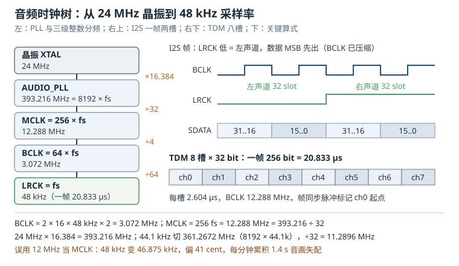

# 音频：I2S/TDM 时序、codec 与 DAPM、时钟树与 pop 音

音频在嵌入式设备里经常被当成"能响就行"的功能，直到语音对讲出现周期性咔哒、音乐播放变调、或者设备在安静房间里每隔几秒"啪"一声。这些问题几乎都能归到三个地方：**时钟树对不对**、**帧格式与槽位配不配**、**上下电顺序顺不顺**。它们分别对应 I2S/TDM 的时序、codec 的 DAPM 路径、以及功放与偏置的上电时序。

这一章把一条音频链路拆成"时钟、帧、路径、电源"四层，先给出可以手算的分频关系，再落到设备树与 ALSA 调试命令。所有频率数字都能用一张纸复核，所有寄存器行为都能在 codec 手册里找到对应章节。

## 1. 动机：无声、爆音、变调是三件不同的事

现场最常报的三类音频故障，恰好对应三条独立的因果链：

| 现象 | 直接原因 | 检查层 |
|---|---|---|
| 完全没有声音，`aplay` 却正常返回 | DAPM 路径没打通、功放没使能 | 路径与电源 |
| 每隔几秒"咔哒"一声，或语音断断续续 | 缓冲欠载（underrun）、周期太小、调度延迟 | 缓冲与实时性 |
| 音乐变调、语速不对、和视频对不上 | MCLK 与采样率不匹配、分频比算错 | 时钟树 |
| 上电/关机瞬间"砰"一声 | 偏置未建立就开功放、耦合电容放电 | 上下电时序 |
| 录音有嗡声或啸叫 | 偏置电压脏、地回路、AGC 太激进 | 模拟前端 |

这五类问题在软件上看起来都是"ALSA 报错"或"没有报错"，但排查入口完全不同。先分清"是没数据、数据晚了、还是数据速率错了"，能省掉大量盲目换 codec 的时间。

::: motivation 一句"音频有杂音"，查了三天
某台语音对讲设备在播报提示音时，每隔约 4 秒出现一次轻微的"嗒"声，播放音乐则正常。现场先换了喇叭、换了功放、加了磁珠，问题依旧。

抓 `/proc/asound/card0/pcm0p/sub0/status` 发现 `underruns` 计数在缓慢增长；再看应用是"每次提示音重新打开 PCM、写完就关"，而提示音只有 300 ms，PCM 的 period 设成了 1024 帧（21.3 ms），buffer 只有 2 个 period（42.7 ms）。应用层在两次写之间做 JSON 解析，偶尔超过 42.7 ms，硬件就把最后一段静音播完，接着补数据时产生不连续，听起来就是"嗒"。

把 buffer 加到 4 个 period（85.3 ms）、把提示音改成常开 PCM 复用，问题消失。整个过程没有换一颗器件。
:::

这个例子说明：**音频的"杂音"经常是时间问题，不是模拟问题**。先把时钟和缓冲算清楚，再动烙铁。

## 2. 直观：一条音频链路有四个时钟



上图上半部分是从 24 MHz 晶振到 48 kHz 采样率的完整分频链，下半部分是 I2S 的帧结构与 TDM 的槽位对比。先把四个时钟的角色分清：

- **MCLK**（master clock，主时钟）：codec 的参考时钟，通常是采样率的 256、384 或 512 倍；
- **BCLK**（bit clock，位时钟）：每个 BCLK 周期传 1 bit；
- **LRCK**（left/right clock，帧时钟，也叫 WS）：每个周期是一帧，I2S 里一帧包含左右两个声道；
- **PCLK/APLL**：SoC 内部的音频 PLL 输出，是 MCLK 的源头。

四个时钟不是"随便谁快谁慢"，而是严格的整数或分数关系。关系错了，声音要么变调，要么根本出不来。

### 2.1 I2S 时序：一帧两个槽

I2S 总线只有三根信号：BCLK、LRCK（WS）、SD（串行数据）。标准时序的要点：

1. LRCK 低电平表示左声道，高电平表示右声道；LRCK 在 BCLK 的某个边沿切换；
2. 数据在 LRCK 切换后的**第二个 BCLK 边沿**开始传 MSB，也就是常说的"MSB 延迟一个 BCLK"；
3. 数据在 BCLK 的一个边沿移出、另一个边沿采样，接收端按 BCLK 周期逐位接收；
4. 一帧的位数 = 每个声道的槽位数 × 2。16 bit 数据放进 32 bit 槽，就是每帧 64 个 BCLK。

"槽位"（slot）是这里最容易混淆的概念：**有效数据位数**和**槽位宽度**是两件事。16 bit 的采样值可以放进 16 bit 槽（每帧 32 个 BCLK），也可以放进 32 bit 槽（每帧 64 个 BCLK，高位对齐、低位补零）。绝大多数 codec 的默认 I2S 模式是 32 bit 槽，因为它兼容 16/20/24/32 bit 数据，切换位深时不用改 BCLK。

这一点直接决定了第 3.1 节公式里"位深"该取什么：公式按"每个采样值占两个位宽的槽"计，32 bit 槽对应的输入值是 16；24 bit 数据放进 32 bit 槽时，帧长仍是 64 bit，BCLK 不变，变化的只是数据在槽内的对齐和补零方式。**帧长由槽宽决定，不由有效位深决定**，这是配置 I2S 时最该先记住的一句话。

### 2.2 TDM：一帧八个槽

时分复用（Time Division Multiplexing，TDM）把一帧切成 N 个槽，每个槽放一个声道。它和 I2S 的区别：

- I2S 用 LRCK 电平区分左右，一帧固定两个槽；
- TDM 用一帧一个同步脉冲（frame sync）标记帧头，槽号靠计数得到，一帧可以有 4、8、16 个槽；
- TDM 的 BCLK 必须等于"槽宽 × 槽数 × 采样率"，槽宽通常是 32 bit。

8 通道麦克风阵列、车载多声道、会议终端常用 TDM，因为它用一根数据线就能传 8 个通道，省引脚也省走线。代价是**所有通道共享一个 BCLK**，任何一个通道的槽宽配错，整帧都会错位。

### 2.3 codec 内部：DAC、混音与 DAPM

codec 不是"数字进、模拟出"的黑盒，它内部有一张模拟开关网络：DAC 输出可以走耳机、走扬声器、走混音器；麦克风可以走 PGA、走旁路、走 ADC。动态音频电源管理（Dynamic Audio Power Management，DAPM）就是这张网络的电源管理器。

DAPM 的模型只有两个概念：

- **widget**：网络里的节点，比如"DAC"、"耳机放大器"、"扬声器输出"、"麦克风偏置"；
- **route**：节点之间的有向边，比如"DAC → 耳机放大器"。

只有当一条从输入到输出的完整路径被用户空间打开（`amixer` 里的开关、或 PCM 流启动）时，DAPM 才沿着这条路径依次给 widget 上电，并按驱动的时序要求插入延时。路径断开时按相反顺序下电。这套机制解决两个问题：**不用的模块不耗电**，以及**上电顺序由驱动保证，而不是靠应用碰运气**。

DAPM 管不到 codec 外面的器件。外接功放的使能脚、外部麦克风偏置、天线开关，都要通过 `gpio` widget、`supply` widget 或 `regulator` widget 接进这张图，否则就会出现"软件以为关了、硬件还在响"或者"上电顺序反了、砰一声"。

### 2.4 时钟树：从晶振到采样率

音频时钟树的典型结构是：

```
24 MHz 晶振 → AUDIO_PLL（分数分频）→ 整数分频 → MCLK → BCLK 分频 → LRCK
```

关键约束是**采样率必须由 MCLK 整数或分数分频得到，且误差要在 ppm 级**。48 kHz 家族（48k、96k、192k）和 44.1 kHz 家族（44.1k、88.2k、176.4k）需要两组不同的 PLL 频率，因为 48k 与 44.1k 的比值是 160:147，不是整数关系。一颗 PLL 想同时覆盖两个家族，只能靠分数分频，而分数分频会引入小数杂散（fractional spur），这就是为什么很多 SoC 提供两颗音频 PLL。

### 2.5 谁做 master：SoC 还是 codec

I2S 的 BCLK 和 LRCK 必须由一方产生：

- **SoC 做 master**（`bitclock-master`、`frame-master` 指向 CPU DAI）：时钟由 SoC 的 AUDIO_PLL 分频得到，软件可控，多 codec 场景好同步；
- **codec 做 master**：codec 用自己的晶振产生 MCLK/BCLK/LRCK，SoC 只做从设备。手机里常见，因为 codec 的时钟更干净，且待机时 SoC 可以关掉音频 PLL。

两种模式没有绝对优劣，但**混用会出问题**：设备树里两边都声明 master，或者一边声明 master 另一边却按 master 配置分频，结果是 BCLK 上出现两个源打架，现象是声音断续或完全无声。

### 2.6 两个采样率家族与两颗 PLL

44.1 kHz 来自 CD 时代（每帧 588 个采样、75 帧每秒，算下来 44,100 Hz），48 kHz 来自数字电话与广播（30 帧 × 1600 采样）。两者的比值是

$$\frac{48{,}000}{44{,}100} = \frac{160}{147} = 1.088435\ldots$$

不是整数，也不是简单的分数。这意味着**同一颗 PLL 很难同时精确产生两个家族的时钟**：要么用分数分频（引入小数杂散），要么准备两颗 PLL（48k 家族一颗、44.1k 家族一颗）。i.MX 8M 的 AUDIO_PLL1/2 就是这种设计，分别对应 393.216 MHz 和 361.2672 MHz。

软件上要做的判断是：这颗 SoC 的音频 PLL 是否支持"按采样率切换"。如果只支持固定频率，那么 44.1 kHz 只能靠近似分频，误差在 2 cent 量级；如果产品要播放音乐，这个误差在长时间播放中会累积成明显的音画不同步，必须切换 PLL 或做软件重采样（resampling）。

## 3. 定量关系：BCLK、MCLK 与分频比

### 3.1 BCLK 与帧长

I2S 的位时钟由"每帧位数 × 采样率"决定：

$$\text{BCLK} = 2 \times b \times f_s \times N_{ch}$$

其中 $b$ 是每个声道槽位宽度的一半（32 bit 槽取 16，16 bit 槽取 8），$f_s$ 是采样率，$N_{ch}$ 是声道数。系数 2 来自 I2S 的"一个采样值占两个位宽"的槽位约定：16 bit 数据放进 32 bit 槽，一帧两个声道就是 $2 \times 16 \times 2 = 64$ 个 BCLK。把 $b$ 理解成"半个槽宽"而不是"有效位深"，公式就不会在 24 bit 数据配 32 bit 槽时给出偏大的结果。代入 16 bit、48 kHz、立体声：

$$\text{BCLK} = 2 \times 16 \times 48{,}000 \times 2 = 3{,}072{,}000\ \text{Hz}$$

帧长 $L_{frame} = 2bN_{ch} = 64$ bit，所以 $\text{BCLK} = L_{frame} \times f_s = 64 \times 48{,}000 = 3.072$ MHz。这个式子的物理含义比"乘以 2"更清楚：**BCLK 就是帧长乘以帧率**。

TDM 用同一套逻辑，只是帧长换成"槽宽 × 槽数"：

$$\text{BCLK}_{TDM} = W_{slot} \times N_{slot} \times f_s$$

8 槽、32 bit 槽宽、48 kHz 时，$\text{BCLK} = 32 \times 8 \times 48{,}000 = 12.288$ MHz。注意这时 BCLK 已经等于 256 倍采样率，和 MCLK 同频，布线时要把这两根时钟当成敏感信号对待。

### 3.2 MCLK 与采样率

codec 需要一个远高于 BCLK 的主时钟来做过采样和内部 DSP。常见比例是 256、384、512 倍采样率：

$$f_{MCLK} = K \times f_s, \qquad K \in \{256, 384, 512\}$$

48 kHz、K=256 时 $f_{MCLK} = 12.288$ MHz；44.1 kHz 时 $f_{MCLK} = 11.2896$ MHz。这个数字不是随便取的：它要同时满足"能被 BCLK 整数分频"和"codec 内部 PLL/过采样器能锁定的范围"。$K=256$ 之所以最常见，是因为它同时兼容 16/24/32 bit 槽和大多数 codec 的默认分频表。

MCLK 与 BCLK 的关系可以直接由两个公式相除得到：

$$\frac{f_{MCLK}}{\text{BCLK}} = \frac{K}{2bN_{ch}}$$

48 kHz、16 bit、立体声、K=256 时比值是 $256/64 = 4$，即 MCLK 四分频得到 BCLK。

### 3.3 PLL 与分频比怎么算

以 i.MX 8M 的音频 PLL 为例：AUDIO_PLL1 输出 393.216 MHz，AUDIO_PLL2 输出 361.2672 MHz。这两个数不是随机的：

$$393{,}216{,}000 = 48{,}000 \times 8192, \qquad 361{,}267{,}200 = 44{,}100 \times 8192$$

也就是说 PLL 输出是采样率的 8192 倍，再除以 32 就得到 256 倍采样率的 MCLK：

$$f_{MCLK} = \frac{8192 f_s}{32} = 256 f_s$$

48 kHz：$393.216/32 = 12.288$ MHz；44.1 kHz：$361.2672/32 = 11.2896$ MHz。

从 24 MHz 晶振到这两个频率需要分数分频：

$$\frac{393.216}{24} = 16.384 = 16 + \frac{48}{125}, \qquad \frac{361.2672}{24} = 15.0528 = 15 + \frac{33}{625}$$

分母 125 和 625 都不大，说明用"整数部分 + 分数部分"的 PLL 架构可以做到很小的小数误差。实际配置时，SoC 的时钟驱动会给出 `assigned-clock-rates`，由 CCM 自动算出这些分频值；但**验证时必须自己算一遍**，因为驱动可能悄悄给你选了另一颗 PLL。

### 3.4 采样率误差：cent 与累积漂移

采样率误差用音分（cent）表示，一个半音是 100 cent：

$$\text{error}_{cent} = 1200 \times \log_2 \frac{f_{actual}}{f_{nominal}}$$

如果 MCLK 用 24 MHz 二分频得到 12 MHz（而不是 12.288 MHz），48 kHz 会变成 $12{,}000{,}000/256 = 46{,}875$ Hz：

$$\text{error} = 1200 \times \log_2 \frac{48{,}000}{46{,}875} = 41.06\ \text{cent}$$

41 cent 接近半个半音，人耳能明显听出"跑调"。更严重的是**累积漂移**：2.34% 的速率误差意味着每播放 60 秒，音画就错开 $60 \times 0.0234 = 1.4$ 秒。唇音同步的容忍阈值大约是 40 ms，也就是说不到 2 秒就会明显对不上。

反过来，44.1 kHz 在只有 12.288 MHz MCLK 的系统里：$12.288/44.1 = 278.64$，分频器只能取 279，得到 $12.288/279 = 44{,}043$ Hz，误差 0.129%，约 2.24 cent。这个误差听感上可以接受，但长时间播放仍会累积；要求严格时应该切换 PLL 到 361.2672 MHz。

### 3.5 缓冲、周期与延迟

ALSA 把 PCM 缓冲切成若干周期（period），应用每次处理一个周期：

$$T_{period} = \frac{N_{period}}{f_s}, \qquad T_{buffer} = N_{periods} \times T_{period}$$

48 kHz、周期 1024 帧时 $T_{period} = 21.33$ ms；4 个周期就是 85.33 ms。这 85.33 ms 是应用必须在这个时间内把数据补上的**硬预算**，超过就欠载（underrun），听感是"咔哒"或断音。

延迟则是另一回事：端到端延迟大致等于"一个周期 + 编解码处理 + 传输"，周期越小延迟越低，但欠载风险越高。语音通话通常取 256 到 512 帧（5.33 到 10.67 ms），音乐播放可以取 1024 到 2048 帧。

### 3.6 pop 音的 RC 与上下电时序

pop 音的根源是**直流偏置的突变**。codec 的输出偏置通常在 AVDD/2（比如 1.65 V），耳机或功放通过耦合电容隔直。如果在上电瞬间电容还没充到偏置电压就打开功放，电容会被当成短路，产生一个幅度接近偏置电压的阶跃：

$$I_{peak} = \frac{V_{bias}}{R_{load}}, \qquad \tau = R_{load} C_{couple}$$

100 µF 耦合电容、32 Ω 耳机负载时 $\tau = 3.2$ ms，5 个时间常数约 16 ms 才基本稳定；峰值电流 $1.65/32 = 51.6$ mA，峰值功率 85 mW，足以听见"砰"的一声。所以上下电时序必须满足：**偏置先建立、电容先充满、再开功放；关机时先关功放、再断偏置**。

## 4. 算例：48 kHz 语音、44.1 kHz 音乐与 8 麦阵列

**第一部分：48 kHz 立体声播放链。**

需求：16 bit、48 kHz、立体声、MCLK 256 倍。

$$\text{BCLK} = 2 \times 16 \times 48{,}000 \times 2 = 3.072\ \text{MHz}$$

$$f_{MCLK} = 256 \times 48{,}000 = 12.288\ \text{MHz}$$

$$\text{PLL} = 8192 \times 48{,}000 = 393.216\ \text{MHz}$$

分频链：393.216 MHz ÷ 32 = 12.288 MHz（MCLK）→ ÷ 4 = 3.072 MHz（BCLK）→ ÷ 64 = 48 kHz（LRCK）。三个分频比都是整数，没有分数杂散。

时间尺度：BCLK 周期 $1/3.072\ \text{MHz} = 325.52$ ns；一个 32 bit 槽 10.417 µs；一帧 20.833 µs；LRCK 半周期也是 10.417 µs。用示波器量 BCLK 和 LRCK，应该看到严格的 64:1。

**第二部分：8 通道 TDM 麦克风阵列。**

需求：8 通道、32 bit 槽、48 kHz。

$$\text{BCLK} = 32 \times 8 \times 48{,}000 = 12.288\ \text{MHz}$$

一帧 256 bit，帧长 20.833 µs，每槽 2.604 µs。此时 BCLK 与 MCLK 同频，都是 12.288 MHz；如果 SoC 只有一个 I2S 控制器，要让 TDM 和播放共用 BCLK，必须确认 codec 支持"播放+录音共用帧"（多数 codec 支持，但槽位分配要查手册）。

**第三部分：44.1 kHz 音乐路径。**

需求：44.1 kHz、16 bit、立体声。若系统只有 48 kHz 家族的 PLL（12.288 MHz），分频比如前所述只能取 279，实际 44,043 Hz，误差 2.24 cent。若切换到 AUDIO_PLL2：

$$f_{MCLK} = 361.2672/32 = 11.2896\ \text{MHz}$$

$$\text{BCLK} = 2 \times 16 \times 44{,}100 \times 2 = 2.8224\ \text{MHz}$$

$$11.2896/2.8224 = 4$$

分频比仍是 4。注意 44.1 kHz 的 BCLK 是 2.8224 MHz，与 48 kHz 的 3.072 MHz 不同；如果 codec 的 BCLK 分频器是固定的，就得同时改 MCLK 和 BCLK 两级。

**第四部分：缓冲与欠载预算。**

语音场景取周期 256 帧、3 个周期：$T_{period} = 5.333$ ms，$T_{buffer} = 16$ ms。如果应用的最坏调度延迟是 12 ms（比如被 Flash 擦除或 GC 阻塞），16 ms 的预算只剩 4 ms 余量；把周期改成 512 帧、3 个周期就是 32 ms，余量 20 ms。欠载计数在 `/proc/asound/card0/pcm0p/sub0/status` 里，压测时应该始终为 0。

**第五部分：pop 音时序。**

假设 codec 偏置建立需要 100 ms，DAC 去静音需要 50 ms，功放使能后稳定需要 20 ms。上电顺序应为：

1. 提供 MCLK，等待 PLL 锁定（约 1 ms）；
2. 释放 codec 复位，等待偏置建立（100 ms）；
3. DAC 去静音，等待 50 ms 让耦合电容充电；
4. 拉高功放使能，等待 20 ms；
5. 开始送 PCM 数据。

总延时约 171 ms。关机顺序完全相反，且每一步之间要留同样的时间。任何一步提前，都会在示波器上看到输出端的阶跃。

## 5. 工程含义：设备树、DAPM 与调试

### 5.1 设备树：simple-audio-card

```dts
sound {
    compatible = "simple-audio-card";
    simple-audio-card,name = "voice-codec";
    simple-audio-card,format = "i2s";
    simple-audio-card,bitclock-master = <&dailink0_master>;
    simple-audio-card,frame-master = <&dailink0_master>;
    simple-audio-card,mclk-fs = <256>;

    simple-audio-card,widgets =
        "Speaker", "Speaker",
        "Headphone", "Headphone",
        "Microphone", "Mic Jack";

    simple-audio-card,routing =
        "Speaker", "SPK_OUT",
        "Headphone", "HP_OUT",
        "MIC_IN", "Mic Jack";

    dailink0_master: simple-audio-card,cpu {
        sound-dai = <&sai2>;
        system-clock-frequency = <12288000>;
    };

    simple-audio-card,codec {
        sound-dai = <&wm8960>;
    };
};
```

几个字段的含义：

- `format = "i2s"` 决定 DAI 的帧格式，可选 `i2s`、`right_j`、`left_j`、`dsp_a`、`dsp_b`；格式选错，现象是声音变成噪声或只有单声道；
- `bitclock-master`、`frame-master` 指定谁产生 BCLK 和 LRCK，必须和 codec 的寄存器配置一致；
- `mclk-fs = <256>` 告诉 ASoC 按 256 倍采样率设置 MCLK，驱动据此调用 `clk_set_rate`；
- `routing` 是 DAPM 的 route 表，sink 在左、source 在右，写反了路径不通。

### 5.2 DAPM 的调试

DAPM 的运行时状态在 debugfs 里：

```bash
cat /sys/kernel/debug/asoc/<card>/dapm/*           # 每个 widget 的供电状态
cat /sys/kernel/debug/asoc/<card>/dapm_pop_time    # 上电时序的延时记录
amixer -c 0 contents                               # 所有 kcontrol 的当前值
amixer -c 0 sset 'Speaker' on
```

`dapm_pop_time` 会列出每个 widget 的上电延时，是排查 pop 音的第一手资料：如果功放使能和偏置建立之间没有延时，这里会显示 0。

外接功放的使能脚要接进 DAPM，有两种做法：

```dts
/* 方式一：gpio widget */
sound {
    simple-audio-card,widgets = "Speaker", "Speaker";
    simple-audio-card,routing = "Speaker", "SPK_OUT";
};

/* 方式二：用 regulator 给功放供电，由 DAPM 的 supply widget 控制 */
```

如果功放使能脚直接接在 GPIO 上、软件在 PCM 启动后才拉高，那么 DAPM 上电时功放还是关的，第一帧数据会被丢掉；反过来，软件在 PCM 停止后忘记拉低，功放就一直耗电。这两种现象分别表现为"开头一小段没声音"和"待机电流偏大"。

### 5.3 上下电时序的代码落点

ASoC 把时序钩子放在 DAI 和 codec 的 `set_bias_level` 里：

- `SND_SOC_BIAS_OFF` → `SND_SOC_BIAS_STANDBY`：给 codec 上电、建立 VMID；
- `SND_SOC_BIAS_STANDBY` → `SND_SOC_BIAS_PREPARE`：PLL 锁定、时钟稳定；
- `SND_SOC_BIAS_PREPARE` → `SND_SOC_BIAS_ON`：DAC 去静音、功放使能。

延时用 `msleep()` 或 `regmap` 的 `poll` 实现，不要用忙等。codec 手册里的 "VMID charge time" 通常按耦合电容和内部电阻算，给的是典型值；实际板上电容越大，需要的时间越长。

### 5.4 ALSA 调试路径

```bash
aplay -l                                   # 列出 PCM 设备
aplay -D hw:0,0 -r 48000 -c 2 -f S16_LE test.wav
cat /proc/asound/card0/pcm0p/sub0/hw_params  # 实际生效的 rate/format/period
cat /proc/asound/card0/pcm0p/sub0/status     # state 与 xrun 计数
speaker-test -D hw:0,0 -c 2 -r 48000 -t sine -l 1
dmesg | grep -iE "asoc|sai|wm8960|underrun"
```

判断"时钟对不对"最快的办法是量 BCLK/LRCK 的频率比：48 kHz、16 bit、立体声应该是 64:1；如果量到 32:1，说明槽位是 16 bit 而不是 32 bit，或者 codec 配成了右对齐。判断"数据对不对"则看 `hw_params` 里的 `rate`、`format`、`period_size` 是否和应用预期一致。

### 5.5 时钟抖动与布局

音频时钟的质量不只看频率，还看抖动（jitter）。采样时刻的抖动会直接变成量化噪声，其信噪比上限可以估算为

$$\text{SNR}_{jitter} = -20 \log_{10}(2\pi f_{in} t_{jitter})$$

$f_{in}$ 是信号频率，$t_{jitter}$ 是时钟抖动的均方根值。100 ps 抖动、1 kHz 信号时，$2\pi \times 1000 \times 10^{-10} = 6.28 \times 10^{-7}$，对应约 124 dB；同样是 100 ps，10 kHz 信号就只有 104 dB。这说明**高频信号对抖动更敏感**，也说明"能播 1 kHz 正弦"不代表时钟合格。

布局上要守住三条：

1. MCLK 走线尽量短，远离 DC-DC 的 SW 节点和 Class-D 功放的输出；
2. MCLK、BCLK、LRCK 不要和 I2C、SPI 的长走线并行，必要时加地线隔离；
3. codec 的模拟电源与数字电源分开供电，VMID 的去耦电容靠近引脚，地回流不要穿过数字区。

如果板上有多颗 codec 或多路 I2S，优先让它们共用一个 MCLK 源，避免"各唱各的调"；确实需要独立时钟时，用同一颗 PLL 的不同整数分频，而不是各自起晶振。

## 6. 常见坑：现象、原因与解决

::: pitfall 坑一：`aplay` 正常返回但完全没有声音
**现象**：命令不报错，进度条走完，喇叭一点声音都没有；`amixer` 里 Master 已经拉满。

**原因**：DAPM 路径没打通。常见是 `routing` 里 sink/source 写反、外接功放的使能脚没接进 DAPM、或者 codec 的输出 mixer 没打开。

**解决**：先看 `/sys/kernel/debug/asoc/<card>/dapm/` 里 "Speaker"、"HP_OUT" 这些 widget 是否处于 `On`；再逐个 `amixer` 打开输出开关；最后确认功放使能脚的 GPIO 状态。若 widget 全 On 仍无声，量功放输入是否有信号，把数字域和模拟域分开。
:::

::: pitfall 坑二：音乐变调、语速偏快，和视频对不上
**现象**：提示音听起来"尖"了一点，长视频播放几分钟后唇音不同步；用音频分析仪量频率偏高约 2.3%。

**原因**：MCLK 不是采样率的整数倍。例如用 24 MHz 二分频得到 12 MHz 当 MCLK，而 codec 按 256 倍关系推出 46.875 kHz，实际播放速度比标称快 2.34%。

**解决**：按第 3.3 节复算 PLL 与分频链，确认 `mclk-fs`、`assigned-clock-rates` 和 codec 的 MCLK 分频寄存器三者一致；用频率计量 MCLK 和 LRCK，算比值是否为 256。不要把"能出声"当成"时钟对"。
:::

::: pitfall 坑三：每隔几秒"咔哒"一声，语音断续
**现象**：播放长音频或语音通话时周期性出现爆音，`dmesg` 偶发 underrun 或 "XRUN" 日志。

**原因**：PCM 缓冲太小或应用调度不及时。周期 1024 帧、2 个 period 时只有 42.7 ms 预算，应用做一次 JSON 解析或 Flash 写就可能超时。

**解决**：把 period 加到 4 个、周期大小按最坏调度延迟的 2 到 3 倍取；把音频线程设成实时优先级（`SCHED_FIFO`）并绑核；用 `perf sched` 或 ftrace 看唤醒延迟。目标是压测时 xrun 计数保持 0。
:::

::: pitfall 坑四：上电或关机时"砰"一声
**现象**：开机第一次出声、或关机瞬间，喇叭有明显低频冲击；耳机里更明显。

**原因**：偏置电压还没建立就打开了功放，或者关机时先断了偏置、功放还在放大，耦合电容的放电电流被放大成脉冲。

**解决**：严格按"时钟→偏置→去静音→功放"的顺序上电，每步之间加延时；关机反序；给功放加静音脚（mute）并在断偏置前先拉低；用示波器看输出端的直流阶跃，而不是靠耳朵判断。
:::

::: pitfall 坑五：录音有嗡嗡声或自激啸叫
**现象**：录音底噪里带 50 Hz 工频或高频啸叫；扬声器靠近麦克风时啸叫。

**原因**：麦克风偏置电源不干净（来自开关电源）、地回路形成环路、或者 AGC 增益过高把回授放大。

**解决**：给麦克风偏置加 RC 滤波或独立 LDO；检查模拟地和数字地的单点连接；降低 PGA 增益、打开高通滤波；用 `arecord` 录一段静音分析频谱，确认干扰频率后再改电路。
:::

## 7. 自测题

<details><summary>题一：48 kHz、24 bit 数据、32 bit 槽、立体声，BCLK 是多少？若 MCLK 取 256 倍采样率，MCLK 与 BCLK 的比值是多少？</summary>

按槽位算帧长：每声道 32 bit，两个声道 64 bit，所以

$$\text{BCLK} = 64 \times 48{,}000 = 3.072\ \text{MHz}$$

若套用 $2 \times b \times f_s \times N_{ch}$，$b$ 取 16（32 bit 槽 = 2 × 16），得到同样结果 $2 \times 16 \times 48{,}000 \times 2 = 3.072$ MHz。

MCLK $= 256 \times 48{,}000 = 12.288$ MHz，比值 $12.288/3.072 = 4$。

</details>

<details><summary>题二：8 通道 TDM、32 bit 槽、48 kHz，BCLK 是多少？一帧多少 bit、多少微秒？每个槽多少微秒？</summary>

$$\text{BCLK} = 32 \times 8 \times 48{,}000 = 12.288\ \text{MHz}$$

一帧 256 bit，帧长 $256/12.288\ \text{MHz} = 20.833\ \mu s$；每槽 32 bit，$32/12.288\ \text{MHz} = 2.604\ \mu s$。

一帧正好是一个采样周期 $1/48{,}000 = 20.833\ \mu s$，两者相等可以作为验算。

</details>

<details><summary>题三：24 MHz 晶振经 PLL 得到 393.216 MHz，再 32 分频得到 MCLK。验证 48 kHz 时 MCLK 是否为 256 倍采样率；若误用 12 MHz 作 MCLK，采样率误差多少 cent？</summary>

$393.216/32 = 12.288$ MHz，$12.288/0.048 = 256$，成立。

误用 12 MHz 时，$12{,}000{,}000/256 = 46{,}875$ Hz，误差

$$1200 \times \log_2 \frac{48{,}000}{46{,}875} = 41.06\ \text{cent}$$

约半个半音，且 2.34% 的速率误差每分钟累积 1.4 秒，唇音同步会明显失配。

</details>

<details><summary>题四：语音应用用 48 kHz、周期 512 帧、3 个 period。缓冲时间是多少？若最坏调度延迟 20 ms，是否安全？</summary>

$T_{period} = 512/48{,}000 = 10.667$ ms，$T_{buffer} = 3 \times 10.667 = 32$ ms。

最坏延迟 20 ms 时余量 12 ms，安全但不算宽裕；把 period 加到 4 个（42.67 ms）余量 22.7 ms，更稳。注意延迟增加会牺牲通话的"跟手感"，需要在欠载与延迟之间权衡。

</details>

<details><summary>题五：耦合电容 100 µF、耳机 32 Ω、偏置 1.65 V。求时间常数、峰值电流，并解释为什么上电要延时约 5 个时间常数。</summary>

$\tau = 32 \times 100 \times 10^{-6} = 3.2$ ms；峰值电流 $1.65/32 = 51.6$ mA。

电容电压按 $1 - e^{-t/\tau}$ 建立，5τ = 16 ms 时达到 99.3%，残余直流阶跃约 11 mV，已经听不见。若在 1τ（3.2 ms）时就打开功放，残余约 63% 的偏置会变成冲击，所以时序要留足 5τ。

</details>

## 8. 参考资料

- Linux 内核文档 `Documentation/sound/soc/overview.rst`、`clocking.rst`：ASoC 的分层、DAI 与时钟设置。
- Linux 内核文档 `Documentation/sound/soc/dapm.rst`：widget 类型、route 语法、路径上电与调试节点。
- Philips Semiconductors，《I2S Bus Specification》：SCK/WS/SD 时序与 MSB 对齐规则。
- Linux 内核绑定 `Documentation/devicetree/bindings/sound/simple-card.yaml`：`mclk-fs`、`dai-format`、master 字段。
- Wolfson Microelectronics，《WM8960 Datasheet》：MCLK 分频表、VMID 建立时间与 pop 抑制。
- NXP，《i.MX 8M Applications Processor Reference Manual》CCM 章节：AUDIO_PLL1/2 的频率与分数分频。
- ALSA 项目，《Procfile.txt》：`hw_params`、`status`、xrun 计数的含义。
- Linux 内核源码 `sound/soc/soc-dapm.c`、`sound/soc/generic/simple-card.c`：路径上电与 DAI 链接的实现。
