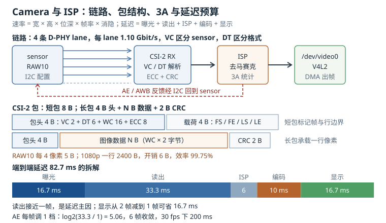

# Camera 与 ISP：CSI-2 速率、V4L2 管线与 3A 收敛

摄像头是嵌入式设备里**唯一同时受四套带宽约束**的外设：sensor 的像素读出、CSI-2 的差分链路、ISP 的流水线、DDR 的读写。任何一环不够，现象都是"帧率上不去"或者"画面卡住"，而软件日志往往只给你一句 `VIDIOC_DQBUF: Resource temporarily unavailable`。

这一章把一条从光子到像素的路径拆成五段：MIPI CSI-2（Camera Serial Interface 2，摄像头串行接口）的通道与包、sensor 的寄存器序列、V4L2（Video for Linux 2）的管线与 media controller、ISP（Image Signal Processor，图像信号处理器）的功能块、以及自动曝光/自动白平衡/自动对焦（合称 3A）的收敛。所有速率都能用"宽 × 高 × 位深 × 帧率"手算，所有延迟都能按段相加。

## 1. 动机：黑屏、花屏、慢帧率是三件不同的事

摄像头的故障现象很像，排查入口却完全不同：

| 现象 | 大概率在哪一段 | 先看什么 |
|---|---|---|
| 完全没数据，`DQBUF` 一直超时 | CSI-2 链路或 sensor 没出流 | sensor 的 stream 寄存器、lane 数、link frequency |
| 有数据但花屏、横条纹 | 物理层时序或 lane 映射 | lane 顺序、HS settle、走线等长 |
| 帧率只有标称的一半 | 曝光/帧长配置或 ISP 吞吐 | VTS/HTS、曝光行数、ISP 时钟 |
| 颜色发绿或发紫 | Bayer 顺序或 AWB | `media-ctl` 里的 mbus code、AWB 增益 |
| 灯光下有条纹滚动 | 工频闪烁（flicker） | 曝光时间是否为 10 ms 的整数倍 |
| 画面延迟明显 | 缓冲队列或编码 | `--stream-mmap` 的缓冲数、编码器队列深度 |

把这些混在一起查，最常见的浪费是"先换摄像头模组"——模组换了，lane 数和寄存器序列也跟着变，问题有时消失有时不消失，最后没人说得清原因。

::: motivation 一条 lane 的差别
某款双目设备用同一颗 500 万像素 sensor，A 版本接 2 条 lane，B 版本为了走线方便改成 4 条。B 版本上电后 `dmesg` 只有一行

```
csi2: virtual channel 0, data type 0x2b, frame start received
```

然后就没有 frame end，应用侧 `DQBUF` 永远超时。

原因不在 sensor：设备树里的 `data-lanes = <1 2>` 没改，接收端仍按 2 条 lane 解析，而 sensor 已经按 4 条 lane 输出，每个包被切成两半，长包的 word count 对不上，接收端等不到完整的行，自然不会产生 frame end。改设备树、重新编译 DTB 之后，B 版本一次点亮。

整个过程里，sensor 的 I2C 配置、供电、时钟全是对的——**错的只是"接收端以为有几条 lane"**。
:::

这个例子说明：CSI-2 是**两端必须完全一致**的链路。lane 数、每 lane 速率、虚拟通道、数据类型，任何一项不一致，结果都不是"降级运行"，而是"完全收不到"。

## 2. 直观：一条从光子到像素的流水线



上图左侧是 sensor 到 CSI-2 接收器的四段链路，中间是长短包的结构与虚拟通道，右侧是 ISP 的处理链与 3A 回路。

### 2.1 MIPI CSI-2：通道、包与虚拟通道

CSI-2 跑在 D-PHY 上。一条链路包含一个时钟通道和 1 到 4 条数据通道（lane），每条通道是一对差分线。D-PHY 有两种工作模式：

- **LP（Low Power）**：单端低摆幅，用于控制命令和进入/退出高速模式；
- **HS（High Speed）**：差分低摆幅，用于传数据，采用 DDR 时钟，每个时钟周期传 2 位。

一次 HS 传输的开始叫 SoT（Start of Transmission），结束叫 EoT。接收端要在 SoT 之后的一段"稳定时间"（settle）内完成采样点校准，**settle 配短了会读到错误的起始位，表现为整帧错位或花屏**。

CSI-2 在物理层之上定义了两类包：

| 类型 | 结构 | 用途 |
|---|---|---|
| 短包 | 4 字节包头 + 4 字节载荷 | 帧开始（FS）、帧结束（FE）、行开始（LS）、行结束（LE） |
| 长包 | 4 字节包头 + N 字节数据 + 2 字节 CRC | 图像行、嵌入数据 |

长包的包头只有 4 个字节，却塞了三样关键信息：虚拟通道（Virtual Channel，VC，2 位）、数据类型（Data Type，DT，6 位）、字计数（Word Count，WC，16 位），外加 8 位 ECC。**VC 让一个接收器能同时接多颗 sensor**，DT 告诉接收端"这是 RAW10 还是 YUV422"。

常见的数据类型编码：

| 格式 | DT | 打包方式 |
|---|---|---|
| RAW8 | 0x2A | 1 像素 1 字节 |
| RAW10 | 0x2B | 4 像素打包成 5 字节 |
| RAW12 | 0x2C | 2 像素打包成 3 字节 |
| YUV422 8 bit | 0x1E | 2 字节 1 像素 |
| RGB888 | 0x24 | 3 字节 1 像素 |

RAW10 的打包方式是理解带宽的关键：4 个 10 位像素正好 40 位，装进 5 个字节，所以**每像素平均 10 位，没有浪费**。但主机侧的 DMA 往往按 16 位对齐存放，内存里每像素占 2 字节，带宽比链路上多 60%。这就是"链路上 4.4 Gbps，内存里却要 7 Gbps"的来源。

### 2.2 sensor 的寄存器序列与曝光/增益

sensor 上电到出图，是一条固定的状态序列，任何一步提前都会失败：

1. **上电**：模拟电源（AVDD）、数字核心（DVDD）、I/O（DOVDD）按手册顺序上，间隔通常 1 ms 以上；
2. **时钟**：外部晶振（INCK，常见 24 MHz）稳定，sensor 的 PLL 以此为参考；
3. **复位**：拉低 `RESET` 至少 1 ms，释放后再等 1 ms 让内部寄存器复位；
4. **I2C 探测**：读芯片 ID 寄存器，确认地址与型号；
5. **PLL 与 MIPI 配置**：设置像素时钟、lane 数、每 lane 速率、连续/非连续时钟；
6. **格式配置**：分辨率、Bayer 排列、位深、裁剪窗口；
7. **出流**：写 stream 控制寄存器（多数 OmniVision 器件是 `0x0100 = 0x01`）。

顺序错了的典型现象是"能读到 ID，但写 PLL 寄存器无效"——因为 PLL 在复位释放前是锁住的。

曝光与增益是 3A 的两个执行器，理解它们要先理解**行时间**：

- 曝光时间以"行"为单位，实际曝光时长等于行数乘以行时间；
- 行时间由水平总像素（HTS）除以像素时钟决定；
- 曝光行数不能超过帧长（VTS），否则帧率会掉；
- 增益分模拟增益和数字增益，前者在 ADC 之前放大，后者在之后乘系数。

以常见的 OmniVision 风格寄存器为例：`0x3500` 到 `0x3502` 是 20 位曝光值的高中低字节，`0x3508` 到 `0x3509` 是 16 位模拟增益，`0x350A` 到 `0x350B` 是数字增益。Sony 的器件地址布局完全不同（16 位地址、8 位数据），曝光在 `0x0202` 附近。**换型号必须换寄存器表，不能靠"差不太多"**。

### 2.3 V4L2 与 media controller

V4L2 把摄像头抽象成一条由"子设备"（subdev）组成的管线。每个子设备有若干 pad，pad 之间用 link 连接，形成一张有向图：

```
sensor ──► CSI-2 receiver ──► ISP ──► /dev/video0
  │             │              │
  └─ I2C 控制   └─ 物理层       └─ 3A 统计
```

这张图由 media controller 管理，用户态通过 `/dev/media0` 查看和修改：

```bash
media-ctl -p -d /dev/media0
```

输出里每个实体（entity）会列出 pad 与当前格式。格式必须在整条链路上一致：sensor 输出 `SBGGR10_1X10/1920x1080`，接收端和 ISP 的 sink pad 也必须是同样的 mbus code 和分辨率，否则 `streamon` 会返回 `-EPIPE`。

V4L2 的另一个抽象是**控制项**（control）。曝光、增益、帧率都是控制项：

```bash
v4l2-ctl -d /dev/video0 --list-ctrls
v4l2-ctl -d /dev/video0 -c exposure=1000,analogue_gain=200
```

控制项分两类：`V4L2_CID_EXPOSURE` 这类是"手动值"，`V4L2_CID_EXPOSURE_AUTO` 是"模式开关"。把自动模式打开又去写手动值，多数驱动会忽略手动值，或者在下一次 3A 迭代时覆盖它——这是"设了曝光没反应"的常见原因。

### 2.4 ISP 的功能块

ISP 不是"把 RAW 转成 YUV"的黑盒，它是一条有固定顺序的流水线：

| 功能块 | 作用 | 典型参数 |
|---|---|---|
| 坏点校正（DPCC） | 修掉 sensor 的固定坏点 | 坏点表、阈值 |
| 镜头阴影校正（LSC） | 补偿边角亮度下降 | 网格增益表 |
| 黑电平校正（BLC） | 减去光学黑区偏置 | 每通道偏移 |
| 去马赛克（Demosaic） | 从 Bayer 恢复三通道 | 插值核、边缘方向 |
| 白平衡增益（AWB gain） | 校正色温 | R/G/B 三通道增益 |
| 颜色矩阵（CCM） | 把 sensor 色彩空间转到 sRGB | 3×3 矩阵 |
| Gamma / 色调映射 | 适配显示与编码 | 分段曲线 |
| 降噪（2D/3D） | 空域与时域降噪 | 强度、运动阈值 |
| 锐化 | 提升边缘 | 半径、强度 |

顺序不能随便换：**去马赛克必须在降噪之前**（否则噪声会被插值成彩色斑点），**CCM 必须在 Gamma 之前**（Gamma 是非线性的，先做会把颜色算错）。这也是为什么"自己用 GPU 拼一个 ISP"往往效果很差——不是算法不会写，而是顺序和定点精度不对。

3D 降噪需要额外的帧缓存，它会把内存带宽放大 2 到 3 倍。1080p30 的 YUV420 输出是 93.3 MB/s，开 3D 降噪后实际读写可能到 300 MB/s 以上，这在只有单通道 DDR3 的板子上会直接拖垮帧率。

### 2.5 3A：AE、AWB、AF

3A 是三个独立的闭环，共用 ISP 的统计信息：

- **AE（Auto Exposure，自动曝光）**：统计画面的亮度直方图，与目标亮度比较，调整曝光时间和增益；
- **AWB（Auto White Balance，自动白平衡）**：统计 R/G/B 均值，估计光源色温，调整三通道增益；
- **AF（Auto Focus，自动对焦）**：反差对焦（CDAF）靠"爬到对比度峰值"，相位对焦（PDAF）靠 sensor 内嵌的相位像素直接算离焦量。

AE 的收敛速度由"每帧调整几档"决定。常见策略是每帧最多调整 2 倍（1 档），从 1 ms 收敛到 33 ms 需要

$$\log_2 \frac{33.3}{1} = 5.06$$

即 6 帧，按 30 fps 算是 200 ms。调得更快会震荡（过冲后回摆），调得更慢则从室内走到室外要好几秒。

AWB 的经典假设是"灰世界"：整幅画面的 R/G/B 均值应该相等。这个假设在有大面积单色物体时会失效（一面红墙会让画面变青），所以工程实现通常加"色温先验"和"置信度"两层约束。

## 3. 定量：数据速率、帧率与延迟

### 3.1 CSI-2 数据速率

一帧的原始比特数由分辨率与位深决定：

$$R_{raw} = W \times H \times bpp \times fps$$

$W$、$H$ 是有效像素宽高，$bpp$ 是每像素比特数（RAW10 取 10），$fps$ 是帧率，$R_{raw}$ 单位是 bit/s。实际链路上还要传消隐期（blanking），乘一个系数：

$$R_{lane} = \frac{R_{raw} \times (1 + \beta)}{N_{lane}}$$

$\beta$ 是消隐开销比例，典型 0.10 到 0.15；$N_{lane}$ 是数据通道数；$R_{lane}$ 是每通道比特率。**这个值必须小于接收端 D-PHY 的上限**，常见 SoC 是 1.5 Gbit/s 或 2.5 Gbit/s 每通道。

代入几组典型配置：

| 配置 | 原始速率 | 含 12% 消隐 | 通道数 | 每通道数据率 | clock lane 频率 |
|---|---|---|---|---|---|
| 1080p30 RAW10 | 622.1 Mbit/s | 696.7 Mbit/s | 2 | 348.4 Mbit/s | 174.2 MHz |
| 1080p60 RAW10 | 1244.2 Mbit/s | 1393.5 Mbit/s | 4 | 348.4 Mbit/s | 174.2 MHz |
| 4K30 RAW10 | 2488.3 Mbit/s | 2786.9 Mbit/s | 4 | 696.7 Mbit/s | 348.4 MHz |
| 13 MP30 RAW10 | 3938.7 Mbit/s | 4411.3 Mbit/s | 4 | 1102.8 Mbit/s | 551.4 MHz |
| 13 MP15 RAW12 | 2363.2 Mbit/s | 2646.8 Mbit/s | 2 | 1323.4 Mbit/s | 661.7 MHz |

最后两列的关系是 $f_{link} = R_{lane}/2$：D-PHY 采用 DDR 时钟，一个时钟周期传 2 位，所以设备树里的 `link-frequencies` 是 **clock lane 频率**，不是每通道比特率。

从表里能读出两条工程结论：

1. **1080p30 用 2 条 lane 就够**，每通道 348.4 Mbit/s（clock lane 174.2 MHz），离 1.5 Gbit/s 的上限还有 4 倍余量；
2. **13 MP 全分辨率必须上 4 条 lane**，每通道约 1.103 Gbit/s（clock lane 551.4 MHz）；2 条 lane 时每通道 2.2 Gbit/s，只有 2.5 Gbit/s 的 PHY 才接得住，而且没有余量给走线损耗。

### 3.2 帧时间与曝光窗口

帧率不是"软件设的"，而是由像素时钟和总像素数决定的：

$$t_{frame} = \frac{HTS \times VTS}{f_{pix}}, \qquad fps = \frac{f_{pix}}{HTS \times VTS}$$

$HTS$ 是水平总像素（有效宽 + 水平消隐），$VTS$ 是垂直总行数（有效高 + 垂直消隐），$f_{pix}$ 是像素时钟。行时间是

$$t_{line} = \frac{HTS}{f_{pix}}$$

最大曝光时间受帧长限制：

$$T_{exp,max} = VTS \times t_{line} = t_{frame}$$

也就是说，**曝光时间最长等于一帧**。想更长曝光只能降帧率（增大 VTS）。1080p30 的典型参数是 $HTS = 2200$、$VTS = 1125$、$f_{pix} = 74.25$ MHz：

$$t_{frame} = \frac{2200 \times 1125}{74.25 \times 10^{6}} = 33.33\ \text{ms}$$

$$t_{line} = \frac{2200}{74.25 \times 10^{6}} = 29.63\ \mu\text{s}$$

最大曝光 33.33 ms，正好一帧。室内通常用 16.7 ms（半帧），室外用 1 ms 到 5 ms。

### 3.3 ISP 吞吐

ISP 的处理能力用像素率衡量：

$$R_{ISP} = W \times H \times fps$$

1080p30 是 62.2 Mpx/s，4K30 是 248.8 Mpx/s。若 ISP 每个时钟处理 2 个像素，4K30 需要 124.4 MHz 的 ISP 时钟；但要跑 3D 降噪、锐化、多级 gamma，实际每个像素要 4 到 8 个周期，时钟就得 500 MHz 以上。**这就是为什么低端 SoC 标称"支持 4K"，实际只能跑 4K15**。

内存带宽同样要算。RAW10 入、YUV420 出：

$$B_{in} = W \times H \times fps \times \frac{10}{8}, \qquad B_{out} = W \times H \times fps \times 1.5$$

1080p30 时 $B_{in} = 77.8$ MB/s，$B_{out} = 93.3$ MB/s；4K30 时输出就是 373.2 MB/s。加上 3D 降噪的 2 到 3 倍读写，单通道 DDR3-1600 的 12.8 GB/s 理论带宽也会被吃掉可观的一部分。

### 3.4 延迟预算

端到端延迟（glass-to-glass）由五段相加：

$$L_{total} = T_{exp} + T_{readout} + T_{ISP} + T_{enc} + T_{disp}$$

| 阶段 | 典型值 | 说明 |
|---|---|---|
| 曝光 | 16.7 ms | 半帧，室内 |
| 读出 | 33.3 ms | 卷帘快门逐行读出，约一帧 |
| CSI-2 + ISP | 6 ms | 流水线延迟，不是吞吐 |
| 编码 | 10 ms | H.264 1080p30 一帧 |
| 显示/传输 | 16.7 ms | 一帧缓冲 |
| 合计 | 82.7 ms | |

卷帘快门的读出时间接近一帧，这是延迟的主要来源，而且**无法通过提高帧率消除**——帧率越高，单帧读出越快，但曝光时间也随之变短。要压低延迟，只能从编码和缓冲队列下手。

## 4. 算例：13 MP sensor 的四条 lane 与 1080p 的延迟

**第一步：算链路速率。** 13 MP sensor，有效像素 4208 × 3120，RAW10，30 fps，4 条 lane：

$$R_{raw} = 4208 \times 3120 \times 10 \times 30 = 3.939\ \text{Gbit/s}$$

加 12% 消隐：

$$R_{total} = 3.939 \times 1.12 = 4.411\ \text{Gbit/s}$$

每条 lane：

$$R_{lane} = \frac{4.411}{4} = 1.103\ \text{Gbit/s}$$

对应的 clock lane 频率是 $1102.8/2 = 551.4$ MHz，设备树里的 `link-frequencies` 应写 `551400000`（按 sensor 实际 PLL 档位取整）；作为对照，1080p30 两条 lane 的 348.4 Mbit/s 对应 174.2 MHz。

接收端 1.5 Gbit/s 上限时余量 26%；2.5 Gbit/s 时余量 56%。若改成 2 条 lane，每通道 2.206 Gbit/s，只有 2.5 Gbit/s 的 PHY 能接，且走线损耗会吃掉余量。

**第二步：算内存带宽。** 一帧 RAW10 的数据量：

$$S_{frame} = \frac{4208 \times 3120 \times 10}{8} = 16.41\ \text{MB}$$

30 fps 下持续写入：

$$B_{raw} = 16.41 \times 30 = 492.3\ \text{MB/s}$$

这只是"链路上的原始数据"，还没算 ISP 的中间缓冲。如果 SoC 把 RAW 先落到 DDR 再给 ISP，这 492 MB/s 是实打实的读写；如果 ISP 直通，压力会小很多。

**第三步：算曝光与帧长。** 1080p30，$HTS = 2200$、$VTS = 1125$、$f_{pix} = 74.25$ MHz：

$$t_{line} = \frac{2200}{74.25 \times 10^{6}} = 29.63\ \mu\text{s}$$

最大曝光 $1125 \times 29.63\ \mu\text{s} = 33.33$ ms。若应用设 40 ms 曝光，驱动只能把 VTS 拉到 1350 行，帧率降到 $74.25 \times 10^{6}/(2200 \times 1350) = 25$ fps。**"设了长曝光，帧率掉了"不是 bug，是物理约束。**

**第四步：算运动模糊。** 目标 1 m/s，视野宽 5 m，画面 1920 像素，曝光 10 ms：

$$N_{blur} = \frac{1 \times 0.01}{5} \times 1920 = 3.84\ \text{像素}$$

3.84 像素的模糊在车牌识别里已经接近不可读。要压到 1 像素以内，曝光要降到 2.6 ms，代价是增益提高约 4 倍，噪声增加。

**第五步：算延迟。** 曝光 16.7 + 读出 33.3 + ISP 6 + 编码 10 + 显示 16.7 = 82.7 ms。若要满足"端到端小于 100 ms"的交互要求，这个预算只剩 17 ms 余量；把编码换成硬编码器（5 ms）能省 5 ms，把显示缓冲从 2 帧减到 1 帧能省 16.7 ms——**减缓冲比换芯片有效**。

**第六步：算 3A 收敛。** AE 每帧最多调 1 档（2 倍），从 1 ms 到 33.3 ms 要 5.06 档，6 帧收敛，200 ms。这段时间里画面会持续变亮，如果设备在"进隧道"场景下要求 100 ms 内稳定，就得允许每帧调 2 档，代价是可能过冲。

## 5. 工程含义：设备树、media-ctl 与调试

### 5.1 设备树里的链路描述

```dts
&i2c1 {
    camera: sensor@36 {
        compatible = "ovti,ov5640";
        reg = <0x36>;
        clocks = <&clk_24m>;
        clock-names = "xclk";
        reset-gpios = <&gpio1 7 GPIO_ACTIVE_LOW>;
        powerdown-gpios = <&gpio1 8 GPIO_ACTIVE_HIGH>;
        DOVDD-supply = <&reg_1v8>;
        AVDD-supply = <&reg_2v8>;

        port {
            sensor_out: endpoint {
                remote-endpoint = <&csi_in>;
                data-lanes = <1 2>;
                link-frequencies = /bits/ 64 <700000000>;
            };
        };
    };
};
```

三个字段最容易写错：

- `data-lanes = <1 2>` 里的值是**物理 data lane 索引**，数组位置才是**逻辑 lane**。CSI-2 有独立 clock lane 时，数据 lane 从 1 开始编号（绑定文档的原例就是 `data-lanes = <1 2>`，假设 clock lane 在硬件 lane 0），所以 `<1 2>` 表示"逻辑 lane 0 接物理 lane 1、逻辑 lane 1 接物理 lane 2"；4 条 lane 写 `<1 2 3 4>`。写成 `<2 1>` 则是"逻辑 lane 0 接物理 lane 2、逻辑 lane 1 接物理 lane 1"，用于走线交叉的板子——数组位置不变，变的是每个逻辑 lane 取哪条物理线。
- `link-frequencies` 是 **CSI-2 clock lane 的频率**（D-PHY 在 DDR 下工作的时钟），单位 Hz；**每条 lane 的数据率是它的 2 倍**。V4L2 的 `V4L2_CID_LINK_FREQ` 报的就是这个时钟频率，内核 `camera-sensor.rst` 也是这样定义的。它不是像素时钟，也不是总带宽。IMX219 的 456 MHz 对应 912 Mbit/s/lane；示例里的 700 MHz 对应 1.4 Gbit/s/lane，只是演示单位换算，实际要按 sensor 的模式表填写——1080p30 两条 lane（348.4 Mbit/s/lane）只需要 174.2 MHz，13 MP 四条 lane（约 1.103 Gbit/s/lane）对应 551.4 MHz。
- `clock-noncontinuous` 表示时钟通道在帧间会停，多数 sensor 默认连续时钟，配错时接收端会等不到 clock lane 的 HS 进入。

### 5.2 用 media-ctl 把链路配通

```bash
# 1. 看图
media-ctl -p -d /dev/media0

# 2. 设置 sensor 输出格式（mbus code + 分辨率）
media-ctl -d /dev/media0 --set-v4l2 \
  '"ov5640 1-0036":0[fmt:SBGGR10_1X10/1920x1080]'

# 3. 设置 CSI 接收端 sink pad 的格式，必须与上一步一致
media-ctl -d /dev/media0 --set-v4l2 \
  '"csi":0[fmt:SBGGR10_1X10/1920x1080]'

# 4. 设置 video 节点的像素格式并出流
v4l2-ctl -d /dev/video0 --set-fmt-video=width=1920,height=1080,pixelformat=RG10
v4l2-ctl -d /dev/video0 --stream-mmap=4 --stream-count=120 --stream-to=/tmp/frames
```

`SBGGR10_1X10` 里 `BGGR` 是 Bayer 排列，`10` 是位深，`1X10` 表示一个像素一个 10 位分量。**排列错了，颜色会整体偏绿或偏紫**，而且不是"调 AWB 能救回来"的那种偏。

`--stream-mmap=4` 表示申请 4 个缓冲。缓冲越多越不容易丢帧，但延迟也越大：4 个缓冲意味着最坏情况下应用拿到的是 3 帧之前的数据，30 fps 下就是 100 ms。

### 5.3 曝光与增益的调试

```bash
# 关掉自动曝光，固定手动值
v4l2-ctl -d /dev/video0 -c auto_exposure=1
v4l2-ctl -d /dev/video0 -c exposure=800,analogue_gain=120

# 看驱动实际生效的值（有些驱动会做量化）
v4l2-ctl -d /dev/video0 --get-ctrl=exposure,analogue_gain
```

判断"曝光有没有生效"，最快的办法是看**同一场景下连续两帧的亮度直方图**：如果设了 800 和 1600 两档，直方图均值不变，说明写入被 3A 覆盖了，或者寄存器地址写错了。

增益的换算要写清楚。若模拟增益是 16 位寄存器，单位是 1/16 dB，写 96 就是 6 dB，约 2 倍：

$$G_{dB} = 20 \log_{10} A, \qquad A = 10^{G_{dB}/20}$$

数字增益在 ISP 里做，放大信号的同时也放大量化噪声，**不会改善信噪比**；模拟增益在 ADC 之前做，在读噪声主导时能改善信噪比。所以暗光下应该优先加模拟增益，直到它到上限，再用数字增益补。

### 5.4 布线与 EMI

CSI-2 是差分高速信号，布线规则和 USB 3.0 类似：

1. 差分对内等长，偏差控制在 0.1 mm 量级；
2. 差分对之间保持 3 倍线宽以上的间距，避免串扰；
3. 走线尽量短，超过 10 cm 要考虑插入损耗；
4. 远离 DC-DC 的电感和 Class-D 功放输出；
5. 连接器处要有完整的地平面，不要让差分对跨分割。

走线不等长的直接后果是**通道间偏斜**，接收端采样时某些 lane 的建立时间不够，表现为固定位置的横条纹或周期性花屏。

## 6. 常见坑：现象、原因与解决

::: pitfall 坑一：能收到 frame start，但永远没有 frame end
**现象**：`dmesg` 里有 `frame start received`，应用侧 `VIDIOC_DQBUF` 一直超时；`v4l2-ctl --stream-count` 卡在 0。

**原因**：接收端与发送端的 lane 数不一致，或者 `link-frequencies` 写错。接收端按 2 条 lane 解析 4 条 lane 的数据，长包的 word count 永远对不上，行数据被丢弃，自然不会产生 frame end。也可能是虚拟通道号不匹配（多 sensor 场景）。

**解决**：先对齐设备树的 `data-lanes` 与 sensor 寄存器里的 lane 数；再确认 `link-frequencies` 等于 clock lane 频率（每 lane 比特率的一半），而不是总带宽；最后用示波器看每条 lane 上有没有 HS 突发的波形——没有波形的 lane 说明 sensor 根本没配出来。
:::

::: pitfall 坑二：画面有固定位置的横条纹或周期性花屏
**现象**：图像每隔几十行出现一条错位或彩色条纹，静止场景也复现；降低帧率后条纹位置变化。

**原因**：物理层采样问题。常见的是 HS settle 时间不够、lane 之间偏斜超预算、差分对走线不等长，或者连接器处地平面断裂导致回流路径变长。

**解决**：先用 `v4l2-ctl` 把分辨率降到一半，看条纹是否消失（降低速率能掩盖时序问题，可作为定位手段）；再量各 lane 的走线长度，控制在 0.1 mm 以内；检查接收端的 settle 配置是否与 D-PHY 版本匹配；最后在差分对两侧加地线并保证连接器处地平面连续。
:::

::: pitfall 坑三：帧率只有标称的一半，`fps` 怎么设都不对
**现象**：sensor 标称 30 fps，实际只有 15 fps；`v4l2-ctl --get-parm` 显示 30，但时间戳算出来是 15。

**原因**：曝光时间超过帧周期，驱动自动拉长了 VTS。比如 1080p30 的帧周期是 33.33 ms，应用设了 40 ms 曝光，VTS 从 1125 拉到 1350，帧率就变成 25 fps；如果设 66 ms，就掉到 15 fps。另一种可能是 ISP 吞吐不够，DMA 完成中断延迟导致丢帧。

**解决**：先读回实际曝光行数与 VTS，确认 $T_{exp} \leq t_{frame}$；再看 `/sys/kernel/debug/dri` 或 ISP 驱动的统计，确认没有 FIFO 溢出；最后检查 DDR 带宽，3D 降噪开启时带宽需求会翻倍。
:::

::: pitfall 坑四：颜色发绿或发紫，调 AWB 也没用
**现象**：画面整体偏色，白墙呈绿色或紫色；调整 AWB 增益只能轻微改变，无法校正。

**原因**：Bayer 排列配错。sensor 实际输出 `RGGB`，设备树或 `media-ctl` 里写成了 `BGGR`，去马赛克时把 R 和 B 通道对调了。这种现象在灰卡上不明显，在白墙和肤色上非常明显。

**解决**：查 sensor 数据手册的 Bayer 排列，确认 `media-ctl -p` 里的 mbus code（`RG10`、`BG10`、`GR10`、`GB10`）；用一张白纸拍一张，看直方图三个通道的均值是否接近；如果 R 和 B 完全对调，说明是排列问题而不是增益问题。
:::

::: pitfall 坑五：日光灯下有条纹滚动
**现象**：室内日光灯下画面出现横向明暗条纹，缓慢向上或向下滚动；室外正常。

**原因**：工频闪烁。50 Hz 电网的日光灯亮度以 100 Hz 波动，曝光时间不是 10 ms 的整数倍时，每行积累的光能量不同，形成条纹。卷帘快门逐行曝光，条纹就会随行号变化。

**解决**：把曝光时间固定为 10 ms 的整数倍（50 Hz）或 8.33 ms 的整数倍（60 Hz），并打开驱动的抗闪烁（anti-flicker）模式；如果必须用自动曝光，让 AE 在 10 ms 的整数倍上取档，而不是连续调节。代价是曝光档位变粗，暗光下可能要靠增益补。
:::

## 7. 自测题

<details><summary>题一：1080p30、RAW10、2 条 lane、消隐系数 1.12。求每 lane 速率；若接收端上限是 1.5 Gbit/s，余量多少？</summary>

$$R_{raw} = 1920 \times 1080 \times 10 \times 30 = 622.1\ \text{Mbit/s}$$

$$R_{total} = 622.1 \times 1.12 = 696.7\ \text{Mbit/s}$$

$$R_{lane} = \frac{696.7}{2} = 348.4\ \text{Mbit/s}$$

对应的 clock lane 频率是 $348.4/2 = 174.2$ MHz，设备树写 `link-frequencies = /bits/ 64 <174200000>`。

余量 $1.5/0.3484 = 4.3$ 倍，约 77%。所以 1080p30 用 2 条 lane 非常宽裕，这也是手机副摄普遍用 2 lane 的原因。
</details>

<details><summary>题二：13 MP（4208×3120）、RAW10、消隐系数 1.12、接收端每 lane 上限 1.5 Gbit/s、4 条 lane。最高能跑多少帧？</summary>

链路总容量：

$$R_{total,max} = 4 \times 1.5 = 6.0\ \text{Gbit/s}$$

扣掉消隐，可用于有效像素的速率：

$$R_{raw,max} = \frac{6.0}{1.12} = 5.357\ \text{Gbit/s}$$

单帧比特数 $4208 \times 3120 \times 10 = 131.29$ Mbit，所以

$$fps_{max} = \frac{5.357 \times 10^{9}}{131.29 \times 10^{6}} = 40.8\ \text{fps}$$

理论上限 40.8 fps，实际要留 20% 余量给走线损耗与重传，取 30 fps 是合理的。这也解释了为什么很多 13 MP 模组的全分辨率帧率标 30 而不是 45。
</details>

<details><summary>题三：1080p30，HTS 2200、VTS 1125、像素时钟 74.25 MHz。求帧时间、行时间、最大曝光；若曝光设 50 ms，帧率变成多少？</summary>

$$t_{frame} = \frac{2200 \times 1125}{74.25 \times 10^{6}} = 33.33\ \text{ms}$$

$$t_{line} = \frac{2200}{74.25 \times 10^{6}} = 29.63\ \mu\text{s}$$

最大曝光 $= 1125 \times 29.63\ \mu\text{s} = 33.33$ ms。

50 ms 曝光需要 $VTS = 50/0.02963 = 1688$ 行，帧率 $= 74.25 \times 10^{6}/(2200 \times 1688) = 20$ fps。**曝光与帧率是同一个预算的两端**，想同时要长曝光和高帧率，只能提高像素时钟或减小消隐。
</details>

<details><summary>题四：目标 2 m/s，视野宽 8 m，画面 1920 像素，曝光 8 ms。求运动模糊像素数；要压到 2 像素以内，曝光要降到多少？</summary>

$$N_{blur} = \frac{2 \times 0.008}{8} \times 1920 = 3.84\ \text{像素}$$

压到 2 像素：$T_{exp} = 2 \times 8/(2 \times 1920) = 4.17$ ms。

曝光缩短一半，进光量减半，需要把增益提高约 2 倍（6 dB）。如果模拟增益已经到上限，就只能接受噪声上升或者加补光。**运动模糊和噪声是同一个曝光预算的两面**。
</details>

<details><summary>题五：端到端延迟 82.7 ms 由哪几段组成？如果要求小于 60 ms，最有效的两个改动是什么？</summary>

组成：曝光 16.7 + 读出 33.3 + ISP 6 + 编码 10 + 显示 16.7 = 82.7 ms。

要降到 60 ms，缺口 22.7 ms。两个最有效的改动：

1. **把显示缓冲从 2 帧减到 1 帧**，省 16.7 ms。这是纯粹的软件配置，不增加成本；
2. **换硬编码器**（10 ms 降到 5 ms），省 5 ms。

两项合计 21.7 ms，刚好接近目标。继续压只能缩短曝光（牺牲暗光）或提高帧率（提高读出速度但降低单帧曝光）。**延迟优化先看缓冲，再看编码，最后才动 sensor。**
</details>

## 8. 参考资料

- MIPI Alliance，《MIPI CSI-2 Specification v2.1》：包格式、数据速率与虚拟通道相关章节。
- MIPI Alliance，《MIPI D-PHY Specification v2.0》：HS/LP 时序、settle 与 SoT/EoT 定义。
- Linux 内核文档 `Documentation/media/kapi/v4l2-subdev.rst`：pad、format、link 的协商规则。
- Linux 内核绑定 `Documentation/devicetree/bindings/media/video-interfaces.txt`：`data-lanes`、`clock-lanes`、`link-frequencies`。
- OmniVision，《OV5640 Datasheet》与软件应用笔记：上电时序、PLL 配置、`0x3500` 与 `0x3508` 寄存器。
- Sony，《IMX219 Datasheet》：曝光与增益寄存器、MIPI 输出配置。
- Rockchip，《RKISP 与 RKAiq 开发指南》：ISP 功能块顺序、3A 在用户态的统计与迭代。
- libcamera 项目文档《Pipeline Handler》：media controller 图在真实产品中的组织方式。
