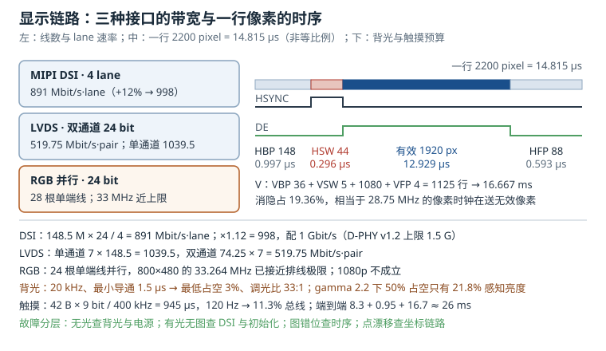

# 显示与触摸：从像素到手指的两条链路

一块带触摸的显示屏，在系统里其实由两条互不依赖的链路组成：**显示链路**把帧缓冲里的像素送到玻璃上，**触摸链路**把手指位置送回输入子系统。它们共用一块玻璃、一条 FPC、一路电源，但故障表现和数据通路完全不同。现场把"屏有问题"统称花屏，往往会在错误的链路上浪费几天：花屏先查背光、无显示先换触摸、触摸漂移先换屏，都是典型的方向性错误。

这一章按"接口怎么选、时序怎么算、背光怎么调、触摸怎么接、故障怎么定位"的顺序展开。所有带宽与时间数字都可以用手算复核，所有寄存器与设备树字段都能在主线内核或厂商手册里找到出处。

## 1. 动机：花屏、闪烁与漂移是三类不同的问题

屏幕是嵌入式设备里最贵的单个外设之一，也是最容易在环境试验中暴露问题的部件。低温下花屏、高温下闪烁、静电后触摸漂移，这三类现象在返修单上常被写成同一句话，实际分别落在**物理层带宽**、**背光与刷新同步**、**触摸坐标链路**上。

一个真实的取舍场景：产品定义要求 10.1 英寸 1920×1080、单条 FPC、外壳厚度 8 mm。RGB 并行需要 24 根数据线加 4 根同步线，FPC 宽度和 EMI 都放不下；LVDS 需要 8 对差分线（双通道）加一对时钟，线数可接受，但 SoC 端要占 16 个引脚且没有命令通道；MIPI DSI 只要 4 对数据 lane 加 1 对时钟 lane，还能复用 DCS 命令读面板 ID。这三种接口不是"新老替代"关系，而是**带宽、线数、成本、可控性**四个维度的不同折中。

::: motivation 一块"随机花屏"的 1080p 屏
某台工业平板在常温老化 30 分钟后出现随机彩色条纹，重启即好，温度降下来也不再复现。硬件团队先换了 FPC、加了屏蔽、改了地平面，问题依旧。

把面板规格书和 DSI 配置放在一起算：1920×1080、60 Hz、24 bpp、4 lane，像素时钟 148.5 MHz，每 lane 需要 891 Mbit/s；当时设备树里写的 lane 速率是 700 Mbit/s。余量是负的——DSI 控制器在温度升高、DDR 带宽争用变严重时开始丢包，表现就是随机花屏。

把 lane 速率改到 1 Gbit/s（仍低于 D-PHY v1.2 的 1.5 Gbit/s 上限），问题消失。整个过程没有换一根线，只是把"带宽预算"从拍脑袋改成算出来的。
:::

这一章要建立的第一个习惯是：**先算带宽，再谈走线**。第二个习惯是：**把面板时序当成一等公民**，它决定了行时间、场时间、空白区占比，也决定了 DSI 在空白期能不能进低功耗。

## 2. 直观：三种显示接口与一条触摸链路



上图左侧是三种接口的线数与速率量级，中间是一行像素的时序分解（HBP、HSYNC、有效像素、HFP），右侧是背光调光与触摸链路的独立路径。先把"接口在搬什么"讲清楚，公式才有落脚点。

### 2.1 RGB 并行：把 24 根数据线摊在 FPC 上

并行 RGB（RGB parallel）是最直白的接口：R0-R7、G0-G7、B0-B7 共 24 根数据线，加上像素时钟 PCLK、行同步 HSYNC、场同步 VSYNC、数据使能 DE，一共 28 根信号线。每个 PCLK 周期送出一个像素，接收端（面板的时序控制器，TCON）按 HSYNC/VSYNC/DE 把像素填进行列。

它的优点是**零协议开销、零延迟、成本最低**，缺点也同样直接：

- **线太多**。24 位色需要 28 根线，FPC 层数和连接器引脚数都上去了；要做 18 位色（RGB666）可以省 6 根，但色彩过渡会出现可见的台阶。
- **时钟频率上不去**。24 根单端信号在同一束 FPC 上并行翻转，时钟与数据之间、数据线彼此之间的偏斜（skew）会随着线长和温度变化；工程上 33 MHz 左右比较稳，超过 50 MHz 就需要仔细的等长与阻抗控制。
- **没有反向通道**。SoC 不能读面板的 ID、温度、状态，也不能在运行时改分辨率；面板参数只能写死在驱动里。

因此 RGB 适合 800×480、1024×600 这类中小尺寸、短排线（10 cm 量级）的面板，常见于白色家电、工业 HMI、低成本网关。用它驱动 1080p 不是"能不能"的问题，而是"EMI 和良率答不答应"的问题。

### 2.2 LVDS：用 7:1 串行化把线数压下来

低压差分信号（Low-Voltage Differential Signaling，LVDS）把并行数据串行化：每个像素时钟周期，一对差分线传 7 bit。单通道（single-link）用 4 对数据线加 1 对时钟线，共 5 对差分对；四对数据线一个周期能传 28 bit，正好容纳 24 bit 颜色加 HSYNC、VSYNC、DE 三个控制位和 1 个保留位。

- **单通道 24 位**：4 对数据，每对 7 bit/周期，总容量 28 bit/像素；
- **双通道**：8 对数据，奇偶像素分到两个通道，每个通道的像素时钟减半；
- **固定映射**：LVDS 的 bit 顺序由 VESA 或 JEIDA 标准规定，面板和 SoC 必须选同一个映射，接反了就是整屏偏色；
- **无命令通道**：面板 ID、背光控制、触摸通常走另一路 I2C，LVDS 本身只管像素。

LVDS 的杀手锏是**抗干扰和传输距离**：差分信号在 1 到 3 米的双绞线上仍能工作，工业显示器、车载中控、医疗设备因此长期使用 LVDS。它的代价是线数仍然不少（双通道 9 对），且像素时钟就是链路时钟，1080p 60 Hz 下单通道每对线要跑 1.04 Gbit/s，已经接近多数 LVDS 发送器的上限。

### 2.3 MIPI DSI：把像素打成报文

移动产业处理器接口显示串行接口（Mobile Industry Processor Interface Display Serial Interface，MIPI DSI）把像素打包成报文，通过 D-PHY 的 1、2 或 4 条 lane 发送。每条 lane 是一对差分线，高速模式（High Speed，HS）下差分摆幅约 200 mV，低功耗模式（Low Power，LP）下是 1.2 V 单端电平。

DSI 的关键概念：

- **通道数可扩展**。带宽随 lane 数线性增长，2 lane 不够就上 4 lane，不用改 FPC 定义（只改连接器引脚数）。
- **视频模式与命令模式**。视频模式（video mode）像 RGB 一样按时序持续推流，面板不需要帧缓冲；命令模式（command mode）由 SoC 发 DCS 命令写面板内部 RAM，适合带 GRAM 的小屏和低功耗场景（静止画面时可以不刷）。
- **报文有开销**。每个报文有 4 字节包头、ECC 和可选的校验；空白期可以进 LP 模式省电，但也带来进出 HS 的切换时间。所以"lane 速率 = 像素率 × 色深 / lane 数"只是下限，工程上要留 10% 到 20% 的余量。
- **有反向通道**。SoC 可以读面板 ID、读错误计数、发 DCS 亮度命令，调试手段比 RGB/LVDS 丰富。

DSI 的短板是**距离和调试门槛**：FPC 通常控制在 30 cm 以内，lane 之间要做等长和阻抗控制；出问题时示波器要能解 D-PHY 的 HS 突发，比量一根 PCLK 难得多。

### 2.4 面板时序：porch 不是"浪费的行"

无论哪种接口，面板都要求一套时序：一行由**行同步宽度**（HSYNC width，HSW）、**行后沿**（horizontal back porch，HBP）、**有效像素**（HACT）、**行前沿**（horizontal front porch，HFP）组成；一场由 VSW、VBP、VACT、VFP 组成。前后沿统称 porch（消隐区）。

porch 不是"故意浪费"，它承担三件事：

1. **源极驱动建立时间**。一行像素写完后，源极驱动需要时间把电荷打到液晶电容上，HBP 给的就是这段稳定时间。
2. **栅极扫描与行切换**。HSYNC 的宽度要满足 TCON 对行起点的识别，太窄会丢行。
3. **接口自身的喘息**。DSI 在空白期可以切到 LP 模式，RGB 的 PCLK 在空白期可以停振，porch 是这些行为的合法窗口。

面板规格书一般给出典型值（typ）和最小/最大值（min/max）。驱动里必须按 typ 配，且满足 min；把 HBP 配小了，现象是左边几列像素错位或整行偏移，而不是"少显示一点"。

### 2.5 背光与触摸：两条独立链路

**背光**（backlight）通常是一串或几串白光 LED，需要恒流升压驱动（boost converter）。亮度调节有两种方式：

- **PWM 调光**：固定电流，用占空比控制平均亮度；简单、线性度好，但低占空比时人眼和相机都可能看到闪烁。
- **模拟调光**：改变 LED 电流；无闪烁，但低电流时色偏、亮度线性度差。

工程上常用**混合调光**：高亮度区用 PWM，低亮度区降低电流并保持 PWM 占空比不太低。

**触摸控制器**（touch controller）是另一颗独立芯片，通过 I2C（少数用 SPI）上报坐标，用一根中断线（INT）通知 SoC "有数据"，用一根复位线（RST）做上电复位。它有自己的固件、自己的校准参数、自己的电源域。触摸不工作不影响显示，显示不工作也不影响触摸——这条"独立性"是现场定位的第一把刀。

触摸接入 Linux 有两条路。**厂商私有协议**（GT911、FT5x06 等）由专用驱动解析固定格式的坐标包，实现直接、寄存器语义清楚，但每换一颗触摸 IC 就要带一份驱动。**HID over I2C** 则把触摸控制器当成标准 HID 设备：设备树里声明 `compatible = "hid-over-i2c"`，内核的 `i2c-hid` 驱动从芯片里读出 HID 报告描述符，按描述符解析触摸点，事件直接进 `input` 子系统，不需要厂商驱动。它的优点是通用、换芯片通常不用改内核；缺点是报告描述符由固件决定，坐标范围、上报率、多点格式都要以描述符为准，调试时要通过 `hidraw` 节点抓原始报告。

## 3. 定量关系：带宽、时序与调光

### 3.1 像素时钟

设一行总像素为 $H_{total}$，一场总行数为 $V_{total}$，刷新率为 $f_r$，则像素时钟为：

$$f_{\text{pclk}} = H_{total} \times V_{total} \times f_r$$

其中

$$H_{total} = H_{act} + H_{bp} + H_{fp} + H_{sw}, \qquad V_{total} = V_{act} + V_{bp} + V_{fp} + V_{sw}$$

符号说明：$H_{act}$、$V_{act}$ 是有效像素与有效行数；$H_{bp}$、$H_{fp}$ 是行后沿与行前沿；$V_{bp}$、$V_{fp}$ 是场后沿与场前沿；$H_{sw}$、$V_{sw}$ 是同步脉冲宽度；$f_r$ 是刷新率。空白区占比为

$$\eta_{blank} = \frac{H_{total}V_{total}}{H_{act}V_{act}} - 1$$

这个比值很重要：它说明"分辨率和刷新率"并不能直接决定像素时钟，porch 越大，时钟越高。1080p 60 Hz 的典型空白占比是 19.4%，也就是说有效像素只占链路时间的 80.6%。

### 3.2 DSI 通道速率与余量

视频模式下，DSI 在每个有效像素上要送 $bpp$ 位，分到 $N_{lane}$ 条 lane 上：

$$R_{lane} = \frac{f_{\text{pclk}} \times bpp}{N_{lane}} \times (1 + \eta_{proto})$$

$bpp$ 是每像素位数（RGB888 为 24），$\eta_{proto}$ 是协议开销系数，工程上取 0.10 到 0.15，覆盖包头、ECC、行首行尾报文和 HS/LP 切换。如果只按有效像素做粗算，$1920 \times 1080 \times 24 \times 60 / 4 = 746.5$ Mbit/s；把消隐区算进去才是 891 Mbit/s。面板规格书里的时序决定了后者，所以**带宽预算要用总像素，不能用分辨率**。常见配置的复算结果：

| 分辨率 | 行×场总数 | $f_{\text{pclk}}$ | 24 bpp 总速率 | lane 数 | 每 lane | 含 12% 余量 |
|---|---|---|---|---|---|---|
| 800×480 | 1056×525 | 33.264 MHz | 0.798 Gbit/s | 1 | 798 Mbit/s | 894 Mbit/s |
| 1280×800 | 1440×823 | 71.107 MHz | 1.707 Gbit/s | 4 | 427 Mbit/s | 478 Mbit/s |
| 1920×1080 | 2200×1125 | 148.5 MHz | 3.564 Gbit/s | 4 | 891 Mbit/s | 998 Mbit/s |
| 2560×1440 | 2720×1481 | 241.699 MHz | 5.801 Gbit/s | 4 | 1450 Mbit/s | 1624 Mbit/s |

最后一行是关键：1450 Mbit/s 看起来没超过 D-PHY v1.2 的 1.5 Gbit/s，但加上 12% 协议开销就是 1624 Mbit/s，已经超限。这类"贴着上限设计"的方案在常温实验室能点亮，一到高温或长 FPC 就随机花屏。2560×1440 应该选 D-PHY v2.0（2.5 Gbit/s/lane）或 8 lane，而不是赌 3% 的余量。

### 3.3 LVDS 与 RGB 的速率上限

LVDS 每对数据线每个像素时钟传 7 bit，因此单对线速率是

$$R_{pair} = 7 \times f_{\text{pclk}}$$

1080p 60 Hz 单通道时 $f_{\text{pclk}} = 148.5$ MHz，每对线 1039.5 Mbit/s；双通道把像素分到两路，每路 74.25 MHz，每对线降到 519.75 Mbit/s。这就是为什么 1080p 及以上的 LVDS 面板几乎都是双通道。

RGB 并行没有"每对线速率"的概念，但每根数据线的翻转率可以估算：最坏情况下每位随像素变化翻转，单根线的翻转率约为 $f_{\text{pclk}}/2$。800×480 60 Hz 时 $f_{\text{pclk}} = 33.264$ MHz，单根线约 16.6 MHz；24 根线同时翻转，FPC 上的总翻转能量和 EMI 与线数成正比。这也是 RGB 很难做到高分辨率的原因：不是驱动器跟不上，而是排线和连接器承受不了。

### 3.4 背光调光的分辨率与频率

PWM 调光的最小占空比受 LED 驱动器的最小导通时间 $t_{on,min}$ 限制：

$$\delta_{min} = t_{on,min} \times f_{pwm}, \qquad D_{max} = \frac{1}{\delta_{min}} = \frac{1}{t_{on,min} f_{pwm}}$$

$D_{max}$ 是可实现的最大调光比。20 kHz 时周期 50 µs，若驱动器最小导通 1.5 µs，则 $\delta_{min} = 3\%$，调光比只有 33:1；200 Hz 时周期 5 ms，同样 1.5 µs 对应 0.03%，调光比 3333:1。可见**调光比与 PWM 频率是一对矛盾**：频率越高越不容易闪，但低亮度分辨率越差。

人眼感知的不是占空比而是亮度，显示领域通常用 gamma 2.2 近似：

$$L_{perceived} \propto \delta^{1/2.2}$$

占空比 50% 时感知亮度只有 21.8%，占空比 1% 时约 12.3%。所以 8 位 PWM 如果按线性占空比映射，低亮度段会"跳变"；正确做法是按 gamma 表反算占空比，或者用 10 到 12 位的 PWM 加混合调光。

### 3.5 触摸链路预算

触摸控制器通过 I2C 上报坐标，一次上报 $N_{byte}$ 字节。I2C 每字节 8 位数据加 1 位应答，共 9 个时钟；总线利用率为

$$U = \frac{N_{byte} \times 9 \times f_{report}}{f_{SCL}}$$

以 5 点触摸、每点 8 字节、加状态和按键共 42 字节为例，400 kHz 总线上一次传输 42×9 = 378 个时钟，耗时 945 µs；上报率 120 Hz 时占用率 11.3%。这说明 400 kHz I2C 带一颗 5 点触摸芯片是宽裕的，但如果同一总线还挂 EEPROM、传感器、PMIC，就要把最坏情况叠加起来算。

延迟链路也要算：120 Hz 的上报周期是 8.3 ms，I2C 读取 0.95 ms，应用合成一帧 16.7 ms（60 Hz），端到端约 26 ms。要做出"跟手"的滑动手感，通常要求端到端低于 50 ms，这个预算里最大的项往往是 UI 合成而不是 I2C。

## 4. 算例：10.1 英寸 1920×1080 面板的全链路核算

需求：10.1 英寸、1920×1080、60 Hz、RGB888、MIPI DSI 4 lane、电容触摸 5 点、I2C 400 kHz、背光 3 串×4 颗 LED。面板规格书的典型时序为 HSW 44、HBP 148、HFP 88、VSW 5、VBP 36、VFP 4。

**第一步，像素时钟与时序。**

$$H_{total} = 1920 + 148 + 88 + 44 = 2200$$

$$V_{total} = 1080 + 36 + 4 + 5 = 1125$$

$$f_{\text{pclk}} = 2200 \times 1125 \times 60 = 148{,}500{,}000\ \text{Hz}$$

行时间 $= 2200 / 148.5\ \text{MHz} = 14.815\ \mu s$；场时间 $= 1125 \times 14.815\ \mu s = 16.667\ \text{ms}$，正好 60 Hz。空白占比 $= 2200\times1125 / (1920\times1080) - 1 = 19.36\%$。

**第二步，DSI 带宽。**

$$R_{lane} = \frac{148.5 \times 10^6 \times 24}{4} \times 1.12 = 997.92\ \text{Mbit/s}$$

取整配 1 Gbit/s/lane。相对 D-PHY v1.2 的 1.5 Gbit/s 上限，利用率 66.5%，留出了温度、电压和 FPC 损耗的余量。若改成 2 lane，每 lane 需要 1995.8 Mbit/s，超过 v1.2 上限，只能上 v2.0。

**第三步，接口取舍。**

- RGB：需要 28 根单端线，148.5 MHz 的 PCLK 在 0.5 m FPC 上无法保证 skew，排除。
- LVDS：双通道每对线 519.75 Mbit/s，可行，但 SoC 需要 9 对差分引脚，且无法读面板 ID，调试与兼容性差。
- DSI：4 lane 加 1 对时钟，线数最少，有 DCS 反向通道，选定。

**第四步，背光电气与调光。**

3 串并联，每串 4 颗 LED，单颗 $V_f = 3.2$ V，每串 20 mA：

$$V_{string} = 4 \times 3.2 = 12.8\ \text{V}, \qquad I_{total} = 3 \times 20 = 60\ \text{mA}$$

$$P_{LED} = 12.8 \times 0.06 = 0.768\ \text{W}$$

升压效率按 90% 计，5 V 输入电流为

$$I_{in} = \frac{0.768}{0.9 \times 5} = 0.171\ \text{A}$$

调光选 20 kHz：周期 50 µs，驱动器最小导通 1.5 µs，最低占空比 3%，调光比 33:1。若产品要求夜间 1 cd/m²（约 0.2% 占空比），20 kHz 做不到，需要降到 200 Hz 或改用模拟+混合调光。这里的结论不是"20 kHz 更好"，而是**调光频率必须由最低亮度需求反推**。

**第五步，触摸总线与延迟。**

42 字节上报、400 kHz、120 Hz：单次 945 µs，占用率 11.3%，与 EEPROM 共用总线仍有余量；但若同总线还有 1 kHz 采样率的惯性传感器（每次 12 字节），占用率要再加 2.7%。端到端延迟 8.3 + 0.95 + 16.7 ≈ 26 ms，满足 50 ms 目标。

**第六步，上下电时序。**

面板规格书通常给出：VDDI（1.8 V）先于 VDD（3.3 V）至少 1 ms；VDD 稳定后至少 10 ms 才能释放复位；复位释放后至少 120 ms 才能发 DSI 初始化命令；断电顺序相反。驱动里用 `regulator` + `gpio` + `delay` 实现，任何一步提前，现象都是"偶尔白屏"或"初始化失败"。

## 5. 工程含义：选型、设备树与调试路径

### 5.1 接口选型表

| 维度 | RGB 并行 | LVDS | MIPI DSI |
|---|---|---|---|
| 信号线数（1080p） | 28 根单端 | 9 对差分 | 5 对差分（4 lane + 时钟） |
| 典型最高分辨率 | 1024×600 | 1920×1080（双通道） | 2560×1440 及以上 |
| 排线长度 | 10 cm 量级 | 1 到 3 m | 30 cm 以内 |
| 反向控制通道 | 无 | 无（另走 I2C） | 有（DCS） |
| EMI | 高（并行翻转） | 低（差分） | 低（差分、可 LP） |
| 调试难度 | 低（量 PCLK） | 中 | 高（需解 D-PHY） |
| 成本 | 最低 | 中 | 中高 |

选型的顺序应该是：先按分辨率和刷新率算带宽，再看排线长度和结构空间，最后看 SoC 是否支持对应控制器。反过来"先选屏再找接口"通常会在带宽或引脚数上翻车。

### 5.2 设备树：面板时序怎么写

主线内核的 `panel-timing` 绑定把时序参数直接写进设备树，面板驱动只负责上下电和初始化序列：

```dts
panel: panel@0 {
    compatible = "boe,example-1080p";
    reg = <0>;
    enable-gpios = <&gpio3 4 GPIO_ACTIVE_HIGH>;
    reset-gpios  = <&gpio3 5 GPIO_ACTIVE_LOW>;
    backlight = <&backlight>;
    power-supply = <&vdd_panel>;

    port {
        panel_in: endpoint {
            remote-endpoint = <&dsi_out>;
        };
    };

    panel-timing {
        clock-frequency = <148500000>;
        hactive = <1920>;
        vactive = <1080>;
        hfront-porch = <88>;
        hback-porch = <148>;
        hsync-len = <44>;
        vfront-porch = <4>;
        vback-porch = <36>;
        vsync-len = <5>;
        hsync-active = <0>;
        vsync-active = <0>;
        de-active = <1>;
        pixelclk-active = <0>;
    };
};
```

几个容易写错的地方：

- `clock-frequency` 是**像素时钟**，不是 DSI 的 lane 速率；两者差一个 $bpp/N_{lane}$ 的因子。
- `hsync-active`、`vsync-active`、`de-active` 的极性必须和面板规格书一致，写反了会出现整行偏移或图像左右翻转。
- `pixelclk-active` 决定在时钟的哪个边沿采样，RGB 接口接反会整体偏色或抖动。
- DSI 控制器的 lane 速率写在控制器节点里（不同 SoC 属性名不同，常见 `dsi,clock-frequency` 或 `assigned-clock-rates`），不要和 `panel-timing` 混在一起。

### 5.3 设备树：背光与触摸

背光用 `pwm-backlight` 时，`brightness-levels` 是"感知亮度表"，不是线性占空比表；`default-brightness-level` 是上电默认档位。`post-pwm-on-delay-ms` 用来等 LED 电流稳定，避免上电瞬间过冲。

```dts
backlight: backlight {
    compatible = "pwm-backlight";
    pwms = <&pwm1 0 50000 0>;          /* 20 kHz */
    brightness-levels = <0 4 8 16 32 64 96 128 160 192 224 255>;
    default-brightness-level = <8>;
    enable-gpios = <&gpio1 9 GPIO_ACTIVE_HIGH>;
    post-pwm-on-delay-ms = <10>;
    pwm-off-delay-ms = <10>;
};
```

触摸控制器按 `touchscreen` 绑定写：

```dts
touch: touchscreen@5d {
    compatible = "goodix,gt911";
    reg = <0x5d>;
    interrupt-parent = <&gpio4>;
    interrupts = <12 IRQ_TYPE_EDGE_FALLING>;
    reset-gpios = <&gpio4 13 GPIO_ACTIVE_LOW>;
    irq-gpios = <&gpio4 12 GPIO_ACTIVE_HIGH>;
    touchscreen-size-x = <1920>;
    touchscreen-size-y = <1080>;
    touchscreen-inverted-y;
    vdd-supply = <&vdd_3v3>;
    vio-supply = <&vdd_1v8>;
};
```

`touchscreen-size-x/y` 必须等于面板的**有效像素**，不是物理毫米；写错会导致边缘触摸点被压缩或拉伸。`touchscreen-inverted-y` 之类的轴向属性取决于 FPC 的 mounting 方向，不是"所有屏都要加"。

### 5.4 调试路径

显示链路按"电源、时序、链路、内容"四层排查：

```bash
dmesg | grep -iE "dsi|panel|backlight|drm"
ls /sys/class/drm/
cat /sys/kernel/debug/dri/0/summary
modetest -M <driver> -c            # 列出 connector 与 mode
cat /sys/class/backlight/backlight/brightness
cat /sys/kernel/debug/dsi/*/status  # 部分 SoC 提供误码计数
```

触摸链路按"供电、总线、中断、坐标"四层排查：

```bash
i2cdetect -y 1                     # 确认地址 0x5d 可见
i2cget -y 1 0x5d 0x8140 w          # 读 GT911 产品 ID（示例）
evtest /dev/input/event2           # 看原始坐标与压力
libinput debug-events              # 看经过校准后的坐标
cat /proc/interrupts | grep gt911  # 中断是否在涨
```

判断"显示 vs 背光"的最快办法是：把背光调到 100% 仍然黑屏，但 `dmesg` 里 DSI 初始化成功，则问题在数据链路或面板初始化；如果背光本身不亮，先查 boost 的使能、PWM 和 LED 串电压，不要动 DSI。

### 5.5 硬件设计的四条硬约束

1. **差分对等长与阻抗**。DSI/LVDS 差分阻抗 100 Ω，对内偏斜控制在 5 ps 量级（约 0.7 mm 的走线差），对间偏斜按 lane 速率折算。
2. **电源去耦与上电斜率**。面板的 VDDI/VDD 需要各自去耦，上电斜率太慢会导致内部 LDO 反复复位。
3. **背光走线远离触摸 FPC**。boost 的开关节点（SW）是最大的 di/dt 源，耦合到触摸感应线会直接表现为"触摸漂移"。
4. **ESD 路径**。触摸 FPC 是整机最容易进静电的入口，TVS 要放在连接器内侧，地回流要短。

## 6. 常见坑：现象、原因与解决

::: pitfall 坑一：常温正常、老化后随机花屏
**现象**：设备点亮后图像正常，运行 20 到 60 分钟后出现彩色条纹或整屏噪点，重启恢复，温度降低后不再复现。

**原因**：DSI lane 速率贴着 D-PHY 或 SoC 的上限，温度升高后驱动能力下降、DDR 带宽争用加剧，控制器 FIFO 欠载（underrun），报文丢失。

**解决**：按第 3 节的公式复算 lane 速率并留 20% 以上余量；降低刷新率或改用压缩（DSC）；检查 SoC 的 DSI 时钟是否来自会波动的 PLL；在驱动里打开 underrun 中断计数，把"随机"变成"可测"。
:::

::: pitfall 坑二：背光闪烁，相机取景时出现滚动条纹
**现象**：人眼看上去亮度正常，手机拍照或机器视觉相机里出现明暗滚动条；调低亮度时更明显。

**原因**：PWM 频率与相机曝光/刷新率拍频。比如 200 Hz 背光与 60 Hz 显示的三次谐波 180 Hz 相差 20 Hz，形成 20 Hz 的亮度包络；相机卷帘快门把包络拍成条纹。

**解决**：把 PWM 提到 20 kHz 以上（超出相机帧率的整数倍关系），或让背光 PWM 与面板 VSYNC 同步；低亮度段改用混合调光，避免占空比进入 1% 以下；用光电二极管加示波器实测亮度波形，不要只看寄存器。
:::

::: pitfall 坑三：触摸坐标整体偏移或边缘压缩
**现象**：屏幕中间触摸基本准，越靠边缘偏差越大；或者 X 轴正常、Y 轴整体偏移 20 像素。

**原因**：设备树里的 `touchscreen-size-x/y` 与面板有效分辨率不一致；或者面板安装时 FPC 翻转，需要 `touchscreen-inverted-x/y`、`touchscreen-swapped-x-y`；也可能是触摸 IC 的固件里存了旧的校准矩阵。

**解决**：先用 `evtest` 看原始坐标范围是否覆盖 0 到 1920/0 到 1080；再对照面板机械图确认轴向；最后检查触摸 IC 的校准参数是否被产线工具写死。不要用应用层"乘一个系数"去补，补出来的非线性会在不同温度下漂移。
:::

::: pitfall 坑四：白屏但有背光，或黑屏但系统正常
**现象**：背光亮、屏幕全白或全黑，`dmesg` 里没有明显报错；或者系统启动正常、UI 在跑，屏幕始终不亮。

**原因**：白屏通常是面板初始化序列没发、复位时序不对、DSI 没进 HS 模式；黑屏但系统正常常见于背光使能 GPIO 极性写反、boost 没起来、或者 PWM 占空比为 0。

**解决**：先量背光使能脚和 LED 串电压，区分"没光"和"没图"；再抓 DSI 初始化命令的返回值，确认面板 ID 能读回；最后核对规格书的 T1/T2/T3 延时，特别是"复位释放到第一条 DSI 命令"的间隔。上下电顺序错，表现往往就是"偶尔白屏"，很难复现。
:::

::: pitfall 坑五：触摸偶发无响应，重启后恢复
**现象**：设备运行一段时间后触摸失效，`i2cdetect` 仍能看到地址，但中断计数不再增长；重启后恢复。

**原因**：触摸 IC 的固件跑飞（ESD、电源跌落、背光干扰），或者 INT 线被配置成电平触发而触摸 IC 只给脉冲，导致中断丢失；也可能是 I2C 总线被其他设备拉死。

**解决**：把 INT 配成边沿触发并在驱动里做超时轮询兜底；给触摸 IC 的复位脚加可控 GPIO，检测到连续 N 次无中断就硬复位；检查 I2C 上拉电阻与总线电容（400 kHz 下总线电容应小于 200 pF），必要时降速到 100 kHz 验证。
:::

## 7. 自测题

<details><summary>题一：1920×1080、60 Hz、RGB888、4 lane DSI，协议开销按 12% 计，每 lane 需要多少速率？能否用 D-PHY v1.2（1.5 Gbit/s/lane）？</summary>

先算总像素：$H_{total} = 2200$，$V_{total} = 1125$，$f_{\text{pclk}} = 2200 \times 1125 \times 60 = 148.5$ MHz。

总速率 $= 148.5 \times 10^6 \times 24 = 3.564$ Gbit/s；分到 4 lane，每 lane $891$ Mbit/s；乘 1.12 得 $997.9$ Mbit/s。

D-PHY v1.2 上限 1.5 Gbit/s/lane，利用率 $997.9/1500 = 66.5\%$，可行。若改成 2 lane，每 lane 需要 $1995.8$ Mbit/s，超过上限，不可行。

</details>

<details><summary>题二：2560×1440、60 Hz、24 bpp、4 lane，行总像素 2720、场总行数 1481，协议开销 12%。为什么这个配置"看起来能行"实际不行？</summary>

$f_{\text{pclk}} = 2720 \times 1481 \times 60 = 241.699$ MHz。

每 lane $= 241.699 \times 10^6 \times 24 / 4 = 1450.2$ Mbit/s，确实低于 1.5 Gbit/s；但乘 1.12 后是 $1624.2$ Mbit/s，超过 D-PHY v1.2 上限 8.3%。

结论：贴着上限设计没有余量，温度、电压、FPC 损耗都会吃掉这 3% 的"看起来"。正确做法是 8 lane（每 lane 812 Mbit/s，含开销）或 D-PHY v2.0。

</details>

<details><summary>题三：背光 PWM 20 kHz，LED 驱动器最小导通时间 1.5 µs，最低占空比和调光比是多少？若要求 1000:1，PWM 频率应不高于多少？</summary>

最低占空比 $\delta_{min} = t_{on,min} \times f_{pwm} = 1.5 \times 10^{-6} \times 20{,}000 = 3\%$，调光比 $1/0.03 = 33:1$。

要求 $1/\delta \geq 1000$，即 $\delta_{min} \leq 0.1\%$，则 $f_{pwm} \leq 0.001 / 1.5\mu s = 667$ Hz。取 200 Hz 时 $\delta_{min} = 0.03\%$，调光比 3333:1，满足要求，但 200 Hz 低于相机常用曝光频率的整数倍关系时会出现条纹，需要实测。

</details>

<details><summary>题四：5 点触摸一次上报 42 字节，I2C 400 kHz，120 Hz 上报，总线占用率多少？若同总线再挂一颗 1 kHz、每次 12 字节的传感器，总占用率是否安全？</summary>

触摸：$42 \times 9 = 378$ 个时钟，单次 $378/400{,}000 = 945\ \mu s$，占用率 $945\mu s \times 120 = 11.34\%$。

传感器：$12 \times 9 = 108$ 个时钟，单次 $270\ \mu s$，占用率 $270\mu s \times 1000 = 27\%$。

合计 $38.3\%$，低于 50% 的工程经验上限，安全；但要把 I2C 的时钟延展（clock stretching）和重试算进去，实际建议留到 60% 以下。

</details>

<details><summary>题五：面板时序 HSW 44、HBP 148、HFP 88，像素时钟 148.5 MHz，求行消隐时间与 HBP 的绝对时间。</summary>

一个像素时间 $= 1/148.5\ \text{MHz} = 6.734$ ns。

行总像素 $= 44+148+88+1920 = 2200$，行时间 $= 2200 \times 6.734\ \text{ns} = 14.815\ \mu s$。

行消隐 $= (44+148+88) \times 6.734\ \text{ns} = 280 \times 6.734 = 1.886\ \mu s$；其中 HBP $= 148 \times 6.734 = 0.997\ \mu s$。

</details>

## 8. 参考资料

- MIPI Alliance，《DSI-2 Specification》与《D-PHY Specification》：通道速率、HS/LP 时序、视频模式与命令模式的定义。
- Linux 内核文档 `Documentation/gpu/drm-kms.rst`、`Documentation/gpu/drm-kms-helpers.rst`：KMS 的 connector、encoder、panel 模型。
- Linux 内核绑定 `Documentation/devicetree/bindings/display/panel/panel-common.yaml` 与 `panel-timing.yaml`：时序字段的权威定义。
- Linux 内核绑定 `Documentation/devicetree/bindings/leds/backlight/pwm-backlight.yaml`：亮度表与使能延时字段。
- Linux 内核绑定 `Documentation/devicetree/bindings/input/touchscreen/touchscreen.yaml`：坐标尺寸与轴向属性。
- Microsoft，《HID over I2C Protocol Specification》1.0a：报告描述符、GPIO 中断、复位与电源时序。
- Goodix，《GT911 Datasheet》：I2C 地址选择、复位时序、5 点坐标上报格式。
- BOE 10.1 英寸 1920×1080 MIPI 面板规格书：典型时序表与上下电顺序（T1/T2/T3 延时）。
- Linux 内核源码 `drivers/gpu/drm/panel/panel-simple.c`：常见面板的时序表与初始化序列写法。
