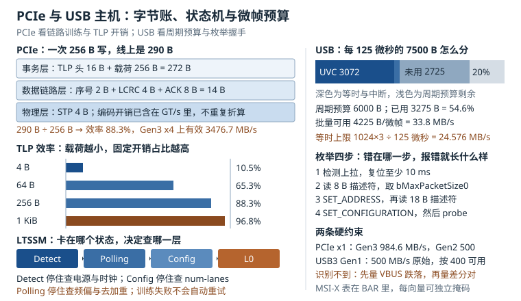

# PCIe 与 USB 主机：链路训练、枚举、BAR 与带宽预算

一块嵌入式板子上，SoC 会引出两类"通用"高速接口。PCIe（Peripheral Component Interconnect Express，外设部件互连快速通道）用来挂系统级外设：WiFi/5G 模组、NVMe 固态盘、多口网卡、FPGA 加速卡。USB（Universal Serial Bus，通用串行总线）用来挂用户级外设：摄像头、U 盘、键鼠、扫码枪、4G 模块。两者都被包装成"插上就该能用"，也都在"不能用"的时候最难查，因为**错误现象几乎一样，出错的位置却可能相差三个层次**：差分对上的一颗耦合电容、设备树里的一行 `ranges`、中断控制器上的一次掩码，都会表现为"设备不工作"。

这一章把两条总线放在一起讲，是因为它们在工程上的排查节奏高度相似：先看物理层有没有"握上手"，再看枚举有没有走完，再看资源有没有分到，最后看带宽和中断够不够。四步各自有独立的证据来源，混着查只会浪费时间。

## 1. 动机：五类"接不上"，五个入口

现场遇到的 PCIe 与 USB 问题，可以按"卡在哪一步"分成五类：

| 现象 | 卡在哪一步 | 第一手证据 |
|---|---|---|
| 设备完全不出现，`lspci` 里没有 | 物理层链路没训练起来 | `dmesg` 里的 `link up failed`、LTSSM 状态、示波器看差分对 |
| 出现了，但驱动 probe 失败 | 枚举完成、资源或时钟没到位 | `lspci -vv` 的 `Region`、`dmesg` 的 `BAR ... no space` |
| 驱动加载了，中断不来或丢包 | 中断路由 | `/proc/interrupts` 计数不涨、`MSI-X: Enable-` |
| 能跑，但一上负载就掉帧、超时 | 带宽超订或 TLP 太小 | `xhci_hcd: Not enough bandwidth`、`iostat`、总线利用率 |
| USB 插上没反应，或反复重连 | 供电、信号完整性、描述符读取 | `dmesg` 的 `-71`/`-110`、`lsusb -t` 的速率、VBUS 波形 |

这五类的排查入口完全不同。第一类要拿示波器或协议分析仪；第二类看配置空间和设备树；第三类看 `/proc/interrupts` 与 MSI-X 能力位；第四类做预算算术；第五类先量电再量线。

::: motivation 一块"时好时坏"的 WiFi 模组
某网关板用 PCIe Gen2 x1 挂 WiFi 模组，试产 30 块里有 4 块上电后 `lspci` 看不到设备，重新上电又能起来。硬件工程师先换了模组，失败率不变；又换了 SoC，还是不变。

停下来量时序才发现：模组的 3.3 V 电源由一颗负载开关控制，开关使能信号由 SoC 的 GPIO 给出，而 `PERST#` 直接接到 SoC 的复位输出。上电瞬间，`PERST#` 比 3.3 V 早释放了约 40 ms。模组在电源还没爬升到 2.9 V 时就开始链路训练，训练自然失败；失败后 LTSSM 停在 Detect，不会自动重试。

在设备树里把 `reset-gpios` 接到同一个 GPIO 控制器，并在驱动里加 100 ms 延时之后，4/30 的失败率降到 0。整个过程没有换一颗器件。**这就是"链路训练"这一类问题的典型形态：软件看到的是"没有设备"，物理上发生的是"电源没到位就开始握手"。**
:::

## 2. 直观：两条总线，四道关



上图左上是一次 256 字节写在 PCIe 三层协议里的字节账，左中是 TLP 效率随载荷的变化，左下是 LTSSM 状态链；右侧是一帧 125 微秒内 7500 字节的分配方式与 USB 枚举的四步。

### 2.1 PCIe 是三层协议，不是一根"高速线"

PCIe 把一次数据传输拆成三层，每层各加一段头：

| 层 | 加什么 | 典型长度 | 谁处理 |
|---|---|---|---|
| 事务层（Transaction Layer） | TLP 头（3DW 或 4DW）、可选 ECRC | 12 或 16 B，ECRC 4 B | 设备与主机的 PCIe 核 |
| 数据链路层（Data Link Layer） | 序号、LCRC、ACK/NAK、流控信用 | 序号 2 B、LCRC 4 B、ACK 8 B | 硬件自动，软件不可见 |
| 物理层（Physical Layer） | STP 帧界、编码、差分对 | STP 4 B，编码开销 20% 或 1.54% | SerDes 与 LTSSM |

因此"标称 8 GT/s"不等于"每秒 8 G 字节"。Gen3 用 128b/130b 编码，每 130 个传输位里只有 128 位是数据，开销 1.54%；Gen1/Gen2 用 8b/10b，开销整整 20%。**同样的 5 GT/s，Gen2 的可用字节率只有 500 MB/s，而不是 625 MB/s。**

### 2.2 链路训练：LTSSM 的四个状态

链路训练由 LTSSM（Link Training and Status State Machine，链路训练与状态机）控制，顺序是固定的：

1. **Detect**：发送端检测对端是否存在，靠接收端 50 Ω 端接带来的直流偏置变化判断。这一状态最怕"没电"或"没时钟"；
2. **Polling**：双方互发 TS1/TS2 有序集，协商极性（Polarity Inversion）与位锁（Bit Lock）。差分对 P/N 接反时，这一层会自动纠正，所以"接反了也能通"是正常的；
3. **Configuration**：协商链路宽度（Link Width）与速率（Link Speed）。双方各报能力，取较小值。Gen3 设备插在只支持 Gen2 的槽上，会停在 Gen2；
4. **L0**：正常工作态。之后进入 Recovery 只在误码率变差或速率切换时发生。

工程上最有用的判据是"卡在哪个状态"。停在 Detect 说明电气层没通（没电、没时钟、没端接）；停在 Polling 说明收到了信号但握不上手（参考时钟频偏、去加重不对）；停在 Configuration 说明宽度或速率谈不拢（`num-lanes` 写错、lane 映射反了）。

### 2.3 枚举：从 Bus 0 开始深度优先

链路进入 L0 之后，主机从 Bus 0、Device 0、Function 0 开始扫描配置空间。每个功能有 4 KB 配置空间，前 64 字节是标准头：

- **Type 0 头**：端点设备，6 个 BAR；
- **Type 1 头**：桥，有 `Primary/Secondary/Subordinate Bus Number` 三个总线号，用来圈定下游总线范围。

扫描是深度优先的：发现桥，就给下游分配一段总线号，递归扫描，扫完再把总线号回收。这条规则解释了两个常见现象：**设备号由硬件拓扑决定，不能随便改**；**桥下面的设备没出现，先看桥的总线号窗口够不够**。

配置空间的访问方式有两种：老式的 CF8/CFC IO 端口（每次 4 字节，很慢），和 ECAM（Enhanced Configuration Access Mechanism，增强配置访问机制，把配置空间映射成一段 MMIO）。嵌入式 SoC 一般用 ECAM，设备树里写成：

```dts
&pcie0 {
    device_type = "pci";
    bus-range = <0x00 0xff>;
    ranges = <0x82000000 0x00 0x18000000 0x18000000 0x00 0x08000000>;
    num-lanes = <1>;
    max-link-speed = <3>;
    reset-gpios = <&gpio1 12 GPIO_ACTIVE_LOW>;
    vpcie3v3-supply = <&reg_3v3>;
    status = "okay";
};
```

`ranges` 的第一项 `0x82000000` 是关键：bit[25:24] 编码地址空间类型（`0x02` 表示 32 位内存、`0x03` 表示 64 位内存、`0x01` 表示 IO），bit30（`0x40000000`）是可预取位。**写成 `0x81000000`（IO 空间）会让所有内存 BAR 分配失败**，而报错只会在驱动 probe 时出现。

### 2.4 BAR 与 MMIO：设备"租"的一段地址

BAR（Base Address Register，基地址寄存器）是设备向系统申请的一段地址窗口。设备在 BAR 里写全 1，主机读回的值就是"这段窗口有多大、是什么类型"：低位是标志（bit0 为 1 表示 IO 空间，为 0 表示内存空间；bit2 为 1 表示 64 位 BAR；bit3 为 1 表示可预取），高位是可对齐的尺寸掩码。

几个工程要点：

1. **64 位 BAR 占两个槽**。BAR0/BAR1 合起来是一个 64 位地址，驱动里只能用 `pci_resource_start(pdev, 0)` 读，不能自己拼；
2. **可预取与不可预取**。可预取的窗口允许 CPU 做写合并（write combining），适合显存、队列这类大块内存；不可预取的窗口必须严格保序，适合寄存器；
3. **MMIO 必须用 `readl()`/`writel()` 访问**，不能用 `memcpy`。因为编译器可能重排、CPU 可能乱序、写可能是 posted（先返回再落地）。读寄存器常常同时起到"刷新写缓冲"的作用，这就是很多驱动里"写完寄存器再读一次同一个寄存器"的原因；
4. **地址窗口是有限的**。32 位内存窗口通常只有 64 MB 到 256 MB，一块显存就要 64 MB 时，必须把设备挂到 64 位窗口下，或者给桥打开 `MEM_64BIT` 支持。

### 2.5 MSI/MSI-X：用一次写代替一根线

传统 INTx 中断是一根物理电平线，多个设备共享，需要软件逐个询问"是你吗"。MSI（Message Signaled Interrupt，消息信号中断）把这个过程变成一次内存写：设备往 LAPIC 的地址写一个 DWORD，数据里编码向量号。MSI-X 更进一步，提供一张表：

| 结构 | 位置 | 大小 | 作用 |
|---|---|---|---|
| Table | 某个 BAR，由 `Table BIR` 与 `Table Offset` 指定 | 每向量 16 B | 每个向量独立的地址、数据、掩码位 |
| PBA | 同一个或另一个 BAR | 每 64 向量 8 B | 挂起位图，用于掩码期间不丢中断 |

MSI-X 的价值不只是"更快"，而是**每个向量可以独立路由到不同 CPU**，并且可以独立掩码。多队列网卡的 8 个收发队列各占一个向量，亲和到 8 个核上，这是把中断处理摊开的标准做法。驱动里的接口是：

```c
int nvec = pci_alloc_irq_vectors(pdev, 1, 9, PCI_IRQ_MSIX | PCI_IRQ_MSI);
if (nvec < 0)
        return nvec;
```

`pci_alloc_irq_vectors()` 会按"MSI-X → MSI → INTx"的顺序降级。**返回值小于请求值时不会报错**，很多驱动在这里静默退回单向量，现象是"网卡能通但只有一个核在跑中断"。

### 2.6 USB 主机控制器：EHCI 与 xHCI

USB 2.0 时代，主机侧通常有两套控制器：EHCI（Enhanced Host Controller Interface，增强主机控制器接口）只负责高速（480 Mbit/s），全速（12 Mbit/s）与低速（1.5 Mbit/s）交给伴生的 UHCI/OHCI。一个高速设备插在高速 hub 上，hub 里的 TT（Transaction Translator，事务翻译器）负责把高速事务拆成低速事务。

xHCI（eXtensible Host Controller Interface，可扩展主机控制器接口）把四种速率统一到一套控制器里，结构上做了三处改变：

- **没有帧调度表**。EHCI 每帧要由软件填一张周期帧列表，xHCI 改成链表：命令环（Command Ring）、事件环（Event Ring）、每个设备一个传输环（Transfer Ring）；
- **TRB 是基本单位**。每个 TRB（Transfer Request Block）16 字节，描述一次传输、一个链、或者一次事件；
- **带宽检查在软件里**。EHCI 由硬件在调度时判断"这一帧排不下"，xHCI 由驱动在 `xhci_check_bandwidth()` 里算，算不过就返回 `-ENOSPC`，`dmesg` 里出现 `Not enough bandwidth`。

### 2.7 USB 枚举：四次握手

设备插上之后的流程是固定的：

1. **检测与复位**：主机看到 D+（全速/高速）或 D-（低速）被 1.5 kΩ 上拉，判定有设备；拉低总线至少 10 ms 做复位。高速设备在复位期间用 chirp K/J 握手确认自己能跑 480 Mbit/s；
2. **读 8 字节设备描述符**：地址还是 0，只读前 8 字节，为了拿到 `bMaxPacketSize0`（端点 0 的最大包长，常见 8/16/32/64）；
3. **分配地址**：`SET_ADDRESS` 给设备一个新地址，之后所有通信都用新地址；再完整读 18 字节设备描述符与配置描述符；
4. **选配置**：`SET_CONFIGURATION` 选定一个配置，主机按 `bMaxPower` 校核供电，然后匹配驱动、调用 probe。

USB 3.x 多了一步链路训练：端口检测到对端后，双方用 LFPS（Low Frequency Periodic Signaling，低频周期信号）握手，再进入 U0 态。所以"USB3 设备只跑 480 Mbit/s"通常不是枚举问题，而是 SuperSpeed 差分对没通，设备降级到了 USB 2.0。

### 2.8 带宽分配：125 微秒里的 7500 字节

USB 2.0 高速把时间切成 125 微秒的微帧，每个微帧在 480 Mbit/s 下能传 $480 \times 10^{6} \times 125 \times 10^{-6} / 8 = 7500$ 字节。规范要求周期传输（等时与中断）最多占 80%，剩下的 20% 留给控制与批量传输。等时传输每个微帧最多 3 个事务，每包最大 1024 字节，所以一路等时流的上限是：

$$B_{iso} = \frac{1024 \times 3}{125\ \mu s} = 24.576\ \text{MB/s}$$

这个数字是硬上限，不是"典型值"。USB 3.2 Gen1 换了调度模型：链路层用信用（credit）流控，等时传输按服务间隔（Service Interval）成组发送，单条流的带宽上限高得多，但**5 Gbit/s 经过 8b/10b 之后只剩 500 MB/s，工程上再按八折取 400 MB/s 估算**。Gen2 的 10 Gbit/s 与 Gen2x2 的 20 Gbit/s 依次翻倍，编码也从 8b/10b 换成了 128b/132b。

## 3. 定量：字节账与预算

### 3.1 PCIe 每 lane 的数据率

每 lane 的可用字节率由传输速率与编码效率决定：

$$B_{lane} = \frac{R \times e}{8}$$

$R$ 是每 lane 的传输速率（GT/s，即每秒十亿次传输），$e$ 是编码效率（8b/10b 取 0.8，128b/130b 取 $128/130$），除以 8 把 bit 换成 Byte。代入五代：

| 代际 | $R$ | 编码 | $B_{lane}$ | x4 | x16 |
|---|---|---|---|---|---|
| Gen1 | 2.5 GT/s | 8b/10b | 250 MB/s | 1000 MB/s | 4000 MB/s |
| Gen2 | 5.0 GT/s | 8b/10b | 500 MB/s | 2000 MB/s | 8000 MB/s |
| Gen3 | 8.0 GT/s | 128b/130b | 984.6 MB/s | 3938.5 MB/s | 15754 MB/s |
| Gen4 | 16.0 GT/s | 128b/130b | 1969.2 MB/s | 7876.9 MB/s | 31508 MB/s |
| Gen5 | 32.0 GT/s | 128b/130b | 3938.5 MB/s | 15754 MB/s | 63015 MB/s |

注意 Gen3 的 984.6 而不是 1000：$8 \times 10^{9} \times 128/130 / 8 = 984.6$ MB/s，差 1.54%。做容量规划时这 1.54% 可以忽略，但做"为什么跑不到标称值"的分析时不能忽略。

### 3.2 TLP 开销与有效带宽

一次内存读写在线上要携带的额外字节，按下面的口径记账：

| 组成 | 字节 | 说明 |
|---|---|---|
| TLP 头 | 16 | 64 位地址用 4DW；32 位地址用 3DW 即 12 B |
| 序号 | 2 | 数据链路层，用于 ACK/NAK |
| LCRC | 4 | 链路 CRC，重传的依据 |
| STP 帧界 | 4 | 物理层帧开始 |
| ACK DLLP 均摊 | 8 | 平均每个 TLP 一个 ACK |

合计 $O = 34$ 字节（3DW 头时为 30 字节）。有效带宽是：

$$B_{eff} = \frac{S}{S + O} \times B_{lane} \times N$$

$S$ 是 TLP 载荷字节数，$N$ 是 lane 数。注意 $B_{lane}$ 已经含了编码开销，**不能再乘一次 $128/130$**，这是最常见的一处重复折算。

代入 Gen3 x4（$B_{lane} \times N = 3938.5$ MB/s）：

| 载荷 $S$ | 效率 $\eta$ | 有效带宽 | 典型场景 |
|---|---|---|---|
| 4 B | 10.5% | 414.6 MB/s | 寄存器、门铃 |
| 64 B | 65.3% | 2572.1 MB/s | 描述符、小命令 |
| 256 B | 88.3% | 3476.7 MB/s | 小包网络 |
| 1024 B | 96.8% | 3811.9 MB/s | NVMe 常规 IO |
| 4096 B | 99.2% | 3906.0 MB/s | NVMe 大块 IO |

表里的 4096 B 已经是单个 TLP 的载荷上限：PCIe 的 `Max_Payload_Size` 最大 4096 B，更大的 DMA 请求必须拆成多个 TLP，每个 TLP 仍带 34 字节开销。128 KiB 会拆成 32 个 4 KiB TLP，效率仍是 $4096/4130 = 99.18\%$，x4 有效带宽 3906.0 MB/s，和 4 KiB 行完全相同；**载荷再大也不会让效率趋近 100%，只会让 TLP 数量变多。**

### 3.3 小块访问为什么慢

表里最刺眼的是 4 字节写只有 10.5% 的效率：写 4 字节要占用 38 字节的线路时间。如果驱动用"每个寄存器一次 MMIO 写"的方式配置一个有 200 个寄存器的设备，线上就是 200 × 38 = 7.6 KB，而有效数据只有 800 字节。

这解释了三条工程经验：

1. **能用 DMA 就不要用 PIO**。让设备自己读描述符，比 CPU 逐个寄存器写快两个数量级；
2. **门铃要合并**。把"每处理一个请求敲一次门铃"改成"攒够 32 个再敲一次"，中断与 MMIO 写都省 32 倍；
3. **写合并（write combining）只对可预取窗口有效**。把队列放在可预取 BAR 里，CPU 的多次写会在写缓冲里合并成一个 TLP；放在不可预取窗口里，每次写都是一个独立 TLP。

### 3.4 中断的线路成本

MSI 的一次中断本质是一个 4 字节的 MWr TLP。按 3.2 节的口径，线路成本 38 字节。Gen3 x1 上就是 $38 / 984.6\ \text{MB/s} = 38.6$ ns。

但真正的开销不在线上，而在软件：一次中断从 CPU 响应到返回，典型 2 到 5 微秒（含入口、保存上下文、驱动处理、EOI）。10 万次每秒的中断就是 0.2 到 0.5 秒每秒，等于半个到一个核被吃掉。**所以中断合并（interrupt coalescing）的收益几乎全部来自软件侧，而不是 PCIe 线路侧。** 网卡的 `ethtool -c` 就是调这个：把"每包一中断"改成"每 64 包或 50 微秒一中断"。

### 3.5 USB 的周期预算

对每个周期端点，按微帧计算需求：

$$\sum_{i} P_i \cdot k_i \le 0.8 \times 7500\ \text{B}$$

$P_i$ 是端点最大包长，$k_i$ 是每微帧的事务数（等时端点最多 3）。等时流的带宽是：

$$B_{iso} = \frac{P \cdot k}{125\ \mu s}$$

一路 1024 字节 × 3 的等时摄像头占 3072 字节，即 24.576 MB/s，占周期预算的 51.2%。再加一路同样的摄像头就是 $6144/6000 = 102.4\%$，超预算，枚举阶段就会被拒绝（`-ENOSPC`）。

### 3.6 USB 供电预算

USB 2.0 端口给 500 mA（2.5 W），USB 3.x 给 900 mA（4.5 W），BC 1.2 充电口给 1.5 A（7.5 W），Type-C 3 A 档位给 15 W。四个 USB 2.0 口全满载就是 2 A，而一个 5 V/2 A 的适配器还要给板子本身供电，**这就是"插满四个 U 盘就重启"的算术原因**。

## 4. 算例：一块"WiFi + NVMe + 摄像头"的板子

**需求**：SoC 引出 PCIe Gen3 x1 给 WiFi 模组（峰值 800 Mbit/s），另一路 Gen3 x1 给 NVMe；USB3 Gen1 的 xHCI 挂一路 720p30 的 UVC 摄像头、一个 USB 麦克风、一个 HID 键盘、一个 4G 模块。

**第一步：算 WiFi 的链路余量。** 800 Mbit/s = 100 MB/s。WiFi 驱动的数据面用 256 字节的 TLP：

$$B_{eff} = 984.6 \times \frac{256}{256 + 34} = 869.2\ \text{MB/s}$$

100 MB/s 只占 11.5%，链路完全不是瓶颈。真正限制吞吐的是空口与主机 CPU，不是 PCIe。

**第二步：算 NVMe 的可用带宽。** 4 KiB 随机读时 $S = 4096$：

$$B_{eff} = 984.6 \times \frac{4096}{4096 + 34} = 976.5\ \text{MB/s}$$

95% 以上的时间花在设备内部，链路开销可以忽略。若换成 Gen3 x4，$B_{eff} = 3906$ MB/s，顺序读能到 3.8 GB/s。**x1 的 976 MB/s 对多数嵌入式场景够用，x4 的意义在于顺序大文件与多队列并发。**

**第三步：算一次视频帧的搬运时间。** 1080p 的一帧 YUY2（不计行消隐）是 $1920 \times 1080 \times 2 = 4.1472$ MB；NV12 则是 $1920 \times 1080 \times 1.5 = 3.1104$ MB。按 YUY2 单帧算：

$$T_{x4} = \frac{4.1472\ \text{MB}}{3938.5\ \text{MB/s}} = 1.05\ \text{ms}, \qquad T_{x1} = \frac{4.1472\ \text{MB}}{984.6\ \text{MB/s}} = 4.21\ \text{ms}$$

30 fps 的帧间隔是 33.3 ms，x1 用掉 12.6%，x4 用掉 3.2%；只有到 60 fps（16.7 ms）时，x1 才占到 25.3%。NV12 单帧 3.1104 MB，对应 x4 0.79 ms、x1 3.16 ms。**8.29 MB 是两帧 YUY2 的大小，把它当成"一帧 + 30 fps"会同时高估搬运时间和占用率**——这是拿两帧的字节数配单帧的帧率，两个口径不能混用。这是"要不要给显示/摄像头通路配 x4"的定量依据。

**第四步：算 USB 的周期预算。** 720p30 的 YUY2 是 $1280 \times 720 \times 2 \times 30 = 55.3$ MB/s，**超过高速总线 60 MB/s 的 92%，必须走 USB3**。放在 USB3 Gen1（按 400 MB/s 可用估算）上占 13.8%。

如果客户坚持用 USB 2.0 摄像头，只能降到 MJPEG 或者 640×480。高速下等时摄像头的硬上限是 24.576 MB/s，连 720p30 的 YUY2 都装不下，这是"摄像头一插上就掉帧"的算术解释。

**第五步：算周期预算的余量。** 麦克风等时 192 字节 × 1，HID 中断 64 字节每毫秒（折合每微帧 8 字节），UAC 反馈端点 3 字节：

$$3072 + 192 + 8 + 3 = 3275\ \text{B}$$

占 6000 字节预算的 54.6%，剩 2725 字节每微帧，折合 21.8 MB/s 给批量传输（U 盘、4G 模块）。再加一路 1024×3 的摄像头就变成 6347 字节，105.8%，超预算。

**第六步：算 4G 模块的位置。** 4G Cat.4 下行 150 Mbit/s = 18.75 MB/s，走批量传输，低于剩余 21.8 MB/s，但两者同时跑满时会互相挤压。工程上要么把 4G 模块放到另一条 USB 总线上（多控制器），要么接受"摄像头满载时下载降速"。

**结论**：这条板子的 PCIe 侧非常宽裕（WiFi 只用 11.5%），瓶颈全在 USB 侧；NVMe 若要求 2 GB/s 以上顺序读，必须从 x1 升到 x4。

## 5. 工程含义：设备树、上电时序与现场定位

### 5.1 上电与复位时序

PCIe 的 `PERST#` 有时序硬要求：电源稳定后至少 100 ms 才能释放；参考时钟要在 `PERST#` 释放前稳定。CEM 规范还要求 `PERST#` 释放到链路训练开始之间留出足够时间，让设备的 PLL 锁定。

USB 侧对应的是 VBUS 的上电与掉电：主机必须在枚举前给足 100 ms 让设备完成内部复位；做电源循环测试时，VBUS 掉电时间要长于设备的放电时间，否则设备内部状态没清干净，下一次枚举会拿到旧的地址。

### 5.2 现场三分钟定位

先看设备在不在：

```bash
# PCIe：拓扑、链路能力与实际状态
lspci -t
lspci -vv -s 01:00.0 | grep -E "LnkCap|LnkSta|DevSta|MSI-X|Region|Kernel driver"

# 资源窗口
cat /sys/bus/pci/devices/0000:01:00.0/resource

# 链路错误计数（AER）
dmesg | grep -iE "pcie|aer|link up|BAR"
```

`LnkCap` 是"能跑多快"，`LnkSta` 是"实际跑多快"。两者不一致时，问题在宽度协商或信号质量；`DevSta` 里的 `CorrErr`/`UnsupReq` 表示收到过不可纠正的完成包，通常指向驱动访问了未映射的 BAR。

USB 侧：

```bash
# 拓扑树与速率（480M / 5000M / 10000M）
lsusb -t

# 供电与配置描述符
lsusb -v -d 0bda:8153 2>/dev/null | grep -E "MaxPower|bMaxPacketSize|wMaxPacketSize"

# 所有设备的供电请求
for d in /sys/bus/usb/devices/*/; do
        printf "%s %s\n" "$(basename $d)" "$(cat $d/bMaxPower 2>/dev/null)"
done

# 协议层抓包（需要 debugfs 与 usbmon）
cat /sys/kernel/debug/usb/usbmon/1u
```

`lsusb -t` 里的速率是最快的判据：设备标称 USB3 但显示 `480M`，说明 SuperSpeed 差分对没通，问题在硬件不在驱动。

### 5.3 带宽规划表

做板级设计时，把每个外设的需求、总线、余量列成一张表，比事后调优有效得多：

| 外设 | 接口 | 需求 | 可用 | 余量 |
|---|---|---|---|---|
| WiFi | PCIe Gen3 x1 | 100 MB/s | 869 MB/s（256 B TLP） | 88% |
| NVMe | PCIe Gen3 x1 | 900 MB/s | 976 MB/s（4 KiB） | 8% |
| UVC 摄像头 | USB3 Gen1 等时 | 55.3 MB/s | 400 MB/s | 86% |
| 4G 模块 | USB3 Gen1 批量 | 18.75 MB/s | 剩余批量预算 | 视并发 |
| U 盘 | USB3 Gen1 批量 | 突发 100 MB/s | 剩余批量预算 | 视并发 |

## 6. 常见坑：现象、原因与解决

::: pitfall 坑一：`lspci` 里根本没有设备，`dmesg` 只有一句 link up failed
**现象**：上电后 `lspci` 看不到设备，`dmesg` 里有 `pcieport 0000:00:00.0: AER: link up failed` 或 `PHY link never came up`；重新上电偶尔能起来。

**原因**：链路训练停在了 Detect 或 Polling。常见的三种：`PERST#` 释放早于电源稳定或参考时钟稳定；参考时钟频偏超出 ±300 ppm；TX/RX 差分对之间少了 AC 耦合电容（Gen3 要求 100 nF，且必须靠近发送端）。

**解决**：先同时抓 `PERST#`、3.3 V、参考时钟三根信号，确认 `PERST#` 在电源与时钟稳定后至少 100 ms 才释放；再量参考时钟频偏；最后检查差分对上的耦合电容是否贴装、容值是否正确。**不要用"换模组"来验证，换模组只改变概率，不改变时序。**
:::

::: pitfall 坑二：设备出现了，但驱动 probe 报 `BAR 0: no space for [mem size 0x1000000]`
**现象**：`lspci` 能看到设备，`Region 0: Memory at <unassigned>`，驱动加载失败，`dmesg` 提示 BAR 没有分配到地址。

**原因**：上游桥的内存窗口不够，或者 `ranges` 写错。32 位内存窗口常常只有 64 MB，而一块设备的 BAR 就要 32 MB，几个设备叠加就溢出。也可能是 `ranges` 的类型编码写成了 IO 空间（`0x81000000`），导致所有内存 BAR 无处可去。

**解决**：先用 `lspci -vv` 看桥的 `Memory behind bridge` 窗口大小，再对照设备树 `ranges` 的长度；把大 BAR 设备挂到 64 位窗口（可预取窗口写 `0xC3000000`：类型位 bit[25:24] = `0x03` 表示 64 位内存，bit30 = `0x40000000` 表示可预取；`0x83000000` 的 bit30 为 0，是"64 位不可预取"），或者给桥打开 64 位内存支持；确认 `ranges` 的类型位是 `0x02`（32 位内存）或 `0x03`（64 位内存），不是 `0x01`（IO）。
:::

::: pitfall 坑三：MSI-X 申请到了，但 `/proc/interrupts` 的计数不涨
**现象**：驱动 `pci_alloc_irq_vectors()` 返回 9，`lspci -vv` 显示 `MSI-X: Enable+ Count=9`，但收发队列的中断计数一直是 0，业务超时。

**原因**：三种可能。设备侧的 MSI-X 向量没被 unmask（Vector Control 的 Mask 位还是 1）；中断被路由到了离线的 CPU；或者驱动在 `request_irq()` 之后忘了写设备的"中断使能"寄存器。

**解决**：先 `cat /proc/interrupts | grep <设备名>` 确认向量号与计数；再 `lspci -vv` 看 `MSI-X: Enable+` 与表项的 Mask 位；用 `echo <cpu> > /proc/irq/<n>/smp_affinity_list` 把向量绑到在线核；最后确认驱动初始化顺序里"申请中断"在"使能设备中断"之前。**顺序反了会丢第一批中断，而且丢得很安静。**
:::

::: pitfall 坑四：USB 设备反复重连，`dmesg` 里是 `device descriptor read/64, error -71`
**现象**：插上设备后内核打印 `usb 1-1: device descriptor read/64, error -71`，然后 `device not accepting address`，反复重试；换成带电源的 hub 就好了。

**原因**：`-71` 是协议错误（EPROTO），最常见的根因不是协议而是供电与信号：VBUS 在枚举瞬间被设备的浪涌电流拉低到 4.4 V 以下；D+/D- 走线太长或没有串阻，眼图闭合；设备端的 1.5 kΩ 上拉电阻让主机误判速率。

**解决**：先用示波器看 VBUS 在插入瞬间的跌落深度与恢复时间，超过 200 mV 的跌落就要加 bulk 电容或限流；再量 D+/D- 的上升沿与过冲，必要时串 22 Ω；确认线缆长度在 3 m 以内（高速）。**换一根线能好，往往说明是线缆的阻抗或屏蔽问题，不是设备问题。**
:::

::: pitfall 坑五：USB3 设备只跑 480 Mbit/s
**现象**：`lsusb -t` 显示设备挂在 `480M` 而不是 `5000M`，大文件拷贝只有 40 MB/s；设备本身标称 USB3.0。

**原因**：SuperSpeed 差分对（SSTX+/−、SSRX+/−）没有正常建立链路。可能是 AC 耦合电容缺失或容值错误（USB3 要求 100 nF，且必须靠近发送端），可能是极性接反（USB3 不像 PCIe 那样自动纠正），也可能是连接器外壳接地不良导致 LFPS 握手失败。

**解决**：先查原理图与 BOM，确认四根 SuperSpeed 线上各有 100 nF 电容且位置正确；用 `lsusb -v` 看 `bcdUSB` 是否真的是 3.0；再用示波器看 LFPS 的周期与幅度（应在 100 mV 到 600 mV 之间）。**PCIe 的差分对可以靠 LTSSM 自动纠正极性，USB3 不行，这是两条总线最容易混淆的一点。**
:::

## 7. 自测题

<details><summary>题一：Gen3 x1 传 4 KiB 的 TLP，按 34 字节开销计算有效带宽；如果载荷降到 64 字节，带宽变成多少？两者差几倍？</summary>

$S = 4096$：

$$B_{eff} = 984.6 \times \frac{4096}{4096 + 34} = 976.5\ \text{MB/s}$$

$S = 64$：

$$B_{eff} = 984.6 \times \frac{64}{64 + 34} = 643.0\ \text{MB/s}$$

比值 $976.5 / 643.0 = 1.52$ 倍。载荷从 4 KiB 降到 64 B，带宽只掉三分之一，但**每字节的线路成本从 1.008 字涨到 1.53 字**。如果继续降到 4 B，效率掉到 10.5%，只剩 103.6 MB/s，是 4 KiB 时的九分之一。

这说明"小包"的惩罚是超线性的：不是线性变差，而是每降一个数量级就多损失一大截。NVMe 的队列深度、网卡的聚合、DMA 描述符的批量提交，本质上都是在把 $S$ 做大。
</details>

<details><summary>题二：一路 1024 字节 × 3 事务的等时摄像头占 USB 2.0 高速多少带宽？再加一路 512 字节 × 3 的摄像头，能共存吗？把第二路换成 256 字节 × 2 呢？</summary>

第一路：$1024 \times 3 = 3072$ B/微帧，$3072 / 125\ \mu s = 24.576$ MB/s，占周期预算 $3072/6000 = 51.2\%$。

第二路 512×3：$1536$ B，累计 $4608$ B，占 $76.8\%$，可以共存，剩 1392 B（11.1 MB/s）给批量。

第二路换成 256×2：$512$ B，累计 $3584$ B，占 $59.7\%$，余量更大。

注意这里的分母是 6000（80% 的 7500），不是 7500。用 7500 当分母会算出 $4608/7500 = 61.44\%$ 和 $3584/7500 = 47.79\%$，看起来更宽裕，但那是把"总线总带宽"当成了"周期传输预算"；规范只允许周期传输最多占 80%，所以判据是 6000 字节。**本例 4608 字节占 6000 的 76.8%，仍然可以共存；真正超预算的是 4 节算例里那组 3275 字节再加一路 1024×3 后的 6347 字节，$6347/6000 = 105.8\%$，枚举阶段会被拒绝。**
</details>

<details><summary>题三：为什么 4 字节的 MMIO 写效率只有 10.5%？如果驱动要把 200 个 4 字节配置写到设备，怎么改？</summary>

因为每个 TLP 的固定开销是 34 字节：16 字节头、2 字节序号、4 字节 LCRC、4 字节 STP、8 字节 ACK。4 字节载荷除以 38 字节总成本，效率 $4/38 = 10.5\%$。

200 次写：线上 $200 \times 38 = 7600$ 字节，有效数据 800 字节，浪费 6800 字节。

改法有三条，按收益排序：

1. **改成 DMA 描述符**。把 200 个寄存器值组织成一个描述符数组放在内存里，设备自己读，CPU 只写一次门铃。线上成本从 7600 字节降到一次 4 字节写加一次 DMA 读；
2. **批量写合并**。如果寄存器地址连续，用 `memcpy_toio()` 或不带 `readl` 的连续 `writel()`，让写缓冲合并；
3. **门铃合并**。确实需要门铃时，攒够一批再敲，把 N 次门铃变成 1 次。

第 1 条是架构级的，第 2、3 条是驱动级的。**先看有没有第 1 条的空间，再谈第 2、3 条。**
</details>

<details><summary>题四：一块设备的 BAR 是 64 位、16 MB，`lspci` 显示两个 BAR 槽。主机只有 64 MB 的 32 位内存窗口，能放下吗？如果放不下，有哪两条路？</summary>

64 位 BAR 占两个 32 位槽（BAR0 与 BAR1）。BAR1 的高位被硬件忽略，读回全 1，所以不能把 BAR1 当成独立设备。

16 MB 放进 64 MB 窗口在容量上可以，但**要考虑对齐**：BAR 必须按自身大小对齐，16 MB 的 BAR 只能落在 16 MB 的边界上。64 MB 窗口里只有 4 个这样的位置，前面已经有设备占了两个，就只剩两个。

放不下的两条路：

1. **挂到 64 位窗口**。设备树里给桥加一段 64 位可预取内存 `ranges`，把大 BAR 设备分配到那里；
2. **缩小 BAR**。部分设备支持可调整 BAR（Resizable BAR，PCIe 3.0 起的扩展能力），可以在配置空间里把窗口改小，但会牺牲性能。

第一条是正解，第二条是权宜。**在原理图阶段就把"这块板子总共需要多少 MMIO 窗口"算出来，比在驱动里绕开 BAR 分配失败要省事得多。**
</details>

## 8. 参考资料

- PCI-SIG，《PCI Express Base Specification 6.0》：事务层（TLP 格式与类型）、数据链路层（LCRC、ACK/NAK、流控信用）、LTSSM 状态机、128b/130b 编码。
- PCI-SIG，《PCI Express Card Electromechanical Specification 5.0》：`PERST#` 与参考时钟的上电时序、发送端 AC 耦合电容的取值与位置、插损预算。
- Intel，《eXtensible Host Controller Interface for Universal Serial Bus Specification 1.2》：数据结构（设备槽、TRB 环、事件环、ERST）、端点带宽检查与 `Max Exit Latency`。
- USB-IF，《Universal Serial Bus Specification 2.0》：事务与微帧、设备枚举与描述符、供电与 `bMaxPower`）。
- USB-IF，《Universal Serial Bus 3.2 Specification》：链路训练与 LFPS、电源管理、8b/10b 与包格式。
- Linux 内核文档 `Documentation/PCI/pci.rst` 与 `Documentation/PCI/MSI-HOWTO.txt`：BAR 探测流程、`pci_alloc_irq_vectors()` 的降级语义、MSI-X 表的结构。
- Linux 内核源码 `drivers/pci/setup-res.c`、`drivers/pci/controller/dwc/pcie-designware-host.c`：资源分配与 DWC 控制器的链路训练入口。
- Linux 内核源码 `drivers/usb/host/xhci-ring.c`、`drivers/usb/host/xhci-mem.c`：TRB 提交、端点环与 `xhci_check_bandwidth()` 的预算计算。
- pciutils 项目《lspci 手册》与 usbutils 项目《lsusb 手册》：`LnkCap`/`LnkSta`/`DevSta` 字段与拓扑树的语义。
