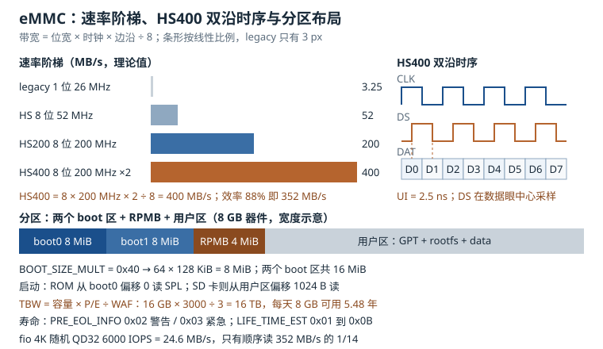

# 存储：eMMC/UFS/SD 的协议、HS 时序、分区与寿命

嵌入式设备里有三样东西几乎一定会老化：电解电容、连接器、闪存。前两样会肉眼可见地坏，闪存则是"慢慢变得不对"——开始是偶发写入失败，然后是启动越来越慢，最后某一天量产线上的板子集体停在 `mmc0: error -110`。存储这一层的问题之所以难查，是因为**软件看到的永远是"块设备"，而真正的物理过程藏在控制器、FTL 和 NAND 三层之下**。

这一章按"协议 → 时序 → 分区 → 寿命 → 测试"的顺序，把 eMMC（Embedded MultiMediaCard，嵌入式多媒体卡）拆开讲。所有带宽都能用"位宽 × 时钟 × 边沿"手算，所有寿命都能用"容量 × P/E ÷ 写放大"估算，所有初始化失败都能落到某一条命令或某一根信号上。UFS（Universal Flash Storage，通用闪存存储）与 SD（Secure Digital，安全数字）作为对照，只讲差异最大的部分。

## 1. 动机：三类故障，三个不同的层面

现场遇到的存储问题，大体可以按"发生在哪一层"分成三类：

| 现象 | 常见层面 | 典型判据 |
|---|---|---|
| 上电不认卡，`-110` 超时 | 电气与初始化时序 | `dmesg` 里第一条 mmc 报错停在哪条 CMD |
| 能识别，读写偶发 CRC 错或掉速 | 信号完整性与时序 | `-84` 错误、tuning 失败、HS400 退回 HS200 |
| 用半年后写入失败、寿命告警 | NAND 与 FTL | `PRE_EOL_INFO`、`DEVICE_LIFE_TIME_EST`、写放大 |

三类的排查入口完全不同。第一类要拿示波器看 CLK、CMD、DAT 的上电顺序与上拉；第二类要看 PCB 走线、数据选通（Data Strobe，DS）信号与 tuning 结果；第三类要看设备写入了多少数据、WAF 是多少、还剩多少预留空间。把它们混在一起查，最常见的后果是"换了一颗 eMMC，问题消失了一个月，然后在新批次上重现"。

::: motivation 一条 `-110`，六块板子
某网关产品的试产板有 20% 概率起不来，串口停在

```
mmc0: Timeout waiting for hardware interrupt.
mmc0: error -110 whilst initialising MMC card
```

工程队先换了 eMMC 品牌，问题降到 10%；又换了电源芯片，降到 5%；最后怀疑是"这批片子体质差"。停下来量上电波形才发现：3.3 V 主电源和 1.8 V I/O 电源同时上电，而 SoC 的 `vmmc` 使能比 `vqmmc` 晚了 2 ms。eMMC 在 I/O 电源尚未稳定时就收到了 CMD1，返回的 OCR 里电压位不对，主机重试三次后放弃。

把两路电源改成"先 3.3 V、后 1.8 V"，并给 `vmmc-supply` 加上 `regulator-boot-on`，20% 的失败率降到 0。整个过程没有换一颗器件，也没有改一行驱动。
:::

这个例子说明：**存储的"不认卡"经常是电源时序问题，不是协议问题**。协议只在电气条件满足之后才有意义。

## 2. 直观：三种介质、两类命令、一条数据通路



上图上半部分是从 legacy 到 HS400 的速率阶梯，中间是 HS400 的双沿采样与 DS 选通关系，下半部分是 eMMC 的四个分区区域与启动路径。

### 2.1 eMMC 是"带控制器的 NAND"

一颗 eMMC 内部至少有四层：NAND 阵列、控制器、闪存转换层（Flash Translation Layer，FTL）、以及一套标准化的主机接口。主机看到的是**逻辑块地址**（Logical Block Address，LBA），不是物理页。这意味着：

1. **坏块管理在片内**。主机不需要像裸 NAND 那样维护坏块表，也不需要自己算 ECC；
2. **磨损均衡在片内**。FTL 把主机的逻辑写分散到不同物理块，主机看不到"这块写了几次"；
3. **写放大在片内发生**。主机写 4 KiB，NAND 可能写 16 KiB 甚至更多，这个比值就是写放大（Write Amplification，WAF）。

代价是**主机失去了对物理布局的控制**。你无法指定"把日志放在 SLC 区"，也无法知道"这次写入落在哪个 die"。所有优化只能通过接口层的手段：分区、`discard`、写入对齐、以及控制写入量。

UFS 的结构类似，但接口换成了 MIPI M-PHY 加 SCSI 命令集，支持全双工和命令队列，所以它的随机性能远好于 eMMC。SD 卡则把控制器做在可插拔的卡片里，主机侧只有 SD 主机控制器（SD Host Controller），协议上多了"卡检测"和"写保护"这些与插拔相关的机制。

### 2.2 CMD 与 DATA：两套握手

eMMC 的物理信号只有五组：`CLK`、`CMD`、`DAT[7:0]`、`DS`、`RST_n`。命令和数据走两条独立的通路：

- **CMD 线**：传输 48 位的命令包（1 位起始 + 1 位传输方向 + 6 位命令号 + 32 位参数 + 7 位 CRC + 1 位结束），响应也是 48 位（R1）或 136 位（R2，用于 CID/CSD）；
- **DAT 线**：传输数据块，每块 512 字节，尾部跟 16 位 CRC。

CMD 线在初始化阶段用开漏（open-drain）驱动，允许多设备共享；进入命令传输阶段后切成推挽（push-pull）。这就是为什么 CMD 线上必须有一个 10 kΩ 到 50 kΩ 的上拉：开漏阶段没人拉高，线就是浮空的。

初始化的命令序列是固定的，每一步失败都会在 `dmesg` 里留下不同的错误码：

| 步骤 | 命令 | 作用 | 失败表现 |
|---|---|---|---|
| 1 | CMD0 | 复位到 idle | 无响应，通常是对卡根本没供电 |
| 2 | CMD1 | 查询 OCR，协商电压与容量 | `-110` 超时，多为电源或时钟 |
| 3 | CMD2 | 取 CID（136 位） | CRC 错，多为 CMD 线上拉或干扰 |
| 4 | CMD3 | 分配 RCA，进入 standby | 地址冲突（多卡场景） |
| 5 | CMD9 | 读 CSD | 容量解析异常 |
| 6 | CMD7 | 选中卡，进入 transfer | 选中后立即掉线，多为供电跌落 |
| 7 | CMD8 | 读 512 字节 EXT_CSD | 读出的字段全 0 或全 FF |
| 8 | CMD6 | 切位宽、切时序、切分区 | 切完不工作，多为时序或电压不匹配 |

EXT_CSD 是 eMMC 的"寄存器总表"，512 字节里有容量、分区大小、支持的速率模式、寿命估计。所有高阶配置都通过 CMD6 的 SWITCH 写这个表。CMD6 的 32 位参数按 JESD84 和内核 `__mmc_switch()` 的定义拆成四段：

| 位段 | 字段 | 宽度 | 含义 |
|---|---|---|---|
| [31:26] | Reserved | 6 位 | 保留，写 0 |
| [25:24] | Access | 2 位 | 0 命令集、1 置位、2 清位、3 写字节 |
| [23:16] | Index | 8 位 | EXT_CSD 索引 |
| [15:8] | Value | 8 位 | 要写入的字节 |
| [7:0] | CmdSet | 8 位 | 命令集，通常为 0 |

即 `arg = (access << 24) | (index << 16) | (value << 8) | cmdset`。例如 access = 3（写字节）、index = 179（`PARTITION_CONFIG`）、value = 0x08、cmdset = 0，参数就是 `0x03B30800`。**写错索引不会报错，只会静默地改掉另一个字段**，这是配置类故障的常见来源。

### 2.3 HS200 与 HS400：从单沿到双沿

速率模式的演进，本质上是"每个时钟周期传几个比特"的变化：

| 模式 | 位宽 | 时钟 | 采样边沿 | 理论带宽 |
|---|---|---|---|---|
| legacy | 1 | 26 MHz | 单沿 | 3.25 MB/s |
| High Speed | 8 | 52 MHz | 单沿 | 52 MB/s |
| HS200 | 8 | 200 MHz | 单沿 | 200 MB/s |
| HS400 | 8 | 200 MHz | 双沿 | 400 MB/s |

HS200 的名字来自"200 MHz 单沿"，每个时钟周期在 8 根数据线上各传 1 位，合计 1600 Mbit/s，即 200 MB/s。它要求 I/O 电压切到 1.8 V，并且必须做时序训练（tuning）：主机用 CMD21 让卡发出一段已知的训练块，然后在不同采样相位下比较读回的数据，选出误码率最低的相位。**训练失败时，主机通常会静默退回 High Speed**，这就是"标称 HS200 的板子只跑到 50 MB/s"的最常见原因。

HS400 在 HS200 的基础上把采样改成双沿（Double Data Rate，DDR），并且增加了一根数据选通信号 `DS`：

- **读方向**：卡在 `DS` 上发一个与数据同源的选通，主机用 `DS` 的边沿采样 `DAT`，这叫源同步（source-synchronous）；
- **写方向**：主机仍然用 `CLK` 发数据，卡用 `CLK` 采样，但要求主机做写时序训练（write tuning）；
- **只支持 8 位**，1 位或 4 位模式下没有 HS400；
- **HS400ES** 是增强版，`DS` 一直输出，不需要在读写之间切换方向，对长走线更友好。

UFS 走的是另一条路：MIPI M-PHY 的 HS-GEAR 用嵌入式时钟，两条 lane 收发分离，可以全双工。UFS 2.1 跑 HS-G3，每 lane 5.8 Gbit/s，两条合计 11.6 Gbit/s，折算 1.45 GB/s，扣掉 8b/10b 的 20% 开销后约 1.16 GB/s；UFS 3.1 跑 HS-G4，每 lane 11.6 Gbit/s，两条合计 23.2 Gbit/s，理论值 2.9 GB/s，128b/132b 编码后约 2.81 GB/s。这个数量级已经超过 SATA III 的 0.6 GB/s，接近 PCIe 3.0 双通道的入门 NVMe，代价是 PCB 上要按高速差分对来布线。

### 2.4 分区与 boot 区

eMMC 的"分区"和普通磁盘的 GPT 分区是两件事。eMMC 内部有四个物理区域：

| 区域 | 容量来源 | 典型大小 | 用途 |
|---|---|---|---|
| User Data Area | 扣除其他区域后的全部容量 | 4 GB 到 64 GB | 放 GPT 与文件系统 |
| Boot Area 1/2 | `BOOT_SIZE_MULT` × 128 KiB | 4 MiB 到 16 MiB | 放 SPL 与 U-Boot |
| RPMB | `RPMB_SIZE_MULT` × 128 KiB | 通常是 4 MiB | 防重放的安全存储 |
| General Purpose 1-4 | `GP_SIZE_MULT` | 按需 | 厂商自定义 |

配置入口是 EXT_CSD 的 `PARTITION_CONFIG`（索引 179）：低 3 位使能哪个 boot 区，中间 3 位选择当前访问哪个分区，第 6 位是"分区配置已完成"标志。**这个标志是一次性可编程位，一旦置 1 就不可逆**：之后再改 `BOOT_SIZE_MULT`、`RPMB_SIZE_MULT` 或 `GP_SIZE_MULT`，器件会直接返回 `SWITCH_ERROR`，`mmc-utils bootpart-resize` 也会拒绝执行。量产时把这一步做错，只能换器件或换方案，后面所有板子都得返工。

三个工程要点：

1. **boot 区默认只读**。`/dev/mmcblk0boot0` 的 `force_ro` 是 1，写之前要 `echo 0 > /sys/block/mmcblk0boot0/force_ro`，写完再置回 1。忘记置回，一次误操作就能把引导区覆盖。
2. **启动偏移不同**。SoC 的 ROM 从 boot 区偏移 0 开始读；从 SD 卡启动时，多数 SoC 要求镜像放在用户区偏移 1024 字节处（给 MBR 留位置）。把给 SD 卡做的镜像直接 `dd` 到 boot0，ROM 会读到一堆 0。
3. **RPMB 有独立写计数器**。每次写 RPMB 都会让 32 位计数器加一，计数器只能增不能减。它是防回滚、防重放的基础设施，读写都带 HMAC-SHA256 认证，密钥在第一次配置时写入且不可读回。

### 2.5 寿命：磨损均衡与写放大

NAND 的物理限制是**每个块能擦写的次数有限**（Program/Erase Cycle，P/E 次数）。SLC 约 10 万次，MLC 约 3000 次，TLC 约 1000 到 3000 次。磨损均衡（Wear Leveling）把写入分散到全片，避免某个块被反复擦写而提前耗尽。

写放大来自三个地方：

- **垃圾回收**（Garbage Collection，GC）：块里还有有效页时不能直接擦，要先把有效页搬到新块，这一次搬运就是额外写入；
- **读-改-写**：主机写 4 KiB，而 NAND 的页是 16 KiB，落盘时可能要把整页读出来改一部分再写回；
- **元数据与日志**：FTL 自己的映射表也要落盘。

WAF 的定义是 NAND 实际写入量除以主机写入量。它不是一个常数：顺序写大文件时接近 1，4 KiB 随机写、盘又接近写满时可以到 5 以上。厂商给出的 TBW（Terabytes Written，总写入字节数）通常是在某个特定负载下测的，直接拿来当"寿命"会偏乐观。

## 3. 定量：带宽、寿命与 IOPS

### 3.1 理论带宽

接口带宽由位宽、时钟和采样边沿三者决定：

$$B = \frac{N_{bit} \times f_{clk} \times k}{8}$$

其中 $N_{bit}$ 是数据线位宽（eMMC 为 1、4、8），$f_{clk}$ 是时钟频率（单位 Hz），$k$ 是每周期采样次数（单沿为 1，双沿为 2），除以 8 把 bit/s 换成 B/s。代入 HS400 的 8 位、200 MHz、双沿：

$$B = \frac{8 \times 200 \times 10^{6} \times 2}{8} = 400\ \text{MB/s}$$

同样的式子代入 HS200（$k=1$）得到 200 MB/s，代入 High Speed（8 位、52 MHz、单沿）得到 52 MB/s。**"HS400 比 HS200 快一倍"不是因为时钟更高，而是因为每个周期采了两次。**

### 3.2 有效带宽与效率

理论带宽是引脚上的比特率，实际能搬多少数据取决于协议开销。定义效率 $\eta$：

$$v_{eff} = \eta \times B$$

$\eta$ 里扣掉的东西包括：命令包的往返、每块 16 位 CRC、多块传输之间的总线换向、随机访问时的寻道与重试。工程上的典型值：

| 场景 | $\eta$ | HS400 下 $v_{eff}$ |
|---|---|---|
| 大块顺序读 | 0.85 到 0.90 | 340 到 360 MB/s |
| 大块顺序写 | 0.70 到 0.78 | 280 到 312 MB/s |
| 4 KiB 随机读 | 由 IOPS 决定，不适用 | 见 3.4 节 |

写比读低，原因是写的链路更长：主机发命令、卡回 R1、主机发数据、卡回 CRC 状态、卡内部编程、主机轮询 CMD13 等"就绪"。这段握手在小块写入时占比很高。

传输时间就是容量除以有效带宽：

$$T = \frac{S}{v_{eff}}$$

注意单位：$S$ 用 MiB 时，$v_{eff}$ 要先换成 MiB/s（1 MiB/s = 1.048576 MB/s），否则会差 4.9%。

### 3.3 TBW 与寿命

TBW 的估算公式只有三个变量：

$$\text{TBW} = \frac{C \times N_{PE}}{\text{WAF}}$$

其中 $C$ 是用户可用容量（单位 B），$N_{PE}$ 是 NAND 的 P/E 次数，WAF 是写放大系数。这个式子的物理含义很直白：整片 NAND 总共能写 $C \times N_{PE}$ 字节，主机每写 1 字节要消耗 WAF 字节的 NAND 寿命，所以主机能写的总量要除以 WAF。

寿命的年数：

$$T_{life} = \frac{\text{TBW}}{D \times 365}$$

$D$ 是每天的写入量（B/天）。代入几组典型参数：

| 容量 | P/E | WAF | TBW | 8 GB/天 时的寿命 |
|---|---|---|---|---|
| 8 GB | 3000 | 4 | 6 TB | 750 天（2.05 年）|
| 16 GB | 3000 | 3 | 16 TB | 2000 天（5.48 年）|
| 16 GB | 3000 | 5 | 9.6 TB | 1200 天（3.29 年）|
| 32 GB | 3000 | 3 | 32 TB | 4000 天（10.96 年）|

WAF 的下限由页大小和主机块大小决定：

$$\text{WAF}_{min} = \frac{S_{page}}{S_{host}}$$

16 KiB 的 NAND 页、4 KiB 的主机块，最小写放大就是 4。也就是说，**只要应用以 4 KiB 为单位随机写，NAND 至少要承担 4 倍的写入量**；这还没算 GC 的搬运。

GC 带来的额外写放大可以粗略估为

$$\text{WAF}_{gc} \approx \frac{1}{1 - u}$$

$u$ 是 NAND 的空间利用率（有效数据占总容量的比例）。盘用到 93% 时 $u = 0.93$，上界是 14.3；留 20% 预留空间时 $u = 0.8$，上界降到 5。真实 FTL 会做冷热数据分离，实际值通常低于这个上界，但趋势是对的：**盘越满，写放大越大，寿命掉得越快**。这也解释了为什么"把日志分区留大一点"能显著延长寿命。

### 3.4 fio 的顺序与随机

顺序和随机的差别不在接口，而在介质。定义 IOPS 与随机带宽：

$$\text{IOPS} = \frac{1}{t_{io}}, \qquad BW_{rand} = \text{IOPS} \times S_{io}$$

$t_{io}$ 是单个 I/O 的平均完成时间，$S_{io}$ 是 I/O 大小。队列深度 $QD$ 下的平均延迟为

$$L = \frac{QD}{\text{IOPS}}$$

eMMC 5.1 的命令队列（Command Queue，CQ）最多支持 32 个未完成任务，所以压测时 `--iodepth` 取 32 是有依据的上限；再大只是把请求堆在主机侧。典型的 4 KiB 随机读是 6000 IOPS，折合带宽只有 24.6 MB/s，平均延迟 5.33 ms——和顺序读的 352 MB/s 差了一个数量级。

顺序场景则可以按"带宽除以块大小"估算 IOPS：300 MB/s 的写带宽、128 KiB 的块，理论上限是 2289 IOPS。这个数字的意义在于：顺序写的瓶颈是带宽，不是 IOPS；随机写的瓶颈是 IOPS，不是带宽。

### 3.5 启动分区容量

boot 区大小由 `BOOT_SIZE_MULT` 决定，单位是 128 KiB：

$$S_{boot} = M \times 128\ \text{KiB}$$

$M$ 是 EXT_CSD 里的乘数。$M = 32$（0x20）时是 4 MiB，$M = 64$（0x40）时是 8 MiB，$M = 128$（0x80）时是 16 MiB。两个 boot 区各占一份，所以实际占用是 $2 \times S_{boot}$。

RPMB 用同样的单位，$RPMB\_SIZE\_MULT = 32$ 时是 4 MiB。4 MiB 听起来很小，但 RPMB 的典型用途是存密钥、计数器、证书哈希，几 KiB 就够，剩下的空间用来做磨损轮转。

## 4. 算例：8 GB eMMC 的带宽、寿命与测试

**第一步：算理论带宽。** 一颗 8 GB eMMC，8 位总线，支持 HS400：

$$B = \frac{8 \times 200 \times 10^{6} \times 2}{8} = 400\ \text{MB/s}$$

按 88% 的顺序读效率，实际读 352 MB/s；按 75% 的写效率，实际写 300 MB/s。

**第二步：算一次升级要多久。** 镜像 1024 MiB（等于 1073.7 MB）：

$$T_{write} = \frac{1073.7\ \text{MB}}{300\ \text{MB/s}} = 3.58\ \text{s}$$

同一份镜像在 HS200 模式下，按与 HS400 相同的 75% 写效率（200 × 0.75 = 150 MB/s）：

$$T_{write} = \frac{1073.7}{150} = 7.16\ \text{s}$$

差了 $7.16 - 3.58 = 3.58$ 秒。这就是"HS400 训练失败、静默退回 HS200"在产线升级工位上表现出的现象：单台多 3.58 秒，一千台多 3580 秒，约 59.7 分钟（接近 1 小时）。

**第三步：算寿命。** 8 GB、TLC 3000 次 P/E、WAF 取 4：

$$\text{TBW} = \frac{8 \times 10^{9} \times 3000}{4} = 6 \times 10^{12}\ \text{B} = 6\ \text{TB}$$

每天写 8 GB：

$$T_{life} = \frac{6 \times 10^{12}}{8 \times 10^{9} \times 365} = 2.05\ \text{年}$$

两年。如果这是一台设计寿命五年的设备，这个配置从一开始就不成立。把容量换成 16 GB、WAF 降到 3，TBW 变成 16 TB，寿命 5.48 年，刚好够；再给日志分区留 20% 预留空间，WAF 还能再降一点。**选型时先算这一步，比事后加监控有用得多。**

**第四步：算随机性能的天花板。** 4 KiB 随机读 6000 IOPS：

$$BW_{rand} = 6000 \times 4096 = 24.6\ \text{MB/s}$$

平均延迟：

$$L = \frac{32}{6000} = 5.33\ \text{ms}$$

同样的 4 KiB 随机写只有 2500 IOPS，折合 10.2 MB/s，延迟 12.8 ms。按 WAF 4 折算，NAND 侧的实际写入是 $10.2 \times 4 = 41\ \text{MB/s}$——主机只写了 10 MB/s，NAND 却在以 41 MB/s 的速度消耗寿命。

**第五步：算 boot 区够不够。** U-Boot 900 KiB、内核 6 MiB、设备树 64 KiB：

$$S_{need} = 0.879 + 6 + 0.0625 = 6.94\ \text{MiB}$$

8 MiB 的 boot 区（$M = 64$）放得下，余量 1.06 MiB；4 MiB 的 boot 区（$M = 32$）放不下。量产时如果把内核和 initramfs 一起塞进 boot 区，很容易超过 8 MiB，这时候要么在置位前把 `BOOT_SIZE_MULT` 改大（置位后不可逆，已出货的板子只能换器件或换方案），要么把内核移到用户区由 U-Boot 从文件系统加载。

**第六步：验算全盘写入时间。** 8 GB 盘从全 0 写到全满：

$$T_{fill} = \frac{8 \times 10^{9}}{300 \times 10^{6}} = 26.7\ \text{s}$$

这个数字可以用来判断"老化测试 30 秒是否够"：如果盘的实际写入速度只有 100 MB/s，30 秒只能写 3 GB，测试覆盖不到后半段，坏块和 GC 压力都没测到。

## 5. 工程含义：设备树、分区表与测试方法

### 5.1 设备树里的三组开关

```dts
&usdhc2 {
    bus-width = <8>;
    non-removable;
    no-sd;
    no-sdio;
    mmc-hs400-1_8v;
    mmc-hs400-enhanced-strobe;
    vmmc-supply = <&reg_3v3>;
    vqmmc-supply = <&reg_1v8>;
    status = "okay";
};
```

每个字段都对应一个具体的物理事实：

- `bus-width = <8>` 必须和 PCB 上实际连了几根 DAT 一致，多写不会报错，只会读到全 0；
- `non-removable` 告诉内核不用等卡检测，eMMC 是焊死的；
- `mmc-hs400-1_8v` 要求 `vqmmc` 在 1.8 V，写错电压会烧 I/O 或者训练失败；
- `vmmc` 与 `vqmmc` 的上电顺序由 regulator 框架保证，如果两路共用一颗芯片，要在驱动里显式加延时。

SD 卡槽的配置反过来：要有 `cd-gpios`（卡检测）、`wp-gpios`（写保护）、`max-frequency`，并且**不能**写 `non-removable`。卡检测的极性经常配反，现象是"插着卡不认、拔了卡反而认"。

### 5.2 分区与 boot 区的操作

```bash
# 看 EXT_CSD 的关键字段
mmc extcsd read /dev/mmcblk0 | grep -E \
  "BOOT_SIZE_MULT|RPMB_SIZE_MULT|PARTITION_CONFIG|PRE_EOL_INFO|LIFE_TIME"

# 使能 boot0 为启动分区（参数：分区号 1/2，发送 ACK 1/0）
mmc bootpart enable 1 1 /dev/mmcblk0

# 写 boot0：先解除只读，写完恢复
echo 0 > /sys/block/mmcblk0boot0/force_ro
dd if=u-boot-with-spl.bin of=/dev/mmcblk0boot0 bs=512 conv=fsync
echo 1 > /sys/block/mmcblk0boot0/force_ro

# 用户区按 1 MiB 对齐建 GPT
sgdisk --clear --new=1:2048:+131072 --change-name=1:boot /dev/mmcblk0
```

`PARTITION_CONFIG` 写完之后，`/dev/mmcblk0boot0` 才会出现对应的大小。注意 `PARTITION_SETTING_COMPLETED`（EXT_CSD[179] 的 bit 6）**只能从 0 写成 1，不能写回 0**：一旦置 1，器件就冻结 `BOOT_SIZE_MULT`、`RPMB_SIZE_MULT` 与 `GP_SIZE_MULT`，后续任何修改都返回 `SWITCH_ERROR`，`mmc-utils bootpart-resize` 同样会拒绝。因此分区大小必须在置位前一次算准；已经置位的器件只能换器件或换方案。

### 5.3 fio 怎么测才有意义

顺序读：

```bash
fio --name=seq-read --filename=/dev/mmcblk0p5 --direct=1 \
    --rw=read --bs=1M --iodepth=8 --ioengine=libaio \
    --size=1G --runtime=60 --time_based --group_reporting
```

4 KiB 随机读，队列深度 32：

```bash
fio --name=rand-read --filename=/dev/mmcblk0p5 --direct=1 \
    --rw=randread --bs=4k --iodepth=32 --ioengine=libaio \
    --size=1G --runtime=60 --time_based --group_reporting
```

四个参数决定结果能不能复现：

1. `--direct=1` 绕过页缓存，否则测的是内存；
2. `--iodepth` 要配合 `libaio`，同步引擎下这个值无效；
3. `--size` 要小于分区容量，且测试前先 `blkdiscard`，否则测的是"盘已经写满"的状态；
4. `--runtime` 加 `--time_based`，避免大文件被一次性写完就结束。

**测试会覆盖目标分区的内容**，执行前必须确认设备节点指向的是测试分区而不是系统分区。产线上通常先备份、再测、再恢复，或者干脆用一块专门的测试板。

### 5.4 寿命监控

内核把 eMMC 的健康信息暴露在 debugfs 和 sysfs：

```bash
cat /sys/kernel/debug/mmc0/health      # 部分内核版本提供
mmc extcsd read /dev/mmcblk0 | grep -A2 "Life Time"
```

两个字段最关键：

- `PRE_EOL_INFO`：0x01 正常、0x02 警告（已用 80%）、0x03 紧急（已用 90%）；
- `DEVICE_LIFE_TIME_EST_TYP_A/B`：0x01 到 0x0A 是十个十分位，分别代表已用 0-10%、10-20% 一直到 90-100%；**0x0B 不是"90-100% 之上的一档"，而是"已超出最大估计寿命"**，读到它说明器件已经超过设计寿命，应按失效处理。

这两个值是 FTL 根据 P/E 消耗估算的，粒度很粗，但足以做"提前换机"的告警。把它接到远程诊断里，比在现场等设备写坏再返修便宜得多。

## 6. 常见坑：现象、原因与解决

::: pitfall 坑一：`mmc0: error -110 whilst initialising MMC card`
**现象**：上电后串口停在初始化，偶尔重试几次能起来；换板子概率不同，换 eMMC 品牌概率变化。

**原因**：CMD1 阶段超时。常见的有三种：`vmmc`/`vqmmc` 上电顺序不对或建立时间不够；CLK 在电源稳定前就开始输出；CMD 线缺少上拉，开漏阶段读不到响应。

**解决**：先用示波器同时看 `vmmc`、`vqmmc`、`CLK`、`CMD` 四根线，确认 CLK 的第一个沿在电源稳定之后；检查 CMD 上的上拉电阻（10 kΩ 到 50 kΩ）是否贴了；必要时在设备树里给 regulator 加 `regulator-enable-ramp-delay`。不要用"换片子"来验证，换片子只能改变概率，不能定位原因。
:::

::: pitfall 坑二：HS400 能识别，但读写偶发 `-84` 或自动退回 HS200
**现象**：`dmesg` 里有 `mmc0: tuning execution failed` 或 `mmc0: switch to hs400 failed`，随后跑在 HS200；压测时偶发 CRC 错误（错误码 -84，EILSEQ）。

**原因**：DS 信号的眼图不满足要求。可能是 DS 与 DAT 的走线长度差太大、DS 没有按差分对待、或者 1.8 V 电源的纹波太大。HS400 的 UI 只有 2.5 ns，10% 的偏斜预算就是 250 ps，按 FR4 上约 6.7 ps/mm 的传播延迟，只相当于 37 mm 的走线差。

**解决**：先确认 `vqmmc` 实测是 1.8 V 且纹波小于 50 mV；再量 DS 与 DAT0 的走线差，控制在 5 mm 以内；DS 与 DAT 之间加地线隔离；最后用 `mmc-utils` 的 `mmc tuning` 或厂商工具看每个相位的误码分布。相位窗口很窄说明信号质量差，不是软件问题。
:::

::: pitfall 坑三：设备用了半年开始写入失败，日志里全是 I/O error
**现象**：现场设备间歇性 `EXT4-fs error`、`blk_update_request: I/O error`；重新格式化能好一阵，之后复发。

**原因**：NAND 寿命接近耗尽，或者预留空间被写满导致 GC 无法搬运。`PRE_EOL_INFO` 可能已经是 0x02 或 0x03。也可能是应用以 4 KiB 随机写日志，WAF 长期在 5 以上，实际消耗远高于设计估算。

**解决**：先读 `PRE_EOL_INFO` 与 `DEVICE_LIFE_TIME_EST` 确认消耗比例；把日志改成顺序追加、按 128 KiB 对齐、并限制总量；打开 `discard` 让 FTL 知道哪些块可以回收；如果寿命已经告急，缩短更换周期，同时把写入量监控加到远程诊断里。换更大容量的片子能线性提升 TBW，但 WAF 不降的话，提升有限。
:::

::: pitfall 坑四：刷了新内核，启动后还是旧版本
**现象**：产线用脚本把 `boot.img` 写到设备，重启后 `uname -a` 显示的还是旧内核；`dd` 没有报错。

**原因**：写到了错误的位置。可能是 `PARTITION_CONFIG` 的 `PARTITION_ACCESS` 还指着 boot0，导致 `/dev/mmcblk0` 的写入落在 boot 区；也可能是脚本按"用户区偏移 1024 字节"写 SD 卡的布局，而这块板子从 boot 区启动，ROM 读的是偏移 0。

**解决**：写之前用 `mmc extcsd read` 确认 `PARTITION_ACCESS` 指向用户区；用 `lsblk -o NAME,SIZE,PARTLABEL` 确认目标节点；写完 `sync` 后回读比对哈希；最后用 `mmc bootpart` 确认启动分区号与 `PARTITION_CONFIG` 一致。**写完必须回读校验，不能只看 `dd` 的退出码。**
:::

::: pitfall 坑五：分区没对齐，顺序写只有标称的一半
**现象**：`fio` 顺序写只有 150 MB/s，而同型号板子能到 300 MB/s；`iostat` 里写请求的合并率很低。

**原因**：分区起始 LBA 没有按 eMMC 的擦除块（通常 512 KiB 到 4 MiB）对齐。每次跨块写都要触发"读-改-写"，写了 1 MiB 实际搬运了 2 MiB 以上。

**解决**：用 `sgdisk` 按 1 MiB 对齐重建分区（起始扇区取 2048 的整数倍）；确认文件系统的块大小与页大小匹配；对日志类分区改用追加写而不是原地覆盖。对齐之后再看 `fio` 的写放大指标（`--write_iops` 与 NAND 侧写入量的比值），通常能从 2 以上降到 1.1 附近。
:::

## 7. 自测题

<details><summary>题一：8 位 eMMC、200 MHz、双沿，理论带宽是多少？若顺序读效率 88%、顺序写效率 75%，读写各是多少？写 512 MiB 需要多久？</summary>

$$B = \frac{8 \times 200 \times 10^{6} \times 2}{8} = 400\ \text{MB/s}$$

读 $= 400 \times 0.88 = 352$ MB/s，写 $= 400 \times 0.75 = 300$ MB/s。

512 MiB $= 536.87$ MB，写入时间 $536.87/300 = 1.79$ s。

注意单位换算：如果把 512 MiB 当成 512 MB 代入，会得到 1.71 s，差 4.9%。做容量规划时这个误差会累积。
</details>

<details><summary>题二：8 GB eMMC、TLC 3000 次 P/E、WAF 为 4，每天写 6 GB，寿命多少年？若把 WAF 降到 2，寿命变成多少？</summary>

$$\text{TBW} = \frac{8 \times 10^{9} \times 3000}{4} = 6\ \text{TB}$$

$$T_{life} = \frac{6 \times 10^{12}}{6 \times 10^{9} \times 365} = 2.74\ \text{年}$$

WAF 降到 2 时 TBW 翻倍到 12 TB，寿命 5.48 年。

这说明**降低写放大比换更大容量更划算**：容量翻倍要多花钱，WAF 减半只需要改写入模式、加预留空间。
</details>

<details><summary>题三：4 KiB 随机读 5000 IOPS，队列深度 32。求随机带宽与平均延迟；同样条件下顺序读 352 MB/s，两者差多少倍？</summary>

$$BW_{rand} = 5000 \times 4096 = 20.5\ \text{MB/s}$$

$$L = \frac{32}{5000} = 6.4\ \text{ms}$$

比值 $352/20.5 = 17.2$ 倍。差距来自"每次 I/O 都要一次完整的命令往返"，而不是接口带宽不够。要提高随机性能，只能靠命令队列加深并发，或者换 UFS。
</details>

<details><summary>题四：`BOOT_SIZE_MULT = 0x20`，boot 区多大？U-Boot 900 KiB、内核 3 MiB、设备树 64 KiB，放得下吗？余量多少？</summary>

$M = 32$，$S_{boot} = 32 \times 128\ \text{KiB} = 4\ \text{MiB}$。

需求 $0.879 + 3 + 0.0625 = 3.94$ MiB，余量只有 0.06 MiB（约 61 KiB）。放得下，但**没有任何余量**：下次内核多 100 KiB 就放不进去；而 `PARTITION_SETTING_COMPLETED` 一旦置 1，`BOOT_SIZE_MULT` 就不可再改，已出货的板子只能换器件或换方案。

工程上应该按"当前需求 × 1.5"取整到 2 的幂，即选 8 MiB（$M = 64$）。boot 区多占的 8 MiB 对 8 GB 的盘可以忽略。
</details>

<details><summary>题五：HS400 的 UI 是 2.5 ns，若允许 10% 的偏斜，对应多少皮秒？FR4 上信号传播延迟约 6.7 ps/mm，折合多少毫米走线差？为什么实际布线要求比这个更严？</summary>

UI $= 1/(200\ \text{MHz} \times 2) = 2.5$ ns $= 2500$ ps。

10% UI $= 250$ ps，对应 $250/6.7 = 37.3$ mm。

实际要求通常控制在 5 mm 以内，因为 37 mm 只是"纯延迟"预算，没有算串扰、阻抗不连续、连接器、以及温度引起的介质常数变化。**理论余量不等于可用余量**，这是高速布线里最容易犯的错。
</details>

## 8. 参考资料

- JEDEC，《JESD84-B51 Embedded MultiMediaCard Product Standard 5.1》：命令表与 EXT_CSD 字段两章、HS200/HS400 时序与 boot 分区定义。
- SD Association，《SD Physical Layer Simplified Specification 8.00》：卡识别流程、UHS-I 总线时序部分。
- JEDEC，《JESD220E Universal Flash Storage 3.1》：UFS 链路层、传输层与 SCSI 命令映射。
- JEDEC，《JESD218B》与《JESD219》：TBW 的定义、企业级与客户端负载的差异。
- Linux 内核文档 `Documentation/driver-api/mmc/mmc-dev-parts.rst`：boot0/boot1、RPMB、GPP 的设备节点与访问规则。
- Linux 内核源码 `drivers/mmc/core/mmc.c`、`mmc_ops.c`：初始化命令序列、bus-speed 选择、tuning 的返回值处理。
- Toshiba/Micron eMMC 应用笔记：写放大、预留空间与 TBW 估算方法。
- fio 项目《fio HOWTO》：`iodepth`、`ioengine`、`time_based` 与延迟统计字段。
