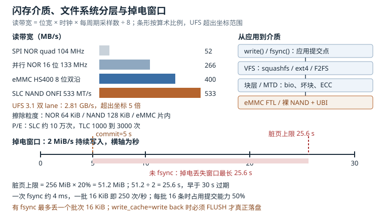

# 闪存介质与文件系统：NOR/NAND/eMMC/UFS 的取舍与掉电一致性

闪存（Flash Memory）在嵌入式设备里承担的角色，和硬盘在服务器里的角色完全不同。服务器上的磁盘坏了可以换一块、重建 RAID；嵌入式设备上的闪存焊在板子上，容量小、写入量大、断电是常态，而且它决定了设备能不能起来。同一份应用代码，放在 NOR 上跑十年不出问题，放在一颗 4 GiB 的 TLC eMMC 上可能十四个月就把寿命写完——差别不在代码，而在介质、文件系统与写入模式三者的匹配。

这一章沿着"介质 → 擦除粒度 → 文件系统 → 掉电语义"这条链往下走。所有容量都能用擦除块大小手算，所有寿命都能用 P/E 次数除以写放大估出来，所有"掉电后文件系统变只读"的故障都能落到某一次未完成的提交或某一个未 flush 的缓存上。

## 1. 动机：同样是"写一个文件"，代价差了两个数量级

嵌入式现场遇到的存储故障，按发生的位置可以分成四类，排查入口完全不同：

| 现象 | 所在层 | 第一手判据 |
|---|---|---|
| 掉电重启后 rootfs 变只读，`dmesg` 出现 `EXT4-fs error` | 文件系统日志 | 挂载参数是否 `errors=remount-ro`、上次是否正常卸载 |
| 挂载时报 `UBI error: bad magic`、`volume table corrupted` | UBI/MTD 层 | 是否对整片 MTD 做过 `dd`，是否跑过 `ubiformat` |
| 用了半年开始出现写入失败、`I/O error` | 介质与坏块 | `mtdinfo` 的坏块数、`PRE_EOL_INFO` |
| 升级包写入成功但重启后仍旧版本 | 缓存与提交 | `queue/write_cache`、是否 `fsync`、是否 `sync` |

这四类问题的共同点是：**错误信息出现在文件系统层，根因却常常在介质层或提交语义上**。

::: motivation 掉电一次，三十台设备变砖
某款排队机在试点门店频繁断电。第一次断电后，约 3% 的设备启动进入紧急 shell，`/` 挂载为只读：

```
EXT4-fs error (device mmcblk0p2): ext4_journal_check_start:83: Detected aborted journal
EXT4-fs (mmcblk0p2): Remounting filesystem read-only
```

团队的第一反应是"eMMC 坏了"，换了品牌，比例降到 2%。第二反应是"文件系统太脆弱"，把 ext4 换成 F2FS，比例反而升到 5%。真正的转折是把设备接上串口电源继电器，做了一百次随机时刻断电，记录每次断电时正在写什么：**九成故障发生在写 40 MiB 的升级缓存文件时**，而那个目录挂在 rootfs 上，恰好也在被日志写入。

改成"rootfs 只读 squashfs + 一个 64 MiB 的 tmpfs overlay + 独立 data 分区放升级缓存"，同一批设备再做三百次断电，只有两台需要恢复，且都是升级缓存不完整（应用层可检测并重下），系统本身再没进过紧急 shell。

整个过程没有换一颗器件。**掉电一致性是设计出来的，不是靠换闪存换出来的。**
:::

这个例子给出一条次序：先定介质，再定文件系统，最后定写入路径与提交点。顺序颠倒，就会出现"用最贵的器件，犯最便宜的错"。

## 2. 直观：介质、擦除粒度与写入路径



图的上半部分是四类介质的读带宽对比（对数直觉：条形按算术比例，UFS 已超出坐标范围，用文字标注），右侧是从应用到介质的四层栈，下半部分是一条以秒为单位的掉电窗口时间轴。

### 2.1 四种介质的分工

**NOR 闪存（NOR Flash，或非闪存）** 的特点是"随机读像内存、写起来像搬砖"。它的存储单元可以按字节随机访问，支持片内执行（Execute In Place，XIP），读延迟在百纳秒量级，适合放 bootloader 这类"上电就要跑"的代码。代价是写：NOR 的编程必须先把目标区域擦成全 1，擦除粒度通常是 4 KiB 扇区或 64 KiB 块，而写入只能把 1 变 0，不能把 0 变 1。所以**改一个字节，实际代价是一次擦除加一次整块回写**。

**NAND 闪存（NAND Flash，与非闪存）** 反过来：读要按页（Page）来，一页 2 KiB 到 16 KiB，随机读延迟在几十微秒量级；但它的单元面积小、成本低、容量大。裸 NAND 有两个 NOR 没有的问题：出厂就允许存在坏块（Bad Block），使用中坏块还会增加；数据会随擦写和放置时间出现位翻转，必须靠纠错码（Error Correcting Code，ECC）兜底。因此裸 NAND 不能直接当块设备用，中间必须有一层管理。

**eMMC（Embedded MultiMediaCard，嵌入式多媒体卡）** 和 **UFS（Universal Flash Storage，通用闪存存储）** 把管理逻辑做进了封装：内部是 NAND 阵列加控制器加闪存转换层（Flash Translation Layer，FTL），对外暴露标准的逻辑块地址（Logical Block Address，LBA）。主机看不到坏块，也不需要算 ECC，但也就失去了对物理布局的控制——主机写 4 KiB，FTL 可能实际写 16 KiB，这个比值就是写放大（Write Amplification Factor，WAF）。

四者的核心取舍可以压缩成一张表：

| 维度 | SPI NOR | 裸 SLC NAND | eMMC（TLC） | UFS 3.1 |
|---|---|---|---|---|
| 读带宽量级 | 52 MB/s（quad 104 MHz） | 533 MB/s（ONFI 8 位 533 MT/s，理论） | 400 MB/s（HS400） | 2.81 GB/s（双 lane） |
| 随机读延迟 | 百纳秒，可 XIP | 几十微秒，按页 | 百微秒，经 FTL | 几十微秒，命令队列 |
| 擦除粒度 | 4 KiB 扇区 / 64 KiB 块 | 128 KiB 块（64 页 × 2 KiB） | 主机不可见，片内 4 MiB 量级 | 主机不可见 |
| P/E 次数 | 约 10 万 | 约 10 万 | 1000 到 3000 | 1000 到 3000 |
| 坏块 | 基本没有 | 出厂即有，使用中增长 | 片内管理 | 片内管理 |
| 成本（每 GB） | 最高，容量最小 | 中 | 低 | 中高 |
| 典型用途 | bootloader、参数区 | 小容量 rootfs、日志 | 主存储 8 到 64 GB | 高端设备主存储 |

读带宽这一列的算法统一为"位宽 × 时钟 × 每周期采样数 ÷ 8"：quad SPI NOR 是 $4\times104\times10^{6}/8=52$ MB/s；八线 DDR NOR 是 $8\times200\times10^{6}\times2/8=400$ MB/s；并行 NOR 16 位 133 MHz 是 266 MB/s。**NOR 并不是"慢"，它慢在写和擦，读从来不慢**——这是选型时最容易记反的一点。

### 2.2 擦除粒度决定了下限写放大

闪存的物理规则只有两条：擦除以块为单位，编程只能 1 变 0。由此推出一个无法绕开的结论：**任何小于擦除块的改写，都至少要把整个块读出来、改掉、再写回去**。于是最小写放大是

$$\text{WAF}_{min}=\frac{S_{erase}}{S_{write}}$$

$S_{erase}$ 是擦除块大小，$S_{write}$ 是一次实际提交的写入量。一颗 64 KiB 块的 NOR，如果应用每 1 KiB 追加一条记录并就地更新头部，$WAF_{min}=64$；改成 4 KiB 对齐追加，$WAF_{min}=16$；一次写满 16 KiB，$WAF_{min}=4$。这个式子解释了一个常见现象：**同样的日志量，改成批量追加后寿命能延长十几倍**，因为分母变了。

垃圾回收（Garbage Collection，GC）会在此之上再加一层放大。当块里还有有效页时不能直接擦，必须先把有效页搬到新块。设介质空间利用率为 $u$（有效数据占总容量的比例），经典的 GC 放大上界是

$$\text{WAF}_{gc}\approx\frac{1}{1-u}$$

$u=0.5$ 时上界是 2，$u=0.8$ 时是 5，$u=0.93$ 时是 14.29，$u=0.97$ 时是 33.33。真实 FTL 会做冷热数据分离，实际值低于这个上界，但趋势成立：**盘越满，写放大越大，寿命掉得越快**。这也是"给日志分区留 20% 空闲"能显著延寿的定量依据。

### 2.3 文件系统分成三族

按与介质的配合方式，嵌入式常见的文件系统分成三族：

1. **日志型（journaling）**：ext4 是代表。数据先写日志区再写原位，掉电后靠重放日志恢复一致性。它为"有 FTL 的块设备"设计，假设下层会处理坏块和磨损，因此**不能直接用在裸 NAND 上**。
2. **日志结构型（log-structured）**：F2FS、UBIFS、JFFS2 属于这一族。写入永远追加到新位置，旧位置留给 GC 回收。F2FS 面向 eMMC/UFS 这类带 FTL 的块设备，UBIFS 面向裸 NAND（它建立在 UBI 之上，认识擦除块和坏块）。
3. **只读型（read-only）**：squashfs 是代表。镜像在构建时压缩、索引固定，运行时只读，没有 GC、没有日志、没有一致性窗口。它配合 overlayfs 提供可写层，是"系统分区永不被写坏"的标准做法。

三族的适用边界由一个问题决定：**下层有没有人替你管坏块和磨损**。有（eMMC/UFS），就用 ext4 或 F2FS；没有（裸 NAND），就必须用 UBI + UBIFS；不希望系统分区被写（无论下面是什么），就用 squashfs + overlay。

### 2.4 squashfs 加 overlay 的读写路径

只读 rootfs 的典型结构是三层：

- **lower**：squashfs 镜像，挂载为只读，压缩存放整个系统；
- **upper**：一个可写目录，通常在 tmpfs 或独立 data 分区上；
- **work**：overlayfs 的工作目录，必须与 upper 在同一个文件系统上。

读一个文件时，overlayfs 直接透传到 lower；写一个已存在的文件时，触发"写时复制升级"（copy-up）：**把整个文件从 lower 复制到 upper，然后在 upper 上修改**。这条规则带来两个工程后果：

- 改一个 4 KiB 的配置文件，代价是 4 KiB；改一个 40 MiB 的二进制或数据库文件，代价是 40 MiB。upper 只有 64 MiB 时，连两份 40 MiB 文件都放不下（$64/40=1.6$）。
- 如果 upper 在 tmpfs 上，这些写入消耗的是内存，重启即失；如果 upper 在 eMMC 上，这些写入会真实消耗寿命，且 copy-up 本身会放大写入量。

所以工程上的常规组合是：**系统分区 squashfs 只读，易变配置放 tmpfs，真正需要持久的数据放独立分区**，三者职责不混。

### 2.5 fsync 到底把数据送到了哪一层

应用调用 `write()` 成功，只代表数据进了页缓存（page cache）；调用 `fsync()` 成功，代表数据与元数据都到了"介质认为持久"的位置。中间至少还有四层：

| 层 | 掉电后是否还在 | 由谁负责推进 |
|---|---|---|
| 应用缓冲区 | 否 | 应用自己 |
| 页缓存 / 脏页 | 否 | 回写线程、`fsync` |
| 文件系统日志 | 否（未提交部分） | jbd2 提交、barrier |
| 设备写缓存（eMMC cache） | 取决于是否 flush | `fsync` 发出的 FLUSH CACHE |
| NAND 单元 | 是 | 编程完成 |

`fsync` 的耗时就是这四层的和：

$$t_{fsync}=t_{data}+t_{journal}+t_{flush}+t_{erase}$$

$t_{data}$ 是数据页编程时间，$t_{journal}$ 是日志提交（含 barrier），$t_{flush}$ 是设备缓存刷出，$t_{erase}$ 是空间不足时触发的擦除。在 eMMC 上，前两项通常是几百微秒到 1 毫秒，flush 是 2 到 5 毫秒，擦除偶尔出现几毫秒的尖峰。**这就是为什么毫秒级的 fsync 会变成吞吐瓶颈**：每次提交都要等一次设备缓存刷出。

eMMC 的写缓存可以在 `/sys/block/mmcblk0/queue/write_cache` 看到，值为 `write back` 时表示设备有易失缓存。此时不 flush 就断电，缓存里的数据全部丢失，而 `write()` 早已返回成功。这个语义差是"写入成功但重启丢文件"的第一大来源。

## 3. 定量：寿命、容量开销与掉电窗口

### 3.1 介质寿命

整片介质能承受的主机写入总量，等于"容量 × P/E 次数 ÷ 写放大"：

$$\text{TBW}=\frac{C\,N_{PE}}{\text{WAF}}$$

$C$ 是可用容量（字节），$N_{PE}$ 是每个块的擦写次数上限，WAF 是实际写放大。折算成年数：

$$T_{life}=\frac{C\,N_{PE}}{365\cdot\text{WAF}\cdot D}$$

$D$ 是每天的主机写入量（字节/天）。这个式子里三个量都是可测的：$C$ 查手册，$N_{PE}$ 由介质类型决定（SLC 约 10 万，TLC 1000 到 3000），WAF 用"NAND 实际写入量 ÷ 主机写入量"实测。**唯一经常被估错的是 $D$**——因为它不是平均值，而是被突发流量拉高的分布。

### 3.2 UBI 的容量开销

裸 NAND 上不能直接建文件系统，必须先经过 UBI（Unsorted Block Images，无序块映像）。UBI 把物理擦除块（Physical Erase Block，PEB）映射成逻辑擦除块（Logical Erase Block，LEB），并承担三件事：坏块隔离、擦写均衡、卷管理。代价是每个 PEB 要留两个页放擦除计数头（EC header）和卷标识头（VID header），另外还要预留内部卷和坏块储备：

$$C_{UBI}=L_{PEB}\left(N_{PEB}-N_{int}-N_{bad}\right),\qquad N_{bad}=\left\lceil\frac{20}{1024}N_{PEB}\right\rceil$$

$L_{PEB}$ 是去掉两个头页后的有效载荷，$N_{int}$ 是内部卷占用的 PEB 数（布局卷 2 个、磨损均衡 1 个，共 3 个），$N_{bad}$ 是坏块储备（UBI 按每 1024 个 PEB 预留 20 个，即约 2%）。以 512 MiB、128 KiB PEB、2 KiB 页的 SLC NAND 为例：$N_{PEB}=4096$，$L_{PEB}=128-4=124$ KiB，$N_{bad}=\lceil20\times4096/1024\rceil=80$，可用 PEB 为 $4096-3-80=4013$，容量 $4013\times124$ KiB $=485.95$ MiB，占标称容量的 94.91%。**标称 512 MiB 的片子，能用的只有 486 MiB**，这个 5% 的差距要在分区表里提前留出来。

UBIFS 还要在这之上再扣日志、索引和孤儿区。日志大小与 LEB 大小相关，索引树随文件数增长，实测开销在 3% 到 10% 之间。算例里取 8%，得到 447.07 MiB 可用。

### 3.3 fsync 吞吐与掉电窗口

单次 `fsync` 的耗时决定了提交频率上限：

$$f_{fsync,max}=\frac{1}{t_{fsync}}$$

若 $t_{fsync}=4$ ms，上限是 250 次/秒。应用如果每写一条记录就 `fsync` 一次，吞吐就被钉在"250 条/秒"上，与介质带宽无关。批量提交把 $n$ 条记录合成一次 `fsync`，吞吐变成 $n/t_{fsync}$，代价是最多丢 $n$ 条。

掉电时可能丢多少数据，由"脏数据量"和"回写策略"共同决定：

$$W=\min\left(\frac{B_{dirty}}{R_{in}},\,T_{expire}\right)$$

$B_{dirty}$ 是允许堆积的脏页上限（默认 `dirty_ratio` 为内存的 20%），$R_{in}$ 是写入速率，$T_{expire}$ 是脏页过期时间（`dirty_expire_centisecs` 默认 3000，即 30 秒）。256 MiB 内存的设备，脏页上限是 51.2 MiB；以 2 MiB/s 持续写入，25.6 秒就堆满，早于 30 秒的过期时间，所以窗口由前者决定。**换句话说，没有 `fsync` 的写入，掉电最多能丢 60 MiB 量级的数据。**

这个结论和"文件系统有日志，所以安全"是两件事：日志保证的是**元数据一致性**（不会出现半个目录项、不会把空闲块标成占用），不保证**最近写入的数据还在**。要数据在，只能 `fsync`。

### 3.4 只读镜像的体积与读取代价

squashfs 的体积由压缩比决定：

$$B_{ro}=\frac{S_{raw}}{\rho_{comp}}$$

$S_{raw}$ 是未压缩的系统树大小，$\rho_{comp}$ 是压缩比。同一份 1229 MiB 的 rootfs，用 xz 压到 320.1 MiB（$\rho=3.84$），用 zstd 压到 472.7 MiB（$\rho=2.6$）。注意压缩后的体积只决定 flash 占用与读取时间，**不决定解压时间**：解压吞吐按输出字节计，而且与压缩器强相关，不能拿压缩后体积除以同一个常数。启动耗时应该写成

$$t_{boot}\approx\frac{S_{raw}}{v_{dec,out}}$$

$S_{raw}$ 是未压缩的系统树大小（1229 MiB），$v_{dec,out}$ 是该压缩器的单核解压吞吐（按输出字节计）。实测数量级：单核 xz 约 50 到 100 MiB/s，zstd 约 400 到 800 MiB/s。取中值（xz 75 MiB/s、zstd 600 MiB/s），xz 镜像要 $1229/75=16.4$ 秒，zstd 镜像要 $1229/600=2.05$ 秒：**xz 的压缩比高 48%、镜像小 152.6 MiB（省 32% flash），单核启动却多花约 14.3 秒，慢 8 倍**。在启动时间敏感的场合，这个交换通常不划算。更麻烦的是 xz 解压需要更大的字典和工作内存，小内存设备上可能直接 OOM。

### 3.5 ext4 与 F2FS 的量化差异

两者的差别不在"谁更先进"，而在写入模型与介质假设：

| 维度 | ext4 | F2FS |
|---|---|---|
| 写入模型 | 覆盖写 + 日志 | 追加写 + 六条活跃日志 |
| 分配单位 | 块组、4 KiB 块 | 段（segment）2 MiB、节（section） |
| 清理机制 | 无（依赖 FTL 的 GC） | 前台/后台 GC，按空闲 section 比例触发 |
| 预留空间 | 默认 5% 给 root | 默认 5% 给 GC，可调 |
| 小文件随机写 | 每次 4 KiB 都可能触发 FTL 读改写 | 合并进段，减少 RMW |
| 掉电恢复 | 重放 jbd2 日志 | roll-forward 重放 checkpoint 后已 fsync 的数据/节点，未 fsync 部分 roll-back |
| 成熟度 | 极高，工具链齐全 | 较新，内核 3.8 起，工具较少 |
| 适用介质 | eMMC/UFS，容量大、写入不极端的场景 | eMMC/UFS，写入密集、随机写多的场景 |

F2FS 的掉电恢复常被误写成"回滚到最后检查点"，这会让读者以为 fsync 成功的数据也会丢。实际是两段式：挂载时先 **roll-forward**，重放上一个 checkpoint 之后已经提交（fsync）的数据块与节点块；再 **roll-back**，把没有提交的写入回退到 checkpoint 的一致状态。内核 `Documentation/filesystems/f2fs.rst` 里的 `disable_roll_forward`（关闭前滚恢复）、`norecovery`（只读挂载、跳过前滚）与 `fsync_mode`（`posix`/`strict`/`nobarrier`）就是这套机制的开关。所以第 2.5 节的结论对 F2FS 同样成立：**`fsync` 返回成功的数据不会因为掉电退回旧 checkpoint**，会丢的只有尚未 `fsync` 的写入。

F2FS 的段是 2 MiB（512 个 4 KiB 块），默认预留 5% 给 GC：4 GiB 盘留 204.8 MiB，8 GiB 盘留 409.6 MiB，16 GiB 盘留 819.2 MiB。这个预留不是浪费，而是把 GC 的写放大压在可控范围内的必要成本。**注意 F2FS 只认识块设备，不认识裸 NAND**：它假设下层 FTL 处理坏块和磨损，把 F2FS 直接建在 MTD 上会丢掉擦除块对齐，写放大反而更差。

## 4. 算例：512 MiB SLC NAND 与 4 GiB TLC eMMC 的对照

某工业网关有两种硬件版本：A 版用 512 MiB 裸 SLC NAND（放系统与日志），B 版用 4 GiB TLC eMMC（放系统）。要求都支持 5 年现场运行，日均写入 600 MB。

**第一步：算 A 版的 UBI 可用容量。** 128 KiB PEB、2 KiB 页、4096 个 PEB：

$$N_{bad}=\left\lceil\frac{20\times4096}{1024}\right\rceil=80,\qquad N_{usable}=4096-3-80=4013$$

$$C_{UBI}=4013\times(128-4)\ \text{KiB}=497\,612\ \text{KiB}=485.95\ \text{MiB}$$

再扣 8% 的 UBIFS 开销，可用 447.07 MiB。

**第二步：算 A 版寿命。** SLC 取 $N_{PE}=10^{5}$，UBIFS 的写放大取 2.5（日志结构，顺序追加为主，GC 压力中等）：

$$\text{TBW}=\frac{447.07\times1024^{2}\times10^{5}}{2.5}=1.875\times10^{13}\ \text{B}=18.75\ \text{TB}$$

按每天 600 MB：

$$T_{life}=\frac{18.75\times10^{12}}{600\times10^{6}\times365}=85.6\ \text{年}$$

85.6 年远超 5 年设计寿命，说明**在这颗片子上，P/E 不是瓶颈**。真正的瓶颈是数据保持（断电存放后电荷泄漏）与坏块增长，这两个靠介质等级和 ECC 强度保证，不靠减少写入。

**第三步：同样的工作量换成 B 版。** 4 GiB TLC、$N_{PE}=1000$、WAF 取 5（TLC 的页更大、GC 更积极）：

$$\text{TBW}=\frac{4\times1024^{3}\times1000}{5}=8.59\times10^{11}\ \text{B}=0.86\ \text{TB}$$

按每天 2 GB：

$$T_{life}=\frac{0.86\times10^{12}}{2\times10^{9}}=429.5\ \text{天}\approx14.3\ \text{个月}$$

**14 个月。** 同一家公司的两个硬件版本，B 版的标称容量是 A 版的 8 倍、按 UBI/UBIFS 扣除开销后的可用容量是 A 版的 9.16 倍，寿命却只有 A 版的 1/72.7。原因不是 TLC "质量差"，而是 $N_{PE}$ 只有 A 版的 1/100、WAF 是 2 倍、日写入量又高了 3.33 倍：$9.16\times0.01\div2\div3.33\approx1/72.7$。

**第四步：算突发预算。** 事件风暴时写入速率到 2 MiB/s，持续 300 秒：

$$B_{burst}=2\ \text{MiB/s}\times300\ \text{s}=600\ \text{MiB}\approx629\ \text{MB}$$

**一次 5 分钟的风暴就吃掉（略超）一整天的写入预算。** 这就是为什么寿命估算必须用"日总量"而不是"平均速率"：日均 600 MB 折合平均只有 6944 B/s，看起来微不足道，但它是被几次风暴堆出来的。如果设备真的以 2 MiB/s 连续写满全天，日写入量是 $2\times1024^{2}\times86400=1.8119\times10^{11}$ B，即 168.75 GiB（181.19 GB），A 版寿命立刻掉到 $18.75\times10^{12}/1.8119\times10^{11}=103.5$ 天，只有 85.6 年的 1/302。

**第五步：算 fsync 吞吐。** 每条记录 1 KiB，风暴时 2000 条/秒（2 MiB/s）。每次 `fsync` 4 ms：

$$f_{max}=\frac{1}{0.004}=250\ \text{次/秒}$$

每 16 条合并一次提交，提交频率 $2000/16=125$ 次/秒，占用的提交能力是 $125\times4=500$ ms/s，即 50%。每次提交 16 KiB，在 2 MiB/s 下只隔 8 ms，提交能力刚好够用、没有余量。**这意味着任何一次擦除尖峰都会让队列堆积**，所以批量大小不能贴着上限设计，工程上留一倍余量（每 32 条一次）更稳。

**第六步：算掉电窗口。** 256 MiB 内存、`dirty_ratio` 20%、写入 2 MiB/s：

$$B_{dirty}=256\times0.2=51.2\ \text{MiB},\qquad W=\frac{51.2}{2}=25.6\ \text{s}$$

25.6 秒小于 30 秒的 `dirty_expire`，所以窗口由脏页上限决定。没有 `fsync` 的数据，掉电最多丢 25.6 秒、约 51.2 MiB；按 1 KiB 一条记录算，是 5 万多条。**"日志已经写进文件了"和"日志已经落盘了"之间，隔着 25.6 秒。**

**第七步：算 A 版上跑 F2FS 的后果。** 有人会问：F2FS 明明更适合闪存，为什么 A 版不用？因为 A 版是裸 NAND。F2FS 认的是 512 字节 LBA 的块设备，它把 2 MiB 的段写到"连续的逻辑块"上，而 UBI 之下这些逻辑块在物理上可能分散在不同 PEB；F2FS 也不会向 UBI 通报"这些块已释放"，UBI 的擦写均衡因此失去依据。结果是擦除粒度错配，写放大从 2.5 升到 6 以上，寿命从 85.6 年掉到 35 年左右——**不是不能用，是把优势用没了**。

## 5. 工程含义：选型、建卷与验证

### 5.1 选型矩阵

| 需求 | 首选 | 次选 | 不要用 |
|---|---|---|---|
| bootloader、参数区、几 MB 配置 | SPI NOR（可 XIP） | eMMC boot 分区 | 裸 NAND（无 ECC 保护） |
| 系统分区，要求永不变砖 | squashfs + overlay | 双份 squashfs A/B | 可写 ext4 单分区 |
| 小容量 rootfs（< 512 MiB），成本敏感 | 裸 SLC NAND + UBI/UBIFS | eMMC pSLC 模式 | ext4 on 裸 NAND |
| 大容量数据（> 4 GB），随机写多 | eMMC/UFS + F2FS | eMMC + ext4 | UBIFS（容量效率低） |
| 高频小记录日志 | 独立分区 + 批量追加 | F2FS + 预留空间 | 每条 `fsync` 写 rootfs |
| 高端设备，带宽敏感 | UFS 3.1 + F2FS | eMMC HS400 + ext4 | SPI NOR 当主存储 |

### 5.2 UBI 与 UBIFS 的建卷流程

裸 NAND 上的顺序是固定的：先格式化 MTD 分区建立 UBI，再建卷，再在卷上建 UBIFS。

```bash
# 1. 看几何：PEB 大小、页大小、坏块数
mtdinfo /dev/mtd3

# 2. 格式化（会擦除整片分区，注意确认设备节点）
ubiformat /dev/mtd3 -y -q

# 3. 附着并建卷：400 MiB 的 rootfs 卷
ubiattach -m 3 -d 0
ubimkvol /dev/ubi0 -n 0 -s 400MiB -N rootfs

# 4. 在主机侧生成 UBIFS 镜像：-m 页大小 -e LEB 大小 -c 最大 LEB 数
mkfs.ubifs -r rootfs/ -m 2048 -e 126976 -c 4000 -o rootfs.ubifs

# 5. 打成可直接烧写的 UBI 镜像
ubinize -o ubi.img -m 2048 -p 128KiB -s 512 ubinize.cfg
```

四个参数必须和硬件一致，写错不会报错，只会让镜像在目标板上挂不上：

- `-m 2048`：NAND 页大小，必须等于 `mtdinfo` 里的 `Page size`；
- `-e 126976`：LEB 大小，等于 PEB 减两个头页（$131072-4096=126976$）；
- `-c 4000`：最大 LEB 数，不能小于卷的实际 LEB 数，否则挂载时报 `too large`；
- `-s 512`：最小 I/O 大小，等于页内可写子页，通常是 512。

`ubiformat` 与 `dd` 的区别必须记住：**`dd` 写裸 MTD 会连同 OOB 区一起覆盖，破坏 UBI 的 EC/VID 头，下次挂载直接报坏魔数**。烧写工具必须支持 UBI 镜像格式（`ubiformat`、`nandwrite` 加 `--ubi`、或厂商的下载工具）。

### 5.3 只读 rootfs 的构建与挂载

```bash
# 生成 squashfs：块 128 KiB，xz 压缩
mksquashfs rootfs/ rootfs.squashfs -comp xz -b 131072 -noappend

# 运行时挂载：lower 只读，upper 在 tmpfs，work 与 upper 同分区
mkdir -p /mnt/lower /run/overlay/upper /run/overlay/work
mount -t squashfs -o ro,loop /dev/mmcblk0p3 /mnt/lower
mount -t tmpfs -o size=64M,mode=0755 tmpfs /run/overlay
mount -t overlay overlay \
  -o lowerdir=/mnt/lower,upperdir=/run/overlay/upper,workdir=/run/overlay/work /mnt/root
```

三个细节决定这套方案能不能落地：

1. **`workdir` 必须与 `upperdir` 同一文件系统**，否则 `mount` 直接返回 `EINVAL`；
2. **upper 选 tmpfs 还是持久分区**，取决于"重启后配置要不要保留"。选 tmpfs 时内存占用等于被修改文件的总大小，40 MiB 的文件改一次就占 40 MiB；
3. **`metacopy=on` 可以让"只改元数据"不复制数据**（例如 `chmod`、`touch`），但改内容仍要整文件 copy-up，不能指望它省掉大文件的复制。

如果设备必须"断电后配置还在"，标准做法是把 `/etc` 这类目录做成独立的小分区，或者用 systemd 的 `systemd-repart`/`tmpfiles.d` 在启动时从模板生成，而不是把整个 rootfs 放开写。

### 5.4 ext4 与 F2FS 的挂载参数

```bash
# ext4：5 秒提交、禁止同步 discard（改用 fstrim.timer）
mount -t ext4 -o noatime,commit=5,errors=remount-ro /dev/mmcblk0p2 /mnt/data

# 查看设备写缓存状态：write back 表示有易失缓存
cat /sys/block/mmcblk0/queue/write_cache

# F2FS：后台 GC 打开，空间紧张时手动触发紧急 GC
mount -t f2fs -o noatime,background_gc=on,discard /dev/mmcblk0p4 /mnt/data
echo 1 > /sys/fs/f2fs/mmcblk0p4/gc_urgent
```

`commit=5` 是默认值的显式化，把日志提交周期钉在 5 秒；`errors=remount-ro` 让文件系统在检测到不一致时转只读而不是继续写坏数据——**代价是设备会"突然不能写"，收益是不会把错误扩散到全盘**。同步 `discard` 每次删除都要发 TRIM 命令，在 eMMC 上可能引入几十毫秒的延迟，量产设备一般改成每周一次 `fstrim`。

### 5.5 掉电一致性的验证方法

掉电不能靠"我觉得没问题"来验收，必须做可重复的断电实验。软件方案用 device-mapper 的 flakey 目标模拟写入丢失：

```bash
# 建一个 1 GiB 的 flakey 设备：5 秒正常、1 秒丢弃写入，循环
dmsetup create cut --table "0 2097152 flakey /dev/mmcblk0p5 0 5 1"
mkfs.ext4 /dev/mapper/cut
mount /dev/mapper/cut /mnt/test

# 写入循环 + 反复断链，然后每轮检查一致性
for _ in {1..100}; do
  dd if=/dev/urandom of=/mnt/test/run bs=4k count=256 conv=fsync
  dmsetup suspend cut && dmsetup resume cut
done
umount /mnt/test
fsck.ext4 -fn /dev/mapper/cut
```

三个判据缺一不可：文件系统能干净挂载（`fsck -fn` 无错）、应用层数据能自校验（校验和或版本号）、系统能正常启动到业务进程。硬件方案是用继电器切主电源，随机延时 1 到 30 秒，重复三百次以上——**只有真实断电才能暴露 eMMC 写缓存和 PMIC 掉电顺序的问题**，`dmsetup` 模拟不了这两者。

### 5.6 运行期监控

```bash
# NAND 与 UBI 的健康状况
mtdinfo -a | grep -E "Amount of bad blocks|Eraseblock size"
ubinfo -a

# 块设备的写入量与队列状态
cat /sys/block/mmcblk0/stat
cat /sys/block/mmcblk0/queue/write_cache

# UBIFS 的空间与坏块统计
cat /sys/kernel/debug/ubifs/ubi0_0/space
dmesg | grep -i "ubifs\|ubi"
```

`/sys/block/mmcblk0/stat` 前 11 列的含义是固定的：第 1 列读 I/O 次数、第 3 列读扇区数、第 5 列写 I/O 次数、第 7 列写扇区数（`/proc/diskstats` 里对应第 6、10 列，因为前面多了主设备号、次设备号和设备名三列）。**取读、写扇区要拿第 3、7 列，拿第 5 列会得到"写 I/O 次数"，差几个数量级**；扇区固定按 512 字节计，与设备逻辑块大小无关，乘 512 就是累计吞吐。用它反推日均写入量比应用自己记账更可靠。UBIFS 的 `space` 节点给出总 LEB、已用 LEB、脏 LEB，脏 LEB 长期偏高说明 GC 跟不上写入。

## 6. 常见坑：现象、原因与解决

::: pitfall 坑一：掉电后 rootfs 变只读，只能重刷
**现象**：设备断电重启后进入紧急 shell，`mount` 显示 `/` 为 `ro`，`dmesg` 里有 `EXT4-fs error`、`Detected aborted journal`，`fsck` 能修但需要人工介入。

**原因**：可写 rootfs 上同时有系统文件、日志和升级缓存，掉电时 jbd2 正在提交，日志中断导致文件系统被标记为需要检查；`errors=remount-ro` 把它转成只读。根因不是 ext4 不可靠，而是**把"必须可写"的数据放在了"不该被写"的分区上**。

**解决**：系统分区改 squashfs 只读，易变数据搬到独立分区或 tmpfs；确需可写时给该分区单独挂载并设置 `errors=remount-ro`，同时在上电脚本里加一次 `fsck -p` 兜底。改完必须用随机断电实验验证，不能只看一次重启。
:::

::: pitfall 坑二：UBIFS 挂载报 `bad magic`，换了三片 NAND 都一样
**现象**：新板首次启动 `UBI error: bad magic at PEB 0`、`UBI: volume table corrupted`，同一镜像在开发板上正常。

**原因**：烧写方式错了。产线用 `dd` 把 `ubinize` 生成的镜像写到 `/dev/mtd3`，但 `dd` 按块设备语义写，会覆盖 OOB 区；UBI 的 EC/VID 头正好在 OOB 或页内保留区，被覆盖后校验失败。也可能镜像的 `-e`/`-p` 参数与目标板的 PEB 大小不一致。

**解决**：用 `ubiformat /dev/mtd3 -f ubi.img` 烧写，它按 MTD 语义保留 OOB；核对 `mtdinfo` 的 PEB 大小与 `ubinize.cfg` 的 `peb-size` 一致；烧完立刻 `ubiattach` 加 `ubinfo` 验证卷表可读，再继续后续工位。**烧写工具的语义比参数更容易出错**。
:::

::: pitfall 坑三：overlay 写满后整机卡死，`No space left on device`
**现象**：设备运行几天后应用报 `ENOSPC`，`df` 显示 `/` 100%，但 `du` 加起来只有几十 MiB。

**原因**：upper 在 tmpfs 上，被 copy-up 的文件占的是内存；改了几个 40 MiB 的数据库文件后，64 MiB 的 tmpfs 被填满（只放得下 1.6 个），同时挤压了页缓存。

**解决**：把大文件移出 overlay 覆盖范围（放到独立 data 分区并软链接），upper 只保留小配置；给 tmpfs 设 `size=` 上限并加 `nr_inodes=`；在应用层限制单文件大小。根本原则是**只读系统与可写数据在挂载点上就分开**，不要用 overlay 当"万能可写层"。
:::

::: pitfall 坑四：`fsync` 返回成功，断电后文件仍是旧内容
**现象**：应用日志显示"已持久化"，断电重启后最后几条记录消失，文件长度甚至回退。

**原因**：`fsync` 只保证到设备缓存为止，而 eMMC 的写缓存是易失的；如果内核没有向设备发 FLUSH CACHE（例如 `barrier=0`、`nobarrier` 挂载，或驱动未实现 flush），数据仍在缓存里。另一个来源是应用把 `write()` 的返回值当成"已落盘"。

**解决**：确认 `/sys/block/mmcblk0/queue/write_cache` 为 `write back` 时 `fsync` 确实触发了 flush（用 `strace -e trace=fsync,fdatasync` 加 `blktrace` 对照）；去掉 `nobarrier` 挂载选项；关键数据用"写临时文件 + `fsync` + `rename` + `fsync` 目录"的原子替换序列。**目录也要 fsync，否则 rename 本身可能丢。**
:::

::: pitfall 坑五：squashfs 换成 xz 后启动变慢、小内存机器 OOM
**现象**：镜像从 473 MiB 降到 320 MiB，但单核启动解压从约 2 秒涨到 16 秒；部分 256 MiB 内存的机器在启动阶段 OOM。

**原因**：解压吞吐按输出字节计，xz 单核只有 zstd 的 1/8 左右（约 75 MiB/s 对 600 MiB/s），压缩省下的 152 MiB 读取时间远补不回多出来的 14 秒 CPU 时间；同时 xz 需要更大的字典和工作内存，启动时多个服务并发读取，解压成为 CPU 与内存的双重瓶颈。

**解决**：按设备内存分档选压缩器——大内存用 xz 省 flash，小内存用 zstd 或 lz4 换启动时间；用 `mksquashfs` 的 `-b` 调小块大小以减少单次解压粒度；把最常读的目录（如 `/usr/lib`）单独做成不压缩或低压缩比的镜像层。**压缩比是存储指标，不是启动指标，两者要分开验收。**
:::

## 7. 自测题

<details><summary>题一：512 MiB SLC NAND、128 KiB PEB、2 KiB 页，UBI 格式化后可用容量是多少？容量效率是多少？</summary>

PEB 数 $=512\times1024/128=4096$。

坏块储备 $=\lceil20\times4096/1024\rceil=80$，内部卷 3 个（布局卷 2 + 磨损均衡 1）。

可用 PEB $=4096-3-80=4013$；每个 PEB 去掉 EC/VID 两个头页，LEB $=128-2\times2=124$ KiB。

$$C_{UBI}=4013\times124\ \text{KiB}=497\,612\ \text{KiB}=485.95\ \text{MiB}$$

效率 $=485.95/512=94.91\%$。

注意：如果把 512 MiB 当成 512 MB 代入，会得到 500 MB 一类的数字，误差 4.9%；分区表按 MiB 规划、寿命按字节计算时，这个 4.9% 会来回出现。
</details>

<details><summary>题二：接上题，UBIFS 扣 8% 开销后 447.07 MiB 可用。SLC 的 P/E 为 10 万、WAF 为 2.5、每天写 600 MB，寿命多少年？若改成 2 MiB/s 连续写满全天呢？</summary>

$$\text{TBW}=\frac{447.07\times1024^{2}\times10^{5}}{2.5}=1.875\times10^{13}\ \text{B}=18.75\ \text{TB}$$

按 600 MB/天：

$$T_{life}=\frac{18.75\times10^{12}}{600\times10^{6}\times365}=85.6\ \text{年}$$

按 2 MiB/s 全天：日写入 $2\times1024^{2}\times86400=1.8119\times10^{11}$ B $=168.75$ GiB $=181.19$ GB，寿命 $18.75\times10^{12}/1.8119\times10^{11}=103.5$ 天。

两个结果差 302 倍。这说明**日均写入量必须实测**：同一个"2 MiB/s"在突发场景下只持续几分钟，在故障场景下（例如日志死循环刷错误）会持续几小时，寿命估算的输入完全不同。
</details>

<details><summary>题三：`fsync` 耗时 4 ms，每条记录 1 KiB、峰值 2000 条/秒。不批量时能撑住吗？每 16 条批量一次时，提交能力占用多少？掉电会丢多少？</summary>

不批量：需要 2000 次/秒，而能力是 $1/0.004=250$ 次/秒，差 8 倍，队列会无限堆积。

每 16 条批量：提交频率 $2000/16=125$ 次/秒，占用 $125\times4=500$ ms/s，即 50%；每次 16 KiB，在 2 MiB/s 下间隔 $16/2048=8$ ms，刚好等于一次提交的耗时，余量为零。

掉电最多丢一个批次，即 16 条、16 KiB。若应用完全不 `fsync`，则由脏页窗口决定：$51.2/2=25.6$ 秒、约 51.2 MiB。

结论：**批量大小要按"提交耗时不超过批间隔的一半"来选**，50% 占用是可用下限，不是设计目标。
</details>

<details><summary>题四：1229 MiB 的 rootfs，xz 压缩比 3.84、zstd 压缩比 2.6。单核解压吞吐按输出字节计，xz 取 75 MiB/s、zstd 取 600 MiB/s。两种镜像各多大？启动解压各要多久？怎么选？</summary>

xz：$1229/3.84=320.1$ MiB，解压 $1229/75=16.4$ 秒。

zstd：$1229/2.6=472.7$ MiB，解压 $1229/600=2.05$ 秒。

体积差 152.6 MiB（省 32% flash），启动差 14.3 秒（慢 8 倍）。判据是"flash 容量 vs 启动预算"：容量紧张、启动有 20 秒以上余量时选 xz；启动预算紧、或内存小于 512 MiB（xz 解压工作内存更大）时选 zstd。**两者都不是"更好"，只是交换的东西不同。**
</details>

<details><summary>题五：8 GiB eMMC 上建 F2FS，默认预留 5% 给 GC。预留多少 MiB？如果 GC 长期触发，说明什么？</summary>

$$8\times1024\times0.05=409.6\ \text{MiB}$$

预留的作用是给 GC 提供"可搬家的空段"。GC 长期触发说明空闲 section 低于水位，通常有三种原因：盘真的快满了、写入模式太随机（六条日志都被打散）、或者预留被手动调小。

处理顺序：先看 `/sys/fs/f2fs/<dev>/` 下的空闲段统计确认水位，再把冷数据（媒体、日志归档）迁到别的分区，最后才考虑调大预留。**调参数是最后一步，不是第一步。**
</details>

## 8. 参考资料

- Linux 内核文档 `Documentation/driver-api/mtdnand.rst`：NAND 子系统分层、坏块表与 ECC 引擎。
- Linux 内核文档 `Documentation/filesystems/ubifs.rst`：UBIFS 的日志、索引与空间开销。
- Linux 内核文档 `Documentation/filesystems/f2fs.rst`：段/节布局、六条活跃日志与 GC 触发条件。
- Linux 内核文档 `Documentation/filesystems/squashfs.rst`：块大小、压缩器与只读语义。
- Linux 内核文档 `Documentation/filesystems/overlayfs.rst`：lower/upper/work 三元组与 copy-up 规则。
- Linux 内核文档 `Documentation/filesystems/ext4/journal.rst`：jbd2 提交、barrier 与 data=ordered。
- Linux 内核文档 `Documentation/admin-guide/sysctl/vm.rst`：`dirty_ratio`、`dirty_expire_centisecs` 与回写线程。
- MTD 项目 mtd-utils：`ubiformat`、`ubimkvol`、`ubinize`、`mkfs.ubifs` 的手册页与源码 `doc/`。
- JEDEC JESD218B《Solid-State Drive Requirements and Endurance Test Method》与 ONFI 4.0 规范：P/E 次数、页编程时间、坏块上限。
- F2FS 论文《F2FS: A New File System for Flash Storage》，USENIX ATC 2015：日志结构布局与清理代价的原始论述。
