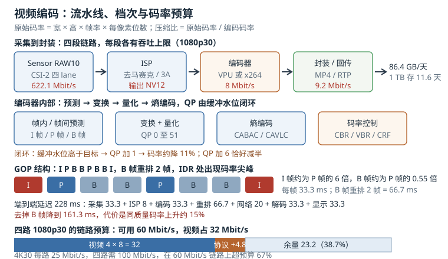

# 视频编解码：档次与工具、硬编与软编、码率控制与延迟预算

一块四路 1080p30 的记录仪板，规格书写着三个互不相干的数字：整机 2 TB 存储、保留 30 天、Wi-Fi 回传。它们其实被同一个量串在一起——编码后的码率。把 2 TB 摊到 30 天，每天只有 66.7 GB，折合 6.17 Mbit/s；四路均分，每路 1.54 Mbit/s。对 1080p30 来说这是每像素 0.0248 bit，暗部会糊成方块。三个数字里任意改一个，另外两个就被迫跟着动。

视频编解码（Video Codec）在嵌入式系统里之所以难，不是因为它算法复杂——算法由芯片或库实现——而是因为**它把像素、带宽、延迟、功耗四个预算绑在一起，任何一个超了都表现为"画面卡"**。这一章把 H.264 与 HEVC 的档次与工具、硬编与软编的取舍、码率控制的三种模式、GOP 与延迟的关系、色彩空间与位深、以及质量与带宽预算，拆成可以手算的几条式子。

## 1. 动机：码率、延迟、能量是三个不能分开算的预算

编码参数配错时，现象往往不在编码器上暴露，而在下游：

| 现象 | 大概率在哪一段 | 先看什么 |
|---|---|---|
| 录制正常，回放卡顿 | 码率超过存储或网络的持续写入能力 | 实际码率、eMMC 顺序写速度、VBV 缓冲 |
| 画面静止时清晰，一动就糊 | 码率太低或 QP 上限被驱动钳住 | 运动场景的瞬时码率、`i_frame_qp`/`p_frame_qp` |
| 云台转动后要等几秒才出画面 | GOP 太长，找不到最近的 IDR | `gop_size`、关键帧间隔、IDR 是否被强制刷新 |
| 直播延迟 300 ms 以上 | B 帧重排、编码前瞻、VBV 缓冲叠加 | B 帧数量、`lookahead`、缓冲区大小 |
| 高温下自动掉帧或花屏 | VPU 与 DDR 抢带宽、温度触发降频 | VPU 时钟、DDR 占用、`devfreq` 曲线 |
| 暗部出现一圈圈色带 | 8 bit 位深不够，或色度被压到 4:2:0 | 位深、色度采样、量化矩阵 |
| 同一码率下 HEVC 反而更糊 | 编码器实现差、或码率分配策略不同 | 编码器版本、preset、是否开了 B 帧 |

::: motivation 一个"参数都对，就是卡"的现场
某款车载记录仪用 4K30、硬件编码、CBR 20 Mbit/s，实验室一切正常。装车后用户反馈"太阳直射时回放卡"。现场抓包发现，编码器输出并不稳定在 20 Mbit/s：正午高对比场景下瞬时冲到 34 Mbit/s，而 eMMC 的顺序写只有 42 MB/s（336 Mbit/s），看似够用，但同一时刻 ISP 还在往 DDR 写 RAW 缓冲，两股流量叠加后写入队列积压，编码器输出缓冲满，VPU 只能丢帧。

把 CBR 换成"封顶 VBR"（`maxrate=20M`、`bufsize=10M`），并把 GOP 从 250 改成 60，问题消失：瞬时码率被 `bufsize` 钳住，IDR 更密使丢帧后恢复更快。

整个排查里，编码器的 profile、level、分辨率、帧率全是对的——**错的只是"瞬时码率"这个从未出现在规格书里的量**。
:::

这个例子说明：规格书给的是**平均码率**，硬件和网络承受的是**瞬时码率**。两者之间的桥是 VBV 缓冲，而缓冲深度直接换成延迟。码率、延迟、缓冲三者必须一起定。

## 2. 直观：从感光到比特流的一条流水线



上图上半是四段链路与各自的吞吐，中间是编码器内部的四个处理块与 QP 闭环，下半左侧是 GOP 中 I/P/B 帧的排布，右侧是四路 1080p30 的链路预算。

### 2.1 编码器在做什么

编码器（Encoder）的本质是**去掉三种冗余**：

- **空间冗余**：同一帧内相邻像素高度相关，用帧内预测（Intra Prediction）从左边和上边的已编码块推测当前块。
- **时间冗余**：相邻帧内容相似，用帧间预测（Inter Prediction）加运动补偿（Motion Compensation），只传"残差 + 运动矢量"。
- **统计冗余**：残差系数的分布极不均匀，用熵编码（Entropy Coding）把常见符号编成短码。

处理链固定为四步：**预测 → 变换（Transform）→ 量化（Quantization）→ 熵编码**。其中只有量化是有损的，而且损失程度由一个参数控制：量化参数（QP，Quantization Parameter）。H.264 的 QP 取值 0 到 51，HEVC 同样 0 到 51；QP 越大，量化步长越大，码率越低、画质越差。

H.264 以 16×16 的宏块（Macroblock，MB）为基本单位，HEVC 改用最大 64×64 的编码树单元（Coding Tree Unit，CTU），并用四叉树加二叉树递归切分。这是 HEVC 在同样画质下省码率的主要来源之一：大平坦区域用一个 64×64 块就够，细节区域可以切到 8×8。

### 2.2 码流的三层结构

一段 H.264 码流不是"一帧一段"，而是三层：

| 层 | 单位 | 作用 |
|---|---|---|
| 序列层 | SPS（Sequence Parameter Set） | 分辨率、位深、色度格式、档次级别、VUI 色彩信息 |
| 图像层 | PPS（Picture Parameter Set）+ Slice | 熵编码方式、参考帧数、量化矩阵、切片划分 |
| 单元层 | NAL Unit | 网络传输的最小单位，带 1 字节头 |

SPS 与 PPS 是"解码器初始化参数"。它们丢失或版本不匹配，解码器就不知道该怎么解析后续数据，表现为"有码流但解不出图"。工程上对应的问题是：**中途改分辨率或改 profile 而没有重新发 SPS/PPS**，接收端会用旧参数去解新码流。HEVC 把参数集拆得更细，多了 VPS（Video Parameter Set），还可能带多个 SPS 用于时域子层。

### 2.3 档次与级别：Profile 决定工具集，Level 决定吞吐上限

这两个概念经常被混为一谈，实际约束完全不同：

- **档次（Profile）**：允许使用哪些编码工具。用了档次外的工具，解码器可以直接拒解。
- **级别（Level）**：在给定工具集下，每秒最多处理多少数据。超了，解码器来不及算。

H.264 常用档次：

| 档次 | 新增工具 | 典型用途 |
|---|---|---|
| Baseline | 仅 I/P 切片、CAVLC、无加权预测 | 低延迟、老设备兼容 |
| Main | B 切片、CABAC、加权预测 | 通用广播与存储 |
| High | 8×8 变换、量化缩放矩阵、Cb/Cr 独立 QP 偏移 | 主流存储与流媒体 |
| High 10 | 10 bit 位深 | 高动态范围、后期调色 |
| High 4:2:2 / 4:4:4 | 更高色度精度 | 采集与中间片，不作为终端分发 |

HEVC 的档次简单得多：Main（8 bit 4:2:0）、Main 10（10 bit 4:2:0）、Main Still Picture，以及面向专业采集的 4:2:2/4:4:4 扩展。**Main 10 已经是消费终端的默认选项**，因为 10 bit 对暗部渐变的改善远大于它带来的 10% 到 15% 码率增量。

级别用两个硬指标卡住：最大帧尺寸（MaxFS，以宏块计）和最大宏块率（MaxMBPS，宏块每秒）。1080p 是 120×68 个宏块，共 8160 个；30 fps 需要 244800 宏块每秒。H.264 Level 4.0 的上限是 245760，占用 99.6%——**刚好够，一点余量都没有**。这也解释了一个常见现象：1080p30 用 Level 4.0 能跑，1080p60 就必须上 4.2。

### 2.4 硬编与软编：同一套标准，两条实现路径

| 维度 | 硬件编码（VPU） | 软件编码（x264/x265） |
|---|---|---|
| 算力 | 专用流水线，4K30 常见 | 通用 CPU，按宏块数线性吃核 |
| 功耗 | 数百毫瓦量级 | 每核数百毫瓦，多核叠加 |
| 画质 | 同码率通常低 10% 到 25% | 同码率通常更好 |
| 参数粒度 | 受驱动与固件限制，控制项有限 | preset/tune 极细，可调心理视觉模型 |
| 延迟 | 流水线固定，通常 1 帧 | 前瞻（lookahead）可到数十帧 |
| 升级 | 换芯片，或等厂商固件 | 换库版本即可 |

Linux 下硬件编码的标准入口是 V4L2 的内存到内存（Memory-to-Memory，M2M）接口：一侧是原始帧队列，另一侧是码流队列，控制项通过 `VIDIOC_S_CTRL` 下发。软件路径则是 libavcodec 或直接调 x264/x265 库。GStreamer 把两条路径统一成 `v4l2h264enc` 与 `x264enc` 两个元件，切换只改一行管线。

### 2.5 码率控制的三个旋钮

- **分辨率与帧率**：最粗暴也最有效的降码率手段，各降一半，像素率降到四分之一。
- **QP / 质量因子**：直接控制量化强度，是编码器内部最细的旋钮。
- **GOP 与参考结构**：决定 I 帧占比和 B 帧比例，影响平均码率和瞬时峰值。

围绕这三个旋钮，业界有三种控制模式：

| 模式 | 目标 | 码率波动 | 典型场景 |
|---|---|---|---|
| 恒定码率 CBR（Constant Bitrate） | 单位时间码率固定 | 小，靠调 QP 吸收 | 固定带宽链路、直播上行 |
| 可变码率 VBR（Variable Bitrate） | 平均码率达标，质量优先 | 大，高运动段落码率抬升 | 本地存储、点播 |
| 恒定质量因子 CRF（Constant Rate Factor） | 质量恒定，码率随内容浮动 | 最大 | 离线转码、素材归档 |

CBR 不是"每帧字节数相同"，而是"每秒字节数相同"。它必须配一个缓冲模型才有意义，这个模型叫 VBV（Video Buffering Verifier，视频缓冲验证器）：编码器保证任何时刻缓冲都不会下溢或上溢，解码器按同样的模型取数据就不会断流。VBV 缓冲越浅，码率越平稳，但编码器越难吸收 I 帧尖峰，画质在尖峰附近会明显下降。

工程上最常见的组合是**封顶 CRF**：`crf=23` 保证质量下限，`maxrate` 与 `bufsize` 保证不撑爆链路。它比纯 CBR 画质好，比纯 CRF 可控。

## 3. 定量：五个式子把预算算清

### 3.1 原始码率与压缩比

$$R_{\text{raw}} = W \cdot H \cdot f \cdot b_{\text{px}}$$

其中 $W$、$H$ 为宽高（像素），$f$ 为帧率（帧每秒），$b_{\text{px}}$ 为每像素平均位数（bit/px）。对 4:2:0 的 8 bit 视频，亮度 8 bit、两个色度各 2 bit 摊到每像素，合计 $b_{\text{px}} = 12$。

压缩比定义为

$$K = \frac{R_{\text{raw}}}{R_{\text{enc}}}$$

$R_{\text{enc}}$ 为编码器输出的平均码率。$K$ 不是一个固定常数，它随内容复杂度、分辨率、编码器档次变化。**同分辨率下 $K$ 会随码率上升而下降**，因为容易编码的部分先被榨干了。

### 3.2 每像素比特数

$$b_{\text{eff}} = \frac{R_{\text{enc}}}{W \cdot H \cdot f}$$

这个量比码率本身更能横向比较不同分辨率的编码强度。经验区间：

| $b_{\text{eff}}$（bit/px） | 画质档位 | 说明 |
|---|---|---|
| 0.02 到 0.04 | 监控级 | 静态可辨，运动糊 |
| 0.05 到 0.08 | 消费级 | 手机短视频常见区间 |
| 0.10 到 0.15 | 高质量 | 1080p 主流平台 |
| 0.20 以上 | 接近透明 | 归档母版 |

这是量级参考，不是标准值：同一 $b_{\text{eff}}$ 下，编码器好坏能差出一档画质。

### 3.3 QP 与码率的对数关系

H.264 的量化步长按 QP 每增加 6 翻一倍：

$$Q_{\text{step}} = 2^{(QP-4)/6}$$

码率近似与量化步长成反比，于是

$$\frac{R_2}{R_1} \approx 2^{-\,(QP_2 - QP_1)/6}$$

也就是 **QP 加 6，码率约减半；QP 加 1，码率约降 11%**。这条式子解释了为什么码率控制只需要小幅调 QP 就能跟住目标：从 QP 26 到 QP 32 就是一半码率，画质只降一档。

::: advanced 为什么是 6 而不是 10
H.264 的量化参数映射到量化步长表，索引以 6 为周期循环，每个周期内步长按 $\sqrt[6]{2}$ 递增，所以 6 个 QP 恰好对应 2 倍。这个设计让 QP 的小数部分可以用 1/6 的精度表达。HEVC 沿用同样的 6 周期结构，但把 QP 范围扩展到 0 到 51 之外还可以用切片级 QP 偏移。工程含义是：**码率对 QP 的敏感度是分段指数的，调 QP 时要按 6 的倍数思考档位，按 1 的步进做微调**。
:::

### 3.4 GOP、缓冲与延迟

图像组（GOP，Group of Pictures）从一个 IDR 帧开始，到下一个 IDR 之前结束。IDR（Instantaneous Decoder Refresh）是"清空参考帧列表"的 I 帧，解码器从它开始可以独立解码。

GOP 长度的第一重代价是**随机访问粒度**：

$$t_{\text{seek}} \leq \frac{G}{f}$$

$G$ 为 GOP 帧数，$f$ 为帧率。GOP 为 250、30 fps 时，最坏要等 8.33 秒才能定位到一个可独立解码的帧。

第二重代价是**码率尖峰**。I 帧约为 P 帧的 6 倍，B 帧约为 P 帧的 0.55 倍。GOP 越短，I 帧占比越高，平均码率越高。粗略估算，若 I、P、B 的字节比为 6 : 1 : 0.55，一个"1 个 I + 3 个 P + 4 个 B"的 8 帧 GOP 平均每帧成本为

$$\bar{c} = \frac{6 + 3 \times 1 + 4 \times 0.55}{8} = 1.4$$

而无 B 帧的"1 个 I + 7 个 P"结构为 $(6 + 7)/8 = 1.625$。所以 B 帧在码率上确实划算，代价是延迟。

第三重是**重排延迟**。B 帧要等后面的参考帧到达才能解码，解码顺序与显示顺序不同，缓冲里必须压住 $N_B$ 帧：

$$L_{\text{reorder}} = N_B \cdot \frac{1}{f}$$

2 个连续 B 帧、30 fps 就是 66.7 ms。

VBV 缓冲深度换算成延迟：

$$L_{\text{vbv}} = \frac{B_{\text{vbv}} \cdot 8}{R}$$

$B_{\text{vbv}}$ 单位为字节，$R$ 为码率（bit/s）。8 Mbit/s、缓冲 1 秒对应 1 MB，这部分数据必须先攒够才能平稳播放，构成额外的启动延迟。

端到端延迟按段相加：

$$L_{\text{e2e}} = L_{\text{cap}} + L_{\text{isp}} + L_{\text{enc}} + L_{\text{reorder}} + L_{\text{net}} + L_{\text{dec}} + L_{\text{disp}}$$

### 3.5 色彩空间与位深的位宽账

4:2:0 指每 2×2 像素共用一组色度样本，每像素平均 $8 + 2 \times 8/4 = 12$ bit；4:2:2 是 $8 + 2 \times 8/2 = 16$ bit；4:4:4 是 24 bit。所以**从 4:2:0 换到 4:4:4，原始数据翻倍，同画质码率大约也要翻倍**。

位深的账不同：8 bit 到 10 bit，原始数据只多 25%，但同 QP 下熵编码输出约多 10% 到 15%，而同画质下反而能省——因为 10 bit 减少了暗部量化误差，可以用更大的 QP。工程上按 **+12% 码率换掉可见色带**来估算。

色彩矩阵同样影响可解性。BT.601 与 BT.709 的 YUV 到 RGB 系数不同，标错矩阵的典型现象是"人脸发绿"或"红色过饱和"。有限范围（16 到 235）与全范围（0 到 255）标错，则是"黑位发灰"或"高光死白"。这两项都写在 SPS 的 VUI 里，容器层（MP4 的 `colr` box）还有一份，**两份不一致时以播放器实际读取的那份为准**，这是排查色彩问题时最容易漏的一环。

## 4. 算例：从 1080p30 到 4K60 的四本账

### 4.1 算例一：1080p30 的码率、存储与压缩比

1080p30、4:2:0、8 bit：

$$R_{\text{raw}} = 1920 \times 1080 \times 30 \times 12 = 746{,}496{,}000\ \mathrm{bit/s} = 746.5\ \mathrm{Mbit/s}$$

即 $746.5/8 = 93.3$ MB/s。按 8 Mbit/s 编码：

$$K = \frac{746.5}{8} = 93.3$$

$$b_{\text{eff}} = \frac{8 \times 10^6}{1920 \times 1080 \times 30} = 0.1286\ \mathrm{bit/px}$$

落在"高质量"区间。存储侧，24 小时连续录制：

$$S = \frac{8 \times 10^6 \times 86400}{8} = 86.4\ \mathrm{GB}$$

1 TB 可存 $1000/86.4 = 11.6$ 天。若降到 4 Mbit/s，$b_{\text{eff}} = 0.0643$，存储翻倍到 23.1 天，但画质掉到消费级。

回到开头的规格冲突：2 TB、30 天、四路，倒推每路只有 1.54 Mbit/s，$b_{\text{eff}} = 0.0248$，落在监控级以下。三选二：保留期压到 10 天、降到 720p、或加一路只录事件的低帧率通道。

::: example 从规格倒推参数
需求：4 路、每路 1080p30、保留 30 天、2 TB。

每天可用字节 $2 \times 10^{12} / 30 = 6.67 \times 10^{10}$ B，折合码率

$$R_{\text{total}} = \frac{6.67 \times 10^{10} \times 8}{86400} = 6.17\ \mathrm{Mbit/s}$$

四路均分 $1.54$ Mbit/s。要让 $b_{\text{eff}}$ 回到 0.05 的消费级下限，需要

$$R = 0.05 \times 1920 \times 1080 \times 30 = 3.11\ \mathrm{Mbit/s}$$

四路共 12.4 Mbit/s，对应保留期 $2 \times 10^{12} \times 8 / (12.4 \times 10^6 \times 86400) = 14.9$ 天。结论：**在给定存储下，"1080p30 + 消费级画质"最多保留 15 天**，这条结论比任何参数表都有用。
:::

### 4.2 算例二：4K30 的 Level 归属与链路预算

4K30 的宏块数：

$$P_{\text{MB}} = \left\lceil \frac{3840}{16} \right\rceil \times \left\lceil \frac{2160}{16} \right\rceil = 240 \times 135 = 32{,}400$$

宏块率为 $32400 \times 30 = 972{,}000$ 宏块每秒。对照 H.264 级别表：

| 级别 | MaxFS | MaxMBPS | 4K30 是否够 |
|---|---|---|---|
| 4.0 | 8192 | 245760 | 否，超 3.96 倍 |
| 5.0 | 22080 | 589824 | 否 |
| 5.1 | 36864 | 983040 | 是，占用 98.9% |
| 5.2 | 36864 | 2073600 | 是，占用 46.9% |

**4K30 必须标 Level 5.1**。写 Level 4.0 的码流，解码器按规范可以直接拒解；而部分播放器会"尽力解"，表现为卡顿而不是报错——这是兼容性问题的常见来源。

4K60 的宏块率翻倍到 $1{,}944{,}000$，只有 Level 5.2 装得下，占用 93.8%。

链路预算：四路 4K30 按 25 Mbit/s 计，裸码率 100 Mbit/s。802.11n 2.4 GHz 的 100 Mbit/s PHY 在实测中只有约 60% 可用（60 Mbit/s），**裸码率已超 67%**；再加 15% 协议与封装开销为 115 Mbit/s，超出 91.7%。必须换 5 GHz 802.11ac（PHY 433 Mbit/s，可用约 260 Mbit/s），余量 145 Mbit/s，占 55.8%。

### 4.3 算例三：GOP、VBV 与端到端延迟

设 1080p30、8 Mbit/s、GOP 60、2 个连续 B 帧，各段延迟：采集 1 帧、ISP 8 ms、编码流水 1 帧、网络单程 20 ms、解码 1 帧、显示 1 帧。帧时间 $1000/30 = 33.3$ ms。

$$L_{\text{e2e}} = 33.3 + 8 + 33.3 + 66.7 + 20 + 33.3 + 33.3 = 228.0\ \mathrm{ms}$$

去掉 B 帧（$N_B = 0$）后 $L_{\text{e2e}} = 161.3$ ms，省下 66.7 ms，代价是同质量码率上升约 15%，即 8 Mbit/s 变成约 9.2 Mbit/s。

GOP 的随机访问粒度：$G/f = 60/30 = 2$ 秒。若产品要求"云台转动后 500 ms 内出画面"，GOP 必须满足 $G \leq 0.5 \times 30 = 15$ 帧。GOP 从 60 降到 15，I 帧占比从 1/60 升到 1/15。按 I:P:B = 6:1:0.55 的模型，60 帧的 GOP 约含 1 个 I、15 个 P、44 个 B，平均每帧成本 $(6+15+44 \times 0.55)/60 = 0.753$；15 帧的 GOP 约含 1 个 I、4 个 P、10 个 B，成本 $(6+4+10 \times 0.55)/15 = 1.033$。**平均码率上升约 37%**，必须重新核 VBV 与链路余量。

VBV 缓冲：8 Mbit/s、1 秒缓冲对应 $8 \times 10^6/8 = 1$ MB，即 976.6 KiB。缓冲降到 0.5 秒（488.3 KiB），启动延迟省 0.5 秒，但 I 帧尖峰更容易顶到缓冲上限，画质在场景切换处会更差。

### 4.4 算例四：硬编与软编的能量账

1080p30 每帧 8160 个宏块，每秒 244800 个。按软件编码每宏块 3000 到 10000 个 CPU 周期的量级估算：

$$f_{\text{cpu}} = 244800 \times 3000 = 0.73\ \mathrm{GHz}\quad\text{到}\quad 244800 \times 10000 = 2.45\ \mathrm{GHz}$$

即单核 2.45 GHz 或四核 A53 各 0.61 GHz 量级。四核 A53 跑满时，编码部分多耗约 2.75 W；硬件编码器多耗约 0.25 W。

一块 11.1 Wh 电池（3000 mAh、3.7 V）、整机其余部分 5 W：

$$t_{\text{sw}} = \frac{11.1}{5 + 2.75} = 1.43\ \mathrm{h},\qquad t_{\text{hw}} = \frac{11.1}{5 + 0.25} = 2.11\ \mathrm{h}$$

**硬编让续航提升到 1.48 倍**。这是硬编存在的真实理由：不是"CPU 省下来了"，而是"每焦耳能编多少帧"。

但硬编要付画质代价：同 8 Mbit/s 下，硬件编码器通常比 x264 `medium` 低 10% 到 25% 的主观质量。若产品对画质敏感，正确的做法不是换回软编，而是**给硬编多分配 20% 码率**——在 8 Mbit/s 与 9.6 Mbit/s 之间，链路预算通常还有余量。

## 5. 工程含义：把参数写成规格

### 5.1 选型判断

| 条件 | 选择 |
|---|---|
| 需要 4K 以上、多路并发、电池供电 | 硬件编码，优先选带独立 VPU 且驱动走 V4L2 M2M 的 SoC |
| 需要极致画质、离线转码、算力充裕 | 软件编码 x264/x265 |
| 需要频繁换编码参数、做 ABR 阶梯 | 软件编码，参数粒度更细 |
| 需要低延迟 100 ms 以内 | 任一路径都要关 B 帧、关前瞻、缩短 VBV |
| 需要长期维护、不想绑定芯片固件 | 软件编码，升级路径独立于硬件 |

一条容易忽略的判断：**先问"解码端是谁"**。终端是手机浏览器，就必须兼容 H.264 High；终端是自家 App，HEVC 可行；终端是老旧 NVR，可能只认 Baseline。编码器选得再好，解码端不认就是零。

### 5.2 参数表

| 参数 | 1080p30 存储 | 1080p30 低延迟 | 4K30 直播 |
|---|---|---|---|
| 编码 | H.264 High | H.264 High | HEVC Main |
| 码率模式 | 封顶 VBR | CBR | 封顶 VBR |
| 码率 | 6 到 8 Mbit/s | 8 Mbit/s | 20 到 25 Mbit/s |
| 缓冲 | 1 秒 | 0.3 秒 | 1 秒 |
| GOP | 60（2 秒） | 30（1 秒），或开 intra-refresh | 60 |
| B 帧 | 2 | 0 | 2 |
| 前瞻 | 无 | 0 | 无 |
| Level | 4.0 | 4.0 | 5.1 |

低延迟档里"intra-refresh"值得单独说：它不用 IDR，而是把 I 帧的刷新分散到连续多帧的条带里，码率曲线平滑，代价是恢复时间变长、随机访问变差。实时会议类产品普遍用它替代周期性 IDR。

### 5.3 色彩与位深的落地

- **采集端**：sensor 输出 RAW，ISP 输出 NV12（4:2:0 8 bit）。要保留 10 bit，必须在 ISP 输出、DMA 格式、编码器输入三处同时改成 P010 之类的 10 bit 格式，任何一处退回 8 bit，整条链就白改。
- **矩阵与范围**：BT.709 有限范围是消费视频的默认。监控类设备常用 BT.601，接错设备会偏色。VUI 与容器元数据要一致。
- **HDR**：PQ（Perceptual Quantizer）与 HLG（Hybrid Log-Gamma）是两套传输函数，不能混用；HDR10 还需要静态元数据（MaxCLL、MaxFALL）。位深不够时强行上 HDR，结果是暗部色带比 SDR 更明显。

### 5.4 验收方法

```bash
# 查看编码器暴露的控制项与取值范围
v4l2-ctl -d /dev/video1 --list-ctrls

# 读出码率、GOP、档次、级别
v4l2-ctl -d /dev/video1 --get-ctrl=video_bitrate,video_gop_size,h264_profile,h264_level

# 用 GStreamer 跑 300 帧硬编，固定 8 Mbit/s、GOP 60
gst-launch-1.0 v4l2src device=/dev/video0 num-buffers=300 ! \
  video/x-raw,width=1920,height=1080,framerate=30/1,format=NV12 ! \
  v4l2h264enc extra-controls="controls,video_bitrate=8000000,video_gop_size=60" ! \
  h264parse ! filesink location=/tmp/out.h264

# 统计实际码率与时长
ffprobe -v error -show_entries format=bit_rate,duration -of default=nw=1 /tmp/out.h264

# 统计帧类型分布，确认 GOP 是否按预期
ffprobe -v error -select_streams v:0 -show_entries frame=pict_type -of csv=p=0 /tmp/out.h264 | sort | uniq -c
```

验收要看三件事：**平均码率是否落在目标 ±10%**、**瞬时码率峰值是否超过链路能力**、**帧类型分布是否与设定 GOP 一致**。前两项用 `ffprobe` 加一段时间的滑动窗口统计，第三项看 `pict_type` 的 `I` 间隔。

再补一项压测：把编码器放在最高温、最高运动、最高对比度的场景下跑 30 分钟，记录码率曲线与丢帧计数。实验室常温和现场高温的差别，往往就是 VPU 降频与 DDR 争抢造成的 15% 到 30% 吞吐损失。

## 6. 常见坑

::: pitfall 坑一：把 CBR 当成"每帧字节数固定"
**现象**：产品按 CBR 20 Mbit/s 设计，现场仍偶发花屏或缓冲溢出；抓包看到瞬时码率冲到 30 Mbit/s 以上，且尖峰出现在场景切换处。

**原因**：CBR 约束的是"每秒平均字节数"，不是每帧。编码器要保证 VBV 不上溢，就必须在尖峰前"预支"缓冲；如果 `bufsize` 设得过大（比如 3 秒），瞬时码率可以长时间高于平均值。

**解决**：把 `bufsize` 压到 0.5 到 1 秒，用 `maxrate` 显式封顶；用 1 秒滑动窗口统计码率而不是只看文件总大小；对 I 帧密集的段落，降低 GOP 或改用 intra-refresh 削峰。
:::

::: pitfall 坑二：改分辨率后没有重发 SPS/PPS
**现象**：切换分辨率或切换编码器实例后，接收端画面异常、绿屏、或解出半帧；重启播放器又正常。

**原因**：H.264 的分辨率、位深、色度格式都在 SPS 里。运行中换参数却没有把新的 SPS/PPS 随码流重新发送，解码器仍按旧参数解析，宏块数对不上。

**解决**：参数集随 IDR 一起周期性重发（`repeat-headers`）；切换分辨率时强制刷新并重新发送 SPS/PPS；封装层（MP4、RTP）确认 avcC 或 sprop-parameter-sets 同步更新。
:::

::: pitfall 坑三：GOP 太长导致云台转动后长时间无画面
**现象**：摄像头转动或网络抖动恢复后，播放端要黑屏数秒才出图；日志显示解码器一直在等关键帧。

**原因**：GOP 设为 250（约 8.3 秒），丢包或切换后最近的 IDR 在很久之前；接收端只能丢弃中间的 P/B 帧，等下一个 IDR。

**解决**：把 GOP 降到 30 到 60，或开启 intra-refresh；在关键事件（云台停止、开始录像）时通过 `VIDIOC_ENCODER_CMD` 强制插入 IDR；网络侧对关键帧做优先转发。
:::

::: pitfall 坑四：10 bit 链路只改了一段
**现象**：宣称支持 10 bit，实测暗部仍有明显色带；抓编码器输入格式，发现是 NV12 而不是 P010。

**原因**：10 bit 要 ISP 输出、DMA 格式、编码器输入三方一致。常见是 ISP 配了 10 bit，但 V4L2 队列协商时格式退回 NV12，编码器按 8 bit 编码，位深增益全丢。

**解决**：用 `v4l2-ctl --get-fmt-video` 在每一个节点确认格式；把格式协商结果打进启动日志；用灰阶渐变测试卡定量测色带宽度，不靠肉眼判断。
:::

::: pitfall 坑五：CPU 占用不高，但编码帧率上不去
**现象**：软编时 `top` 显示 CPU 只有 60%，编码帧率却达不到 30 fps，队列持续积压。

**原因**：瓶颈不在 CPU 计算，而在内存带宽或单线程瓶颈。x264 的多线程有帧级与切片级两种，帧级并行受参考帧依赖限制；如果参考帧多、B 帧多，线程间同步让并行度上不去，单核成为瓶颈。

**解决**：降低参考帧数、关 B 帧、用 `threads` 显式设成物理核数并开 `sliced-threads`；检查是否被 `memcpy` 或色彩转换吃掉了带宽，把 CSC 交给硬件或 NEON；用 `perf top` 看热点是否在 `mc_chroma`、`deblock` 这类核内函数上。
:::

## 7. 自测题

<details><summary>题一：1080p30、4:2:0、8 bit 的原始码率是多少？若编码到 8 Mbit/s，压缩比与每像素比特数各是多少？降到 4 Mbit/s 呢？</summary>

原始码率：

$$R_{\text{raw}} = 1920 \times 1080 \times 30 \times 12 = 746{,}496{,}000\ \mathrm{bit/s} = 746.5\ \mathrm{Mbit/s}$$

8 Mbit/s 时：

$$K = \frac{746.5}{8} = 93.3,\qquad b_{\text{eff}} = \frac{8 \times 10^6}{1920 \times 1080 \times 30} = 0.1286\ \mathrm{bit/px}$$

4 Mbit/s 时：

$$K = \frac{746.5}{4} = 186.6,\qquad b_{\text{eff}} = 0.0643\ \mathrm{bit/px}$$

验算：$0.1286 \times 62{,}208{,}000 = 8.0 \times 10^6$，其中 $1920 \times 1080 \times 30 = 62{,}208{,}000$ 像素每秒。码率减半时压缩比翻倍，$b_{\text{eff}}$ 减半——因为像素率没变，码率与 $b_{\text{eff}}$ 成正比。

</details>

<details><summary>题二：4K30 需要哪个 H.264 级别？4K60 呢？如果强行标成 Level 4.0，解码端会发生什么？</summary>

4K30 的宏块数 $240 \times 135 = 32{,}400$，宏块率 $32400 \times 30 = 972{,}000$。

Level 4.0 的 MaxMBPS 是 245{,}760，需求是它的 $972000/245760 = 3.96$ 倍，装不下。

Level 5.1 的 MaxMBPS 是 983{,}040，占用 $972000/983040 = 98.9\%$，刚好够。

4K60 宏块率 $1{,}944{,}000$，Level 5.1 装不下（$1.98$ 倍），只有 Level 5.2（2{,}073{,}600）可以，占用 93.8%。

强行标 Level 4.0：严格实现按规范拒绝解码；宽松实现会"尽力解"，表现为丢帧、卡顿、或只解出部分区域。更隐蔽的后果是**解码端据此分配的资源不够**，比如硬件解码器的内部行缓冲按级别申请，直接导致花屏。

</details>

<details><summary>题三：1080p30、8 Mbit/s、GOP 60、2 个 B 帧。各段延迟为采集 1 帧、ISP 8 ms、编码 1 帧、网络 20 ms、解码 1 帧、显示 1 帧。求端到端延迟；去掉 B 帧后是多少？GOP 决定的最坏随机访问延迟是多少？</summary>

帧时间 $1000/30 = 33.3$ ms，B 帧重排 $2 \times 33.3 = 66.7$ ms。

$$L_{\text{e2e}} = 33.3 + 8 + 33.3 + 66.7 + 20 + 33.3 + 33.3 = 228.0\ \mathrm{ms}$$

去掉 B 帧：

$$L_{\text{e2e}} = 228.0 - 66.7 = 161.3\ \mathrm{ms}$$

最坏随机访问延迟：

$$t_{\text{seek}} = \frac{G}{f} = \frac{60}{30} = 2.0\ \mathrm{s}$$

若产品要求 500 ms 内出画面，需 $G \leq 0.5 \times 30 = 15$ 帧。GOP 从 60 降到 15，I 帧占比从 1/60 升到 1/15。按 I:P:B = 6:1:0.55 估算：60 帧 GOP 含 1 个 I、15 个 P、44 个 B，平均每帧成本 0.753；15 帧 GOP 含 1 个 I、4 个 P、10 个 B，平均每帧成本 1.033。码率上升 $1.033/0.753 - 1 = 37.2\%$，需要重新核 VBV 与链路余量。

</details>

<details><summary>题四：四路 1080p30 每路 8 Mbit/s，协议开销 15%，链路实测可用 60 Mbit/s。余量多少？若改成四路 4K30 每路 25 Mbit/s，需要多快的链路？硬编与软编在 5 W 基线上差多少续航？</summary>

1080p30 四路：

$$R_{\text{total}} = 4 \times 8 \times 1.15 = 36.8\ \mathrm{Mbit/s}$$

余量 $60 - 36.8 = 23.2$ Mbit/s，占 $23.2/60 = 38.7\%$。

4K30 四路：

$$R_{\text{total}} = 4 \times 25 \times 1.15 = 115\ \mathrm{Mbit/s}$$

比 60 Mbit/s 超 $115/60 - 1 = 91.7\%$。若只按裸码率 100 Mbit/s 与 60 Mbit/s 比是 67% 超，加上协议开销后差距更大——**这正是"按裸码率做预算"最容易低估的地方**。

能量账：11.1 Wh 电池，5 W 基线，软编多 2.75 W：

$$t_{\text{sw}} = \frac{11.1}{7.75} = 1.43\ \mathrm{h},\qquad t_{\text{hw}} = \frac{11.1}{5.25} = 2.11\ \mathrm{h}$$

差 0.68 小时，硬编是软编的 1.48 倍。

</details>

## 8. 参考资料

- ITU-T Recommendation H.264《Advanced video coding for generic audiovisual services》Annex A：档次与级别的语法约束、MaxFS 与 MaxMBPS 的具体上限。
- ITU-T Recommendation H.265《High efficiency video coding》Annex A：Main 与 Main 10 档次的工具集、各级别的最大亮度图像尺寸。
- Linux 内核文档 `Documentation/userspace-api/media/v4l2-controls.rst`：编码器控制项 `V4L2_CID_MPEG_VIDEO_BITRATE`、`V4L2_CID_MPEG_VIDEO_GOP_SIZE`、`V4L2_CID_MPEG_VIDEO_H264_PROFILE`、`V4L2_CID_MPEG_VIDEO_BITRATE_MODE` 的语义与取值。
- Linux 内核文档 `Documentation/driver-api/media/v4l2-core.rst`：M2M 设备的队列模型、缓冲区协商与 `VIDIOC_ENCODER_CMD` 的强制关键帧语义。
- IETF RFC 6184《RTP Payload Format for H.264 Video》：NAL 单元在 RTP 上的打包、分片与关键帧标记。
- x264 项目文档《x264 Settings》与《Rate Control》：preset、tune、crf、vbv 参数的相互作用与默认值。
- FFmpeg 项目文档《H.264 Video Encoding Guide》《H.265/HEVC Video Encoding Guide》：x264/x265 常用参数组合与封顶 CRF 的写法。
- Netflix Technology Blog《Toward a Practical Perceptual Video Quality Metric》：VMAF 的构造动机与在码率阶梯中的用法。
- Iain E. Richardson，《The H.264 Advanced Video Compression Standard》第二版：宏块、变换、量化与熵编码的完整处理链。
- Charles Poynton，《Digital Video and HD: Algorithms and Interfaces》第二版：BT.601/BT.709 矩阵、有限范围与全范围、色度采样的工程定义。
