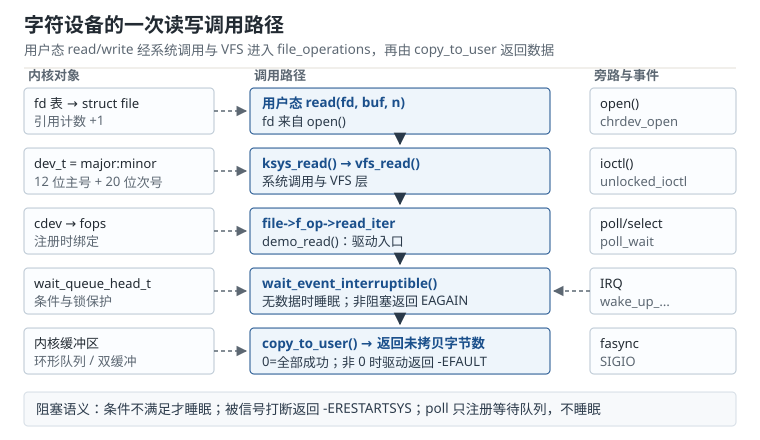

# 字符设备：file_operations、阻塞与 ioctl Character Devices

用户态执行 `read(fd, buf, 512)` 时，glibc 只做一次系统调用，剩下的事情全在内核里：VFS 根据 `fd` 找到 `struct file`，从 `file->f_op` 取出驱动注册的函数表，调用驱动的 `read` 或 `read_iter`，驱动再把数据从内核缓冲区复制到用户缓冲区。整条路径上有四个地方最容易出错：设备号没注册对，`open` 直接失败；`copy_to_user` 的返回值没检查，用户读到半截旧数据；阻塞条件写错，进程睡死或被信号打断后不返回；`ioctl` 结构体在 32 位与 64 位下大小不同，命令字对不上。

这一章把字符设备拆成"号码、函数表、数据拷贝、等待与唤醒、控制命令"五件事，每一件都给出可复算的定量口径。读完应当能自己写出一个带阻塞读、`poll` 和 `ioctl` 的字符设备，并解释为什么 1 字节一次地读会把 CPU 吃满。

## 1. 设计动机

字符设备（Character Device）是内核向用户态暴露"字节流或控制接口"的最直接方式。串口、I2C 适配器、ADC、GPIO 事件、音频控制节点，最终都以 `/dev/xxx` 的形式出现。它和块设备的区别不在"能不能随机访问"，而在接口语义：字符设备按字节流读写，不经过页缓存，驱动自己决定缓冲策略；块设备以块为单位，由块层管理缓存与调度。

::: motivation 三个绕不开字符设备的场景
**场景一：传感器采样流。** 一颗 8 通道、24 位、50 kS/s 的 ADC，原始数据率是 $8\times24\times50000=9.6$ Mbit/s，即 1.2 MB/s。用户态要连续读取，驱动必须提供环形缓冲区、阻塞读和 `poll`，否则应用只能轮询，CPU 占用和延迟都不可控。

**场景二：设备控制面。** 一个视频采集设备有分辨率、帧率、曝光、增益十几项参数，用 `write()` 传文本协议既难解析又难保证原子性。`ioctl` 提供"一个命令字 + 一个结构体"的原子控制接口，命令字还自带方向与大小，用户态和内核可以各自校验。

**场景三：事件通知。** 按键、红外、CAN 错误帧这类稀疏事件，用阻塞 `read` 会让一个线程专门等；用 `poll`/`epoll` 可以把几十个设备放进一个事件循环；用 `fasync` 可以让内核在事件到达时给进程发 `SIGIO`。三种机制共用同一个等待队列，驱动只需正确实现 `poll_wait` 与 `wake_up`。
:::

| 需求 | 机制 | 关键约束 |
|---|---|---|
| 连续字节流 | `read`/`write` + 环形缓冲区 | 返回部分长度是合法的，应用要循环 |
| 稀疏事件 | 阻塞读 + `poll`/`epoll` | 条件判断与等待队列必须配对 |
| 原子配置 | `ioctl` + 固定布局结构体 | 命令字、大小、32/64 位兼容 |
| 高吞吐零拷贝 | `mmap` + DMA 缓冲区 | 页对齐、缓存一致性、权限 |
| 设备发现 | `class_create` + `device_create` | devtmpfs/udev 生成节点与权限 |

**不懂会在哪摔跤**，具体是这四条：

1. 把 `read` 的返回值当成"一定等于请求长度"，驱动返回 300 字节、应用按 512 字节解析，后面的数据整体错位。
2. 在中断处理里调用 `copy_to_user`，触发"sleeping function called from invalid context"，或者更隐蔽地踩坏用户页表。
3. `ioctl` 命令字用 `_IOW` 定义了 24 字节的结构体，32 位应用按 20 字节发过来，驱动直接 `copy_from_user` 读越界。
4. 模块卸载时只调用 `cdev_del`，没有等待已打开的文件释放，`release` 回调在模块内存释放后执行，造成 use-after-free。

## 2. 定义与直观：号码、函数表与数据通道

### 2.1 设备号与设备节点

内核用 32 位的 `dev_t` 标识一个设备：高 12 位是**主设备号（Major Number）**，低 20 位是**次设备号（Minor Number）**。主设备号对应"哪一类驱动"，次设备号对应"这一类里的第几个实例"。

```c
dev_t dev = MKDEV(240, 3);       /* 0x0F000003 */
unsigned int major = MAJOR(dev); /* 240 */
unsigned int minor = MINOR(dev); /* 3 */
```

`/dev/demo0` 这样的设备节点里保存着 `dev_t`（`stat` 的 `st_rdev`）。用户 `open` 时，VFS 的 `chrdev_open()` 用 `inode->i_rdev` 在 `cdev_map` 里查找对应的 `struct cdev`，取出 `cdev->ops`，通过 `fops_get()` 增加模块引用计数，然后调用驱动的 `open`。这条链路解释了为什么 `file_operations.owner = THIS_MODULE` 如此重要：没有它，模块可以在设备仍被打开时被卸载。

注册字符设备有三套 API，推荐顺序如下：

```c
static dev_t demo_dev;
static struct cdev demo_cdev;
static struct class *demo_class;

static int __init demo_init(void)
{
    int ret, i;

    ret = alloc_chrdev_region(&demo_dev, 0, 4, "demo");
    if (ret)
        return ret;

    cdev_init(&demo_cdev, &demo_fops);
    demo_cdev.owner = THIS_MODULE;
    ret = cdev_add(&demo_cdev, demo_dev, 4);
    if (ret)
        goto err_region;

    demo_class = class_create("demo"); /* 6.4 之前为 class_create(THIS_MODULE, "demo") */
    if (IS_ERR(demo_class)) {
        ret = PTR_ERR(demo_class);
        goto err_cdev;
    }

    for (i = 0; i < 4; i++) {
        if (IS_ERR(device_create(demo_class, NULL,
                                 MKDEV(MAJOR(demo_dev), i),
                                 NULL, "demo%d", i))) {
            ret = -ENODEV;
            goto err_class;
        }
    }
    return 0;

err_class:
    /* 销毁已创建的节点，再销毁 class */
    while (--i >= 0)
        device_destroy(demo_class, MKDEV(MAJOR(demo_dev), i));
    class_destroy(demo_class);
err_cdev:
    cdev_del(&demo_cdev);
err_region:
    unregister_chrdev_region(demo_dev, 4);
    return ret;
}
```

- `register_chrdev_region()`：主设备号由调用者指定，适合有固定号段的产品。
- `alloc_chrdev_region()`：主设备号为 0 时由内核从空闲号段分配，适合新驱动。实际分配到的号看 `/proc/devices`。
- `register_chrdev()`：老接口，一次占用 256 个次设备号并内部创建 `cdev`，新代码不要用。

`class_create()` 与 `device_create()` 只负责 sysfs 与设备节点，不负责字符设备的注册。两者都成功，`/dev/demo0` 才会由 devtmpfs 或 udev 创建；只调用 `cdev_add()` 而不创建 class，节点不会自动出现，需要手动 `mknod`。卸载顺序与初始化相反：先 `device_destroy()`，再 `class_destroy()`，再 `cdev_del()`，最后 `unregister_chrdev_region()`。

### 2.2 `file_operations` 是驱动与 VFS 的契约

`struct file_operations` 是一张函数指针表。VFS 不关心驱动内部怎么实现，只按表调用：

| 方法 | 何时调用 | 关键点 |
|---|---|---|
| `open` | 每次 `open()` | 初始化 `filp->private_data`，可返回负 errno |
| `release` | 最后一个引用关闭 | 释放 `private_data`，不保证在 `close()` 返回前完成 |
| `read` / `read_iter` | `read()`、`readv()` | 返回实际字节数，0 表示 EOF，负值表示错误 |
| `write` / `write_iter` | `write()`、`writev()` | 可能部分写入，应用要循环 |
| `poll` | `select`/`poll`/`epoll` | 调用 `poll_wait` 注册，返回就绪掩码 |
| `unlocked_ioctl` | `ioctl()` | 不再持有 BKL，自己加锁 |
| `compat_ioctl` | 32 位应用在 64 位内核 | 处理指针与结构体大小差异 |
| `mmap` | `mmap()` | 把内核缓冲区或设备内存映射到用户态 |
| `fasync` | `fcntl(F_SETFL, O_ASYNC)` | 异步通知，配合 `kill_fasync` |
| `llseek` | `lseek()` | 字符设备常用 `no_llseek` 返回 `-ESPIPE` |

`owner` 必须是 `THIS_MODULE`，`private_data` 是每个打开实例的私有指针，`struct file` 在 `open` 成功后一直存活到 `release`。不要在 `open` 里把全局变量地址赋给 `private_data` 又在多个实例间共享可变状态，除非你自己做了同步。

### 2.3 一次 `read` 的完整路径

以 `read()` 为例，路径是：

```text
用户态 read(fd, buf, n)
  → sys_read / ksys_read
    → vfs_read
      → rw_verify_area（检查文件模式与偏移）
      → file->f_op->read_iter（或旧式 read）
        → demo_read
          → 等待数据（可能阻塞）
          → copy_to_user(buf, kbuf, n)
      ← 返回实际字节数
  ← 系统调用返回
```

VFS 负责三件事：参数与权限检查、文件偏移更新、把驱动的返回值翻译成系统调用返回值。驱动负责：数据从哪来、没有数据时睡不睡、复制到用户态成功多少。



几个返回值约定必须记清：

- 返回 `0`：读到文件末尾（对字符设备通常表示设备已关闭或没有更多数据）。
- 返回正数：实际读到的字节数，**可以小于请求长度**。
- 返回 `-EAGAIN`：非阻塞模式下暂无数据。
- 返回 `-ERESTARTSYS`：被信号打断，VFS 可能重启系统调用，也可能把 `-EINTR` 返回给用户。
- 返回 `-EFAULT`：用户缓冲区不可访问。
- 返回 `-ENOTTY`：不支持的 `ioctl` 命令。

### 2.4 `copy_to_user` 与 `copy_from_user`

用户指针不能直接解引用。原因有三层：用户地址可能未映射，直接访问会触发内核页错误；SMAP/SMEP 会阻止内核在未显式放开的情况下访问用户页；KASAN 等工具需要知道这是一次用户拷贝。正确做法是使用 `copy_to_user()` / `copy_from_user()`，并用 `__user` 标注指针类型。

```c
static ssize_t demo_read(struct file *filp, char __user *buf,
                         size_t count, loff_t *ppos)
{
    struct demo_dev *d = filp->private_data;
    unsigned int copied;

    if (kfifo_is_empty(&d->fifo)) {
        if (filp->f_flags & O_NONBLOCK)
            return -EAGAIN;
        if (wait_event_interruptible(d->wq, !kfifo_is_empty(&d->fifo)))
            return -ERESTARTSYS;
    }

    if (kfifo_to_user(&d->fifo, buf, count, &copied))
        return -EFAULT;

    return copied;
}
```

`copy_to_user()` 返回**未拷贝的字节数**，不是错误码。返回 0 表示全部成功；返回非 0 通常意味着用户缓冲区在中途不可访问。`copy_from_user()` 在短拷贝时会把目标缓冲区剩余部分清零，避免把内核旧数据泄露给用户；但驱动仍应检查返回值并返回 `-EFAULT`。

上面的 `demo_read` 假设同一时刻只有一个读者。如果允许多个读者并发 `read`，要在外层加互斥锁，或者在 `copied == 0` 时返回 `-EAGAIN` 重新等待；否则两个读者都判断"非空"、其中一个把数据取空后，另一个会返回 0，被应用误认为 EOF。

其他接口：

- `get_user(x, ptr)` / `put_user(x, ptr)`：拷贝单个标量，适合 `int`、`u32` 这类小数据。
- `strncpy_from_user()`：拷贝以 `\0` 结尾的字符串，返回长度或负错误码。
- `clear_user()`：把用户缓冲区清零。
- `copy_struct_from_user()`：专为 `ioctl` 设计，按"内核结构体大小"和"用户传入大小"处理扩展与清零，新代码优先用它。

`copy_to_user()` 可能因为缺页而睡眠，因此**不能**在自旋锁、中断上下文、RCU 读临界区里调用。需要在这些上下文返回数据时，先把数据放进内核缓冲区，等进程上下文再拷贝。

### 2.5 阻塞（Blocking）、非阻塞（Non-blocking）与等待队列

阻塞读的本质是"条件不满足时把当前进程挂到等待队列上，让出 CPU；条件满足时被唤醒，重新检查条件"。等待队列（Wait Queue）是内核的通用机制：

```c
static DECLARE_WAIT_QUEUE_HEAD(demo_wq);

/* 读侧：没有数据就睡 */
if (wait_event_interruptible(demo_wq, demo_has_data(d)))
    return -ERESTARTSYS;

/* 中断侧：数据到达后唤醒 */
wake_up_interruptible(&demo_wq);
```

`wait_event_interruptible(wq, condition)` 展开后做四件事：把当前进程状态设为 `TASK_INTERRUPTIBLE`，把等待项挂到 `wq`，重新检查 `condition`（防止在挂入前条件已满足造成丢唤醒），然后调度。被唤醒后它会再次检查条件；如果条件仍不满足，继续睡。

两个常见错误：

1. **丢唤醒（lost wakeup）**：先检查条件、再加等待队列，检查与挂入之间如果中断到达并 `wake_up`，这次唤醒就丢了。`wait_event` 宏通过"挂入后重新检查"避免这个问题，手写 `prepare_to_wait()` 时也必须遵守同样的顺序。
2. **条件没有同步**：条件变量被中断和进程同时访问，却没有锁或内存屏障。应该用自旋锁保护条件，或者在 `wake_up` 前用 `smp_wmb()` 保证数据先写入。

非阻塞模式由 `filp->f_flags & O_NONBLOCK` 判断。没有数据时立即返回 `-EAGAIN`，应用用 `poll` 等事件后再读。不要在非阻塞路径里睡眠，否则 `O_NONBLOCK` 就失去意义。

`wake_up_interruptible()` 默认唤醒所有非独占等待者，并唤醒一个独占等待者。多个读者同时等待时，用独占等待（`wait_event_interruptible_exclusive`）可以避免"惊群"：一次中断只唤醒一个读者，其余继续睡。

### 2.6 `poll`、`select` 与 `epoll`：多路复用（Multiplexing）

`poll` 的职责不是"等数据"，而是"告诉 VFS 我现在有没有数据，以及将来有数据时通知我"。驱动实现：

```c
static __poll_t demo_poll(struct file *filp, poll_table *wait)
{
    struct demo_dev *d = filp->private_data;
    __poll_t mask = 0;

    poll_wait(filp, &d->wq, wait);

    if (!kfifo_is_empty(&d->fifo))
        mask |= EPOLLIN | EPOLLRDNORM;
    if (kfifo_avail(&d->fifo) >= d->buf_size)
        mask |= EPOLLOUT | EPOLLWRNORM;

    return mask;
}
```

`poll_wait()` 只是把当前 `poll` 调用注册到等待队列，不睡眠；真正睡眠发生在 VFS 的 `do_poll()` 或 `epoll_wait()` 里。驱动每次被调用都要重新计算掩码，因为数据状态可能已经变化。

三种多路复用接口的差异：

| 接口 | 每次调用的开销 | 文件描述符上限 | 适用场景 |
|---|---|---|---|
| `select` | 扫描全部 fd，修改 fd_set | `FD_SETSIZE`，通常 1024 | 少量 fd、跨平台 |
| `poll` | 扫描全部 `pollfd` | 受内存限制 | 中等数量、事件类型多 |
| `epoll` | 只处理就绪链表 | 受内存限制 | 大量 fd、长期监听 |

`poll` 默认是水平触发：只要缓冲区非空，每次调用都返回可读。边缘触发（`EPOLLET`）只在状态变化时通知一次，应用必须一次读到 `-EAGAIN` 为止，否则会漏事件。驱动不需要关心触发模式，只需要在每次 `poll` 时如实报告状态。

`fasync` 是另一条通知路径：应用用 `fcntl(fd, F_SETFL, O_ASYNC)` 打开异步通知，驱动在 `fasync` 方法里调用 `fasync_helper()`，事件到达时调用 `kill_fasync(&d->fasync, SIGIO, POLL_IN)`。它适合"事件很少、不想占用一个线程"的场景，但信号语义复杂，新设计更推荐 `poll`。

### 2.7 `ioctl` 的约定

`ioctl` 解决的是"`read`/`write` 表达不了的控制操作"。它的命令字是一个 32 位整数，按位编码了方向、大小、类型和序号：

```c
struct demo_cfg {
    __u64 addr;
    __u32 rate;
    __u8  mode;
    __u8  flags;
};

struct demo_status {
    __u32 dropped;
    __u32 overrun;
};

#define DEMO_IOC_SET_CFG    _IOW('D', 0x21, struct demo_cfg)
#define DEMO_IOC_GET_STATUS _IOR('D', 0x22, struct demo_status)
```

`_IOW` 表示用户态向内核写数据，`_IOR` 表示内核向用户态读数据，`_IOWR` 表示双向，`_IO` 表示无数据。`'D'` 是驱动自己的魔数，`0x21` 是序号。内核侧处理：

```c
static long demo_ioctl(struct file *filp, unsigned int cmd, unsigned long arg)
{
    struct demo_cfg cfg;
    void __user *argp = (void __user *)arg;
    int ret;

    switch (cmd) {
    case DEMO_IOC_SET_CFG:
        ret = copy_struct_from_user(&cfg, sizeof(cfg), argp, _IOC_SIZE(cmd));
        if (ret)
            return ret;
        if (cfg.rate == 0 || cfg.rate > 1000000)
            return -EINVAL;
        return demo_set_cfg(filp->private_data, &cfg);
    default:
        return -ENOTTY;
    }
}
```

约定：

- 未知命令返回 `-ENOTTY`，不要返回 `-EINVAL`，否则应用无法区分"命令不支持"与"参数不合法"。
- 成功返回 0；需要返回数据时用 `_IOR` 的结构体，不要用正返回值兼作数据。
- 结构体用固定宽度类型（`__u32`、`__u64`），不要放原生指针；用户地址用 `__u64` 存，再用 `u64_to_user_ptr()` 转换。
- 结构体要可扩展：开头放 `version` 或 `size` 字段，新版本只追加字段；配合 `copy_struct_from_user()` 处理旧应用传来的短结构。
- `copy_struct_from_user()` 返回 `-E2BIG` 或 `-EFAULT` 时要原样返回，不要一律映射成 `-EFAULT`，否则用户态无法区分"缓冲区不可访问"与"结构体版本太新"。
- 命令字不能随意改。改了 `sizeof` 就等于改了 ABI，旧应用会收到 `-EINVAL` 或读越界。

## 3. 定量关系

### 3.1 吞吐（Throughput）模型

一次 `read` 的耗时由固定开销和拷贝时间组成：

$$T(S)=\frac{S}{t_0+S/B},\qquad \eta(S)=\frac{T(S)}{B}=\frac{1}{1+t_0B/S}$$

符号与单位：

- $S$：单次读写的字节数，B；
- $t_0$：系统调用、VFS、驱动逻辑、唤醒等固定开销，s；
- $B$：`copy_to_user` 的有效拷贝带宽，B/s；
- $T(S)$：吞吐，B/s；
- $\eta(S)$：相对拷贝带宽的效率，无量纲。

推导：单次调用耗时 $t=t_0+S/B$，吞吐 $T=S/t$。当 $S\to\infty$ 时 $T\to B$；当 $S$ 很小时，$T\approx S/t_0$，吞吐由调用频率决定，而不是由内存带宽决定。

### 3.2 阻塞唤醒延迟

一次"中断到达 → 阻塞进程被唤醒 → `read` 返回"的延迟可以拆成：

$$t_{\text{wake}}=t_{\text{irq}}+t_{\text{handler}}+t_{\text{wakeup}}+t_{\text{sched}}+t_{\text{switch}}+t_{\text{return}}$$

符号与单位：

- $t_{\text{irq}}$：中断入口硬件与软件保存现场，s；
- $t_{\text{handler}}$：硬中断处理函数（含读取状态、清中断），s；
- $t_{\text{wakeup}}$：`wake_up_interruptible()` 遍历等待队列并把任务置为可运行，s；
- $t_{\text{sched}}$：调度器选中该任务的时间，受运行队列长度影响，s；
- $t_{\text{switch}}$：上下文切换与缓存污染，s；
- $t_{\text{return}}$：从系统调用返回用户态，s。

这个模型给出的是平均值；工程上要按 p99 估算，因为调度延迟在负载高时会显著变大。

### 3.3 `ioctl` 命令字与结构体对齐

命令字的编码为：

$$C=(\text{dir}\ll30)\ |\ (\text{size}\ll16)\ |\ (\text{type}\ll8)\ |\ \text{nr}$$

符号与单位：

- $\text{dir}$：方向，2 位，0 无数据、1 写、2 读、3 读写；
- $\text{size}$：结构体字节数，14 位，最大 $2^{14}-1=16383$；
- $\text{type}$：魔数，8 位；
- $\text{nr}$：序号，8 位；
- $C$：32 位命令字。

结构体大小由字段偏移与对齐决定：

$$\text{off}_{i+1}=\text{alignup}(\text{off}_i+s_i,\ a_{i+1}),\qquad \text{sizeof}=\text{alignup}(\text{off}_n,\ a_{\max})$$

其中 $s_i$ 是第 $i$ 个字段大小，$a_i$ 是其对齐要求，$\text{alignup}(x,a)=\lceil x/a\rceil a$。填充字节不计入字段，但计入 `sizeof`，也就计入命令字的 `size` 位。

### 3.4 `select` 与 `epoll` 的开销

`select`/`poll` 每次调用都要遍历全部 fd：

$$t_{\text{select}}\approx n_{\text{fd}}\,t_{\text{poll}},\qquad t_{\text{epoll}}\approx n_{\text{ready}}\,t_{\text{poll}}+t_{\text{sys}}$$

符号与单位：

- $n_{\text{fd}}$：注册的文件描述符数量；
- $n_{\text{ready}}$：本次就绪的 fd 数量；
- $t_{\text{poll}}$：单个 fd 调用驱动 `poll` 并检查掩码的耗时，s；
- $t_{\text{sys}}$：一次系统调用的固定开销，s。

`epoll` 的优势来自"只处理就绪链表"，但当所有 fd 都活跃时，它退化到与 `poll` 同一量级。

### 3.5 设备号容量

`dev_t` 的位宽决定容量：

$$N_{\text{major}}=2^{12}=4096,\qquad N_{\text{minor}}=2^{20}=1048576$$

主设备号最多 4096 个，每个主设备号下最多约 105 万个次设备号。次设备号耗尽时只能再申请一个主设备号；反过来，一个主设备号下挂几百个串口完全正常。

## 4. 典型算例

### 4.1 ADC 数据流的读取大小

8 通道、24 位、50 kS/s 的 ADC，数据率：

$$R=8\times24\times50000=9.6\times10^6\ \text{bit/s}=1.2\ \text{MB/s}$$

取 $t_0=0.9$ 微秒、$B=6$ GB/s，按不同读大小计算：

| 单次读取 $S$ | 单次耗时 | 吞吐 $T$ | 效率 $\eta$ | 每秒调用次数 |
|---|---|---|---|---|
| 64 B | 0.911 微秒 | 70.3 MB/s | 1.17% | 18750 |
| 512 B | 0.985 微秒 | 520 MB/s | 8.66% | 2344 |
| 4 KiB | 1.583 微秒 | 2.59 GB/s | 43.1% | 293 |
| 64 KiB | 11.82 微秒 | 5.54 GB/s | 92.4% | 18.3 |

对 1.2 MB/s 的 ADC，512 B 一次只需 2344 次调用/秒，CPU 占用 $2344\times0.985=2.31$ ms/s，约 0.23%，非常宽裕。如果应用每次只读 1 字节，需要 120 万次调用/秒，单是系统调用就要 $1.2\times10^6\times0.9\,\mu s=1.08$ s/s，超过一个 CPU 核，根本跑不动。**最小可行读大小**由"调用频率上限"决定：

$$S_{\min}=\frac{R}{1/t_0}=R\,t_0=1.2\times10^6\times0.9\times10^{-6}=1.08\ \text{B}$$

理论上 2 字节就够，但实际要留出 10 倍以上余量，所以 512 B 到 4 KiB 是合理区间。读得越大，吞吐越高，但单次延迟也越大：4 KiB 在 1.2 MB/s 下对应 3.4 ms 的数据，对 50 kS/s 的采样流意味着 170 个采样点的缓冲。

### 4.2 `ioctl` 结构体的大小、填充与命令字

原始结构体按声明顺序：

```c
struct demo_cfg {
    __u8  mode;   /* offset 0 */
    __u32 rate;   /* offset 4，前面填充 3 字节 */
    __u64 addr;   /* offset 8 */
    __u8  flags;  /* offset 16 */
};                /* sizeof = 24，尾部填充 7 字节 */
```

重排后：

```c
struct demo_cfg {
    __u64 addr;   /* offset 0 */
    __u32 rate;   /* offset 8 */
    __u8  mode;   /* offset 12 */
    __u8  flags;  /* offset 13 */
};                /* sizeof = 16，尾部填充 2 字节 */
```

命令字按 64 位布局计算：

- 原始：`dir=1`，`size=24=0x18`，`type='D'=0x44`，`nr=0x21`，则 $C=(1\ll30)|(0x18\ll16)|(0x44\ll8)|0x21=0x40184421$。
- 重排：`size=16=0x10`，则 $C=0x40104421$。

两者只差 `size` 位，但 `_IOC_SIZE()` 一个返回 24、一个返回 16。如果驱动按 24 字节 `copy_from_user`，而用户态按 16 字节的结构体传参，内核会读越界 8 字节；反过来，驱动按 16 字节读、用户态发 24 字节，则会忽略尾部字段。

32 位兼容更麻烦：i386 的 `__u64` 对齐是 4，原始结构体变成 `mode@0`、`rate@4`、`addr@8`、`flags@16`，`sizeof=20`，命令字是 `0x40144421`；64 位内核按 24 字节解析，`_IOC_SIZE` 直接对不上。重排后的结构体在 i386 上仍是 16 字节，命令字一致。**把 64 位字段放在最前面**是减少兼容问题的最简单办法；如果必须支持旧布局，就实现 `compat_ioctl` 并显式转换。

`copy_struct_from_user()` 能处理"用户态结构体比内核结构体短"的情况：它按 `ksize` 清零内核缓冲区，只拷贝 `usize` 字节，`usize` 大于 `ksize` 时返回 `-E2BIG`（除非尾部全零）。这比裸 `copy_from_user` 安全，适合可扩展的 `ioctl` 结构。

### 4.3 阻塞唤醒的延迟预算

某传感器中断到 `read` 返回的典型分解：

| 阶段 | 耗时 |
|---|---|
| 中断入口 | 1.5 微秒 |
| 硬中断处理 | 2.0 微秒 |
| `wake_up_interruptible` | 0.8 微秒 |
| 调度选中 | 2.5 微秒 |
| 上下文切换 | 1.2 微秒 |
| 系统调用返回 | 1.0 微秒 |
| 缓存缺失（估算） | 3.0 微秒 |
| 合计 | 12.0 微秒 |

若事件率 1 kHz，唤醒开销 $1000\times12\,\mu s=12$ ms/s，占 1.2%；10 kHz 时占 12%，且调度延迟的尾部会迅速变长。若应用要求 50 微秒内响应，12 微秒的平均值只有 4.2 倍余量，p99 很可能超标。此时应把中断上半部做薄、用线程化中断处理耗时工作，或者用 `poll` 批量取数而不是每个事件唤醒一次。

反过来，如果中断处理里加一条 `pr_info`，按上一章的串口模型，一行 96 字节要 8.33 ms，延迟直接放大 694 倍。**日志不能出现在唤醒路径上**，这不是风格问题，是数量级问题。

### 4.4 `select` 与 `epoll` 的 CPU 开销

1000 个 fd 全部注册读事件，单个 `vfs_poll` 平均 0.6 微秒：

- `select` 每次调用扫描 1000 个 fd，耗时约 $1000\times0.6=0.6$ ms；事件循环每秒跑 1000 次，CPU 占用 $0.6\times1000=600$ ms/s，即 60%。
- `epoll` 每次只有 10 个 fd 就绪，处理就绪链表约 $10\times0.6=6$ 微秒，加 1 微秒系统调用，共 7 微秒；每秒 1000 次只占 0.7%。

差距来自"扫描全部"与"只处理就绪"的区别。但要注意：`epoll` 在注册时仍要调用一次驱动的 `poll`，如果驱动在 `poll` 里做了重活（比如读硬件寄存器），注册 1000 个 fd 的成本仍然存在。`poll` 方法应该只做内存状态检查，把硬件访问放到中断或工作队列里。

### 4.5 设备号计算

主设备号 240、次设备号 0 到 3 的四个设备：

$$\text{dev}_i=(240\ll20)\ |\ i=0x0F000000+i$$

即 `0x0F000000`、`0x0F000001`、`0x0F000002`、`0x0F000003`。`MKDEV(240, 3)` 得到 `0x0F000003`，`MAJOR()` 取高 12 位得 240，`MINOR()` 取低 20 位得 3。

最大合法值：主设备号 4095、次设备号 1048575 时，`dev_t` 为 `0xFFFFFFFF`，32 位全部用满。实际分配不会用到这么满；`alloc_chrdev_region()` 会从空闲号段里找连续区间，失败返回 `-ENOSPC`，此时要减少次设备号数量或换主设备号。

## 5. 工程含义

### 5.1 缓冲区与延迟的权衡

字符设备的缓冲区大小决定了三件事：能吸收多少突发、单次读的延迟、内存占用。经验规则：

- 缓冲区至少覆盖"最坏调度延迟 × 数据率"。例如 1.2 MB/s、最坏 20 ms 不能调度，需要 24 KiB 缓冲。
- 读大小取缓冲区的 1/4 到 1/2，避免一次读把缓冲区搬空导致后续读者等待。
- 用 `kfifo` 或环形缓冲区，生产者（中断/DMA）与消费者（read）各自维护索引，用内存屏障保证顺序；不要用"关中断 + 大临界区"保护整个拷贝。

高吞吐场景考虑 `mmap`：驱动把 DMA 缓冲区映射到用户态，应用直接读，省掉 `copy_to_user`。代价是缓存一致性与页对齐要求，且应用可能读到"正在被 DMA 写入"的半更新数据，需要双缓冲或序列号。

### 5.2 阻塞与非阻塞的 API 设计

同一个设备通常同时支持两种模式：

- 默认阻塞：没有数据就睡，适合"一个线程管一个设备"的简单应用。
- `O_NONBLOCK`：立即返回 `-EAGAIN`，配合 `poll` 使用，适合事件循环。
- `poll` 的超时：应用可以设 0（纯轮询）或有限值（带超时的等待）。

驱动要保证：非阻塞路径不睡眠；阻塞路径可被信号打断；`poll` 的掩码与 `read` 的实际可读性一致。三者不一致时，应用会出现"`poll` 说可读、`read` 却返回 `-EAGAIN`"的诡异现象，通常是因为 `poll` 检查了错误的条件，或者条件在两者之间被另一个读者改变。

### 5.3 `ioctl` 的 ABI 稳定性

`ioctl` 是用户态与驱动之间的二进制契约。一旦发布，命令字与结构体布局就不能改。工程做法：

- 结构体开头放 `__u32 version` 与 `__u32 size`，新字段只追加。
- 用 `_IOC_SIZE(cmd)` 判断用户态传来的是哪个版本，而不是假设等于 `sizeof`。
- 32 位兼容用 `compat_ioctl` + `compat_ptr()`，或者让结构体里只放固定宽度整数，避免指针。
- 魔数在 `Documentation/userspace-api/ioctl/ioctl-number.rst` 里登记，避免与其他驱动冲突。
- 新接口优先考虑 `sysfs`（全局配置）或 `netlink`（复杂消息），`ioctl` 只保留每 fd 的原子控制。

### 5.4 锁与上下文

字符设备驱动常见的锁组合：

- `mutex`：保护 `open`/`release`/`read`/`ioctl` 的慢路径，可以睡眠。
- `spinlock`：保护中断与进程共享的环形缓冲区索引，临界区要短。
- `wait_event` 的条件用 `spinlock` 保护，`wake_up` 在中断里调用没问题（它不睡眠）。

不能在自旋锁里 `copy_to_user`、`kmalloc(GFP_KERNEL)`、`mutex_lock`。如果中断里需要把数据交给用户，先把数据放进 `kfifo`，在中断里 `wake_up`，让进程上下文完成拷贝。

### 5.5 卸载与生命周期

字符设备的卸载顺序必须是：

1. 停止新请求：`device_destroy()` 删除 `/dev` 节点，`class_destroy()` 删除 sysfs。
2. 注销 `cdev`：`cdev_del()` 从 `cdev_map` 移除，新的 `open` 失败。
3. 等待已打开的文件：靠 `file_operations.owner` 的模块引用计数；模块不会被卸载，直到所有 `release` 完成。
4. 释放资源：`unregister_chrdev_region()`、`kfree` 缓冲区、销毁等待队列。

如果 `owner` 没设置，第 3 步不存在，`rmmod` 可以在文件仍打开时成功，后续 `read` 调用到已释放的代码段，直接 Oops。这是字符设备驱动最严重的生命周期错误。

### 5.6 权限与设备节点

`device_create()` 创建的节点默认权限由内核与 udev 规则决定。生产设备通常需要：

```text
# /etc/udev/rules.d/99-demo.rules
SUBSYSTEM=="demo", MODE="0660", GROUP="demo"
```

这行规则让 `demo` 组的用户可读写，其他用户不可访问。不要用 `MODE="0666"` 图省事；字符设备往往能直接操作硬件，权限过宽等于把设备控制权交给所有本地用户。

## 6. 常见坑

::: pitfall 坑一：忽略 copy_to_user 的返回值
**现象**：应用偶尔读到全 0 或半截旧数据，`read` 却返回了请求的长度；`dmesg` 没有报错。

**原因**：`copy_to_user()` 返回未拷贝字节数，驱动没检查就返回 `count`；用户缓冲区在拷贝中途不可访问（例如跨页边界未映射），剩余部分保持原样，应用却以为拿到了新数据。

**解决**：检查返回值，非 0 时返回 `-EFAULT`；如果确实要支持部分读，返回"已拷贝字节数"而不是请求长度。用 `kfifo_to_user()` 这类封装减少手写错误；测试时故意传一个跨页的缓冲区，验证错误路径。
:::

::: pitfall 坑二：非阻塞没生效，或者丢了唤醒
**现象**：应用用 `O_NONBLOCK` 打开，`read` 仍然卡住；或者阻塞读偶尔永远不返回，`poll` 却显示可读。

**原因**：驱动只在 `open` 时判断了一次 `O_NONBLOCK`，没在 `read` 里看 `filp->f_flags`；或者手写等待队列时先检查条件再加队列，中断在两者之间到达，唤醒丢失；或者条件变量没加锁，读到旧值。

**解决**：每次 `read` 都检查 `filp->f_flags & O_NONBLOCK`；用 `wait_event_interruptible()` 宏而不是手写 `prepare_to_wait`；条件用自旋锁保护；中断侧在写数据后执行 `smp_wmb()` 再 `wake_up_interruptible()`。
:::

::: pitfall 坑三：ioctl 结构体在 32/64 位下大小不同
**现象**：64 位应用工作正常，32 位应用调用同一个 `ioctl` 返回 `-EINVAL` 或 `-ENOTTY`；`strace` 显示命令字不同。

**原因**：结构体里有 `__u64` 或指针，i386 的对齐规则与 x86_64 不同，`sizeof` 从 24 变成 20，`_IOW` 编码的 `size` 位随之改变；驱动按 64 位大小校验 `_IOC_SIZE`，直接拒绝。

**解决**：结构体用固定宽度类型并重排字段（64 位字段放最前），使两种 ABI 大小一致；实现 `compat_ioctl`，用 `compat_ptr()` 转换指针；用 `copy_struct_from_user()` 按 `_IOC_SIZE` 处理；在 CI 里同时编译 32 位与 64 位测试程序。
:::

::: pitfall 坑四：cdev_del 之后仍有打开的文件
**现象**：`rmmod` 成功，但几秒后系统 Oops，`RIP` 落在驱动的 `release` 或 `read` 里；`dmesg` 显示模块已被卸载。

**原因**：`file_operations.owner` 没有设为 `THIS_MODULE`，或者驱动自己实现了 `open` 却没有正确使用引用计数；`cdev_del()` 只从设备号映射里移除，不会等待已打开的文件，模块内存释放后 `file->f_op` 仍指向旧代码。

**解决**：设置 `fops.owner = THIS_MODULE`，让 VFS 在 `open` 时自动 `try_module_get`、`release` 时 `module_put`；卸载顺序按"删节点、删 cdev、等引用归零、释放资源"执行；用 `lsmod` 的 `Used by` 与 `/sys/module/demo/refcnt` 验证。
:::

::: pitfall 坑五：poll 没有调用 poll_wait
**现象**：应用用 `epoll` 监听设备，CPU 占用 100%，但 `epoll_wait` 从不返回；或者只在第一次返回，之后再也收不到事件。

**原因**：驱动的 `poll` 只返回掩码，没有调用 `poll_wait()` 注册等待队列，VFS 不知道该在什么时候重新检查；或者 `poll_wait` 传错了等待队列，中断唤醒的是另一个队列。

**解决**：在 `poll` 开头调用 `poll_wait(filp, &d->wq, wait)`，即使当前已有数据也要调用；确保 `poll_wait` 用的队列与中断里 `wake_up` 的是同一个；返回前重新计算掩码；用 `strace -e epoll_wait` 和 `perf top` 验证没有空转。
:::

::: pitfall 坑六：在自旋锁里拷贝到用户态
**现象**：系统随机报 `BUG: sleeping function called from invalid context`，或者 `copy_to_user` 之后死锁；开 `CONFIG_DEBUG_ATOMIC_SLEEP` 时更容易复现。

**原因**：`copy_to_user()` 可能触发缺页并睡眠，而调用点持有自旋锁或处于中断上下文；另外用户页错误处理可能要求获取当前 `mm` 的锁，与驱动锁形成环。

**解决**：把数据先放进内核缓冲区，释放自旋锁后在进程上下文拷贝；中断里只做 `kfifo_in()` 与 `wake_up()`；用 `might_sleep()` 检查调用上下文；不要在原子上下文调用任何可能睡眠的分配或拷贝函数。
:::

## 7. 自测题

<details><summary>题一：某字符设备固定开销 $t_0=1.2$ 微秒，拷贝带宽 $B=5$ GB/s。分别求单次 256 B 与 8 KiB 的吞吐和效率；要让效率达到 90%，单次至少读多少字节？</summary>

单次耗时 $t=t_0+S/B$。

256 B：$S/B=256/5\times10^9=51.2$ ns，$t=1.2512$ 微秒，$T=256/1.2512\,\mu s=204.6$ MB/s，$\eta=204.6/5000=4.09\%$。

8 KiB：$S/B=8192/5\times10^9=1.638$ 微秒，$t=2.838$ 微秒，$T=8192/2.838\,\mu s=2.887$ GB/s，$\eta=2.887/5=57.7\%$。

效率 90% 要求 $t_0\le0.1\,S/B$，即 $S\ge10\,t_0B=10\times1.2\times10^{-6}\times5\times10^9=60000$ B，向上取常见的 64 KiB。验算：64 KiB 时 $S/B=13.11$ 微秒，$t=14.31$ 微秒，$\eta=13.11/14.31=91.6\%$。

这说明小读的瓶颈不是内存带宽，而是系统调用与驱动逻辑；要提升吞吐，先增大单次读写，再考虑 `mmap` 绕过拷贝。

</details>

<details><summary>题二：结构体 `struct cfg { __u8 a; __u32 b; __u64 c; __u8 d; };` 在 x86_64 上的 `sizeof` 是多少？按 `_IOW('C', 7, struct cfg)` 算出的命令字是多少？重排字段后能省多少字节？</summary>

x86_64 布局：`a@0`，填充 3 字节，`b@4`，`c@8`（8 字节对齐），`d@16`，尾部填充 7 字节到 8 的倍数，`sizeof=24`。

命令字：`dir=1`，`size=24=0x18`，`type='C'=0x43`，`nr=7`，则

$$C=(1\ll30)|(0x18\ll16)|(0x43\ll8)|7=0x40184307$$

重排为 `__u64 c; __u32 b; __u8 a; __u8 d;`：`c@0`、`b@8`、`a@12`、`d@13`，`sizeof=16`，省 8 字节，命令字变成 `0x40104307`。

但要注意：改布局就等于改 ABI。已发布的结构体不能直接重排，只能新加一个命令字或加版本字段；重排只适用于尚未发布的接口。

</details>

<details><summary>题三：某事件源以 20 kHz 触发中断，每次唤醒一个阻塞读者，唤醒路径总延迟 12 微秒。求唤醒占用的 CPU 比例；若要求 50 微秒内响应，余量是多少？可以怎么改？</summary>

每秒 20000 次，每次 12 微秒，总时间 $20000\times12\,\mu s=240$ ms/s，占 24%。这还没算中断处理本身与 `read` 的数据拷贝。

50 微秒预算下，12 微秒只是平均值，余量 $50/12=4.17$ 倍；按 p99 可能是平均值的 3 到 5 倍，实际会逼近甚至超过预算。

改法：把多次事件合并成一次唤醒（中断里累计计数，达到阈值或超时再 `wake_up`）；改用 `poll` 批量取数；把耗时处理移到线程化中断或工作队列；必要时用 `PREEMPT_RT` 降低调度延迟。若事件率继续升高，就不应该"每事件一次唤醒"，而应该用 DMA + 大缓冲区 + 批量读。

</details>

<details><summary>题四：主设备号 240、次设备号 5，写出 `dev_t` 的值；这个主设备号下最多能有多少个次设备号？如果 `alloc_chrdev_region()` 返回 `-ENOSPC`，可能的原因是什么？</summary>

$$\text{dev}=(240\ll20)|5=0x0F000005$$

主设备号 12 位、次设备号 20 位，因此每个主设备号下最多 $2^{20}=1048576$ 个次设备号（编号 0 到 1048575）。

`-ENOSPC` 表示找不到足够长的连续次设备号区间。常见原因：请求的 `count` 太大；指定了固定的 `baseminor`，但该区间已被占用；系统里注册的字符设备太多，空闲号段碎片化。解决：减小 `count`、把 `baseminor` 设为 0 让内核自己找、或者释放不再使用的设备号。用 `cat /proc/devices` 与 `ls /dev` 对照，能看出号段占用情况。

</details>

## 8. 参考资料

- Linux 内核文档 `Documentation/filesystems/vfs.rst`：VFS 对象模型、`file_operations` 各方法的调用约定、`read_iter`/`write_iter`。
- Linux 内核文档 `Documentation/userspace-api/ioctl/ioctl-decoding.rst` 与 `ioctl-number.rst`：命令字位域、`_IOC_SIZE` 解码、魔数登记。
- Linux 内核文档 `Documentation/admin-guide/devices.txt`：主/次设备号的分配规则与保留号段。
- Linux 内核源码 `fs/char_dev.c`、`fs/read_write.c`、`include/linux/fs.h`、`include/linux/uaccess.h`：`chrdev_open`、`vfs_read`、`copy_to_user` 的实现与返回值约定。
- Linux 内核源码 `kernel/sched/wait.c`、`include/linux/wait.h`：等待队列、`wake_up` 与 `wait_event` 宏族的语义。
- Linux Device Drivers, 3rd Edition（Corbet, Rubini, Kroah-Hartman, O'Reilly, 2005）：Char Drivers、Advanced Char Driver Operations。
- Linux 内核文档 `Documentation/process/coding-style.rst` 与 `Documentation/core-api/kernel-api.rst`：内核 API 使用约定与用户态数据拷贝接口。
