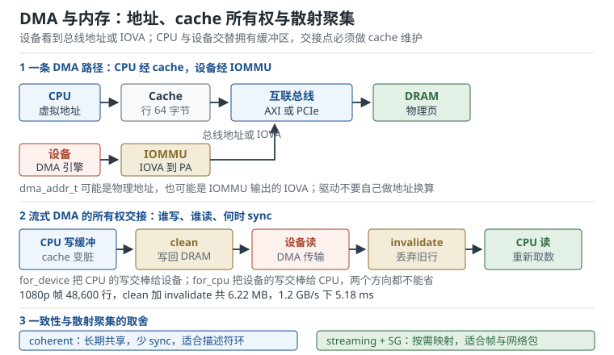

# DMA 与内存：一致性、流式映射与 cache 维护

摄像头已经出图，但每隔几帧就有一帧花屏；网卡统计到大量 CRC 错误，重传率随负载升高；驱动 probe 时报 `dma_map_single failed`，或者系统跑了一天后 `CMA allocation failed`。这三类现象看起来分别属于显示、网络和内存，根因却常常是同一件事：**CPU 和 DMA 设备对“这块内存现在归谁”没有达成一致**。

DMA（Direct Memory Access，直接内存访问）让设备绕过 CPU 直接读写内存，代价是把 cache 一致性、地址空间、缓冲区生命周期这三件事从硬件手里交给了驱动。驱动写错一个 `dma_sync_*`，CPU 可能读到旧帧；映射方向写反，设备可能把数据写到错误的位置；DMA mask 设错，32 位设备拿到 4 GiB 以上的地址，轻则传输失败，重则踩坏别的内存。这一章把 DMA 拆成“地址、所有权、连续性、隔离”四个问题，每个问题给出可复算的定量口径。

## 1. 设计动机

从 CPU 的角度，内存是一块可以按字节访问的数组；从 DMA 设备的角度，内存是一串总线地址，设备只会按自己的规则读写。两者之间隔着 cache、IOMMU、总线桥和内存控制器。DMA 驱动的全部工作，就是在这条路径上安排一次安全的“交接”。

::: motivation 三个必须用 DMA 视角看的场景
**场景一：1080p60 视频采集。** 一帧 YUV420 是 3,110,400 字节，60 帧每秒就是 186.6 MB/s 的写带宽；显示端还要再读一遍，合计 373.2 MB/s。如果每一帧都由 CPU 用 `memcpy()` 从摄像头 FIFO 搬到内存，CPU 光拷贝就要吃掉大量 cycles，还要和显示、网络争总线。DMA 让摄像头直接把帧写进内存，CPU 只处理元数据；代价是每帧都要正确维护 cache，否则看到的是上一帧或半帧。

**场景二：千兆网接收。** 网卡把包写到内存，CPU 从内存读包。如果驱动在 `dma_map_single()` 之后没有 `dma_sync_single_for_cpu()`，CPU 可能从 cache 里读到网卡写之前的旧内容；如果方向写成 `DMA_TO_DEVICE`，架构代码可能跳过 invalidate，错误更隐蔽。小包高 rate 下，错误不会立刻暴露，而是表现为偶发校验和错误、偶发重传。

**场景三：长时间运行的设备。** 一个视频会议终端连续工作 30 天，CMA 池被不同分辨率的缓冲区切碎，某次 `dma_alloc_coherent()` 失败，摄像头打不开。不是内存不够，而是**连续内存**不够；CMA 的容量要按“最大并发缓冲区数 × 单缓冲区大小 × 余量”算，不能按“平均占用”算。
:::

| 你遇到的现象 | 最可能出问题的环节 | 首先检查 |
|---|---|---|
| 偶发花屏、旧帧、半帧 | cache 所有权 | `dma_sync_*` 是否成对、方向是否正确 |
| 相邻内存被踩、随机 Oops | 缓冲区越界 | DMA 长度、stride、SG 长度、`dma_mask` |
| `dma_map_single` 返回错误 | 地址空间 | `dma_mask`、`dma-ranges`、IOMMU、swiotlb |
| `swiotlb buffer is full` | bounce buffer | 32 位设备 + 高地址内存、swiotlb 大小 |
| CMA 分配失败 | 连续内存 | `cma=` 大小、缓冲区是否泄漏、碎片 |
| IOMMU 报 context fault | IOVA 映射 | `dma_map_*` 是否成功、unmap 是否提前 |
| 设备读到旧描述符 | 写顺序 | `dma_wmb()`、doorbell 顺序、描述符所有权位 |

**不懂会在哪摔跤**，具体是这四条：

1. 把 `dma_alloc_coherent()` 当成“普通 `kmalloc()` + 一个地址”，在 CPU 侧随便读写，忘了它可能是 uncached 映射，性能差一个数量级。
2. 流式映射后 CPU 直接读缓冲区，没有 `dma_sync_single_for_cpu()`；在非一致性 ARM 平台上读到 cache 里的旧数据。
3. 只把 `dma_map_single()` 的返回值当普通整数、不调用 `dma_mapping_error()`；映射失败后继续用错误地址编程设备。
4. 32 位设备 + 8 GiB 内存，`dma_set_mask()` 没设或设错，设备拿到高地址，IOMMU 关闭时直接访问失败，或者 swiotlb 拷贝把带宽砍半。

## 2. 定义与直观：地址、所有权、连续性与隔离

### 2.1 三种地址：虚拟、物理、总线

一个 DMA 缓冲区在内核里至少有三个地址：

| 地址 | 谁使用 | 例子 | 注意 |
|---|---|---|---|
| CPU 虚拟地址 | CPU 代码 | `void *cpu_addr` | `dma_alloc_coherent()` 的返回值 |
| 物理地址 | MMU/页表 | `phys_addr_t` | `virt_to_phys()` 只对直接映射区有效 |
| 总线地址/IOVA | 设备 | `dma_addr_t dma_handle` | 设备寄存器里填的值 |

`dma_addr_t` 可能是物理地址（IOMMU 关闭、identity mapping），也可能是 IOMMU 输出的 IOVA（I/O Virtual Address，I/O 虚拟地址）。驱动不应该自己做 `virt_to_phys()` 再塞给设备；这会绕过 IOMMU、绕过 `dma-ranges` 翻译，也会在 HIGHMEM 或 `vmap` 缓冲区上出错。

DMA mask（DMA 地址掩码）描述设备能寻址的位数：

```c
ret = dma_set_mask_and_coherent(dev, DMA_BIT_MASK(32));
if (ret)
    return ret;
```

`DMA_BIT_MASK(32)` 表示设备只能访问 4 GiB 以下。设错会导致两种结果：

- 映射失败，`dma_map_single()` 返回错误码，驱动如果只判空就会继续用坏地址。
- 映射成功但设备实际发出高地址，IOMMU 关闭时总线错误；开启 swiotlb（Software I/O TLB，软件 I/O 转换缓冲）时内核用 bounce buffer 拷贝，带宽下降。

### 2.2 一致性 DMA 与流式 DMA

Linux DMA API 把缓冲区分成两类：一致性 DMA（Coherent DMA）与流式 DMA（Streaming DMA），语义完全不同：

| 维度 | 一致性 DMA | 流式 DMA |
|---|---|---|
| 分配接口 | `dma_alloc_coherent()` | `dma_map_single()` / `dma_map_sg()` |
| 释放接口 | `dma_free_coherent()` | `dma_unmap_single()` / `dma_unmap_sg()` |
| 生命周期 | 长期存在，probe 到 remove | 一次传输，map 到 unmap |
| cache 语义 | 硬件一致或映射为 uncached，CPU/设备随时可见 | 交替拥有，交接点要 `dma_sync_*` |
| 典型用途 | 描述符环、控制块、长期共享状态 | 帧缓冲、网络包、块数据 |
| 性能 | CPU 访问可能慢（uncached） | 可映射 cached，按需维护 |
| 对齐 | 页对齐，大小按页取整 | 设备/架构要求的最小对齐 |

**一致性 DMA** 的名字容易误解：它不是说“数据一定最新”，而是说“CPU 和设备对这块内存的访问在硬件层面保持一致”。在 ARM 上，`dma_alloc_coherent()` 可能返回 Normal Non-cacheable 内存，CPU 读写直接到内存，慢但不需要维护；也可能返回 cacheable 内存，由硬件一致性协议（如 ACE）维护。具体走哪条路径取决于架构、`dma-coherent` 属性和内核配置。

**流式 DMA** 假设 CPU 和设备不会同时访问同一块缓冲区，而是交替拥有：

```text
CPU 写数据
  → dma_sync_single_for_device()   /* clean cache，交棒给设备 */
  → 设备读数据（DMA）
  → 设备写数据（DMA）
  → dma_sync_single_for_cpu()      /* invalidate cache，交棒给 CPU */
  → CPU 读数据
```

交接点漏一个，就会读到旧数据或让设备读到旧数据。`dma_map_single()` 本身通常已经包含“第一次交棒”的维护（map 时按方向 clean 或 invalidate），但传输完成后、CPU 再访问前，仍然要 `dma_sync_single_for_cpu()`。

### 2.3 cache 所有权：clean、invalidate 与 false sharing

cache 维护只有两个基本动作：

- **clean**：把 cache line 里的脏数据写回内存，cache 里的副本仍然有效。
- **invalidate**：丢弃 cache line，下次访问从内存重新取。

方向决定用哪个：

| 方向 | 谁写 | 谁读 | map 时 | 传输后 CPU 读之前 |
|---|---|---|---|---|
| `DMA_TO_DEVICE` | CPU | 设备 | clean | 不需要 invalidate（CPU 没读新数据） |
| `DMA_FROM_DEVICE` | 设备 | CPU | invalidate | invalidate |
| `DMA_BIDIRECTIONAL` | 双方 | 双方 | clean + invalidate | invalidate |

`dma_sync_single_for_device()` 在 CPU 写完、设备读之前调用：方向为 `DMA_TO_DEVICE` 时做 clean，方向为 `DMA_FROM_DEVICE` 时做 invalidate，避免脏行在设备写之后回写覆盖新数据。`dma_sync_single_for_cpu()` 在设备写完、CPU 读之前调用，方向为 `DMA_FROM_DEVICE` 时做 invalidate。名字里的“for_device”和“for_cpu”指的是“接下来谁访问”，不是“谁拥有”。

cache line（缓存行）是维护的最小单位，典型 64 字节。如果缓冲区没有按 cache line 对齐，或者缓冲区和别的数据共享一条 cache line，invalidate 可能把邻居的脏数据丢掉：

```text
cache line 0x1000: [ 驱动缓冲区 60 B ][ 邻居变量 4 B ]
设备写缓冲区 → CPU invalidate 整行 → 邻居变量的脏数据被丢弃
```

所以流式缓冲区要按 cache line 对齐，大小向上取整到 cache line；小缓冲区用 `dma_alloc_coherent()` 或单独分配一条 line，不要和别的数据拼在一起。`____cacheline_aligned` 可以强制对齐，但更重要的是**不要共享**。



### 2.4 CMA 与连续内存

很多 DMA 设备要求物理连续内存，尤其是没有 IOMMU 的 SoC。伙伴系统在长时间运行后会碎片化，分配大块连续内存越来越难。CMA（Contiguous Memory Allocator，连续内存分配器）在启动时预留一块区域，平时可以给可移动页使用，需要时通过迁移腾出连续块。

CMA 的配置方式：

```bash
# 内核命令行预留 64 MiB
cma=64M

# 设备树 reserved-memory 节点
reserved-memory {
    #address-cells = <2>;
    #size-cells = <2>;
    ranges;

    cma: linux,cma {
        compatible = "shared-dma-pool";
        reusable;
        size = <0x0 0x4000000>;
        alignment = <0x0 0x200000>;
        linux,cma-default;
    };
};
```

`reusable` 表示这块内存在没有 DMA 分配时可以给可移动页使用；`linux,cma-default` 表示它是默认 CMA 区域。驱动不需要直接调用 CMA API，`dma_alloc_coherent()` 的大块连续分配在部分 ARM/ARM64 配置上会落到 CMA 或预留内存；但是否走 CMA 取决于架构、`DMA_ATTR_FORCE_CONTIGUOUS` 和内核配置，不能假设一定走。需要强制物理连续时，用 `DMA_ATTR_FORCE_CONTIGUOUS` 或设备树 `memory-region`。

CMA 的三个工程约束：

- **启动时预留**，运行时不能扩大；预留太多浪费内存，太少会在高负载时分配失败。
- **分配可能睡眠**，不能在原子上下文调用；`GFP_ATOMIC` 的 CMA 分配限制更多。
- **碎片化**：不同大小的缓冲区交替分配释放，会把 CMA 区域切碎；长期运行要预分配或使用内存池。

### 2.5 IOMMU 与 IOVA

IOMMU（I/O Memory Management Unit，I/O 内存管理单元）在设备和内存之间做地址翻译和权限检查。对驱动来说，它带来三个变化：

1. **地址不再等于物理地址**：设备拿到的是 IOVA，IOMMU 把它翻译成物理地址。
2. **分散的物理页可以映射成连续的 IOVA**：`dma_map_sg()` 可以把多个物理段映射到一段连续 IOVA，设备看到的是“连续”的。
3. **隔离与故障报告**：设备只能访问映射过的区域，越界会触发 IOMMU fault，而不是踩坏任意内存。

设备树里的 `dma-ranges` 描述总线地址到物理地址的翻译：

```dts
pcie@30000000 {
    device_type = "pci";
    reg = <0x0 0x30000000 0x0 0x1000000>;
    dma-ranges = <0x02000000 0x0 0x40000000 0x0 0x40000000 0x0 0x80000000>;
};
```

`dma-ranges` 的格式随总线类型不同，但语义一致：设备发出的总线地址要经过这段翻译才能到达内存。写错会让设备访问到错误物理页，表现为“DMA 数据错乱”而不是“映射失败”。

IOMMU 的两种常见模式：

- **translated**：默认模式，设备用 IOVA，IOMMU 做翻译和隔离。
- **passthrough**：`iommu=pt` 让支持的设备使用 identity mapping，减少翻译开销，但失去部分隔离。

`iommu.strict=0` 允许延迟 TLB 刷新，提高吞吐，但会扩大“已 unmap 的 IOVA 仍可被设备访问”的窗口；安全敏感产品不要为了性能关掉 strict。

### 2.6 scatterlist 与非线性传输

真实设备很少只传一块连续内存。一个网络包由多个 frag 组成，一个视频帧的 Y、U、V 三个平面在物理上可能不连续。scatterlist（分散聚集列表，SG）把“多个物理段”描述成一个传输：

```c
struct scatterlist *sg;
struct sg_table sgt;
int ret;

ret = sg_alloc_table(&sgt, nents, GFP_KERNEL);
if (ret)
    return ret;

sg_set_buf(&sgt.sgl[0], buf0, len0);
sg_set_buf(&sgt.sgl[1], buf1, len1);
/* ... */

mapped = dma_map_sg(dev, sgt.sgl, sgt.nents, DMA_TO_DEVICE);
if (!mapped) {
    ret = -EIO;
    goto err_free;
}

/* 遍历时用 mapped，不是原始 nents */
for_each_sg(sgt.sgl, sg, mapped, i)
    demo_fill_desc(desc, sg_dma_address(sg), sg_dma_len(sg));

dma_unmap_sg(dev, sgt.sgl, mapped, DMA_TO_DEVICE);
```

要点：

- `dma_map_sg()` 可能把物理相邻的段合并，返回值 `mapped` 可能小于原始 `nents`；遍历和 unmap 用 `mapped`，原始条目数用于释放 SG 表。
- 映射后不要用 `page_address()` 或 `sg_page()` 算设备地址；用 `sg_dma_address()` 和 `sg_dma_len()`。
- `dma_unmap_sg()` 的 `nents` 参数要与 map 的返回值一致，不能把原始条目数直接传进去。
- 设备不支持 SG 时，驱动要么逐段映射、逐段编程，要么把数据复制到连续缓冲区；后者多一次拷贝，但兼容性好。
- `dma_map_sg()` 失败返回 0，不是空指针；检查方式与 `dma_map_single()` 不同。

### 2.7 描述符、doorbell 与 DMA 屏障

设备通常通过“描述符环 + doorbell（门铃寄存器）”工作：

```c
desc->addr = dma_handle;
desc->len = size;
desc->flags = OWN_BIT;

dma_wmb();              /* 保证描述符内容先于 doorbell 可见 */
writel(ring->iova, regs + DOORBELL);
```

`dma_wmb()` 不是可选的“保险”：CPU 的 store buffer 可能让 doorbell 先到设备，设备看到 doorbell 时描述符还没写完，就会读到旧地址或旧长度。`dma_wmb()` 保证“写描述符”先于“写 doorbell”被设备观察到。

设备写完数据后，通常先更新描述符的 ownership 位，再发中断。CPU 在中断里读描述符之前，要用 `dma_rmb()` 保证“读描述符”在“读数据”之前，避免 CPU 先读数据、后看到 ownership 更新。对于 MMIO 寄存器，`readl()`/`writel()` 在多数架构上有序，但跨 CPU 的 MMIO 顺序要用 `mmiowb()`。

### 2.8 DMA API 的调试设施

内核提供几层调试：

- `CONFIG_DMA_API_DEBUG`：检查 map/unmap 是否成对、是否重复 unmap、方向是否一致、是否在 unmap 后访问；`dma_debug=on` 可以在启动时开启。
- `/sys/kernel/debug/dma-api/`：查看错误计数、未释放的映射、最小空闲内存等（需要 debugfs 和对应配置）。
- `CONFIG_DMA_API_DEBUG_SG`：额外检查 scatterlist 的映射。
- IOMMU 事件：`dmesg` 里的 `Unhandled context fault`、`SMMUv3 event`、`IOMMU fault` 是定位越界和错误 IOVA 的直接线索。
- 如果内核配置了 DMA tracepoint，可以在 tracefs 里观察 `dma_map_*` 的调用；没有 tracepoint 时用 `bpftrace` 挂 kprobe。
- `cat /proc/meminfo | grep Cma` 看 CMA 总量与空闲量。

## 3. 定量关系

### 3.1 总线带宽与效率

总线理论带宽：

$$B_{\mathrm{theo}} = f_{\mathrm{clk}} W$$

有效带宽：

$$B_{\mathrm{eff}} = \eta f_{\mathrm{clk}} W$$

符号与单位：

- $f_{\mathrm{clk}}$：总线时钟频率，Hz；
- $W$：每个时钟周期传输的字节数，B/cycle；
- $\eta$：效率，包含仲裁、刷新、空闲周期、协议开销，无量纲；
- $B_{\mathrm{theo}}$、$B_{\mathrm{eff}}$：理论/有效带宽，B/s。

64 位、200 MHz 的 AXI 总线，理论带宽 $200\times10^6\times8=1.6$ GB/s；取 $\eta=0.75$，有效 1.2 GB/s。32 位、100 MHz 只有 400 MB/s 理论、300 MB/s 有效。

### 3.2 帧带宽与总线利用率

一帧的数据量：

$$V_f = W_{\mathrm{px}} H_{\mathrm{px}} \cdot \mathrm{BPP}_{\mathrm{eff}}$$

其中 $W_{\mathrm{px}}$、$H_{\mathrm{px}}$ 是宽高（像素），$\mathrm{BPP}_{\mathrm{eff}}$ 是每像素有效字节数（YUV420 为 1.5）。帧率 $f_{\mathrm{fps}}$ 下的单向带宽：

$$B_f = V_f f_{\mathrm{fps}}$$

总线利用率：

$$U = \frac{B_{\mathrm{capture}} + B_{\mathrm{display}} + B_{\mathrm{cpu}}}{B_{\mathrm{eff}}}$$

分子是各主设备同时占用的带宽。利用率超过 1 表示总线饱和，实际会表现为延迟上升、FIFO 溢出、丢帧，而不是“带宽刚好够”。

### 3.3 cache 维护的数据量

缓冲区大小 $S$，cache line 大小 $L$，行数：

$$N_L = \left\lceil \frac{S}{L} \right\rceil$$

最坏情况下 clean + invalidate 各做一遍，维护数据量：

$$V_m = 2 N_L L \approx 2S$$

维护时间：

$$t_m = \frac{V_m}{B_{\mathrm{mem}}}$$

$B_{\mathrm{mem}}$ 是内存/总线有效带宽。这里假设每次维护都走总线；实际 clean 只写回脏行，invalidate 可能只做本地操作，所以 $2S$ 是上界。按上界做预算，才能覆盖最坏情况。

### 3.4 CMA 容量

设最大并发缓冲区数 $N_b$，单缓冲区 $S_f$，余量比例 $m$：

$$S_{\mathrm{CMA}} = N_b S_f (1+m)$$

$m$ 要覆盖对齐、元数据、不同分辨率混用和碎片化，工程上常取 20% 到 50%。按“最大并发”而不是“平均占用”算，因为 CMA 分配失败通常发生在峰值。

### 3.5 scatterlist 的段数与描述符开销

最大段大小 $S_{\max}$，缓冲区 $S$：

$$N_{\mathrm{sg}} = \left\lceil \frac{S}{S_{\max}} \right\rceil$$

描述符内存：

$$M_{\mathrm{desc}} = N_{\mathrm{sg}} d$$

$d$ 是每个描述符的字节数。段越小，描述符越多，map/unmap 和硬件遍历的开销越大；段越大，对物理连续性的要求越高。两者要折中。

### 3.6 IOMMU 页表与 TLB 覆盖

映射大小 $S_{\mathrm{map}}$，页大小 $P$，页表项大小 $p$：

$$N_{\mathrm{PTE}} = \frac{S_{\mathrm{map}}}{P},\qquad M_{\mathrm{PTE}} = N_{\mathrm{PTE}} p$$

TLB 有 $N_T$ 项时，覆盖范围：

$$S_{\mathrm{TLB}} = N_T P$$

用大页（2 MiB 或 1 GiB）可以显著减少 PTE 数量和 TLB miss；代价是内部碎片和映射粒度变粗。

### 3.7 DMA mask 与 bounce buffer 成本

设备只能寻址 $2^b$ 字节，缓冲区落在更高地址时，内核用 bounce buffer 拷贝。一次传输的额外数据量约为 $2S$（拷入 + 拷出），额外时间：

$$t_{\mathrm{bounce}} = \frac{2S}{B_{\mathrm{eff}}}$$

如果 $S=3.11$ MB、$B_{\mathrm{eff}}=1.2$ GB/s，$t_{\mathrm{bounce}}=5.18$ ms，和帧传输本身同一量级。bounce buffer 不是“免费兼容层”，它会直接吃掉带宽预算。

## 4. 典型算例

下面所有带宽、行数与时间都用 Python 复算，带宽单位按十进制 MB/GB 处理。

### 4.1 1080p60 YUV420 的总线预算

一帧：

$$V_f = 1920 \times 1080 \times 1.5 = 3{,}110{,}400\ \mathrm{B} = 3.11\ \mathrm{MB}$$

60 帧每秒，采集写：

$$B_{\mathrm{capture}} = 3{,}110{,}400 \times 60 = 186.624\ \mathrm{MB/s}$$

显示读同样的数据：

$$B_{\mathrm{display}} = 186.624\ \mathrm{MB/s}$$

再加 CPU 访问 80 MB/s，总需求：

$$B_{\mathrm{total}} = 186.624 + 186.624 + 80 = 453.248\ \mathrm{MB/s}$$

64 位 200 MHz 总线、效率 0.75，有效带宽 1.2 GB/s：

$$U = \frac{453.248}{1200} = 37.8\%$$

还有余量，但只剩 62%；如果同时跑 4K 预览、网络和存储，很快就会饱和。这个算例说明：**1080p60 本身不吓人，吓人的是“采集 + 显示 + CPU + 其他主设备”的叠加**。

### 4.2 32 位总线的上限

同样的 1080p60，如果 SoC 只有 32 位、100 MHz 的总线：

$$B_{\mathrm{theo}} = 100\times10^6 \times 4 = 400\ \mathrm{MB/s}$$

$$B_{\mathrm{eff}} = 400 \times 0.75 = 300\ \mathrm{MB/s}$$

仅采集加显示就需要 373.2 MB/s：

$$U = \frac{373.2}{300} = 124.4\%$$

已经超过 100%，还没算 CPU。这样的总线撑不住 1080p60 的“采集 + 显示”，必须提高位宽/频率、启用压缩，或者让显示走独立通道。选型时不要只看“主频多少 MHz”，要算“位宽 × 频率 × 效率”。

### 4.3 cache 维护的时间

1080p YUV420 帧 3,110,400 字节，cache line 64 字节：

$$N_L = \frac{3{,}110{,}400}{64} = 48{,}600\ \mathrm{lines}$$

clean + invalidate 的数据量：

$$V_m = 2 \times 48{,}600 \times 64 = 6{,}220{,}800\ \mathrm{B} = 6.22\ \mathrm{MB}$$

1.2 GB/s 下：

$$t_m = \frac{6{,}220{,}800}{1.2\times10^9} = 5.184\ \mathrm{ms}$$

占 60 fps 的 16.667 ms 帧周期：

$$\frac{5.184}{16.667} = 31.1\%$$

如果只 clean 不清 invalidate，时间减半到 2.592 ms，占 15.6%。这还没有算 map/unmap 的锁开销、IOMMU 的 TLB miss 和 CPU 争用。**每帧 31% 的帧周期花在 cache 维护上**，这就是为什么很多视频管线用一致性 DMA 或硬件一致性互联，而不是每帧手工 clean/invalidate。

### 4.4 CMA 容量

8 个 1080p YUV420 缓冲区：

$$S_{\mathrm{CMA}} = 8 \times 3{,}110{,}400 \times 1.2 = 29{,}859{,}840\ \mathrm{B} = 29.86\ \mathrm{MB}$$

向上取到 32 MiB 的 CMA 区域够用。4K YUV420 一帧：

$$3840 \times 2160 \times 1.5 = 12{,}441{,}600\ \mathrm{B} = 12.44\ \mathrm{MB}$$

8 个缓冲区加 20% 余量：

$$8 \times 12.44 \times 1.2 = 119.44\ \mathrm{MB}$$

需要 128 MiB 的 CMA。若产品同时支持 1080p 和 4K，按 4K 峰值配，否则切换分辨率时会分配失败。

### 4.5 scatterlist 的段数

1 MiB 缓冲区，最大段 64 KiB：

$$N_{\mathrm{sg}} = \frac{1{,}048{,}576}{65{,}536} = 16$$

每段描述符按 32 字节估算，描述符表 512 字节。若设备最大段只有 4 KiB：

$$N_{\mathrm{sg}} = \frac{1{,}048{,}576}{4{,}096} = 256$$

描述符表 8,192 字节，是前者的 16 倍。硬件遍历 256 个描述符、驱动填 256 个地址，map/unmap 的开销也按比例上升。能合并的段要尽量合并，能在大页上分配的缓冲区不要拆成 4 KiB。

### 4.6 IOMMU 页表与 TLB

映射 1 GiB，页大小 4 KiB，PTE 8 字节：

$$N_{\mathrm{PTE}} = \frac{1{,}073{,}741{,}824}{4{,}096} = 262{,}144$$

$$M_{\mathrm{PTE}} = 262{,}144 \times 8 = 2{,}097{,}152\ \mathrm{B} = 2\ \mathrm{MiB}$$

改用 2 MiB 大页：

$$N_{\mathrm{PTE}} = \frac{1{,}073{,}741{,}824}{2{,}097{,}152} = 512$$

$$M_{\mathrm{PTE}} = 512 \times 8 = 4{,}096\ \mathrm{B} = 4\ \mathrm{KiB}$$

页表内存从 2 MiB 降到 4 KiB。TLB 64 项时，4 KiB 页只覆盖 256 KiB，2 MiB 页覆盖 128 MiB；大页能显著减少 TLB miss，但要求物理连续或 IOMMU 支持块映射。

### 4.7 32 位设备的 bounce 成本

8 GiB 内存，32 位设备，缓冲区落在 4 GiB 以上。内核用 swiotlb 拷贝，一帧 3.11 MB 拷入再拷出：

$$t_{\mathrm{bounce}} = \frac{2 \times 3{,}110{,}400}{1.2\times10^9} = 5.184\ \mathrm{ms}$$

60 fps 下每帧多 5.18 ms，占 31.1% 的帧周期；再加上 cache 维护，管线基本没有余量。正确做法是给设备预留低 4 GiB 内存、开启 IOMMU，或者换支持 64 位寻址的设备；不要指望 bounce buffer 撑高带宽。

## 5. 工程含义

### 5.1 分配策略

- **长期共享的控制结构**用 `dma_alloc_coherent()`：描述符环、寄存器块、状态页。它在 probe 时分配，remove 时释放，CPU 访问可能慢，但不需要每次 sync。
- **大块数据流**用流式映射：帧缓冲、网络包、块数据。缓冲区可以来自 `alloc_pages()`、`kmalloc()`、`vmalloc()` 或用户页，映射时再决定 DMA 地址。
- **需要物理连续但不想长期占用**的用 CMA：大帧缓冲、相机管线。按峰值配，不要按平均配。
- **原子上下文**不能调用会睡眠的分配；在 probe 或工作队列里预分配，把指针带到中断里。
- `dma_alloc_coherent()` 的大小会按页取整；申请 3.11 MB 实际占 3.11 MB 向上取整到页，不要按字节精确预算。

### 5.2 映射与释放的对称性

流式 DMA 的生命周期必须严格对称：

```c
dma_addr_t handle;

handle = dma_map_single(dev, buf, len, DMA_TO_DEVICE);
if (dma_mapping_error(dev, handle))
    return -EIO;

/* 编程设备，启动传输 */
demo_start(dev, handle, len);

/* 等待完成 */
wait_for_completion(&d->done);

/* 设备写完、CPU 读之前 */
dma_sync_single_for_cpu(dev, handle, len, DMA_FROM_DEVICE);

/* CPU 读数据 */
demo_consume(buf, len);

dma_unmap_single(dev, handle, len, DMA_FROM_DEVICE);
```

规则：

- map 和 unmap 的 `dev`、`len`、`direction` 必须一致；unmap 的地址是 map 返回的 `dma_addr_t`，不是 CPU 虚拟地址。
- `dma_mapping_error()` 检查不能省；返回错误后不要 unmap，也不要把错误地址写给设备。
- 传输还在进行时不能 unmap，也不能释放缓冲区；要等完成中断或 `dma_fence`。
- `dma_sync_single_for_cpu()` 之后，CPU 拥有缓冲区；在下次 `for_device` 之前，不要让设备再写。
- 如果方向是 `DMA_BIDIRECTIONAL`，map 和 sync 的成本都更高；能拆成两次单向传输就拆。

### 5.3 cache line 对齐与 false sharing

- 流式缓冲区按 cache line（通常 64 字节）对齐；`posix_memalign()` 不适用于内核，使用 `kmalloc()` 的对齐保证或 `dma_alloc_coherent()`。
- 缓冲区大小向上取整到 cache line；不要让两个独立缓冲区共享一条 line。
- 结构体里把 DMA 描述符和 CPU 频繁访问的字段分开，避免 invalidate 描述符时把 CPU 的脏数据冲掉。
- 用 `____cacheline_aligned` 标记 per-CPU 或需要独占 cache line 的字段。
- 如果硬件要求更严格的对齐（如 128 字节），按硬件手册来，不要只按 cache line。

### 5.4 CMA 与设备树

- CMA 大小按“最大并发缓冲区 × 单缓冲区 × 余量”算，写在 `cma=` 或 `reserved-memory`。
- `reusable` 让 CMA 在空闲时服务可移动页，提高内存利用率；`linux,cma-default` 让没有显式 `memory-region` 的设备也能用。
- 多分辨率产品按最大分辨率配；否则切换分辨率时容易出现“1080p 正常，4K 打不开”。
- 长时间运行要监控 `/proc/meminfo` 的 `CmaTotal`/`CmaFree`；只降不升说明有缓冲区泄漏。
- 不要在中断里做 CMA 分配；分配可能触发迁移和回收，必须睡眠。

### 5.5 IOMMU 的工程取舍

- 开启 IOMMU 提高隔离性，但增加翻译延迟和 TLB 压力；大页、块映射、`iommu.strict=0` 可以降低开销，后者会削弱安全边界。
- 设备树 `dma-ranges` 必须与硬件手册一致；写错时设备可能“能工作但访问错页”，比直接失败更难查。
- IOMMU fault 是宝贵线索：记录 fault 地址、设备 ID、读写方向，反查是哪个 `dma_map_*` 没有配对。
- 不是所有设备都能安全穿透；`iommu=pt` 只适合确认设备行为规范的场景。
- 虚拟化场景下 IOMMU 还负责中断重映射和 PASID，驱动不要假设 IOVA 等于 PA。

### 5.6 scatterlist 与 dmaengine

- 用 `sg_alloc_table()`/`sg_free_table()` 管理 SG 表；`sg_init_table()` 用于栈上或静态表。
- `dma_map_sg()` 返回 0 表示失败；非 0 是有效段数。
- 设备支持 SG 时，把 `sg_dma_address()`/`sg_dma_len()` 填进描述符；不支持时逐段传输或复制到连续缓冲。
- `dmaengine` 的 `dmaengine_prep_slave_sg()`、`dmaengine_prep_dma_cyclic()` 已经封装了 SG 和 cyclic 传输；音频、串口常用 cyclic，要处理半传输/完成回调。
- cyclic 传输的缓冲区在停止前不能释放；`dmaengine_terminate_sync()` 之后再释放。

### 5.7 调试命令

```bash
# 看 DMA-API 调试信息（需要 CONFIG_DMA_API_DEBUG 和 debugfs）
ls /sys/kernel/debug/dma-api/
cat /sys/kernel/debug/dma-api/error_count

# 看 CMA 总量与空闲量
grep Cma /proc/meminfo

# 看 IOMMU 与 SMMU 事件
dmesg | grep -i -E "iommu|smmu|context fault"

# 看设备树里的 dma-ranges 与 reserved-memory
dtc -I fs -O dts /sys/firmware/devicetree/base 2>/dev/null | grep -A4 dma-ranges

# 打开 DMA-API 调试（启动参数）
# dma_debug=on
```

如果 `dma_map_single()` 失败，先看 `dmesg` 里的 `DMA-API` 行，再看 `dma_mask` 和 `dma-ranges`；如果是运行一段时间后失败，先看 CMA 空闲量和未释放映射。

### 5.8 性能调优的边界

- **批量映射**：一次 `dma_map_sg()` 比多次 `dma_map_single()` 少很多锁和 TLB 操作；网络和存储路径优先用 SG。
- **减少 sync 次数**：把多次小传输合并成一次大传输，但不要为了省 sync 而让 CPU 和设备同时访问同一块缓冲区。
- **`DMA_ATTR_SKIP_CPU_SYNC`**：只在驱动自己保证 cache 维护时使用；用错会读到旧数据。
- **`DMA_ATTR_NO_KERNEL_MAPPING`**：不需要 CPU 访问的缓冲区可以省掉内核映射，但驱动不能解引用 CPU 地址。
- **`iommu.strict=0`**：降低 TLB 刷新频率，提高吞吐；安全敏感场景不要用。
- **大页/块映射**：减少 PTE 和 TLB miss；需要物理连续或 IOMMU 块支持。
- **一致性 DMA 的 CPU 访问成本**：uncached 内存的 `memcpy()` 可能比 cached 慢几倍；CPU 频繁访问的控制结构要评估是否值得用 coherent。

## 6. 常见坑

::: pitfall 坑一：流式 DMA 少了 for_cpu，CPU 读到旧帧
**现象**：摄像头第一帧正常，之后偶发重复上一帧、半帧旧数据；`memcmp()` 发现缓冲区内容和设备写入不符；加 `printk()` 或降低帧率后现象变化。

**原因**：设备写内存后，CPU 的 cache 里还保留着旧行；驱动没有调用 `dma_sync_single_for_cpu()` 就读取，CPU 命中旧 cache line。方向为 `DMA_FROM_DEVICE` 时，map 时的 invalidate 只覆盖传输前，传输后必须再 invalidate。

**解决**：在设备完成中断之后、CPU 读之前调用 `dma_sync_single_for_cpu()`；CPU 写完、设备读之前调用 `dma_sync_single_for_device()`。用 `CONFIG_DMA_API_DEBUG` 检查 map/unmap 配对；不要用 `volatile` 或 `mb()` 替代 cache 维护。
:::

::: pitfall 坑二：DMA 长度或 stride 写错，踩坏相邻内存
**现象**：随机 Oops、相邻缓冲区被改写、显示出现撕裂；`CONFIG_DEBUG_SG` 或 KASAN 报越界；设备工作一段时间后内存内容“自己变了”。

**原因**：DMA 传输长度大于缓冲区，或者硬件 stride 包含 padding 而驱动按可见宽度算长度；SG 的 `sg_dma_len()` 没有按段更新；32 位长度寄存器溢出。

**解决**：按硬件手册算“行 stride × 行数”，不要按可见像素算；所有长度做上界检查；用 IOMMU 限制设备可访问范围；在缓冲区尾部放 canary，用 KASAN 和 `CONFIG_DMA_API_DEBUG` 复现。显示/相机管线要特别检查 Y、U、V 三个平面的 stride。
:::

::: pitfall 坑三：32 位 mask 与高地址内存
**现象**：probe 时 `dma_map_single()` 失败，或者运行中 `swiotlb buffer is full`；系统有 8 GiB 内存，但设备只能访问低 4 GiB；吞吐只有预期的一半。

**原因**：`dma_set_mask_and_coherent()` 没调用或设成 64 位，设备拿到高地址；IOMMU 关闭时映射失败，开启 swiotlb 时每个缓冲区都要 bounce 拷贝。

**解决**：按设备能力设置 mask，检查返回值；设备树 `dma-ranges` 与硬件手册一致；需要低地址时用 `dma_alloc_coherent()` 配合 `GFP_DMA`/预留内存，或开启 IOMMU；不要用 `virt_to_phys()` 绕过 DMA API。
:::

::: pitfall 坑四：缓冲区与邻居共享 cache line
**现象**：DMA 传输后，缓冲区旁边的变量被改、链表指针损坏；单独测试正常，和其他数据一起分配就复现；换一个分配大小后现象消失。

**原因**：流式缓冲区没有按 cache line 对齐，invalidate 整行时把邻居的脏数据丢弃；或者两个 DMA 缓冲区共享一条 line，一个设备的写被另一个的 invalidate 冲掉。

**解决**：缓冲区按 cache line 对齐并向上取整；小缓冲区用 `dma_alloc_coherent()` 单独分配；结构体里把 DMA 区和 CPU 热字段分开；用 `____cacheline_aligned` 和 padding 保证独占。
:::

::: pitfall 坑五：传输未完成就 unmap 或释放
**现象**：偶发 IOMMU fault、随机数据错乱、`use-after-free`；压力越大越容易复现；`dma_unmap_single()` 之后设备还在写内存。

**原因**：驱动在提交 DMA 后没有等待完成中断，或者超时路径直接 unmap/`kfree()`；cyclic 传输停止前释放了环形缓冲区；错误处理路径重复 unmap。

**解决**：用完成量、`dma_fence` 或中断确认传输完成；超时路径先 `dmaengine_terminate_sync()`，再 unmap；错误路径只 unmap 一次；用 `CONFIG_DMA_API_DEBUG` 检查重复 unmap 和 map 泄漏。
:::

::: pitfall 坑六：一致性 DMA 与流式 DMA 混用
**现象**：`dma_alloc_coherent()` 分配的缓冲区又调用 `dma_map_single()`，出现 `DMA-API: device driver maps memory from coherent pool` 警告；或者 CPU 访问极慢，性能不达标。

**原因**：驱动把 coherent 缓冲区当成普通内存再做流式映射；或者反过来，对流式缓冲区调用 `dma_free_coherent()`。两套 API 的分配器、cache 语义和释放路径都不同。

**解决**：一个缓冲区只用一种 API。长期共享用 coherent，一次传输用 streaming；需要把 coherent 缓冲区交给设备时，直接把 `dma_handle` 写进描述符，不要再 map。用 `dma_mapping_error()` 和 DMA-API 调试检查。
:::

::: pitfall 坑七：doorbell 先于描述符到达设备
**现象**：设备偶发读到旧描述符、传输长度为 0、DMA 地址是上一次的；加 `printk()` 或改编译优化后现象消失；ARM 上比 x86 更容易复现。

**原因**：CPU store buffer 让 doorbell 写先于描述符写被设备看到；驱动只用了 `writel()`，没有 `dma_wmb()`；或者描述符所有权位在数据写完之前就置为设备所有。

**解决**：先写描述符内容和所有权位，再 `dma_wmb()`，最后写 doorbell；读方向用 `dma_rmb()` 保证先读所有权位再读数据。不要把 `wmb()` 和 `dma_wmb()` 混用，后者才是给设备看的。
:::

## 7. 自测题

<details><summary>题一：1080p YUV420、30 fps，采集写 + 显示读，总线 64 位 150 MHz、效率 0.8。求单向带宽、总带宽与利用率；若再加 100 MB/s 的 CPU 访问，是否还能留 30% 余量？</summary>

一帧：

$$1920\times1080\times1.5 = 3{,}110{,}400\ \mathrm{B}$$

30 fps 单向：

$$3{,}110{,}400\times30 = 93.312\ \mathrm{MB/s}$$

采集加显示：

$$2\times93.312 = 186.624\ \mathrm{MB/s}$$

总线有效带宽：

$$150\times10^6\times8\times0.8 = 960\ \mathrm{MB/s}$$

利用率：

$$U = \frac{186.624}{960} = 19.4\%$$

加 100 MB/s CPU 访问：

$$U = \frac{286.624}{960} = 29.9\%$$

还剩 70.1%，满足“留 30% 余量”。如果换成 60 fps，单向 186.624 MB/s，加显示和 CPU 共 473.248 MB/s，利用率 49.3%，余量 50.7%，仍然安全；但总线还要服务网络、存储，实际要留更多。

</details>

<details><summary>题二：一帧 3.11 MB，cache line 64 B，分别计算只 clean、clean + invalidate 的维护数据量与 1.2 GB/s 下的时间；若帧率 30 fps，各占帧周期多少？</summary>

行数：

$$N_L = \frac{3{,}110{,}400}{64} = 48{,}600$$

只 clean：

$$V_m = 48{,}600\times64 = 3{,}110{,}400\ \mathrm{B} = 3.11\ \mathrm{MB}$$

$$t_m = \frac{3{,}110{,}400}{1.2\times10^9} = 2.592\ \mathrm{ms}$$

clean + invalidate：

$$V_m = 2\times3{,}110{,}400 = 6{,}220{,}800\ \mathrm{B} = 6.22\ \mathrm{MB}$$

$$t_m = 5.184\ \mathrm{ms}$$

30 fps 帧周期 $1/30=33.333$ ms，只 clean 占 $2.592/33.333=7.78\%$，clean + invalidate 占 $5.184/33.333=15.55\%$。帧率越低，维护时间占比越小；但 60 fps 时同样操作会占 31.1%，所以高帧率管线更要考虑一致性 DMA 或硬件一致性。

</details>

<details><summary>题三：1 MiB 缓冲区，设备最大段 32 KiB，描述符 24 B。求 SG 段数与描述符内存；若改成 4 KiB 段，段数和描述符内存各是多少？</summary>

32 KiB 段：

$$N_{\mathrm{sg}} = \frac{1{,}048{,}576}{32{,}768} = 32$$

$$M_{\mathrm{desc}} = 32\times24 = 768\ \mathrm{B}$$

4 KiB 段：

$$N_{\mathrm{sg}} = \frac{1{,}048{,}576}{4{,}096} = 256$$

$$M_{\mathrm{desc}} = 256\times24 = 6{,}144\ \mathrm{B} = 6\ \mathrm{KiB}$$

段数增加 8 倍，描述符内存也增加 8 倍；硬件遍历和驱动填表的时间同样增加。能合并的段要合并，能分配大页的不要拆成小页。

</details>

<details><summary>题四：8 GiB 内存，32 位设备，一帧 3.11 MB 落在 4 GiB 以上，swiotlb 拷贝带宽 1.2 GB/s。求 bounce 的额外时间与 60 fps 下的占比；有哪三种修正方式？</summary>

拷入加拷出：

$$V_{\mathrm{bounce}} = 2\times3{,}110{,}400 = 6{,}220{,}800\ \mathrm{B}$$

$$t_{\mathrm{bounce}} = \frac{6{,}220{,}800}{1.2\times10^9} = 5.184\ \mathrm{ms}$$

60 fps 帧周期 16.667 ms，占比：

$$\frac{5.184}{16.667} = 31.1\%$$

三种修正：

1. 给设备预留低 4 GiB 内存（`GFP_DMA`、`reserved-memory`、`dma-ranges`），让缓冲区天然可寻址。
2. 开启 IOMMU，把高地址物理页映射成设备可访问的 IOVA，避免 bounce。
3. 换支持 64 位寻址的设备，或减少单次传输大小、改用 SG 让内核按段处理。

bounce buffer 只能救急，不能作为高带宽管线的长期方案。

</details>

## 8. 参考资料

- Linux 内核文档 `Documentation/core-api/dma-api.rst`：DMA API 的分配、映射、同步与释放约定。
- Linux 内核文档 `Documentation/core-api/dma-api-howto.rst`：一致性 DMA、流式 DMA、`dma_mask` 与 scatterlist 的使用规则。
- Linux 内核文档 `Documentation/core-api/dma-attributes.rst`：`DMA_ATTR_*` 属性与一致性内存语义。
- Linux 内核文档 `Documentation/core-api/dma-direction.rst`：DMA 方向与 CPU/设备所有权。
- Linux 内核文档 `Documentation/devicetree/bindings/dma/dma-controller.yaml`：DMA 控制器的设备树绑定。
- Linux 内核文档 `Documentation/admin-guide/kernel-parameters.txt`：`cma=`、`iommu=`、`iommu.strict`、`swiotlb=` 等参数。
- Linux 内核源码 `kernel/dma/mapping.c`、`kernel/dma/coherent.c`、`kernel/dma/swiotlb.c`：`dma_map_*`、`dma_alloc_coherent`、bounce buffer 的实现。
- Linux 内核源码 `include/linux/dma-mapping.h`、`include/linux/scatterlist.h`：DMA 属性、SG 表与 `dma_addr_t` 的定义。
- Linux 内核源码 `drivers/iommu/dma-iommu.c`、`drivers/iommu/arm/arm-smmu-v3/arm-smmu-v3.c`：IOVA 分配、IOMMU 映射与 SMMUv3 事件。
- Linux Device Drivers, 3rd Edition（Corbet, Rubini, Kroah-Hartman, O'Reilly, 2005）：Memory Mapping and DMA 一章。
