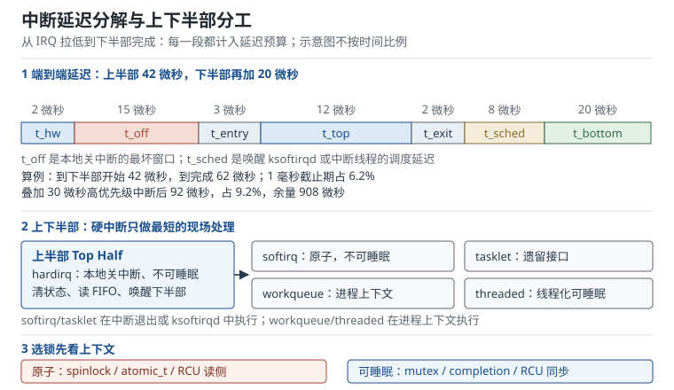

# 中断与并发：上下半部、原子上下文与锁的选择

一个 1 kHz 的控制环，截止期只有 1 ms。中断在 2 微秒内被硬件捕获，却在关中断窗口里等了 15 微秒，上半部又跑了 12 微秒，等到下半部真正处理数据时，已经过去 62 微秒；如果这时一个更高优先级的中断插进来，端到端延迟会推到 92 微秒。单看每一段都不长，叠在一起就吃掉了近 10% 的截止期。更糟的是，驱动可能在硬中断里调用了 `msleep()`，内核打印一行 `BUG: sleeping function called from invalid context`，然后系统在某个与中断无关的路径上崩溃。

中断（Interrupt）与并发（Concurrency）是内核驱动里最容易“看起来能跑、压力一来就崩”的部分。它考的不是 API 记忆，而是三件事：**这段代码在哪个上下文执行、它能不能睡眠、它和谁共享数据**。把这三件事答对，`softirq`、`tasklet`、工作队列、线程化中断、自旋锁、互斥量、RCU、内存屏障就只是不同答案下的工具选择。

## 1. 设计动机

中断处理面对一对天然矛盾：硬件要求尽快响应，软件又需要做大量耗时工作。网卡收到一帧，硬件希望 CPU 在几微秒内把数据取走，否则 FIFO 溢出；但协议栈解析、路由查找、拷贝到用户态可能要几十微秒，甚至需要睡眠。内核的解法是把中断处理切成两段：上半部（Top Half）只做“必须立刻做、且不能被打断”的事，下半部（Bottom Half）把剩下的工作推迟到更宽松的上下文。

::: motivation 三个绕不开中断并发的场景
**场景一：工业控制环。** 电机控制以 10 kHz 运行，每个周期 100 微秒。编码器中断必须在 10 微秒内读到位置，否则下一次 PWM 更新就会用旧值。驱动如果把滤波、CAN 上报、日志都塞进硬中断，单次处理超过 100 微秒，控制环直接失稳。正确做法是上半部只读编码器并记录时间戳，滤波和上报放到线程化中断或工作队列。

**场景二：千兆网接收。** 1 Gbps 线速、64 字节小包时，包速率约 1.488 Mpps，平均每 0.672 微秒就有一帧。若每个包在软中断里花 1.8 微秒，单核利用率会达到 267.9%，必然丢包。不是“中断太慢”，而是处理预算根本不够；需要 NAPI 批量轮询、RPS/RSS 多核分摊，或者把部分处理前移到 XDP。

**场景三：休眠唤醒。** 设备进入 runtime suspend 后，唤醒引脚上的一个毛刺触发中断，中断处理又要读 I2C 传感器。I2C 传输会睡眠，不能放在硬中断里；如果驱动没有线程化中断，就会在原子上下文里调用会睡眠的函数，轻则警告，重则死锁。
:::

| 你遇到的现象 | 最可能出问题的环节 | 首先检查 |
|---|---|---|
| 偶发丢中断、计数不增长 | 上半部或关中断窗口 | `/proc/interrupts`、`irqsoff`、共享中断的 `IRQF_SHARED` |
| 系统卡死、日志出现 scheduling while atomic | 原子上下文睡眠 | 是否在硬中断/软中断里调用 `mutex_lock`、`msleep`、`copy_to_user` |
| 单核 100% 软中断，网络吞吐上不去 | 下半部预算 | `ksoftirqd`、NAPI 预算、RPS/RSS |
| 压力测试几小时后崩溃 | 锁或生命周期 | 锁顺序、`cancel_work_sync`、模块卸载、RCU 宽限期 |
| 控制环偶发超时 | 中断延迟 | 关中断窗口、高优先级中断、CPU 隔离、线程优先级 |

**不懂会在哪摔跤**，具体是这四条：

1. 把“中断里不能睡眠”理解成“中断里不能调用任何函数”，于是把所有工作都推给工作队列，结果上半部该清的中断状态没清，中断风暴把 CPU 打满。
2. 用 `spin_lock()` 保护一段会被硬中断访问的数据，却没关本地中断；进程上下文持锁时中断到来，中断处理在同一 CPU 上自旋等锁，死锁。
3. 工作队列回调还在跑，模块已经卸载，回调访问已释放的内存；驱动把 work 排在 `system_wq` 这类共享队列上，卸载时没有 `cancel_work_sync()`——`destroy_workqueue()` 会 drain 并销毁驱动自己创建的 wq，但管不到共享队列。
4. 以为 `volatile` 能解决多核可见性，或者以为 `WRITE_ONCE()` 自带内存屏障；在弱内存模型机器上，标志位先于数据可见，消费者读到新标志、旧数据。

## 2. 定义与直观：上下文、两半、锁与屏障

### 2.1 一次中断从引脚到下半部

以 ARM64 + GICv3 为例，一次外设中断的路径可以压缩成下面这条链：

```text
外设拉高/拉低 IRQ
  → GIC 分发器（Distributor）置 pending
  → CPU 接口（CPU Interface）把中断递给核心
  → 异常向量 el1_irq
  → 通用中断层 handle_irq_desc()
  → irq_desc->handle_irq（如 handle_level_irq）
  → irqaction->handler（驱动注册的上半部）
  → 中断退出，执行 pending 的 softirq
  → 需要时唤醒 ksoftirqd 或中断线程
```

`request_irq()` 注册的是 `irqaction->handler`，它运行在硬中断上下文（Hard IRQ Context）。这个上下文有几个硬约束：

- 本地 CPU 的中断被关闭；共享中断线上其他设备的 handler 会被依次调用，但当前 CPU 仍然处于硬中断上下文。
- 不能睡眠，不能调用可能睡眠的函数，不能主动让出 CPU。
- 不能做长循环，不能等待硬件状态位无限期翻转。
- 访问的数据必须用不会睡眠的锁保护，通常是自旋锁或原子操作。

上半部应该只做四类事：读硬件状态、清中断标志、把数据搬到内存、唤醒下半部。除此之外的工作都应该推迟。

### 2.2 上半部与下半部：四种推迟机制

Linux 提供四种常见的下半部机制。它们不是“新旧替代”关系，而是上下文和能力不同：

| 机制 | 执行上下文 | 能否睡眠 | 典型用途 | 主要 API |
|---|---|---|---|---|
| 软中断 softirq | 硬中断退出或 `ksoftirqd` | 否 | 网络收发、块设备完成、定时器 | `raise_softirq()`、`open_softirq()` |
| tasklet（任务let） | 软中断上下文 | 否 | 老驱动的短延迟工作 | `tasklet_schedule()`、`tasklet_kill()` |
| 工作队列 workqueue | 内核线程（进程上下文） | 是 | 需要睡眠、可能阻塞的工作 | `queue_work()`、`cancel_work_sync()` |
| 线程化中断 threaded IRQ | 内核线程 | 是 | 慢总线、需要 I2C/SPI/regulator 的中断 | `request_threaded_irq()` |

**软中断（softirq）**是编译期确定的几种类型，运行在中断上下文，不能睡眠，同一类型的软中断可以在多个 CPU 上并行。它适合“短、无锁、可并行”的工作。网络收包用 `NET_RX_SOFTIRQ`，块设备完成用 `BLOCK_SOFTIRQ`。软中断的预算由 `net.core.netdev_budget` 等参数控制，超预算后由 `ksoftirqd` 接管，避免用户态被无限期饿死。

**tasklet（任务let）**建立在软中断之上，保证同一个 tasklet 不会同时在多个 CPU 上运行，适合老驱动里“短、串行”的收尾工作。它仍然不能睡眠。tasklet 是历史接口，近年主线内核已经开始移除；新代码不应再使用，维护老驱动时仍会遇到。

**工作队列（workqueue）**运行在内核线程里，属于进程上下文，可以睡眠、可以拿互斥量、可以调用 `regulator_get()` 这类可能睡眠的函数。代价是调度延迟：从 `queue_work()` 到回调执行，可能是几十微秒，也可能在系统繁忙时到毫秒级。工作队列还分普通、高优先级、无绑定（unbound）等类型，内存回收路径要用 `WQ_MEM_RECLAIM`。

**线程化中断（threaded IRQ）**把上半部拆成“硬中断里的 primary handler”和“内核线程里的 thread function”。primary handler 只做最小检查，返回 `IRQ_WAKE_THREAD`，通用中断层唤醒对应的中断线程；线程函数可以睡眠。电平触发中断通常要加 `IRQF_ONESHOT`，让中断线保持屏蔽直到线程函数完成，否则线程还没处理完，中断又会进来，形成风暴。



### 2.3 原子上下文与睡眠禁忌

内核里“能不能睡眠”不是靠感觉判断的，而是由抢占计数（Preempt Count）和中断状态决定。常见的不可睡眠上下文（原子上下文，Atomic Context）包括：

- 硬中断上下文：`in_irq()` 为真。
- 软中断/tasklet 上下文：`in_softirq()` 为真，`in_atomic()` 通常也为真。
- 持有自旋锁、关闭抢占、关闭中断的临界区。
- 持有 `raw_spinlock_t` 的代码，即使配置了 PREEMPT_RT 也不能睡眠。

判断工具：

```c
might_sleep();      /* 在可能睡眠的函数入口检查，错误上下文会打印警告 */
in_atomic();        /* 抢占计数非零或中断关闭 */
in_irq();           /* 硬中断上下文 */
in_softirq();       /* 软中断上下文 */
irqs_disabled();    /* 本地中断是否关闭 */
```

`might_sleep()` 不是运行时保护，而是调试断言。开启 `CONFIG_DEBUG_ATOMIC_SLEEP` 后，内核会在原子上下文调用可能睡眠的函数时打印调用栈，这是定位“睡眠在原子上下文”最快的手段。

哪些函数会睡眠？常见的有：

- `mutex_lock()`、`down()`、`wait_for_completion()`（无超时版本）。
- `msleep()`、`ssleep()`、`schedule_timeout()`。
- `kmalloc(GFP_KERNEL)`、`vmalloc()`、`get_zeroed_page()`。
- `copy_to_user()`、`copy_from_user()`（可能触发缺页）。
- `regulator_get()`、`clk_prepare()`、`i2c_transfer()`、`spi_sync()`。
- `request_firmware()`、`devm_regulator_get()` 等 probe 期接口。

对应的原子上下文替代品：

| 可能睡眠的接口 | 原子上下文替代 |
|---|---|
| `kmalloc(GFP_KERNEL)` | `kmalloc(GFP_ATOMIC)`，或提前分配 |
| `mutex_lock()` | `spin_lock()`、`atomic_t`、`cmpxchg()` |
| `wait_for_completion()` | `complete()` 只唤醒，等待放线程 |
| `copy_to_user()` | 拷贝到内核缓冲，线程里再拷贝 |
| `i2c_transfer()` | 线程化中断或工作队列 |
| `regulator_get()` | probe 阶段获取，中断里只用已拿到的句柄 |

`GFP_ATOMIC` 不是免费的：它不能直接回收和睡眠，内存紧张时失败率更高。正确策略是“在能睡眠的地方提前分配”，而不是在中断里反复 `GFP_ATOMIC`。

### 2.4 锁的谱系：从原子操作到 RCU

并发控制的目标不是“加锁”，而是“用最低成本保证不变量”。内核提供的原语大致可以排成一条从“最轻、限制最多”到“最重、能力最强”的谱系：

| 原语 | 是否阻塞 | 优先级继承 | 可用上下文 | 典型场景 |
|---|---|---|---|---|
| `atomic_t` / `atomic64_t` | 否 | 无 | 任意 | 计数器、标志、引用计数 |
| 自旋锁 spinlock | 自旋等待 | 无 | 任意（含中断） | 极短临界区、中断共享数据 |
| 读写锁 rwlock | 自旋等待 | 无 | 任意 | 读多写少但临界区极短 |
| 顺序锁 seqlock | 重试 | 无 | 任意 | 读多写少、读侧可重试 |
| 互斥量 mutex | 睡眠等待 | 有（rtmutex） | 仅进程上下文 | 可能较长的临界区、I2C/SPI |
| 完成量 completion | 睡眠等待 | 无 | 进程上下文 | 等待硬件完成、一次性事件 |
| RCU | 不阻塞读 | 无 | 读侧任意（不可睡眠） | 链表、路由表、设备列表 |

**自旋锁（spinlock）**的规则最短也最容易被违反：

- 临界区必须短，不能睡眠，不能调用可能睡眠的函数。
- 如果数据会被硬中断访问，进程上下文必须用 `spin_lock_irqsave()`，同时关闭本地中断并保存标志。
- 如果数据只会被软中断访问，进程上下文可以用 `spin_lock_bh()`，关闭下半部但不关硬中断。
- 锁的获取顺序必须全局一致；否则两个 CPU 各持一把锁、互相等待，死锁。
- 自旋锁不可递归；同一 CPU 重复获取同一把锁会自死锁。

一个常见的错误写法：

```c
static DEFINE_SPINLOCK(lock);
static int shared;

static irqreturn_t demo_irq(int irq, void *dev)
{
    spin_lock(&lock);          /* 上半部：本地中断已经关闭 */
    shared++;
    spin_unlock(&lock);
    return IRQ_HANDLED;
}

static ssize_t demo_write(struct file *f, const char __user *buf,
                          size_t len, loff_t *off)
{
    spin_lock(&lock);          /* 错误：没有关本地中断 */
    shared++;
    spin_unlock(&lock);
    return len;
}
```

如果进程上下文拿到 `lock` 后，同一个 CPU 上的中断到来，中断处理会自旋等待一把已经被自己持有的锁，系统死锁。正确写法是 `spin_lock_irqsave(&lock, flags)` / `spin_unlock_irqrestore(&lock, flags)`。如果确认数据只在进程和软中断之间共享，用 `spin_lock_bh()` 就够，不必关闭硬中断。

**互斥量（mutex）**只能用于进程上下文，可以睡眠，适合保护可能较长的临界区。它的实现带所有权和优先级继承（PREEMPT_RT 下是 rtmutex），可以避免优先级反转。不能在中断里用，也不能在持有自旋锁时用。`mutex_lock_interruptible()` 允许被信号打断，用户态路径优先用它，避免进程在等待时无法被杀死。

**RCU（Read-Copy-Update，读-拷贝-更新）**把“读”和“写”的成本彻底分开：读侧不加锁、不阻塞、几乎零开销；写侧复制一份新数据、替换指针、等所有旧读者退出后再释放。它适合读多写少、读侧不能睡眠的场景，比如网络路由表、设备列表、文件描述符表。

### 2.5 RCU：读侧不加锁，写侧等宽限期

RCU 的核心是“发布—订阅”协议，写者替换指针后要等一个宽限期（Grace Period），确保所有旧读者退出：

```c
struct demo_node {
    int value;
    struct demo_node *next;
};

static struct demo_node *demo_list;
static DEFINE_SPINLOCK(demo_lock);

/* 读者：rcu_read_lock() 之间不能睡眠 */
static int demo_read(void)
{
    struct demo_node *p;
    int sum = 0;

    rcu_read_lock();
    for (p = rcu_dereference(demo_list); p; p = rcu_dereference(p->next))
        sum += p->value;
    rcu_read_unlock();
    return sum;
}

/* 写者：进程上下文，复制、替换、等宽限期、释放 */
static void demo_add(int value)
{
    struct demo_node *n = kmalloc(sizeof(*n), GFP_KERNEL);
    struct demo_node *old;

    if (!n)
        return;
    n->value = value;
    spin_lock(&demo_lock);
    old = demo_list;
    n->next = old;
    rcu_assign_pointer(demo_list, n);
    spin_unlock(&demo_lock);
}
```

`rcu_assign_pointer()` 保证“初始化新节点”先于“发布指针”对读者可见；`rcu_dereference()` 保证读者拿到指针后，后续读字段不会被编译器或 CPU 提前。释放旧节点不能直接 `kfree()`，要等所有已经进入读侧的读者退出：

```c
static void demo_del_all(void)
{
    struct demo_node *p, *n;

    spin_lock(&demo_lock);
    p = demo_list;
    rcu_assign_pointer(demo_list, NULL);
    spin_unlock(&demo_lock);

    synchronize_rcu();          /* 等宽限期，可睡眠 */
    for (n = p; n; n = p) {
        p = n->next;
        kfree(n);
    }
}
```

`synchronize_rcu()` 会睡眠，只能在进程上下文调用。中断或软中断里要异步释放，用 `call_rcu()` 或 `kfree_rcu()`。RCU 读侧不能睡眠，也不能在 `rcu_read_lock()` 和 `rcu_read_unlock()` 之间调用可能睡眠的函数；需要睡眠读侧时用 SRCU（Sleepable RCU）。

RCU 不是“免费锁”。写侧的宽限期可能持续几毫秒到几十毫秒，释放被推迟；如果写非常频繁，内存会积压。它适合“读远多于写”的结构，不适合写密集的计数器。

### 2.6 内存屏障：编译器、CPU 与设备三个层次

并发 bug 里最难复现的一类是“顺序错了”。内存屏障（Memory Barrier）要解决的就是这种顺序问题。CPU 和编译器都可能重排访存：

- 编译器为了优化，把循环里的读提到循环外，或把写合并。
- CPU 的 store buffer 让写先进入本地缓冲，其他核暂时看不到。
- 弱内存模型（ARM、Power）允许读和写以不同于程序顺序的次序被观察到。

`volatile` 只告诉编译器“不要优化掉这次访问”，它不保证 CPU 顺序，也不保证原子性。内核用 `READ_ONCE()` / `WRITE_ONCE()` 防止编译器合并、撕裂和重排，但它们仍然不是 CPU 屏障。

一个经典的消息传递：

```c
static int data;
static int ready;

/* CPU0：先写数据，再置标志 */
data = 42;
smp_wmb();
WRITE_ONCE(ready, 1);

/* CPU1：先读标志，再读数据 */
if (READ_ONCE(ready)) {
    smp_rmb();
    pr_info("data = %d\n", data);
}
```

没有 `smp_wmb()`，CPU0 可能让 `ready = 1` 先于 `data = 42` 可见；CPU1 看到标志为真，却读到旧数据。`smp_wmb()` 与 `smp_rmb()` 配对，保证“写数据”先于“写标志”、“读标志”先于“读数据”。

更推荐使用 acquire/release 语义，意图更清楚，成本通常也更低：

```c
/* CPU0 */
data = 42;
smp_store_release(&ready, 1);

/* CPU1 */
if (smp_load_acquire(&ready))
    pr_info("data = %d\n", data);
```

屏障的层次：

| 层次 | 原语 | 作用范围 | 典型用途 |
|---|---|---|---|
| 编译器 | `barrier()` | 阻止编译器重排 | 与 `READ_ONCE`/`WRITE_ONCE` 配合 |
| SMP | `smp_mb()`、`smp_rmb()`、`smp_wmb()` | 多核之间 | 共享内存、标志、队列 |
| 获取/释放 | `smp_load_acquire()`、`smp_store_release()` | 多核之间 | 发布指针、锁、消息 |
| 设备 | `dma_wmb()`、`dma_rmb()` | CPU 与设备 | 描述符、doorbell |
| MMIO | `mmiowb()`、`readl()`/`writel()` | CPU 与设备 | 寄存器写顺序 |

`dma_wmb()` 在“写描述符、写 doorbell 寄存器”之间使用，保证设备看到 doorbell 时描述符已经写好；`dma_rmb()` 在“读设备状态、读数据”之间使用。`writel()` 在多数架构上有序，但不能假设所有架构都如此；跨 CPU 的 MMIO 顺序需要 `mmiowb()`。

### 2.7 中断延迟的定义与测量

“中断延迟”至少有四种口径，讨论时必须说清楚是哪一种：

1. **硬件延迟**：中断信号到达 CPU 到 CPU 开始执行向量入口。
2. **中断响应延迟**：从信号到上半部第一条指令，包含硬件延迟、关中断窗口、高优先级中断抢占。
3. **端到端延迟**：从信号到下半部处理完成，包含调度延迟和下半部执行时间。
4. **唤醒延迟**：从信号到等待数据的用户态线程被调度，包含唤醒、优先级和调度器开销。

测量工具各管一段：

- `cyclictest`：测定时器到期到线程被唤醒的延迟，覆盖关中断、抢占和调度；适合系统级基线。
- `ftrace` 的 `irqsoff`：测本地关中断的最长窗口，直接定位“谁关了中断太久”。
- `ftrace` 的 `preemptoff`：测抢占关闭窗口。
- `hwlatdetect`：测硬件/固件造成的延迟（SMI、总线仲裁），软件 tracer 看不到。
- `osnoise`：测操作系统噪声对实时线程的干扰。
- `/proc/interrupts`：看中断计数、CPU 分布；计数不增长说明中断没到或没被处理。
- `perf` / `bpftrace`：统计中断处理函数的耗时分布。

## 3. 定量关系

### 3.1 端到端延迟分解

把一次中断从引脚到下半部完成拆成可测的段：

$$t_{\mathrm{start}} = t_{\mathrm{hw}} + t_{\mathrm{off}} + t_{\mathrm{entry}} + t_{\mathrm{top}} + t_{\mathrm{exit}} + t_{\mathrm{sched}}$$

$$t_{\mathrm{end}} = t_{\mathrm{start}} + t_{\mathrm{bottom}} + t_{\mathrm{hp}}$$

符号与单位：

- $t_{\mathrm{hw}}$：中断信号到 CPU 开始执行入口，s；
- $t_{\mathrm{off}}$：本地关中断窗口，s；
- $t_{\mathrm{entry}}$：异常入口、保存现场、通用中断层分发，s；
- $t_{\mathrm{top}}$：上半部执行时间，s；
- $t_{\mathrm{exit}}$：中断退出、恢复现场，s；
- $t_{\mathrm{sched}}$：唤醒下半部或中断线程的调度延迟，s；
- $t_{\mathrm{bottom}}$：下半部执行时间，s；
- $t_{\mathrm{hp}}$：更高优先级中断的抢占时间，s。

`t_start` 是“下半部开始执行”的延迟，`t_end` 是“处理完成”的延迟。控制环关心 `t_end`，因为数据要等下半部处理完才能用；只用 `t_start` 评估会低估。

### 3.2 软中断的 CPU 预算

设中断到达率为 $\lambda$（次/s），上半部与下半部合计每次消耗 $c$ 秒，则单核利用率：

$$U_{\mathrm{irq}} = \lambda c$$

要保证不积压，必须 $U_{\mathrm{irq}} < 1$。多核可以把中断分散到 $N$ 个 CPU：

$$U_{\mathrm{core}} = \frac{\lambda c}{N} < 1$$

但共享缓存、同一把锁、同一个 NAPI 实例会让实际并行度低于 $N$。软中断积压时，`ksoftirqd` 会占用进程时间，表现为 `si` 升高、用户态线程被饿。

### 3.3 自旋锁的排队近似

把一把自旋锁看成一个服务台，临界区长度 $t_c$，到达率 $\lambda$，服务率 $\mu = 1/t_c$，利用率 $\rho = \lambda/\mu = \lambda t_c$。用 M/M/1 粗略估计平均排队时间：

$$W_q = \frac{\rho}{\mu(1-\rho)},\qquad W = t_c + W_q$$

符号与单位：

- $t_c$：临界区平均持有时间，s；
- $\lambda$：锁请求到达率，次/s；
- $\mu$：锁的服务率，次/s；
- $\rho$：利用率，无量纲；
- $W_q$：平均排队等待，s；
- $W$：平均持有加等待，s。

这个模型假设请求随机到达、临界区指数分布，真实自旋锁还有公平性、缓存行弹跳、NUMA 效应，所以它只能当量级判断。自旋锁的设计目标是让 $\rho$ 远小于 1，且 $t_c$ 在微秒以下；$\rho$ 接近 1 时，等待时间非线性上升。

### 3.4 RCU 读侧开销与宽限期

RCU 读侧的单次开销近似为：

$$c_{\mathrm{rcu}} = c_{\mathrm{lock}} + c_{\mathrm{ref}} + c_{\mathrm{unlock}}$$

其中 $c_{\mathrm{lock}}$、$c_{\mathrm{unlock}}$ 是读写 per-CPU 计数或抢占计数的成本，$c_{\mathrm{ref}}$ 是解引用与访存。读侧没有原子指令和缓存行争用，所以多核扩展性接近线性。

写侧的宽限期 $T_{\mathrm{gp}}$ 取决于所有 CPU 都经过一次静止状态（Quiescent State）的时间。读侧越长、CPU 越忙，$T_{\mathrm{gp}}$ 越大。写频繁时，旧版本在内核里停留的时间约为：

$$T_{\mathrm{retain}} \approx T_{\mathrm{gp}} + T_{\mathrm{free}}$$

如果每 $\lambda_w$ 秒更新一次，积压的旧版本数量约为 $\lambda_w T_{\mathrm{retain}}$。这就是“RCU 不适合写密集结构”的定量原因。

### 3.5 屏障的成本

一次完整屏障在 1.2 GHz 的 Cortex-A 上大约是 20 到 50 个周期，取 30 周期：

$$t_{\mathrm{mb}} = \frac{30}{1.2\times10^9} = 25\ \mathrm{ns}$$

如果每秒发送 10 万条消息，每条一个屏障，年化开销：

$$U_{\mathrm{mb}} = 10^5 \times 25\times10^{-9} = 0.0025 = 0.25\%$$

看起来很小，但在每包一个屏障的 1.488 Mpps 路径上：

$$U_{\mathrm{mb}} = 1.488\times10^6 \times 25\times10^{-9} = 3.72\%$$

这就不能忽略了。屏障要放在“语义必需”的位置，而不是“到处加一个更安全”。

### 3.6 测量样本数与置信度

`cyclictest` 以频率 $f_s$ 采样 $T$ 秒，样本数：

$$N_s = f_s T$$

如果只关心最大延迟，一次超标就足以否定系统；样本越少，越容易漏掉罕见事件。要在 $10^6$ 次中断里发现一次异常，至少需要 $10^6$ 个样本。1 kHz 采样需要 1000 秒，约 16.7 分钟；10 kHz 采样需要 100 秒。反过来，600 秒 1 kHz 只有 60 万个样本，单次超标对应 1.67 ppm，不能据此宣称“从未发生”。

## 4. 典型算例

下面所有时间与利用率都用 Python 按上式计算，保留三位有效数字。

### 4.1 1 kHz 控制环的延迟预算

某板实测一组中断延迟数据：

| 段 | 符号 | 时间/微秒 | 说明 |
|---|---|---:|---|
| 硬件捕获 | $t_{\mathrm{hw}}$ | 2 | GIC 到 CPU 入口 |
| 关中断窗口 | $t_{\mathrm{off}}$ | 15 | 最坏情况，由 `irqsoff` 测得 |
| 入口分发 | $t_{\mathrm{entry}}$ | 3 | 保存现场、查 `irq_desc` |
| 上半部 | $t_{\mathrm{top}}$ | 12 | 读编码器、清状态 |
| 退出 | $t_{\mathrm{exit}}$ | 2 | 恢复现场 |
| 调度下半部 | $t_{\mathrm{sched}}$ | 8 | 唤醒线程或 `ksoftirqd` |
| 下半部 | $t_{\mathrm{bottom}}$ | 20 | 滤波、写共享内存 |

先算到下半部开始：

$$t_{\mathrm{start}} = 2 + 15 + 3 + 12 + 2 + 8 = 42\ \mu s$$

再算到完成：

$$t_{\mathrm{end}} = 42 + 20 = 62\ \mu s$$

叠加 30 微秒的高优先级中断：

$$t_{\mathrm{end,hp}} = 62 + 30 = 92\ \mu s$$

截止期 1 ms 时，占 $92/1000 = 9.2\%$，余量 908 微秒。若截止期是 100 微秒，占比 92%，只剩 8 微秒，任何一次额外抖动都会超标；这时必须减少关中断窗口、把下半部线程化并给足优先级，或者把控制环放到隔离 CPU 上。

这个算例的关键结论：**优化上半部只省 12 微秒，优化关中断窗口能省 15 微秒，减少高优先级抢占能省 30 微秒**。先测清楚哪一段最大，再改代码。

### 4.2 千兆网小包的软中断预算

1 Gbps 线速，以太网帧 64 字节，加前导码 8 字节和帧间隙 12 字节，共 84 字节，即 672 bit：

$$\lambda_{64} = \frac{10^9}{672} = 1.488\times10^6\ \mathrm{pps}$$

平均每包时间：

$$\frac{1}{\lambda_{64}} = 0.672\ \mu s$$

若上半部加软中断每包 1.8 微秒，单核利用率：

$$U = \frac{1.8}{0.672} = 2.679 = 267.9\%$$

单核不可能跟上，必须多核或减少每包处理。换成 512 字节帧，每包 532 字节、4256 bit：

$$\lambda_{512} = \frac{10^9}{4256} = 2.350\times10^5\ \mathrm{pps},\qquad \frac{1}{\lambda_{512}} = 4.256\ \mu s$$

$$U = \frac{1.8}{4.256} = 42.3\%$$

再加 0.2 微秒的上半部开销，约 47.0%。同样是 1 Gbps，小包把 CPU 预算放大了 6.3 倍（4.256/0.672）。这解释了为什么“千兆网跑大包没问题，小包一压就丢”：瓶颈不是带宽，是包速率。

### 4.3 自旋锁争用

4 核系统，一把锁保护 2 微秒的临界区，总请求率 10 万次/s：

$$\rho = 10^5 \times 2\times10^{-6} = 0.2$$

$$W_q = \frac{0.2}{5\times10^5 \times (1-0.2)} = 0.5\ \mu s$$

平均持有加等待 2.5 微秒。若临界区扩大到 5 微秒：

$$\rho = 0.5,\qquad W_q = \frac{0.5}{2\times10^5 \times 0.5} = 5\ \mu s$$

平均持有加等待变成 10 微秒，是原来的 4 倍。锁的服务率上限是 $1/t_c$：2 微秒对应 50 万次/s，5 微秒对应 20 万次/s。10 万次/s 的请求在第一种情况下只用了 20% 的容量，第二种用了 50%，排队等待涨了 10 倍，总时间从 2.5 微秒涨到 10 微秒。**临界区长度对争用的影响是非线性的**，能移到锁外的计算一定要移出去。

### 4.4 屏障的成本与消息传递

1.2 GHz CPU，一次 `smp_wmb()` 约 30 周期：

$$t_{\mathrm{mb}} = \frac{30}{1.2\times10^9} = 25\ \mathrm{ns}$$

每秒 10 万条消息，每条一个屏障：

$$U_{\mathrm{mb}} = 10^5 \times 25\times10^{-9} = 0.25\%$$

每秒 100 万条：

$$U_{\mathrm{mb}} = 10^6 \times 25\times10^{-9} = 2.5\%$$

如果每条消息有两个屏障（生产者和消费者各一个），再翻倍。屏障不是越多越好：用 acquire/release 替代全屏障，用 `READ_ONCE`/`WRITE_ONCE` 防止编译器优化，把不必要的共享改成 per-CPU 数据，往往比“加个 `smp_mb()` 试试”更有效。

### 4.5 测量样本数

1 kHz 采样 600 秒：

$$N_s = 1000 \times 600 = 6\times10^5$$

单次超标对应 $1/6\times10^5 = 1.67$ ppm。要在 1 ppm 量级上给出结论，至少需要 $10^6$ 个样本，即 1000 秒。若只看最大延迟，600 秒的测试可能漏掉每 20 分钟一次的抖动；把测试拉长到 1 小时，样本数到 $3.6\times10^6$，才能覆盖更罕见的事件。

## 5. 工程含义

### 5.1 上半部写法清单

上半部只做“硬件必须立刻做”的事：

- 读状态寄存器，判断中断源；不是自己设备的中断，共享中断要返回 `IRQ_NONE`。
- 清中断标志，防止中断线一直有效。
- 把 FIFO 里的数据搬到预先分配的缓冲。
- 记录时间戳、递增计数。
- 唤醒下半部：`return IRQ_WAKE_THREAD`、`tasklet_schedule()`、`queue_work()`、`raise_softirq()`。

不要在上半部做：

- `msleep()`、`mutex_lock()`、`copy_to_user()`、`kmalloc(GFP_KERNEL)`。
- 遍历大链表、解析协议、打印大量日志。
- 等待硬件状态位无限期翻转；所有轮询都要有上限。
- 调用 `request_firmware()`、`regulator_get()`、`clk_prepare()` 等可能睡眠的接口。

### 5.2 线程化中断

慢总线设备（I2C、SPI、UART 带流控）适合线程化中断：

```c
static irqreturn_t demo_irq(int irq, void *data)
{
    struct demo *d = data;

    if (!demo_irq_pending(d))
        return IRQ_NONE;

    /* 只做最小确认，剩下交给线程 */
    demo_mask_irq(d);
    return IRQ_WAKE_THREAD;
}

static irqreturn_t demo_thread(int irq, void *data)
{
    struct demo *d = data;
    int ret;

    ret = i2c_smbus_read_byte_data(d->client, REG_STATUS);
    if (ret < 0)
        dev_err(d->dev, "read status failed: %d\n", ret);

    demo_unmask_irq(d);
    return IRQ_HANDLED;
}

ret = devm_request_threaded_irq(dev, irq, demo_irq, demo_thread,
                                IRQF_ONESHOT, dev_name(dev), d);
```

要点：

- `IRQF_ONESHOT` 让中断线保持屏蔽，直到线程函数返回；电平触发中断几乎必须加。
- primary handler 返回 `IRQ_WAKE_THREAD` 才会唤醒线程；返回 `IRQ_HANDLED` 表示已经处理完，不再唤醒。
- 线程函数可以睡眠，但不要在里面做无限等待；它仍然占用中断线程的调度资源。
- 中断线程的优先级可以通过 `chrt` 调整；实时控制环要把中断线程和数据线程放在同一优先级体系里设计，避免互相饿死。
- 不需要线程化的中断可以加 `IRQF_NO_THREAD`，但只有真正不能睡眠的极短中断才适合。

### 5.3 工作队列

工作队列适合“需要睡眠、可以延迟、没有硬实时要求”的收尾工作：

```c
struct demo {
    struct work_struct work;
    struct device *dev;
};

static void demo_work(struct work_struct *work)
{
    struct demo *d = container_of(work, struct demo, work);

    /* 可以睡眠：读 I2C、拿 mutex、写文件 */
    demo_process(d);
}

static irqreturn_t demo_irq(int irq, void *data)
{
    struct demo *d = data;

    demo_clear_irq(d);
    queue_work(system_wq, &d->work);
    return IRQ_HANDLED;
}
```

生命周期是最大的坑：

- work 在 `system_wq` 等共享队列上时，模块卸载前必须 `cancel_work_sync(&d->work)`，确保回调不再运行，再释放 `d`。
- 自己创建的 wq 用 `destroy_workqueue()` 销毁即可：它会先 `drain_workqueue()`，等该 wq 变空才销毁，不会把已排队或运行的回调留到 `rmmod` 之后。
- `cancel_work_sync()` 支持会自我重排队的 work，不会仅仅因为 work 会重排就一直等：它会在返回前取消最后一次重排，返回时保证 work 不再 pending 或 executing。只有回调无条件无限重排、没有停止条件时才会一直等；卸载路径仍应置“停止”标志，让重排最终终止。
- `flush_workqueue()` 会等待整个队列，可能很久；优先用 `cancel_work_sync()` 精确取消。
- 内存回收路径的工作队列要加 `WQ_MEM_RECLAIM`，否则在内存紧张时可能死锁。
- 高优先级工作用 `system_highpri_wq`，但不要把所有工作都塞进去，否则高优先级线程也会被拖慢。

### 5.4 锁的选择与顺序

选锁顺序可以按下面的问题走：

1. 这段代码在中断上下文吗？是，只能用自旋锁、原子操作、RCU 读侧，不能睡眠。
2. 临界区会睡眠吗？会，用互斥量，且确保不在原子上下文。
3. 数据会被硬中断访问吗？会，进程上下文用 `spin_lock_irqsave()`。
4. 数据只在进程和软中断之间共享吗？用 `spin_lock_bh()`。
5. 读远多于写、读侧不能睡眠吗？用 RCU。
6. 只是计数器或标志吗？用 `atomic_t` 或 `READ_ONCE`/`WRITE_ONCE`，不要为大材小用加锁。

锁顺序的工程规则：

- 给每类锁编号，所有代码按同一方向获取；跨子系统时尤其重要。
- 不要在持锁时调用可能回调外部代码的函数（`notifier`、`callback`、`release`），否则容易形成反向锁序。
- 用 `lockdep` 在开发期验证锁顺序；`CONFIG_PROVE_LOCKING` 会报告“possible circular locking dependency”。
- 自旋锁临界区里不要 `printk()` 太多；控制台可能很慢，还会拿自己的锁。
- 不要把同一把锁同时用于“保护数据”和“保护硬件状态”，两者的持有时间与上下文可能不同。

### 5.5 RCU 的使用边界

RCU 适合：

- 读多写少的全局表：路由表、设备列表、挂载点、文件描述符表。
- 读侧在中断或软中断里，不能睡眠。
- 写侧可以容忍几毫秒到几十毫秒的释放延迟。

RCU 不适合：

- 写密集的计数器；用 `atomic_t` 或 per-CPU 计数。
- 读侧需要睡眠；用 SRCU 或互斥量。
- 需要强一致快照的复杂结构；RCU 只保证指针和初始化顺序，不保证多个字段的原子快照。
- 释放有严格时限的对象；`synchronize_rcu()` 的延迟不可控。

RCU 的读侧临界区要短。虽然读侧不阻塞，但读侧越长，宽限期越长，旧版本积压越多。不要在 `rcu_read_lock()` 里做耗时计算，更不要睡眠。

### 5.6 屏障的使用边界

- 用 `READ_ONCE()`/`WRITE_ONCE()` 防止编译器合并、撕裂和重排。
- 用 `smp_store_release()`/`smp_load_acquire()` 表达发布—订阅，替代“全屏障 + 普通读写”。
- 用 `smp_wmb()`/`smp_rmb()` 表达“写数据先于写标志”“读标志先于读数据”。
- 用 `dma_wmb()`/`dma_rmb()` 处理 CPU 与设备之间的描述符顺序。
- 用 `mmiowb()` 处理跨 CPU 的 MMIO 写顺序；单 CPU 的 `readl()`/`writel()` 通常有序，但不要假设所有架构。
- 不要在每条普通访存后加 `smp_mb()`；屏障有成本，且会掩盖真正的锁设计问题。

### 5.7 测量与调优

```bash
# 中断计数与 CPU 分布
cat /proc/interrupts
cat /proc/irq/32/smp_affinity_list

# 调度延迟基线：4 个线程，1 kHz，跑 10 分钟，直方图 400 微秒
cyclictest -p 80 -t 4 -n -i 1000 -D 10m -h 400 -q

# 抓本地关中断的最长窗口
cd /sys/kernel/debug/tracing
echo irqsoff > current_tracer
echo 1 > tracing_on
sleep 10
echo 0 > tracing_on
cat trace

# 抓抢占关闭窗口
echo preemptoff > current_tracer
```

`irqsoff` 的 `trace` 会给出最长关中断的调用栈和持续时间。先看最大窗口，再看是谁（驱动、`printk`、`console`、`stop_machine`）造成的。`cyclictest` 的 `Max Latencies` 是单次最坏值，`histogram` 能看出分布尾部；只看平均值会掩盖抖动。

### 5.8 PREEMPT_RT 的差异

PREEMPT_RT 把大部分中断线程化、把自旋锁替换为可睡眠的 rtmutex、把软中断放到线程里跑。它带来的变化：

- 硬中断上下文只剩极短的“唤醒线程”部分，大部分处理在可抢占的线程里。
- `spin_lock()` 可能睡眠，所以不能在真正的原子上下文里用；`raw_spinlock_t` 仍然不可睡眠。
- 中断线程有优先级，可以用 `chrt` 调整；优先级反转由 rtmutex 的优先级继承缓解。
- 吞吐量会下降，尤其是短临界区、频繁锁竞争的场景；实时性和吞吐量要权衡。

在 PREEMPT_RT 上，`spin_lock_irqsave()` 仍然会关闭本地中断，但临界区本身可能睡眠；这改变了“自旋锁临界区必须极短”的传统规则，但没有改变“不能在高优先级原子上下文里睡眠”的底线。移植驱动时要用 `lockdep` 和 `CONFIG_DEBUG_ATOMIC_SLEEP` 重新验证。

## 6. 常见坑

::: pitfall 坑一：在硬中断里睡眠
**现象**：压力测试时 `dmesg` 出现 `BUG: sleeping function called from invalid context at ...`，随后系统卡死或出现 RCU stall；调用栈落在 `msleep`、`mutex_lock`、`i2c_transfer` 或 `copy_to_user`。

**原因**：上半部或软中断里调用了可能睡眠的函数。常见伪装是“这个函数平时很快”，例如 `devm_regulator_get()`、`regmap_read()`（I2C/SPI 后端）、`kmalloc(GFP_KERNEL)`；它们在特定路径上会睡眠。

**解决**：把慢操作移到线程化中断或工作队列；上半部只清状态、读 FIFO、唤醒下半部。用 `CONFIG_DEBUG_ATOMIC_SLEEP` 和 `might_sleep()` 在开发期抓；检查所有在 `in_irq()`/`in_softirq()` 为真的路径上调用的函数。
:::

::: pitfall 坑二：自旋锁没关中断导致死锁
**现象**：单核或低负载正常，一上压力就死锁；`lockdep` 报告“possible interrupt unsafe locking scenario”，或者看门狗复位，串口没有任何输出。

**原因**：进程上下文用 `spin_lock()` 保护会被硬中断访问的数据。进程持锁时，同一 CPU 的中断到来，中断处理自旋等待同一把锁；进程永远等不到中断返回，中断永远等不到锁释放。

**解决**：会被硬中断访问的数据，进程上下文用 `spin_lock_irqsave()`/`spin_unlock_irqrestore()`；只在进程与软中断之间共享时用 `spin_lock_bh()`。用 `lockdep` 的 `CONFIG_PROVE_LOCKING` 在开发期验证；不要在中断里用普通 `spin_lock()` 再嵌套关中断。
:::

::: pitfall 坑三：工作队列回调在模块卸载后运行
**现象**：`rmmod` 后几秒内 Oops，`RIP` 落在工作回调里；或者卸载时卡住，`rmmod` 进程处于 D 状态。

**原因**：work 排在 `system_wq` 等共享队列上，卸载时没有 `cancel_work_sync()`；共享 wq 不属于驱动，`destroy_workqueue()` 不会 drain 它，回调随后访问了已释放的 `struct demo` 或已 `iounmap` 的寄存器。另一种情况是驱动自己创建了 wq，却先释放 `d`、后销毁 wq，drain 期间回调仍会碰到已释放的资源。

**解决**：卸载路径先停中断、停 DMA，再 `cancel_work_sync(&d->work)`（共享 wq 上的 work 必须这样做），最后释放内存；自己创建的 wq 用 `destroy_workqueue()` 收尾：它会先 drain 再销毁，所以调用前不要提前释放回调还在用的 `d`。如果回调会重排队，先置“停止”标志，再取消。用 `devm_add_action_or_reset()` 把清理顺序固定下来；用 KASAN 和 `CONFIG_DEBUG_OBJECTS_WORK` 复现。
:::

::: pitfall 坑四：RCU 读侧睡眠或忘记读锁
**现象**：`scheduling while atomic`、`RCU stall`，或者读到的链表节点在遍历中途被释放，出现 use-after-free。

**原因**：在 `rcu_read_lock()` 和 `rcu_read_unlock()` 之间调用了 `msleep()`、`mutex_lock()`、`copy_to_user()`；或者读侧根本没有 `rcu_read_lock()`，写侧 `synchronize_rcu()` 无法等待这个读者。

**解决**：RCU 读侧只做无睡眠的遍历；需要睡眠时改用 SRCU，或把数据复制到本地再解锁。所有通过 `rcu_dereference()` 发布的指针，读侧必须在 `rcu_read_lock()` 内访问；写侧用 `rcu_assign_pointer()` 发布，用 `synchronize_rcu()`/`call_rcu()` 释放。
:::

::: pitfall 坑五：缺少内存屏障导致偶发旧数据
**现象**：多核压力下偶发读到旧值；单核、低负载、加 `printk` 后现象消失；换 x86 正常，换 ARM 复现。

**原因**：生产者和消费者之间只有普通读写或 `volatile`，没有 `smp_wmb()`/`smp_rmb()` 或 acquire/release。CPU store buffer 让标志先于数据可见；编译器也可能把读提到循环外。

**解决**：用 `smp_store_release()`/`smp_load_acquire()` 表达发布—订阅；或者成对使用 `smp_wmb()`/`smp_rmb()`。用 `READ_ONCE()`/`WRITE_ONCE()` 防止编译器优化。不要在每条路径上加 `smp_mb()` 碰运气；先画清楚“谁先写、谁后读”的顺序。
:::

::: pitfall 坑六：线程化中断没加 ONESHOT，中断风暴
**现象**：系统进入中断风暴，`/proc/interrupts` 里该中断计数飞快增长，CPU 被一个中断线程占满；`dmesg` 可能出现“nobody cared”或线程饿死。

**原因**：电平触发中断的 primary handler 返回 `IRQ_WAKE_THREAD`，但没有加 `IRQF_ONESHOT`；线程还没处理完，中断线仍然有效，硬件反复触发，通用中断层反复唤醒线程。

**解决**：电平触发中断加 `IRQF_ONESHOT`，让中断线屏蔽到线程函数返回；确认 primary handler 真的清了设备的中断状态；共享中断返回 `IRQ_NONE` 时要确保不是自己的中断。用 `/proc/interrupts` 和 `ftrace` 的 `irq` 事件观察触发频率。
:::

## 7. 自测题

<details><summary>题一：某中断的 $t_{\mathrm{hw}}=2$ 微秒、$t_{\mathrm{off}}=18$ 微秒、$t_{\mathrm{entry}}=3$ 微秒、$t_{\mathrm{top}}=10$ 微秒、$t_{\mathrm{exit}}=2$ 微秒、$t_{\mathrm{sched}}=7$ 微秒、$t_{\mathrm{bottom}}=25$ 微秒。求到下半部开始与完成的延迟；若截止期 200 微秒，余量多少？应先优化哪一段？</summary>

到下半部开始：

$$t_{\mathrm{start}} = 2+18+3+10+2+7 = 42\ \mu s$$

到完成：

$$t_{\mathrm{end}} = 42+25 = 67\ \mu s$$

截止期 200 微秒，已用 $67$ 微秒，占 $67/200=33.5\%$；余量 $200-67=133$ 微秒，占 $133/200=66.5\%$。如果叠加 20 微秒高优先级中断，$t_{\mathrm{end}}=87$ 微秒，已用占 $87/200=43.5\%$，余量 113 微秒，占 $113/200=56.5\%$。

应先优化最大的两段：$t_{\mathrm{bottom}}=25$ 微秒和 $t_{\mathrm{off}}=18$ 微秒。下半部可以拆成“必须在本周期完成的部分”和“可以延后的部分”，把滤波、日志、上报移出；关中断窗口要用 `irqsoff` 找到具体调用栈，通常是长临界区、`printk` 或 `stop_machine`。上半部只有 10 微秒，优化它收益最小。

</details>

<details><summary>题二：1 Gbps 线速、128 字节以太网帧，每包处理 1.5 微秒。求包速率、单包时间预算与单核利用率；若要求单核利用率不超过 60%，最多能处理多大的包（按帧长估算）？</summary>

128 字节帧加 20 字节开销共 148 字节、1184 bit：

$$\lambda = \frac{10^9}{1184} = 8.446\times10^5\ \mathrm{pps}$$

单包预算：

$$\frac{1}{\lambda} = 1.184\ \mu s$$

单核利用率：

$$U = \frac{1.5}{1.184} = 126.7\%$$

单核跟不上。若要求 $U \le 60\%$，单包预算至少 $1.5/0.6=2.5$ 微秒，对应帧长：

$$L = \frac{10^9 \times 2.5\times10^{-6}}{8} - 20 = 312.5 - 20 = 292.5\ \mathrm{B}$$

即大约 293 字节以上的帧，才能让单核利用率不超过 60%。实际还要留余量给协议栈、用户态和其他中断，工程上通常按 50% 设计。

</details>

<details><summary>题三：临界区 8 微秒，4 核总请求率 6 万次/s。用 M/M/1 近似求 $\rho$、排队时间与总时间；若改成互斥量，临界区仍是 8 微秒，上下文切换来回 4 微秒，什么条件下自旋更划算？</summary>

$$\rho = 6\times10^4 \times 8\times10^{-6} = 0.48$$

服务率 $\mu=1/8\,\mu s=1.25\times10^5$ 次/s：

$$W_q = \frac{0.48}{1.25\times10^5 \times (1-0.48)} = 7.38\ \mu s$$

总时间 $8+7.38=15.38$ 微秒。

互斥量的成本至少是两次上下文切换 $2\times4=8$ 微秒，加上可能的排队。若临界区只有 1 微秒、争用很低，自旋等待通常小于 8 微秒，自旋更划算；若临界区 8 微秒且争用接近 0.5，自旋会浪费大量 CPU，互斥量让等待者睡眠更合适。判断式可以粗略写成：

$$t_{\mathrm{spin}} \approx t_c + W_q < 2t_{\mathrm{cs}} + t_{\mathrm{wait,mutex}}$$

但自旋锁还会造成缓存行弹跳和优先级反转，真实选择要结合上下文：中断里只能自旋，进程上下文且可能长时间等待时优先互斥量。

</details>

<details><summary>题四：下面的代码在 ARM 多核上偶发读到旧数据，为什么？给出两种修正，并说明 `volatile` 为什么不够。</summary>

```c
/* CPU0 */
data = 42;
flag = 1;

/* CPU1 */
if (flag)
    printk("%d\n", data);
```

`flag = 1` 和 `data = 42` 都是普通写，编译器可以重排，CPU 的 store buffer 也可以让 `flag` 先于 `data` 对其他核可见。CPU1 看到 `flag` 为 1 时，`data` 可能还是旧值。`volatile` 只阻止编译器把访问优化掉，不阻止 CPU 重排，也不保证多核可见顺序。

修正一，使用 acquire/release：

```c
/* CPU0 */
data = 42;
smp_store_release(&flag, 1);

/* CPU1 */
if (smp_load_acquire(&flag))
    printk("%d\n", data);
```

修正二，使用成对的 SMP 屏障：

```c
/* CPU0 */
data = 42;
smp_wmb();
WRITE_ONCE(flag, 1);

/* CPU1 */
if (READ_ONCE(flag)) {
    smp_rmb();
    printk("%d\n", data);
}
```

`READ_ONCE`/`WRITE_ONCE` 解决编译器层面的撕裂与合并，`smp_wmb`/`smp_rmb` 解决 CPU 层面的顺序；两者职责不同，不能互相替代。

</details>

## 8. 参考资料

- Linux 内核文档 `Documentation/core-api/genericirq.rst`：通用中断层、`irq_desc`、`irqaction` 与中断处理流程。
- Linux 内核文档 `Documentation/core-api/irq/irq-domain.rst`：中断号映射与 `irq_domain`。
- Linux 内核文档 `Documentation/locking/spinlocks.rst`：自旋锁、读写锁与中断上下文加锁规则。
- Linux 内核文档 `Documentation/locking/locktypes.rst`：spinlock、mutex、rtmutex 的语义与 PREEMPT_RT 差异。
- Linux 内核文档 `Documentation/RCU/rcu.rst`、`Documentation/RCU/whatisRCU.rst`：RCU 读侧、宽限期与发布订阅。
- Linux 内核文档 `Documentation/memory-barriers.txt`：编译器屏障、SMP 屏障、acquire/release 与 DMA 屏障。
- Linux 内核文档 `Documentation/trace/ftrace.rst`、`Documentation/trace/events.rst`：`irqsoff`、`preemptoff`、`wakeup` 跟踪器。
- Linux 内核源码 `kernel/irq/manage.c`、`kernel/softirq.c`、`kernel/workqueue.c`、`include/linux/interrupt.h`：`request_threaded_irq`、softirq、workqueue 的实现。
- Linux 内核源码 `kernel/locking/mutex.c`、`kernel/rcu/tree.c`、`include/linux/rcupdate.h`：mutex、RCU 宽限期与同步原语。
- Linux Device Drivers, 3rd Edition（Corbet, Rubini, Kroah-Hartman, O'Reilly, 2005）：Interrupt Handling 与 Concurrency 相关章节。
