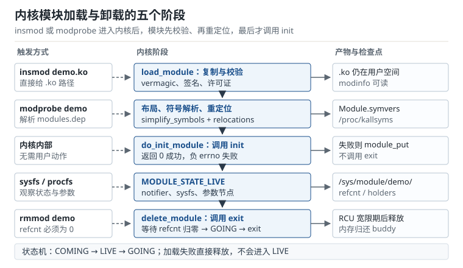

# 内核模块：生命周期、符号导出与调试 Kernel Modules

把一份驱动放进内核有两条路：写进 `vmlinux` 一起编译，或者编译成 `.ko`，等系统跑起来再用 `insmod` 加载。前者每次改一行都要重新构建、烧写、重启，后者只要几秒。很多人因此把模块理解成"内核态的共享库"——`insmod` 相当于 `dlopen`，`rmmod` 相当于 `dlclose`。这个类比在**开发体验**上成立，在**内核语义**上不成立：模块没有独立的地址空间、没有 libc、不能懒绑定符号，卸载还要过引用计数这一关，读错一行 Oops 甚至会把排查方向带到完全错误的地方。

这一章按"它是什么、怎么被链接、怎么初始化、出错怎么看"讲四件事。读完应当能回答：为什么 `insmod` 报 `Unknown symbol` 而 `modprobe` 能成功；为什么 `rmmod` 说模块在忙；为什么 `pr_debug` 打了却看不到；`RIP: demo_read+0x3c/0x120` 这行到底怎么换算到源码第几行。

## 1. 设计动机

嵌入式产品的内核配置往往有几千个选项，最终镜像只用到其中几十个驱动。把这些驱动全部静态编进 `vmlinux` 有三个直接后果：镜像变大、启动时的初始化路径变长、任何一个驱动出错都会让整机在内核初始化阶段挂掉。模块化把"编译期决定"改成"运行期决定"，代价是引入版本、符号、引用计数和卸载时序这一整套约束。

::: motivation 三个必须用模块的理由
**第一，迭代速度。** 一个默认配置的 ARM64 内核，全量构建在 8 核工作站上通常要 8 到 20 分钟；单独编译一个外部模块只要 2 到 10 秒，因为 Kbuild 只编译改动过的目标文件并做一次 modpost。调试一个 probe 时序问题时，开发者一天可能要加载几十次，这个差距决定了他能不能做"改一版、验一版"的循环。

**第二，配置裁剪与 rootfs 体积。** 发行版内核常把上千个驱动编成模块，按需自动加载；产品内核则相反，只保留用得到的。以 40 个驱动、每个模块 120 KiB 常驻内存估算，全静态会多占约 4.7 MiB，这在 128 MiB 内存的板子上是实打实的数字。模块还能把不常用的调试驱动放到独立分区，出问题时再加载。

**第三，故障隔离与现场替换。** 模块可以在不重启的情况下卸载再加载，用于恢复一个卡死的采集线程；也可以在现场用新版本替换旧模块，做一次最小化验证。注意这只是**开发与诊断手段**：量产设备上随意热替换模块会破坏签名与版本一致性，不能当成常规升级方案。
:::

| 你想要的 | 对应机制 | 代价 |
|---|---|---|
| 改驱动不重编内核 | 外部模块 + `insmod` | 必须自己保证 vermagic 与符号版本一致 |
| 按硬件配置裁剪 | Kconfig `tristate` + `obj-m` | 配置错误时驱动"静默消失"，没有编译错误 |
| 模块之间复用代码 | `EXPORT_SYMBOL` / `EXPORT_SYMBOL_GPL` | 符号成为事实接口，改签名会破坏所有使用者 |
| 加载时传配置 | `module_param` + sysfs | 参数校验、权限与并发写入都要自己处理 |
| 线上定位问题 | `printk`、dynamic debug、Oops | 日志本身有带宽上限，打印过多会淹没现场 |

**不懂会在哪摔跤**，具体是这四条：

1. 升级内核后直接拿旧 `.ko` 加载，只看到 `invalid module format`，不知道 `vermagic` 里还编码了 SMP、抢占、模块卸载、符号版本等一串配置。
2. 用了 `EXPORT_SYMBOL_GPL` 的符号，却给模块写 `MODULE_LICENSE("Proprietary")`，加载时报 `Unknown symbol`，而符号明明在 `/proc/kallsyms` 里。
3. 在 `__init` 函数里把某个数据结构指针存进全局变量，初始化完成后这段内存被释放，几小时后在完全无关的路径上 Oops。
4. 把 Oops 里的 `RIP` 地址直接拿去 `addr2line`，忘了模块是**重定位**加载的，地址每次启动都可能不同，算出来的行号完全是另一段代码。

## 2. 定义与直观：一个会被链接进内核的 ELF 目标文件

### 2.1 一句话定义与边界

**内核模块（Kernel Module，可加载内核模块 Loadable Kernel Module，LKM）**是一个在运行时被链接进内核地址空间的 ELF 可重定位目标文件，扩展名 `.ko`。它不是进程，没有自己的 `task_struct`、栈和堆；它执行的代码借用当前进程的内核栈，或者借用中断上下文，出错时影响的是整个内核。

这句话里有三个关键词：

- **可重定位**：`.ko` 里保留着"这里要填某个符号地址"的重定位项，加载时由内核解析并改写，而不是由用户态动态链接器完成。
- **运行时链接**：链接发生在 `init_module` 系统调用内部，所有未定义符号必须在调用 `init` 之前解析完，不存在懒绑定。
- **地址空间共享**：模块的 `.text` 被映射到内核模块区（x86_64 上是 `MODULES_VADDR` 起始的一段，ARM64 上在 `vmalloc` 区域附近），与内核直接共享页表。

::: analogy 模块像浏览器扩展，而不是独立应用
浏览器扩展不是单独运行的进程，它被加载进浏览器的地址空间，能调用浏览器内部 API，也可能因为一个空指针把整个标签页甚至浏览器搞崩。内核模块完全一样：它调用的是 `EXPORT_SYMBOL` 暴露出来的内核 API，共享内核的地址空间，一个越界写就能让整机 panic。把这个类比记住，就不会问"模块崩了为什么系统也挂了"。
:::

模块也不是万能的。它不能用浮点运算（内核默认不保存 FPU 状态，除非显式 `kernel_fpu_begin()`），不能调用 libc，不能假设自己运行在某个固定 CPU 上，也不能依赖"内核 ABI 稳定"——Linux 内核明确不提供跨版本的二进制接口，模块必须和内核一起编译。

### 2.2 `.ko` 文件的段布局

用 `readelf -S demo.ko` 能看到十几个段。和驱动开发关系最大的是下面这些：

| 段 | 内容 | 生命周期 |
|---|---|---|
| `.text` | 普通代码 | 模块存活期间常驻 |
| `.init.text` | 标了 `__init` 的初始化代码 | `init` 返回后释放 |
| `.exit.text` | 标了 `__exit` 的卸载代码 | 配置不允许卸载时不编译 |
| `.rodata` | 只读常量、`MODULE_PARM_DESC` 字符串 | 常驻，写保护 |
| `.data` / `.bss` | 可读写全局变量 | 常驻 |
| `.modinfo` | 许可证、作者、别名、参数说明、vermagic | 常驻，供 `modinfo` 读取 |
| 导出符号表 / GPL 符号表 | 本模块导出的符号表项 | 常驻，供其他模块解析 |
| `__versions` | 符号 CRC（开启 `CONFIG_MODVERSIONS` 时） | 常驻，加载时校验 |
| `.gnu.linkonce.this_module` | 一个 `struct module` 实例 | 常驻，内核用它表示这个模块 |

`struct module` 是整个模块的"身份证"：里面有 `state`、`refcnt`、`name`、`init`/`exit` 函数指针、各段基址、`mkobj`（sysfs 对象）、`source_list` 等字段。内核源码里用 `THIS_MODULE` 宏拿到当前模块的这张身份证，字符设备的 `file_operations.owner` 就靠它做引用计数。

### 2.3 五个阶段的状态机

一次成功的加载要经过五个阶段，任何一步失败都会回滚：

1. **复制与校验**：内核把 `.ko` 从用户空间读进内核缓冲，检查 ELF 头、节表、`vermagic`、签名、许可证。失败返回 `-ENOEXEC`、`-EINVAL`、`-EPERM` 等。
2. **布局与重定位**：为各段分配内核内存，解析未定义符号（`simplify_symbols`），应用重定位（`apply_relocations`），刷新指令缓存。
3. **执行 init**：`do_init_module()` 通过 `do_one_initcall()` 调用模块的 `init` 函数。返回 0 表示成功；返回负 errno 表示失败，内核回收模块内存，**不会**调用 `exit`。
4. **进入 LIVE**：模块状态从 `MODULE_STATE_COMING` 变成 `MODULE_STATE_LIVE`，注册 sysfs 节点、发送 `MODULE_STATE_LIVE` 通知，`/sys/module/demo/` 下出现 `refcnt`、`holders`、`parameters` 等文件。
5. **卸载**：`delete_module` 先把状态置为 `MODULE_STATE_GOING`，检查引用计数，调用 `exit`，等待 RCU 宽限期后释放内存。



这里最容易误解的是第 2 步和第 3 步的边界：**符号解析失败时，你的 `init` 根本不会执行**。所以看到 `Unknown symbol` 不要往 `init` 里加打印，那行打印永远不会出现。

### 2.4 init 与 exit 的返回约定

一个最小但完整的模块长这样：

```c
/* demo_core.c */
#include <linux/init.h>
#include <linux/module.h>
#include <linux/kernel.h>

static int __init demo_init(void)
{
    pr_info("demo: init\n");
    return 0;
}

static void __exit demo_exit(void)
{
    pr_info("demo: exit\n");
}

module_init(demo_init);
module_exit(demo_exit);

MODULE_LICENSE("GPL");
MODULE_AUTHOR("Demo");
MODULE_DESCRIPTION("Minimal demo module");
```

几个约定必须记住：

- `__init` 把函数放进 `.init.text`，`init` 返回后这段内存被释放。因此**不能**把 `__init` 函数里的局部变量地址、或者 `__initdata` 全局变量的地址保存到模块的长期数据结构里。
- `__exit` 在 `CONFIG_MODULE_UNLOAD=n` 时不会被编译；如果代码里只有 `module_exit` 没有其他引用，编译器可能报未使用函数的警告。
- `module_init` 在模块里展开成 `init_module` 别名，在静态编译进内核时展开成 `device_initcall`。也就是说同一份代码，`=m` 时由 `insmod` 调用，`=y` 时由内核在启动的 device initcall 阶段调用。
- `init` 返回负值时，内核会释放模块占用的内存并返回错误，`exit` 不会被调用。已经申请的资源要在 `init` 的错误分支里自己释放，或者改用 `devm_*` 让驱动核心代管。

### 2.5 符号导出（Symbol Export）：模块之间的接口

模块 A 想调用模块 B 的函数，B 必须显式导出：

```c
/* demo-core.c：提供函数的一方 */
int demo_read_reg(struct demo_dev *d, u32 reg, u32 *val)
{
    return regmap_read(d->map, reg, val);
}
EXPORT_SYMBOL_GPL(demo_read_reg);

/* demo-client.c：使用函数的一方 */
extern int demo_read_reg(struct demo_dev *d, u32 reg, u32 *val);
```

`EXPORT_SYMBOL` 把符号放进普通导出符号表，`EXPORT_SYMBOL_GPL` 放进 GPL 专用符号表（链接脚本里对应 `__ksymtab_gpl` 一类节名）。后者只允许声明了 GPL 兼容许可证的模块使用；如果客户端写 `MODULE_LICENSE("Proprietary")`，加载时会得到 `Unknown symbol`，而不是"许可证不匹配"这种更友好的错误。

符号解析依赖三样东西：

1. **内核的符号表**：`vmlinux` 链接时生成的 `__ksymtab`，运行时可通过 `/proc/kallsyms` 查看。
2. **`Module.symvers`**：`modpost` 生成的符号与 CRC 清单。编译外部模块时，内核构建目录里的 `Module.symvers` 必须存在，否则 modpost 会警告符号版本缺失。
3. **`CONFIG_MODVERSIONS`**：开启后每个导出符号带一个 32 位 CRC，加载时比对；不匹配报 `disagrees about version of symbol`。它防的是"结构体布局变了但模块没重编"这类静默错误。

模块之间的依赖还可以用符号命名空间约束：`EXPORT_SYMBOL_NS_GPL(fn, "DEMO_NS")` 导出的符号，使用方必须写 `MODULE_IMPORT_NS("DEMO_NS")` 才能解析。较新的内核把命名空间改成字符串字面量，旧内核用标识符，写代码时以所用内核的头文件为准。

### 2.6 模块参数（Module Parameters）：把配置留在加载时

```c
static int poll_ms = 100;
module_param(poll_ms, int, 0644);
MODULE_PARM_DESC(poll_ms, "Polling interval in milliseconds");

static char *label = "demo";
module_param(label, charp, 0444);

static int ids[4];
static int nr_ids;
module_param_array(ids, int, &nr_ids, 0444);
```

`module_param(name, type, perm)` 做三件事：在 `.modinfo` 里记录参数名与类型，在模块加载时解析命令行，在 `/sys/module/<name>/parameters/` 下创建节点。`perm` 为 0 表示不创建 sysfs 节点；`0444` 只读；`0644` 可写。可写参数在运行时被 `echo` 修改，驱动必须自己处理并发与边界，内核不会替你做范围检查。

常用类型有 `byte`、`short`、`ushort`、`int`、`uint`、`long`、`ulong`、`charp`、`bool`、`invbool`。数组用 `module_param_array`，字符串缓冲区用 `module_param_string`。需要自定义解析时用 `module_param_cb` 注册 `param_set_*` / `param_get_*` 回调。

加载时的写法：

```text
insmod demo.ko poll_ms=50 label=front
modprobe demo poll_ms=50
```

静态编译进内核时，参数通过内核命令行传递：`demo.poll_ms=50`。`modprobe` 还可以从 `/etc/modprobe.d/demo.conf` 读取 `options demo poll_ms=50`，这对量产配置比命令行更可靠。

### 2.7 Kconfig 与 Kbuild：编译期开关

Kconfig 决定"编不编、编成什么"，Kbuild 决定"怎么编"。

```kconfig
config DEMO_SENSOR
    tristate "Demo sensor driver"
    depends on I2C
    select REGMAP_I2C
    help
      Say M here to build the demo sensor driver as a module.
      Say Y to build it into the kernel image.
```

`tristate` 有三个值：`n` 不编译，`m` 编译成模块，`y` 编进内核。`depends on I2C` 表示 I2C 子系统没启用时这个选项不可见；`select REGMAP_I2C` 强制打开依赖项。`select` 不会检查被选中的符号自身的依赖，滥用会造成"配置了但编不过"，所以新代码更推荐 `depends on` 或 `imply`。

```makefile
obj-$(CONFIG_DEMO_SENSOR) += demo_sensor.o  # $(CONFIG_DEMO_SENSOR) -> y or m
demo_sensor-y := demo_core.o demo_i2c.o
ccflags-y += -DDEMO_TRACE=1
```

这段 Makefile 的含义是：当配置为 `y` 或 `m` 时，把 `demo_sensor.o` 加入构建；`demo_sensor-y` 指定这个复合目标由两个源文件链接而成；`ccflags-y` 只对当前目录生效。Kbuild 会分两遍扫描 Makefile，第一遍收集目标，第二遍真正编译，所以变量顺序和普通 Makefile 不完全一样。

外部模块的构建命令：

```bash
make -C /lib/modules/$(uname -r)/build M=$(pwd) modules
```

这条命令让内核构建系统进入指定内核目录，再用 `M=` 指回当前目录。产物包括 `demo_sensor.ko`、`Module.symvers`、`modules.order` 和一堆 `.o`、`.cmd` 文件。安装与更新依赖：

```bash
sudo make -C /lib/modules/6.6.0-demo/build M=/home/dev/demo modules_install
sudo depmod -a 6.6.0-demo
```

`modules_install` 把 `.ko` 复制到 `/lib/modules/<版本>/extra/`（或 `updates/`），`depmod` 重新生成 `modules.dep`、`modules.alias`、`modules.softdep`。**跳过 `depmod` 是 `modprobe` 找不到模块的头号原因**；`insmod` 直接吃路径，不受影响，这也是两者最容易被忽略的差别。

| 命令 | 是否解析依赖 | 典型用途 |
|---|---|---|
| `insmod demo.ko` | 否 | 开发时加载单个刚编译的模块 |
| `modprobe demo` | 是，读 `modules.dep` | 生产环境按名字加载，自动带依赖 |
| `rmmod demo` | 否 | 卸载，引用计数不为 0 时失败 |
| `modprobe -r demo` | 是 | 卸载并尝试卸载不再被使用的依赖 |
| `modinfo demo.ko` | 不涉及 | 查看 vermagic、依赖、参数、许可证 |
| `depmod -a` | 不涉及 | 重建依赖与别名数据库 |

### 2.8 printk 与动态调试（Dynamic Debug）

内核日志的第一原则是：**日志是有限带宽的共享资源**。一条 `pr_info` 不只是写内存环形缓冲区，还可能被同步送到串口控制台；在 115200 波特率下，一行 96 字节的日志要占 8.3 ms，足以把一次中断处理拖成毫秒级。

```c
#define pr_fmt(fmt) KBUILD_MODNAME ": " fmt

pr_info("probe: irq=%d\n", irq);
pr_err_ratelimited("fifo overflow, dropped=%u\n", dropped);
dev_dbg(dev, "reg[%02x]=%08x\n", reg, val);
```

| 级别 | 宏 | 数值 | 典型用途 |
|---|---|---|---|
| 紧急 | `pr_emerg` | 0 | 系统不可用 |
| 报警 | `pr_alert` | 1 | 必须立即处理 |
| 严重 | `pr_crit` | 2 | 硬件/驱动严重错误 |
| 错误 | `pr_err` | 3 | 操作失败 |
| 警告 | `pr_warn` | 4 | 可恢复的异常 |
| 通知 | `pr_notice` | 5 | 正常但重要的事件 |
| 信息 | `pr_info` | 6 | 启动、probe 等常规信息 |
| 调试 | `pr_debug` | 7 | 默认不编译或动态开启 |

`/proc/sys/kernel/printk` 的四个数字分别是控制台日志级别、默认消息级别、最小控制台级别、默认控制台级别。常见的 `4 4 1 7` 表示：只有级别小于 4 的消息会打到控制台，`pr_info` 只进环形缓冲区。用 `dmesg` 看缓冲区，用 `dmesg -w` 跟踪，用 `dmesg --level=err,warn` 过滤。

`pr_debug` 和 `dev_dbg` 在未定义 `DEBUG` 时被编译成空操作；开启 `CONFIG_DYNAMIC_DEBUG` 后，它们会保留调用点信息，可以在运行时按文件、函数、行号、模块打开：

```bash
echo 'file demo_core.c +p' > /sys/kernel/debug/dynamic_debug/control
echo 'module demo +pflmt' > /sys/kernel/debug/dynamic_debug/control
echo 'func demo_probe +p' > /sys/kernel/debug/dynamic_debug/control
```

标志位 `p` 打开打印，`f` 加函数名，`l` 加行号，`m` 加模块名，`t` 加线程 ID。启动时也可以用 `dyndbg="file drivers/i2c/* +p"` 一次性打开。动态调试的价值在于：**生产固件可以保留调试点，默认零开销，出问题时再打开**，不需要重新编译。

还要注意 `%p` 的行为：普通 `%p` 打印的是哈希后的指针，防止泄露内核地址布局；需要真实地址时用 `%px`（仅调试），受 `kptr_restrict` 限制的用 `%pK`。把 `%p` 当成"能看到地址"来用，是常见的误判。

### 2.9 Oops 的阅读顺序

一次典型的空指针 Oops：

```text
[  102.417382] BUG: unable to handle page fault for address: 0000000000000018
[  102.417401] #PF: supervisor read access in kernel mode
[  102.417410] #PF: error_code(0x0000) - not-present page
[  102.417428] Oops: 0000 [#1] PREEMPT SMP
[  102.417439] CPU: 0 PID: 812 Comm: cat Tainted: G           O       6.6.0-demo #1
[  102.417461] RIP: 0010:demo_read+0x3c/0x120 [demo]
[  102.417475] Code: 48 8b 47 18 48 85 c0 74 1a 48 8b 40 08 48 8b 00 48 89 45 d0
[  102.417488] RSP: 0018:ffffc90000a3be48 EFLAGS: 00010246
[  102.417497] RAX: 0000000000000000 RBX: ffff888006a4c000 RCX: 0000000000000000
[  102.417510] RDX: 0000000000000001 RSI: 0000000000000000 RDI: ffff888006a4c000
[  102.417523] CR2: 0000000000000018
[  102.417531] Call Trace:
[  102.417538]  <TASK>
[  102.417544]  demo_read+0x3c/0x120 [demo]
[  102.417556]  vfs_read+0x1f2/0x3a0
[  102.417601] ---[ end trace 0000000000000000 ]---
```

按下面的顺序读，效率最高：

1. **第一行**：错误类型和出错地址。`page fault for address: 0x18` 说明访问了虚拟地址 24，几乎可以断定是空指针加结构体字段偏移。
2. **`RIP` 行**：出错指令位置。`0010` 是代码段选择子，不是偏移；`demo_read+0x3c/0x120` 表示函数内偏移 `0x3c`、函数总长 `0x120`，方括号里是模块名。
3. **`Code` 行**：出错指令的机器码。用 `objdump -d` 对照，能看出是读、写还是跳转。
4. **寄存器**：`RAX=0` 常是空指针来源；`CR2` 是页错误地址；`RDI/RSI` 往往是函数参数。`RSP` 能看出栈有没有跑飞。
5. **`Call Trace`**：调用链。注意 `<TASK>` 表示任务上下文；如果出现 `?` 前缀，说明该地址没找到可靠符号，栈回溯可能不可信。
6. **`Tainted`**：`O` 表示加载了树外模块，`P` 表示专有许可证模块，`E` 表示未签名模块。看到 `O` 就要先把"是不是模块版本不匹配"排掉。

把函数内偏移换算到源码行，用内核自带的脚本：

```bash
scripts/faddr2line demo.ko demo_read+0x3c
```

输出会给出 `demo_read at /home/dev/demo/demo.c:87` 这样的位置。如果内核没开 `CONFIG_DEBUG_INFO`，`faddr2line` 只能给出函数名和偏移，此时只能用 `objdump -d` 反汇编，结合 `Code` 字节判断访问了哪个字段。`RIP` 后面没有方括号、只有 `?` 时，说明 `CONFIG_KALLSYMS` 没开或模块已被卸载，先解决符号表问题再谈定位。

## 3. 定量关系

### 3.1 加载耗时的分解

一次 `insmod` 的耗时可以拆成四项：

$$t_{\text{load}}=\frac{S_{\text{ko}}}{B_{\text{io}}}+N_{\text{rel}}t_{\text{rel}}+N_{\text{sym}}t_{\text{sym}}+t_{\text{init}}$$

符号与单位：

- $S_{\text{ko}}$：`.ko` 文件字节数，B；
- $B_{\text{io}}$：从存储读取的有效带宽，B/s；
- $N_{\text{rel}}$：重定位项数量，个；
- $t_{\text{rel}}$：单项重定位的平均耗时，s；
- $N_{\text{sym}}$：未定义符号数量，个；
- $t_{\text{sym}}$：单个符号查找与 CRC 校验耗时，s；
- $t_{\text{init}}$：模块 `init` 函数自身耗时，s。

这个模型忽略页分配与锁竞争，适合判断"加载慢"的瓶颈在哪一项。通常 $t_{\text{init}}$ 是驱动作者能控制的部分，前三项由模块大小与内核配置决定。

### 3.2 常驻内存的页数

模块各段按页分配，`init` 段在初始化后释放。常驻内存为：

$$M_{\text{res}}=\left(\sum_{s}\left\lceil\frac{S_s}{P}\right\rceil P\right)-\left(\sum_{s\in\text{init}}\left\lceil\frac{S_s}{P}\right\rceil P\right)+S_{\text{meta}}$$

符号与单位：

- $S_s$：第 $s$ 个段的字节数，B；
- $s\in\text{init}$：初始化段集合（`.init.text`、`.init.data` 等），这些段在 `init` 返回后释放；
- $P$：页大小，ARM64 常见 4096 B 或 65536 B；
- $S_{\text{meta}}$：`struct module`、sysfs 节点、kallsyms 字符串等元数据，约 1–2 KiB；
- $M_{\text{res}}$：模块常驻内存，B。

注意求和里的段要先各自向上取整再相加，不能先加总再取整：5 个 1 KiB 的段占 5 页，而不是 2 页。这个细节在模块很多时会把误差放大到几十 KiB。

### 3.3 引用计数（Reference Count）与可卸载条件

模块的引用计数由三部分组成：

$$r_{\text{total}}=r_{\text{open}}+r_{\text{holder}}+r_{\text{internal}}$$

符号与单位：

- $r_{\text{open}}$：当前打开的文件、socket、设备节点持有的引用数，每个打开实例通常加 1；
- $r_{\text{holder}}$：其他模块通过 `try_module_get()` 持有的引用数，可在 `/sys/module/<name>/holders/` 看到；
- $r_{\text{internal}}$：内核子系统内部的引用，例如注册的回调、工作队列；
- $r_{\text{total}}$：`/sys/module/<name>/refcnt` 的值。

可卸载的充要条件是 $r_{\text{total}}=0$。`rmmod` 在计数不为 0 时返回 `EBUSY`；如果以阻塞方式调用 `delete_module`，它会等待计数降到 0，这也是某些脚本里 `rmmod` 看起来"卡住"的原因。字符设备的 `file_operations.owner = THIS_MODULE` 会让每次 `open` 自动加 1，这条链路在字符设备一章还会展开。

### 3.4 日志带宽与环形缓冲区

串口控制台的字符速率由波特率和帧格式决定。8N1 每字节 10 位（1 起始位 + 8 数据位 + 1 停止位）：

$$R_{\text{con}}=\frac{B_{\text{uart}}}{10},\qquad t_{\text{line}}=\frac{L}{R_{\text{con}}},\qquad T_{\text{over}}=\frac{S_{\text{buf}}}{L}\cdot\frac{1}{f_{\text{log}}}$$

符号与单位：

- $B_{\text{uart}}$：波特率，bit/s；
- $R_{\text{con}}$：控制台字符吞吐，字符/s；
- $L$：单行日志字节数，B；
- $t_{\text{line}}$：一行日志占用控制台的时间，s；
- $S_{\text{buf}}$：环形缓冲区字节数，B，由 `CONFIG_LOG_BUF_SHIFT` 决定；
- $f_{\text{log}}$：日志产生速率，行/s；
- $T_{\text{over}}$：从缓冲区满到最早一条日志被覆盖的时间，s。

这个式子解释了两个常见现象：日志产生速率超过 $R_{\text{con}}/L$ 时，控制台成为瓶颈，`printk` 调用者可能被拖慢；$T_{\text{over}}$ 很小（秒级）时，一次日志风暴会把 Oops 之前的关键几行冲掉。

### 3.5 Oops 地址回算

模块的加载基址每次启动都可能不同，因此 `RIP` 里的绝对地址不能直接拿去查 `vmlinux`。正确的关系是：

$$A_{\text{func}}=A_{\text{text}}+O_{\text{sym}},\qquad A_{\text{rip}}=A_{\text{func}}+o$$

符号与单位：

- $A_{\text{text}}$：模块 `.text` 段的加载基址，从 `/sys/module/<name>/sections/.text` 读取（需要 root）；
- $O_{\text{sym}}$：函数在 `.text` 内的偏移，从 `nm -n demo.ko` 读取；
- $A_{\text{func}}$：函数入口的绝对地址；
- $o$：`RIP` 行里 `+` 后面的函数内偏移，字节；
- $A_{\text{rip}}$：出错指令的绝对地址。

反过来，如果只有绝对地址，先减基址得到段内偏移，再在 `nm` 输出里找落在哪个函数区间。`faddr2line` 做的就是这件事，但它需要调试信息才能继续映射到源码行。

### 3.6 重新加载的停机窗口

模块化调试常假设"卸载再加载很快"，实际业务中断时间是：

$$t_{\text{gap}}=t_{\text{rmmod}}+t_{\text{load}}+t_{\text{reinit}}$$

其中 $t_{\text{rmmod}}$ 是卸载耗时（含等待引用计数归零），$t_{\text{load}}$ 由上一节的模型给出，$t_{\text{reinit}}$ 是驱动重新初始化硬件、恢复寄存器与缓冲区的时间。后一项经常被忽略：一个音频驱动重新加载后，I2S 时钟重新锁定、FIFO 重新填充，可能需要几十毫秒，足以让上层听到爆音。

## 4. 典型算例

### 4.1 一次 300 KiB 模块的加载耗时

某外部模块 $S_{\text{ko}}=300$ KiB，从 eMMC 读取的有效带宽 $B_{\text{io}}=80$ MB/s，重定位项 $N_{\text{rel}}=4000$，单项 $t_{\text{rel}}=0.8$ 微秒，未定义符号 $N_{\text{sym}}=120$，单项 $t_{\text{sym}}=2$ 微秒，`init` 自身耗时 $t_{\text{init}}=1.2$ ms。

代入：

$$t_{\text{load}}=\frac{300\times1024}{80\times10^6}+4000\times0.8\times10^{-6}+120\times2\times10^{-6}+1.2\times10^{-3}$$

逐项计算：

- 读取：$307200/8\times10^{7}=3.84$ ms；
- 重定位：$4000\times0.8\,\mu s=3.2$ ms；
- 符号：$120\times2\,\mu s=0.24$ ms；
- 初始化：1.2 ms。

合计 $3.84+3.2+0.24+1.2=8.48$ ms。再加上系统调用与内存分配的约 0.1 ms，实测应在 8.5–9 ms 量级。如果 40 个模块都在启动时加载，总时间约 $40\times8.5=340$ ms，占 1 秒启动预算的三分之一，这时才值得考虑把部分模块编进内核或延迟加载。

验算方法：用 `time insmod demo.ko` 看总时间，用 `dmesg` 里 `initcall` 的时间戳看 `init` 部分，两者之差就是前三个阶段。差值远大于 8 ms 时，优先怀疑存储读取或 `CONFIG_MODVERSIONS` 的 CRC 校验开销。

### 4.2 40 个模块的常驻内存

假设单个模块各段大小为：`.text` 96 KiB、`.init.text` 24 KiB、`.rodata` 8 KiB、`.data` 4 KiB、`.bss` 2 KiB、`.modinfo` 1 KiB，页大小 $P=4$ KiB。

按段取整：$96/4=24$ 页，$24/4=6$ 页，$8/4=2$ 页，$4/4=1$ 页，$2/4\to1$ 页，$1/4\to1$ 页，合计 35 页，即 140 KiB。`init` 返回后释放 6 页（24 KiB），剩 29 页 = 116 KiB，再加约 2 KiB 元数据，约 118 KiB。

40 个模块：$40\times118=4720$ KiB，约 4.6 MiB。这个数字要和"把这 40 个驱动静态编进内核"比较：静态链接会去掉模块元数据与对齐填充，通常略小，但失去按需加载能力。若板子只有 128 MiB 内存，4.6 MiB 占 3.6%，通常可以接受；真正的大头往往是每个模块私有的 DMA 缓冲区，而不是代码段。

验算：`cat /proc/modules` 第二列是模块大小（字节），把所有值加起来除以 1024 得到 KiB；与按段估算的差异主要来自页对齐和 `struct module` 的实现大小。

### 4.3 115200 串口下的日志上限

$B_{\text{uart}}=115200$ bit/s，8N1 帧格式，则 $R_{\text{con}}=11520$ 字符/s。一行日志 $L=96$ B，则 $t_{\text{line}}=96/11520=8.33$ ms，控制台最多承受 $1/0.00833=120$ 行/s。

如果驱动在 1 kHz 的中断里每次都 `pr_info`，日志产生率是 1000 行/s，是控制台能力的 8.3 倍。环形缓冲区 $S_{\text{buf}}=128$ KiB（`CONFIG_LOG_BUF_SHIFT=17`），可存 $131072/96=1365$ 行；按 1000 行/s 计算，$T_{\text{over}}=1365/1000=1.365$ s——也就是说，出问题后 1.4 秒内不把日志取走，最早的现场就没了。

如果改用 `pr_info_ratelimited`，默认限制是每 5 秒 10 条，即 2 行/s，只有产生率的 0.2%，能把控制台占用压到 $2\times8.33=16.7$ ms/s，约 1.7%。代价是丢掉 99.8% 的日志，所以限流打印适合"有异常才打"，不适合"每帧都要看"。

验算：在板子上执行 `dmesg | wc -l` 与 `dmesg -T | head`，对比时间戳跨度，就能估算实际日志速率；再把 `printk_ratelimit_burst` 改小观察丢日志的行为。

### 4.4 从 RIP 反推源码行

某次 Oops 给出：

```text
RIP: 0010:demo_read+0x3c/0x120 [demo]
CR2: 0000000000000018
```

从 `/sys/module/demo/sections/.text` 读到基址 `0xffffffffc02a1000`，从 `nm -n demo.ko` 读到 `demo_read` 在 `.text` 内的偏移 `0x120`。

函数入口绝对地址：

$$A_{\text{func}}=0xffffffffc02a1000+0x120=0xffffffffc02a1120$$

出错指令地址：

$$A_{\text{rip}}=0xffffffffc02a1120+0x3c=0xffffffffc02a115c$$

函数总长 `0x120` = 288 字节，偏移 `0x3c` = 60 字节，位于函数前 21% 处。`CR2=0x18` 表示访问地址 24；`RAX=0` 表示基址寄存器为空，因此最可能是 `p->field` 且 `p=NULL`、`field` 偏移 24。

执行 `scripts/faddr2line demo.ko demo_read+0x3c`，得到 `demo.c:87`。如果源码在该行是 `val = dev->ops->read(dev, reg);`，那么 `dev->ops` 偏移 24、`dev` 为空，问题就从"驱动读寄存器失败"缩小到"`demo_read` 被调用时 `dev` 还没初始化"。

验算：用 `objdump -d demo.ko` 找到偏移 `0x3c` 的指令，确认它确实是 `mov 0x18(%rax),...` 这类带 24 偏移的访存指令；与 `Code:` 行的字节对照，能排除"符号偏移读错"的可能。

### 4.5 重载窗口与业务中断

某音频采集模块卸载耗时 0.8 ms，加载 8.5 ms，重新初始化 I2S 与缓冲区 40 ms，则：

$$t_{\text{gap}}=0.8+8.5+40=49.3\text{ ms}$$

采集端以 10 ms 为一个缓冲周期，49.3 ms 相当于丢掉约 5 个缓冲，必然产生可听见的断续。若业务要求切换不中断，就不能用"卸载再加载"做升级，而要走双缓冲、无缝切换或整机重启窗口。这个算例说明：**模块化降低的是编译与部署成本，不是运行时中断成本**；后者要单独设计。

## 5. 工程含义

### 5.1 版本与 ABI

Linux 内核不提供稳定的模块二进制接口。`vermagic` 字符串里编码了内核版本、是否 SMP、抢占模型、是否允许卸载模块、是否开启 `CONFIG_MODVERSIONS`、架构、是否启用 retpoline 等信息；其中任何一项变化，旧模块都会被拒绝加载。`CONFIG_MODVERSIONS` 进一步用每个导出符号的 CRC 检查结构体布局与函数签名变化。

工程上的结论很直接：

- 模块必须和内核**同一套配置、同一个编译器版本**构建；交叉编译时尤其要固定 `CROSS_COMPILE` 与内核源码树。
- 树外模块加载后，内核被标记为 `O`（out-of-tree），这不是错误，但意味着"出了 bug 先怀疑模块"。
- 升级内核时，`/lib/modules/<新版本>/` 必须整体更新，不能只替换 `vmlinux`。

### 5.2 体积与发布

带调试信息的 `.ko` 可能有 2 MB 以上，而 strip 后通常只剩 100–300 KiB。以 50 个模块、每个 2.4 MB 为例，未裁剪的 `/lib/modules` 约 120 MB；`INSTALL_MOD_STRIP=1` 后约 9 MB；再用 `MODULE_COMPRESS_XZ` 压缩到约 2–3 MB。对 512 MiB 的 rootfs 来说，这是从"必须扩分区"到"可以忽略"的差别。

发布时的做法：

```bash
make modules_install INSTALL_MOD_STRIP=1 INSTALL_MOD_PATH=/tmp/rootfs
```

内核配置里还可以打开 `CONFIG_MODULE_COMPRESS_XZ` 或 `CONFIG_MODULE_COMPRESS_ZSTD`，让安装阶段自动压缩。注意压缩后的模块在加载时要先解压到内存，会多花几毫秒，启动时间敏感的模块可以不压缩。

### 5.3 许可、签名与污点（Taint）

`MODULE_LICENSE("GPL")` 不只是"声明"，它决定模块能否使用 `EXPORT_SYMBOL_GPL` 的符号，也决定内核是否被打上 `P` 污点。专有模块可以加载，但只能用非 GPL 符号；强行改许可证字符串属于许可证违规，不是技术手段。

模块签名是另一条链：`CONFIG_MODULE_SIG` 让内核校验 `.ko` 的 PKCS#7 签名，`CONFIG_MODULE_SIG_FORCE` 拒绝未签名模块，未强制时未签名模块加载后内核被标记 `E`。开启 UEFI Secure Boot 或内核 lockdown 后，未签名模块可能被直接拒绝。量产设备应把签名密钥放在构建服务器上，而不是开发机上。

### 5.4 初始化顺序

静态编译时，`module_init` 展开成 `device_initcall`，同一级别的初始化函数按链接顺序执行；链接顺序由 Makefile 的目标顺序和 `modules.order` 决定，不是稳定 API。模块化后，加载顺序由用户或 `modprobe` 的依赖决定，更不可控。

因此模块之间不要假设"另一个模块已经初始化"。需要明确依赖时：

- 用 `EXPORT_SYMBOL` 建立编译期依赖，让 `modprobe` 按 `modules.dep` 排序；
- 用 `-EPROBE_DEFER` 让驱动在资源就绪后重试（platform 驱动一章展开）；
- 用 `late_initcall` 把依赖硬件的初始化推迟到更晚，但不要用它掩盖竞态。

### 5.5 线上调试策略

生产固件的调试能力要在"可观测"和"不扰民"之间取舍：

- 常规路径用 `pr_info` 打一条关键状态即可，热路径用 `pr_debug` + dynamic debug；
- 中断上下文避免 `pr_info`，必要时用 `pr_*_ratelimited` 或每 N 次打印一次；
- 打开 `CONFIG_PSTORE` + `ramoops`，让 Oops 在重启后还能从 `/sys/fs/pstore` 取回；
- 用 `panic_on_oops=1` 配合看门狗，避免系统带着损坏状态继续跑；
- 保留 `vmlinux` 与对应 `System.map`、模块的未 strip 版本，否则拿到 Oops 也无法定位。

## 6. 常见坑

::: pitfall 坑一：insmod 报 Unknown symbol，但符号明明存在
**现象**：`insmod demo.ko` 返回 `Unknown symbol demo_read_reg (err -2)`，`grep demo_read_reg /proc/kallsyms` 能看到符号。

**原因**：符号是用 `EXPORT_SYMBOL_GPL` 导出的，而模块的 `MODULE_LICENSE` 不是 GPL 兼容；或者模块编译时用的 `Module.symvers` 与当前内核不一致，CRC 校验失败；或者命名空间未导入。

**解决**：先看 `modinfo demo.ko` 的 `license` 字段与 `depends`；再看内核源码里该符号的导出宏；确认 `Module.symvers` 来自当前内核构建目录。用 `dmesg` 看完整错误，`Unknown symbol` 后面通常会跟 `(err -2)`，`-2` 是 `ENOENT`。
:::

::: pitfall 坑二：rmmod 提示模块在使用，但找不到占用者
**现象**：`rmmod demo` 返回 `ERROR: Module demo is in use`，`lsmod` 显示 `Used by` 为 0 或为空，`ps` 里也没有相关进程。

**原因**：引用计数不只来自打开的文件。注册的中断处理、定时器、工作队列、`try_module_get()` 没配对、其他模块的 `holders` 都会加计数；`lsmod` 的 `Used by` 只显示模块之间的依赖，不显示内核子系统持有的引用。

**解决**：读 `/sys/module/demo/refcnt` 与 `/sys/module/demo/holders/`；检查 `open`/`release` 是否配对，`try_module_get` 是否在错误分支漏了 `module_put`；用 `rmmod -w` 观察计数是否随时间下降，确认是不是某个长期打开的设备节点。
:::

::: pitfall 坑三：`__init` 数据在几小时后才炸
**现象**：模块加载成功，运行几分钟到几小时后随机 Oops，`RIP` 落在与初始化无关的函数里，`CR2` 指向一个已经被回收的地址。

**原因**：把 `__init` 函数里的局部变量地址、或 `__initdata` 全局变量的地址存进了长期结构；`init` 返回后内核释放 `.init.text` 与 `.init.data`，那块内存可能被别的模块或 slab 复用。

**解决**：长期保存的数据用 `kmalloc`/`kzalloc` 或 `devm_kzalloc` 分配；`__init` 函数只做一次性初始化，不把栈上地址传出去；用 `CONFIG_DEBUG_OBJECTS` 或 KASAN 复现"释放后使用"。
:::

::: pitfall 坑四：日志风暴把第一现场冲掉
**现象**：设备异常后重启，`dmesg` 里全是驱动的高频打印，真正的第一条错误已经找不到；串口控制台卡顿，甚至触发看门狗。

**原因**：热路径无节流打印，日志产生率远超控制台吞吐；环形缓冲区被覆盖，$T_{\text{over}}$ 只有一两秒。

**解决**：热路径改 `pr_debug` 或 `*_ratelimited`；把 `log_buf_len` 调大只能延长时间，不能解决带宽；用 `pstore`/`ramoops` 持久化最后一段日志；必要时把控制台日志级别降到 3，只保留错误。
:::

::: pitfall 坑五：升级内核后旧模块加载失败
**现象**：`insmod` 报 `invalid module format`，`dmesg` 里有 `disagrees about version of symbol` 或 `version magic ... should be ...`。

**原因**：`vermagic` 或符号 CRC 与当前内核不一致；常见于只替换了 `vmlinux`、没更新 `/lib/modules`，或者模块是用另一套配置编译的。

**解决**：用 `modinfo -F vermagic demo.ko` 与 `uname -r` 对比；重新用目标内核的构建目录编译模块；`make modules_install` 后执行 `depmod -a`；把内核与模块作为一个整体版本管理，别单独替换。
:::

## 7. 自测题

<details><summary>题一：某模块的 `.text` 为 100 KiB、`.init.text` 为 20 KiB、`.rodata` 为 6 KiB、`.data` 为 3 KiB、`.bss` 为 1 KiB，页大小 4 KiB，元数据 2 KiB。求加载期间与 `init` 返回后的常驻内存，并说明为什么不能先加总再取整。</summary>

加载期间按段取整：`100/4=25` 页，`20/4=5` 页，`6/4=1.5` 向上取整为 2 页，`3/4` 为 1 页，`1/4` 为 1 页，合计 $25+5+2+1+1=34$ 页，即 136 KiB。加元数据 2 KiB，加载期间约 138 KiB。

`init` 返回后释放 5 页（20 KiB），剩 29 页 = 116 KiB，加元数据约 118 KiB。

不能先加总再取整，是因为各段独立分配、独立对齐：总字节数 $100+20+6+3+1=130$ KiB，若按 130 KiB 一次取整只需 33 页，但实际每段都有自己的页边界，`6 KiB` 的 `.rodata` 要占 2 页而不是 1.5 页，`3 KiB` 的 `.data` 要占 1 页而不是 0.75 页。模块越多，这种"段内碎片"越明显。

</details>

<details><summary>题二：串口 115200 8N1，日志行宽 80 字节，环形缓冲区 256 KiB。驱动以 500 行/s 打印，多久会把缓冲区写满一圈？若把日志改成每 10 秒最多 20 条，控制台占用率是多少？</summary>

字符速率 $R_{\text{con}}=115200/10=11520$ 字符/s。每行 80 B，控制台每秒可输出 $11520/80=144$ 行，单行耗时 $80/11520=6.94$ ms。

缓冲区可存 $262144/80=3276.8$，即 3276 行。以 500 行/s 计算，写满一圈的时间 $T_{\text{over}}=3276/500=6.55$ s。这还没考虑控制台只能输出 144 行/s：500 行/s 中有 356 行/s 积压在缓冲区，实际覆盖时间仍是 6.55 s，但日志的"时间分辨率"已经被压缩。

限流后 20 条/10 s = 2 行/s，控制台占用 $2\times6.94=13.9$ ms/s，约 1.4%。代价是丢掉 99.6% 的日志，所以限流适合"异常计数"，不适合逐帧追踪。

</details>

<details><summary>题三：Oops 显示 `RIP: 0010:demo_ioctl+0x4a/0x1c0 [demo]`，模块 `.text` 基址为 `0xffffffffc03a0000`，`nm` 显示 `demo_ioctl` 在 `.text` 内偏移 `0x200`。求函数入口与出错指令的绝对地址；如果 `faddr2line` 报找不到调试信息，下一步怎么做？</summary>

函数入口：

$$A_{\text{func}}=0xffffffffc03a0000+0x200=0xffffffffc03a0200$$

出错指令：

$$A_{\text{rip}}=0xffffffffc03a0200+0x4a=0xffffffffc03a024a$$

函数总长 `0x1c0`=448 字节，偏移 `0x4a`=74 字节，位于函数前 16.5% 处。

`faddr2line` 失败说明模块或 `vmlinux` 没带 `CONFIG_DEBUG_INFO`。这时用 `objdump -d demo.ko` 反汇编，定位偏移 `0x4a` 的指令，看它访问了哪个寄存器加哪个偏移；再结合 `Code:` 行的机器码与寄存器 dump（尤其 `CR2`、`RAX`）判断是空指针、越界还是类型错误。若手上有未 strip 的 `.ko`，也可以 `gdb demo.ko` 后执行 `list *(demo_ioctl+0x4a)`，但同样依赖调试信息。

</details>

<details><summary>题四：某模块使用了 `EXPORT_SYMBOL_GPL` 的 `demo_lock()`，但许可证写的是 `Proprietary`。加载会发生什么？把许可证改成 `GPL` 是否就能解决？还需要注意什么？</summary>

加载时符号解析会失败，`insmod` 报 `Unknown symbol demo_lock (err -2)`，即使 `/proc/kallsyms` 里能看到该符号。原因是 GPL-only 符号只对 GPL 兼容许可证的模块可见，内核在 `find_symbol()` 阶段就按许可证过滤，不会走到 `init`。

把 `MODULE_LICENSE` 改成 `"GPL"` 在技术上能让符号解析通过，但这不是"改个字符串"的问题：许可证是法律声明，只有代码确实按 GPL 兼容条款发布时才成立。工程上还要确认：模块是否链接了其他专有代码、是否使用了 GPL 专属头文件、分发方式是否符合许可证要求。如果确实不能开源，正确做法是改用非 GPL 导出的替代 API，或者把功能拆到用户态。

另外，改许可证还会影响内核污点标记：专有模块加载后内核带 `P`，GPL 模块不带；这不是"绕过检查"，而是把法律与技术支持边界明确下来。

</details>

## 8. 参考资料

- Linux 内核文档 `Documentation/kbuild/modules.rst`：外部模块的构建流程、`M=` 与 `modules_install`。
- Linux 内核文档 `Documentation/kbuild/kconfig-language.rst`：`tristate`、`depends on`、`select` 的语义与常见误用。
- Linux 内核文档 `Documentation/admin-guide/dynamic-debug-howto.rst`：dynamic debug 的查询语法、标志位、`dyndbg` 启动参数。
- Linux 内核文档 `Documentation/admin-guide/tainted-kernels.rst`：`P`、`O`、`E` 等污点标记的含义；`Documentation/process/license-rules.rst` 解释 GPL 兼容许可证。
- Linux 内核源码 `kernel/module/main.c`、`include/linux/module.h`、`include/linux/moduleparam.h`：`load_module` 的各阶段、`struct module`、参数宏族。
- Linux Device Drivers, 3rd Edition（Corbet, Rubini, Kroah-Hartman, O'Reilly, 2005）：Building and Running Modules。
- Linux 内核文档 `Documentation/trace/ftrace.rst` 与 `scripts/faddr2line`：函数内偏移到源码行的映射；`Documentation/admin-guide/kernel-parameters.txt` 中的 `panic_on_oops` 等参数。
