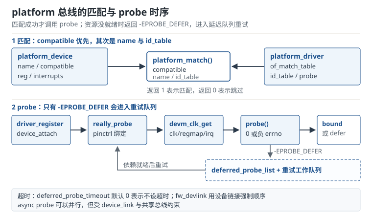

# platform 总线与驱动：匹配、probe 与资源 Platform Bus and Drivers

设备树里写了一个节点，`compatible` 看起来也对，驱动却始终不 probe；或者 probe 返回 `-517`，`dmesg` 里一行 `probe failed with error -517` 反复出现；再或者 probe 成功，但读寄存器全是 `0xff`，因为时钟没开、电源域没上电、pinctrl 没配对。这三种现象覆盖了 platform 驱动开发的大部分时间，它们分别对应三个问题：**匹配、资源、顺序**。

platform 总线（Platform Bus）不是一条物理总线，而是 Linux 设备模型里的一条"伪总线"，用来承载 SoC 内部那些没有 PCI 配置空间、地址固定、由设备树描述的设备。理解它，等于理解"设备树节点如何变成 `struct device`、驱动如何被匹配、probe 为什么失败、失败后谁负责重试"。

## 1. 设计动机

SoC 内部的 UART、I2C、SPI、GPIO、PWM、DMA、看门狗，既不能像 USB 那样枚举，也不能像 PCI 那样读配置空间。它们的基地址、中断号、时钟、复位线在芯片设计时就固定了，板级差异只体现在"用哪一路、引脚怎么复用、电源怎么接"。设备树（Device Tree）把这些差异写成数据，platform 总线把数据翻译成设备模型，驱动只面对 `struct platform_device`。

::: motivation 三个必须理解 platform 模型的地方
**场景一：新板 bring-up。** 拿到一块新板，内核能启动到用户态，但以太网、音频、传感器都不工作。九成原因不在驱动代码，而在设备树：`status` 没改成 `okay`、`compatible` 与驱动表不一致、`clocks` 指向了一个还没 probe 的时钟控制器、`pinctrl` 的引脚组写错。没有匹配与 probe 的模型，只能靠"改一行、重启、看串口"盲试。

**场景二：启动时间。** 一个中等规模的 SoC 有 100 到 300 个 platform 设备。如果每个 probe 平均 2 ms，串行就是 0.2 到 0.6 秒；再叠加 `-EPROBE_DEFER` 的重试，启动时间可能翻倍。产品要求 1 秒内出画面时，probe 顺序与并行策略就是硬指标。

**场景三：驱动依赖。** 传感器驱动需要 regulator 先上电、时钟先输出、I2C 控制器先注册。这些依赖在设备树里用 phandle 表达，但内核不保证 probe 顺序。驱动必须用 `-EPROBE_DEFER` 或 `device_link` 表达"我还没准备好"，而不是假设"另一个驱动一定先跑"。
:::

| 你遇到的现象 | 对应的模型环节 | 首先检查 |
|---|---|---|
| 驱动完全不 probe | 匹配 | `compatible`、`of_match_table`、`status`、`MODULE_DEVICE_TABLE` |
| probe 返回 `-517` 后反复重试 | 依赖 | regulator/clk/gpio/irq 的 supplier 是否 probe、phandle 是否正确 |
| probe 成功但寄存器读回 `0xff` | 资源 | 时钟、电源域、复位、pinctrl、`reg` 地址 |
| 启动慢、日志刷屏 | 顺序 | probe 串行、deferred 重试次数、async 策略 |
| 卸载后崩溃 | 生命周期 | `devm` 释放顺序、`remove_new`、runtime PM |

**不懂会在哪摔跤**，具体是这四条：

1. 只写了 `of_match_table`，忘了 `MODULE_DEVICE_TABLE(of, ...)`，模块能手动 `insmod`，但设备树热插拔或 udev 自动加载永远不触发。
2. 在 probe 里 `devm_clk_get()` 返回 `-EPROBE_DEFER`，却当成普通错误 `return -ENODEV`，驱动永久不绑定，日志只有一行"probe failed"。
3. 用 `if (irq)` 判断 `platform_get_irq()`，把合法的 IRQ 0 当成错误，或者把 `-ENXIO` 当成"有中断"。
4. probe 里手动 `kfree()` 了 `devm_kzalloc()` 分配的内存，remove 时 devres 再释放一次，造成 double free。

## 2. 定义与直观：三个对象、一条匹配规则、一条 probe 链

### 2.1 三个对象：bus、device、driver

Linux 设备模型把"总线"抽象成 `struct bus_type`，把"设备"抽象成 `struct device`，把"驱动"抽象成 `struct device_driver`。platform 总线就是这三个结构的一个具体实例：

- `platform_bus_type`：总线类型，`name` 为 `"platform"`，`match` 回调是 `platform_match()`。
- `struct platform_device`：内嵌一个 `struct device`，额外带 `name`、`id`、`num_resources`、`resource[]`、`id_entry`、`driver_override`、`mfd_cell` 等字段。
- `struct platform_driver`：内嵌一个 `struct device_driver`，额外带 `probe`、`remove`/`remove_new`、`shutdown`、`id_table`、`prevent_deferred_probe` 等字段。

设备树节点在启动时由 `of_platform_default_populate()` 展开成一批 `platform_device`；驱动用 `module_platform_driver()` 注册成 `platform_driver`。总线负责把两者配对，配对成功后调用驱动的 `probe`。

| 结构 | 关键字段 | 作用 |
|---|---|---|
| `platform_device` | `name`、`id`、`resource[]`、`dev.of_node` | 描述"有一个设备，资源在哪" |
| `platform_driver` | `probe`、`remove_new`、`driver.of_match_table`、`id_table` | 描述"我能处理哪些设备，怎么初始化" |
| `platform_bus_type` | `match`、`uevent`、`pm` | 描述"怎么配对、怎么发事件、怎么省电" |

### 2.2 匹配（Match）规则：`compatible` 优先

`platform_match()` 的判定顺序是固定的，理解顺序就理解了一半的"为什么不 probe"：

```c
/* 简化后的逻辑，完整实现见 drivers/base/platform.c */
static int platform_match(struct device *dev, struct device_driver *drv)
{
    struct platform_device *pdev = to_platform_device(dev);

    if (pdev->driver_override)
        return !strcmp(pdev->driver_override, drv->name);

    if (of_driver_match_device(dev, drv))
        return 1;

    if (acpi_driver_match_device(dev, drv))
        return 1;

    if (pdev->id_entry)
        return platform_match_id(pdev->id_entry, pdev) != NULL;

    return strcmp(pdev->name, drv->name) == 0;
}
```

优先级从高到低：

1. **`driver_override`**：用户通过 sysfs 强制指定驱动名，优先级最高，常用于调试"我想让另一个驱动绑定这个设备"。
2. **设备树 `compatible`**：`of_driver_match_device()` 拿 `of_match_table` 里的 `compatible` 与节点比较，命中第一个就返回。
3. **ACPI**：`acpi_driver_match_device()`，x86 平台常见。
4. **`id_table`**：非设备树设备（board file、MFD 子设备）用 `platform_device_id` 匹配。
5. **name**：最后兜底，`platform_device.name` 与 `platform_driver.driver.name` 字符串相等。

设备树侧：

```dts
i2c1: i2c@30a30000 {
    compatible = "vendor,i2c-v2", "vendor,i2c";
    reg = <0x30a30000 0x1000>;
    interrupts = <GIC_SPI 32 IRQ_TYPE_LEVEL_HIGH>;
    clocks = <&clk IMX_CLK_I2C>;
    clock-names = "ipg";
    pinctrl-0 = <&pinctrl_i2c1>;
    pinctrl-names = "default";
    status = "okay";
};
```

驱动侧：

```c
static const struct of_device_id demo_of_match[] = {
    { .compatible = "vendor,i2c-v2" },
    { }
};
MODULE_DEVICE_TABLE(of, demo_of_match);

static struct platform_driver demo_driver = {
    .probe = demo_probe,
    .remove_new = demo_remove,
    .driver = {
        .name = "demo-i2c",
        .of_match_table = demo_of_match,
    },
};
module_platform_driver(demo_driver);
```

`compatible` 是一个字符串列表，从最具体到最通用排列。内核按顺序取第一个能匹配的；驱动表里写 `"vendor,i2c-v2"` 就只能匹配具体版本，写 `"vendor,i2c"` 则两类设备都能匹配。**不要把通用字符串写在前面**，否则具体版本的驱动永远轮不到。

`MODULE_DEVICE_TABLE(of, demo_of_match)` 不是可选项。它把 `compatible` 写进模块的 `alias` 字段，udev 收到设备事件后拿 `MODALIAS` 去 `modprobe`；没有它，模块只能手动加载，自动加载永远不触发。

### 2.3 probe（探测）的调用链

注册驱动时，总线会遍历设备列表：

```text
platform_driver_register()
  → driver_register()
    → bus_add_driver()
      → driver_attach()
        → bus_for_each_dev()
          → __driver_attach()
            → driver_match_device()      /* 调用 platform_match */
              → really_probe()
                → pinctrl_bind_pins()    /* 绑定默认 pinctrl 状态 */
                → dev_pm_domain_attach() /* 附加电源域 */
                → call_driver_probe()    /* 调用 demo_probe */
                  → 返回 0：driver_bound()
                  → 返回 -EPROBE_DEFER：driver_deferred_probe_add()
                  → 返回其他负值：放弃绑定
```



几个细节：

- `pinctrl_bind_pins()` 在 `probe` 之前执行，它自己也可能返回 `-EPROBE_DEFER`，此时驱动还没见到 `probe` 就被延迟了。
- `probe` 在进程上下文执行，可以睡眠，可以 `msleep()`，可以等完成量；但不能假设中断已关闭或抢占已禁用。
- `probe` 返回 0 后，`driver_bound()` 建立 `dev->driver` 与 sysfs 符号链接；返回负值则 `devres_release_all()` 回收本次 probe 申请的所有 `devm` 资源。
- 返回 `-EPROBE_DEFER` 时，设备被挂到 `deferred_probe_pending_list`，等某个驱动 probe 成功或延迟工作队列被触发时重试。

### 2.4 资源（Resource）获取：regmap、clk、gpio、irq

一个典型的 probe 只做四件事：映射寄存器、拿到时钟、拿到 GPIO、申请中断。

```c
static int demo_probe(struct platform_device *pdev)
{
    struct device *dev = &pdev->dev;
    struct demo *d;
    void __iomem *base;
    int irq, ret;

    d = devm_kzalloc(dev, sizeof(*d), GFP_KERNEL);
    if (!d)
        return -ENOMEM;

    base = devm_platform_ioremap_resource(pdev, 0);
    if (IS_ERR(base))
        return PTR_ERR(base);

    d->map = devm_regmap_init_mmio(dev, base, &demo_regmap_config);
    if (IS_ERR(d->map))
        return dev_err_probe(dev, PTR_ERR(d->map), "regmap\n");

    d->clk = devm_clk_get_enabled(dev, "ipg");
    if (IS_ERR(d->clk))
        return dev_err_probe(dev, PTR_ERR(d->clk), "clock\n");

    d->reset = devm_gpiod_get_optional(dev, "reset", GPIOD_OUT_LOW);
    if (IS_ERR(d->reset))
        return dev_err_probe(dev, PTR_ERR(d->reset), "reset gpio\n");

    irq = platform_get_irq(pdev, 0);
    if (irq < 0)
        return irq;

    ret = devm_request_threaded_irq(dev, irq, NULL, demo_irq,
                                    IRQF_ONESHOT, dev_name(dev), d);
    if (ret)
        return ret;

    platform_set_drvdata(pdev, d);
    return 0;
}
```

逐个说明：

- **寄存器**：`devm_platform_ioremap_resource()` 等价于 `platform_get_resource()` + `devm_ioremap_resource()`，负责申请内存区域并 `ioremap`。之后用 `readl()`/`writel()` 或 `regmap` 访问。
- **regmap**：`devm_regmap_init_mmio()` 把 MMIO 包装成带缓存、位域更新、端序处理的抽象。`regmap_config` 里的 `reg_bits`、`val_bits`、`max_register`、`reg_stride` 必须与硬件手册一致。
- **时钟**：`devm_clk_get_enabled()` 获取并 `clk_prepare_enable()`，remove 时自动关闭。旧内核用 `devm_clk_get()` + 手动 `clk_prepare_enable()`。
- **GPIO**：`devm_gpiod_get_optional()` 拿可选 GPIO，设备树没有该属性时返回 `NULL` 而不是错误；`GPIOD_OUT_LOW` 表示初始输出低。
- **中断**：`platform_get_irq()` 返回中断号或负 errno；`devm_request_threaded_irq()` 的线程化处理函数可以睡眠，适合 I2C/SPI 这类慢总线。

`regmap` 的配置：

```c
static const struct regmap_config demo_regmap_config = {
    .reg_bits = 32,
    .val_bits = 32,
    .reg_stride = 4,
    .max_register = 0xffc,
    .cache_type = REGCACHE_RBTREE,
};
```

`max_register` 不是"最大值随便写"，它决定缓存大小与越界检查；`reg_stride` 决定寄存器地址的步长。写错这两个字段，`regmap_read()` 可能返回 `-EIO` 或读到错位的值。

### 2.5 deferred probe（延迟探测）：依赖没就绪怎么办

设备树里的 phandle 表达了依赖，但内核不保证 supplier 先 probe。驱动拿到 `-EPROBE_DEFER` 时，正确做法是原样返回：

```c
d->vcc = devm_regulator_get(dev, "vcc");
if (IS_ERR(d->vcc))
    return dev_err_probe(dev, PTR_ERR(d->vcc), "vcc\n");
```

`dev_err_probe()` 对 `-EPROBE_DEFER` 不打印错误（避免刷屏），对其他错误打印一行带设备名的日志，并返回原错误码。它把"判断 + 打印 + 返回"压缩成一句，是 probe 里最值得养成的习惯。

延迟探测的机制：

1. `probe` 返回 `-EPROBE_DEFER`（数值 `-517`）。
2. `really_probe()` 调用 `driver_deferred_probe_add()`，把设备挂到 pending 链表。
3. 每次有驱动 probe 成功，`driver_bound()` 触发 `driver_deferred_probe_trigger()`，工作队列在一段时间后重试 pending 链表。
4. 重试时重新匹配、重新调用 `probe`；依赖仍未就绪就再次挂回。
5. 启动后期，`deferred_probe_timeout`（默认 0，表示不设超时）控制是否继续等待；`fw_devlink` 用设备链接把"消费者等供应商"的关系提前建立，减少盲目重试。

调试延迟探测：

```bash
cat /sys/kernel/debug/devices_deferred
dmesg | grep -i deferred
```

`devices_deferred` 会列出仍在等待的设备与原因（需要 debugfs）。如果某个设备永远在里面，通常是依赖环、supplier 被 `status = "disabled"` 关掉、phandle 写错，或者 supplier 的驱动根本没编进内核。

### 2.6 probe 顺序：为什么不能假设

内置驱动的初始化按 initcall 级别执行：`postcore_initcall`、`arch_initcall`、`subsys_initcall`、`fs_initcall`、`device_initcall`、`late_initcall`。`module_init` 对内置代码展开成 `device_initcall`，同一级别内的顺序由链接顺序决定，而链接顺序由 Makefile 目标顺序与 `modules.order` 决定——**这不是稳定 API**。

模块化后更不可控：模块在用户态 `insmod` 或 udev 触发时加载，时间和顺序都取决于用户空间。因此：

- 驱动之间不要用"全局变量已初始化"来表达依赖，用设备树 phandle + `-EPROBE_DEFER`。
- 需要强制顺序时用 `device_link_add()` 建立消费者-供应商链接，或依赖 `fw_devlink` 自动从设备树生成链接。
- `late_initcall` 只能推迟自己的初始化，不能保证别人已经就绪，不要用它掩盖竞态。
- `async probe` 可以让独立设备并行 probe，但共享总线、同一电源域、同一时钟源的设备仍会互相阻塞；并行度受 `device_link` 约束。

### 2.7 remove 与 devres

probe 里用 `devm_*` 申请的资源，在两种情况下自动释放：probe 返回错误时，以及 remove 返回后。释放顺序是**后申请先释放**（LIFO），所以依赖关系要按"先申请被依赖的资源"排列。

```c
static void demo_remove(struct platform_device *pdev)
{
    struct demo *d = platform_get_drvdata(pdev);

    pm_runtime_disable(&pdev->dev);
    /* clk、regmap、ioremap、irq 由 devm 在 remove 返回后释放 */
}
```

`remove_new` 返回 `void`，从 6.3 起引入，逐步替代返回 `int` 的 `remove`。新驱动用 `remove_new`；如果内核版本较老，只能用 `remove` 并返回 0。两者不能同时填，否则编译告警或行为不确定。

`devm` 不是万能的：它只负责"释放"，不负责"停止"。中断可能还在触发、工作队列可能还在跑、DMA 可能还在传输。remove 里要先 `disable_irq()`、`cancel_work_sync()`、停掉 runtime PM，再让 devm 释放内存。

## 3. 定量关系

### 3.1 probe 的关键路径

把设备依赖画成有向无环图，启动时的 probe 时间由最长路径决定：

$$T_{\text{probe}}=\max_{p\in\text{paths}}\sum_{i\in p}(t_i+w_i)$$

符号与单位：

- $t_i$：设备 $i$ 的 probe 执行时间，s；
- $w_i$：设备 $i$ 的等待时间（延迟重试、等供应商、等工作队列），s；
- $p$：从无依赖设备到叶子设备的一条路径；
- $T_{\text{probe}}$：所有设备完成 probe 的最短可能时间，s。

如果 probe 完全串行，$T_{\text{serial}}=\sum_i(t_i+w_i)$；并行只能把独立分支压到关键路径上，不能压缩路径本身。

### 3.2 deferred probe 的最坏尝试次数

设 pending 链表有 $N$ 个设备，每有一个设备 probe 成功就重试整条链表。最坏情况下（依赖顺序与尝试顺序完全相反），尝试次数为：

$$N_{\text{try}}\le\sum_{k=1}^{N}k=\frac{N(N+1)}{2}$$

符号与单位：

- $N$：处于延迟状态的设备数；
- $N_{\text{try}}$：probe 尝试总次数（含成功与失败）。

这个上界是二次的：200 个设备最坏 20100 次尝试，1000 个设备最坏 500500 次。每次尝试即使只有 0.5 ms，也会把启动时间推到秒级。

### 3.3 超时预算与看门狗

硬件看门狗在固定时间后复位，启动过程必须在预算内完成：

$$T_{\text{probe}}+T_{\text{other}}<T_{\text{wdt}}-T_{\text{margin}}$$

符号与单位：

- $T_{\text{wdt}}$：看门狗超时时间，s；
- $T_{\text{margin}}$：留给用户态喂狗与异常处理的余量，s；
- $T_{\text{other}}$：内核其他启动阶段耗时，s。

`deferred_probe_timeout` 是"等多久后放弃等待"，不是"让设备 probe 成功"。设一个小于看门狗预算的值，可以让内核在依赖永远不出现时继续启动，但相关设备仍然不可用。它不是修复依赖环的手段。

### 3.4 regmap 访问吞吐

一次 SPI 寄存器访问的时间：

$$t_{\text{access}}=\frac{8N_{\text{bit}}}{f_{\text{spi}}}+t_{\text{cs}}+t_{\text{drv}},\qquad R_{\text{reg}}=\frac{1}{t_{\text{access}}}$$

符号与单位：

- $N_{\text{bit}}$：一次事务的总位数（寄存器地址 + 数据），bit；
- $f_{\text{spi}}$：SPI 时钟频率，Hz；
- $t_{\text{cs}}$：片选建立/保持与总线周转，s；
- $t_{\text{drv}}$：驱动与 regmap 层的固定开销，s；
- $R_{\text{reg}}$：寄存器访问速率，次/s。

批量读写把 $N$ 次事务合并成一次，省掉 $N-1$ 次 $t_{\text{cs}}+t_{\text{drv}}$，但总位数不变。

### 3.5 时钟分频与精度

时钟树的分频关系：

$$f_{\text{out}}=\frac{f_{\text{parent}}}{N_1N_2},\qquad \epsilon=\frac{f_{\text{out}}-f_{\text{target}}}{f_{\text{target}}}\times100\%$$

符号与单位：

- $f_{\text{parent}}$：父时钟频率，Hz；
- $N_1,N_2$：两级分频系数，无量纲；
- $f_{\text{target}}$：目标频率，Hz；
- $\epsilon$：相对误差，%。

音频、串口、CAN 对时钟精度敏感：UART 通常要求误差小于 2%–3%，音频 I2S 要求采样率误差在 ppm 级，靠分频往往做不到，需要专门的音频 PLL。

### 3.6 async probe 的加速上界

设可并行部分占比 $p$，CPU 核数 $C$，Amdahl 定律给出加速比：

$$S_{\text{async}}=\frac{1}{(1-p)+p/C}$$

符号与单位：

- $p$：可并行 probe 的时间占比；
- $C$：可用于 probe 的 CPU 核数；
- $S_{\text{async}}$：相对串行的加速比。

依赖链、共享总线、全局锁都会让实际加速比低于这个上界。

## 4. 典型算例

### 4.1 一条依赖链的启动时间

某板子的 probe 依赖：

| 设备 | probe 时间 | 依赖 |
|---|---|---|
| PMIC | 12 ms | 无 |
| regulator | 6 ms | PMIC |
| pinctrl | 4 ms | 无 |
| I2C 控制器 | 8 ms | 无 |
| 传感器 | 9 ms | regulator、pinctrl、I2C |

关键路径是 PMIC → regulator → 传感器：$12+6+9=27$ ms。pinctrl 与 I2C 可以并行，不增加关键路径；如果完全串行，总时间是 $12+6+4+8+9=39$ ms。

传感器第一次 probe 时依赖未就绪，返回 `-EPROBE_DEFER`，每次尝试约 0.3 ms。假设它在 PMIC、regulator、pinctrl 各自 probe 成功后各失败重试一次，I2C 就绪后的第 4 次尝试成功，共 3 次失败尝试，额外开销 $3\times0.3=0.9$ ms，总时间约 27.9 ms。若再加 1.2 s 的其他启动阶段，probe 占 2.3%。

这个算例说明：**关键路径由依赖链决定，不由设备数量决定**。优化启动时间要先找最长依赖链，而不是盲目把每个 probe 改快 10%。

### 4.2 200 个设备的 deferred probe 最坏开销

$N=200$，每次尝试 0.5 ms：

$$N_{\text{try}}\le\frac{200\times201}{2}=20100,\qquad T_{\text{try}}=20100\times0.5\,\text{ms}=10.05\ \text{s}$$

如果设备数增加到 1000：

$$N_{\text{try}}\le\frac{1000\times1001}{2}=500500,\qquad T_{\text{try}}=500500\times0.5\,\text{ms}=250.25\ \text{s}$$

250 秒的启动时间在任何产品上都是不可接受的。实际不会这么极端，因为依赖通常分层、每层有多个设备同时就绪，但"二次上界"提醒我们：**延迟探测不是免费的**，设备越多、依赖越乱，重试成本增长越快。

降低开销的手段：用 `device_link` 精确表达依赖，减少"盲目重试全部 pending"；把同一供应商的多个消费者合并到一次 probe；避免在 probe 里做与依赖无关的慢操作（例如延时 100 ms 等硬件稳定），把这类等待移到工作队列。

### 4.3 SPI regmap 初始化序列的耗时

SPI 时钟 $f_{\text{spi}}=10$ MHz，每次访问 32 位地址 + 32 位数据 = 64 bit，$t_{\text{cs}}=1.5$ 微秒，$t_{\text{drv}}=1.5$ 微秒：

$$t_{\text{access}}=\frac{64}{10\times10^6}+1.5\,\mu s+1.5\,\mu s=6.4+1.5+1.5=9.4\ \mu s$$

单次访问速率 $1/9.4\,\mu s=106.4$ k 次/s。初始化 64 个寄存器，逐次写：

$$64\times9.4=601.6\ \mu s$$

用 `regmap_bulk_write()` 合并成一次 512 字节传输：

$$t_{\text{bulk}}=\frac{512\times8}{10\times10^6}+2\,\mu s=409.6+2=411.6\ \mu s$$

节省 $601.6-411.6=190\ \mu s$，约 31.6%。对一个要求 5 ms 内完成 probe 的传感器，这点差距足以决定成败。

缓存大小：`max_register=0xffc`、`reg_stride=4`，共 1024 个寄存器，每个 4 字节，裸数据 4 KiB；`REGCACHE_RBTREE` 的节点开销约为数据的 3 到 5 倍，实际可能占 12 到 20 KiB。寄存器多、访问稀疏时，缓存未必划算；`REGCACHE_FLAT` 只适合小地址空间。

### 4.4 时钟分频的精度

音频 I2S 需要 48 kHz 采样率、64 倍位时钟，即 3.072 MHz。若父时钟是 24 MHz，两级分频 $N_1=8$、$N_2=64$：

$$f_{\text{out}}=\frac{24\times10^6}{8\times64}=46.875\ \text{kHz}$$

误差：

$$\epsilon=\frac{46.875-48}{48}\times100\%=-2.34\%$$

2.34% 的采样率偏差对音频来说已经能听出音调变化。换成 24.576 MHz 晶振：

$$f_{\text{out}}=\frac{24.576\times10^6}{8\times64}=48.000\ \text{kHz}$$

误差为 0。若硬件没有 24.576 MHz 时钟，只能用分数分频 PLL 或 ASRC 重采样；软件改分频系数救不了，因为 24 MHz 无法通过整数分频得到 3.072 MHz。

这个算例也适用于 UART：115200 波特率要求误差小于 2%，分频系数取整带来的误差要提前算，不能等通信误码了再查。

### 4.5 看门狗预算与最大设备数

某产品看门狗 60 秒，留 10 秒余量，其他启动阶段 1.2 秒，则 probe 预算为：

$$T_{\text{probe}}<60-10-1.2=48.8\ \text{s}$$

按每次延迟尝试 0.5 ms、最坏二次增长，最大设备数满足：

$$\frac{N(N+1)}{2}\times0.5\,\text{ms}\le48.8\ \text{s}\quad\Rightarrow\quad N(N+1)\le195200$$

解得 $N\approx441$。超过约 441 个设备，最坏情况下看门狗会在 probe 完成前复位。这个数字不是"设备上限"，而是"依赖全乱时的安全边界"；实际产品应通过依赖分层把尝试次数压到 $O(N)$ 量级。

## 5. 工程含义

### 5.1 设备树绑定

设备树是 platform 驱动的"配置接口"，绑定（binding）一旦发布就要保持兼容。要点：

- `compatible` 用 `vendor,device` 形式，vendor 前缀在 `Documentation/devicetree/bindings/vendor-prefixes.yaml` 登记。
- `reg` 的地址与长度必须与手册一致，`reg-names` 用于多窗口设备。
- `interrupts` 用 `GIC_SPI`/`GIC_PPI` 宏与触发类型，不要写裸数字。
- `clocks` 与 `clock-names` 成对出现，驱动按名字取时钟，避免依赖顺序。
- `pinctrl-0`/`pinctrl-names` 描述引脚复用，`pinctrl_bind_pins()` 在 probe 前自动应用 default 状态。
- `power-domains`、`resets`、`vcc-supply` 描述电源与复位依赖，驱动用对应的 `devm_*` API 获取。
- `status = "okay"` 才能启用；`"disabled"` 的节点仍会被创建成 device，但不会 probe。

### 5.2 probe 的返回值语义

| 返回值 | 含义 | 内核行为 |
|---|---|---|
| `0` | 成功 | 绑定驱动，建立 sysfs 链接 |
| `-EPROBE_DEFER` | 依赖未就绪 | 加入 deferred 链表，稍后重试 |
| `-ENODEV` | 设备不存在/不支持 | 放弃绑定，不重试 |
| `-EINVAL` | 设备树或参数错误 | 放弃绑定，打印错误 |
| `-EBUSY` | 资源被占用 | 放弃绑定，不重试 |
| `-EIO` | 硬件访问失败 | 放弃绑定，不重试 |

只有 `-EPROBE_DEFER` 会重试。把"时钟还没准备好"错误地返回成 `-ENODEV`，设备就永远不会再被尝试；反过来，把"设备树写错"返回成 `-EPROBE_DEFER`，会让内核无限重试，启动变慢且日志刷屏。`dev_err_probe()` 能帮你统一处理这两种情况。

### 5.3 devm 与 remove 的生命周期

`devm_*` 的资源释放顺序是 LIFO，且与 `probe` 的错误路径共享同一套回收逻辑。工程建议：

- 所有"跟着设备生命周期走"的资源都用 `devm_*`：`devm_kzalloc`、`devm_ioremap`、`devm_clk_get`、`devm_gpiod_get`、`devm_request_irq`、`devm_regmap_init`。
- 需要显式停止的东西（工作队列、定时器、DMA、runtime PM）在 remove 里先停，再让 devm 释放内存。
- 不要对 `devm_*` 返回的指针手动 `kfree()`/`iounmap()`，否则 remove 时 double free。
- `devm_add_action_or_reset()` 可以注册自定义清理函数，适合没有现成 `devm_*` 封装的资源。

### 5.4 并发与 async probe

`async probe` 把 probe 放到工作队列并行执行，能缩短启动时间，但引入两类风险：

- **顺序风险**：驱动假设"另一个设备已经 probe"，异步后这个假设不成立。用 `device_link` 或 `-EPROBE_DEFER` 表达依赖。
- **资源竞争**：多个 probe 同时访问同一总线、同一时钟控制器、同一电源域，需要 supplier 自己加锁；`fw_devlink` 会尝试从设备树推导依赖并串行化。

开启方式：驱动设置 `probe_type = PROBE_PREFER_ASYNCHRONOUS`，或内核参数 `driver_async_probe=*`（调试用）。是否真的并行，还取决于设备是否有链接、总线是否允许。

### 5.5 调试手段

- `initcall_debug`：启动日志里打印每个 initcall 的耗时，能快速定位慢 probe。
- `ftrace`：用 `function_graph` 跟踪 `really_probe`、`driver_probe_device`，看每个 probe 的子调用耗时。
- `/sys/kernel/debug/devices_deferred`：看还有哪些设备在等，以及等待原因。
- `/sys/bus/platform/drivers/<driver>/`：看驱动绑定了哪些设备；`bind`/`unbind` 可以手动触发。
- `dmesg | grep -i "probe.*-517"`：快速找延迟探测。
- `scripts/bootgraph.pl`：把 `initcall_debug` 输出画成启动时间线。

## 6. 常见坑

::: pitfall 坑一：驱动完全不 probe
**现象**：`dmesg` 里没有任何 `probe` 日志，`/sys/bus/platform/drivers/demo/` 下没有设备链接，模块已加载。

**原因**：`compatible` 与 `of_match_table` 不一致；设备树节点 `status = "disabled"`；缺少 `MODULE_DEVICE_TABLE` 导致自动加载不触发；驱动编成模块但没装进 rootfs；`driver_override` 被设成了别的驱动。

**解决**：先 `cat /sys/firmware/devicetree/base/<节点>/compatible` 或 `dtc -I fs /sys/firmware/devicetree/base` 确认节点；再看 `modinfo demo.ko` 的 `alias` 是否包含 `of:N...`；用 `echo demo > /sys/bus/platform/devices/<dev>/driver_override` 强制绑定做验证；确认 `status` 与 `CONFIG_*`。
:::

::: pitfall 坑二：probe 永远返回 -517，启动越来越慢
**现象**：`dmesg` 反复出现 `demo: probe failed with error -517`，启动时间从 1 秒涨到十几秒，设备始终不可用。

**原因**：依赖环（A 等 B、B 等 A）；supplier 的 `status = "disabled"`；phandle 指向了错误节点；supplier 驱动没编进内核；probe 在依赖未就绪时返回了 `-EPROBE_DEFER`，但依赖永远不会出现。

**解决**：`cat /sys/kernel/debug/devices_deferred` 看等待原因；检查设备树 phandle 与 `status`；用 `dev_err_probe()` 保留错误上下文；确认 supplier 驱动存在；如果是可选依赖，用 `devm_clk_get_optional()` 并区分 `-ENOENT` 与 `-EPROBE_DEFER`。
:::

::: pitfall 坑三：`platform_get_irq` 的判断写错
**现象**：设备树里明明有 `interrupts`，驱动却走了"没有中断"的分支；或者 IRQ 0 被当成错误。

**原因**：用 `if (irq)` 判断，IRQ 0 是合法中断号却被当成 false；或者用 `if (irq > 0)`，把 `-ENXIO` 之外的其他负错误码漏掉。

**解决**：统一用 `if (irq < 0) return irq;`；需要区分"没有中断"与"解析错误"时用 `platform_get_irq_optional()`；`platform_get_irq_byname()` 用于多中断设备。
:::

::: pitfall 坑四：可选资源被当成致命错误
**现象**：设备树没有写 `reset-gpios`，驱动 probe 失败；或者把 `-ENOENT` 当成 `-EPROBE_DEFER`，设备永远在延迟。

**原因**：用 `devm_gpiod_get()` 而不是 `devm_gpiod_get_optional()`；没有区分 `-ENOENT`（属性不存在）与 `-EPROBE_DEFER`（supplier 未就绪）；`devm_clk_get()` 对可选时钟也返回 `-ENOENT`。

**解决**：可选资源用 `_optional` 版本；对 `-ENOENT` 走"没有这个资源"的分支，对 `-EPROBE_DEFER` 原样返回；用 `dev_err_probe()` 统一记录非延迟错误。
:::

::: pitfall 坑五：devm 资源被手动释放
**现象**：remove 时 Oops，`RIP` 落在 `kfree` 或 `iounmap`；或者 probe 失败路径 double free。

**原因**：对 `devm_kzalloc()`、`devm_ioremap()` 的返回值调用了 `kfree()`/`iounmap()`；probe 的错误分支手动释放了已经交给 devm 的资源。

**解决**：devm 资源只由 devm 释放；错误分支直接 `return ret`，让 `devres_release_all()` 统一回收；需要自定义清理时用 `devm_add_action_or_reset()`；用 KASAN 复现 double free。
:::

::: pitfall 坑六：假设 probe 顺序
**现象**：单独加载驱动正常，系统启动时偶尔 probe 失败；或者异步 probe 开启后，传感器读不到 regulator。

**原因**：驱动在 probe 里假设"regulator/clk/gpio 已经就绪"，没有处理 `-EPROBE_DEFER`；或者依赖 initcall 链接顺序，换一个 Makefile 顺序就失效。

**解决**：所有跨设备依赖都用 `-EPROBE_DEFER` 表达；需要强制顺序时用 `device_link_add()`；开启 `fw_devlink=on` 让内核从设备树推导依赖；不要在 probe 里用 `msleep()` 赌对方会先完成。
:::

## 7. 自测题

<details><summary>题一：设备树节点 `compatible = "acme,uart-v2", "acme,uart"`，驱动 A 的 `of_match_table` 匹配 `"acme,uart"`，驱动 B 匹配 `"acme,uart-v2"`。谁会被绑定？如果用户把 `driver_override` 写成 A 的名字，又会怎样？</summary>

正常情况下 B 被绑定。`platform_match()` 先用 `of_driver_match_device()` 比较 `compatible` 列表，设备树从最具体到最通用排列，B 的 `"acme,uart-v2"` 与第一个字符串完全相等，直接命中；A 的 `"acme,uart"` 虽然也能匹配第二个字符串，但总线在找到第一个匹配的驱动后就停止，不会同时绑定两个驱动。

`driver_override` 的优先级高于设备树匹配。把 `/sys/bus/platform/devices/<dev>/driver_override` 写成 A 的驱动名后，`platform_match()` 第一分支就直接比较 override 与驱动名，只有 A 能匹配，B 被跳过。这个机制用于调试"我想让另一个驱动接管这个设备"，但写错会让设备绑到不合适的驱动，生产环境不要长期保留 override。

</details>

<details><summary>题二：依赖链为 PMIC(10 ms) → regulator(5 ms) → sensor(8 ms)，pinctrl(3 ms) 与 I2C(6 ms) 独立。sensor 在依赖就绪前被尝试 3 次，每次 0.4 ms。求关键路径时间与串行总时间；若看门狗 40 秒、其他启动 1 秒、留 8 秒余量，是否安全？</summary>

关键路径：PMIC → regulator → sensor，$10+5+8=23$ ms；加上 3 次失败尝试 $3\times0.4=1.2$ ms，约 24.2 ms。pinctrl 与 I2C 在关键路径之外，可并行，不增加总时间。

串行总时间：$10+5+3+6+8=32$ ms，再加 1.2 ms 重试，约 33.2 ms。

看门狗预算：$40-1-8=31$ s，probe 只占 0.024 s，安全。即使设备数增加到几百个，只要依赖分层合理，也不会接近预算；真正危险的是"所有设备互相等待"的二次重试，而不是单条链的长度。

</details>

<details><summary>题三：SPI 时钟 8 MHz，一次访问 16 位地址 + 16 位数据，片选与驱动开销合计 2.5 微秒。求单次访问时间与速率；初始化 32 个寄存器，逐次写与一次 bulk 写各需多久？</summary>

每次 32 bit，传输时间 $32/8\times10^6=4$ 微秒，加 2.5 微秒开销，共 6.5 微秒；速率 $1/6.5\,\mu s=153.8$ k 次/s。

逐次写 32 个寄存器：$32\times6.5=208$ 微秒。

Bulk 写：32 个寄存器 × 4 字节 = 128 字节 = 1024 bit，传输 $1024/8\times10^6=128$ 微秒，加约 2.5 微秒开销，约 130.5 微秒。节省约 77.5 微秒，约 37%。

注意 bulk 写要求寄存器地址连续且硬件支持自动递增；如果寄存器不连续，只能逐次写，或者用多个 bulk 段。

</details>

<details><summary>题四：某 I2S 需要 48 kHz × 64 = 3.072 MHz 位时钟，父时钟 25 MHz，两级整数分频。能否得到准确的 3.072 MHz？误差多少？应该怎么改？</summary>

25 MHz 无法通过整数分频得到 3.072 MHz：$25/3.072=8.138$，不是整数。取 $N_1=8$、$N_2=64$，得到 $25\times10^6/(8\times64)=48.828$ kHz，相对 48 kHz 的误差：

$$\epsilon=\frac{48.828-48}{48}\times100\%=+1.725\%$$

1.725% 的采样率偏差对音频来说仍然偏大。解决办法：换 24.576 MHz 晶振（$24.576/8/64=48.000$ kHz，误差 0）；或用支持分数分频的音频 PLL；或在软件层做异步采样率转换（ASRC）。单纯调整整数分频系数无法消除误差，因为 25 与 3.072 的比值不是有理数的简单整数比。

</details>

## 8. 参考资料

- Linux 内核文档 `Documentation/driver-api/driver-model/platform.rst`：platform 总线、设备与驱动的注册、匹配与 probe。
- Linux 内核文档 `Documentation/driver-api/driver-model/bus.rst`、`device.rst`、`driver.rst`、`binding.rst`：设备模型的匹配、绑定与 sysfs 表示。
- Linux 内核文档 `Documentation/driver-api/driver-model/devres.rst`：`devm_*` 资源的生命周期、LIFO 释放与错误路径。
- Linux 内核文档 `Documentation/devicetree/bindings/writing-bindings.rst`：`compatible`、`reg`、`interrupts`、`clocks` 等属性的绑定约定。
- Linux 内核文档 `Documentation/driver-api/gpio/consumer.rst`、`clk.rst`、`regmap.rst`：GPIO、时钟与寄存器映射的资源获取接口。
- Linux 内核源码 `drivers/base/platform.c`、`drivers/base/dd.c`、`drivers/base/core.c`、`include/linux/platform_device.h`：`platform_match`、`really_probe`、deferred probe 的实现。
- Linux Device Drivers, 3rd Edition（Corbet, Rubini, Kroah-Hartman, O'Reilly, 2005）：The Linux Device Model。
- Linux 内核文档 `Documentation/admin-guide/kernel-parameters.txt`：`deferred_probe_timeout`、`fw_devlink`、`initcall_debug` 等启动参数。
