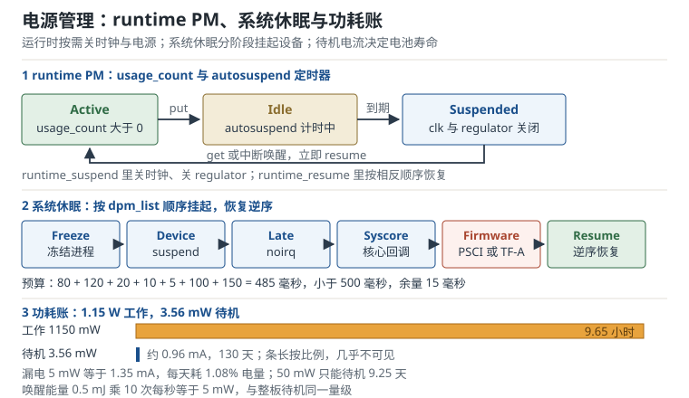

# 电源管理：runtime PM、系统休眠与功耗账

一台电池供电的网关，工作电流 300 mA，待机目标 30 天。电池 3000 mAh、3.7 V，算下来待机平均电流必须低于 4.17 mA，也就是 15.4 mW。板子做完 suspend，万用表显示 3.56 mW，看起来达标；但现场设备装到第 12 天就掉线，因为一个未使用的以太网 PHY 还在耗 20 mW，或者一个浮空的唤醒引脚被噪声触发，每秒唤醒十次，每次 0.2 mJ，等于又多了 2 mW。

电源管理（Power Management）是嵌入式 Linux 里“软件改动最小、收益最大、也最容易被忽略”的一块。它不是一个驱动，而是一套横跨时钟、regulator、电源域、中断和系统休眠的协作机制。理解它，要同时回答三个问题：**设备现在该不该工作、它依赖的时钟和电源现在该不该开、系统睡着时谁负责把它叫醒**。

## 1. 设计动机

功耗不是一个数字，而是一条随负载变化的曲线。产品规格通常给出几个点：工作功耗、待机功耗、关机功耗、唤醒时间。每个点背后都对应一套软件状态：

- **工作**：CPU 全速、DDR 活跃、屏幕亮、无线收发。
- **空闲**：CPU 进 WFI、部分时钟门控、DDR 自刷新。
- **runtime suspend**：单个设备关时钟、关 regulator，系统其余部分继续跑。
- **系统 suspend**：进程冻结、设备挂起、CPU 断电、DDR 自刷新，只留唤醒源。
- **关机**：只有 RTC 和电源键待机。

::: motivation 三个必须算功耗账的场景
**场景一：电池待机 30 天。** 3000 mAh 电池、3.7 V，能量 11.1 Wh；30 天是 720 小时，平均功率必须低于 $11.1/720=15.4$ mW。板子待机 3.56 mW 时理论 130 天，看起来余量很大；但多一个 20 mW 的漏电点，单算就是 $11.1/0.020=555$ 小时，即 23.1 天，叠加 3.56 mW 基线后约 19.6 天。要掉到 5 天，漏电得达到 92.5 mW。**待机功耗是“加法”，不是“平均值”**，每个漏电点都要单独找出来。

**场景二：唤醒时间。** 工业 HMI 要求按键到屏幕亮在 300 ms 内。系统 suspend 越深，功耗越低，但 resume 要重新初始化 DDR、时钟、显示，可能超过 500 ms。省电和唤醒时间是一对矛盾，要用“唤醒能量 + 待机功率差”算盈亏平衡点。

**场景三：热设计。** 一个无风扇盒子，外壳温度不能超过 70 摄氏度。工作功耗 5 W 时结温可能已经 95 摄氏度；把 CPU 从 1.2 GHz 降到 600 MHz、电压从 1.0 V 降到 0.8 V，动态功耗降到 32%，但任务时间翻倍，整机功耗未必等比例下降。DVFS 要按“能量 per task”算，不是只看瞬时功率。
:::

| 你遇到的现象 | 最可能出问题的环节 | 首先检查 |
|---|---|---|
| 设备从不 runtime suspend | usage_count 不平衡 | `pm_runtime_get`/`put` 是否成对、`runtime_status` |
| 设备刚 suspend 就被唤醒 | autosuspend 太短、唤醒源太敏感 | `autosuspend_delay_ms`、`wakeup_count`、中断频率 |
| 系统 suspend 失败 | 设备 busy、回调顺序 | `suspend_stats`、`pm_test`、`dmesg` |
| 待机电流比预期高 | 时钟/regulator 未关、GPIO 漏电 | `clk_summary`、`regulator_summary`、`gpio` |
| 按电源键不能唤醒 | 唤醒源未使能 | `power/wakeup`、`enable_irq_wake`、PMIC 配置 |
| 休眠后外设失效 | resume 顺序、寄存器丢失 | `resume` 回调、`suspend_noirq`、电源域 |
| 电池寿命不达标 | 功耗账漏项 | 分轨测量、占空比、唤醒次数 |

**不懂会在哪摔跤**，具体是这四条：

1. `pm_runtime_get_sync()` 之后忘记 `pm_runtime_put_autosuspend()`，`usage_count` 永远大于零，设备永远不睡；或者反过来，put 多了，设备在使用中被挂起，寄存器访问失败。
2. 在中断上下文调用 `pm_runtime_get_sync()`，它可能睡眠，触发 `scheduling while atomic`；应该用 `pm_runtime_get()` 或 `pm_runtime_get_noresume()`。
3. 只关了设备时钟，忘了关 regulator；或者只关了 regulator，时钟还在翻转，省电效果差一个数量级。
4. 系统 suspend 时设备 `suspend` 回调返回 `-EBUSY`，内核放弃休眠，但用户态只看到“睡不下去”，不知道是哪个设备；不会用 `suspend_stats` 和 `pm_test` 就只能盲猜。

## 2. 定义与直观：从时钟门控到系统休眠

### 2.1 五层电源管理

Linux 的电源管理可以分成五层，越往下越省电，恢复越慢：

| 层次 | 机制 | 省电手段 | 恢复代价 | 典型延迟 |
|---|---|---|---|---|
| 1 | CPU idle | WFI、浅睡 | 立即 | 微秒 |
| 2 | 时钟门控 | 关未用模块时钟 | 开时钟 | 微秒到毫秒 |
| 3 | 电源域 | 关整个 power domain | 重新上电、复位 | 毫秒 |
| 4 | runtime PM | 单设备关时钟/regulator | 重新初始化设备 | 毫秒到几十毫秒 |
| 5 | 系统 suspend | 冻结进程、CPU 断电、DDR 自刷新 | 重新初始化系统 | 几十毫秒到几百毫秒 |

这五层不是互斥的。系统 suspend 的 `suspend` 阶段，PM core 只会调用驱动 `dev_pm_ops` 里的 `.suspend` 回调，不会额外再调一次 runtime 的 `.runtime_suspend`；如果驱动把 `.suspend` 指向 `pm_runtime_force_suspend()`，这个回调会在内部调用 `runtime_suspend`，把系统休眠桥接到 runtime 回调。两套回调必须由驱动显式桥接。resume 时同理，`pm_runtime_force_resume()` 是 `.resume` 回调。

### 2.2 runtime PM：引用计数 + 自动挂起

runtime PM（运行时电源管理）的核心是一个引用计数 `usage_count` 和一个状态机：

```text
usage_count > 0                 usage_count == 0
     Active  ────── put ──────→  Idle
        ↑                         │
        │ get                     │ autosuspend 计时到期
        │                         ↓
        └──── resume ────────  Suspended
```

驱动要做的三件事：

1. 在访问硬件前 `pm_runtime_get_sync(dev)`，确保设备处于 active。
2. 访问结束后 `pm_runtime_mark_last_busy(dev)` + `pm_runtime_put_autosuspend(dev)`，把“最后一次使用时间”记下来并减计数。
3. 在 `runtime_suspend` 回调里关时钟、关 regulator、保存寄存器；在 `runtime_resume` 里按相反顺序恢复。

```c
static int demo_runtime_suspend(struct device *dev)
{
    struct demo *d = dev_get_drvdata(dev);

    clk_disable_unprepare(d->clk);
    regulator_disable(d->vcc);
    return 0;
}

static int demo_runtime_resume(struct device *dev)
{
    struct demo *d = dev_get_drvdata(dev);
    int ret;

    ret = regulator_enable(d->vcc);
    if (ret)
        return ret;
    ret = clk_prepare_enable(d->clk);
    if (ret) {
        regulator_disable(d->vcc);
        return ret;
    }
    return 0;
}

static const struct dev_pm_ops demo_pm_ops = {
    SET_RUNTIME_PM_OPS(demo_runtime_suspend, demo_runtime_resume, NULL)
};

static int demo_probe(struct platform_device *pdev)
{
    pm_runtime_set_autosuspend_delay(&pdev->dev, 200);
    pm_runtime_use_autosuspend(&pdev->dev);
    pm_runtime_set_active(&pdev->dev);
    pm_runtime_enable(&pdev->dev);
    return 0;
}
```

`runtime_resume` 的顺序很重要：先上电（regulator），再开时钟（clk），最后访问寄存器。`runtime_suspend` 反过来：先确认设备空闲，再关时钟，最后关电源。顺序错了会出现“时钟还在翻转但电源已经断”的瞬态电流，或者“电源没上就访问寄存器”的总线错误。

`pm_runtime_get_sync()` 会睡眠，只能在进程上下文调用。中断里要用 `pm_runtime_get()`（只增计数，不等待 resume）或 `pm_runtime_get_noresume()`；如果设备可能已经 suspend，中断里不能直接访问寄存器，应该唤醒工作队列或中断线程去 resume。

`autosuspend`（自动挂起）是为了避免“用一下、睡一下、马上又用”的抖动。`pm_runtime_put_autosuspend()` 不会立即 suspend，而是启动一个延迟定时器；在延迟内再次 `get`，定时器取消，设备保持 active。延迟太短，唤醒次数多、能量浪费；延迟太长，空闲时多耗电。后面用盈亏平衡公式算。

### 2.3 系统 suspend/resume 流程

系统休眠（system suspend）不是“把 CPU 停了”这么简单，它要按顺序冻结整个软件栈：

```text
用户写 /sys/power/state
  → 冻结用户进程与可冻结内核线程（freezer）
  → dpm_prepare：从 dpm_list.next 正序（父→子）调用 device_prepare
  → dpm_suspend：从 dpm_prepared_list.prev 逆序（子→父）调用 device_suspend
  → dpm_suspend_late：late 回调
  → dpm_suspend_noirq：noirq 回调（不能睡眠）
  → pm_sleep_disable_secondary_cpus：关闭非启动 CPU
  → arch_suspend_disable_irqs：关闭本地中断
  → syscore_suspend：核心子系统回调
  → 平台固件进入低功耗（PSCI SYSTEM_SUSPEND / CPU_SUSPEND）
  → 唤醒源触发，固件恢复 CPU 和 DDR
  → syscore_resume
  → 重新打开本地中断、启动非启动 CPU
  → dpm_resume_noirq
  → dpm_resume_early
  → dpm_resume：正序（父→子）调用 resume
  → 解冻进程
```

几个关键点：

- **dpm_list 的顺序**：设备按注册顺序挂在 `dpm_list` 上，子设备通常在父设备之后。`dpm_prepare()` 从 `dpm_list.next` 正序（父→子）调用 `device_prepare`；`dpm_suspend()` 随后从 `dpm_prepared_list.prev` 逆序（子→父）调用 `device_suspend`；resume 时正序（父→子）。prepare 是独立阶段，不属于 `dpm_suspend()`。驱动不应该假设“我的设备一定在某个设备之前挂起”，要用 `device_link` 表达依赖。
- **回调阶段**：`suspend` 可以睡眠；`suspend_late` 在 `suspend` 之后执行，仍可睡眠；`suspend_noirq` 在 `late` 之后执行，不能睡眠。非启动 CPU 和本地中断是在 `noirq` 之后才关闭的，随后进入 `syscore` 阶段，同样不能睡眠。把会睡眠的 I2C 传输放在 `suspend_noirq` 里，必然出问题。
- **失败处理**：任何设备的 `suspend` 返回负值，系统会中止休眠并恢复已经挂起的设备；`suspend_stats` 记录失败阶段和设备。
- **唤醒源**：系统睡着后，只有被标记为 wakeup 的中断能把系统叫醒；普通中断被屏蔽。`enable_irq_wake()` 要在这个阶段之前调用。

`dev_pm_ops` 提供两套回调：runtime 和 system。很多驱动用 `pm_runtime_force_suspend()`/`pm_runtime_force_resume()` 把系统休眠映射到 runtime 回调，避免写两份代码；但要注意 `force_suspend` 会忽略 `usage_count`，如果设备还在使用，可能把正在工作的设备挂起。



### 2.4 时钟框架：prepare 与 enable 两级计数

时钟框架（Common Clock Framework，CCF）用两个计数管理每个时钟：

- `prepare_count`：准备计数，`clk_prepare()` 增加，可能睡眠（比如锁 PLL）。
- `enable_count`：使能计数，`clk_enable()` 增加，通常不能睡眠。

`clk_prepare_enable()` 同时做两件事；`clk_disable_unprepare()` 同时减两个计数。只有两个计数都为 0，时钟才会真正关闭。这个设计的目的是允许“在原子上下文快速 enable/disable”，而把可能睡眠的 PLL 锁定放在 prepare 阶段。

常见错误：

- 只 `clk_enable()` 不 `clk_prepare()`，在需要 prepare 的平台上时钟不会输出。
- `clk_prepare()` 之后忘记 `clk_enable()`，寄存器访问超时。
- enable/disable 不配对，`enable_count` 永远大于 0，时钟永远不关；`clk_summary` 里能看到 `enable_cnt`。
- 在中断里调用 `clk_prepare()`，它可能睡眠；中断里只能用已经 prepare 过的时钟的 `clk_enable()`。

调试：

```bash
cat /sys/kernel/debug/clk/clk_summary
```

输出里有每个时钟的 `enable_cnt`、`prepare_cnt`、`rate`、`parent`。如果某个时钟的计数在系统空闲时仍然大于 0，要么是驱动泄漏，要么是 `CLK_IS_CRITICAL`/`clk_ignore_unused` 把它标记为不可关。

### 2.5 regulator 框架：电压、电流与约束

regulator 框架（电源调节器框架）管理电源轨（LDO、buck、PMIC 输出）。驱动通过 `regulator_get()` 拿到句柄，用 `regulator_enable()`/`regulator_disable()` 控制开关，用 `regulator_set_voltage()` 调电压。

设备树里的约束：

```dts
&i2c1 {
    pmic: pmic@48 {
        compatible = "acme,pmic";
        reg = <0x48>;

        regulators {
            vcc_3v3: buck1 {
                regulator-name = "vcc_3v3";
                regulator-min-microvolt = <3300000>;
                regulator-max-microvolt = <3300000>;
                regulator-always-on;
            };

            vcc_1v8: ldo2 {
                regulator-name = "vcc_1v8";
                regulator-min-microvolt = <1800000>;
                regulator-max-microvolt = <1800000>;
                regulator-off-in-suspend;
            };
        };
    };
};
```

常见属性：

- `regulator-always-on`：系统运行期间不允许关；适合核心电源，但会掩盖漏电。
- `regulator-boot-on`：bootloader 已经打开，内核启动时不要关；适合显示、DDR 等。
- `regulator-off-in-suspend`：系统 suspend 时关闭。
- `regulator-suspend-microvolt`：suspend 时切换到低电压。
- `regulator-allow-bypass`：允许旁路模式（如 LDO 直通）。
- 多路电源需要同时调整时，用 regulator coupling 或驱动显式协调。

`regulator_summary` 能看到每路的使用者、电压、电流、开关状态：

```bash
cat /sys/kernel/debug/regulator/regulator_summary
```

如果一路电源在系统空闲时仍然 `enabled`，先看它的 `users` 是谁；如果是 `regulator-always-on`，再确认是否真的需要。很多“待机功耗高”是 `always-on` 和 `boot-on` 滥用造成的。

### 2.6 唤醒源：谁能把系统叫醒

系统 suspend 后，深睡状态（如 `mem` 的 deep）下 CPU 断电，普通中断不会触发。只有被标记为 wakeup 的中断源（wakeup source，唤醒源）能让 PMIC/SoC 重新上电。唤醒源的软件配置有三步：

1. 设备声明自己能唤醒：`device_init_wakeup(dev, true)`，对应 `dev->power.can_wakeup`。
2. 使能具体中断的唤醒能力：`enable_irq_wake(irq)`，告诉中断控制器这个 IRQ 在 suspend 期间要保持有效。
3. 用户空间允许：`/sys/devices/.../power/wakeup` 写 `enabled`；`device_may_wakeup()` 同时检查 `can_wakeup` 和 `wakeup`。

```c
static int demo_probe(struct platform_device *pdev)
{
    /* 其余资源初始化略；先声明设备具备唤醒能力 */
    device_init_wakeup(&pdev->dev, true);
    return 0;
}

static int demo_suspend(struct device *dev)
{
    struct demo *d = dev_get_drvdata(dev);

    if (device_may_wakeup(dev))
        enable_irq_wake(d->irq);
    return 0;
}

static int demo_resume(struct device *dev)
{
    struct demo *d = dev_get_drvdata(dev);

    if (device_may_wakeup(dev))
        disable_irq_wake(d->irq);
    return 0;
}
```

`enable_irq_wake()` 放在 `suspend` 回调里、`disable_irq_wake()` 放在 `resume` 回调里；不要在 probe 里永久打开，否则唤醒逻辑一直供电，待机电流会抬高。用户空间通过 `/sys/devices/.../power/wakeup` 决定是否允许这个设备唤醒系统。系统回调通过 `SET_SYSTEM_SLEEP_PM_OPS()` 与 runtime 回调一起放进 `dev_pm_ops`。

suspend 期间，唤醒源触发后系统恢复，`resume` 回调重新初始化设备。唤醒事件会被记录在 `/sys/kernel/debug/wakeup_sources`（需要 debugfs），包括唤醒次数、活跃时间、最大延迟。`/sys/power/wakeup_count` 用来避免“刚决定休眠，唤醒事件就来了”的竞态：

```bash
count=$(cat /sys/power/wakeup_count)
echo "$count" > /sys/power/wakeup_count || exit 1
echo mem > /sys/power/state
```

如果两次读到的 `wakeup_count` 不同，说明有唤醒事件发生，内核会拒绝这次 suspend，用户态应该重新决策。这个机制比“先关中断再检查”更可靠。

### 2.7 电源域、OPP 与 DVFS

复杂 SoC 把外设划分成多个 power domain（电源域）。关掉一个 domain 可以同时关掉里面所有设备的电源，比逐个 runtime suspend 更彻底。Linux 用 `genpd`（Generic Power Domain）管理：

- 设备树 `power-domains = <&pd_gpu>` 声明所属域。
- `dev_pm_domain_attach()` 在 probe 时附加。
- domain 的 `power_on`/`power_off` 由 genpd 核心调用，设备驱动不需要直接操作。
- 多个设备共享一个 domain 时，只有最后一个设备 suspend 后 domain 才会关。

OPP（Operating Performance Point）描述“频率—电压”对：

```dts
opp_table {
    compatible = "operating-points-v2";

    opp-1200000000 {
        opp-hz = /bits/ 64 <1200000000>;
        opp-microvolt = <1000000>;
    };

    opp-600000000 {
        opp-hz = /bits/ 64 <600000000>;
        opp-microvolt = <800000>;
    };
};
```

驱动用 `dev_pm_opp_set_rate()` 切换 OPP，内核同时调整时钟频率和 regulator 电压。DVFS（Dynamic Voltage and Frequency Scaling，动态电压频率调节）的收益来自 $P \propto V^2 f$：降频不够，必须同时降压，否则动态功耗下降有限。

### 2.8 功耗测量：从毫瓦到微安

功耗测量分两种：

- **平均功耗**：用高侧采样电阻 + 电流监测芯片（INA219、INA226）或功耗分析仪（Nordic PPK2、Otii、Monsoon），记录一段时间的平均电流。
- **瞬态功耗**：用示波器看采样电阻上的电压波形，捕捉唤醒瞬间的电流尖峰、DVFS 切换的过冲。

平均功耗的账：

$$P_{\mathrm{avg}} = V_{\mathrm{rail}} I_{\mathrm{avg}}$$

电池寿命：

$$t_{\mathrm{run}} = \frac{E_{\mathrm{batt}}}{P_{\mathrm{avg}}} = \frac{C V_{\mathrm{batt}}}{P_{\mathrm{avg}}}$$

其中 $C$ 是电池容量（Ah），$V_{\mathrm{batt}}$ 是标称电压（V）。实际要乘 0.8 左右的 derating，覆盖老化、温度、转换效率。

测待机电流时，量程和分辨率很关键。采样电阻 $R$、ADC 最小电压 $V_{\mathrm{LSB}}$，电流分辨率：

$$I_{\mathrm{LSB}} = \frac{V_{\mathrm{LSB}}}{R}$$

INA219 的 shunt ADC 最小 10 微伏，$R=0.1\ \Omega$ 时分辨率 100 微安；要测 100 微安的待机电流，分辨率不够，得换 1 $\Omega$ 或带 PGA 的芯片。但 $R$ 太大会产生 burden voltage：1 A 时 1 $\Omega$ 上压降 1 V，设备可能掉电。工程上常用“量程切换”或“高侧 + 低侧组合”。

## 3. 定量关系

### 3.1 runtime PM 的平均功耗

设设备 active 功率 $P_a$，suspend 功率 $P_s$，active 占空比 $D$，唤醒频率 $\lambda_w$（次/s），每次唤醒能量 $E_w$（J）：

$$P_{\mathrm{avg}} = P_a D + P_s(1-D) + \lambda_w E_w$$

符号与单位：

- $P_a$、$P_s$：active/suspend 功率，W；
- $D$：active 时间占比，无量纲；
- $\lambda_w$：每秒唤醒次数，次/s；
- $E_w$：每次唤醒的能量，J。

这个式子把“工作、待机、唤醒”三笔账分开。很多驱动只算了前两项，忘了唤醒能量；当 $\lambda_w$ 较高时，第三项会主导。

### 3.2 autosuspend 延迟的盈亏平衡

设 active 与 suspend 的功率差 $\Delta P = P_a - P_s$，唤醒能量 $E_w$。如果设备在延迟 $d$ 内再次被使用，就省掉一次“suspend + resume”的唤醒能量；代价是多保持 active $d$ 秒。盈亏平衡：

$$d_{\mathrm{be}} = \frac{E_w}{P_a - P_s}$$

当 $d < d_{\mathrm{be}}$ 时，多等一会儿省下的唤醒能量大于多耗的 active 能量；当 $d > d_{\mathrm{be}}$ 时，等待不划算。这个公式假设“下一次使用一定在 $d$ 内”，实际要用事件间隔分布做期望；但它给出了延迟的量级。

### 3.3 系统 suspend 的时间预算

系统 suspend 到 resume 的总时间：

$$T_{\mathrm{cycle}} = T_{\mathrm{freeze}} + T_{\mathrm{dev}} + T_{\mathrm{late}} + T_{\mathrm{noirq}} + T_{\mathrm{syscore}} + T_{\mathrm{fw}} + T_{\mathrm{resume}}$$

每一项都要单独测。`T_fw` 是固件进入/退出低功耗的时间，常常是最大的一项；`T_dev` 是所有设备 suspend 回调之和，受 I2C/SPI 慢总线影响。预算要留 10% 到 20% 余量，因为温度、电压、负载都会让时间变长。

### 3.4 电源轨功耗账

每一路电源的功率：

$$P_i = V_i I_i$$

总功率：

$$P_{\mathrm{total}} = \sum_i P_i = \sum_i V_i I_i$$

电池寿命：

$$t = \frac{C V_{\mathrm{batt}} \eta_{\mathrm{derate}}}{P_{\mathrm{total}}}$$

$\eta_{\mathrm{derate}}$ 是 derating 系数，通常 0.8。注意单位：$C$ 用 Ah，$V$ 用 V，$P$ 用 W，$t$ 才是小时。

### 3.5 LDO 与 buck 的效率

LDO（Low Dropout Regulator，低压差线性稳压器）的损耗：

$$P_{\mathrm{loss}} = (V_{\mathrm{in}} - V_{\mathrm{out}}) I_{\mathrm{out}}$$

效率：

$$\eta_{\mathrm{LDO}} = \frac{V_{\mathrm{out}}}{V_{\mathrm{in}}}$$

buck（降压变换器）的效率 $\eta_{\mathrm{buck}}$ 通常在 85% 到 95%，输入功率：

$$P_{\mathrm{in}} = \frac{P_{\mathrm{out}}}{\eta_{\mathrm{buck}}}$$

同样输出 1.8 V、200 mA，从 5 V 降压：LDO 效率 36%，损耗 640 mW；buck 效率 90%，损耗 40 mW。差 600 mW，对电池产品是数量级的差别。

### 3.6 DVFS 的能量 per task

动态功率：

$$P_{\mathrm{dyn}} = \alpha C V^2 f$$

任务时间 $t \propto 1/f$，所以完成同一任务的能量：

$$E_{\mathrm{task}} = P_{\mathrm{dyn}} t \propto V^2$$

降压比降频更有效。但从 1.0 V 降到 0.8 V，频率从 1.2 GHz 降到 600 MHz，功率比：

$$\frac{P_2}{P_1} = \left(\frac{0.8}{1.0}\right)^2 \times \frac{0.6}{1.2} = 0.32$$

任务时间翻倍，能量比：

$$\frac{E_2}{E_1} = 0.32 \times 2 = 0.64$$

省 36%，但延迟翻倍。对延迟敏感的任务，不一定划算；对后台批处理，很划算。

### 3.7 唤醒源漏电

一个浮空的唤醒引脚被噪声触发，频率 $f_w$，每次唤醒能量 $E_w$：

$$P_{\mathrm{spur}} = f_w E_w$$

10 Hz、0.2 mJ 就是 2 mW；100 Hz 就是 20 mW，足以让 130 天的待机掉到 23.1 天，叠加 3.56 mW 基线后约 19.6 天。唤醒源要有硬件消抖、软件去抖和中断计数；调试时看 `/sys/kernel/debug/wakeup_sources` 的唤醒次数，比看电流更快定位。

## 4. 典型算例

下面所有功率、能量与天数都用 Python 复算，电池按标称 3.7 V 计算。

### 4.1 autosuspend 的功耗账

某传感器 active 20 mW，suspend 0.1 mW，每次唤醒 0.5 mJ，事件率 10 次/s，实测 active 占空比 12%。平均功率：

$$P_{\mathrm{avg}} = 20 \times 0.12 + 0.1 \times 0.88 + 10 \times 0.5\times10^{-3}$$

$$P_{\mathrm{avg}} = 2.4 + 0.088 + 5.0 = 7.488\ \mathrm{mW}$$

单次事件能量：

$$\frac{7.488}{10} = 0.7488\ \mathrm{mJ}$$

相比一直 active 的 20 mW，省了 62.6%。但如果把 autosuspend 延迟从 10 ms 加到 50 ms，active 占空比变成 52%：

$$P_{\mathrm{avg}} = 20 \times 0.52 + 0.1 \times 0.48 + 5.0 = 15.448\ \mathrm{mW}$$

几乎回到一直 active 的水平。盈亏平衡延迟：

$$d_{\mathrm{be}} = \frac{0.5\times10^{-3}}{20\times10^{-3} - 0.1\times10^{-3}} = 25.1\ \mathrm{ms}$$

也就是说，如果事件间隔通常小于 25 ms，等 25 ms 再 suspend 是划算的；如果事件间隔是 100 ms，等 50 ms 只会白耗电。autosuspend 延迟要按事件分布设，不是越大越好。

### 4.2 系统 suspend 的时间预算

某板子的 suspend/resume 阶段实测：

| 阶段 | 时间/ms | 说明 |
|---|---:|---|
| freeze | 80 | 冻结进程 |
| device suspend | 120 | 所有设备 `suspend` 回调 |
| late | 20 | `suspend_late` |
| noirq | 10 | `suspend_noirq` |
| syscore | 5 | 核心子系统 |
| firmware | 100 | PSCI 进入/退出低功耗 |
| resume | 150 | 设备 resume + 解冻 |

总时间：

$$T_{\mathrm{cycle}} = 80+120+20+10+5+100+150 = 485\ \mathrm{ms}$$

预算 500 ms，余量 15 ms，只有 3%。如果某个设备 `suspend` 回调从 120 ms 涨到 150 ms，总时间 515 ms，直接超标。这个算例说明：**suspend 预算是所有设备回调之和，不是“平均一个设备多久”**；慢总线设备（I2C 传感器、SPI 屏）要逐个测。

### 4.3 电源轨账与电池寿命

某板子的工作和待机电流：

| 电源轨 | 工作电压/V | 工作电流/mA | 待机电流/mA |
|---|---:|---:|---:|
| 3.3 V | 3.3 | 120 | 0.8 |
| 1.8 V | 1.8 | 80 | 0.2 |
| 1.2 V | 1.2 | 300 | 0.05 |
| 5 V | 5.0 | 50 | 0.1 |

工作总功率：

$$P_{\mathrm{active}} = 3.3\times120 + 1.8\times80 + 1.2\times300 + 5.0\times50$$

$$P_{\mathrm{active}} = 396 + 144 + 360 + 250 = 1150\ \mathrm{mW}$$

电池 3000 mAh、3.7 V：

$$E_{\mathrm{batt}} = 3.0 \times 3.7 = 11.1\ \mathrm{Wh}$$

工作时间：

$$t_{\mathrm{active}} = \frac{11.1}{1.15} = 9.65\ \mathrm{h}$$

按 80% derating：

$$t_{\mathrm{active,80\%}} = \frac{11.1\times0.8}{1.15} = 7.72\ \mathrm{h}$$

待机总功率：

$$P_{\mathrm{suspend}} = 3.3\times0.8 + 1.8\times0.2 + 1.2\times0.05 + 5.0\times0.1$$

$$P_{\mathrm{suspend}} = 2.64 + 0.36 + 0.06 + 0.50 = 3.56\ \mathrm{mW}$$

待机电流：

$$I_{\mathrm{suspend}} = \frac{3.56}{3.7} = 0.96\ \mathrm{mA}$$

待机时间：

$$t_{\mathrm{suspend}} = \frac{11.1}{3.56\times10^{-3}} = 3118\ \mathrm{h} = 129.9\ \mathrm{days}$$

30 天目标需要平均功率低于：

$$P_{30} = \frac{11.1\times1000}{30\times24} = 15.4\ \mathrm{mW}$$

当前 3.56 mW，余量 11.84 mW。但只要多一个 50 mW 的漏电点，待机就掉到：

$$t = \frac{11.1}{0.050} = 222\ \mathrm{h} = 9.25\ \mathrm{days}$$

这就是为什么待机功耗要按“加法”逐项查，而不是看一个总数。

### 4.4 LDO 换成 buck 的收益

5 V 转 1.8 V、200 mA：

LDO 损耗：

$$P_{\mathrm{loss}} = (5.0-1.8)\times0.2 = 640\ \mathrm{mW}$$

效率：

$$\eta_{\mathrm{LDO}} = \frac{1.8}{5.0} = 36\%$$

输入功率 1000 mW。buck 效率 90%：

$$P_{\mathrm{in}} = \frac{1.8\times0.2}{0.9} = 400\ \mathrm{mW}$$

损耗 40 mW，省 600 mW。若这块 1.8 V 轨是整机主要负载，其他部分耗 500 mW，则 LDO 方案整机 1000 + 500 = 1500 mW、buck 方案 400 + 500 = 900 mW：

$$t_{\mathrm{LDO}} = \frac{11.1}{1.5} = 7.40\ \mathrm{h},\qquad t_{\mathrm{buck}} = \frac{11.1}{0.9} = 12.33\ \mathrm{h}$$

整机从 1500 mW 降到 900 mW，电池时间从 7.40 h 延长到 12.33 h；这比在软件里抠几毫安有效得多。当然，buck 有开关噪声、需要电感，成本和 PCB 面积要权衡。

### 4.5 DVFS 的能量账

1.2 GHz、1.0 V 降到 600 MHz、0.8 V：

$$P_2/P_1 = (0.8/1.0)^2 \times (600/1200) = 0.32$$

任务时间翻倍，能量比 0.64，省 36%。如果只降频不降压（1.0 V 不变）：

$$P_2/P_1 = 0.5,\qquad E_2/E_1 = 0.5\times2 = 1.0$$

能量不变，只是把同样的工作拖得更久。**只降频不降压，省不了能量**；这是 DVFS 最常见的误解。

### 4.6 虚假唤醒的代价

一个浮空唤醒引脚被噪声触发，10 Hz，每次 0.2 mJ：

$$P_{\mathrm{spur}} = 10 \times 0.2\times10^{-3} = 2\ \mathrm{mW}$$

占待机 3.56 mW 的 56%。如果频率 100 Hz：

$$P_{\mathrm{spur}} = 100 \times 0.2\times10^{-3} = 20\ \mathrm{mW}$$

待机时间从 130 天掉到（按 20 mW 单独计算）：

$$t = \frac{11.1}{0.020} = 555\ \mathrm{h} = 23.1\ \mathrm{days}$$

叠加 3.56 mW 基线后为 $11.1/(0.020+0.00356)=471$ 小时，即 19.6 天。一个引脚配置错误，就能让 30 天目标直接失守。唤醒源要有上拉/下拉、RC 滤波、软件去抖；调试时先看 `/sys/kernel/debug/wakeup_sources` 的计数，再看电流。

### 4.7 测量分辨率

INA219 的 shunt ADC 最小电压 10 微伏，采样电阻 0.1 欧姆：

$$I_{\mathrm{LSB}} = \frac{10\times10^{-6}}{0.1} = 100\ \mu A$$

测 3.56 mW、3.7 V 的待机电流（0.96 mA），分辨率 100 微安，只有 10 个 LSB，误差偏大。换 1 欧姆：

$$I_{\mathrm{LSB}} = \frac{10\times10^{-6}}{1} = 10\ \mu A$$

分辨率够了，但 1 A 时 burden voltage 1 V，设备可能掉电。实际产品用“高侧 0.1 欧姆测工作、低侧 10 欧姆测待机”的量程切换，或者用带 PGA 的专用功耗分析仪。测量待机电流时，还要等系统进入稳定 suspend 后再读数，避免把 resume 的瞬态算进去。

## 5. 工程含义

### 5.1 runtime PM 的引用计数纪律

- 每次 `pm_runtime_get_sync()` 必须对应一次 `pm_runtime_put_autosuspend()` 或 `pm_runtime_put()`；错误路径也要 put。
- 在 probe 里 `pm_runtime_enable()`，在 remove 里 `pm_runtime_disable()`；disable 之前先确保设备已经 resume，否则后续寄存器访问会失败。
- `pm_runtime_get_sync()` 可能睡眠，不能在中断、软中断、自旋锁临界区调用；中断里用 `pm_runtime_get()`。
- `pm_runtime_set_active()` 用于“设备当前已经是 active，但 runtime PM 还不知道”的场景，通常在 probe 里、enable 之前调用。
- `pm_runtime_force_suspend()`/`force_resume()` 只适合“系统休眠时设备一定空闲”的场景；如果设备还在使用，会破坏状态。
- 用 `pm_runtime_status_suspended()` 判断状态，不要自己维护一个布尔变量。

### 5.2 系统休眠回调的分工

| 回调 | 阶段 | 能否睡眠 | 典型工作 |
|---|---|---|---|
| `prepare` | 冻结进程后 | 是 | 检查是否允许休眠、准备缓冲 |
| `suspend` | `prepare` 之后 | 是 | 保存寄存器、关时钟、关电源 |
| `suspend_late` | `suspend` 之后 | 是 | late 阶段的设备清理 |
| `suspend_noirq` | `late` 之后 | 否 | 保存最后状态、编程唤醒源 |
| `resume_noirq` | 恢复中断和非启动 CPU 后 | 否 | 恢复硬件、清唤醒状态 |
| `resume_early` | `resume_noirq` 之后 | 是 | 恢复时钟/电源 |
| `resume` | `resume_early` 之后 | 是 | 重新初始化设备 |
| `complete` | 解冻进程前 | 是 | 收尾、通知 |

会睡眠的 I2C/SPI 传输只能放在 `suspend`、`suspend_late`、`resume`、`resume_early`；`noirq` 阶段只能用 MMIO 和不会睡眠的寄存器操作。把 `regulator_set_voltage()` 放在 `suspend_noirq` 里，会触发 `scheduling while atomic`。

### 5.3 时钟与 regulator 的关断顺序

上电：

1. regulator 上电，等电压稳定（可能需要延时）。
2. 开时钟。
3. 释放复位。
4. 访问寄存器。

下电：

1. 确认设备空闲、DMA 停止。
2. 关时钟。
3. 拉复位。
4. 关 regulator。

顺序反了会出现瞬态大电流、总线错误或寄存器丢失。很多 SoC 要求“时钟先于电源关闭”，否则内部逻辑在无时钟状态下上电，可能锁死。

### 5.4 唤醒源的设计

- 只把真正需要唤醒系统的中断标记为 wakeup；普通数据中断不应唤醒，否则待机被频繁打断。
- 唤醒源要有硬件消抖和软件确认；按键、霍尔、加速度计都是“毛刺大户”。
- `enable_irq_wake()` 要与 `disable_irq_wake()` 配对；suspend 前使能，resume 后按需关闭。
- 共享中断线上有多个设备时，要确认唤醒源能区分是哪个设备触发的；否则会“唤醒了但不知道谁”。
- 用 `wakeup_count` 避免“刚决定休眠就来事件”的竞态。
- 记录唤醒原因：`/sys/kernel/debug/wakeup_sources`、PMIC 的 wakeup reason 寄存器、`dmesg` 里的 resume 日志。

### 5.5 功耗测量与漏电定位

测量步骤：

1. 用稳压电源给板子供电，串入高侧采样电阻，先用大量程测工作电流。
2. 系统进入稳定工作状态，记录平均电流和峰值。
3. 触发 runtime suspend，等 autosuspend 延迟过去，记录单设备电流差。
4. 进入系统 suspend，等 30 秒以上，记录待机电流；注意排除 RTC、充电、LED 等。
5. 逐路断开电源轨（或读 `regulator_summary` + 电流探头），找漏电点。
6. 用热像仪找发热器件，尤其是未使用的 PHY、LDO、DDR 终端电阻。

常见漏电点：

- 未使用的以太网 PHY、USB PHY 没有关时钟/电源。
- GPIO 浮空，输入缓冲来回翻转；或外部上拉在输出低时持续灌电流。
- SD 卡检测引脚、调试串口、JTAG 没有关。
- `regulator-always-on` 把该关的电源锁死。
- 时钟没有 gate，模块处于空闲但时钟仍在翻转。
- 唤醒源配置错误，系统睡了又醒。
- DDR 没有进入自刷新，或自刷新模式配置错。

### 5.6 调试命令

```bash
# 查看睡眠状态和支持的 mem sleep 模式
cat /sys/power/state
cat /sys/power/mem_sleep

# 查看 suspend 统计
cat /sys/kernel/debug/suspend_stats

# 打开 PM 调试日志
echo 1 > /sys/power/pm_debug_messages
dmesg | grep -i "PM:"

# 用 pm_test 逐阶段测试（不会真正断电）
echo devices > /sys/power/pm_test
echo mem > /sys/power/state
echo none > /sys/power/pm_test

# 查看时钟和 regulator 状态
cat /sys/kernel/debug/clk/clk_summary
cat /sys/kernel/debug/regulator/regulator_summary

# 查看唤醒源
cat /sys/kernel/debug/wakeup_sources

# 定时唤醒测试
rtcwake -m mem -s 10
```

`pm_test` 的取值包括 `freezer`、`devices`、`platform`、`processors`、`core`、`none`。它让系统在指定阶段后自动 resume，用来判断“睡不下去”是冻结、设备回调还是平台固件的问题。`suspend_stats` 会记录 `failed_freeze`、`failed_prepare`、`failed_suspend`、`failed_suspend_late`、`failed_suspend_noirq`、`failed_resume` 等计数，先看哪个阶段失败，再看 `dmesg`。

### 5.7 suspend 失败的排查顺序

1. `cat /sys/kernel/debug/suspend_stats`：看失败阶段和计数。
2. `dmesg | grep -i "PM:"`：看最后一个成功/失败的设备。
3. `echo devices > /sys/power/pm_test`：只测设备回调，排除固件问题。
4. `echo freezer > /sys/power/pm_test`：只测冻结，排除用户进程。
5. 打开 `initcall_debug`，看每个设备 `suspend`/`resume` 的耗时和返回值。
6. 用 `pm-graph` 的 `sleepgraph.py` 生成时序图，定位慢设备和顺序问题。
7. 检查 `wakeup_count` 是否被唤醒事件改变；检查是否有设备 `-EBUSY`。

### 5.8 生产验证

- 高低温、高低压、电池满/空都要测待机电流；温度会影响漏电和 regulator 效率。
- 连续 suspend/resume 循环 1000 次，检查是否有资源泄漏、时钟计数漂移、唤醒源失效。
- 用 `suspend_stats` 和生产日志记录失败率；不要只看一次成功。
- 用 `rtcwake` 做定时唤醒老化测试，模拟真实待机。
- 用功耗分析仪记录整机电流曲线，确认没有周期性尖峰。

## 6. 常见坑

::: pitfall 坑一：runtime PM 计数不平衡
**现象**：设备 `runtime_status` 永远是 `active`，`/sys/kernel/debug/clk/clk_summary` 里时钟 `enable_cnt` 一直大于 0；或者设备在使用中被挂起，寄存器读写返回错误。

**原因**：`pm_runtime_get_sync()` 后错误路径直接 return，没有 put；或者 put 次数多于 get，`usage_count` 下溢，设备被提前 suspend。

**解决**：用 `goto` 统一错误路径，确保每个 get 都有 put；用 `pm_runtime_get_noresume()` 只增计数、不 resume 的场景要手动配对；用 `pm_runtime_status_suspended()` 和 `clk_summary` 验证；在 remove 里 `pm_runtime_disable()` 前先 resume。
:::

::: pitfall 坑二：在中断里调用会睡眠的 PM 接口
**现象**：`BUG: sleeping function called from invalid context`，调用栈落在 `pm_runtime_get_sync`、`regulator_set_voltage`、`clk_prepare`；系统偶发死锁。

**原因**：中断上下文用 `pm_runtime_get_sync()`，它会等待 resume 完成并可能睡眠；或者用 `regulator_enable()` 的慢路径、`clk_prepare()` 的 PLL 锁定。

**解决**：中断里只用 `pm_runtime_get()`（不等待）或 `pm_runtime_get_noresume()`，把真正的 resume 放到工作队列/线程化中断；时钟在 probe 阶段 prepare，中断里只 `clk_enable()`；regulator 在 runtime resume 里开关，中断里不直接操作。
:::

::: pitfall 坑三：时钟 enable/disable 不配对
**现象**：系统空闲时功耗比预期高几十毫瓦；`clk_summary` 里某个时钟 `enable_cnt` 一直是 1；设备 remove 后时钟仍然开着。

**原因**：`clk_prepare_enable()` 后错误路径没有 `clk_disable_unprepare()`；或者多处代码各自 enable，导致计数叠加；或者 `CLK_IS_CRITICAL`/`clk_ignore_unused` 让内核不敢关。

**解决**：用 `devm_clk_get_enabled()` 让 devres 管理生命周期；错误路径统一 `clk_disable_unprepare()`；用 `clk_summary` 找到持有者；确认 `CLK_IS_CRITICAL` 是否真的必要。
:::

::: pitfall 坑四：regulator always-on / boot-on 滥用
**现象**：系统 suspend 后某路电源仍然有电压，待机电流高出几毫安；`regulator_summary` 显示 `always-on` 或 `boot-on`。

**原因**：设备树为了“保险”给电源加了 `regulator-always-on`，或者 bootloader 开了电、内核用 `regulator-boot-on` 保持；驱动没有在 suspend 里关。

**解决**：只给真正不能关的核心电源加 `always-on`；外设电源用 `regulator-off-in-suspend` 或驱动在 `runtime_suspend` 里 `regulator_disable()`；用 `regulator_summary` 的 `users` 字段找持有者；测量每一路待机电压。
:::

::: pitfall 坑五：唤醒源没使能或太敏感
**现象**：按电源键不能唤醒；或者系统刚 suspend 就立刻 resume，日志里没有明显错误；`wakeup_sources` 的计数飞快增长。

**原因**：`device_init_wakeup()` 没有调用、`enable_irq_wake()` 没有配对、`/sys/devices/.../power/wakeup` 是 `disabled`；或者唤醒引脚浮空、上拉/下拉错误、没有消抖，噪声触发中断。

**解决**：确认 `can_wakeup`、`wakeup`、`enable_irq_wake` 三层都打开；用 `wakeup_count` 观察是否有事件；给唤醒引脚加硬件 RC 滤波和软件去抖；只把真正需要唤醒的中断标记为 wakeup。
:::

::: pitfall 坑六：在 suspend_noirq 里睡眠
**现象**：系统 suspend 到一半卡住，`dmesg` 出现 `BUG: sleeping function called from invalid context`；或者 resume 后设备不工作。

**原因**：`suspend_noirq` 阶段中断已关闭，不能睡眠；驱动在里面调用 I2C/SPI 传输、`regulator_set_voltage()`、`clk_prepare()` 或 `msleep()`。

**解决**：把会睡眠的操作移到 `suspend`/`suspend_late`；`noirq` 阶段只做 MMIO 和不会睡眠的寄存器保存；用 `pm_test` 的 `devices`/`platform` 分段验证；用 `CONFIG_DEBUG_ATOMIC_SLEEP` 抓。
:::

::: pitfall 坑七：autosuspend 太短导致唤醒抖动
**现象**：设备频繁 suspend/resume，`dmesg` 里状态切换日志刷屏；功耗反而比不 suspend 还高；`wakeup_sources` 的活跃时间占比很高。

**原因**：`autosuspend_delay_ms` 设得太小（如 0 或 10 ms），设备刚 suspend 就被下一次访问唤醒；每次唤醒的能量（PLL 锁定、regulator 建立、寄存器恢复）超过省下的待机能量。

**解决**：按事件间隔分布设延迟，用盈亏平衡公式 $d_{\mathrm{be}} = E_w/(P_a-P_s)$ 估算；用 `pm_runtime_mark_last_busy()` 更新最后使用时间；对突发访问用批量处理或保持 active 一段时间；测 suspend/resume 次数和平均功耗验证。
:::

## 7. 自测题

<details><summary>题一：设备 active 30 mW，suspend 0.2 mW，每次唤醒 0.8 mJ，事件率 5 次/s，active 占空比 20%。求平均功率和单次事件能量；若把延迟加大到 active 占空比 40%，平均功率变成多少？</summary>

平均功率：

$$P_{\mathrm{avg}} = 30\times0.2 + 0.2\times0.8 + 5\times0.8\times10^{-3}$$

$$P_{\mathrm{avg}} = 6 + 0.16 + 4 = 10.16\ \mathrm{mW}$$

单次事件能量：

$$\frac{10.16}{5} = 2.032\ \mathrm{mJ}$$

占空比 40%：

$$P_{\mathrm{avg}} = 30\times0.4 + 0.2\times0.6 + 4 = 12 + 0.12 + 4 = 16.12\ \mathrm{mW}$$

延迟加大后，待机省下的 0.12 mW 远小于多 active 的 6 mW，不划算。盈亏平衡延迟：

$$d_{\mathrm{be}} = \frac{0.8\times10^{-3}}{30\times10^{-3}-0.2\times10^{-3}} = 26.8\ \mathrm{ms}$$

如果事件间隔通常小于 26.8 ms，等待才划算；否则应立即 suspend。

</details>

<details><summary>题二：系统 suspend 各阶段为 freeze 60 ms、device 140 ms、late 15 ms、noirq 8 ms、syscore 4 ms、firmware 90 ms、resume 130 ms。总时间多少？预算 450 ms 是否达标？若 device 增加 40 ms，余量多少？</summary>

总时间：

$$T = 60+140+15+8+4+90+130 = 447\ \mathrm{ms}$$

预算 450 ms，余量 3 ms，只有 0.7%，非常危险。device 增加 40 ms 后：

$$T = 447+40 = 487\ \mathrm{ms}$$

超预算 37 ms，不达标。应优先压缩 device 和 firmware：device 140 ms 说明有慢总线设备（I2C/SPI）在 suspend 里做长传输；firmware 90 ms 是平台进入/退出低功耗的固定开销，换更浅的睡眠状态可以缩短，但待机功耗会上升。

</details>

<details><summary>题三：3.3 V/100 mA、1.8 V/60 mA、1.2 V/250 mA 三路工作，待机电流分别为 0.5 mA、0.15 mA、0.04 mA。电池 2500 mAh、3.7 V。求工作/待机功率、工作时间和待机天数；30 天目标是否达标？</summary>

工作功率：

$$P_{\mathrm{active}} = 3.3\times100 + 1.8\times60 + 1.2\times250 = 330 + 108 + 300 = 738\ \mathrm{mW}$$

电池能量：

$$E = 2.5\times3.7 = 9.25\ \mathrm{Wh}$$

工作时间：

$$t_{\mathrm{active}} = \frac{9.25}{0.738} = 12.53\ \mathrm{h}$$

待机功率：

$$P_{\mathrm{suspend}} = 3.3\times0.5 + 1.8\times0.15 + 1.2\times0.04 = 1.65 + 0.27 + 0.048 = 1.968\ \mathrm{mW}$$

待机天数：

$$t_{\mathrm{suspend}} = \frac{9.25}{1.968\times10^{-3}\times24} = 195.9\ \mathrm{days}$$

30 天目标需要 $9.25\times1000/(30\times24)=12.85$ mW；当前 1.97 mW，余量 10.88 mW，达标。但这是理想值，实际要加 derating 和漏电点；如果多一个 10 mW 的漏电，待机降到约 32.2 天，已经贴近 30 天目标，几乎没有余量。

</details>

<details><summary>题四：5 V 转 1.8 V、300 mA，LDO 与 90% 效率的 buck 各损耗多少？若整机其他部分耗 500 mW，换 buck 后电池 11.1 Wh 的工作时间各是多少？</summary>

LDO 损耗：

$$P_{\mathrm{loss}} = (5.0-1.8)\times0.3 = 960\ \mathrm{mW}$$

LDO 输入功率 1500 mW，效率 $1.8/5=36\%$。整机：

$$P_{\mathrm{total}} = 500 + 1500 = 2000\ \mathrm{mW}$$

工作时间：

$$t = \frac{11.1}{2.0} = 5.55\ \mathrm{h}$$

buck 输入：

$$P_{\mathrm{in}} = \frac{1.8\times0.3}{0.9} = 600\ \mathrm{mW}$$

损耗 60 mW。整机：

$$P_{\mathrm{total}} = 500 + 600 = 1100\ \mathrm{mW}$$

工作时间：

$$t = \frac{11.1}{1.1} = 10.09\ \mathrm{h}$$

换 buck 后工作时间接近翻倍。注意 buck 的 90% 是典型值，轻载时效率会下降；如果 300 mA 是峰值、平时只有 10 mA，要选低静态电流的 buck，否则轻载效率可能不如 LDO。

</details>

## 8. 参考资料

- Linux 内核文档 `Documentation/power/runtime_pm.rst`：runtime PM 的 `usage_count`、autosuspend 与回调约定。
- Linux 内核文档 `Documentation/power/devices.rst`：系统休眠的设备挂起顺序、`dpm_list` 与 `dev_pm_ops`。
- Linux 内核文档 `Documentation/power/suspend-and-resume.rst`：suspend/resume 阶段、唤醒源与调试方法。
- Linux 内核文档 `Documentation/driver-api/pm/devices.rst`：设备电源管理回调与系统休眠阶段。
- Linux 内核文档 `Documentation/admin-guide/pm/sleep-states.rst`：`freeze`、`mem`、`disk` 等睡眠状态。
- Linux 内核文档 `Documentation/power/regulator/regulator.rst`：regulator 获取、使能、电压与约束。
- Linux 内核文档 `Documentation/driver-api/clk.rst`：时钟 prepare/enable 计数与时钟树。
- Linux 内核源码 `drivers/base/power/runtime.c`、`drivers/base/power/main.c`：runtime PM 状态机与 `dpm_list` 遍历。
- Linux 内核源码 `drivers/regulator/core.c`、`drivers/clk/clk.c`：regulator 与 clock 的引用计数和约束。
- Linux 内核源码 `kernel/power/suspend.c`、`kernel/power/main.c`：suspend 入口、`wakeup_count` 与 `suspend_stats`。
- Linux Device Drivers, 3rd Edition（Corbet, Rubini, Kroah-Hartman, O'Reilly, 2005）：Power Management 相关内容。
