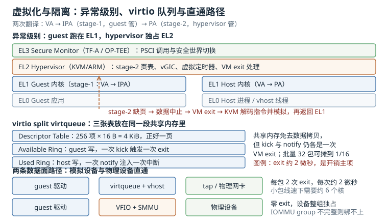

# 虚拟化与隔离：KVM/ARM、virtio、设备直通与实时性

同一颗 SoC 上跑两个系统，在嵌入式里已经不是新闻：一边是负责实时控制的 RTOS 或 PREEMPT_RT 内核，另一边是带图形界面和网络栈的通用 Linux；或者一边是不可信的应用沙箱，另一边是持有密钥的安全域。虚拟化（Virtualization）提供的是**硬件强制的边界**：客户机（Guest）的代码即使拿到自己内核的 root，也碰不到宿主机的内存。

代价是三类开销：**退出的次数、内存的搬运、中断的绕路**。这三项都能算，而且算出来的结论常常与直觉相反——1 Gbit/s 的小包线速，用最朴素的 virtio 配置需要近 6 个 CPU 核才能撑住，而一块四核的网关板根本没有这么多余量。

## 1. 动机：隔离不是免费的，也不是随便配的

虚拟化在嵌入式里的典型动机有四个：

| 动机 | 具体形态 | 关键约束 |
|---|---|---|
| 实时与通用共存 | 一个核跑 RTOS 管电机，其余跑 Linux | 中断延迟必须在微秒级 |
| 安全域隔离 | 密钥运算在独立 guest，业务在另一 guest | 内存与设备必须硬隔离 |
| 负载合并 | 多个历史遗留系统跑在一台新硬件上 | 启动时间、镜像体积 |
| 开发与测试 | 在板子上跑 CI 与被测系统 | 快照、回滚、可重复 |

反过来说，不该上虚拟化的信号也很明确：只有一个系统、对延迟极敏感、板子 RAM 小于 512 MB、或者团队没人能看懂 `dmesg` 里的 KVM 日志。此时容器（Container）往往更合适——它隔离的是视图与资源，不是内核。

现场最常见的问题不是"虚拟化性能不够"，而是"虚拟机里设备不工作"：

| 现象 | 大概率原因 | 先查什么 |
|---|---|---|
| guest 里 `lspci` 完全看不到设备 | 命令行没加 `-device vfio-pci`，或 host 没绑到 `vfio-pci` | QEMU 参数、`/sys/bus/pci/devices/*/driver` |
| 设备出现但 probe 失败 | MSI 中断没通、寄存器窗口没映射 | guest `dmesg`、`/proc/interrupts`、BAR 映射 |
| 网卡能收不能发 | 队列通知没生效、后端没起来 | `ip -s link`、vhost 线程、tap 状态 |
| 一跑大数据量就复位 | IOMMU 没开，DMA 越界写坏内存 | `dmesg` 里的 SMMU fault、`iommu=` 参数 |
| 时间越跑越偏 | 虚拟定时器偏移没设，或没启用半虚拟化时钟 | `clocksource`、`dmesg` 里的 clocksource 选择 |
| 实时任务周期抖动大 | vCPU 被 host 调度抢占、中断全落在一个核 | vCPU 亲和、`isolcpus`、中断亲和 |

::: motivation 直通了网卡，guest 里什么都没有
某网关把一颗 PCIe 网卡直通给 guest，QEMU 命令行写了 `-device vfio-pci,host=01:00.0`，启动后 guest 里 `lspci` 只有 virtio 设备，没有网卡。

第一步查 host：设备确实绑到了 `vfio-pci`，`/dev/vfio/12` 也存在。第二步查 QEMU 日志，发现一行

```
vfio: failed to set iommu for container: Operation not permitted
```

原因不在 QEMU：这块板的内核启动参数里没有 `iommu=on`，SMMU 驱动没有接管设备，VFIO 无法建立 DMA 重映射，于是拒绝把设备交给 guest。

改启动参数、确认 `/sys/class/iommu/` 下出现 SMMU 实例后，同一个命令行一次点亮。

**整个过程里 QEMU 的参数、guest 的内核配置、设备本身都是对的**，错的只是"host 从来没有打开 IOMMU"这个前提。
:::

这个例子的教训是：**直通的失败几乎总在 host 侧，而症状总在 guest 侧**。排查必须从 host 的 IOMMU 状态开始，而不是从 guest 的驱动开始。

## 2. 直观：EL2 上的一层，和一条共享内存的队列



上图上半是四个异常级别与两次地址翻译，中间是 virtio 的分离式虚拟队列，下半是"模拟设备"与"物理设备直通"两条数据面路径。

### 2.1 四个异常级别与两次地址翻译

ARMv8-A 把特权分成四个异常级别（Exception Level，EL）：

| 级别 | 典型内容 | 关键作用 |
|---|---|---|
| EL0 | 用户态应用 | 无特权 |
| EL1 | guest 内核与 host 内核 | 各自维护自己的页表 |
| EL2 | hypervisor（KVM/ARM） | 控制 stage-2 翻译、vGIC、虚拟定时器 |
| EL3 | 安全监控（TF-A BL31） | PSCI 调用与安全世界切换 |

安全世界要单独看：OP-TEE OS 运行在 **S-EL1**（安全世界的 EL1），并不在 EL3；TF-A 的 BL31 才是 EL3 上的安全监控运行时。

关键在于**地址翻译分成两段**。guest 内核的页表把虚拟地址（VA）翻译成中间物理地址（IPA，Intermediate Physical Address）；hypervisor 的 stage-2 页表再把 IPA 翻译成真正的物理地址（PA）。guest 以为自己管着整块内存，其实它看到的 IPA 空间由 EL2 决定映射到哪里。

这个设计的工程含义有三条：

1. **guest 无法越界**。它改自己的页表只能改 VA 到 IPA，IPA 到 PA 的映射在 EL2 手里。
2. **MMIO 可以被拦截**。guest 访问一个没有映射的 IPA 会触发 stage-2 缺页，CPU 陷入 EL2，KVM 读指令、判断是读还是写、模拟设备行为，再把结果写回虚拟寄存器。这就是一次虚拟机退出（VM Exit）。
3. **DMA 不受 stage-2 保护**。设备发起的是物理地址访问，它绕过 stage-2。要保护就必须靠 IOMMU，这也是直通必须开 IOMMU 的根本原因。

### 2.2 一次 VM exit 的代价

VM exit 不是一次函数调用，而是一次完整的上下文切换：

```text
guest 执行 load/store
  → stage-2 缺页，CPU 陷入 EL2
  → 保存 guest 的通用寄存器与系统寄存器（部分由硬件完成）
  → KVM 读取 ESR_EL2 判断退出原因
  → 若为 MMIO：读指令编码，确定宽度与目标寄存器
  → 调用设备模型（QEMU 或内核内模拟器）
  → 写回目标寄存器，eret 返回 EL1
```

一次完整的 MMIO 退出在 ARM 服务器上大约 1 到 3 微秒，在低端嵌入式 SoC 上可能到 5 微秒以上。这个数字是后面所有估算的基石：**它不是常数，而是随 SoC 主频、cache 状态、KVM 版本变化的量级**。

减少退出的手段有三类：

- **批量化**：一次通知处理多个包，把退出次数摊薄。
- **绕过**：`ioeventfd` 让 guest 的 notify 写直接唤醒后端线程而不退出；`irqfd` 让后端直接向 guest 注入中断。
- **卸载**：`vhost` 把 virtqueue 的处理从 QEMU 用户态搬到 host 内核线程；`vhost-user` 搬到独立的用户态进程（如 DPDK、OVS）。

### 2.3 virtio：共享内存加两次通知

virtio 是半虚拟化（Paravirtualization）I/O 的事实标准。它不模拟真实硬件寄存器，而是定义一套"guest 与后端都认得的"数据结构：

| 结构 | 谁写 | 内容 |
|---|---|---|
| Descriptor Table | guest 分配，双方读 | 每项 16 字节：地址、长度、标志、下一个描述符 |
| Available Ring | guest 写 | "这些描述符可以用了"，带序号 |
| Used Ring | 后端写 | "这些已经处理完"，带已写字节数 |

guest 把数据缓冲区地址填进描述符，把描述符索引写进 available ring，然后写一次 notify 寄存器。这一次写会触发 VM exit（除非用了 `ioeventfd`）。后端处理完，把索引写进 used ring，再注入一次中断（除非用了 `irqfd`）。

所以**一次数据往返最少两次退出**：一次 kick、一次 notify。共享内存省掉的是数据拷贝，不是退出。这是 virtio 性能模型里最容易被误解的一点。

队列深度也会影响行为。256 个描述符 × 16 字节 = 4 KiB，正好一页；这个"刚好一页"不是巧合，而是规范设计时的对齐考虑。队列太浅，突发流量时容易空转；太深，缓存局部性变差。

### 2.4 设备直通与 IOMMU

直通（Passthrough）把物理设备整个交给 guest，guest 用原生驱动直接操作寄存器，数据面零退出。

代价有三个：

1. **设备被独占**，host 不能再使用它。
2. **必须开 IOMMU**。设备发起 DMA 时用的是 guest 给的地址，IOMMU 负责把它翻译并限制在这个 guest 的地址空间内。没有 IOMMU，一个恶意的 guest 可以让设备 DMA 到 host 任意内存。
3. **IOMMU group 必须整体绑定**。同一 group 内的设备共享翻译上下文，只要组内有一个设备还挂在 host 驱动上，整组都绑不了 VFIO。这就是"驱动已经解绑了，还是报 device busy"的常见原因。

ARM 上的 IOMMU 通常叫 SMMU（System Memory Management Unit）。它按设备标识（StreamID，来自设备树的 `iommus` 属性或 PCIe 的 Requester ID）选择翻译表。中断侧，MSI 通过 ITS（Interrupt Translation Service）把消息地址翻译成 LPI 中断号。

### 2.5 容器与虚拟机的边界

| 维度 | 虚拟机 | 容器 |
|---|---|---|
| 隔离对象 | 整个内核与硬件视图 | 进程视图与资源配额 |
| 隔离机制 | EL2 + stage-2 + IOMMU | namespace + cgroup + seccomp |
| 内核共享 | 否，各跑各的 | 是，共用 host 内核 |
| 内核漏洞影响 | 需先突破 hypervisor | 直接获得 host 内核攻击面 |
| 启动时间 | 秒级 | 百毫秒级 |
| 内存开销 | 数百 MB 起 | 数 MB 起 |
| 设备访问 | 模拟或直通 | 直接看到 host 设备节点 |

结论很直接：**容器隔离的是"看到什么"，虚拟机隔离的是"能碰到什么"**。安全域、异构 OS、需要独立内核版本的场景用虚拟机；单纯的应用打包、资源限额、快速部署用容器。两者可以叠加：容器跑在 guest 里，由虚拟机提供硬边界。

## 3. 定量：虚拟化开销的四个来源

### 3.1 退出与通知

设每秒处理 $N$ 个数据单元（包、块请求、帧），每个单元平均触发 $n_{\text{exit}}$ 次退出，每次退出耗时 $t_{\text{exit}}$，则退出占用的 CPU 时间为

$$C_{\text{exit}} = N \cdot n_{\text{exit}} \cdot t_{\text{exit}}$$

折算成核数就是 $C_{\text{exit}}$ 除以 1 秒。若一个物理核一秒能提供 1 秒的 CPU 时间，则需要的核数等于 $C_{\text{exit}}$（单位：秒/秒）。

考虑批量：每次通知处理 $b$ 个单元，则

$$n_{\text{exit}} = \frac{2}{b}$$

分子 2 来自 kick 与 notify 各一次。

### 3.2 内存拷贝

每次拷贝 $L$ 字节，内存带宽 $B$ 字节每秒，拷贝 $n_{\text{copy}}$ 次：

$$C_{\text{copy}} = N \cdot n_{\text{copy}} \cdot \frac{L}{B}$$

$B$ 取实测的可用带宽，不是理论峰值。DDR 标称 10 GB/s 的板子，单核 `memcpy` 往往只能跑到 5 GB/s 量级，因为受限于单核的 outstanding 请求数。

### 3.3 IOMMU 翻译与页表

IOMMU 的页表也要占内存。若 guest 的 DMA 地址空间为 $S_{\text{guest}}$，页大小 $S_{\text{page}}$，每个页表项 8 字节：

$$P_{\text{pt}} = \frac{S_{\text{guest}}}{S_{\text{page}}} \times 8$$

用大页能显著压缩这个数字，因为页表项数量与页大小成反比。同时，IOMMU 有 TLB（通常叫 IOTLB），命中时翻译开销可忽略；未命中时要走多级页表，延迟可达数百纳秒。**DMA 密集且地址分散的负载，IOTLB 未命中率会很高**，这时大页与地址局部性比什么都重要。

### 3.4 中断延迟与实时性

guest 的一次中断响应要经过：设备 → host 中断 → vhost/后端 → irqfd 或 vGIC 注入 → guest 的 vCPU 被调度 → guest 中断处理。

最坏情况下的延迟近似为

$$L_{\text{irq}} = t_{\text{host}} + t_{\text{inject}} + t_{\text{sched}}$$

$t_{\text{host}}$ 是 host 侧中断处理，$t_{\text{inject}}$ 是注入开销（vGIC 写 list register，通常亚微秒），$t_{\text{sched}}$ 是 vCPU 等待被调度的时间——**这一项通常是最大的，而且是长尾的**。

中断负载本身也会吃掉 CPU：

$$U_{\text{irq}} = \lambda \cdot t_{\text{irq}}$$

$\lambda$ 为中断频率，$t_{\text{irq}}$ 为单次中断的端到端处理时间。这条式子解释了一个常见现象：中断频率高的设备直通给 guest 后，guest 的实时任务反而更差——因为每次中断都要走一遍 host 到 guest 的注入路径。

## 4. 算例：五本账

### 4.1 算例一：1 Gbit/s 小包需要几个核

千兆线速、64 字节最小帧，加上前导码与帧间隙约 20 字节，每帧 84 字节：

$$N = \frac{10^9}{84 \times 8} = 1{,}488{,}095\ \text{帧/s} \approx 1.488\ \mathrm{Mpps}$$

每次退出 2 微秒、每包 2 次退出：

$$C_{\text{exit}} = 1.488 \times 10^6 \times 2 \times 2 \times 10^{-6} = 5.95\ \text{核}$$

**光退出就要 6 个核**，还没算协议栈本身。这就是"virtio 网卡跑不满千兆"的定量解释：不是带宽不够，是退出次数太多。

换成 1500 字节大帧：

$$N = \frac{10^9}{(1500 + 20) \times 8} = 82{,}237\ \text{帧/s}$$

$$C_{\text{exit}} = 82{,}237 \times 2 \times 2 \times 10^{-6} = 0.329\ \text{核}$$

同一块网卡，帧长从 64 变到 1500，退出开销降到 1/18。**这就是为什么吞吐测试必须声明帧长**。

### 4.2 算例二：批量与 vhost 的收益

同样的 64 字节小包，每次通知批量处理 32 个包，每个包仍按 2 次退出、每次退出 2 微秒计：

$$n_{\text{exit}} = \frac{2}{32} = 0.0625$$

$$C_{\text{exit}} = 1.488 \times 10^6 \times 0.0625 \times 2 \times 10^{-6} = 0.186\ \text{核}$$

比 5.95 核降了 32 倍。换个算法验算：每秒 $1.488 \times 10^6 / 32 = 46{,}503$ 个批次，每批 2 次退出共 4 微秒，$46{,}503 \times 4 \times 10^{-6} = 0.186$ 秒，一致。批量化把固定的退出次数摊到了 32 个包上，单次退出的成本并没有变。

若进一步用 `vhost` 把处理搬进 host 内核线程，退出次数可以降到每包 0.1 次量级：

$$C_{\text{exit}} = 1.488 \times 10^6 \times 0.1 \times 2 \times 10^{-6} = 0.298\ \text{核}$$

两条路径的收益都来自同一个方向：**减少单位数据的退出次数**，而不是提高单次退出的速度。

### 4.3 算例三：IOMMU 页表内存

给 guest 映射 2 GiB 的 DMA 地址空间。用 4 KiB 页：

$$P_{\text{pt}} = \frac{2 \times 1024^3}{4096} \times 8 = 524{,}288 \times 8 = 4{,}194{,}304\ \mathrm{B} = 4\ \mathrm{MiB}\ (4.19\ \mathrm{MB})$$

用 2 MiB 大页：

$$P_{\text{pt}} = \frac{2 \times 1024^3}{2 \times 1024^2} \times 8 = 1024 \times 8 = 8\ \mathrm{KiB}$$

差了 512 倍。对一块只有 512 MB 内存的嵌入式板，4 MiB（4.19 MB）的额外页表不算致命，但**页表遍历的 IOTLB 未命中代价**才是真问题：4 KiB 页意味着 2 GiB 映射需要更多级遍历，DMA 分散访问时 IOTLB 很快被冲空。

### 4.4 算例四：实时任务的抖动预算

设 guest 里有一个 1 ms 周期的控制任务，每次执行 200 微秒，允许的抖动是周期的 10%（100 微秒）。

中断侧：某设备中断频率 30 kHz，每次中断在 guest 内的端到端处理 5 微秒：

$$U_{\text{irq}} = 30{,}000 \times 5 \times 10^{-6} = 0.15 = 15\%$$

频率升到 100 kHz：

$$U_{\text{irq}} = 100{,}000 \times 5 \times 10^{-6} = 0.50 = 50\%$$

半个核被中断吃掉，剩下的时间要跑任务本身。若这个 vCPU 还与 host 的其他负载共享物理核，调度延迟很容易超过 100 微秒的抖动预算。

结论：**实时 guest 的 vCPU 必须独占物理核**（cpuset 或 `isolcpus`），中断要绑到不与实时 vCPU 共享的核上，host 侧的定时器与 RCU 也要做隔离。

### 4.5 算例五：容器与虚拟机的启动与内存

| 指标 | 虚拟机 | 容器 | 倍数 |
|---|---|---|---|
| 冷启动 | 8 s | 0.2 s | 40 倍 |
| 额外内存 | 256 MB | 8 MB | 32 倍 |
| 镜像体积 | 数百 MB | 数十 MB | 约 5 到 10 倍 |

对"每天重启一次"的设备，8 秒可以接受；对"按需拉起"的边缘计算节点，40 倍差距就是产品能不能用的分界线。

## 5. 工程含义：把架构决策落成配置

### 5.1 选型判断

| 需求 | 选择 | 理由 |
|---|---|---|
| 需要跑不同内核版本 | 虚拟机 | 内核各自独立 |
| 安全域与业务域隔离 | 虚拟机 + 直通 | stage-2 与 IOMMU 提供硬边界 |
| 仅资源限额与应用打包 | 容器 | 开销低、启动快 |
| 硬实时（微秒级抖动） | 裸机或 AMP 分区 | 虚拟化引入的长尾延迟难以彻底消除 |
| 需要 GPU 直通 | 虚拟机 + VFIO | 设备独占，避免上下文切换 |
| 需要频繁热升级 | 容器 | 镜像与回滚成本低 |

一条容易被忽略的判断：**如果团队没有能力读 `perf kvm stat` 与 SMMU fault 日志，就不要上直通**。直通把问题从"驱动不对"变成"三个层面都可能不对"，排查成本是数量级上升的。

### 5.2 直通清单

按顺序确认，任一步失败就不要往下走：

1. host 内核带 `CONFIG_IOMMU_SUPPORT`、`CONFIG_ARM_SMMU_V3`，启动参数有 `iommu=on`。
2. `/sys/class/iommu/` 下有实例；`dmesg | grep -i smmu` 没有 fault。
3. 设备所在 IOMMU group 内所有设备都解绑了原驱动。
4. 设备绑到 `vfio-pci`（或 `vfio-platform`），`/dev/vfio/<group>` 存在。
5. QEMU 命令行加 `-device vfio-pci,host=<bdf>`，并确认 guest 的 ACPI 或设备树能枚举到它。
6. guest 内确认 BAR 空间足够、MSI 中断可用、驱动已加载。

### 5.3 排查"设备不工作"的顺序

```bash
# host：IOMMU 是否真的启用
dmesg | grep -i -E "iommu|smmu"
ls /sys/class/iommu/

# host：设备的驱动绑定与 IOMMU group
ls /sys/bus/pci/devices/0000:01:00.0/driver
ls /sys/kernel/iommu_groups/12/devices/

# host：VFIO 节点是否出现
ls /dev/vfio/

# host：vhost 线程与中断分布
ps -eLo pid,comm | grep vhost
cat /proc/interrupts | grep -i -E "virtio|vfio"

# guest：设备是否枚举、驱动是否绑定
lspci -nn
ls /sys/bus/virtio/devices/
dmesg | grep -i -E "vfio|virtio|msi"

# guest：队列与中断是否在动
ip -s link
cat /proc/interrupts

# host：退出原因与频率
perf kvm stat live
```

排查顺序的核心原则是**从下往上**：先确认 IOMMU 与 VFIO 这一层，再看 QEMU 的设备模型，最后才看 guest 驱动。反过来做，会在 guest 里反复换驱动，而真正的原因一直躺在 host 的 `dmesg` 里。

### 5.4 实时性的配置要点

- vCPU 绑核：每个 vCPU 独占一个物理核，用 cpuset 或 `taskset`；host 的其他任务不落在这几个核上。
- 中断亲和：把 vhost 与物理设备中断绑到非实时核，避免打断实时 vCPU。
- 关掉 CFS 带宽限制：cgroup 的 `cpu.max` 会给 vCPU 引入周期性节流，实时场景应设为无限制。
- 时钟源：guest 用半虚拟化时钟（`kvm-clock`、`ptp_kvm` 或 ARM 的虚拟计数器），不要用会漂移的 TSC 模拟。
- halt polling：KVM 的空闲轮询能减少 WFI 退出，但会多耗电，电池设备要权衡。
- 中断注入：vGIC 的 list register 数量有限，中断密集时要确认没有溢出导致的维护中断风暴。

## 6. 常见坑

::: pitfall 坑一：IOMMU 没开就直通
**现象**：QEMU 报 `failed to set iommu for container`，或设备能绑 VFIO 但 guest 一访问就复位；host `dmesg` 里可能出现 SMMU 的 context fault。

**原因**：host 启动参数没有 `iommu=on`，或设备树里没有给该设备配 `iommus` 属性；SMMU 驱动没有接管，VFIO 无法建立 DMA 重映射，只能拒绝直通。

**解决**：确认启动参数、确认 `/sys/class/iommu/` 有实例、确认设备树或 ACPI 里设备与 SMMU 的关联；用 `dmesg | grep -i smmu` 看 SMMU 是否 probe 成功；先让设备在 host 下正常 DMA，再谈直通。
:::

::: pitfall 坑二：IOMMU group 不完整，设备绑不上
**现象**：`echo 0000:01:00.0 > /sys/bus/pci/drivers/vfio-pci/bind` 返回 `Device or resource busy`，`lspci -k` 显示同组另一个功能还挂在原驱动上。

**原因**：IOMMU group 是翻译的最小单位，组内任一设备被 host 驱动占用，整组就不能交给 VFIO。

**解决**：用 `ls /sys/kernel/iommu_groups/<n>/devices/` 列出整组，把组内所有功能一并解绑；必要时用 `pci-stub` 或 `vfio-pci` 的 `ids=` 参数在启动早期就接管；多功能设备（网卡的多个 port）通常同组，必须一起直通。
:::

::: pitfall 坑三：guest 时钟漂移
**现象**：guest 运行几小时后时间偏了几十秒，定时任务错乱，日志时间戳与 host 对不上。

**原因**：guest 用了模拟的定时器或未校准的计数器，host 与 guest 的计数器偏移没有正确设置；迁移后偏移没有重新计算。

**解决**：guest 优先选半虚拟化时钟源（`kvm-clock`、`ptp_kvm`，ARM 上用虚拟计数器加 `CNTVOFF_EL2` 偏移）；用 `chrony` 或 `systemd-timesyncd` 做兜底校正；迁移场景要在目的端重设偏移。
:::

::: pitfall 坑四：实时 vCPU 被 host 调度抢占
**现象**：guest 里 1 ms 周期的任务偶发 300 微秒以上的抖动，`cyclictest` 的最大延迟远大于平均值；host 负载一高就更差。

**原因**：vCPU 只是 host 的一个普通线程，会和 host 的其他任务共享物理核；CFS 的调度粒度与带宽限制都会引入毫秒级等待。

**解决**：vCPU 独占物理核（cpuset），host 侧对该核做 `isolcpus` 与 `nohz_full`；给 vCPU 设实时优先级；关闭 cgroup 的 CPU 带宽限制；把中断与内核线程从实时核上挪走。
:::

::: pitfall 坑五：小包吞吐上不去，误判为网卡问题
**现象**：`iperf` 大包能到 940 Mbit/s，小包只有 200 Mbit/s；换网卡、换驱动都没用。

**原因**：瓶颈在每次包的 VM exit，不在链路。64 字节帧的包率是 1500 字节帧的 18 倍，退出开销按包数线性增长。

**解决**：开批量收发（`vhost` 的批处理、驱动的 NAPI 合并）、用 `ioeventfd`/`irqfd` 绕过退出、增大队列深度、启用 GRO/GSO 把多个小包合成大包处理；测试报告必须标明帧长。
:::

::: pitfall 坑六：直通设备的 DMA 掩码不匹配
**现象**：guest 里驱动 probe 时报 `swiotlb buffer is full` 或 DMA 分配失败，小流量正常，大流量崩溃。

**原因**：guest 的设备 DMA 掩码按物理设备能力设置，但中间经过了 IOMMU 与可能的 bounce buffer；当 guest 内存超过设备可直接寻址的范围，就会走 swiotlb，池子耗尽即失败。

**解决**：确认 guest 驱动的 `dma_set_mask` 与设备实际能力一致；增大 swiotlb（`swiotlb=` 参数）；优先用 IOMMU 的 IOVA 映射而不是 bounce buffer；核对设备树里的 `dma-ranges`。
:::

## 7. 自测题

<details><summary>题一：1 Gbit/s 线速、64 字节帧、每次退出 2 微秒、每包 2 次退出，需要几个核？换成 1500 字节帧呢？批量 32 后呢？</summary>

64 字节帧加 20 字节开销为 84 字节：

$$N = \frac{10^9}{84 \times 8} = 1{,}488{,}095\ \text{帧/s}$$

$$C_{\text{exit}} = 1.488 \times 10^6 \times 2 \times 2 \times 10^{-6} = 5.95\ \text{核}$$

1500 字节帧：

$$N = \frac{10^9}{1520 \times 8} = 82{,}237\ \text{帧/s},\qquad C_{\text{exit}} = 82{,}237 \times 2 \times 2 \times 10^{-6} = 0.329\ \text{核}$$

批量 32：

$$C_{\text{exit}} = 1.488 \times 10^6 \times \frac{2}{32} \times 2 \times 10^{-6} = 0.186\ \text{核}$$

验算：$1.488 \times 10^6 / 32 = 46{,}503$ 个批次每秒，每批 2 次退出共 4 微秒，$46{,}503 \times 4 \times 10^{-6} = 0.186$ 秒。注意批量化改变的是退出次数，不是单次退出成本；若后端不批量处理，即使减少通知次数也没用。若再用 `irqfd` 把 notify 那一次也绕开，只剩 kick：

$$C_{\text{exit}} = 1.488 \times 10^6 \times \frac{1}{32} \times 2 \times 10^{-6} = 0.093\ \text{核}$$

</details>

<details><summary>题二：给 guest 映射 2 GiB DMA 空间，4 KiB 页与 2 MiB 页各需要多少页表内存？为什么大页对 DMA 性能的提升不止省内存？</summary>

4 KiB 页：

$$P_{\text{pt}} = \frac{2 \times 1024^3}{4096} \times 8 = 524{,}288 \times 8 = 4{,}194{,}304\ \mathrm{B} = 4\ \mathrm{MiB}\ (4.19\ \mathrm{MB})$$

2 MiB 页：

$$P_{\text{pt}} = \frac{2 \times 1024^3}{2 \times 1024^2} \times 8 = 1024 \times 8 = 8192\ \mathrm{B} = 8\ \mathrm{KiB}$$

比值 $524{,}288/1024 = 512$。

性能提升不止于省内存：IOMMU 的 IOTLB 条目数固定，4 KiB 页时覆盖 2 GiB 需要 524288 个条目才能全命中，实际 TLB 只有几百到几千项，DMA 地址一分散就频繁 miss，每次 miss 要走多级页表，延迟数百纳秒。2 MiB 页只需 1024 个条目，命中率高得多。

</details>

<details><summary>题三：guest 里 1 ms 周期任务，允许抖动 100 微秒；设备中断 30 kHz，每次在 guest 内处理 5 微秒。中断占用多少 CPU？升到 100 kHz 呢？还该注意什么？</summary>

$$U_{\text{irq}} = 30{,}000 \times 5 \times 10^{-6} = 0.15 = 15\%$$

$$U_{\text{irq}} = 100{,}000 \times 5 \times 10^{-6} = 0.50 = 50\%$$

30 kHz 时中断吃掉 15% 的核，看似可接受；但**平均值不是抖动的来源，长尾才是**。真正决定 100 微秒抖动的量是 $t_{\text{sched}}$——vCPU 等待被调度的时间，它由 host 的调度策略、vCPU 亲和、host 中断负载共同决定，与 $U_{\text{irq}}$ 无直接关系。

所以除了算 CPU 占用，还要：vCPU 独占物理核、host 侧 `isolcpus` 与 `nohz_full`、中断绑到非实时核、关闭 cgroup CPU 带宽限制、用 `cyclictest` 测最大延迟而不是平均值。100 kHz 时 50% 的占用已经说明这个设备不该与实时任务共核。

</details>

<details><summary>题四：为什么说"容器隔离看到什么，虚拟机隔离能碰到什么"？给出至少三条判据，说明某场景该选哪个。</summary>

容器用 namespace 隔离视图（PID、网络、挂载、UTS、IPC、用户），用 cgroup 限制资源，用 seccomp 限制系统调用；但所有容器共享同一个 host 内核。guest 里的一次内核漏洞利用，直接就是 host 内核的漏洞利用。

虚拟机用 EL2 与 stage-2 把 guest 内核整个关在非特权态，guest 访问 host 只能经过模拟设备或 virtio 这一条窄路。设备模拟面约几十个接口，远小于容器暴露的三百多个系统调用——这就是"能碰到什么"的差别。

判据：

1. **内核版本是否必须独立**：需要不同内核或不同实时补丁，选虚拟机。
2. **是否持有密钥或做安全域**：选虚拟机，且配合直通与 IOMMU。
3. **是否需要秒级以下启动与大量实例**：选容器。
4. **团队能否维护 hypervisor 与 IOMMU 配置**：不能，就先别上虚拟机。

安全域场景若选容器，等于把边界交给了同一个内核，隔离强度与"不同用户跑两个进程"差别有限。

</details>

## 8. 参考资料

- Arm，《Arm Architecture Reference Manual for A-profile Architecture》（DDI 0487）D13 章：EL2、stage-2 翻译、VHE、vGIC 与虚拟定时器的完整定义。
- OASIS，《Virtual I/O Device (VIRTIO) Version 1.2》：split/packed virtqueue 结构、feature 协商、通知抑制与 MMIO/PCI 传输层。
- Linux 内核文档 `Documentation/virt/kvm/api.rst`（6.x 起迁到 `Documentation/virt/kvm/`）：`KVM_RUN`、内存槽注册与 vCPU 退出原因。
- Linux 内核文档 `Documentation/driver-api/vfio.rst`：IOMMU group、vfio-pci 绑定与 DMA 重映射的调用链。
- Linux 内核文档 `Documentation/admin-guide/kernel-parameters.txt`：`iommu=`、`intel_iommu=`、`arm-smmu.disable_bypass` 等参数的语义与默认值。
- Dall 与 Nieh，《KVM/ARM: The Design and Implementation of the Linux ARM Hypervisor》，ASPLOS 2014：ARM 上的 CPU 虚拟化、中断虚拟化与退出路径优化。
- QEMU 项目文档《Invocation》与《Device Front Ends》：`-device vfio-pci`、`-netdev vhost-user`、`-object memory-backend-memfd` 的配置组合。
- Linux 内核源码 `virt/kvm/`、`arch/arm64/kvm/`、`drivers/vhost/`：退出处理、vGIC 注入与 vhost 工作线程实现。
- Linux 内核文档 `Documentation/admin-guide/cgroup-v2.rst`：容器依赖的 CPU、内存、IO 控制组与权重语义。
- Linux 内核源码 `kernel/nsproxy.c`、`include/linux/nsproxy.h` 与 `kernel/cgroup/`：容器隔离原语与资源控制的实现边界。
