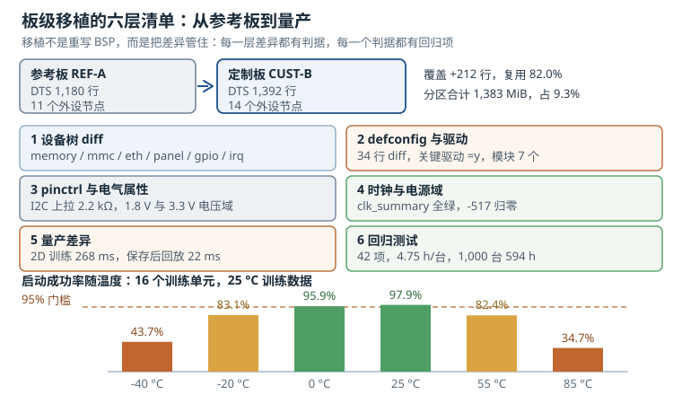

# 板级移植：从参考板到量产的清单 Board Porting Checklist

板级移植（board porting）的通常起点是厂商的参考板（reference board，参考设计）。参考板已经跑通了启动、DDR、网络、显示，移植的工作看起来只是"照着改"。真正的风险恰恰在这个"照着改"里：参考板的设备树有 1,180 行，你的定制板只改 212 行，**风险全部集中在这 212 行**——内存大小写错会把 1 GiB 用成 512 MiB，管脚电压域配错会让 I2C 时好时坏，DDR 训练数据跨板复制会在低温批量翻车，而这些问题在常温、单板、短时间测试里都不会出现。

所以本章不按"驱动"组织，而按**清单**组织：六层差异（设备树、defconfig（默认配置）、引脚复用与电气属性、时钟与电源域、量产差异、回归测试），每层给出判据、失败分支与量化口径。目标不是"把板子点亮"，而是"把这块板的差异变成可审计、可复现、可量产的资产"。

## 1. 设计动机：移植的本质是差异管理

一个 BSP（Board Support Package，板级支持包）里，与具体板子相关的部分通常只占 10% 到 20%。以一块 64 位四核 SoC 为例：`soc.dtsi` 描述内部总线、中断控制器、时钟树，几千行，所有板子共用；板级 `.dts` 描述外设怎么接、引脚怎么复用、电源怎么供，几百行。移植的功夫全在这几百行，而故障的代价与这几百行不成比例：

| 差异类型 | 典型数量 | 配错的后果 | 发现阶段 |
|---|---|---|---|
| 内存容量与保留区 | 1 到 3 个节点 | 内核只用一半内存，或踩到 OP-TEE 保留区 | 启动即暴露，但常被"能启动"掩盖 |
| 存储（eMMC/SD/NAND） | 2 到 5 个节点 | 识别不到、HS400 降速、偶发 CRC 错 | 常温可能正常，高低温暴露 |
| 网络 PHY 与 RGMII 延迟 | 2 到 4 个属性 | 千兆不通、百兆可用、丢包 | 压力测试或长线才暴露 |
| 显示时序与桥片 | 5 到 15 个属性 | 花屏、偏移、闪屏、无背光 | 一眼可见，但定位到具体参数难 |
| GPIO 与中断 | 10 到 40 个引用 | 按键无响应、中断风暴、休眠不醒 | 功能测试或老化才暴露 |
| 引脚复用与电压域 | 20 到 80 个引脚 | I2C 无 ACK、SPI 误码、引脚过压 | 时好时坏，最难定位 |
| 时钟与电源域 | 10 到 30 个引用 | probe 返回 -517、寄存器读回全 1 | 启动日志可查，但依赖链长 |
| 量产校准 | 每台一份数据 | 低温不启动、高温花屏、良率骤降 | 量产与现场才暴露 |

这张表的最后一行是关键：**前七类差异都能在实验室的单板上验证，最后一类只能在批量与温度里验证**。如果移植阶段不把量产差异当成设计的一部分，问题会推迟到最贵的时刻出现。

### 1.1 四类差异与一张清单

把差异按"改什么"分成四类，正好对应四个工程动作：

1. **描述差异**（设备树）：板上有哪些器件、接在哪个控制器、用哪组引脚、中断走哪条线。
2. **使能差异**（defconfig 与驱动）：这些器件的驱动要不要编进内核、编成模块还是内置。
3. **电气差异**（pinctrl 与时钟电源）：pinctrl（pin control，引脚控制）决定引脚的驱动强度、上下拉与电压域；器件的时钟源与供电域。
4. **量产差异**（校准与筛选）：每台设备不同的 DDR 训练数据、PHY 延迟、温度补偿与筛选条件。

四类差异加上一份回归清单，就是本章的六层结构。

### 1.2 不做清单的三类代价

**改一处、坏一处。** 定制板把调试串口从 UART2 换到 UART4，设备树改了，但 `chosen/stdout-path` 没改，内核日志仍然往不存在的 UART2 发；接着为了排查又改了 `console=`，结果 U-Boot 的 `bootargs` 把它覆盖回去。没有清单时，这类"改漏一处"的问题平均要花半天到一天。

**量产才发现。** DDR 训练数据在实验室用 25 °C 的参考板生成，直接烧进 1,000 台设备。到了北方冬天，-20 °C 下约三成设备起不来。这不是驱动 bug，而是"每台设备的 PHY 延迟不同"这个物理事实没有进入流程。

**交接断层。** 移植工程师离职，接手的人拿到一块能跑的板，但不知道哪些节点是改过的、为什么改、改了之后验证了什么。于是他只能重新对照参考板做一次 diff——而这正是当初应该留下的清单。

## 2. 定义与直观：六层清单

板级移植可以定义成一句话：**在保持 SoC 公共描述不变的前提下，把板级差异表达成设备树、配置、引脚与时钟电源设置，并用回归测试证明每一项差异都被验证过。** 注意"保持公共描述不变"是硬约束：`soc.dtsi` 是 SoC 厂维护的公共部分，改它等于给所有板子引入风险，也会让下次升级内核时的合并变成灾难。

::: analogy 装修不能动承重墙
参考板是一套精装房，`soc.dtsi` 是承重墙与水电主干，板级 `.dts` 是你家的家具布置。你可以换沙发（换 PHY）、改灯位（改引脚）、加一个柜子（加传感器），但不能把承重墙敲了（改 SoC 公共节点）。装修清单的价值在于：每一项改动都写明"改了什么、为什么改、验收标准是什么"，否则下一次维修（升级内核）时，谁也说不清哪面墙是后加的。
:::



图中上半部分是"参考板 → 定制板"的差异规模（212 行、82.0% 复用），中间六格是六层清单及其关键数字，下半部分是温度窗口：同一份 25 °C 训练数据，在 0 到 25 °C 之间整机成功率高于 95%，到 85 °C 掉到 34.7%。这张图想说明的是：**清单的最后一层（量产差异）决定了前五层的努力能不能变成良率**。

### 2.1 第一层：设备树从参考板改起

做法是"复制、包含、覆盖"，而不是"从头写"：

```dts
/dts-v1/;

#include "vendor-soc.dtsi"
#include "vendor-ref-a.dtsi"

/ {
    model = "Vendor CUST-B";
    compatible = "vendor,cust-b", "vendor,ref-a";

    memory@40000000 {
        device_type = "memory";
        reg = <0x0 0x40000000 0x0 0x20000000>;
    };

    chosen {
        stdout-path = "serial2:115200n8";
    };

    aliases {
        mmc0 = &usdhc1;
        serial2 = &uart2;
    };
};
```

`model` 是给人看的，`compatible` 是给驱动匹配用的。二级 `compatible` 保留参考板的字符串，可以让尚未适配的驱动继续工作，但也会掩盖"这块板其实不一样"的事实，量产前应当逐项清理。`aliases` 决定 `mmcblk0`、`ttyS2` 这类编号的稳定性，换启动介质时尤其重要。

下面按六类节点说明"改什么、判据是什么、失败先查什么"。所有节点的公共判据是：**`make dtbs` 能编过、`make dtbs_check` 没有新增告警、`/proc/device-tree/model` 与预期一致**。

**内存。** 改 `/memory` 的 `reg`（起始地址 + 大小），并检查 `reserved-memory` 里 OP-TEE、DDR 训练数据、CMA 的区域是否与真实内存布局重叠。判据是 `/proc/meminfo` 的 `MemTotal` 与 BOM 一致（例如 1 GiB 颗粒应看到约 100 万 KiB 可用，扣除保留区）。失败分支：`MemTotal` 只有一半，说明 `reg` 还是参考板的值；启动时随机崩溃，多半是保留区与内核可用区重叠。

**存储。** eMMC（embedded MultiMediaCard）节点要写 `bus-width = <8>`、`non-removable`、`no-sd`、`no-sdio`，并给出 `vmmc-supply` 与 `vqmmc-supply`；只有 VCCQ 真的供 1.8 V 时才能写 `mmc-hs400-1_8v`（HS400，eMMC 5.1 的高速模式）或 `mmc-ddr-1_8v`，3.3 V 供电的板子必须写 `no-1-8-v` 并删掉 HS400 属性。判据是 `dmesg` 里出现 `mmc0: new HS400 Enhanced strobe MMC card`，且 `dd` 写 64 MiB 的速率在颗粒规格的 70% 以上。失败分支：`error -110 whilst initialising MMC card` 查供电与引脚；能识别但 CRC 错，查 `bus-width` 与数据线的上下拉；HS400 训练失败会自动降速到 HS200，日志里会有 `tuning` 相关提示。

**网络。** `phy-mode` 必须与 PCB 的实际延迟方案一致（PHY 即 Physical Layer，物理层；RGMII 是 Reduced Gigabit Media Independent Interface，MAC 与 PHY 之间的千兆接口）：PHY 内部加延迟写 `rgmii-id`，PCB 走线等长且不加延迟写 `rgmii`，只在一端加延迟写 `rgmii-txid` 或 `rgmii-rxid`。再配 `phy-handle`、`mdio` 子节点、`reset-gpios` 与 MAC 地址来源（`nvmem-cells` 或 `local-mac-address`）。判据是 `ethtool eth0` 显示 1000 Mb/s 全双工、`ping -f` 十万包零丢包、`ethtool -S` 的 CRC 错误计数不增长。失败分支：MDIO 扫不到 PHY，查 `reset-gpios` 极性与复位时序、MDIO 时钟；千兆不通百兆可用，九成是 RGMII 延迟配错或 TX 时钟走线过长；有链路但丢包，查引脚驱动强度与 PHY 的时钟输出。

**显示。** 面板节点要给出像素时钟、有效区、前后肩与同步极性，LVDS 还要 `data-mapping`（vesa 或 jeida）与 `width-mm`、`height-mm`；桥片与 DSI 之间用 `port/endpoint` 的 `remote-endpoint` 相连；背光用 `pwm-backlight` 并给出 `brightness-levels`。判据是 `/sys/class/drm/card0-DSI-1/status` 为 `connected`，`modetest` 能按预期时序出图，连续点亮 24 小时无 FIFO underrun。失败分支：黑屏但有背光，查 DSI 通道数与 HS 速率；画面偏移或抖动，查前后肩与像素时钟；颜色错乱，查 LVDS 映射与位序。

**GPIO 与中断。** GPIO 用 `gpios = <&gpio1 12 GPIO_ACTIVE_LOW>` 引用，配合 `gpio-line-names` 便于调试；按键用 `gpio-keys` 加 `linux,code`；中断控制器用 `interrupt-parent = <&gic>`（GIC，Generic Interrupt Controller，通用中断控制器），`interrupts = <GIC_SPI 45 IRQ_TYPE_LEVEL_HIGH>`。这里最容易错的是中断号：设备树里填的是 TRM 给出的 SPI 序号（从 0 起），不是加 32 之后的 GIC 中断号，写错会指向不存在的中断或别人的中断。判据是 `/proc/interrupts` 里对应行在触发时计数增长，`gpiomon` 能看到边沿。失败分支：中断风暴，查触发类型（电平配成边沿、或引脚浮空）；完全无中断，查 pinctrl 是否把引脚配成了输出、GPIO 控制器时钟是否使能。

**判据总括**：`make dtbs_check` 无新增告警；`/proc/device-tree` 下节点与属性齐全；每个外设在 `dmesg` 里有 probe 记录；`/sys/bus/platform/devices` 下设备已绑定驱动。

### 2.2 第二层：defconfig 与驱动使能

参考板的 defconfig 通常有 1,800 到 2,000 行，直接复制会带上大量用不到的驱动，也会漏掉定制板新增的器件。正确做法是三步：

1. `make ARCH=arm64 vendor_defconfig` 得到基线；
2. 用 `scripts/kconfig/merge_config.sh` 合并定制板的配置片段（新增器件、关闭不用的子系统）；
3. `make savedefconfig` 生成最小化 defconfig，与基线做 diff，diff 应当只有几十行。

`=y` 与 `=m` 的取舍要按"是否在启动路径上"判断。串口、存储、regulator、pinctrl、时钟控制器必须 `=y`，否则会出现"驱动在 rootfs 里、rootfs 在驱动后面"的死锁；传感器、摄像头、蓝牙这类可以 `=m`，但每个模块加载大约 10 到 15 ms，7 个模块就是 84 ms 的启动开销，需要算进预算。

**判据**：`make savedefconfig` 后再 diff 为空（说明 defconfig 已最小化且自洽）；`zcat /proc/config.gz` 与构建配置逐项一致；`lsmod` 的模块数与预期一致；新增器件的驱动出现在 `dmesg` 的 probe 日志里。

**失败分支**：配置项被依赖关系自动关掉（`make olddefconfig` 后消失），查 Kconfig 的 `depends on` 与 `select`；驱动编了但设备不出现，查 `compatible` 与 `status`；模块没进 rootfs，查安装规则与 `modules.dep`。

### 2.3 第三层：管脚复用与电气属性

引脚复用（pin multiplexing）解决"这个引脚这个时刻是谁的功能"，电气属性（electrical properties）解决"这个引脚以什么电平、多大驱动、什么上下拉工作"。两者写在同一个 pinctrl 组里，任何一项错了都表现为"时好时坏"。

以 I2C 为例，上拉电阻不是随便取 4.7 kΩ，而是由总线电容和上升时间决定：

$$R_{\max}=\frac{t_r}{0.8473\,C_b},\qquad R_{\min}=\frac{V_{DD}-V_{OL,\max}}{I_{OL,\max}}$$

其中 $t_r$ 是规范允许的最大上升时间（标准模式 1,000 ns，快速模式 300 ns），$C_b$ 是总线总电容（线缆、引脚、器件输入之和，常见 100 到 200 pF），$V_{OL,\max}$ 是器件低电平最大电压（通常 0.4 V），$I_{OL,\max}$ 是灌电流能力（常见 3 mA）。取 $t_r=300$ ns、$C_b=150$ pF，得 $R_{\max}=2.36$ kΩ；取 $V_{DD}=3.3$ V、$V_{OL,\max}=0.4$ V、$I_{OL,\max}=3$ mA，得 $R_{\min}=967$ Ω。所以 2.2 kΩ 落在窗口内：上升时间 $0.8473\times2200\times150\times10^{-12}=279.6$ ns，灌电流 $(3.3-0.4)/2200=1.32$ mA。

电压域是另一个高频坑。SoC 的 IO 电源可能是 1.8 V 或 3.3 V，由 `vqmmc-supply` 或固定的 LDO 决定；如果引脚所在的域是 1.8 V，而上拉电阻接到了 3.3 V，轻则通信不稳，重则通过 ESD 二极管给 1.8 V 域倒灌。判据是量上拉电阻上端的电压与域电压一致，并用示波器看上升沿。

**判据**：`/sys/kernel/debug/pinctrl/*/pinmux-pins` 里每个引脚的功能与预期一致；I2C 的上升时间在规范内；SPI 在最高频率下连续传输 1 GiB 无 CRC 错；GPIO 回环测试 10 万次无丢失。

**失败分支**：I2C 无 ACK，先量上拉电压与上升沿，再查地址与器件供电；SPI 高速误码，查驱动强度（从 4 mA 提到 8 mA 或 12 mA）与走线长度；引脚发热或漏电，查电压域是否倒灌。

### 2.4 第四层：时钟与电源域

时钟与电源域是"probe 失败"的两大来源。设备树侧要写清楚三件事：这个设备用哪个时钟（`clocks` 与 `clock-names`，顺序必须与驱动里 `clk_get` 的名字一致）、这个设备属于哪个电源域（`power-domains`）、启动时要不要预置频率与父时钟（`assigned-clocks`、`assigned-clock-parents`、`assigned-clock-rates`）。

```dts
&uart2 {
    clocks = <&clk IMX8MP_CLK_UART2_ROOT>;
    clock-names = "ipg";
    assigned-clocks = <&clk IMX8MP_CLK_UART2_ROOT>;
    assigned-clock-rates = <80000000>;
    power-domains = <&pgc_uart2>;
    status = "okay";
};
```

供电侧要区分"常开"与"按需"：`regulator-always-on` 用于那些没有驱动管理、或者必须在早期就供电的轨（DDR、IO、PHY），其余交给 `regulator-boot-on` 或设备自己 `regulator_get`。OPP 表（Operating Performance Points，工作性能点）用 `operating-points-v2` 描述频率电压对，`opp-microvolt` 写错会导致降频或过压。

**判据**：`/sys/kernel/debug/clk/clk_summary` 里关键时钟的 rate 与预期一致；`/sys/kernel/debug/pm_genpd/*` 的电源域状态与实际一致；`dmesg` 没有持续的 `-517` 重试；量电流确认空闲时能进低功耗域。

**失败分支**：probe 反复返回 `-517`，说明 supplier 还没就绪，查 phandle 与驱动加载顺序；寄存器读回 `0xffffffff`，说明总线时钟没开或电源域没上电；频率不对，查 `assigned-clock-rates` 是否被驱动 later 覆盖，以及父时钟选择。

### 2.5 第五层：量产差异

前四层是"设计差异"，这一层是"每台设备之间的差异"。三件事必须在量产流程里落地。

**DDR 训练按颗保存。** PHY 的延迟线受工艺、电压、温度影响，同一批次的两颗板，最优延迟可能差几个 tap。工厂对每台设备做 2D 训练，把结果写进 OTP 或 eMMC 的保留分区，启动时回放。判据是每台的训练窗口余量不低于 180 ps，且回放后的误码率低于 $10^{-12}$。跨板复制训练数据是最危险的做法：常温能过，低温成批失败。

**PHY 与接口校准。** 以太网 PHY 的 RGMII 延迟、eMMC 的 HS400 tuning、USB2 的 PHY 调谐、MIPI DSI 的 HS 偏斜，都需要在工厂按板校准或由驱动在启动时自适应。eMMC tuning 由驱动自动完成，代价是每次启动 120 ms 左右；RGMII 延迟通常由 PHY strapping 或寄存器固定，需要按 PCB 走线选一次。

**温度筛选与温度窗口。** 高低温箱做 -40 °C、25 °C、85 °C 三个角，每角保持 2 小时，记录 DDR 余量、PHY 误码、启动成功率。判据不是"能启动"，而是"三个角都能启动且余量高于门槛"。

**判据**：每台设备的 DDR 余量 ≥ 180 ps；HS400 tuning 的最优 tap 落在窗口中心 ±2 以内；-40 °C 与 85 °C 各 100 次掉电启动全部成功；PHY 误码率低于 $10^{-12}$。

**失败分支**：低温不启动，先看训练数据是否按颗保存、再看电源纹波与晶振启动；高温花屏，查 DDR 刷新率与温度补偿、以及面板时序在高低温下的漂移；量产不良率 3% 以上，按批次追查 DDR 颗粒与 PCB 阻抗。

### 2.6 第六层：回归测试清单

回归清单的作用是"把每一层差异翻译成可执行的测试项"。一块定制板的清单通常 40 项左右，按组分配：

| 组 | 项数 | 代表项 | 通过标准 |
|---|---|---|---|
| 启动 | 8 | 冷启动、热复位、看门狗复位、掉电 1,000 次、bootargs 校验 | 1,000 次全部成功 |
| 存储 | 7 | eMMC 全盘写读校验、HS400 速率、文件系统掉电一致性、SD 卡热插拔 | 校验一致，速率达标 |
| 网络 | 6 | 千兆链路、iperf 1 小时、反复插拔 100 次、MAC 地址唯一性 | 零丢包，无 CRC 增长 |
| 显示 | 5 | 各分辨率出图、24 小时老化、背光调光、休眠唤醒 | 无花屏，无 underrun |
| GPIO 与中断 | 6 | 回环 10 万次、按键与 LED、中断计数、唤醒源 | 无丢失，无风暴 |
| 电源与温度 | 5 | 各域电压、功耗、-40/25/85 °C 启动、温循 5 次 | 全部通过 |
| 升级与回滚 | 5 | A/B 升级、断电回滚、签名校验、版本回退 | 可回滚，不变砖 |

**判据**：42 项全部通过，且每一项的原始数据（日志、示波器截图、测试脚本输出）都归档；任何一项失败必须定位到六层中的某一层，不允许"重试通过"。

**失败分支**：只在老化后失败，查温度与电源余量；只在批量出现，查物料批次与校准数据；只在特定启动介质出现，查分区与 bootargs。

### 2.7 清单总表

| 层 | 输入 | 产出 | 判据 | 回归项 |
|---|---|---|---|---|
| 设备树 | 参考板 dts、原理图 | 定制板 dts（212 行差异） | dtbs_check 无新增告警、节点齐全 | 8 |
| defconfig | 参考 defconfig、BOM | 最小 defconfig（34 行 diff） | savedefconfig 无差异、config.gz 一致 | 4 |
| pinctrl 与电气 | 引脚表、原理图 | 引脚组与电气属性 | 上升沿合规、误码为零 | 7 |
| 时钟与电源域 | 时钟树、PMIC 手册 | assigned-clocks 与 power-domains | clk_summary 一致、无 -517 | 6 |
| 量产差异 | DDR/PHY 校准数据 | 每台一份训练数据 | 余量 ≥ 180 ps、三角启动成功 | 9 |
| 回归测试 | 上述五层的判据 | 42 项测试报告 | 全部通过且数据归档 | 8 |

按层归集时，同一测试项会跨层引用（例如"启动"既验证设备树的内存节点，也验证时钟与电源域），所以这张表的合计仍是 42 项，但分组口径与 2.6 节按测试域的分组不同；评审时两张表要能互相追溯。

## 3. 定量关系：五本账

### 3.1 启动时间预算

启动时间仍然按"计算时间 + 串口时间"分解，只是这次把"移植引入的设备"单独列为一项：

$$T_{\mathrm{boot}}=\sum_{i=1}^{5}c_i+\frac{10000}{B}\sum_{i=1}^{5}L_i+\sum_{j=1}^{n_d}\left(t_j+r_j\tau_j\right)$$

前两项与上一章同构：$c_i$ 是阶段计算时间（ms），$L_i$ 是日志字节数，$B$ 是波特率（bit/s）。第三项是移植新增的设备：$n_d$ 是新增设备数，$t_j$ 是设备 $j$ 的 probe 时间（ms），$r_j$ 是它触发延迟 probe（deferred probe）的次数，$\tau_j$ 是每次重试的等待时间。这一项很重要，因为定制板每加一个器件，就多一次 probe；依赖链没理清时，一个 `-517` 会带来三轮重试。

以 64 位四核板、量产配置 921600 波特率为例：

| 阶段 | 计算时间 / ms | 日志 / B | 串口时间 / ms | 小计 / ms |
|---|---|---|---|---|
| ROM | 30 | 0 | 0 | 30 |
| SPL（含 DDR 回放 22 ms） | 150 | 1,024 | 11.1 | 161.1 |
| U-Boot | 240 | 7,168 | 77.8 | 317.8 |
| 内核 | 820 | 23,552 | 255.6 | 1,075.6 |
| init | 320 | 3,072 | 33.3 | 353.3 |
| 合计 | 1,560 | 34,816 | 377.8 | 1,937.8 |

同样的 34 KiB 日志，如果串口还是 115200，串口时间就是 3,022.2 ms，总时间 4,582 ms——超过 2,000 ms 预算的一倍多。这就是为什么量产配置必须把调试串口提到 921600 以上，而 bring-up 阶段为了兼容各种 USB 转串口模块才留在 115200。

移植增量可以单独算：新增 11 个设备，平均 probe 2.4 ms，其中 3 个各触发 1 次延迟 probe、每次等待 3.9 ms，则增量为 $11\times2.4+3\times3.9=38.1$ ms，占 1,937.8 ms 的 2.0%。这个比例不大，但如果依赖链设计得不好（例如 3 个设备各重试 3 次），增量会变成 60 ms 以上，还会把日志量推高。

### 3.2 串口日志字节与耗时

串口带宽的关系与上一章相同：

$$R=\frac{B}{10},\qquad t_{\mathrm{ser}}=\frac{10000\,L}{B}$$

$R$ 是字节率（B/s），$L$ 是日志字节数（B），$t_{\mathrm{ser}}$ 是对应耗时（ms）。定量上要关注两个数：**日志总量**与**每千字节的耗时**。

| 波特率 | 1 KiB | 8 KiB | 34 KiB | 70 KiB |
|---|---|---|---|---|
| 115200 | 88.9 ms | 711 ms | 3,022 ms | 6,222 ms |
| 921600 | 11.1 ms | 88.9 ms | 378 ms | 778 ms |
| 1500000 | 6.8 ms | 54.6 ms | 232 ms | 478 ms |

定制板的日志通常比参考板多 10% 到 30%，因为多出来的器件会打印 probe、regulator、pinctrl 信息。34 KiB 就是"参考板 26 KiB 加上 8 个新设备"的量级。这个数字直接决定 3.1 节里串口项的大小，也解释了为什么"多打几行日志"在 115200 下是昂贵操作：多 10 KiB 就是多 889 ms。

### 3.3 DDR 训练时间与保存收益

DDR 训练的公式与上一章一致，只是参数换成 64 位、2 rank 的 DDR4：

$$T_{\mathrm{train}}^{\mathrm{1D}}=n_{\mathrm{ch}}n_{\mathrm{rk}}\left(t_{\mathrm{init}}+n_{\mathrm{lane}}\left(t_{\mathrm{wl}}+t_{\mathrm{rg}}+t_{\mathrm{rd}}+t_{\mathrm{wr}}\right)\right)$$

$$T_{\mathrm{train}}^{\mathrm{2D}}=n_{\mathrm{ch}}n_{\mathrm{rk}}\left(t_{\mathrm{init}}+n_{\mathrm{lane}}n_{\mathrm{vref}}\left(t_{\mathrm{wl}}+t_{\mathrm{rg}}+t_{\mathrm{rd}}+t_{\mathrm{wr}}\right)\right)$$

取 $n_{\mathrm{ch}}=1$、$n_{\mathrm{rk}}=2$、$n_{\mathrm{lane}}=8$、$t_{\mathrm{init}}=6$ ms、四个扫描步骤每通道合计 2.0 ms：1D 是 $1\times2\times(6+8\times2.0)=44$ ms；2D 取 $n_{\mathrm{vref}}=8$，是 $1\times2\times(6+8\times8\times2.0)=268$ ms。

保存与回放的收益是 $268-22=246$ ms，占 1,937.8 ms 启动预算的 12.7%。这个数字决定了两条策略：**启动只回放，工厂才做 2D**。工厂端的 2D 训练成本也要算：6 个温度角各做一次，$268\times6=1.61$ s；再加上以太网 PHY 的 8 档延迟扫描 $8\times2=16$ s 与 eMMC HS400 的 6 角 tuning $0.12\times6=0.72$ s，单台校准约 18.3 s。

### 3.4 分区与镜像大小

分区下限仍按 $P_j\ge s_j/(1-h_j)$ 计算，但量产板多了 recovery 与 data，A/B 还要成对：

| 分区 | 内容 | 镜像大小 | 分区大小 | 占用率 |
|---|---|---|---|---|
| loader | SPL + TF-A + U-Boot | 1.4 MiB | 4 MiB | 35.0% |
| env | 两份 128 KiB 冗余环境 | 256 KiB | 1 MiB | 25.0% |
| boot_a / boot_b | Image 9.2 MiB + DTB 112 KiB | 9.31 MiB | 2 × 24 MiB | 38.8% |
| recovery | 救援内核 + initramfs | 12 MiB | 48 MiB | 25.0% |
| rootfs_a / rootfs_b | squashfs | 104 MiB | 2 × 128 MiB | 81.3% |
| data | 可写数据与日志 | 运行期增长 | 1,024 MiB | — |
| misc | 启动计数器与标志 | 4 KiB | 1 MiB | 0.4% |
| GPT 与对齐 | 主备分区表 + 1 MiB 对齐 | — | 1 MiB | — |

总占用 $4+1+48+48+256+1{,}024+1+1=1{,}383$ MiB，占 16 GB eMMC 用户区（约 14,950 MiB）的 9.3%。rootfs 的 104 MiB 对 128 MiB 分区是 81.3%，留了 18.7% 的余量，符合"根文件系统预留 15% 以上"的口径；boot 分区占用只有 38.8%，因为要给内核增长与多份 DTB 留空间。

升级包大小是 rootfs 加 boot，即 $104+9.31=113.31$ MiB。按 20 Mbps 的有效下行算，下载需要 $113.31\times8/20=45.3$ s；按 5 Mbps 算需要 181.3 s。这两个数字决定了升级策略：低于 10 Mbps 的现场应当用差分升级，而不是整包。

### 3.5 良率与温度窗口

良率模型与上一章相同，但 64 位、2 rank 板的训练单元是 $N_l=16$：

$$p=\Phi\left(-C_{pk}\right),\qquad C_{pk}=\frac{\mu}{3\sigma},\qquad Y=(1-p)^{N_l}$$

$\mu$ 是训练窗口的余量均值（ps），$\sigma$ 是同批分布的标准差（ps），$\Phi$ 是标准正态分布函数，$Y$ 是整机一次启动成功率。一组工程取值如下（示例参数，用于演算）：

| 温度 | $\mu$ / ps | $\sigma$ / ps | $C_{pk}$ | 单 lane 失效率 | 整机成功率 | 每千台失败 |
|---|---|---|---|---|---|---|
| -40 °C | 128 | 78 | 0.55 | 5.04% | 43.72% | 563 |
| -20 °C | 150 | 66 | 0.76 | 1.15% | 83.08% | 169 |
| 0 °C | 162 | 58 | 0.93 | 0.26% | 95.90% | 41 |
| 25 °C | 165 | 55 | 1.00 | 0.14% | 97.86% | 21 |
| 55 °C | 158 | 70 | 0.75 | 1.20% | 82.44% | 176 |
| 85 °C | 140 | 92 | 0.51 | 6.40% | 34.68% | 653 |

若要求整机成功率不低于 99.5%，可以反解单 lane 的失效率上限：$p\le 1-0.995^{1/16}=3.13\times10^{-4}$，对应 $z=\mu/\sigma=3.42$、$C_{pk}=1.14$。这张表里只有 25 °C 满足（$C_{pk}=1.00$ 还差一点），说明"25 °C 训练一次、终身使用"在宽温产品上不成立。

这也解释了温度窗口为什么必须和训练策略一起定义：如果每台设备在温度变化超过 10 °C 时重新做一次 1D 训练（44 ms），窗口会从"0 到 25 °C"扩展到接近全温区，代价是每次温度事件 44 ms 的启动延迟与一段重训代码。工程上的折中是：常温启动回放，温度跨越阈值时重训，并在 -40 °C 与 85 °C 的筛选台上验证重训路径。

## 4. 算例：从参考板到量产的四个数字

设定如下：参考板 REF-A（4×A53、LPDDR4 32 位 1 rank、eMMC 16 GB、RGMII 千兆、MIPI DSI 1080p），定制板 CUST-B（同 SoC、DDR4 64 位 2 rank、eMMC 16 GB、去掉摄像头、增加 CAN 与 1280×800 面板）。

### 4.1 算例一：设备树差异与启动增量

设备树从 1,180 行改成 1,392 行，差异 212 行，复用率 $(1{,}180-212)/1{,}180=82.0\%$。差异集中在 9 个节点：memory、usdhc1、fec（以太网）、panel、backlight、i2c3（触摸）、can1、gpio-keys、regulator。

启动增量按 3.1 节的公式：11 个新设备、平均 2.4 ms、3 次延迟 probe、每次 3.9 ms，得 38.1 ms，占 1,937.8 ms 的 2.0%。如果把 CAN 控制器从 `=m` 改成 `=y`（它被三个上层服务依赖），省下 12 ms 的模块加载，但内核镜像增大 180 KiB；这个交换在 2,000 ms 预算下是划算的。

回归项与差异行的比例也值得算：42 项回归对应 212 行差异，约每 5 行差异对应 1 个测试项。比例过低说明清单粗，比例过高说明测试冗余；工程上 4 到 6 行一项是常见区间。

### 4.2 算例二：镜像、分区与升级包

按 3.4 节的表，总占用 1,383 MiB，占 14,950 MiB 的 9.3%。这个数字说明两件事：第一，16 GB 的 eMMC 对这套系统是过剩的，8 GB 也能装下（1,383/7,280 = 19.0%），选 16 GB 是为了寿命与坏块余量；第二，1,383 MiB 里 A/B 与 recovery 占了 352 MiB（boot 48 + rootfs 256 + recovery 48），占全部保留空间的 25.5%，这笔钱买的是"升级失败不变砖"。

升级包 113.31 MiB，20 Mbps 下 45.3 s 下载完，加上写入 eMMC 的 104 MiB（45 MB/s，2.3 s）与校验（0.9 s），一次升级约 48.5 s。如果现场网络只有 5 Mbps，下载变成 181.3 s，用户体验不可接受，这时要么做差分升级，要么把 rootfs 从 104 MiB 压到 60 MiB 以内。

### 4.3 算例三：量产校准工时与筛选

单台校准 18.3 s（DDR 2D 六个温度角 1.61 s、PHY 八档扫描 16 s、HS400 六角 tuning 0.72 s）。1,000 台的校准总工时 $18.3\times1{,}000=18{,}300$ s，即 5.08 小时；4 个夹具并行，1.27 小时完成。这个成本可以接受，所以"每台都做 2D 并保存"是可行的。

筛选的成本更高：-40 °C 与 85 °C 各保持 2 小时，单台 4 小时，1,000 台就是 4,000 小时；8 个温箱并行也要 500 小时。所以量产通常做"抽样温度筛选 + 全量常温校准"，抽样比例按批量与风险定，例如首批 100% 温度筛选，稳定后降到 5%。

### 4.4 算例四：回归清单的工时

42 项回归里，4 小时老化加 45 分钟功能测试，单台 4.75 小时。1,000 台全检需要 $4.75\times1{,}000=4{,}750$ 小时，8 个夹具并行是 593.75 小时，约 24.7 天。这个数字直接决定产能：如果月产 5,000 台，全检需要 123 天，显然不可行，只能抽检。

工时账的结论不是"少测"，而是"把测试分层"：全量做 5 分钟的快速功能测试（启动、存储、网络、显示、GPIO），抽检做 4 小时老化与温度循环，异常批次加严。分层的依据就是 2.6 节的 42 项清单——哪些项能快速判定，哪些项必须老化。

## 5. 工程含义：清单是产品的一部分

**清单即合同。** 六层清单写清楚"改了什么、判据是什么、谁来测"，它既是研发内部的交接文档，也是与工厂、方案商、客户之间的验收依据。没有清单，"能跑"就是唯一标准，而"能跑"在不同人嘴里含义不同。

**diff 可审计。** 设备树、defconfig、pinctrl 的差异应当能用一条命令生成（`git diff` 或 `diff -u`），并附在每次硬件改版的通知里。212 行差异是可以人工评审的；如果差异变成 2,000 行，说明有人改了 `soc.dtsi`，必须退回。

**CI 自动把关。** 把 `make dtbs_check`、`make savedefconfig` 的 diff、`checkpatch.pl` 放进 CI，能拦住大部分低级错误（属性名拼错、状态没开、配置漂移）。这些检查不替代硬件测试，但能把"人眼容易漏"的部分自动化。

**基线冻结。** 每个硬件版本对应一份冻结的设备树、defconfig 与校准数据，版本号写进 `/etc/os-release` 与启动日志。出问题时，先确认现场设备的基线版本，再谈复现。

## 6. 常见坑：现象、原因、解决

::: pitfall 坑一：内存只认到一半
**现象**：1 GiB 的板子，`/proc/meminfo` 只有 512 MiB 左右；系统能启动，但跑大程序时 OOM。

**原因**：`/memory` 节点的 `reg` 还是参考板的值（例如 512 MiB），或者 `reserved-memory` 里有一块与内核可用区重叠，内核主动裁掉了重叠部分。

**解决**：核对 `reg` 的起始地址与大小是否与 DDR 拓扑一致；用 `cat /proc/device-tree/memory@*/reg | xxd` 看实际传入的字节；检查 `reserved-memory` 的 `reg` 与 OP-TEE、DDR 训练数据区是否冲突；改完重新编译 DTB 并确认 U-Boot 没有用旧的 DTB。
:::

::: pitfall 坑二：I2C 时好时坏，示波器看上升沿很缓
**现象**：触摸屏偶尔不识别，`i2c i2c-3: sendbytes: NAK bailout` 间歇出现；降低总线速率后好转。

**原因**：上拉电阻取值偏大（例如照抄参考板的 10 kΩ）而总线电容偏大（排线长、器件多），上升时间超过快速模式的 300 ns；或者上拉接到了 3.3 V，而该组引脚工作在 1.8 V 域，电平判决边缘化。

**解决**：按 $R_{\max}=t_r/(0.8473C_b)$ 重算上拉，2.2 kΩ 对应 150 pF 时上升时间 279.6 ns；确认上拉电压与 `vqmmc-supply` 同域；用示波器在最长走线端量上升沿与过冲；必要时把总线降到 100 kHz 验证，再逐步回到 400 kHz。
:::

::: pitfall 坑三：网络驱动没编进去，日志里一点报错都没有
**现象**：定制板没有 `eth0`，`dmesg` 里搜不到以太网相关字样，`/sys/class/net` 只有 `lo`。

**原因**：defconfig 里对应的 MAC 驱动是 `=m`，模块没有打进 rootfs；或者设备树 `status` 改了但 `phy-handle` 指向不存在的节点，驱动 probe 直接返回错误而没有打印。

**解决**：先确认驱动是否编进内核（`zcat /proc/config.gz | grep FEC` 或看 `.config`）；把启动路径上的网络驱动改为 `=y`；用 `dmesg | grep -i -E "eth|mdio|phy"` 看 MDIO 扫描结果；核对 `phy-handle` 与 `mdio` 子节点的 phandle。判据是 `/sys/class/net/eth0` 存在且 `ethtool` 能读到链路状态。
:::

::: pitfall 坑四：冬天三成设备起不来
**现象**：常温产线全部通过，北方现场 -20 °C 下约 30% 的设备启动失败，重启几次偶尔能起来；回到常温又正常。

**原因**：工厂把参考板的 DDR 训练数据复制到了所有设备，或者只做了 1D 训练没有保存按颗数据；低温下 PHY 延迟漂移，训练窗口余量不足。

**解决**：每台设备在工厂做 2D 训练并按颗保存；启动时回放本机数据，温度跨越阈值时重训；用 3.5 节的表核对低温余量（-20 °C 时 $C_{pk}$ 应不低于 0.8）；在 -40 °C 与 85 °C 各做 100 次掉电启动验证。跨板复制训练数据必须从流程里删掉，它不是"省事"，而是把良率风险推迟到现场。
:::

## 7. 自测题

<details>
<summary>题一：参考板设备树 1,180 行，定制板 1,392 行，差异 212 行。复用率是多少？若回归清单 42 项，平均每几行差异对应一个测试项？</summary>

复用率 $=(1{,}180-212)/1{,}180=968/1{,}180=0.8203$，即 82.0%。注意分母用参考板行数，而不是定制板行数；用 212/1,392 得到的 15.2% 是"差异占定制板的比例"，含义不同。

测试密度 $=212/42=5.05$，即平均每 5 行差异对应一个测试项。这个数字不是标准，而是评审时的参照：明显低于 3 说明清单过粗，明显高于 10 说明测试冗余或差异里有大量注释与空行。
</details>

<details>
<summary>题二：一条 I2C 快速模式总线，$C_b=150$ pF，$t_r$ 上限 300 ns，$V_{DD}=3.3$ V，$V_{OL,\max}=0.4$ V，$I_{OL,\max}=3$ mA。上拉电阻的允许范围是多少？选 2.2 kΩ 后上升时间与灌电流各是多少？</summary>

上限：$R_{\max}=t_r/(0.8473C_b)=300\times10^{-9}/(0.8473\times150\times10^{-12})=2{,}360\ \Omega$，即 2.36 kΩ。

下限：$R_{\min}=(3.3-0.4)/0.003=967\ \Omega$。

所以范围是 967 Ω 到 2.36 kΩ。选 2.2 kΩ 后，上升时间 $t_r=0.8473\times2{,}200\times150\times10^{-12}=279.6$ ns，小于 300 ns；灌电流 $I=(3.3-0.4)/2{,}200=1.32$ mA，小于 3 mA。两个条件都满足。

若总线电容涨到 250 pF，$R_{\max}$ 降到 1.42 kΩ，2.2 kΩ 就不合格了——这就是长排线必须减小上拉或降低速率的原因。
</details>

<details>
<summary>题三：量产板启动日志 34,816 B，波特率 921600。串口占多少毫秒？若把日志压到 17 KiB，总启动时间（计算时间 1,560 ms）变成多少？为什么不能只靠删日志达到 2,000 ms 预算？</summary>

34,816 B 在 921600 下：$10{,}000\times34{,}816/921{,}600=377.8$ ms。总时间 $1{,}560+377.8=1{,}937.8$ ms，距 2,000 ms 只有 62.2 ms 余量。

压到 17 KiB（17,408 B）：$10{,}000\times17{,}408/921{,}600=188.9$ ms，总时间 $1{,}560+188.9=1{,}748.9$ ms，余量 251.1 ms。

不能只靠删日志，是因为 115200 下 34 KiB 的串口时间是 3,022.2 ms，即使把日志删到 17 KiB 也还有 1,511 ms，总时间 3,071 ms，仍然超标；必须同时把波特率提上来。反过来说，只提波特率不删日志也能过（34,816 B 在 921600 下 377.8 ms），但日志越少，留给内核增长的余量越大。
</details>

<details>
<summary>题四：64 位、2 rank 的板子，25 °C 时 $\mu=165$ ps、$\sigma=55$ ps。若来料波动使 $\sigma$ 涨到 70 ps，整机成功率与每千台失败数变成多少？要满足 99.5% 整机成功率，$C_{pk}$ 至少要多少？</summary>

原状态：$C_{pk}=165/(3\times55)=1.00$，$z=3.00$，$p=0.00135$，$Y=0.99865^{16}=97.86\%$。

$\sigma=70$ ps 时：$z=165/70=2.357$，$p=\Phi(-2.357)=0.00921$。取对数：$\ln Y=16\ln(0.99079)=-0.1481$，$Y=0.8624$，即 86.2%。每千台失败 $=1{,}000\times(1-0.8624)=137.6$，约 138 台。

要满足 99.5%：单 lane 失效率上限 $p=1-0.995^{1/16}=3.13\times10^{-4}$，对应 $z=3.42$，所以 $C_{pk}=z/3=1.14$，即 $\mu/\sigma\ge3.42$。$\mu=165$ ps 时要求 $\sigma\le48.2$ ps——比现在的 55 ps 还严，说明要么提高余量均值，要么加温度重训。
</details>

## 8. 参考资料

- Linux 内核文档 `Documentation/devicetree/bindings/writing-bindings.rst`：`compatible`、`reg`、`interrupts`、`clocks` 的绑定约定与命名规则，是 2.1 节所有节点写法的依据。
- Linux 内核文档 `Documentation/devicetree/bindings/mmc/mmc-controller.yaml`：`bus-width`、`non-removable`、`mmc-hs400-1_8v`、`vmmc-supply`/`vqmmc-supply` 的语义与互斥关系，对应 2.1 节存储部分。
- Linux 内核文档 `Documentation/devicetree/bindings/net/ethernet-controller.yaml` 与 `Documentation/devicetree/bindings/net/phy.txt`：`phy-mode` 的取值、`phy-handle` 与 MDIO 总线的连接方式，对应 RGMII 延迟配置。
- Linux 内核文档 `Documentation/driver-api/pinctl.rst` 与 `rockchip,pinctrl.yaml`、`fsl,imx8mm-pinctrl.yaml`：引脚组、功能选择与驱动强度/上下拉/压摆率的写法，对应 2.3 节。
- Linux 内核文档 `Documentation/devicetree/bindings/clock/clock-bindings.txt` 与 `Documentation/devicetree/bindings/power/power-domain.yaml`：`assigned-clocks`、`clock-names` 的顺序要求与 `power-domains` 的引用方式，对应 2.4 节。
- U-Boot 文档 `doc/develop/devicetree/control.rst`：U-Boot 设备树的包含链、`board-u-boot.dtsi` 与 `bootph-*` 标记，保证 U-Boot 与内核看到同一份硬件描述。
- NXP I2C-bus specification and user manual（UM10204）Section 7：总线电容、上拉电阻与上升时间的定量关系，是 2.3 节公式与算例的来源。
- JEDEC JESD84-B51（eMMC 电气标准与 HS400 tuning）与 JESD79-4（DDR4 初始化、ZQ 校准与训练）：对应 2.1 节的 HS400 属性与 3.3 节的训练项。
- NXP i.MX 8M Plus Applications Processor Reference Manual（IMX8MPRM）Chapter 8 IOMUX 与 Chapter 12 DDR Controller：引脚复用寄存器、DDR PHY 训练与参数保存机制，对应 2.3 与 2.5 节。
