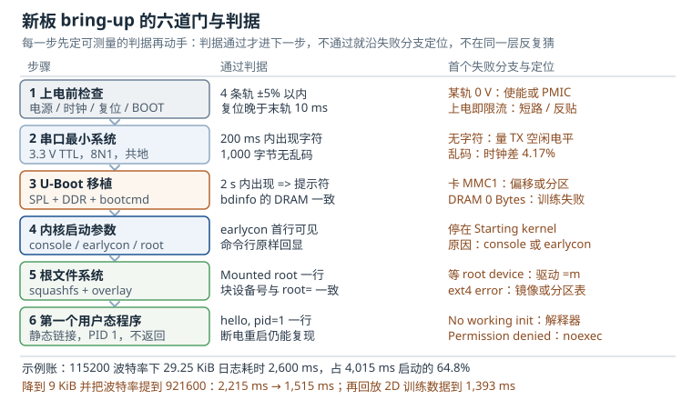

# 板级 bring-up：从裸板到第一个用户态程序

一块刚贴完片的新板，第一次上电时能给出的信息只有三样：电流、串口，以及"什么都没有"。板级 bring-up（Board Bring-up，板级启动调试）要做的，就是在最短时间内把这三样信息变成一条**可重复的启动路径**：从上电到串口出字，从 U-Boot 到内核，从内核到根文件系统，最后到你写的那个程序在串口上打印一行字。这条路径跑通之后，驱动开发、性能优化、量产测试才有地基。

这条路径之所以贵，不是因为每一步难，而是因为**每一步的症状几乎一样**：串口安静。电源没起来、时钟没振、复位没释放、BOOT 引脚选错了介质、SPL（Secondary Program Loader，二级程序加载器）没初始化串口、内核 console 参数写错、rootfs 挂不上——全部表现为"没有输出"或"输出到一半停住"。没有判据，工程师只能在这一串可能里反复猜；有判据，每一步都有明确的通过线，失败时也能立刻知道该往哪个方向量。

本章把 bring-up 拆成六道门，给出每道门的**判据**（pass criteria，可测量的通过条件）、**失败分支**（failure branch，失败后先查什么），再用五本账（启动时间、串口带宽、DDR 训练、分区镜像、良率温度）把"能跑"变成"可预算、可复现、可量产"。

## 1. 设计动机：为什么每一步都必须先有判据

一个中等复杂度的 SoC 板（四核 A53、512 MiB 到 1 GiB DDR、eMMC（embedded MultiMediaCard，嵌入式多媒体卡）、千兆网、MIPI 屏）从贴片到"能跑到自己的程序"，熟练工程师通常要 3 到 8 个工作日。这段时间的分布很能说明问题：

| 阶段 | 典型耗时 | 时间主要花在哪 |
|---|---|---|
| 上电前检查 | 0.5 天 | 量电源轨对地阻值、确认上电顺序、量晶振与复位、核对 BOOT 引脚 |
| 串口最小系统 | 0.5 到 2 天 | 电平与接线、波特率、SPL 阶段的串口初始化、pinmux |
| U-Boot 移植 | 1 到 3 天 | 板级目录、默认配置（defconfig）、SPL 尺寸、DDR 参数、环境变量与 bootcmd |
| 内核启动参数 | 0.5 到 1 天 | console 与 earlycon、root= 的写法、驱动是否编进内核 |
| 根文件系统 | 0.5 到 1 天 | 镜像格式、分区表、挂载参数、overlay 与权限 |
| 第一个用户态程序 | 0.5 天 | 静态链接、PID 1 的语义、/dev/console、掉电复现 |

注意最后一列：几乎没有一项是"写代码"，全部是"确认到底是哪一层坏了"。而确认的效率，完全取决于每一步有没有事先写下来的判据。

::: motivation 判据的三次救命
**换人接手。** 板子调了三天，工程师请假。接手的人面对一块"能出字但进不了内核"的板，如果没有记录"上一次通过判据是 U-Boot 的 `bdinfo` 显示 1 GiB"，他只能从电源重新量起。有了记录，他知道 DDR 已通过、串口已通过，问题必然在镜像加载或内核入口，范围立刻缩小到半个小时。

**批量验证。** 第二版板回来 5 块，只有 2 块能启动。没有判据时，"能启动"是一个主观结论；有判据时，你可以对 5 块板各跑一遍六道门，得到一张 5 行 6 列的通过表——差异立刻定位到某一列，而不是"这块板有点问题"。

**交接给工厂。** 试产 200 台，产线需要知道"什么算通过"。判据就是测试项：电压在窗口内、串口在 200 ms 内出字符、`bdinfo` 的 DRAM 与 BOM 一致、`Mounted root` 一行出现、hello 程序打印。没有判据，产线只能"能亮就算过"，不良品会成批流到客户手里。
:::

### 1.1 六道门与一份时间分布

六道门是串行的，每一道门的输出是下一道门的输入。把它们写成"输入—动作—输出—判据"，bring-up 就变成了一张可执行的表：

| 门 | 输入 | 动作 | 输出 | 判据（可测量） |
|---|---|---|---|---|
| 1 上电前 | 裸板、原理图、BOM | 量阻值、核时序、量时钟与复位、读 BOOT 码 | 可以安全上电的板 | 每轨对地阻值正常、上电顺序与手册一致、复位释放晚于末轨 10 ms、BOOT 码正确 |
| 2 串口 | 已上电的板、USB 转 TTL | 接线、设 8N1、抓第一段日志 | 可读的启动日志 | 200 ms 内出现第一个可读字符，连续 1,000 字节无乱码 |
| 3 U-Boot | 可烧写的启动介质 | 板级目录、defconfig、DDR 参数、环境 | 有命令行的 U-Boot | 2 s 内出现 `=>`，`bdinfo` 的 DRAM 与硬件一致，`mmc list` 能枚举 |
| 4 内核参数 | 内核镜像、DTB、bootargs | 传参、earlycon、root= | 内核日志到 init 交接 | `Kernel command line:` 原样回显，出现 `Run /init as init process` |
| 5 根文件系统 | 分区表、rootfs 镜像 | 分区、烧写、挂载 | 可读写或可叠加的根 | `VFS: Mounted root` 一行出现，块设备号与 `root=` 一致 |
| 6 用户态 | init 程序、动态库或静态二进制 | 静态编译、设为 PID 1、掉电复现 | 第一个用户态输出 | 串口出现 hello 且 `pid=1`，断电重启 10 次全部复现 |

这张表的价值在于：**它把"板子没反应"变成"第几道门没过"**。而判据必须是数字——毫秒、字节、电压、行号，不能是"看起来正常"。

### 1.2 没有判据时会在哪摔跤

**只量电压不核时序。** 3.3 V 的 IO 轨比 0.9 V 的核心轨早起来 200 ms，电压全对，但 IO 缓冲区的输入高于 VDD_CORE，电流从 ESD 二极管灌进核心域。现象是静态电流偏大、偶发启动失败，甚至第一次上电就损坏。判据必须包含"顺序与间隔"，而不只是"每轨电压"。

**把 RS-232 电平当 TTL 用。** USB 转串口模块有 TTL 与 RS-232 两种，后者输出 ±5 到 ±12 V。接到 3.3 V 的调试串口上，轻则无输出，重则打穿引脚。判据是"空闲时 TX 为 3.3 V 高电平"，用万用表一量就知道接的是哪一种。

**改了设备树（Device Tree），没改 defconfig（默认配置）。** 节点写了 `status = "okay"`，驱动却编成了模块且没进 rootfs。内核日志里没有任何报错，因为驱动根本没注册，设备树节点只是躺在 `/proc/device-tree` 里。判据应该是"`dmesg` 里出现该驱动的 probe 行"或"`/sys/bus/.../devices` 下有对应设备"，而不是"设备树写好了"。

**用设备名写 root=。** `root=/dev/mmcblk0p2` 在 SD 卡启动时正确，切到 eMMC 启动后枚举顺序变化，`mmcblk0` 变成了 SD 卡，于是挂载了错误的分区。判据是"挂载日志里的设备号与预期分区一致"，写法上则应使用 `root=PARTUUID=`（分区 UUID，Partition UUID）。

**init 写成了会返回的程序。** 内核把 init 当 PID 1，PID 1 退出会触发 `Attempted to kill init` 并 panic。判据不是"程序跑起来了"，而是"程序打印后调用 `reboot()` 或 `execve()`，且系统能按预期关机或进入 shell"。

## 2. 定义与直观：从裸板到 hello

bring-up 的目标状态可以一句话说清：**一条从上电到用户态输出的、可重复的、每一步都有判据的启动路径**。它不要求所有外设都能用，也不要求性能达标；它要求的是"地基已经浇好，后面每加一个驱动都能独立验证"。

::: analogy 像验房，而不是装修
验房师不会先挑家具，他按顺序验：入户电箱（电源）、水压（时钟）、门锁（复位）、钥匙能不能开门（BOOT 介质）、水表能不能走字（串口）、通水通电后灯亮不亮（内核）、最后才是入住（用户态程序）。每一步都有一个"合格线"，不合格就退回施工方，而不是自己动手改。bring-up 的六道门就是这张验房单：先确认基础设施，再确认协议层，最后才怀疑镜像。
:::



图中左侧是六道门，中间是可测量的判据，右侧是每道门最常见的失败分支。底部两行是本章后面要算的账：日志量决定了启动时间的六成以上，所以"先降日志、再提波特率、最后才裁内核"是优化顺序。

### 2.1 上电前：电源、时钟、复位、BOOT 引脚

这一步全部在断电状态下完成，成本最低，收益最大。四件事按顺序做。

**电源。** 用万用表二极管档逐条量电源轨对地压降，与同型号好板对比。3.3 V 轨正常读数在 0.3 到 0.6 V 之间（不同表笔极性读数不同，所以要和好板对比），接近 0 V 说明有短路。核心轨（0.8 到 1.0 V）因为并联的晶体管多，读数会偏低，同样靠对比判断。然后核对上电顺序：SoC 数据手册会给出各轨的先后与最小间隔（常见 1 到 10 ms），PMIC（Power Management IC，电源管理芯片）的顺序由 OTP 或寄存器配置决定。第一次上电用限流电源，5 V 档限 200 mA，空板静态电流通常在 40 到 120 mA；一上电就顶到限流，立即断电查短路，不要"再试一次"。

**时钟。** 主晶振常见 24 MHz 或 25 MHz，负载电容按晶体规格里的 $C_L$ 计算：

$$C_1 = C_2 \approx 2\left(C_L - C_{\mathrm{stray}}\right)$$

其中 $C_1$、$C_2$ 是两端对地电容，$C_L$ 是晶体标称负载电容，$C_{\mathrm{stray}}$ 是 PCB 与引脚寄生电容，通常取 3 到 5 pF。例如 $C_L=8\ \mathrm{pF}$、$C_{\mathrm{stray}}=4\ \mathrm{pF}$，则每端取 8 pF。上电后用示波器看起振时间与峰峰值，判据是起振小于 5 ms、频率误差小于 50 ppm（无线通信用 TCXO 时按模组要求，通常更严）。

**复位。** 复位由 supervisor 或 PMIC 产生，SoC 要求时钟稳定后才释放。判据是复位释放时刻晚于最后一轨稳定至少 10 ms，复位低电平脉宽不小于 1 ms；按键复位与看门狗复位都能把 RESET_N 拉低。用四通道示波器同时看末轨、时钟、RESET_N，一眼就能看出顺序对不对。

**BOOT 引脚。** strap 引脚在复位上升沿被采样，2 到 4 位组合决定从 SD、eMMC、SPI NOR、NAND、USB 还是 UART（Universal Asynchronous Receiver/Transmitter，通用异步收发器）启动。断电时用万用表量每个 strap 引脚对地电阻，与期望码表比对（上拉 10 kΩ、下拉 10 kΩ 或直连）。这一步做错，后面所有现象都会指向"镜像坏了"，而实际上芯片根本没去读那个介质。

**判据**：四条电源轨在标称 ±5% 以内、纹波小于 50 mVpp（20 MHz 带宽）、上电顺序与手册一致、复位释放晚于末轨 10 ms、BOOT 码与期望介质一致、空板电流在预期区间。

**失败分支**：某轨 0 V，先查使能脚、反馈分压与 PMIC 配置；电压偏高，查反馈电阻；上电即限流，查短路与器件反贴；顺序反了，查 PMIC 的 OTP 与 SoC 内部 LDO 的依赖；复位不释放，查 supervisor 阈值与上拉；BOOT 码不对，查 strap 电阻与焊接。还有一个常被忽略的证据：用电流探头看首次上电的电流阶跃——ROM 开始执行时会有一个几十毫安级的跳变，它比串口更早告诉你"芯片活着"。

### 2.2 串口最小系统

串口是 bring-up 唯一的"眼睛"，它的判据必须最先建立。要点只有四个：电平、接线、参数、初始化时机。

电平是 3.3 V TTL（少数板是 1.8 V），不是 RS-232。接线是交叉：板端 TX 接模块 RX，板端 RX 接模块 TX，GND 必须共。参数是 8N1、无流控（把 RTS/CTS 关掉），波特率常用 115200，部分 SoC 的调试串口默认 1500000。初始化时机最容易被忽略：很多 SoC 的 SPL 只初始化一路 UART，如果板级代码没配，最早的可读日志要等到 U-Boot 主程序；而 ROM 阶段通常完全没有输出。

波特率容差可以算清楚。一个 8N1 帧是 10 位（1 起始 + 8 数据 + 1 停止），接收端在第 6 到第 8 位之间采样，累计相位误差超过半个位就会错位，理论上限约 5%。工程上留一倍余量，要求时钟误差小于 2%。这解释了一个经典故障：SoC 用 24 MHz 晶振，代码按 25 MHz 计算分频，误差 4.17%，超过 5% 的一半，串口必然乱码。判据是"连续 1,000 字节无乱码"，而不是"能看到字"。

**判据**：上电后 200 ms 内出现第一个可读字符；连续 1,000 字节无乱码；模块 RX 断开时板端 TX 空闲为高电平；示波器量一位宽度与波特率一致（115200 时一位约 8.68 µs）。

**失败分支**：完全无字符，先用示波器量 TX 引脚——有 3.3 V 空闲高电平但无跳变，说明 SPL 没初始化串口或 pinmux 没配对；有跳变但上位机无显示，查接线、地线与波特率；有字符但乱码，查时钟源与分频（24 MHz 与 25 MHz 混用是高频原因）、TTL 与 RS-232 混接、地线未共；前半段正常后半段乱，查电源跌落、复位抖动与晶振稳定性。没有串口时，逻辑分析仪抓 TX 是最快的替代手段，哪怕只抓到 0x55 的波形也能反推波特率。

### 2.3 U-Boot 移植要点

U-Boot 移植不是"改一个配置文件"，而是在厂商参考板的基础上补齐四件事：板级目录、配置、DDR 参数、启动流程。

板级目录通常是 `board/<厂商>/<板名>/`，里面放 `Kconfig`、`Makefile`、`board.c`（板级初始化）、`spl.c`（SPL 阶段的时钟与串口）、以及 DDR 初始化文件。`Kconfig` 里声明 `SYS_VENDOR`、`SYS_BOARD`、`SYS_CONFIG_NAME` 与 `TARGET_<板名>`；`configs/<板名>_defconfig` 里打开 `CONFIG_TARGET_<板名>=y` 并指定 `CONFIG_DEFAULT_DEVICE_TREE`；设备树放在 `arch/arm/dts/<板名>.dts`，SPL 需要的节点要打上 `bootph-all`（旧版本写作 `u-boot,dm-pre-reloc`），否则驱动模型在 SPL 阶段找不到这个设备。

SPL 有一条硬约束：它必须整个塞进片内 SRAM（常见 128 到 256 KiB），文本段、BSS、栈、堆加起来不能超。`CONFIG_SPL_MAX_SIZE` 与 `CONFIG_SPL_BSS_MAX_SIZE` 要按 SoC 手册显式设置，超了会在链接期报 overflow，或者更糟——运行时踩栈，表现为随机复位。

DDR 参数是移植里最"重"的部分。板级的 `ddr_init()` 一般由 SoC 厂工具生成（例如 i.MX 的 DDR Tool），它编码了 DDR 颗粒型号、位宽、rank 数、ODT（On-Die Termination，片上端接）与驱动强度。PCB 拓扑变了（换颗粒、改走线、少一个 rank），参数必须重算，不能照抄参考板。

环境变量与启动流程决定了"能不能自动进内核"：

```text
CONFIG_ENV_IS_IN_MMC=y
CONFIG_SYS_MMC_ENV_DEV=1
CONFIG_ENV_OFFSET=0x400000
CONFIG_ENV_OFFSET_REDUND=0x400000+0x20000
```

典型的手动启动命令如下，先用它验证镜像与参数，再写进 `bootcmd`：

```text
setenv bootargs console=ttyS0,115200n8 earlycon root=PARTUUID=8f3a1c2e-6d4b-4b1e-9c2a-3f5d7e9a1b0c rootwait rw
fatload mmc 1:1 0x40400000 Image
fatload mmc 1:1 0x43000000 board.dtb
booti 0x40400000 - 0x43000000
```

**判据**：串口先出现 SPL banner（含 DRAM 大小），再出现 U-Boot banner，2 s 内出现 `=>`；`bdinfo` 报告的 DRAM 容量与 BOM 一致；`mmc list` 能枚举启动介质；`fatls mmc 1:1` 能看到内核与 DTB；`env print` 里的 bootargs 与预期逐字一致。

**失败分支**：SPL 完全无输出，查 `CONFIG_SPL_SERIAL_SUPPORT`、调试串口的基地址与 pinmux；出现 `DRAM: 0 Bytes`，查 DDR 供电、颗粒拓扑与训练参数；卡在 `Trying to boot from MMC1`，查启动介质偏移、分区与镜像是否烧在正确位置；`=>` 出现但命令都报错，查时钟驱动与驱动模型绑定；`Bad Linux ARM64 Image magic`，查加载地址与镜像格式（`booti` 对应 Image，`bootz` 对应 zImage）。

### 2.4 内核启动参数

内核启动参数（bootargs）是把"上一级知道的信息"传给内核的唯一通道，也是最容易写错的一环。一条完整的、用于 bring-up 的命令行：

```text
console=ttyS0,115200n8 earlycon=uart8250,mmio32,0x30890000,115200 root=PARTUUID=8f3a1c2e-6d4b-4b1e-9c2a-3f5d7e9a1b0c rootfstype=squashfs ro rootwait loglevel=3 init=/sbin/init
```

| 参数 | 作用 | 写错的后果 |
|---|---|---|
| `console=` | 指定正式控制台，可写多次，最后一个成为 `/dev/console` | 内核正常启动但串口无输出，或输出到不存在的 tty |
| `earlycon=` | 在串口驱动 probe 之前用 MMIO 直接打印 | 内核早期崩溃时完全无日志，只能靠 JTAG |
| `keep_bootcon` | 保留早期控制台，不因正式控制台注册而注销 | 早期日志在切换时丢失，恰好错过关键错误 |
| `root=` | 根文件系统位置，推荐 `PARTUUID=` | 枚举顺序变化导致挂错分区 |
| `rootwait` | 无限等待根设备出现 | 异步 probe 的 MMC 未就绪，直接 panic |
| `rootfstype=` | 指定文件系统类型 | 探测失败或多花几百毫秒 |
| `loglevel=` | 控制 printk 输出等级 | 日志刷屏，启动时间被串口吃掉 |
| `init=`/`rdinit=` | 指定 PID 1；`rdinit` 只对 initramfs 生效 | 找不到 init 或跑错程序 |
| `panic=` | panic 后自动重启的秒数 | 现场故障无法自愈，或无限重启 |

**判据**：earlycon 打印 `Booting Linux on physical CPU`；`Kernel command line:` 把整条命令行原样回显（这是验证参数没被 U-Boot 覆盖的最快方法）；出现 `Run /init as init process`。

**失败分支**：earlycon 无任何输出，查控制器类型、寄存器宽度与物理地址（`uart8250,mmio32,0x...` 三个字段都要对），以及该 UART 的时钟是否已被内核使能；`Starting kernel ...` 之后停住，通常是 console 名字不对或 earlycon 地址错；`Kernel panic - not syncing: VFS: Unable to mount root fs` 指向 rootfs；`No working init found` 指向 init 路径或动态加载器。

### 2.5 根文件系统挂载

根文件系统（root filesystem，rootfs）有三种常见形态，选择决定了挂载参数与失败模式：

| 形态 | 优点 | 缺点 | 适用 |
|---|---|---|---|
| initramfs（initial RAM filesystem，内置 cpio） | 不依赖块设备，启动最快，可做救援 | 占内核镜像体积，内容固定 | bring-up 早期、救援系统、小系统 |
| squashfs + overlay | 只读、压缩率高、抗掉电 | 需要 overlay 分区与挂载脚本 | 大多数量产设备 |
| ext4 可写 | 简单、可直接改 | 掉电易损、需要 fsck | 开发板、工控机 |

挂载的判据是一行日志：`VFS: Mounted root (squashfs filesystem) readonly on device 179:3.`，以及 `EXT4-fs (mmcblk0p2): mounted filesystem` 之类。关键不是"有没有这行"，而是**设备号与 `root=` 指向的分区一致**——这正是 `PARTUUID` 比设备名可靠的原因。

**判据**：`Mounted root` 一行出现且设备号匹配；`/proc/mounts` 里根为预期类型；overlay 生效时 `/` 可写且下层只读；`ls /` 能看到 `bin`、`etc`、`lib`、`dev`。

**失败分支**：日志停在 `Waiting for root device`，查块设备驱动是否编成模块却没进 rootfs、`root=` 是否写错、regulator 是否没开；`VFS: Cannot open root device` 说明设备根本不存在，查分区表与介质；`EXT4-fs error` 或校验失败，查镜像完整性与烧写偏移；挂载成功但紧接着 `No working init found`，问题已经不在文件系统，而在 rootfs 内容或架构。

### 2.6 第一个用户态程序

最后一步要证明的是"内核能把控制权交给用户态"，而不是"我的程序功能正确"。所以第一个程序应当静态链接、只依赖系统调用、并且**永不返回**：

```c
#include <fcntl.h>
#include <unistd.h>
#include <sys/reboot.h>

int main(void)
{
    const char msg[] = "hello from userspace, pid 1\n";
    int fd = open("/dev/console", O_WRONLY);

    if (fd >= 0)
        write(fd, msg, sizeof(msg) - 1);
    sync();
    reboot(RB_POWER_OFF);
    for (;;)
        pause();
}
```

编译用 `aarch64-linux-gnu-gcc -static -O2 -o hello hello.c`，`file hello` 应显示 statically linked。把它放进 rootfs 的 `/usr/bin/`，先用 `init=/bin/sh` 确认 shell 能起来，再改成 `init=/usr/bin/hello`。静态链接绕开了动态加载器缺失这个最常见的问题；`/dev/console` 需要 devtmpfs 已挂载，否则要先 `mknod /dev/console c 5 1`。

**判据**：串口出现 `hello from userspace, pid 1`；`cat /proc/1/comm` 返回 hello；断电重启 10 次全部复现；程序退出路径是关机或 `execve`，而不是返回。

**失败分支**：`No working init found`，查路径、可执行位、动态加载器（用 `readelf -l` 看 interpreter）；`Permission denied`，查挂载是否带 `noexec`、文件权限是否可执行；打印后立即 panic，说明 init 返回了；完全无输出，查 `/dev/console` 是否存在、stdout 是否真的指向控制台。

### 2.7 判据总表

把六道门的判据合并成一张可以贴在工位上的表，就是 bring-up 的执行清单：

| 门 | 通过判据 | 测量手段 | 常见误判 |
|---|---|---|---|
| 上电前 | 四轨 ±5%、顺序 1 ms 间隔、复位晚 10 ms、BOOT 码正确 | 万用表、示波器 | "电压对了就能上电" |
| 串口 | 200 ms 出字、1,000 字节无乱码 | USB 转 TTL、示波器、逻辑分析仪 | "有字就行" |
| U-Boot | 2 s 出 `=>`、DRAM 与 BOM 一致 | 串口、`bdinfo` | "打印了 banner 就是好了" |
| 内核 | 命令行回显、`Run /init as init process` | earlycon 日志 | "内核起来了" |
| rootfs | `Mounted root` 且设备号匹配 | `dmesg`、`/proc/mounts` | "挂上了就是对的" |
| 用户态 | hello、pid 1、掉电 10 次复现 | 串口、`/proc/1/comm` | "跑一次就行" |

## 3. 定量关系：五本账

bring-up 的每一步都能算。算清楚的目的不是追求精确，而是知道"这个数字正常吗、优化空间在哪、量产时怎么定合格线"。

### 3.1 启动时间预算

启动时间是各阶段"计算时间"与"串口输出时间"之和。串口为什么能加进启动时间？因为控制台的写操作是**同步忙等**的：驱动把字节塞进 FIFO 后要等发送完成，CPU 在这段时间里做不了别的事。于是有

$$T_{\mathrm{boot}} = \sum_{i=1}^{5} c_i + \frac{10000}{B}\sum_{i=1}^{5} L_i$$

其中 $T_{\mathrm{boot}}$ 是总启动时间（ms），$c_i$ 是第 $i$ 个阶段除去串口输出之外的计算时间（ms），$L_i$ 是该阶段输出的日志字节数（B），$B$ 是波特率（bit/s）。系数 10000 来自单位换算：8N1 每字节 10 位，字节率是 $B/10$，所以 $L$ 字节需要 $1000L/(B/10)=10000L/B$ 毫秒。

这个模型的适用条件是：控制台独占串口、没有 DMA 后台发送、日志在阶段内同步输出。它给出的结论很稳定——**日志量是启动时间的一阶项**。

### 3.2 串口日志的字节数与耗时

把上式单独抽出来，就是串口的"带宽账"：

$$R=\frac{B}{10},\qquad t_{\mathrm{KiB}}=\frac{1024}{R}\times 1000=\frac{10240}{B}\times 1000$$

$R$ 是字节率（B/s），$t_{\mathrm{KiB}}$ 是传 1 KiB 日志所需时间（ms）。代入常见波特率：

| 波特率 | 字节率 | 1 KiB | 4 KiB | 32 KiB |
|---|---|---|---|---|
| 115200 | 11,520 B/s | 88.9 ms | 356 ms | 2,844 ms |
| 460800 | 46,080 B/s | 22.2 ms | 88.9 ms | 711 ms |
| 921600 | 92,160 B/s | 11.1 ms | 44.4 ms | 356 ms |
| 1500000 | 150,000 B/s | 6.8 ms | 27.3 ms | 218 ms |
| 3000000 | 300,000 B/s | 3.4 ms | 13.7 ms | 109 ms |

这张表解释了两件事。第一，115200 下 32 KiB 日志要 2.8 秒，比很多 SoC 的内核初始化还长；第二，把波特率从 115200 提到 921600，串口时间直接除以 8，而代码一行都不用改。所以优化的顺序永远是"先降日志量，再提波特率，最后才裁内核"。

### 3.3 DDR 训练的时间构成

DDR 训练（DDR training）是 SPL 阶段最耗时的部分。一次一维（1D）训练包括写均衡（write leveling）、读门控（read gate）、读延迟与写延迟四步，每一步都要对每个字节通道（byte lane）扫一遍延迟线：

$$T_{\mathrm{train}}^{\mathrm{1D}}=n_{\mathrm{ch}}n_{\mathrm{rk}}\left(t_{\mathrm{init}}+n_{\mathrm{lane}}\left(t_{\mathrm{wl}}+t_{\mathrm{rg}}+t_{\mathrm{rd}}+t_{\mathrm{wr}}\right)\right)$$

二维（2D）训练在最优点附近再扫参考电压，相当于把延迟扫描重复 $n_{\mathrm{vref}}$ 次：

$$T_{\mathrm{train}}^{\mathrm{2D}}=n_{\mathrm{ch}}n_{\mathrm{rk}}\left(t_{\mathrm{init}}+n_{\mathrm{lane}}n_{\mathrm{vref}}\left(t_{\mathrm{wl}}+t_{\mathrm{rg}}+t_{\mathrm{rd}}+t_{\mathrm{wr}}\right)\right)$$

符号含义：$n_{\mathrm{ch}}$ 通道数，$n_{\mathrm{rk}}$ 每通道 rank 数，$n_{\mathrm{lane}}$ 字节通道数（32 位总线为 4，64 位为 8），$t_{\mathrm{init}}$ 是模式寄存器写入与 ZQ 校准的时间（ms），$t_{\mathrm{wl}}$、$t_{\mathrm{rg}}$、$t_{\mathrm{rd}}$、$t_{\mathrm{wr}}$ 分别是单个字节通道在四个步骤上的扫描时间（ms），$n_{\mathrm{vref}}$ 是 2D 扫描的参考电压点数。

以 32 位总线、2 个 rank、$t_{\mathrm{init}}=6$、四个扫描步骤合计每通道 2.0 ms 为例：1D 训练是 $1\times2\times(6+4\times2.0)=28$ ms；2D 取 $n_{\mathrm{vref}}=4$ 则是 $1\times2\times(6+4\times4\times2.0)=76$ ms。若换 64 位、每通道扫描 2.0 ms、2 个 rank，1D 就是 $1\times2\times(6+8\times2.0)=44$ ms，2D 是 $1\times2\times(6+8\times4\times2.0)=140$ ms。

DDR 训练的第二个数字是"保存与回放"的收益。把 2D 训练结果按颗保存到启动介质，启动时直接写入 DDR PHY（Physical Layer，物理层）的寄存器，训练段可以从 140 ms 降到 18 ms 左右（读回训练数据 + 少量校验寄存器的时间）。代价是每颗板都要单独保存——PHY 的延迟随工艺与温度变化，跨板复制训练数据会在高低温下翻车。

### 3.4 分区与镜像大小

分区大小的下限由镜像大小和预留比例决定：

$$P_j \ge \frac{s_j}{1-h_j},\qquad u_j=\frac{s_j}{P_j}$$

$P_j$ 是分区大小，$s_j$ 是该分区要装的镜像总字节数，$h_j$ 是为升级、对齐和未来增长预留的比例，$u_j$ 是占用率。工程上 boot 分区取 $h=0.25$ 左右，rootfs 取 $h=0.15$ 到 $0.2$，loader 分区因为要留原始偏移与备份，$h$ 可以到 0.5。

例如 boot 分区内容为内核 8.4 MiB 加设备树 96 KiB，合计 8.49 MiB，取 $h=0.25$，则 $P\ge 11.33$ MiB，按 eMMC 的擦除块（512 KiB）向上取到 12 MiB，占用率 70.8%。这个占用率看起来高，但 boot 分区本来就不该留大块空白；真正需要留余量的是 rootfs。

### 3.5 良率与温度窗口

DDR 训练能不能成功，取决于每个训练单元的时序余量 $m$ 是否大于零。把同一批板、同一温度下的余量看成均值 $\mu$、标准差 $\sigma$ 的正态分布，则单 lane 的失效率与整机成功率是

$$p=\Phi\left(-\frac{\mu}{3\sigma}\right),\qquad Y=(1-p)^{N_l},\qquad N_{\mathrm{fail}}=N_{\mathrm{unit}}(1-Y)$$

其中 $\Phi$ 是标准正态分布函数，$\mu/(3\sigma)$ 就是过程能力指数 $C_{pk}$，$N_l$ 是训练单元数（字节通道数乘以 rank 数），$Y$ 是整机一次启动成功的概率，$N_{\mathrm{fail}}$ 是 $N_{\mathrm{unit}}$ 台设备里预期的失败台数。

以 32 位、2 rank（$N_l=8$）的 DDR3L 板为例，一组工程取值如下（参数为演算示例，实际以 PHY 训练报告为准）：

| 温度 | $\mu$ / ps | $\sigma$ / ps | $C_{pk}$ | 单 lane 失效率 | 整机成功率 | 每千台失败 |
|---|---|---|---|---|---|---|
| -40 °C | 150 | 70 | 0.71 | 1.61% | 87.85% | 121 |
| -20 °C | 168 | 64 | 0.88 | 0.43% | 96.59% | 34 |
| 0 °C | 178 | 61 | 0.97 | 0.18% | 98.60% | 14 |
| 25 °C | 182 | 60 | 1.01 | 0.12% | 99.04% | 10 |
| 55 °C | 174 | 64 | 0.91 | 0.33% | 97.41% | 26 |
| 85 °C | 142 | 95 | 0.50 | 6.75% | 57.18% | 428 |

这就是"温度窗口"：若定义整机成功率不低于 95% 的区间为可用窗口，这张表给出的窗口是 -20 °C 到 55 °C，高温端先崩——85 °C 时 $\sigma$ 从 60 ps 涨到 95 ps，余量均值还掉了 40 ps，$C_{pk}$ 从 1.01 掉到 0.50，失败率放大了 50 倍以上。

## 4. 典型计算：一块 DDR3L 板的完整账

设定如下：四核 A53、DDR3L-1600（32 位、2 rank、共 1 GiB）、eMMC 8 GB、调试串口 115200 8N1。下面的数字是各阶段的示例取值，用于演示算法；换成实测值时，代入同样的公式即可。

### 4.1 算例一：4,015 ms 花在哪里

| 阶段 | 计算时间 $c_i$ / ms | 日志 $L_i$ / B | 串口时间 / ms | 小计 / ms |
|---|---|---|---|---|
| ROM | 25 | 0 | 0 | 25 |
| SPL（含 DDR 1D 训练 44 ms） | 120 | 576 | 50 | 170 |
| U-Boot | 210 | 5,760 | 500 | 710 |
| 内核 | 760 | 20,736 | 1,800 | 2,560 |
| init | 300 | 2,880 | 250 | 550 |
| 合计 | 1,415 | 29,952 | 2,600 | 4,015 |

复算过程：串口时间 $=10000\times L/115200$，576 B 得 50 ms，5,760 B 得 500 ms，20,736 B 得 1,800 ms，2,880 B 得 250 ms，合计 2,600 ms；加上计算时间 1,415 ms，总时间 4,015 ms。串口占比 $2,600/4,015=64.8\%$。

如果产品要求 2,000 ms 内出画面，这个版本超标 2,015 ms。先看日志预算：在 115200 下留给串口的时间只有 $2,000-1,415=585$ ms，换算成日志量是 $585\times11.52=6,739$ B，也就是 6.58 KiB——不到当前日志量的四分之一。只靠"删几行 printk"是达不到的，必须同时动波特率。

三个动作的实际效果：

| 配置 | 日志量 | 串口时间 | 总时间 | 相对目标 |
|---|---|---|---|---|
| 115200，默认 loglevel | 29,952 B | 2,600 ms | 4,015 ms | 超标 2,015 ms |
| 115200，loglevel=3 + quiet | 9,216 B | 800 ms | 2,215 ms | 超标 215 ms |
| 921600，loglevel=3 | 9,216 B | 100 ms | 1,515 ms | 余量 485 ms |
| 921600 + 回放 2D 训练数据 | 9,216 B | 100 ms | 1,393 ms | 余量 607 ms |

第三步验证了模型的可加性：9,216 B 在 921600 下是 $9216/92160=100$ ms，与表格一致；第四步把训练从 140 ms 换成 18 ms，正好省 122 ms。

### 4.2 算例二：镜像、分区与烧写

按 3.4 节的口径排一张 8 GB eMMC 的分区表：

| 分区 | 内容 | 镜像大小 | 分区大小 | 占用率 |
|---|---|---|---|---|
| loader | SPL 92 KiB + TF-A（Trusted Firmware-A）180 KiB + U-Boot 1,120 KiB | 1,392 KiB | 4 MiB | 34.0% |
| env | 两份 128 KiB 冗余环境 | 256 KiB | 1 MiB | 25.0% |
| boot_a / boot_b | Image 8.4 MiB + DTB 96 KiB | 8.49 MiB | 2 × 12 MiB | 70.8% |
| rootfs_a / rootfs_b | squashfs | 96 MiB | 2 × 128 MiB | 75.0% |
| data | 可写数据区 | 运行期增长 | 512 MiB | — |
| GPT 与对齐 | 主备分区表各 34 扇区 + 1 MiB 对齐 | — | 1 MiB | — |

总占用 $4+1+24+256+512+1=798$ MiB，占 8 GB eMMC 用户区（约 7,280 MiB）的 10.96%。这个比例说明：**分区表留白是廉价的，改分区表是昂贵的**，所以第一次就按 A/B 加 data 的形态规划。

烧写时间也算得出来：需要写的内容是 $1.36+8.49+96=105.85$ MiB，eMMC 顺序写按 45 MB/s 计，写入 $105.85/45=2.35$ s；回读校验按 120 MB/s 计，$105.85/120=0.88$ s；单台约 3.23 s，1,000 台约 0.9 小时。这是纯编程时间，不含上下料与测试，但它决定了产线工位的数量。

### 4.3 算例三：训练时间与 DVT 数量

DDR 训练的账已经在 3.3 节算过：1D 训练 44 ms，2D 训练 140 ms，回放 18 ms。把 2D 放进每次启动，代价是启动预算的 $140/1,515=9.2\%$；把结果保存并按颗回放，代价降到 $18/1,515=1.2\%$，省下的 122 ms 相当于 8.1% 的启动预算。这也是为什么量产设备通常"工厂做 2D、启动只回放"。

DVT（Design Verification Test，设计验证测试）阶段还有一个统计问题。假设真实不良率是 2%，想以 95% 的把握至少发现一台不良，需要多少台样机？解

$$(1-0.02)^{n}\le 0.05 \;\Rightarrow\; n\ge \frac{\ln 0.05}{\ln 0.98}=148.3$$

即至少要 149 台。5 台样机全部通过，只能说明不良率大概率低于 45% 左右，对 2% 的不良率几乎没有分辨力。这一条经常被忽略：**DVT 的样机数量决定的是"能发现多小的批量问题"，而不是"设计是否完美"**。想让 5 台样机有意义，就把判据收紧到余量维度（例如要求 $C_{pk}\ge1.0$、2D 窗口 $\mu\ge180$ ps），用测量值代替通过率。

同时，按 3.5 节的表，25 °C 下整机成功率 99.04%，5 台全部通过的概率是 $0.9904^5=95.3\%$——也就是说，即使设计刚好达标，5 台样机里出现 1 台失败的概率仍有 4.7%，这属于统计涨落，不要急着改设计，先把这台板的余量测出来再判断。

## 5. 工程含义：把判据写进流程

判据一旦写下来，bring-up 就从"个人经验"变成"团队资产"。具体落法是四条。

**判据进 DVT 计划。** 六道门的判据直接抄进 DVT 表格的测试项，每项写清测量手段、合格线、记录字段。例如"串口首字符时间"记录为 `t_first_char`，单位 ms，合格线 200；"DDR 余量"记录为 `margin_ps`，合格线 180。这样 DVT 报告本身就是一份可复算的数据集。

**记录模板固定。** 每次上电记录：日期、板号、镜像版本（U-Boot 与内核的 git 短哈希）、串口配置、bootargs、每道门的读数与结论。模板的价值在于"可对比"——第二版板回来时，拿同一张表填一遍，差异列就是改动带来的影响。

**每一步设时间盒。** 给每道门设上限，例如上电前 4 小时、串口 1 天、U-Boot 2 天。超时不代表继续硬扛，而是换手段：串口抓不到就上逻辑分析仪，U-Boot 起不来就用 USB 下载模式或 JTAG，内核早期崩溃就加 earlycon 与 `keep_bootcon`。时间盒防止的是"在一个错误的层次上反复试"。

**把 bring-up 的默认值带进量产。** 调通时的串口波特率、日志等级、rootfs 形态、A/B 策略、掉电重启策略，会成为量产的默认配置。反过来，如果 bring-up 阶段靠"每次手动敲命令"通过，量产就会缺一条自动启动路径。所以第六道门的判据里要有"断电重启 10 次全部复现"，它检验的正是自动化。

## 6. 常见坑：现象、原因、解决

::: pitfall 坑一：串口前半段正常，后半段乱码
**现象**：SPL banner 正常，U-Boot 打印几百字节后开始乱码，重新上电有时又正常。

**原因**：U-Boot 的 UART 时钟源仍沿用 ROM 的默认配置（例如 24 MHz），而板级代码按 25 MHz 计算分频，误差 4.17%；波特率偏差在长帧上累积，加上温度漂移后越界。另一种原因是 TX 线上串了电阻或走了长线，边沿变缓，采样点落在跳变区。

**解决**：用示波器量一位宽度（115200 时约 8.68 µs），反推实际波特率；核对时钟树里 UART 的父时钟与分频；把 `clock-frequency` 与驱动配置统一到晶振实际值。若是边沿问题，减小串阻、缩短走线或降低波特率验证。
:::

::: pitfall 坑二：内核卡在 Waiting for root device
**现象**：内核日志正常，最后一行是 `Waiting for root device PARTUUID=...`，之后没有任何输出。

**原因**：块设备驱动被编成模块（`=m`），而模块放在尚未挂载的 rootfs 里，形成死循环；或者 `root=` 写成了设备名，启动介质枚举顺序变化后指向了错误分区；也可能是 eMMC 的 regulator 没使能，设备根本没被枚举。

**解决**：把存储、串口、regulator 这类"启动路径上"的驱动改为 `=y`；`root=` 改用 `PARTUUID=` 并加 `rootwait`；用 `dmesg | grep mmc` 确认设备是否枚举、`/proc/partitions` 确认分区是否存在；必要时先用 initramfs 启动，进系统后再查块设备。
:::

::: pitfall 坑三：改了设备树，驱动却不 probe，日志里没有报错
**现象**：设备树节点写了 `status = "okay"`，`/proc/device-tree` 里能看到节点，但 `dmesg` 里没有任何该设备的 probe 记录，`/sys/bus` 下也没有设备。

**原因**：`defconfig` 没使能对应驱动（编译进了模块但没打包），或者 `compatible` 与驱动的 `of_match_table` 不一致，或者 pinctrl（pin control，引脚控制）组没被节点引用导致 probe 返回 `-EPROBE_DEFER` 并最终超时。

**解决**：先确认驱动是否编进内核（`zcat /proc/config.gz | grep 驱动名` 或看 `.config`）；用 `dmesg | grep -i deferred` 看是否有延迟 probe；核对 `compatible` 字符串与驱动表；检查 `pinctrl-0` 是否指向存在的 phandle。判据是"`/sys/bus/platform/devices` 下出现该设备且已绑定驱动"，而不是"设备树写了"。
:::

::: pitfall 坑四：五块板里有一块偶尔启动失败，重试就好
**现象**：同一镜像，四块板每次都成功，一块板大约每五次失败一次；失败时停在 SPL 的 DDR 初始化，重试后正常。

**原因**：DDR 训练窗口处在边缘（$C_{pk}$ 低于 0.8），温度或电源纹波的小扰动就会让某个字节通道训练失败；也可能是 SPL 的栈或 BSS 接近 SRAM 上限，偶发踩踏。

**解决**：先测这块板的 2D 训练窗口，比较它与好板的 $\mu$、$\sigma$；检查 DDR 供电纹波与 ODT 配置；确认 SPL 的 `CONFIG_SPL_MAX_SIZE`、`CONFIG_SPL_BSS_MAX_SIZE` 与链接 map 有足够余量；必要时把训练从 1D 升到 2D，或在 SPL 里加重试与温度补偿。不要用"重试成功"掩盖窗口边缘，那会在量产与高低温现场放大成批量故障。
:::

## 7. 自测题

<details>
<summary>题一：12 KiB 的内核日志在 115200 与 1500000 波特率下各占多少启动时间？为什么它可以直接加到启动时间里？</summary>

先算字节率：8N1 每字节 10 位，所以 $R=B/10$。115200 时 $R=11{,}520$ B/s，12 KiB 是 12,288 B，时间 $=12{,}288/11{,}520=1.067$ s，即 1,066.7 ms。1500000 时 $R=150{,}000$ B/s，时间 $=12{,}288/150{,}000=0.0819$ s，即 81.9 ms。

可以直接相加，是因为控制台写是同步忙等的：驱动逐字节等待发送寄存器空，CPU 在这段时间不能执行其他任务。若控制台改成 DMA 后台发送或把日志放进环形缓冲区延后打印，这部分时间才可以从关键路径上移走——但那样一来，崩溃前的最后几行日志可能永远发不出去，bring-up 阶段通常不这么做。

</details>

<details>
<summary>题二：一只 64 位、2 rank 的 DDR4，$t_{\mathrm{init}}=6$ ms，每通道四个扫描步骤合计 2.0 ms，2D 扫 8 个参考电压点。1D 与 2D 训练各多少毫秒？若每次启动都做 2D，占 1,515 ms 启动预算的多少？</summary>

$n_{\mathrm{ch}}=1$，$n_{\mathrm{rk}}=2$，$n_{\mathrm{lane}}=8$。

1D：$T=1\times2\times(6+8\times1\times2.0)=2\times22=44$ ms。

2D：$T=1\times2\times(6+8\times8\times2.0)=2\times(6+128)=268$ ms。

占预算：$268/1{,}515=17.7\%$。若改为回放保存的训练数据（约 22 ms），占比降到 1.5%，省下 246 ms。

</details>

<details>
<summary>题三：以下三段日志分别停在哪道门，下一步先查什么？(a) `U-Boot SPL 2024.04 ... DRAM: 0 Bytes` 后复位循环；(b) `Starting kernel ...` 之后串口再无输出；(c) `Waiting for root device PARTUUID=...` 一直重复。</summary>

(a) 停在 U-Boot 门，具体是 SPL 的 DDR 初始化。先查 DDR 供电与纹波、颗粒拓扑与训练参数是否与 PCB 一致、SPL 的 DDR 初始化是否真的被调用；`DRAM: 0 Bytes` 说明控制器读回的训练结果无效。

(b) 停在 U-Boot 到内核的交接。先确认 `console=` 与 `earlycon=` 的地址/类型是否正确，以及内核是否编入了该串口驱动；用 `earlycon` 能看到 `Booting Linux` 就说明内核已进入，问题在 console 切换；完全无输出则可能是镜像格式或加载地址错误（`booti` 与 `bootz` 混用）。

(c) 停在 rootfs 门。先查块设备是否枚举（`dmesg | grep mmc`）、`root=` 的分区是否存在、存储驱动是否编成模块却没打包，以及 `rootwait` 是否生效。

</details>

<details>
<summary>题四：某板 25 °C 时 DDR 余量均值 182 ps、标准差 60 ps，训练单元 8 个。若来料波动让标准差涨到 75 ps，整机成功率与每千台失败数变成多少？</summary>

$C_{pk}=\mu/(3\sigma)=182/225=0.809$，等价于 $z=\mu/\sigma=2.427$。单 lane 失效率 $p=\Phi(-2.427)=0.0076$，即 0.76%。

整机成功率 $Y=(1-0.0076)^8$。取对数：$\ln Y=8\ln 0.9924=-0.0611$，所以 $Y=0.9407$，即 94.1%。

每千台失败 $=1000\times(1-0.9407)=59.3$，约 59 台。对比原来的 99.04%（每千台 10 台），标准差从 60 ps 涨到 75 ps 就让失败数翻了近 6 倍——这就是为什么 DDR 余量必须按 $\sigma$ 管理，而不能只看均值。

</details>

## 8. 参考资料

- Linux 内核文档 `Documentation/admin-guide/kernel-parameters.txt`：`console=`、`earlycon=`、`keep_bootcon`、`root=`、`rootwait`、`rdinit=`、`init=`、`loglevel=` 的逐条语义与优先级，是写 bootargs 的第一手依据。
- Linux 内核文档 `Documentation/arch/arm64/booting.rst` 与 `Documentation/arch/arm/booting.rst`：内核入口的寄存器约定、DTB 传递方式、MMU 与缓存状态，解释"交接失败为什么没有任何日志"。
- Linux 内核文档 `Documentation/driver-api/early-userspace/early_userspace_support.rst` 与 `Documentation/filesystems/ramfs-rootfs-initramfs.rst`：initramfs 的 cpio 格式，以及 `/init`、`init=`、`rdinit=` 的尝试顺序。
- Linux 内核文档 `Documentation/devicetree/bindings/serial/8250.yaml`：串口节点属性与 `earlycon` 的匹配规则，对应 2.4 节的地址写法。
- U-Boot 文档 `doc/develop/spl.rst`、`doc/develop/driver-model/design.rst`、`doc/README.distro`：SPL 的 SRAM 约束与尺寸配置、驱动模型的 `bootph` 标记、发行版启动与 bootargs 生成。
- ARM Trusted Firmware-A 文档 `docs/design/firmware-design.rst`：BL1/BL2/BL31/BL33 的分工与镜像布局，对应 2.3 节 loader 分区的组成。
- JEDEC JESD79-4（DDR4）与 JESD209-4（LPDDR4）：初始化流程、ZQ 校准、写均衡与读门控训练的规范定义，是 3.3 节训练项的来源。
- NXP i.MX 8M Plus Reference Manual（IMX8MPRM）Chapter 6 System Boot、Chapter 12 DDR Controller：启动介质偏移、DDR PHY 训练参数与保存机制，对应 2.3 与 3.3 节。
- TI AM335x and AMIC110 Sitara Processors Technical Reference Manual（SPRUH73）Chapter 32 Initialization：ROM 启动序列、MLO 加载与串口最小系统的寄存器级说明，对应 2.1 与 2.2 节。
