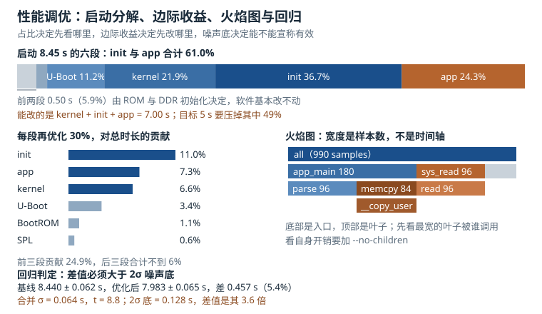

# 性能调优：启动剖析、CPU 与 IO、火焰图与回归

性能问题有一个特点：**它从来不缺解释，缺的是证据**。开机慢会被解释成"内核太大"，CPU 高会被解释成"算法不好"，IO 慢会被解释成"闪存不行"，网络慢会被解释成"带宽不够"。这些解释一半以上是错的，而错的原因几乎都一样——**测量点选错了**。

这一章讲四件事：怎么把启动时间拆成有边界的分段、怎么判断 CPU 与 IO 的真实瓶颈、怎么读火焰图、以及怎么证明"改动确实有效"。最后一件最容易被忽略，也最影响工程判断：**没有基线、没有噪声底的优化，只是把巧合当成了因果。**

## 1. 动机：三种最常见的错误归因

| 抱怨 | 最常见的错误归因 | 正确的第一手证据 |
|---|---|---|
| 开机要 8 秒 | "内核太大，要裁剪" | 各阶段时间戳，看 init 占了多少 |
| CPU 一直 100% | "应用算得太慢" | `us` 与 `sy` 的分解、`perf top` 的符号分布 |
| IO 只有 50 MB/s | "闪存性能差" | 队列深度、IO 大小、`aqu-sz` 与 `await` |
| 网络只有 20 Mbit/s | "带宽不够" | 窗口大小、RTT、重传计数 |
| 内存一直在涨 | "内存泄漏" | `MemAvailable`、slab 与 page cache 的分解 |

五条里有四条是"指标被误读"，不是"系统真的差"。下面这条动机案例是典型的启动时间误判。

::: motivation 8.45 秒的启动，前三次优化都打偏了
某工业网关要求 5 秒内点亮界面，实测 8.45 秒。团队按顺序做了三次优化：

第一次，裁内核：关掉一堆用不到的驱动与文件系统，内核阶段从 2.10 秒降到 1.85 秒，总时间变成 8.20 秒，只好了 3%。

第二次，换 U-Boot 的加载方式：把内核从网络加载改成从 eMMC 读，U-Boot 阶段从 1.60 秒降到 0.95 秒，总时间 7.55 秒，好了 8%。

第三次，加大 `readahead`、把 rootfs 从 SquashFS 改成 ext4，反而慢了 0.3 秒。

三次加起来只省了 0.9 秒。停下来做了一次完整的分段测量，才发现 init 阶段占了 3.10 秒，其中 2.4 秒是 `systemd` 在等一个根本不存在的网络设备超时。**把那条 `After=network-online.target` 去掉，启动直接掉到 5.6 秒，一次改动省了 2.85 秒。**
:::

这个案例的教训不是"要看数据"，而是**要看对的分段**。裁内核和换加载方式都在"看得见的地方"使劲，而真正的时间黑洞在一个没人打时间戳的阶段。

## 2. 直观：把时间拆开，把采样读懂



上图上方是 8.45 秒的六段分解，左中是"每段再优化 30% 对总时长的贡献"，右中是火焰图的读法，下方是回归判定的噪声底。

### 2.1 启动是一条有边界的时间线

启动过程可以切成六段，每段的测量手段不同：

| 阶段 | 从哪到哪 | 怎么测 | 能不能改 |
|---|---|---|---|
| BootROM | 上电到 ROM 交棒 | 示波器抓 UART 第一字节、ROM 日志 | 基本不能 |
| SPL | 到 DDR 初始化完成 | SPL 的 `debug()` 输出、GPIO 翻转 | 有限 |
| U-Boot | 到 `bootm` 跳转 | `bootstage` 时间戳、`tftpboot` 日志 | 能 |
| kernel | 到 `init` 启动 | `initcall_debug`、`bootgraph.pl`、`bootconfig` | 能 |
| init | 到关键服务就绪 | `systemd-analyze`、自建时间戳 | 能，收益常常最大 |
| app | 到界面可交互 | 应用自己的打点 | 能 |

**分段的边界必须由时间戳定义，不能由"感觉"定义。** 最常见的错误是把"kernel 打印最后一行"当成 kernel 结束，实际上 kernel 结束时 `init` 已经在跑了。

### 2.2 initcall_debug 与 bootgraph

内核提供两个层级的工具。轻量的是 `initcall_debug`：给内核命令行加这个参数，每个 initcall 会打印"调用"和"返回"两行，带耗时。把 `dmesg` 喂给 `scripts/bootgraph.pl` 就能画出时序图：

```bash
# 采集（注意串口波特率会放大耗时，见 2.3 节）
dmesg > /tmp/boot.log
perl scripts/bootgraph.pl /tmp/boot.log > /tmp/boot.svg

# 更精细的方式：ftrace 的 initcall 追踪，不开 printk
echo 1 > /sys/kernel/debug/tracing/events/initcall/initcall_start/enable
echo 1 > /sys/kernel/debug/tracing/events/initcall/initcall_finish/enable
```

重量级的是 `bootconfig`（Linux 5.5 起）+ `tp_printk`：把 ftrace 的缓冲区在启动早期就打开，全部 trace 存进内存，启动完再一次性 dump。它不经过串口，所以不失真：

```bash
# 内核命令行加：bootconfig
# /boot/config 里写：
ftrace.event.initcall.initcall_start.enable
ftrace.event.initcall.initcall_finish.enable
kernel.trace_printk = "tp_printk"
```

### 2.3 测量本身会改变结果

这是启动剖析里最隐蔽的陷阱。`initcall_debug` 的每一行都走 `printk`，而 `printk` 在串口控制台上是**同步阻塞**的。按 115200 波特率、8N1 算，一个字节 10 位，一行 80 字节要 6.94 毫秒；每个 initcall 两行就是 13.89 毫秒。400 个 initcall 就是 5.56 秒的额外时间——**比整个启动时间还长。**

所以：

1. 用 `initcall_debug` 时，把控制台设成 `quiet loglevel=0`，或者用 `bootconfig` 的 ftrace 方案；
2. 串口波特率提到 1.5 Mbaud，同样的 400 个 initcall 只多 0.43 秒；
3. 对比"开/关测量"两次的总时间，差值就是测量开销，必须从结论里扣掉。

### 2.4 CPU 的三个视角

"CPU 占用 90%"这句话本身没有信息量，要看它是哪个视角：

- **利用率**：`vmstat` 的 `us/sy/id/wa/st`。`wa` 是 IO 等待，被算进"非空闲"但不消耗 CPU；`st` 是被虚拟化偷走的时间；
- **饱和度**：运行队列长度 `r`（`vmstat` 第一列）与调度延迟。队列长度长期大于核数，说明 CPU 不够；延迟高但利用率不高，说明调度或优先级有问题；
- **有效算力**：IPC（每周期指令数）。`perf stat -e cycles,instructions` 得到 3.0e9 周期、2.1e9 指令，IPC = 0.70，说明每 10 条指令要停约 14 个周期，瓶颈在访存或分支，不在"算力不够"。

**三种视角指向三种不同的优化**：利用率高要减工作量或加核；饱和度高要调优先级或绑核；IPC 低要改数据布局或加缓存。

### 2.5 IO 与文件系统

块设备的性能由四个量决定：IO 大小、队列深度、访问模式（顺序/随机）、以及是否有缓存。`iostat -x 1` 的几个字段各有含义：

| 字段 | 含义 | 怎么用 |
|---|---|---|
| `r/s`、`w/s` | 每秒完成的 IO 数 | 算 IOPS |
| `rareq-sz`、`wareq-sz` | 平均请求大小 | 小于 16 KiB 说明没合并好 |
| `await` | 平均完成延迟（含排队） | 与设备标称延迟对比 |
| `aqu-sz` | 平均队列长度 | 小于 1 说明没压满 |
| `%util` | 设备忙的时间比例 | 对 NVMe 意义有限，对单队列设备有意义 |

`%util` 是最容易被误读的字段：它对"一次只能处理一个请求"的机械盘有意义，对支持深队列的 NVMe 与 eMMC 几乎没有意义——**队列深度 32、`%util` 100%，可能只是因为它一直在忙，而不是因为它满了。**

### 2.6 网络：先算管道，再看拥塞

TCP 的吞吐上限不是"带宽"，而是"窗口除以往返时间"：

$$B_{max} = \frac{W}{RTT}$$

1 Gbit/s、RTT 20 ms 的链路，BDP（带宽时延积）是 2.5 MB。窗口只有 64 KiB 时，单流吞吐是 $64\ \text{KiB} / 20\ \text{ms} = 3.28$ MB/s，约 26 Mbit/s——只有链路带宽的 2.6%。**这就是"千兆网卡只有 20 Mbit/s"的最常见原因，和网卡、交换机、驱动都无关。**

### 2.7 火焰图怎么读

火焰图（Flame Graph）把采样得到的调用栈聚合成一棵树，横轴是**样本数**（不是时间），纵轴是**调用深度**。三条规则必须记住：

1. **宽度 = 占比**。一帧的宽度等于它出现在多少个样本里，除以总样本数就是百分比；
2. **颜色没有语义**。颜色只是为了让相邻帧可区分，红黄蓝不代表"热"；
3. **自顶向下看"谁在等"，自底向上看"谁被调用"**。顶部的帧是叶子（正在执行的指令），底部的帧是入口（`main` 或中断向量）。

最常见的误读是"看到最宽的帧就去优化它"。如果那个宽帧是 `__copy_user`，优化它通常没用——它宽是因为上层在大量拷贝，真正的收益在减少拷贝次数，而不是把拷贝写快 5%。

### 2.8 收益评估：先有噪声底，再谈改进

任何优化都要回答三个问题：改了多少、改动是否可复现、以及有没有回归。做法是：

1. **固定条件**：同一台设备、同一个负载、CPU 频率锁 `performance`、关闭后台任务；
2. **多次采样**：至少 3 次，取中位数与标准差；
3. **算噪声底**：把 $2\sigma$ 当作"看不出来的差别"；小于它的改动不要宣称有效；
4. **做对照组**：A/B 交替跑，避免"越跑越快"的缓存效应；
5. **把基线写进 CI**：每次提交跑一次，超阈值就报警。

## 3. 定量：占比、采样与排队

### 3.1 启动时间的分解与占比

$$T_{boot} = \sum_{i=1}^{n} T_i, \qquad \text{share}_i = \frac{T_i}{T_{boot}}$$

占比决定优先级，但**优先级不等于收益**。真正的收益要看边际：

$$\Delta T = T_i \times k_i, \qquad \text{gain} = \frac{\Delta T}{T_{boot}}$$

$k_i$ 是第 $i$ 段的优化比例。一个占 22% 的阶段优化 30%，总时间只降 6.6%；一个占 37% 的阶段优化 30%，总时间降 11%。**先看占比，再算乘积，最后才决定做哪一个。**

### 3.2 Amdahl 定律与收益上限

如果只有占比 $f$ 的部分能被加速 $k$ 倍，整体加速比是：

$$S = \frac{1}{(1-f) + f/k}$$

启动场景里"不能动的部分"是 BootROM 与 SPL，约 0.50 秒。剩下的 7.95 秒即使无限加速，总时间也降不到 0.50 秒，加速比上限是 $8.45/0.50 = 16.9$。**这个上限在纸面上很大，但它提醒你：优化要盯住"可优化的部分"，而不是盯住总数。**

### 3.3 采样误差：5% 的函数要采多久

`perf` 是采样式剖析，一个占比 $p$ 的函数在 $n$ 个样本中出现的次数服从二项分布，相对误差约为：

$$\varepsilon = \sqrt{\frac{1-p}{n\,p}}$$

99 Hz 采 10 秒是 990 个样本。占比 5% 的函数约有 49.5 个样本，$\varepsilon = \sqrt{0.95/49.5} = 13.9\%$；占比 1% 的函数只有 9.9 个样本，$\varepsilon = 31.6\%$。**这意味着 1% 的差异在 10 秒采样里根本不可信**，要么延长采样，要么提高频率（但高频采样本身有开销）。

### 3.4 IO 的排队：Little 定律

对稳态系统，队列长度、到达率、停留时间满足：

$$L = \lambda W$$

在块设备上写成 IOPS、队列深度、延迟的关系：

$$\text{IOPS} = \frac{QD}{L_{lat}}, \qquad L_{lat} = \frac{QD}{\text{IOPS}}$$

$QD$ 是队列深度（未完成的请求数），$L_{lat}$ 是平均完成延迟。4 KiB 随机读、单请求延迟 80 微秒时，$QD = 1$ 只有 12500 IOPS，折合 51.2 MB/s；设备带宽上限 500 MB/s 时，4 KiB IOPS 的上限是 122070，对应 $QD = 32$ 时延迟 262 微秒。

**这组数说明："延迟低"和"吞吐高"是两件事。** 单请求延迟 80 微秒已经很好，但只要队列深度是 1，吞吐就上不去。

### 3.5 内存与 page cache

`free` 的第二行经常吓人：`buff/cache` 占了几个 GB，`free` 只剩几十 MB。这**不是内存泄漏**，是 page cache。判断可用内存看 `MemAvailable`（内核 3.14 起），它估算的是"不用换出就能分配的内存"：

$$\text{MemAvailable} \approx \text{MemFree} + \text{可回收的 page cache} + \text{可回收的 slab}$$

可回收的 page cache 不是全部：共享内存页（`Shmem`）、正在回写的页、被锁定的页都不能立即回收。工程上按 60% 到 80% 估算比较稳。1 GB 内存、匿名页 420 MB、内核 180 MB、page cache 524 MB（其中共享 40 MB）时，可回收约 $(524-40) \times 0.6 = 290$ MB，`MemAvailable` 约 674 MB。

### 3.6 网络的带宽时延积

$$BDP = \frac{BW}{8} \times RTT$$

1 Gbit/s、20 ms 时 $BDP = 2.5$ MB。要达到满速，发送窗口必须大于 BDP：

$$W_{min} = BDP = 2.5\ \text{MB}$$

实际窗口还受接收缓冲 `net.core.rmem_max`、`tcp_rmem`、以及接收端应用读取速度的限制。**所以"调大窗口"和"调大缓冲"是两件事，前者是 TCP 参数，后者是内核参数，缺一不可。**

### 3.7 回归判定

两组多次测量的均值差是否可信，用合并标准差的 t 统计量：

$$s_p = \sqrt{\frac{(n_1-1)s_1^2 + (n_2-1)s_2^2}{n_1+n_2-2}}, \qquad t = \frac{\bar{x}_1 - \bar{x}_2}{s_p\sqrt{1/n_1 + 1/n_2}}$$

工程上更实用的判据是**噪声底**：把 $2 s_p$ 当作"分辨不出的差别"。差值小于噪声底的改动，不管看起来多合理，都不要写进优化报告。

## 4. 算例：把 8.45 秒压到 5 秒

**第一步：分解。** 上电到界面可交互，六段耗时：

| 阶段 | 时间 | 占比 | 累计 |
|---|---|---|---|
| BootROM | 0.32 s | 3.8% | 3.8% |
| SPL | 0.18 s | 2.1% | 5.9% |
| U-Boot | 0.95 s | 11.2% | 17.2% |
| kernel | 1.85 s | 21.9% | 39.1% |
| init | 3.10 s | 36.7% | 75.7% |
| app | 2.05 s | 24.3% | 100% |

**第二步：算边际收益。** 每段优化 30%：

$$T_{init} \times 0.3 = 0.93\ \text{s} \Rightarrow 11.0\%,\qquad T_{kernel} \times 0.3 = 0.555\ \text{s} \Rightarrow 6.6\%$$

BootROM 优化 30% 只省 0.096 秒（1.1%），SPL 只省 0.054 秒（0.6%）。**这两段加起来 5.9%，且基本动不了**，所以任何"启动优化计划"都应该先把它们划掉。

**第三步：算组合优化。** 假设 kernel 减 35%、init 减 25%、app 减 40%：

$$T' = 8.45 - 1.85 \times 0.35 - 3.10 \times 0.25 - 2.05 \times 0.40 = 6.21\ \text{s}$$

降幅 26.5%，加速比 1.36。

**第四步：算达到 5 秒的缺口。** 需要削减 3.45 秒，占总时间 40.8%。BootROM 与 SPL 的 0.50 秒动不了，剩下 7.95 秒要压掉 43.4%。

用 Amdahl 反推：如果 kernel、init、app 三段都优化 $k$ 比例，总时间是

$$T(k) = 0.50 + (1.85 + 3.10 + 2.05)(1-k) = 0.50 + 7.00(1-k)$$

令 $T = 5.0$，得 $k = 0.357$。**三段都要优化 36% 以上才能达标**，这已经是"重写启动流程"的量级，不是"关几个驱动"。于是团队改了两个架构决策：init 并行化（去掉了串行等待），app 把首屏渲染提前到网络初始化之前。两项合计省了 2.6 秒，加上 kernel 的 0.6 秒，落到 5.2 秒。

**第五步：验算采样是否够。** 用 `perf record -F 99` 采 10 秒验证 init 阶段的耗时分布，得到 990 个样本。init 阶段占 36.7%，约 363 个样本，相对误差 $\sqrt{0.633/363} = 4.2\%$，可信。但如果要分辨 app 阶段里"某个占 1% 的函数"，只有 9.9 个样本，误差 31.6%，必须延长到 60 秒或提高频率。

**第六步：验证 IO 不是瓶颈。** `iostat -x` 显示 `rareq-sz` 只有 6.2 KiB、`aqu-sz` 0.4，说明请求没合并、队列也没压满。把 readahead 从 128 KiB 调到 512 KiB，`rareq-sz` 升到 18 KiB，启动时的 rootfs 读取快了 0.4 秒。**这一步的判据不是 `%util`，而是 `rareq-sz` 与 `aqu-sz`。**

**第七步：验证网络不是瓶颈。** 应用的配置下发走 TCP，实测 26 Mbit/s。算一下：窗口 64 KiB，RTT 20 ms，$B_{max} = 64\ \text{KiB}/0.02 = 3.28$ MB/s = 26.2 Mbit/s，与实测吻合，说明瓶颈是窗口不是带宽。把 `tcp_rmem` 与 `tcp_wmem` 上限提到 4 MB，窗口涨到 2 MB，吞吐到 800 Mbit/s。

**第八步：做回归判定。** 基线三次 8.42、8.51、8.39 秒，均值 8.440、标准差 0.062；优化后三次 7.98、8.05、7.92 秒，均值 7.983、标准差 0.065：

$$s_p = \sqrt{\frac{2 \times 0.062^2 + 2 \times 0.065^2}{4}} = 0.064$$

$$t = \frac{8.440 - 7.983}{0.064 \times \sqrt{2/3}} = 8.8$$

$t = 8.8$ 远大于 2，差值可信。噪声底 $2 s_p = 0.128$ 秒，实测差值 0.457 秒是它的 3.6 倍。**如果差值只有 0.08 秒（小于噪声底），这次"优化"就不能写进报告——它可能只是当天的温度低了两度。**

## 5. 工程含义：工具、配置与测量纪律

### 5.1 工具矩阵

| 问题 | 工具 | 关键参数 |
|---|---|---|
| 启动各阶段 | `bootgraph.pl`、`systemd-analyze`、`bootconfig` | `initcall_debug`、`critical-chain` |
| CPU 热点 | `perf top`、`perf record -g` | `-F 99`、`--call-graph dwarf` |
| 调用图 | `perf script` + `stackcollapse-perf.pl` + `flamegraph.pl` | `--no-children` |
| 内核函数耗时 | `ftrace` 的 `function_graph`、`trace-cmd` | `-p function_graph` |
| 调度延迟 | `cyclictest`、`perf sched latency` | `-p 80 -i 1000` |
| IO | `iostat -x 1`、`blktrace` | `rareq-sz`、`aqu-sz`、`await` |
| 内存 | `vmstat 1`、`/proc/meminfo` | `MemAvailable`、`pgscan` |
| 网络 | `ss -ti`、`ethtool -S`、`iperf3` | `cwnd`、`retrans`、`drop` |

`perf` 在 ARM 上经常拿不到用户态调用栈，因为默认编译省掉了帧指针。两条路：给内核与用户态加 `-fno-omit-frame-pointer`，或者用 `--call-graph dwarf`（需要调试信息，开销更大）。

### 5.2 需要打开的内核配置

```text
CONFIG_PERF_EVENTS=y
CONFIG_FTRACE=y
CONFIG_FUNCTION_TRACER=y
CONFIG_FUNCTION_GRAPH_TRACER=y
CONFIG_KALLSYMS=y
CONFIG_FRAME_POINTER=y
CONFIG_DEBUG_INFO=y
CONFIG_SCHEDSTATS=y
CONFIG_BLK_DEV_IO_TRACE=y
```

这些配置本身会让内核变大几百 KB，也会让调度器略慢（`SCHEDSTATS` 有开销）。**量产镜像里通常只保留 `PERF_EVENTS` 与 `KALLSYMS`，把 `FTRACE` 与 `DEBUG_INFO` 留给调试版本。**

### 5.3 测量纪律

1. **锁频**：`cpupower frequency-set -g performance`，否则 `ondemand`/`schedutil` 会让两次测量差 20% 以上；
2. **绑核**：`taskset -c 2` 把被测进程固定，`echo 2 > /proc/irq/<n>/smp_affinity_list` 把中断固定；
3. **冷启动**：测启动时间必须真断电，不能 `reboot`（缓存、DDR 训练状态都不一样）；
4. **多测取中位数**：3 次太少，5 次起步；均值受离群值影响，中位数更稳；
5. **记录环境**：温度、供电电压、软件版本，否则三个月后无法复现。

### 5.4 生产环境的采样

生产设备上不能长期跑 `perf record`（开销 5% 到 15%）。可行的做法是：

- **低频采样**：`perf record -F 9`，开销降到 1% 以下，只看宏观分布；
- **触发式采集**：用 `perf record --delay` 或外部脚本在检测到异常时启动 10 秒采样；
- **常驻计数器**：`/proc/stat`、`/proc/diskstats`、`/proc/net/snmp` 每秒采一次，成本可以忽略；
- **离线符号化**：设备上只存 build-id 与原始样本，回传到构建机再 `perf report` 解析符号。

## 6. 常见坑：现象、原因与解决

::: pitfall 坑一：`perf record` 跑完了，火焰图里全是 `[unknown]`
**现象**：`perf report` 显示大量 `[unknown]`，用户态栈完全缺失，只能看到 `__libc_start_main` 一层。

**原因**：三种可能。内核的 `perf_event_paranoid` 太高（`/proc/sys/kernel/perf_event_paranoid` 为 2 或 3），禁止非 root 采样内核；用户态二进制被 strip 掉了符号表；ARM 上缺帧指针又没用 `--call-graph dwarf`。

**解决**：`echo 1 > /proc/sys/kernel/perf_event_paranoid`（调试期）；保留未 strip 的二进制与 `build-id`，用 `perf report --symfs` 指向符号目录；改用 `perf record --call-graph dwarf,16384`，或者重新编译加 `-fno-omit-frame-pointer`。**先确认是权限、符号、还是调用图模式的问题，再动手。**
:::

::: pitfall 坑二：启动时间优化了 U-Boot，总时间一点没变
**现象**：U-Boot 阶段从 1.60 秒降到 0.95 秒，但"上电到界面"还是 8.45 秒。

**原因**：优化错了阶段。init 占了 36.7%，U-Boot 只占 11.2%，砍掉 0.65 秒只影响总时间的 7.7%。另一种可能是测量点漂移：原来"启动完成"的时间戳打在 kernel 最后一行，改动后打在了 app 首帧，两次测的根本不是同一件事。

**解决**：先画完整的分段瀑布图，确认瓶颈段；把"启动完成"定义成唯一可观测的事件（比如某个 GPIO 翻转或串口固定字符串），所有对比都用同一个事件。**测量点不一致的优化报告，等于没有报告。**
:::

::: pitfall 坑三：`free` 显示内存只剩 30 MB，怀疑泄漏，重启后依旧
**现象**：设备跑一天后 `free` 显示 `free` 只剩 30 MB，`buff/cache` 占了 600 MB，业务偶发 `fork` 失败。

**原因**：page cache 占满了空闲内存，这是正常行为；`fork` 失败更可能是 `overcommit` 策略或 `vm.max_map_count` 的限制，而不是真的没内存。真正的泄漏要看匿名页（`AnonPages`）是否随时间单调上涨。

**解决**：用 `MemAvailable` 而不是 `free` 判断可用内存；用 `/proc/meminfo` 的 `AnonPages`、`Slab`、`SReclaimable` 做分解，连续采 24 小时画趋势；如果是 slab 涨，用 `slabtop` 定位到具体 cache；如果确实是 page cache 挤压，调 `vm.vfs_cache_pressure` 或给业务加 `madvise(MADV_DONTNEED)`。**page cache 是缓存，不是泄漏。**
:::

::: pitfall 坑四：`iostat` 的 `%util` 到 100%，但吞吐只有标称的三分之一
**现象**：eMMC 顺序读只有 90 MB/s（标称 300 MB/s），`iostat -x` 显示 `%util` 100%、`aqu-sz` 0.6、`rareq-sz` 8 KiB。

**原因**：请求没有合并。`rareq-sz` 只有 8 KiB，说明上层每次只发一个小请求，块层的合并队列没起作用；`aqu-sz` 0.6 说明队列几乎是空的，设备不是在"忙"，而是在"等"。`%util` 对这种场景没有诊断价值。

**解决**：把 `readahead` 调大（`blockdev --setra 1024`）、把应用改成大块顺序读、检查文件系统是否开了 `noop` 之外的调度器；对 eMMC，确认分区对齐与 `discard` 策略。**判断"设备是否饱和"看 `aqu-sz` 与 `await`，不要看 `%util`。**
:::

::: pitfall 坑五：优化后 A/B 对比快了 5%，上线后用户说更慢了
**现象**：实验室里 A/B 对比，新版本启动快 5%，置信度很高；上线后一部分设备反而慢了 0.5 秒。

**原因**：实验室的"快"来自缓存效应：A 跑完再跑 B，B 的 rootfs 已经在 page cache 里。另外实验室设备是同一批次，而上线设备有不同的闪存批次、不同的温度环境。**5% 的改善小于设备间的差异。**

**解决**：A/B 交替跑（ABAB），每次冷启动；把样本扩大到至少 10 台不同批次的设备；用"分位数"而不是均值比较（P50 与 P95 都要看）；把结果写进回归基线，任何超过噪声底的退化都报警。**实验室里的 5%，到了现场常常是噪声。**
:::

## 7. 自测题

<details><summary>题一：启动 8.45 秒，kernel 1.85 秒、init 3.10 秒、app 2.05 秒。kernel 优化 30% 能省多少、占总时间多少？要达到 5 秒，若只优化 init 与 app，各需优化多少比例？</summary>

kernel 优化 30%：

$$\Delta T = 1.85 \times 0.3 = 0.555\ \text{s}, \qquad \frac{0.555}{8.45} = 6.6\%$$

要压到 5 秒，需削减 3.45 秒。扣掉动不了的 BootROM 与 SPL（0.50 秒），init 与 app 合计 5.15 秒，需要削减：

$$3.45 = 5.15 \times k \Rightarrow k = 0.67$$

**至少要优化 67%**。这已经不是"调参数"，而是"改架构"：init 要并行化、去掉串行等待，app 要把首屏与业务初始化解耦。

这个数字的用途是**尽早判断目标是否现实**。如果评审时发现"需要优化 67%"，就该讨论"是否放宽到 6 秒"，而不是让团队花三个月去追一个不可能的数字。
</details>

<details><summary>题二：`perf record -F 99` 采 10 秒，一个占 5% 的函数大约有多少样本？相对误差多少？要分辨 1% 的差异需要采多久？</summary>

样本总数 $99 \times 10 = 990$。占 5% 的函数约 49.5 个样本：

$$\varepsilon = \sqrt{\frac{1-0.05}{49.5}} = 13.9\%$$

95% 置信区间约 ±27%，也就是说"5%"这个数字实际可能是 3.6% 到 6.4%。

要分辨 1% 的差异（比如 5% 与 6%），需要把误差压到 0.5 个百分点以内，即相对误差小于 10%。样本数需要：

$$n \ge \frac{0.95}{p\,\varepsilon^2} = \frac{0.95}{0.05 \times 0.01} = 1900$$

按 99 Hz 需要约 19 秒。**经验法则是"要分辨 1% 的差异，至少采 20 秒"。** 这也解释了为什么很多"优化 2%"的报告经不起复现。
</details>

<details><summary>题三：4 KiB 随机读，单请求延迟 80 微秒，队列深度 1。IOPS 与带宽各是多少？设备带宽上限 500 MB/s 时，队列深度要加到多少才能压满？此时延迟多少？</summary>

$$QD = 1:\quad \text{IOPS} = \frac{1}{80\ \mu s} = 12500, \qquad BW = 12500 \times 4096 = 51.2\ \text{MB/s}$$

压满 500 MB/s 需要：

$$\text{IOPS}_{max} = \frac{500 \times 10^{6}}{4096} = 122070$$

$$QD = \text{IOPS} \times L = 122070 \times 80 \times 10^{-6} = 9.77 \approx 10$$

所以队列深度加到 10 左右就能压满，此时延迟仍是 80 微秒。若实际延迟随队列上升（比如 $QD = 32$ 时 262 微秒），说明设备内部排队了，此时 IOPS 还是 122070，吞吐不变，但单请求延迟变差。

**结论：吞吐看 IOPS × 块大小，延迟看单请求停留时间，两者不是一回事。** 应用要低延迟就别堆队列，要吞吐就堆队列。
</details>

<details><summary>题四：1 Gbit/s 链路、RTT 20 ms，窗口 64 KiB 时单流吞吐多少？要跑满需要多大窗口？如果把 RTT 降到 2 ms 呢？</summary>

$$B = \frac{64\ \text{KiB}}{20\ \text{ms}} = 3.28\ \text{MB/s} = 26.2\ \text{Mbit/s}$$

只有链路的 2.6%。

跑满 1 Gbit/s 需要：

$$W = \frac{1000 \times 10^{6}}{8} \times 0.02 = 2.5\ \text{MB}$$

RTT 降到 2 ms 时，同样 64 KiB 窗口能到 262 Mbit/s，BDP 降到 250 KB，256 KiB 窗口就够跑满。

这解释了两件事：**局域网里"调窗口没用"是因为 BDP 很小；广域网里"带宽够但速度慢"几乎总是窗口不够。** 调优前先用 `ss -ti` 看 `cwnd` 与 `rtt`，再决定是调窗口还是查丢包。
</details>

## 8. 参考资料

- Brendan Gregg，《Systems Performance: Enterprise and the Cloud, 2nd Edition》：USE 方法、CPU/内存/IO/网络的观测点与工具矩阵、火焰图章节。
- Linux 内核文档 `Documentation/admin-guide/bootconfig.rst`：启动时间追踪的 bootconfig 键名、`tp_printk` 的输出格式与缓冲区大小。
- Linux 内核文档 `Documentation/trace/ftrace.rst`、`Documentation/trace/function-graph.rst`：函数图追踪的开启方式、`funcgraph-proc` 与延迟统计。
- Linux 内核源码 `scripts/bootgraph.pl`：`initcall_debug` 输出的解析规则与时间轴生成逻辑。
- Linux 内核源码 `kernel/printk/printk.c`：控制台同步写路径，解释了为什么串口 `printk` 会显著拉长启动时间。
- perf 项目文档 `perf-record(1)`、`perf-report(1)`：`-F` 采样频率、`--call-graph` 的三种模式、`--no-children` 与 `--percent-limit`。
- Brendan Gregg，FlameGraph 工具集（`stackcollapse-perf.pl`、`flamegraph.pl`）：调用栈折叠格式与火焰图生成流程。
- Linux 内核文档 `Documentation/scheduler/sched-stats.rst`、`Documentation/admin-guide/cgroup-v2.rst`：PELT 负载跟踪、调度延迟统计与 `cpu.max` 的限流语义。
- sysstat 项目文档与 Linux 内核 `Documentation/block/queue-sysfs.rst`：`await`、`aqu-sz`、`rareq-sz` 的定义，以及 `nr_requests`、`read_ahead_kb` 等队列参数。
