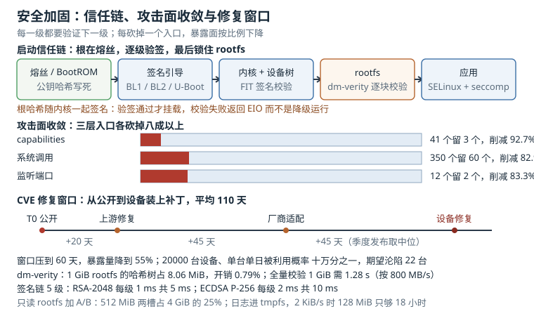

# 安全加固：最小权限、只读 rootfs 与补丁节奏

一台出厂设备在机房里安静运行六个月，然后某天开始对外发垃圾流量。回溯发现：出厂镜像里 root 口令是默认值，SSH 允许密码登录，`/etc` 可写，攻击者改了启动脚本并留了后门。整个链条上没有一处"高危漏洞"，全是配置。

安全加固（Security Hardening）容易被写成一张打勾清单，但清单本身不解决问题。真正决定一台设备是否被攻破的是三个量的乘积：**暴露面有多大、补丁到得多快、单点失守的代价有多高**。这三项都能算，而且算出来的优先级常常与直觉相反——**先把入口砍掉，比补一个 CVE 的收益高一个数量级**。

## 1. 动机：加固是三条曲线的交点

设备的攻击面由三类入口构成：

| 入口类型 | 典型形态 | 收敛手段 |
|---|---|---|
| 网络入口 | 监听端口、调试服务、UPnP、mDNS | 关服务、改绑定地址、防火墙默认拒绝 |
| 本地入口 | 串口、USB、SD 卡、调试接口 | 生产镜像移除、物理封堵、登录鉴权 |
| 内核入口 | 系统调用接口、设备节点、可加载模块 | seccomp、权限收敛、模块签名 |

现场最常见的失守方式，按比例从高到低大致是：默认或弱口令、未关闭的调试服务、可写的系统分区、过期的第三方库、以及内核或驱动漏洞。**前四项都不是"漏洞"，而是配置**，它们占了绝大多数实际事件。

| 现象 | 根因 | 先查什么 |
|---|---|---|
| 设备反复被扫描、日志里大量登录失败 | 22 端口对公网开放，且允许密码登录 | `ss -lntup`、`sshd_config`、防火墙规则 |
| 重启后配置被还原成出厂值 | rootfs 只读，改动写进了 overlay | `mount`、`/etc/fstab`、overlay 上层位置 |
| 应用以 root 运行，被拿下即全盘失守 | 没有降权，或保留了 `CAP_SYS_ADMIN` | `getpcaps`、systemd unit 的 `User=` |
| 升级包被替换后仍能启动 | 没有签名校验，或校验公钥可改 | 启动日志、FIT 签名、熔丝状态 |
| 已知 CVE 长期不修 | 没有 SBOM，不知道用了哪个版本 | 依赖清单、`strings` 版本号、补丁记录 |

::: motivation 一台默认口令的设备
某批网关出货 3000 台，为了"方便现场调试"，镜像里保留了 dropbear，root 口令是厂商缩写加年份，`/etc` 可写。设备部署在客户内网，看似安全。

两年后的一次扫描发现，其中 217 台已经被植入挖矿程序。攻击路径完全一致：弱口令登录、写 `/etc/init.d/` 下的启动脚本、关闭日志、对外连矿池。

修复花了三个月，成本远高于当初把 dropbear 从生产镜像里删掉。更麻烦的是**现场无法确认是否有设备被改过**：rootfs 可写，没有完整性校验，只能全部重刷。

如果把三件事做在前面——生产镜像不含 SSH、rootfs 只读且由 dm-verity 校验、启动链验签——这次事件的影响面会从 217 台降到 0 台。
:::

这个例子的关键不是"弱口令很危险"这种常识，而是**加固的三个层次必须同时到位**：入口收敛让攻击者进不来，只读与校验让进来了也改不动，签名让改了也起不来。缺任何一层，另外两层都会被绕过。

## 2. 直观：一条从熔丝到进程的信任链



上图上半是从熔丝到应用的五级信任链，中间是三类入口的收敛比例，下半是 CVE 从公开到设备修复的时间轴。

### 2.1 启动信任链

信任链（Chain of Trust）的根必须不可改。在 ARM 平台上，这个根通常是 SoC 内部的一次性可编程存储（OTP 或 eFuse），里面烧着第一级引导代码的公钥哈希。

```text
熔丝（公钥哈希）
  → BootROM 验签 BL1
    → BL1 验签 BL2 / BL31
      → BL2 验签 U-Boot 或直接验签内核 FIT
        → 内核挂载 rootfs 前校验 dm-verity 根哈希
          → init 启动后由 SELinux 约束每个进程
```

每一级只信任"上一级验证过的下一级"，整条链的安全性等于最弱一环。工程上最常见的破口是**调试版本与生产版本共用同一把密钥**，或者**生产镜像里保留了可以关闭校验的启动参数**。

### 2.2 只读 rootfs 与可写 overlay

只读 rootfs 的价值不在"省空间"，而在**把"被篡改"变成"起不来"**。常见组合是：

- 根文件系统用只读的 squashfs 或 erofs，由 dm-verity 做逐块校验；
- `/var`、`/tmp`、`/run` 挂 tmpfs 或独立可写分区；
- 需要持久化的配置放独立分区，单独做完整性与备份。

dm-verity 的原理是把 rootfs 按 4 KiB 切块，每块算一个 SHA-256，这些哈希再按同样方式组成上层，直到只剩一个根哈希。根哈希由引导程序在验签后传给内核，任何一块数据被改，校验就失败。

失败后的行为由内核参数显式选择，默认值与三个显式策略不能混为一谈：**默认（不加参数）**在哈希不匹配时返回 `EIO`，读失败但系统继续运行；`ignore_corruption` 只把错误记入日志，然后把数据原样返回，等于校验形同虚设；`restart_on_corruption` 触发系统重启；`panic_on_corruption` 直接 panic。生产设备通常在 `restart_on_corruption` 与 `panic_on_corruption` 之间显式选择，而不是停在默认的 `EIO`。

### 2.3 SELinux 与 AppArmor

两种强制访问控制（Mandatory Access Control，MAC）机制的思路不同：

| 维度 | SELinux | AppArmor |
|---|---|---|
| 模型 | 标签制，类型强制（Type Enforcement） | 路径制，按程序路径匹配 |
| 策略单位 | 全局策略，编译后加载 | 每个程序一个 profile |
| 表达力 | 强，可表达主体-客体-操作的细粒度关系 | 中，主要约束文件、网络、能力 |
| 上手成本 | 高，需要理解标签与策略语言 | 低，profile 接近配置文件 |
| 嵌入式适配 | 需要文件系统支持扩展属性，策略体积较大 | 对文件系统要求低，profile 体积小 |
| 典型发行版 | RHEL、Fedora、Android | Ubuntu、SUSE |

选择标准很实际：**多租户、强隔离、合规要求**选 SELinux；**单用途设备、快速上线、团队没有 SELinux 经验**选 AppArmor。两者都不要在 `permissive` 或 `complain` 模式下出货——那只是"记录但不拦截"，等于没有。

### 2.4 capabilities 与 seccomp

传统 Unix 把特权一刀切成 root 与非 root，粒度太粗。能力（Capabilities）把 root 的特权拆成 41 个独立单元，进程可以只保留需要的几个：

| 能力 | 允许什么 | 典型需要者 |
|---|---|---|
| `CAP_NET_BIND_SERVICE` | 绑定 1024 以下端口 | Web 服务 |
| `CAP_NET_RAW` | 原始套接字 | ping、抓包 |
| `CAP_SETUID` / `CAP_SETGID` | 切换用户与组 | 需要降权的守护进程 |
| `CAP_SYS_TIME` | 设置系统时间 | 时间同步服务 |
| `CAP_SYS_ADMIN` | 挂载、命名空间等大量操作 | 几乎不该给任何业务进程 |

`CAP_SYS_ADMIN` 被称为"新的 root"，因为它覆盖的能力太广。业务进程保留它，等于没有降权。

seccomp 再往下收一层：限制进程能调用哪些系统调用。默认的 Linux 有 300 多个系统调用，一个只做串口读写的守护进程可能只需要几十个。seccomp 过滤器用 BPF 程序实现，匹配到不允许的调用时，由返回值决定动作：`SECCOMP_RET_ERRNO` 返回指定错误码；`SECCOMP_RET_KILL_THREAD` **只终止触发调用的那个线程**；`SECCOMP_RET_KILL_PROCESS` 终止整个进程。此外还有 `TRAP`（发送 `SIGSYS`）、`USER_NOTIF`（交给用户态监督进程裁决）、`LOG`（记录后放行）与 `ALLOW`。注意**不存在"杀死整个进程组"这个动作**：多线程程序里误用 `KILL_THREAD` 只会留下半死的进程，要连坐必须用 `KILL_PROCESS`。

seccomp 有两个硬约束：过滤器一旦加载不能放松，只能更严；使用过滤器通常需要先设置 `no_new_privs`，否则 setuid 程序可以绕过。

### 2.5 服务面收敛与 SSH

出厂镜像里"多装一个服务"的代价，往往比想象中大：它带来一个监听端口、一组配置项、一份依赖库、以及一条未来的 CVE 路径。

收敛的顺序是：**先删，再关，最后才是限制**。

1. 删：生产镜像不安装调试工具、不需要的服务、编译器和包管理器。
2. 关：必须保留的服务改为按需启动（socket activation）或绑定到本地回环。
3. 限制：确实要暴露的，做认证强化、速率限制、来源限制。

SSH 是最典型的例子。嵌入式设备常用 dropbear 或 OpenSSH，两种都必须做同样的收敛：

```text
PermitRootLogin no
PasswordAuthentication no
KbdInteractiveAuthentication no
AllowUsers maint
AllowTcpForwarding no
X11Forwarding no
MaxAuthTries 3
LoginGraceTime 20
```

只留公钥登录、只允许一个运维账号、禁掉转发。更进一步的做法是**生产固件根本不含 SSH**，需要现场调试时通过签名的调试固件临时开启，并设置自动过期。

### 2.6 安全启动与签名怎么配合

安全启动（Secure Boot）与镜像签名是两件事，必须配合：

- **安全启动**保证"从熔丝到内核"这一段没有被替换；
- **镜像签名**保证"升级包"来自可信方；
- **dm-verity 根哈希签名**把两者接起来：rootfs 的完整性由启动链传递下来的根哈希保证。

如果只做安全启动不做镜像签名，攻击者可以推一个"合法签名但内容恶意"的旧版本固件做降级攻击。所以还需要**版本单调递增**与**防回滚计数**（存在 OTP 或受保护分区里）。

密钥管理是这条链上最容易出问题的地方：开发密钥与生产密钥必须分离，生产私钥放 HSM，公钥哈希烧熔丝后不可更改。**熔丝一旦烧错，整批板子报废**，所以量产流程里要有一步"烧录后回读校验"。

## 3. 定量：四个可以算的量

### 3.1 攻击面收敛比例

设收敛前的入口数为 $S_{\text{before}}$，收敛后为 $S_{\text{after}}$：

$$r = 1 - \frac{S_{\text{after}}}{S_{\text{before}}}$$

这个比值本身不是安全性的度量，但它是**优先级排序的依据**：先砍掉比例最大的那一类入口。

### 3.2 CVE 修复窗口与暴露量

设备从"CVE 公开"到"补丁装上"的窗口为

$$W = t_{\text{detect}} + t_{\text{vendor}} + \frac{T_{\text{release}}}{2}$$

$t_{\text{detect}}$ 是从公开到团队注意到的时间，$t_{\text{vendor}}$ 是芯片或方案商适配到 BSP 的时间，$T_{\text{release}}$ 是产品发布周期，取一半表示平均等待。

暴露量用"设备-天"衡量：

$$E = N \cdot W \cdot p$$

$N$ 为在网设备数，$p$ 为单台设备单日被成功利用的概率。$p$ 很难准确估计，但**它的绝对值不影响排序**：只要 $p$ 相同，$E$ 与 $N \cdot W$ 成正比。

### 3.3 只读 rootfs 的容量与校验开销

dm-verity 的哈希树每 4 KiB 数据块产生 32 字节哈希，第一层开销比例为

$$\frac{32}{4096} = \frac{1}{128} \approx 0.78\%$$

上层再叠加，总开销略高于 0.78%。校验时间：

$$t_{\text{verify}} = \frac{S}{B_{\text{sha}}}$$

$S$ 为数据量，$B_{\text{sha}}$ 为哈希吞吐。注意 dm-verity 是**按需校验**：只有被读到的块才校验，所以启动时间取决于启动过程实际读了多少数据，不是整个分区大小。

### 3.4 认证强度与启动时间

口令空间与暴力破解时间：

$$H = L \cdot \log_2 |A|,\qquad t_{\text{brute}} = \frac{|A|^L}{\lambda}$$

$L$ 为长度，$|A|$ 为字符集大小，$\lambda$ 为每秒尝试次数。在线攻击的 $\lambda$ 受限于服务端限速，离线攻击的 $\lambda$ 受限于哈希算法与硬件。

签名链的启动开销：

$$T_{\text{boot}} = n_{\text{stage}} \cdot t_{\text{sig}}$$

$n_{\text{stage}}$ 为需要验签的级数，$t_{\text{sig}}$ 为单次验签时间。

## 4. 算例：六个账本

### 4.1 算例一：三层入口的收敛

| 入口 | 收敛前 | 收敛后 | 削减比例 |
|---|---|---|---|
| capabilities | 41 | 3 | $1 - 3/41 = 92.7\%$ |
| 系统调用 | 350 | 60 | $1 - 60/350 = 82.9\%$ |
| 监听端口 | 12 | 2 | $1 - 2/12 = 83.3\%$ |

三层叠加不是简单相乘，因为它们不是独立的：一个只保留 3 个能力、60 个系统调用、2 个端口的进程，其可利用面比任何一个单层指标都小得多。但**用叠加值来宣传是错的**，正确的说法是"每一层各自削减了多少"。

服务数量的收敛同样显著：出厂镜像 81 个 systemd unit 砍到 18 个，削减 77.8%。每砍掉一个 unit，就少一个进程、少一组依赖、少一条升级路径。

### 4.2 算例二：CVE 窗口与期望沦陷数

设 $t_{\text{detect}} = 20$ 天、$t_{\text{vendor}} = 45$ 天、$T_{\text{release}} = 90$ 天：

$$W = 20 + 45 + \frac{90}{2} = 110\ \text{天}$$

20000 台在网设备：

$$E = 20{,}000 \times 110 = 2{,}200{,}000\ \text{设备-天}$$

若单台单日被利用概率为 $10^{-5}$：

$$\text{期望沦陷} = 2.2 \times 10^6 \times 10^{-5} = 22\ \text{台}$$

概率降到 $10^{-6}$ 则是 2.2 台。**这两个数字的差别就是"要不要做入口收敛"的全部理由**：降低 $N \cdot W$ 与降低 $p$ 是同一条曲线上的两个方向。

### 4.3 算例三：补丁节奏的收益

发布周期从 90 天压到 45 天：

$$W' = 20 + 45 + \frac{45}{2} = 87.5\ \text{天}$$

$$E' = 20{,}000 \times 87.5 = 1{,}750{,}000\ \text{设备-天}$$

只看发布项，$45/90 = 50\%$；但整体窗口只从 110 降到 87.5，降幅 20.5%。因为 $t_{\text{detect}}$ 与 $t_{\text{vendor}}$ 是固定成本。

这个结论很重要：**只压缩发布周期，收益是有上限的**。要把窗口压到 60 天以内，必须同时压缩检测时间（订阅 CVE 源、建立 SBOM）与厂商适配时间（选长周期维护的 BSP、或者自己维护关键补丁）。

### 4.4 算例四：dm-verity 的空间与时间

1 GiB rootfs，4 KiB 块、SHA-256：

第一层 $1024^3/4096 = 262{,}144$ 个哈希，每个 32 字节，共 8 MiB；第二层 $8 \times 1024^2/4096 \times 32 = 64$ KiB；第三层 512 字节。总计

$$1024 + 8 + 0.0625 + 0.0005 \approx 1032.06\ \mathrm{MiB}$$

开销 $8.06/1024 = 0.79\%$。

校验时间按不同吞吐：

| 哈希吞吐 | 校验 1 GiB 耗时 |
|---|---|
| 200 MB/s（纯软件，低端核） | 5.12 s |
| 800 MB/s（带 NEON 优化） | 1.28 s |
| 1500 MB/s（带硬件加速） | 0.68 s |

5.12 秒对启动时间敏感的设备不可接受，但**只有被读到的块才校验**，实际启动读入的数据可能只有 50 到 100 MB，对应 0.25 到 0.5 秒。验收时要测真实启动路径的校验量，而不是拿分区大小估算。

### 4.5 算例五：口令强度与限速

8 位、62 字符集（大小写字母加数字）：

$$H = 8 \times \log_2 62 = 47.6\ \text{bit}$$

状态空间 $62^8 = 2.18 \times 10^{14}$。若攻击者每秒尝试 10 次：

$$t_{\text{brute}} = \frac{2.18 \times 10^{14}}{10 \times 86400 \times 365} = 6.92 \times 10^5\ \text{年}$$

看起来无懈可击，但这是**在线攻击**的数字。真正的风险在离线场景：拿到哈希后可以用 GPU 每秒尝试上亿次。按 $10^8$ 次/秒算，$62^8 = 2.18 \times 10^{14}$，穷尽需要 $2.18 \times 10^{14} / 10^8 = 2.18 \times 10^6$ 秒，约 **25 天/哈希**——不是几分钟。要在 600 秒内穷尽同一空间，需要 $2.18 \times 10^{14}/600 \approx 3.64 \times 10^{11}$ 次/秒，比 $10^8$ 次/秒高约 3600 倍；换句话说，"几分钟破"成立的前提是口令弱得多，比如 8 位纯数字（$10^8$ 种，按 $10^8$ 次/秒约 1 秒）。所以结论不是"8 位够用"，而是：

- 在线入口做限速（3 次每 10 分钟，即 $0.005$ 次每秒），破解时间拉到 $1.38 \times 10^9$ 年；
- 口令存储必须用慢哈希（bcrypt、scrypt、Argon2），不能用 SHA-256；
- 能用密钥认证就不用口令，这一条比任何口令策略都有效。

### 4.6 算例六：tmpfs 日志的容量

只读 rootfs 上，日志只能写 tmpfs 或远程。设日志速率 2 KiB/s：

$$2 \times 1024 \times 86400 = 176.9\ \text{MB/天}$$

128 MiB 的 tmpfs：

$$\frac{134.2\ \text{MB}}{176.9\ \text{MB/天}} = 0.76\ \text{天} \approx 18.2\ \text{小时}$$

tmpfs 写满后，写日志的进程会拿到 `ENOSPC`，如果程序没有处理，可能直接崩溃或进入死循环。所以必须做两件事：**日志分级与限速**（只把重要级别写到本地，其余远程）、**tmpfs 容量显式限制**并配合日志轮转。

## 5. 工程含义：按优先级落地

### 5.1 加固清单

按投入产出比排序，前五项做完就能挡住绝大多数实际攻击：

| 优先级 | 措施 | 验证方式 |
|---|---|---|
| 1 | 删除默认口令，禁止密码登录 | 镜像里 grep 不到默认口令；`sshd -T` 确认 |
| 2 | 关闭不需要的服务与端口 | `ss -lntup` 只剩预期项 |
| 3 | rootfs 只读 + 完整性校验 | `mount` 显示 ro；篡改一块后启动失败 |
| 4 | 业务进程降权，去掉 `CAP_SYS_ADMIN` | `getpcaps`、`/proc/PID/status` |
| 5 | 启动链验签，生产密钥不进镜像 | 换掉签名内核后无法启动 |
| 6 | seccomp 白名单 | `grep Seccomp` 显示 `filter` |
| 7 | SELinux 或 AppArmor 强制模式 | `getenforce` 为 `Enforcing` |
| 8 | SBOM 与 CVE 订阅 | 能列出每个组件的版本 |

### 5.2 只读 rootfs 的落地细节

- **哪些目录必须可写**：`/var`（日志、缓存）、`/tmp`、`/run`、`/home`（如果有）、`/etc` 的少量配置。把这些显式挂成 tmpfs 或独立分区。
- **overlay 的上层放哪**：放 tmpfs 省事但重启丢；放可写分区要单独做备份与容量监控。
- **升级怎么做**：A/B 双槽，新镜像写入非活动槽并校验签名，写启动标志后重启切换。512 MiB 两槽占 4 GiB eMMC 的 25%，这是可接受的代价。
- **失败怎么回滚**：启动计数加看门狗，连续失败自动切回旧槽，并且旧槽在确认新槽可用前不能擦除。

### 5.3 SELinux 与 AppArmor 的落地

SELinux 的最小可用流程：

```bash
# 确认模式与策略加载情况
getenforce
sestatus

# 看某个文件或进程的标签
ls -Z /usr/bin/app
ps -eZ | grep app

# 看最近的拒绝记录
ausearch -m avc -ts recent

# 根据拒绝生成策略片段，人工审核后再加载
ausearch -m avc -ts recent | audit2allow -m app_local
```

`audit2allow` 的输出必须人工审核：它会"允许一切被拒绝的操作"，直接加载等于把策略放宽到没有意义。正确做法是逐条判断"这个访问是否真的必要"。

AppArmor 的最小可用流程：

```bash
# 看 profile 状态
aa-status

# 把某个 profile 从强制切到投诉模式（仅排障时）
aa-complain /etc/apparmor.d/usr.bin.app

# 排障完成后切回强制
aa-enforce /etc/apparmor.d/usr.bin.app
```

### 5.4 验证命令

```bash
# 能力与降权
getpcaps 1234
grep -E "Cap|Seccomp|NoNewPrivs" /proc/1234/status

# 监听面
ss -lntup

# 已启用的服务
systemctl list-unit-files --state=enabled

# 挂载与只读状态
mount | grep -E "ro,|overlay|tmpfs"

# dm-verity 校验
veritysetup verify /dev/mmcblk0p3 /dev/mmcblk0p4 3a7f1c2e

# IMA 度量日志
cat /sys/kernel/security/ima/ascii_runtime_measurements
```

验收的核心原则是**用攻击者视角复验**：不是"我配了"，而是"我试了，做不到"。比如拔掉网线用串口登录、尝试写 `/usr`、尝试加载未签名模块、尝试把旧固件刷回去，每一项都应该失败。

## 6. 常见坑

::: pitfall 坑一：SELinux 停在 permissive 就出货
**现象**：`getenforce` 返回 `Permissive`；策略拒绝只记录在 audit 日志，不拦截。设备看起来一切正常，被攻破时没有任何保护。

**原因**：开发阶段为了省事设了 permissive，量产时忘了切回 enforcing；或者切回后某个服务起不来，又改回 permissive。

**解决**：量产镜像强制 `SELINUX=enforcing`，并用 `setenforce 1` 做启动自检；把"enforcing 下所有服务能起来"列为出厂测试项；用 `ausearch` 收集拒绝并逐条收敛策略，而不是整体放宽。
:::

::: pitfall 坑二：只读 rootfs 被当成"不可改"，却留了可写的 overlay
**现象**：宣传"rootfs 只读、篡改会失败"，实际 `touch /usr/bin/x` 成功；重启后改动消失，但运行期间恶意代码可以驻留。

**原因**：overlayfs 的上层挂在了可写分区或 tmpfs，`/usr` 也在 overlay 覆盖范围内；只读的是下层，上层可写。

**解决**：overlay 只覆盖明确需要可写的目录（`/etc`、`/var`），`/usr`、`/bin` 保持纯只读；用 `mount` 核对每个挂载点的实际选项；把"写 `/usr` 应失败"写成自动化测试。
:::

::: pitfall 坑三：给了 `CAP_SYS_ADMIN`，等于没降权
**现象**：服务已从 root 改成普通用户，但 `getpcaps` 显示仍有 `CAP_SYS_ADMIN`；一旦该服务被利用，攻击者可以挂载文件系统、进入命名空间、修改内核参数。

**原因**：为了实现某个功能（比如绑定低端口、调整调度策略），图省事直接给了 `CAP_SYS_ADMIN`；或者 systemd unit 里写了 `AmbientCapabilities=CAP_SYS_ADMIN`。

**解决**：按功能给最小能力——绑低端口用 `CAP_NET_BIND_SERVICE`、改时间用 `CAP_SYS_TIME`、设调度用 `CAP_SYS_NICE`；用 `CapabilityBoundingSet=` 限定上界；定期用 `getpcaps` 审计所有常驻进程。
:::

::: pitfall 坑四：签名了镜像，但没防回滚
**现象**：安全启动正常，升级包也验签，但攻击者可以把设备刷回一个"官方签名过、但存在已知漏洞"的旧版本，然后利用旧漏洞。

**原因**：只校验签名有效性，没有校验版本单调性；旧固件也是合法签名的。

**解决**：在签名元数据里带单调递增的版本号，并在 OTP 或受保护分区里保存已安装的最高版本；启动时比较，低于则拒绝；同时维护撤销列表，对泄露密钥签发的固件拒绝启动。
:::

::: pitfall 坑五：调试接口留在生产固件里
**现象**：出厂镜像仍可通过串口拿到 root shell，或 USB 插入后自动挂载并执行脚本；现场"方便维修"的设置成了后门。

**原因**：开发与生产共用一份镜像，只靠配置区分；或者调试服务默认开启、密码是固定的。

**解决**：构建时用独立的生产配置，物理移除或编译掉调试服务；串口登录需要密钥或一次性口令；USB 自动挂载默认关闭；把"生产镜像不含调试入口"做成构建门禁。
:::

::: pitfall 坑六：只读 rootfs 与日志冲突，写满 tmpfs 导致服务崩溃
**现象**：设备运行十几个小时后服务异常退出，`dmesg` 里有 `ENOSPC`；或者整机内存被 tmpfs 吃掉触发 OOM。

**原因**：日志全部写 tmpfs，没有容量上限与轮转；程序对写失败没有处理。

**解决**：给 tmpfs 设 `size=` 上限；日志分级，只把关键级别写本地并限制速率；其余走远程 syslog；程序必须处理 `ENOSPC`，写失败不能导致主流程崩溃。
:::

## 7. 自测题

<details><summary>题一：41 个能力留 3 个、350 个系统调用留 60 个、12 个端口留 2 个，各自削减多少？为什么不能把三个比例相乘当成"总防护效果"？</summary>

$$r_{\text{cap}} = 1 - \frac{3}{41} = 92.7\%$$

$$r_{\text{sys}} = 1 - \frac{60}{350} = 82.9\%$$

$$r_{\text{port}} = 1 - \frac{2}{12} = 83.3\%$$

三个比例不能相乘，因为三者的"入口"不是独立事件：一个端口背后是一个进程，一个进程受一套能力与一组系统调用约束。相乘会得到 $0.073 \times 0.171 \times 0.167 = 0.0021$，即"削减 99.8%"，这个数字没有任何物理含义。

正确的表述是分层描述：**网络层从 12 个入口降到 2 个，进程权限从 41 个能力降到 3 个，内核接口从 350 个系统调用降到 60 个**。每一层单独可验证，合起来才是纵深。

另外要注意：削减比例大不等于剩余风险小。如果留下的 3 个能力里包含 `CAP_SYS_ADMIN`，实际风险可能比留 10 个无害能力更高。

</details>

<details><summary>题二：CVE 公开到设备修复，检测 20 天、厂商适配 45 天、季度发布（取中位）。窗口多长？20000 台设备、单台单日被利用概率 1e-5，期望多少台沦陷？把发布周期压到 45 天能改善多少？</summary>

$$W = 20 + 45 + \frac{90}{2} = 110\ \text{天}$$

$$E = 20{,}000 \times 110 = 2{,}200{,}000\ \text{设备-天}$$

$$\text{期望沦陷} = 2.2 \times 10^6 \times 10^{-5} = 22\ \text{台}$$

发布周期压到 45 天：

$$W' = 20 + 45 + \frac{45}{2} = 87.5\ \text{天}$$

$$E' = 20{,}000 \times 87.5 = 1{,}750{,}000\ \text{设备-天}$$

期望沦陷降到 $1.75 \times 10^6 \times 10^{-5} = 17.5$ 台，只降了 20.5%。

结论：发布周期减半，整体窗口只降两成，因为检测与适配是固定成本。要把窗口压到 60 天，必须同时压缩检测时间（订阅 CVE、建立 SBOM）与适配时间（自维护关键补丁）。

</details>

<details><summary>题三：1 GiB rootfs 用 dm-verity，4 KiB 块、SHA-256，哈希树占多少空间？按 800 MB/s 全量校验要多久？为什么实际启动时间远小于这个值？</summary>

第一层 $1024^3/4096 = 262{,}144$ 个哈希 × 32 字节 = 8 MiB；第二层 64 KiB；第三层 512 字节。

$$1024 + 8 + 0.0625 + 0.0005 \approx 1032.06\ \mathrm{MiB}$$

开销 $8.06/1024 = 0.79\%$。

全量校验：

$$t = \frac{1024\ \mathrm{MB}}{800\ \mathrm{MB/s}} = 1.28\ \mathrm{s}$$

实际启动远小于这个值，因为 dm-verity 是**按需校验**：只有被读取的块才校验。启动过程可能只读入 50 到 100 MB，对应 0.06 到 0.13 秒。这也意味着**运行期第一次访问某个块时才付费**，冷启动后的随机读会变慢。

全量校验通常用于出厂自检或离线校验，不是每次启动都做。

</details>

<details><summary>题四：8 位、62 字符集的口令，状态空间多少比特？在线每秒 10 次尝试要多久？为什么这个数字给人以虚假的安全感？该怎么补？</summary>

$$H = 8 \times \log_2 62 = 47.6\ \text{bit}$$

$$|A|^L = 62^8 = 2.18 \times 10^{14}$$

$$t = \frac{2.18 \times 10^{14}}{10 \times 86400 \times 365} = 6.92 \times 10^5\ \text{年}$$

虚假安全感的来源：这个数字只对**在线、限速、每次尝试都要走网络**的场景成立。一旦攻击者拿到口令哈希（比如从备份或固件里提取），就可以离线用 GPU 每秒尝试上亿次：

$$t_{\text{offline}} = \frac{2.18 \times 10^{14}}{10^8} = 2.18 \times 10^6\ \text{秒} \approx 25\ \text{天}$$

25 天，而且可以并行。补齐手段：

1. 口令存储用慢哈希（bcrypt、scrypt、Argon2），把单次尝试成本提高几个数量级；
2. 在线入口限速，服务端做退避与锁定；
3. 能上公钥认证就不用口令；
4. 设备唯一的初始口令，首次登录强制修改。

</details>

## 8. 参考资料

- Linux 内核文档 `Documentation/userspace-api/seccomp_filter.rst`：过滤器模式、BPF 结构、返回值语义与 `no_new_privs` 约束。
- Linux 内核文档 `Documentation/admin-guide/device-mapper/verity.rst`：dm-verity 的哈希树布局、根哈希传递与 `restart_on_corruption` 等错误策略。
- Linux 内核文档 `Documentation/filesystems/integrity.rst`：IMA/EVM 的度量、评估与签名扩展属性。
- Linux 内核文档 `Documentation/process/security-bugs.rst`：内核安全问题的报告、披露与修复流程。
- Linux 内核文档 `Documentation/admin-guide/kernel-parameters.txt`：`ro`、`init_on_alloc`、`slab_nomerge` 等加固相关参数的语义。
- NIST SP 800-40 Rev.4《Guide to Enterprise Patch Management Planning》：补丁窗口、风险排序与修复节奏的方法论。
- NIST SP 800-123《Guide to General Server Security》与 SP 800-53 Rev.5 的 AC-6 最小权限控制项：权限收敛的实践依据。
- FIRST，《Common Vulnerability Scoring System v3.1 Specification》：CVSS 向量、可利用性子分与影响子分的定义。
- OpenSSH 项目文档 `sshd_config(5)`：认证方式、转发限制与 `MaxStartups`、`LoginGraceTime` 等登录速率相关配置。
- Arm，《Trusted Firmware-A Documentation》Trusted Board Boot 章节：镜像链验签、密钥管理与熔丝配置。
- systemd 项目文档 `systemd.exec(5)`：`CapabilityBoundingSet`、`SystemCallFilter`、`ProtectSystem`、`NoNewPrivileges` 等沙箱选项。
