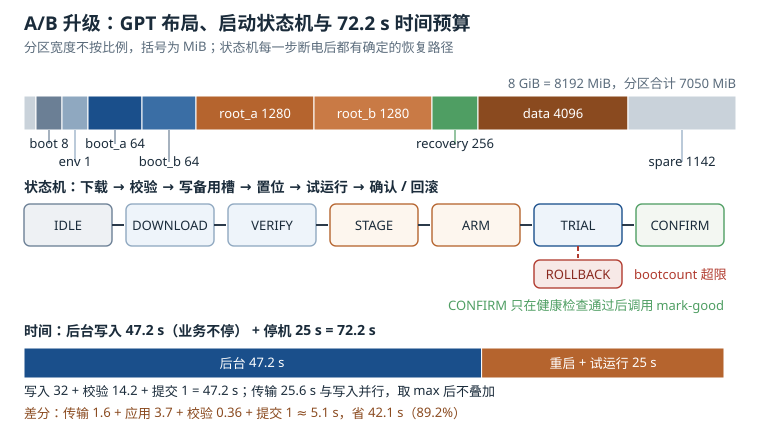

# A/B 升级：GPT 分区、启动计数器与回滚

升级是嵌入式设备里**最容易把故障带到现场**的日常操作。写坏一个字节、断一次电、校验少做一步，设备就可能停在 bootloader，既不响应网络，也没有串口。A/B 升级用"两份可启动系统 + 一个会记账的 bootloader"把这件事变成可回滚的事务：新系统起不来，就退回旧系统；升级过程断电，至少还有一份完整系统能启动。

这一章从分区表讲到状态机：GPT 怎么划、启动计数器怎么记、镜像怎么验、断电怎么恢复、差分怎么省流量。所有容量与时间都能手算，所有状态迁移都要能回答"这一步断电会怎样"。

## 1. 动机：单分区原地升级是在赌断电时刻

传统做法是"把新 rootfs 直接写到唯一的 rootfs 分区"。它的问题不是"可能失败"，而是**失败后没有任何退路**：

- 写到一半断电，分区里是"一半旧、一半新"的文件系统，挂载都可能失败；
- 镜像校验失败，旧系统已经被覆盖，只能进恢复模式（如果还留了恢复分区）；
- 新系统能启动但应用起不来，看门狗复位后仍然进新系统，形成重启循环；
- 回滚需要重新下载旧镜像，现场网络往往不可用。

A/B 把"升级"拆成两个阶段：**在后台把新系统写到备用槽**（此时设备正常运行），以及**切换启动槽并试运行**（此时旧系统仍然完整）。任何一步失败，都有明确的回退路径。

::: motivation 一次断电，三十台设备返厂
某批设备在现场升级时遇到片区停电，三十台设备同时断电。升级方式是单分区原地写入，bootloader 也被一起更新。来电后设备停在 U-Boot 提示符，因为 bootloader 只写了一半；现场没有串口线，也没有 SD 卡槽，只能返厂。

改成 A/B 后，同样的断电场景只会让备用槽处于"未完成"状态，bootloader 仍然从旧槽启动；升级服务在下次联网时重新下载并续传。bootloader 本身保留一个只读的恢复副本，永不原地覆盖。

代价是 flash 多占一份 rootfs（1.25 GiB），换来的是一整类故障从"返厂"降级为"重试"。
:::

## 2. 直观：两份系统、一张表、一个计数器



上图上半部分是 GPT 分区布局与两个 rootfs 槽，中间是"下载 → 校验 → 写入 → 置位 → 试运行 → 确认/回滚"的状态机，下半部分是升级时间的拆解。

### 2.1 为什么是 A/B，而不是"备份一个镜像文件"

一种常见的简化是：把旧 rootfs 打包成一个文件放在 data 分区，升级失败时再解压回去。它的问题在于**恢复本身也需要一次完整的写入**，而这次写入同样可能断电；而且恢复过程通常发生在"系统已经起不来"的时候，没有可用的用户空间去执行解压。

A/B 的关键差别是：**两份系统都是可直接启动的完整分区**，回滚只是改一个启动标志，不需要搬运数据。这让回滚时间从"几分钟的写入"变成"一次重启"。

### 2.2 GPT：分区表不只是"一张清单"

GUID 分区表（GUID Partition Table，GPT）的结构比 MBR 复杂，但每一步都有明确目的：

| 位置 | 内容 | 大小 |
|---|---|---|
| LBA 0 | 保护性 MBR（类型 0xEE） | 512 B |
| LBA 1 | 主 GPT 头 | 512 B（含 CRC32） |
| LBA 2 到 33 | 主分区项数组 | 128 项 × 128 B = 16 KiB |
| 数据区 | 各分区 | 按布局 |
| 倒数第 33 到 2 | 备份分区项数组 | 16 KiB |
| 最后一个 LBA | 备份 GPT 头 | 512 B |

几个工程要点：

1. **头里有 CRC32**。主头损坏时，固件可以读备份头恢复；两个头都坏，分区表就丢了。所以升级流程**不应该重写整张分区表**，只改分区内容。
2. **分区项有唯一 GUID 和类型 GUID**。类型 GUID 决定"这是什么分区"（Linux 文件系统、boot、data），唯一 GUID 决定"是哪一个"。用 `PARTLABEL` 而不是 `/dev/mmcblk0p5` 这类编号挂载，可以在分区顺序变化时仍然找对。
3. **对齐**。eMMC 的擦除块通常是 512 KiB 到 4 MiB，分区起始地址按 1 MiB 对齐可以保证不跨擦除块；raw NAND 则建议按 2 到 4 MiB 对齐。未对齐的后果是每次写都要"读-改-写"两个块，写放大和延迟都会上升。
4. **备份表在末尾**。最后一个分区不要贴着磁盘末尾，留出至少 1 MiB 给备份 GPT，否则 `sgdisk` 会警告甚至拒绝写入。

### 2.3 启动计数器：bootloader 怎么知道"这次没起来"

A/B 的"回滚"不是用户空间决定的，而是 **bootloader 根据计数器决定的**。以 U-Boot 为例，机制由三部分组成：

- `bootcount`：每次启动自增，存放在环境变量、RTC 寄存器或专用分区；
- `bootlimit`：允许的最大连续启动次数，比如 3；
- `altbootcmd`：当 `bootcount > bootlimit` 时执行的备用命令，通常是"切到另一个槽并清零计数"。

配合 `upgrade_available` 标志，流程是：

1. 升级完成，把备用槽标记为"待试运行"，`upgrade_available=1`，`bootcount=0`；
2. 重启，bootloader 看到待试运行标志，启动新槽，`bootcount` 自增；
3. 新系统启动成功后，用户空间的健康检查调用 `rauc status mark-good`（或直接清 `bootcount`、清 `upgrade_available`）；
4. 如果新系统在 `bootlimit` 次启动内都没有确认，bootloader 执行 `altbootcmd`，切回旧槽。

这里有一个容易忽略的细节：**`bootcount` 必须在"确认成功"时清零，而不是在"启动成功"时清零**。如果内核起来了但应用没起来，而 bootloader 已经把计数清零，设备就会无限重启在新系统上。所以清零动作要放在业务健康检查通过之后。

### 2.4 镜像校验与签名

"校验"和"签名"解决两个不同的问题：

- **校验（hash）**：确认镜像在传输/写入过程中没有损坏，对抗的是随机错误；
- **签名（signature）**：确认镜像来自可信的构建系统，对抗的是恶意替换。

常见组合是：构建时对镜像算 SHA-256，把 hash 放进元数据；再用私钥对元数据签名（RSA-2048 或 Ed25519）；设备端用公钥验签，再比对 hash。只做 hash 不做签名，攻击者可以同时替换镜像和 hash；只做签名不比对 hash，签名覆盖的范围可能不是真正被写入的内容。

更严格的做法是用 dm-verity 做**运行时**校验：把 rootfs 的哈希树放在单独分区，root hash 由 bootloader 通过内核命令行传入，内核在读取每个块时校验。它防的是"启动后 rootfs 被篡改"，与"升级时镜像是否完整"是互补的两层。

### 2.5 升级流程状态机

一个可断电恢复的升级流程，状态要足够少、每步都要幂等：

| 状态 | 动作 | 断电后的结果 |
|---|---|---|
| `IDLE` | 无升级任务 | 正常启动当前槽 |
| `DOWNLOAD` | 下载/接收升级包到 data 分区 | 包不完整，下次重下 |
| `VERIFY` | 校验 hash 与签名 | 包不可信，丢弃 |
| `STAGE` | 把镜像写入备用槽 | 备用槽不完整，但当前槽完好 |
| `ARM` | 写元数据：待试运行、计数清零 | 元数据双备份 + CRC，取有效者 |
| `TRIAL` | 重启进入新槽，计数自增 | 计数达到上限后回滚 |
| `CONFIRM` | 健康检查通过，标记成功 | 已确认，清理旧包 |
| `ROLLBACK` | 切回旧槽，标记新槽无效 | 旧槽仍可启动 |

关键设计是 `ARM` 的原子性：元数据不能"写一半"。做法是两块 4 KiB 的记录区，每块带序号和 CRC，写入时先写 B 再写 A，启动时选序号最大且 CRC 正确的那个。这样任何时刻断电，至少有一块是完整的。

### 2.6 差分升级：只传变化的部分

全量升级每次传 512 MiB，差分升级只传"新旧镜像的差异"。块级差分的典型流程：

1. 服务端按固定块大小（如 4 KiB）比较新旧镜像，找出变化的块；
2. 生成差分包：变化块的索引 + 压缩后的新数据；
3. 设备端读旧镜像的对应块，与差分包合并，写入备用槽；
4. 对重建后的镜像做整体 hash 校验。

差分包的收益取决于"变化比例"。系统小版本升级通常只改几百个文件，变化块占比 5% 到 15%；大版本或更换根文件系统时可能超过 50%，此时差分包反而更大，应该回退到全量。

## 3. 定量关系：容量、时间与概率

### 3.1 分区大小与对齐

设第 $i$ 个分区起始偏移 $o_i$、大小 $s_i$，对齐粒度 $A$，则起始扇区

$$start_i = \left\lceil \frac{o_i}{A} \right\rceil A, \qquad end_i = start_i + s_i$$

所有分区大小之和加上 GPT 保留区必须不超过磁盘容量：

$$\sum_i s_i + S_{gpt} \leq S_{disk}$$

$S_{gpt}$ 在 512 字节扇区、128 项分区表下约 1 MiB（主表 34 个扇区 + 备份 33 个扇区，按 1 MiB 预留）。A/B 布局的容量翻倍项是 rootfs：两个槽各 $s_{root}$，再加 boot、env、recovery、data。

### 3.2 升级时间

升级总时间由四段组成：

$$T_{upgrade} = T_{transfer} + T_{write} + T_{verify} + T_{reboot}$$

如果下载与写入是流水线并行（边下边写），传输和写入取较大者：

$$T_{stage} = \max(T_{transfer}, T_{write}) + T_{verify} + T_{commit}$$

其中 $T_{write} = S_{image}/v_{write}$，$T_{verify} = S_{image}/v_{read}$（校验读回的速度通常受限于读带宽，而不是 hash 计算速度）。

**停机时间**只包括"切换槽 + 重启 + 试运行判定"，后台写入期间业务是正常的。这是 A/B 相对原地升级最大的优势：停机时间与镜像大小无关，只与重启时间有关。

### 3.3 校验与签名的时间

SHA-256 的计算速度在带 ARMv8 加密扩展的 Cortex-A53 上约 250 MB/s，软件实现约 60 MB/s。对 1280 MiB 的 rootfs：

$$T_{hash} = \frac{1280}{250} = 5.12\ \text{s}\quad(\text{硬件加速}), \qquad \frac{1280}{60} = 21.3\ \text{s}\quad(\text{软件})$$

但校验通常与读回同时进行，读 eMMC 只有 90 MB/s，所以实际瓶颈是 14.2 秒的读时间，hash 计算被掩盖。签名验证本身很快：RSA-2048 验签约 0.5 毫秒，Ed25519 约 2.5 毫秒，相对几十秒的升级可以忽略；签名大小分别是 256 字节和 64 字节，对分包体积的影响也可以忽略。

### 3.4 回滚概率

设单次试运行失败的概率为 $p$，允许 $n$ 次尝试，则"连续 $n$ 次都失败、必须回滚"的概率是

$$P_{rollback} = p^n$$

$p=5\%$、$n=3$ 时 $P = 1.25 \times 10^{-4}$；$n=5$ 时 $P = 3.1 \times 10^{-7}$。注意这个模型假设每次失败独立，而"镜像本身有确定性 bug"时 $p=1$，重试没有意义——这时回滚是正确的结果，所以 `bootlimit` 不能设得太大，否则只是浪费启动时间。

### 3.5 差分收益

设全量包大小 $S_{full}$、差分包大小 $S_{delta}$、变化块占比 $r$、块大小 $b$，差分包至少包含 $r \times S_{image}$ 的原始数据，压缩后为

$$S_{delta} \approx \frac{r \times S_{image}}{c} + S_{meta}$$

$c$ 是压缩比（2 到 4），$S_{meta}$ 是块索引与元数据。时间收益为

$$\eta = 1 - \frac{T_{delta}}{T_{full}}$$

## 4. 算例：8 GiB eMMC 上的 A/B 布局

**第一步：分区表。** 8 GiB eMMC 按 1 MiB 对齐，布局如下：

| 分区 | 起始 MiB | 大小 MiB | 结束 MiB | 用途 |
|---|---|---|---|---|
| bootloader | 1 | 8 | 9 | U-Boot 与固件 |
| env | 9 | 1 | 10 | U-Boot 环境（双备份） |
| boot_a | 10 | 64 | 74 | 内核 + DTB + initramfs |
| boot_b | 74 | 64 | 138 | 同上，备用槽 |
| root_a | 138 | 1280 | 1418 | 根文件系统 A |
| root_b | 1418 | 1280 | 2698 | 根文件系统 B |
| recovery | 2698 | 256 | 2954 | 恢复系统 |
| data | 2954 | 4096 | 7050 | 用户数据与升级包 |
| 保留 | 7050 | 1142 | 8192 | 备份 GPT 与余量 |

校验求和：$1+8+1+64+64+1280+1280+256+4096 = 7050$ MiB，剩余 1142 MiB。所有起始偏移都是 1 MiB 的整数倍，对应 2048 个 512 字节扇区；例如 root_a 起始 138 MiB $= 282{,}624$ 扇区，正好落在 512 KiB 擦除块的边界上（$282{,}624 \times 512 = 144{,}703{,}488$ 字节，是 512 KiB 的整数倍）。

**第二步：升级时间（全量、流水线）。**

- 网络传输：512 MiB / 20 MB/s = 25.6 s；
- 写入：1280 MiB / 40 MB/s = 32.0 s（解压后写入备用槽）；
- 校验：1280 MiB / 90 MB/s = 14.2 s；
- 提交元数据：1 s；
- 流水线取 max(25.6, 32.0) + 14.2 + 1 = 47.2 s；
- 重启 + 试运行判定：25 s。

总时间 $47.2 + 25 = 72.2$ s。其中**业务停机只有 25 秒**（重启与试运行），后台写入的 47.2 秒设备仍在正常服务。

对比原地升级：写入 32 s + 校验 14.2 s = 46.2 s 的停机，且期间断电就是砖。A/B 用 1.25 GiB 的额外空间，把"停机 46.2 秒且不可回滚"换成"停机 25 秒且可回滚"。

**第三步：回滚概率。** 试运行 3 次、单次失败率 5%，则

$$P_{rollback} = 0.05^3 = 1.25 \times 10^{-4}$$

即万分之一点二五。若把 `bootlimit` 提到 5，概率降到 $3.1 \times 10^{-7}$，但新系统每次启动都要多花 25 秒，且确定性故障会白白重启 5 次。工程上 3 次是常见折中。

**第四步：差分升级。** 1280 MiB 的 rootfs，变化块占比 8%，即 102.4 MiB；压缩比 3.4，差分包约 30 MiB，加 2 MiB 元数据共 32 MiB。

- 传输：32 MiB / 20 MB/s = 1.6 s；
- 应用：读旧块 102.4 MiB / 90 MB/s = 1.14 s，写新块 102.4 MiB / 40 MB/s = 2.56 s；
- 校验：32 MiB / 90 MB/s = 0.36 s；
- 合计约 5.1 s（流水线取 max(1.6, 1.14+2.56) = 3.7 s，加 0.36 s 校验与 1 s 元数据提交）。

相对全量的 47.2 s，节省 42.1 s，收益 $\eta = 1 - 5.1/47.2 = 89.2\%$。流量从 512 MiB 降到 32 MiB，对蜂窝网络下的设备是数量级的差别。

**第五步：签名与元数据。** 1280 MiB 的 SHA-256 在 250 MB/s 下 5.12 s，但被 14.2 s 的读时间掩盖；RSA-2048 验签 0.5 ms，签名 256 字节。元数据双备份各 4 KiB，写入加 CRC 校验在 40 MB/s 下约 0.2 ms，可以认为瞬时完成。

**第六步：断电检查。** 在 `STAGE` 中断电，备用槽不完整，但元数据仍指向旧槽，bootloader 启动旧系统；在 `ARM` 中断电，两块元数据至少一块有效，bootloader 取序号大的有效记录；在 `TRIAL` 中断电，`bootcount` 已经自增，重启后继续计数，达到上限后回滚。三个位置都不会让设备失去可启动系统。

## 5. 工程含义：分区、bootloader 与升级服务

### 5.1 用 sgdisk 划出布局

```bash
# 1 MiB = 2048 扇区；所有起始都按 2048 对齐
sgdisk --clear \
  --new=1:2048:+16384     --typecode=1:0x8300 --change-name=1:bootloader \
  --new=2:18432:+2048     --typecode=2:0x8300 --change-name=2:env \
  --new=3:20480:+131072   --typecode=3:0x8300 --change-name=3:boot_a \
  --new=4:151552:+131072  --typecode=4:0x8300 --change-name=4:boot_b \
  --new=5:282624:+2621440 --typecode=5:0x8300 --change-name=5:root_a \
  --new=6:2904064:+2621440 --typecode=6:0x8300 --change-name=6:root_b \
  --new=7:5525504:+524288 --typecode=7:0x8300 --change-name=7:recovery \
  --new=8:6049792:+8388608 --typecode=8:0x8300 --change-name=8:data \
  /dev/mmcblk0
```

数字都按"起始扇区 + 大小扇区"给：8 MiB = 16384 扇区，64 MiB = 131072 扇区，1280 MiB = 2621440 扇区，256 MiB = 524288 扇区，4096 MiB = 8388608 扇区。写完后用 `sgdisk -v /dev/mmcblk0` 检查 GPT 一致性，用 `lsblk -o NAME,SIZE,PARTLABEL` 确认标签。

### 5.2 U-Boot 的启动计数

```bash
# 环境变量（保存到 env 分区）
setenv bootlimit 3
setenv upgrade_available 0
setenv bootcmd 'run boot_slot_a'
setenv altbootcmd 'run rollback_to_a'
saveenv
```

`bootcount` 的持久化位置取决于配置：可以放 env、RTC 后备寄存器，或专门的 bootcount 分区。**不要只放在 RAM 里**，否则断电后计数丢失，回滚逻辑失效。`upgrade_available` 与槽优先级也要一起持久化，且写入顺序是"先写数据、再写标志"，避免标志先到而数据没写完。

### 5.3 升级服务：RAUC 的配置

```ini
# /etc/rauc/system.conf
[system]
compatible=my-board
bootloader=uboot
mountprefix=/run/rauc

[keyring]
path=/etc/rauc/ca.cert.pem

[slot.rootfs.0]
device=/dev/disk/by-partlabel/root_a
type=ext4
bootname=A

[slot.rootfs.1]
device=/dev/disk/by-partlabel/root_b
type=ext4
bootname=B
```

安装与确认：

```bash
rauc install /data/update-1.2.3.raucb
rauc status
rauc status mark-good
```

`rauc install` 会自动完成校验、写备用槽、置位；`mark-good` 必须在健康检查通过后调用。很多现场事故是"安装脚本最后一行就调用了 mark-good"，等于跳过了试运行，回滚机制形同虚设。

### 5.4 健康检查与确认

用一个 oneshot 服务把"确认"绑到真正的业务健康上：

```ini
[Unit]
Description=Confirm A/B slot after health check
After=network-online.target gateway.service
Wants=gateway.service

[Service]
Type=oneshot
ExecStart=/usr/bin/health-check --timeout 60
ExecStartPost=/usr/bin/rauc status mark-good

[Install]
WantedBy=multi-user.target
```

`health-check` 应该检查：关键服务在跑、网络通、存储可写、业务自检接口返回成功。检查通过才 `mark-good`；失败则退出非零，让 `bootcount` 继续累加，最终由 bootloader 回滚。

### 5.5 镜像校验的分层

| 层 | 手段 | 防什么 | 放在哪 |
|---|---|---|---|
| 传输 | TLS + 包内 SHA-256 | 传输错误、CDN 损坏 | 下载器 |
| 包 | 签名（RSA/Ed25519） | 伪造包、降级攻击 | 升级服务 |
| 槽 | 写入后读回校验 | 写入错误、坏块 | 升级服务 |
| 运行时 | dm-verity | 启动后篡改 | 内核 + bootloader |
| 版本 | 单调计数器（OTP/eFuse） | 回滚到有漏洞的旧版 | bootloader |

最后一行容易被忽略：A/B 天然允许"回滚到旧版本"，但安全策略可能要求"不能回滚到低于某版本"。这时需要防回滚计数器（anti-rollback counter），把最低允许版本烧进 OTP 或安全存储，bootloader 在启动前比较。它和"故障回滚"是两套逻辑，不要混在一起。

### 5.6 测试：每个状态都要注入断电

升级流程的测试不能只测"升级成功"。至少要在这些点各断电 10 次：

- `DOWNLOAD` 进行到一半；
- `VERIFY` 刚开始与刚结束；
- `STAGE` 写入 10%、50%、99%；
- `ARM` 写完第一块元数据、第二块之前；
- `TRIAL` 第一次启动、第二次启动；
- `CONFIRM` 刚调用 `mark-good` 之后。

每次断电后设备都必须能启动到某个可用系统，并且 `rauc status` 能正确显示当前槽与尝试次数。这类测试用可编程电源配合脚本就能做，成本远低于一次现场事故。

## 6. 常见坑：现象、原因与解决

::: pitfall 坑一：升级到一半断电，设备再也起不来
**现象**：升级过程中停电，来电后停在 bootloader 或黑屏，串口没有任何启动日志。

**原因**：升级直接覆盖了唯一的 rootfs，甚至覆盖了 bootloader；没有备用槽，也没有恢复分区；bootloader 的启动脚本写死了一个分区。

**解决**：采用 A/B 双槽，bootloader 只改启动标志不原地覆盖；bootloader 本身保留只读副本或用 recovery 兜底；启动脚本按 `PARTLABEL` 查找，失败时遍历所有可用槽。上线前在每个状态注入断电做验收。
:::

::: pitfall 坑二：新系统明明能用，重启后又回到旧系统
**现象**：升级后第一次启动进入新版本，运行几分钟后自动重启，之后一直停在旧版本；`rauc status` 显示新槽 "bad"。

**原因**：健康检查通过后没有调用 `mark-good`，或者调用时机太早、被后续的失败覆盖；也可能是 `bootcount` 没有清零，bootloader 认为试运行失败。

**解决**：把 `mark-good` 放到健康检查成功之后，且只调用一次；确认 `bootcount` 与 `upgrade_available` 在确认时一起清零；用 `rauc status` 和 bootloader 的环境变量双向核对，而不是只看用户空间的状态。
:::

::: pitfall 坑三：升级后挂载到了错误的槽，数据"丢了"
**现象**：升级成功，但应用读到的是旧配置；或者两个槽的 `/etc` 内容互相覆盖；`mount` 显示 rootfs 设备号与预期不符。

**原因**：`/etc/fstab` 或内核命令行写死了 `/dev/mmcblk0p5`，而 A/B 切换后根分区应该是 p6；或者两个槽用了相同的文件系统 UUID，内核按 UUID 挂载时选错。

**解决**：用 `PARTLABEL=root_a`/`root_b` 或 `root=PARTUUID=` 指定根分区，bootloader 在启动时把当前槽写进命令行；两个槽的 UUID 必须不同；升级后检查 `/proc/cmdline` 与 `findmnt /`，确认挂载的是当前槽。
:::

::: pitfall 坑四：分区没对齐，升级写入慢得离谱
**现象**：同样大小的镜像，有的板子写 30 秒，有的要 3 分钟；`iostat` 显示大量小尺寸随机写。

**原因**：分区起始地址没有按 eMMC 擦除块对齐，每次写跨两个擦除块，触发读-改-写；或者文件系统块大小与擦除块不匹配。

**解决**：所有分区按 1 MiB（raw NAND 按 2 到 4 MiB）对齐；用 `sgdisk -v` 和 `lsblk` 检查起始扇区；文件系统格式化时确认 `block-size` 与页大小匹配；升级写入用大块顺序写，避免边写边 `fsync`。
:::

::: pitfall 坑五：差分升级把设备刷成"四不像"
**现象**：差分升级后系统能启动，但部分文件版本不对，应用报符号未定义；重新全量升级后恢复。

**原因**：差分基线不匹配。设备上的旧镜像被手动改过（改配置、装调试工具），或者上一次升级没完成，导致"旧镜像"与服务端假设的基线不一致；差分包只校验结果 hash，但重建时读到了错误的基础数据。

**解决**：升级前校验当前槽的完整 hash，与差分包声明的基线比对，不一致就回退全量；差分重建后必须做整体 hash 校验，失败则整槽重写；禁止在生产设备上手工修改 rootfs，配置放 data 分区。
:::

## 7. 自测题

<details><summary>题一：8 GiB eMMC，按 1 MiB 对齐，bootloader 8 MiB、env 1 MiB、boot_a/b 各 64 MiB、root_a/b 各 1280 MiB、recovery 256 MiB、data 4096 MiB。总占用多少？还剩多少？root_a 起始扇区是多少？</summary>

求和：$8+1+64+64+1280+1280+256+4096 = 7049$ MiB，加上起始 1 MiB 的 GPT 保留区，共 7050 MiB。

剩余 $8192 - 7050 = 1142$ MiB。

root_a 起始偏移 138 MiB，扇区数 $138 \times 2048 = 282{,}624$；乘以 512 字节得 144,703,488 字节，是 512 KiB 的整数倍，对齐成立。

</details>

<details><summary>题二：全量包 512 MiB、网络 20 MB/s、写入 40 MB/s、校验读 90 MB/s、提交 1 s、重启 25 s，流水线升级。求后台时长、停机时间与总时间。</summary>

传输 $512/20 = 25.6$ s；写入 $1280/40 = 32$ s；流水线取较大者 32 s。

校验 $1280/90 = 14.2$ s；提交 1 s。

后台 $T_{stage} = 32 + 14.2 + 1 = 47.2$ s；停机只有重启与试运行 25 s；总时间 $47.2 + 25 = 72.2$ s。

若改成非流水线（先下载再写），后台变成 $25.6 + 32 + 14.2 + 1 = 72.8$ s，总时间 97.8 s。

</details>

<details><summary>题三：单次试运行失败率 5%，bootlimit 分别为 2、3、4 时，回滚概率各是多少？为什么不能把 bootlimit 设得很大？</summary>

$n=2$：$0.05^2 = 2.5 \times 10^{-3}$；$n=3$：$1.25 \times 10^{-4}$；$n=4$：$6.25 \times 10^{-6}$。

`bootlimit` 越大，回滚概率越低，但每次试运行要花一个完整启动周期（本例 25 秒）；如果镜像有确定性缺陷（$p=1$），无论多少次都会失败，只会延长设备不可用的时间。所以 3 次左右是"覆盖偶发失败"与"快速回滚"的折中。

</details>

<details><summary>题四：GPT 的分区项数组有多大？主表和备份表分别在什么位置？为什么升级时不应该重写整张分区表？</summary>

128 项 × 128 字节 = 16 KiB。主表在 LBA 2 到 33（512 字节扇区），备份表在倒数第 33 到第 2 个 LBA，备份头在最后一个 LBA。

重写整张表会把主备两份都置于"写一半"的风险中，一旦断电，分区表可能两份都不完整，设备连分区都找不到。升级只应写分区内容，分区表在产线烧录时一次成型；确需修改时，改完立即用 `sgdisk -v` 校验，并保证备份表同步更新。

</details>

<details><summary>题五：1280 MiB rootfs，变化块 8%，压缩比 3.4，元数据 2 MiB，网络 20 MB/s。差分包多大？传输时间多少？若全量后台 47.2 s、差分后台 5.1 s，收益百分比是多少？</summary>

变化块 $1280 \times 0.08 = 102.4$ MiB；压缩后 $102.4/3.4 = 30.1$ MiB；加元数据 2 MiB，约 32.1 MiB。

传输 $32.1/20 = 1.6$ s。

收益 $\eta = 1 - 5.1/47.2 = 89.2\%$。

注意差分收益不是线性的：变化比例越大，差分包越接近全量；超过约 50% 时，差分的重建时间与风险都不划算，应直接全量。

</details>

## 8. 参考资料

- UEFI Forum，《UEFI Specification》GUID 分区表章节：GPT 头、分区项、CRC32 与主备表布局。
- U-Boot 文档 `doc/README.bootcount`、`doc/README.distro`：`bootcount`、`bootlimit`、`altbootcmd` 与环境持久化。
- RAUC 文档《Using RAUC》《Bundle Format》：slot 状态、bootchooser、`mark-good` 与 bundle 签名。
- SWUpdate 文档《Double Copy》《Delta Update》：双分区升级与块差分载荷格式。
- Android Open Source Project《A/B Updates》：slot metadata、`boot_control` HAL、`max_retries` 与 `slot-successful` 标志。
- Linux 内核文档 `Documentation/admin-guide/device-mapper/verity.rst`：dm-verity 哈希树、root hash 与启动参数。
- U-Boot 文档 `doc/uImage.FIT/signature.txt`：FIT 镜像签名、公钥嵌入与校验流程。
- RFC 8032：Ed25519 签名算法与 64 字节签名格式。
- `sgdisk(8)`、`lsblk(8)`、`partprobe(8)`：分区表的创建、查看与重读。
