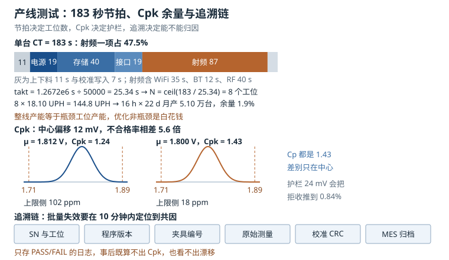

# 产线测试与校准：测试项设计、节拍预算、良率与追溯

产线测试是一个"用秒换 ppm"的地方：每多测一秒，单台成本就上涨；每漏掉一个缺陷，售后成本就以百倍计。这两者之间的平衡不是靠经验拍脑袋，而是**可以算出来的**——节拍、良率、过程能力、护栏、追溯，每一项都有明确的数学形式。

这一章按"测试项怎么设计 → 时间怎么分 → 良率怎么算 → 校准数据怎么写 → 出了批量问题怎么归因"的顺序展开。所有时间都能用秒表复算，所有良率都能用乘法复算，所有 Cpk 都能用正态分布复算。**如果一个产线指标算不出来，它就不是指标，只是感觉。**

## 1. 动机：产线的三个硬约束

一条测试线同时被三个约束夹住：

| 约束 | 量化形式 | 违反的后果 |
|---|---|---|
| 节拍 | 每 $T_{takt}$ 秒必须下线一台 | 堵线、在制品堆积、交期延误 |
| 覆盖率 | 漏测率 × 逃逸成本 | 售后返修、批量召回、品牌损失 |
| 成本 | 单台测试工时 × 工位费率 | 毛利被吃掉，报价失去竞争力 |

三者互相拉扯：加测试项提高覆盖率，但拉长节拍；加并行工位缩短节拍，但推高设备折旧；放宽判定限提高良率，但增加逃逸。**工程上唯一正确的做法是把三者放进同一个算式里，找到边际收益为零的那个点。**

::: motivation 一条"良率 99%"却月亏三十万的生产线
某模组厂报出的直通率是 99.2%，看上去很好。但售后数据显示，出货三个月内的返修率是 3.8%，而返修一台的综合成本（运费、拆装、人工、客户补偿）约 320 元。

财务算了一笔账：月出货 5 万台，返修 1900 台，直接损失 60.8 万元。而如果把这 3.8% 在产线上拦下来，需要增加的项目是"整机满载老化 2 小时"和"射频驻波复测"，合计增加节拍 26 秒。

他们当时认为"26 秒太贵"。按每工位小时 90 元算，26 秒 = 0.65 元/台，5 万台 = 3.25 万元/月。**用 3.25 万换 60.8 万，这笔账根本不需要讨论。**

问题出在"良率"这个指标本身：99.2% 的直通率只统计了产线内的判定，没有统计"判对了但没有测"的那部分。加上老化与驻波复测之后，直通率降到 96.1%，但返修率降到 0.4%，综合成本反而下降。
:::

这个例子说明：**产线指标必须和售后指标连起来看**。只看直通率，会把"测得太松"当成"做得很好"。

## 2. 直观：一条测试线的解剖



上图上方是单台 183 秒在准备、电源、存储、接口、射频、校准六组之间的分配，中部是同一批产品在"中心偏移"与"调中心"两种状态下的分布和规格限，下方是一条完整的追溯链。

### 2.1 工位、节拍与在制品

测试线的基本单元是工位（station）：一块板子进夹具、上电、跑测试序列、下料。单台占用的时间叫周期时间（Cycle Time，CT），线体每隔 $T_{takt}$ 秒允许下线一台，叫节拍（takt time）。

两者的关系是整条线设计的核心：

- $CT \le T_{takt}$：单工位就够，工位有空闲；
- $CT > T_{takt}$：必须并行，工位数 $N = \lceil CT / T_{takt} \rceil$。

并行的代价是设备重复投入。所以工程上先想办法压缩 $CT$（并行测试项、缩短夹具动作），再决定并行几台。**先压缩再并行，是唯一能同时降成本和降节拍的顺序。**

### 2.2 测试项从哪来

测试项不是拍脑袋列的，而是从四个来源收敛出来的：

1. **设计失效模式**：DFMEA 里高风险项对应的可测量特征。比如"电源纹波超标导致 DDR 误码"这条失效链，对应的测试项是纹波峰峰值 + DDR 误码率；
2. **历史返修数据**：售后排名前十的失效，逐条反推"哪一步能拦住"；
3. **工艺薄弱点**：BGA 虚焊、连接器歪斜、屏蔽罩翘起，对应 AOI、X-Ray、推力测试；
4. **法规与认证**：射频的发射功率、频偏、EVM，安规的耐压与漏电流，这些是"必须测"而不是"值得测"。

四条来源汇总后，再做一次裁剪：**能靠设计保证的，不测；能靠工艺保证的，抽测；只有会漂移的，全测。** 时钟频偏属于"每台都不同"，全测；电容容值属于"贴片机保证"，抽测。

### 2.3 五类测试项的设计原则

| 类别 | 典型项 | 测量手段 | 设计要点 |
|---|---|---|---|
| 电源 | 空载/满载电流、上电时序、纹波、效率 | 电子负载、示波器、功率计 | 时序要抓多路同时，纹波要限制 20 MHz 带宽 |
| 时钟 | 频率偏差、抖动、PLL 锁定时间 | 频率计、相位噪声分析仪 | 频偏按 ppm 判，抖动按 UI 判，两者不能混 |
| 存储 | 容量、顺序/随机速度、坏块、DDR 误码 | 内置自检、`fio`、`stressapptest` | DDR 要写满再读回，只测容量测不出误码 |
| 接口 | USB/以太网/PCIe 枚举、环回、眼图 | 环回夹具、协议分析仪 | 枚举成功率要跑 N 次，单次通过不代表稳定 |
| 射频 | 发射功率、频偏、EVM、灵敏度、驻波 | 综测仪、功率计、网络分析仪 | 校准与测试要分开，先校准再测 |

射频项的测试时间通常是整条线最长的，因为它要等综测仪完成一次完整的信令交互。这就是为什么"射频工位"几乎总是瓶颈工位。

### 2.4 良率的三个层次

工程上说的"良率"至少有三个不同的定义，混用会得出相反的结论：

- **FPY（First Pass Yield，一次通过率）**：单个工位第一次就通过的比率，不含返修；
- **RTY（Rolled Throughput Yield，直通率）**：所有工位 FPY 的乘积，表示"一次不做任何返修走完全程"的概率；
- **最终良率**：返修之后仍能出货的比率。

三者关系是：

$$\text{RTY} = \prod_{i=1}^{m} FPY_i$$

$$\text{Yield}_{final} = \text{RTY} + (1 - \text{RTY}) \times r$$

$r$ 是返修成功率。**RTY 永远小于等于最差的那个 FPY**，这是乘法决定的，不是管理水平问题。五个工位各 98% 的 FPY，RTY 只有 90.4%。

### 2.5 Cpk：把"分布"和"规格"放在一起看

只报均值没有意义。一个 1.8 V 的电源，均值 1.800 V，但标准差 0.05 V 时，超过 ±5% 规格的比例是 3.2%；标准差 0.02 V 时只有万分之三。**过程能力指数就是把"分布宽度"和"规格宽度"相比的那个数**：

$$\text{Cp} = \frac{USL - LSL}{6\sigma}, \qquad \text{Cpk} = \min\left(\frac{USL - \mu}{3\sigma}, \frac{\mu - LSL}{3\sigma}\right)$$

$USL$ 与 $LSL$ 是规格上下限，$\mu$ 是均值，$\sigma$ 是标准差。Cp 只看宽度，Cpk 还看中心：**Cp 大而 Cpk 小，说明过程很稳但调偏了**，这是最容易修的一类问题——不用改设计，只要把中心调回规格中点。

工程上的经验分级：

| Cpk | 对应的 $\sigma$ 水平 | 双边不合格率 | 适用场景 |
|---|---|---|---|
| 1.00 | 3$\sigma$ | 2700 ppm | 一般消费品 |
| 1.33 | 4$\sigma$ | 66 ppm | 工业品、汽车电子入门 |
| 1.67 | 5$\sigma$ | 0.54 ppm | 汽车电子、医疗 |
| 2.00 | 6$\sigma$ | 0.002 ppm | 安全关键 |

这里的"$\sigma$ 水平"是 $3\,\text{Cpk}$，不是 Cpk 本身。Cpk = 1.33 时 $z = 3 \times 1.33 = 3.99$，双边不合格率 $2\Phi(-3.99) = 66$ ppm，与表里一致；把 1.33 近似成 $4/3$ 才会得到 63 ppm。

### 2.6 校准数据写在哪

校准的本质是"给每台设备一串只属于它的系数"。存放位置有三种，各有代价：

| 位置 | 容量 | 可改写 | 掉电保持 | 典型用途 |
|---|---|---|---|---|
| eFuse/OTP | 几百 bit 到几 KB | 一次性，不可逆 | 是 | 密钥、MAC、校准系数 |
| 专用分区 | MB 级 | 可改写 | 是 | 校准数据、温度补偿表 |
| EEPROM | KB 级 | 可改写 | 是 | 模组参数、镜头阴影 |

eFuse 的"一次性"是双刃剑：写对了永远不会丢，写错了永远改不回来。所以工程上必须做三件事：**写前校验、写后回读、双备份**。分区方案则相反，可改写但要防"写一半掉电"，所以要有 CRC 与版本号，并且保留上一版。

### 2.7 追溯：一条记录至少要有什么

一次批量失效，如果追溯信息不全，归因就只能靠猜。一条合格的测试记录至少包含：

| 字段 | 为什么需要 |
|---|---|
| SN、MAC、IMEI | 定位到个体 |
| 工位 ID、夹具 ID | 区分"设备问题"与"夹具问题" |
| 测试程序版本（git hash） | 排除"换了程序" |
| 上位机与仪器型号、量程 | 排除"仪器漂移" |
| 时间戳（含时区） | 按时间聚类 |
| 环境温湿度 | 排除"季节/空调" |
| 原始测量值（不是 pass/fail） | 事后算 Cpk、看漂移 |
| 校准系数与 CRC | 复现校准结果 |

最后一条最容易被省略：很多产线只存"PASS"，出了问题时既算不出 Cpk，也看不出漂移趋势。**存原始值的成本是每台几 KB，不存的代价是整批货无法归因。**

## 3. 定量：节拍、良率与能力指数

### 3.1 节拍与产能

需求 $D$（台/月）、可用时间 $T_{avail}$（秒/月），节拍是：

$$T_{takt} = \frac{T_{avail}}{D}$$

需要的工位数：

$$N = \left\lceil \frac{CT}{T_{takt}} \right\rceil$$

单工位的产出率（UPH，Units Per Hour）与线体产能：

$$\text{UPH} = \frac{3600}{CT} \times \eta, \qquad \text{Capacity} = \text{UPH} \times N \times T_{hours}$$

$\eta$ 是稼动率（可用率），扣掉了换型、故障、待料、班前会。**稼动率不写进公式，产能就会高估 10% 到 20%**，这是产线规划最常犯的错误。

### 3.2 良率链

RTY 的乘法已经在 2.4 节给出。它有一个重要推论：**改善最差工位的边际收益最大**。把 97.2% 的工位提到 99.0%，RTY 从 94.4% 升到 96.2%，提升 1.8 个百分点；把 99.9% 的工位提到 99.95%，RTY 只提升 0.05 个百分点。

### 3.3 Cpk 与 ppm 的换算

对正态分布，超出上限的概率是 $\Phi(-(USL-\mu)/\sigma)$，超出下限的概率是 $\Phi(-(\mu-LSL)/\sigma)$。双边不合格率：

$$\text{ppm} \approx \left[\Phi\left(-z_u\right) + \Phi\left(-z_l\right)\right] \times 10^6$$

其中 $z_u = (USL-\mu)/\sigma$，$z_l = (\mu-LSL)/\sigma$。Cpk 的定义等价于 $\min(z_u, z_l) = 3\,\text{Cpk}$，所以居中的过程有：

$$\text{ppm} \approx 2\Phi(-3\,\text{Cpk}) \times 10^6$$

Cpk = 1.33 时 $z = 4$，$\Phi(-4) = 3.17 \times 10^{-5}$，双边 63.3 ppm。Cpk = 1.0 时 $z = 3$，双边 2700 ppm。

### 3.4 抽样不确定度：30 台测不出 Cpk

Cpk 里的 $\sigma$ 是估计值，样本量 $n$ 下的相对标准差约为：

$$\frac{\hat{\sigma}_\sigma}{\sigma} \approx \frac{1}{\sqrt{2(n-1)}}$$

$n = 30$ 时是 13.1%，意味着一个真实的 Cpk = 1.33 的过程，用 30 台样本算出来有 95% 的概率落在 0.98 到 1.68 之间。**这就是"试产 30 台 Cpk 1.6，量产掉到 1.1"的统计学原因**：不是过程变差了，是第一次的样本太少。工程上判定过程能力，至少要 100 台，最好 300 台。

### 3.5 护栏（guardband）的代价

测试系统本身有测量误差 $\sigma_{meas}$。如果判定限就用规格限，那么"真值合格但测出来超差"的产品会被误判，而"真值超差但测出来合格"的会逃逸。护栏的做法是把判定限往内收：

$$USL_{test} = USL - k\,\sigma_{meas}, \qquad LSL_{test} = LSL + k\,\sigma_{meas}$$

$k$ 通常取 2 到 3。合成标准差是 $\sigma_{total} = \sqrt{\sigma_{proc}^2 + \sigma_{meas}^2}$。护栏的代价是误判率上升：**把判定限收紧 24 mV，拒收率可能从 100 ppm 涨到 8400 ppm**，而这 8400 台里真正超差的只有 100 台左右。

### 3.6 测试成本与逃逸成本的平衡

单个测试项的经济性判据是：

$$\text{cost}_{test} = \frac{\Delta CT}{3600} \times R_{station}$$

$$\text{benefit} = \Delta p_{escape} \times C_{escape}$$

$\Delta p_{escape}$ 是这项测试能拦下的逃逸率，$C_{escape}$ 是单台逃逸的综合成本（返修、运费、客户补偿、品牌折损）。当 $\text{benefit} > \text{cost}_{test}$ 时，这项测试就该加。盈亏平衡的逃逸率是 $\text{cost}_{test} / C_{escape}$。

## 4. 算例：月产 5 万台的测试线

**需求**：月产 5 万台，两班制 16 小时，22 个工作日，稼动率 0.92，工位费率 90 元/小时，逃逸成本 300 元/台。

**第一步：算节拍。** 月可用时间：

$$T_{avail} = 22 \times 16 \times 3600 = 1.2672 \times 10^{6}\ \text{s}$$

$$T_{takt} = \frac{1.2672 \times 10^{6}}{50000} = 25.34\ \text{s}$$

**第二步：算单台 CT 与工位数。** 14 个测试项与上下料的时间加起来是 183 秒：

| 测试项 | 时间 | 占比 | 测试项 | 时间 | 占比 |
|---|---|---|---|---|---|
| 上料/扫码/夹紧 | 7 s | 3.8% | WiFi 校准 | 35 s | 19.1% |
| 电源轨电流与时序 | 8 s | 4.4% | BT 校准 | 12 s | 6.6% |
| 电源纹波 | 6 s | 3.3% | RF 发射与驻波 | 40 s | 21.9% |
| 时钟频率与抖动 | 5 s | 2.7% | 传感器/按键/LED | 4 s | 2.2% |
| DDR 训练与自检 | 18 s | 9.8% | 校准写入与回读 | 7 s | 3.8% |
| eMMC 读写与坏块 | 22 s | 12.0% | 下料/贴标 | 4 s | 2.2% |
| USB 枚举与环回 | 6 s | 3.3% | 以太网环回 | 9 s | 4.9% |

$$N = \left\lceil \frac{183}{25.34} \right\rceil = \lceil 7.22 \rceil = 8$$

8 个工位时，线体节拍是 $183/8 = 22.88$ 秒，小于 25.34 秒，产能略有富余，利用率 90.3%。

**第三步：算产能。** 单工位 UPH：

$$\text{UPH} = \frac{3600}{183} \times 0.92 = 18.10$$

8 个工位：$18.10 \times 8 = 144.8$ UPH。月产能：

$$144.8 \times 16 \times 22 = 50965\ \text{台}$$

刚好覆盖 5 万台，余量 1.9%。**这个余量很薄**：只要 CT 增加 10 秒，节拍就超过 takt，需要第 9 个工位。

**第四步：算良率。** 五个关键工位的 FPY 分别是 0.994、0.981、0.997、0.972、0.999：

$$\text{RTY} = 0.994 \times 0.981 \times 0.997 \times 0.972 \times 0.999 = 0.9440$$

直通率 94.4%，缺陷率 5.6%。按返修成功率 70% 算，最终良率：

$$0.9440 + 0.0560 \times 0.70 = 0.9832$$

要出货 5 万台，需要投产 $50000/0.944 = 52966$ 台。**这 2966 台的差额，就是良率的现金成本。**

**第五步：算电源的 Cpk。** 1.8 V 电源，规格 1.71 V 到 1.89 V，实测 $\mu = 1.812$ V，$\sigma = 0.021$ V：

$$\text{Cpk} = \min\left(\frac{1.89 - 1.812}{3 \times 0.021}, \frac{1.812 - 1.71}{3 \times 0.021}\right) = \min(1.238, 1.619) = 1.238$$

上限侧 $z_u = 3.71$，$\Phi(-3.71) = 1.02 \times 10^{-4}$，即 102 ppm；下限侧 $z_l = 4.86$，只有 0.6 ppm。合计约 102 ppm，已经超过工业品常用的 66 ppm 门槛。

把中心从 1.812 V 调到 1.800 V，Cpk 变成：

$$\text{Cpk} = \frac{0.090}{0.063} = 1.429$$

不合格率降到 18 ppm，改善 5.6 倍，**而硬件没有改任何东西，只是把反馈电阻的分压比调准了**。这是性价比最高的一类改善。

**第六步：算护栏的代价。** 测量系统的 $\sigma_{meas} = 0.008$ V，合成 $\sigma_{total} = \sqrt{0.021^2 + 0.008^2} = 0.0225$ V。取 $k = 3$，护栏 24 mV：

$$LSL_{test} = 1.734\ \text{V}, \qquad USL_{test} = 1.866\ \text{V}$$

按测试限算的拒收率是 8391 ppm，而真实超差只有 102 ppm。**护栏让 0.84% 的好产品被误判**，5 万台就是 420 台。这 420 台如果直接报废，损失约 420 × 300 = 12.6 万元/月；如果走复测（复测一次能救回大部分），成本是 420 × 2 元 = 840 元/月。**所以护栏必须配复测流程，否则就是在烧钱。**

**第七步：算校准写入的时间。** OTP 有 32 行，每行写入 12 ms，加两次回读：

$$T_{otp} = 32 \times 0.012 + 0.08 = 0.464\ \text{s}$$

分区方案写 4 KB 双备份（8 KB），按 200 KB/s：

$$T_{part} = \frac{8192}{200 \times 10^{3}} = 41\ \text{ms}$$

分区比 OTP 快一个数量级，但可被改写，安全性低。**密钥必须进 OTP，校准系数可以进分区**，这是常见的折中。

**第八步：算一个测试项该不该加。** 新增"满载老化 60 秒"能拦下 0.3% 的早期失效，逃逸成本 300 元/台：

$$\text{cost} = \frac{60}{3600} \times 90 = 1.50\ \text{元}, \qquad \text{benefit} = 0.003 \times 300 = 0.90\ \text{元}$$

成本 1.50 大于收益 0.90，**在单台口径下不划算**。但老化往往能一次拦下多个失效模式，如果它同时覆盖了电源、存储、射频三类共 0.8% 的早期失效，收益就是 2.40 元，反超成本。**判断一个测试项，要按"它能覆盖的失效集合"算，而不是按单项算。**

## 5. 工程含义：夹具、写入与归因

### 5.1 测试序列的组织

一段可维护的测试序列应该满足：单项可跳过（调试用）、单项可重试（接触不良）、失败即停或继续由配置决定、每项都有超时。下面是一个简化的序列骨架：

```bash
#!/bin/sh
# 产线测试主流程（示意）：每项输出 JSON 行，便于上位机解析
set -e
SN=$(cat /proc/device-tree/serial-number)
echo "{\"sn\":\"$SN\",\"item\":\"boot\",\"result\":\"pass\"}"

# 电源：读 INA226 的电流与总线电压
./test_power --rail VDD_CORE --min 0.85 --max 1.15 || exit 10

# 时钟：读频偏，单位 ppm
./test_clock --target 24 --tol 20 || exit 11

# DDR：写满再读回，比对 CRC
./test_ddr --size 256M --pattern random || exit 12

# eMMC：顺序读写 + 坏块扫描
./test_emmc --seq-write 128M --seq-read 128M --min-read 80 || exit 13

# USB / 以太网：枚举 N 次，统计成功率
./test_usb --retry 5 --min-success 5 || exit 14
./test_eth --loopback --frames 1000 --max-loss 1 || exit 15

# 射频：先校准，再验证
./rf_calibrate --band all --store /tmp/cal.bin || exit 20
./rf_verify --band all --limit 3gpp || exit 21

# 校准数据落盘：先写分区，再回读比对
./cal_write --src /tmp/cal.bin --verify || exit 30
sync
```

`set -e` 加上每项独立的退出码，是"失败即停"的最小实现。**退出码要分段**（10 段电源、20 段射频、30 段写入），这样上位机只看退出码就能知道停在哪一类。

### 5.2 校准数据的写入与校验

校准数据的结构建议固定为"头 + 系数 + 校验"：

```c
struct cal_record {
        uint32_t magic;        /* 0x43414c31 "CAL1" */
        uint16_t version;      /* 结构版本，便于升级 */
        uint16_t length;       /* 有效字节数 */
        int32_t  coef[16];     /* 定点系数，Q16.16 */
        uint32_t crc32;        /* 覆盖前面所有字段 */
};
```

写入流程必须是"写 → 回读 → 比对 → 标记有效"四步。最后一步"标记有效"很关键：**先写数据、再写有效标志，掉电时最多丢一条无效记录，不会把设备变成"带着坏校准出厂"。**

对 OTP，还要考虑不可逆性：

```bash
# 读 OTP 的校准区（nvmem 框架）
hexdump -C /sys/bus/nvmem/devices/*/nvmem | head -20

# 写之前先确认目标区域未被烧写（全 0xFF 或全 0）
dd if=/dev/zero of=/tmp/blank bs=4 count=1 2>/dev/null
cmp -s /tmp/blank /sys/bus/nvmem/devices/imx-ocotp0/nvmem || echo "OTP 已有内容，停止"
```

### 5.3 日志、MES 与追溯链

一条记录写成一个 JSON 行，直接进 MES：

```json
{"ts":"2026-03-11T02:14:07+08:00","sn":"A1B2C3D4","station":"ST07","fixture":"FX-012",
 "tp":"factory-test@3f9c1a2","sw":"1.4.2","item":"vdd_core","value":1.806,
 "unit":"V","limit":[1.71,1.89],"result":"pass","temp_c":24.6,"rh":43}
```

关键在于 `value` 与 `limit` 都存原始值：**只存 `pass` 的日志，事后既算不出 Cpk，也看不出漂移。** 每台 4.2 KB，5 万台/月就是 210 MB/月，三年 7.6 GB，任何一台服务器都放得下。

### 5.4 批量失效的归因方法

一批产品突然大面积失效，归因顺序应该是"从外到内、从粗到细"：

1. **按时间聚类**：失效是否集中在某个小时、某个班次？集中在换班前后通常是夹具或操作问题；
2. **按工位/夹具聚类**：是否集中在某台设备？把失效板换到另一台工位复测，能立刻区分"产品问题"与"设备问题"；
3. **按物料批次聚类**：查 BOM 的批次号，看失效板是否用了同一批电容、同一批晶振；
4. **按软件版本聚类**：测试程序换了没有？固件换了没有？用 `git bisect` 的思路二分；
5. **按环境聚类**：温湿度、电网电压、静电防护。南方梅雨季的湿度失控会造成一批"莫名其妙的漏电"。

聚类之后再看分布形状：**失效集中在规格边界附近**，说明是过程漂移（调机、换料）；**失效随机散布**，说明是随机缺陷（来料、焊接）；**失效集中在某几天**，说明是共因（设备、程序、环境）。

## 6. 常见坑：现象、原因与解决

::: pitfall 坑一：校准写进了 OTP，但没有回读，三个月后才发现一批设备精度全错
**现象**：产线判定全部 PASS，出货后客户反馈"测量值整体偏 3%"，抽查发现这批设备的校准区是空的或全 0xFF。

**原因**：写入工具只检查了"写操作返回值"，没有回读比对。OTP 的烧写需要稳定的编程电压，夹具接触电阻偏大时，写进去的位可能是弱的，读出来是 0；另一种情况是写之前没有确认目标区域为空，第二次烧写被硬件静默忽略。

**解决**：写入流程改成"写 → 回读 → CRC 比对 → 写有效标志 → 再回读"，任何一步失败就停机并报警；OTP 区域在烧写前先读一遍确认全 0xFF；夹具的探针每 5 万次更换，接触电阻纳入日常点检。**校准数据是"一次写错、终身错"的东西，校验的成本远低于召回的代价。**
:::

::: pitfall 坑二：试产 30 台算出 Cpk 1.6，量产后掉到 1.1
**现象**：试产报告的 Cpk 很漂亮，量产爬坡时同一项指标的 Cpk 只有 1.1，客户审核不通过。

**原因**：样本量太小，$\sigma$ 的估计不可靠。$n = 30$ 时 $\sigma$ 的相对标准差是 13.1%，Cpk 的 95% 置信区间宽达 0.98 到 1.68。另外试产往往用"挑过的"物料和"最好的"工位，本身就不代表量产分布。

**解决**：过程能力评估至少用 100 台连续样本，最好 300 台，并且要覆盖不同班次、不同夹具、不同物料批次；用 $\bar{X}-R$ 控制图看过程是否受控，受控之后算出来的 Cpk 才有意义。**不受控的过程算 Cpk 是在给噪声做体检。**
:::

::: pitfall 坑三：产线堵在射频工位，前面堆了 200 台在制品
**现象**：整线设计节拍 25 秒，实际每 40 秒才下线一台，射频工位前的缓冲区总是满的。

**原因**：节拍计算时把可以并行的测试项当成了串行，或者射频工位的实际 CT 远超设计值（校准重试、综测仪超时）。射频是全流程最长的单项（40 秒），一旦它成为瓶颈，前面所有工位的产能都被它锁死。

**解决**：先实测每个工位的 CT 分布（不是平均值，是 P95），找出瓶颈；把射频拆成"校准"与"验证"两个工位并行，或者增加一台综测仪做双工位；在瓶颈工位前设最小缓冲区，避免上游停机传导。**整线产能永远等于瓶颈工位的产能，优化非瓶颈工位是白花钱。**
:::

::: pitfall 坑四：良率一夜之间掉了 8%，找不到原因
**现象**：前一天良率 96%，第二天开班变成 88%，同一批物料、同一套程序、同一批人。

**原因**：共因失效。最常见的三种：夹具探针磨损导致接触电阻上升（表现为电源电流偏低、通信偶发失败）；车间空调故障导致湿度飙升（表现为漏电、绝缘测试不过）；电网电压偏低导致射频功率不足。

**解决**：先按"工位/夹具"聚类，把失效板换到另一台工位复测——如果在别处能过，问题就在夹具；再查环境记录（温湿度、电压）；最后查物料批次。**归因的第一步永远是"分离变量"，而不是"换件试试"。**
:::

::: pitfall 坑五：测试日志只有 PASS/FAIL，出了批量问题无法归因
**现象**：客户投诉某批次设备在低温下启动失败，想查产线数据，发现只存了通过/失败，没有任何测量值。

**原因**：日志设计时只考虑"判定"，没考虑"分析"。测试程序把测量值算成布尔值之后就丢弃了，MES 里只有一条 `result=pass`。

**解决**：日志格式改成"原始值 + 判定限 + 判定结果 + 环境 + 版本"五要素，每项一行 JSON；历史数据至少保留 3 年（覆盖质保期）；对关键项（电源、频偏、发射功率）额外存趋势，用控制图看漂移。**追溯能力是设计出来的，不是事后补出来的。**
:::

## 7. 自测题

<details><summary>题一：月产 5 万台、22 天、两班 16 小时、稼动率 0.92，节拍是多少？单台 CT 183 秒需要几个工位？8 个工位时月产能多少？</summary>

$$T_{avail} = 22 \times 16 \times 3600 = 1.2672 \times 10^{6}\ \text{s}$$

$$T_{takt} = \frac{1.2672 \times 10^{6}}{50000} = 25.34\ \text{s}$$

$$N = \left\lceil \frac{183}{25.34} \right\rceil = \lceil 7.22 \rceil = 8$$

单工位 UPH $= 3600/183 \times 0.92 = 18.10$，8 工位 $= 144.8$ UPH，月产能 $144.8 \times 16 \times 22 = 50965$ 台。

注意两个容易错的地方：一是忘了乘稼动率，会算出 55392 台，高估 8.7%；二是把 $N$ 四舍五入成 7，7 个工位的线体节拍是 26.1 秒，大于 takt，永远追不上需求。**向上取整不是保守，是唯一正确的取法。**
</details>

<details><summary>题二：五个工位 FPY 为 0.994、0.981、0.997、0.972、0.999，RTY 是多少？把最差的那个提到 0.990，RTY 提升多少？把最好的提到 0.9995 呢？</summary>

$$\text{RTY} = 0.994 \times 0.981 \times 0.997 \times 0.972 \times 0.999 = 0.9440$$

最差工位 0.972 提到 0.990：

$$\text{RTY}' = 0.9440 \times \frac{0.990}{0.972} = 0.9615$$

提升 1.75 个百分点。

最好工位 0.999 提到 0.9995：

$$\text{RTY}'' = 0.9440 \times \frac{0.9995}{0.999} = 0.9445$$

提升 0.05 个百分点，是前者的 1/35。

这就是"改善最差工位"的定量依据：**边际收益与该项的缺陷率成正比，与它当前有多好成反比。** 资源永远优先投给最差的那一环。
</details>

<details><summary>题三：1.8 V 电源规格 1.71 到 1.89 V，实测均值 1.812 V、标准差 0.021 V。求 Cpk、上限侧的 ppm；把均值调到 1.800 V 后 Cpk 和 ppm 变成多少？</summary>

$$z_u = \frac{1.89 - 1.812}{0.021} = 3.714, \qquad z_l = \frac{1.812 - 1.71}{0.021} = 4.857$$

$$\text{Cpk} = \min(1.238, 1.619) = 1.238$$

上限侧 $\Phi(-3.714) = 1.02 \times 10^{-4}$，即 102 ppm；下限侧 0.6 ppm，合计约 102 ppm。

调中心到 1.800 V：

$$z_u = z_l = \frac{0.090}{0.021} = 4.286, \qquad \text{Cpk} = 1.429$$

$$\text{ppm} = 2\Phi(-4.286) \times 10^{6} = 18.2$$

Cpk 从 1.24 升到 1.43，不合格率从 102 ppm 降到 18 ppm，改善 5.6 倍。

关键结论：Cp 一直是 1.429（宽度没变），Cpk 从 1.238 升到 1.429，**说明原来损失的全是"中心偏移"，不是"过程不稳"**。这类问题改一个分压电阻就能解决，不需要改设计。
</details>

<details><summary>题四：测量系统的标准差是 0.008 V，过程标准差 0.021 V。取 k=3 的护栏，测试限是多少？按测试限的拒收率与真实超差率各是多少？为什么护栏必须配复测？</summary>

合成标准差：

$$\sigma_{total} = \sqrt{0.021^2 + 0.008^2} = 0.0225\ \text{V}$$

护栏 $= 3 \times 0.008 = 0.024$ V，测试限：

$$LSL_{test} = 1.710 + 0.024 = 1.734\ \text{V}, \qquad USL_{test} = 1.890 - 0.024 = 1.866\ \text{V}$$

按测试限、$\mu = 1.812$：

$$z_u = \frac{1.866 - 1.812}{0.0225} = 2.40, \qquad z_l = \frac{1.734 - 1.812}{0.0225} = -3.47$$

拒收率 $\approx \Phi(-2.40) + \Phi(-3.47) = 0.0082 + 0.0003 = 0.0085$，即 8500 ppm 量级。而真实超差只有 102 ppm。

**差了 80 倍。** 这意味着护栏把大量好产品判成了坏产品。如果直接报废，成本是 5 万台 × 0.84% × 300 元 = 12.6 万元/月；如果复测（复测时测量误差重新抽样，大部分能过），成本是 420 台 × 2 元 = 840 元/月。

所以护栏的配套流程是：**首测收紧、复测放宽（用规格限）、三次不过才判废**。这一步能把护栏的误判损失压到原来的百分之一，同时保留它对逃逸的拦截作用。
</details>

## 8. 参考资料

- AIAG，《Statistical Process Control (SPC) Reference Manual》：Cp/Cpk/Ppk 的定义与区别、$\bar{X}-R$ 控制图的判异准则、过程能力分级。
- ISO 22514-2，《Statistical methods in process management — Capability and performance》：过程能力指数的计算口径与置信区间。
- IPC-A-610，《Acceptability of Electronic Assemblies》：焊点、元器件安装、清洗度的可接受性判据，AOI 与目检的判定基准。
- JEDEC JESD47，《Stress-Test-Driven Qualification of Integrated Circuits》：温度循环、高温工作寿命、早期失效的筛选应力与判据。
- 3GPP TS 38.521-1：NR 终端的发射功率、频率误差、EVM、邻道泄漏比与接收灵敏度的测试定义。
- IEEE 1149.1，《Standard Test Access Port and Boundary-Scan Architecture》：边界扫描的互连测试与器件在位检测。
- Linux 内核文档 `Documentation/driver-api/nvmem.rst`：`nvmem` 框架的读写接口、cell 划分与写保护语义。
- Linux 内核源码 `drivers/nvmem/core.c`、`drivers/nvmem/imx-ocotp.c`：OTP 单元的读改写流程、影子寄存器与烧写时序。
- u-blox 与 Quectel 的模组生产指导文档：射频校准的工位要求、校准数据的存放位置与复测判据。
