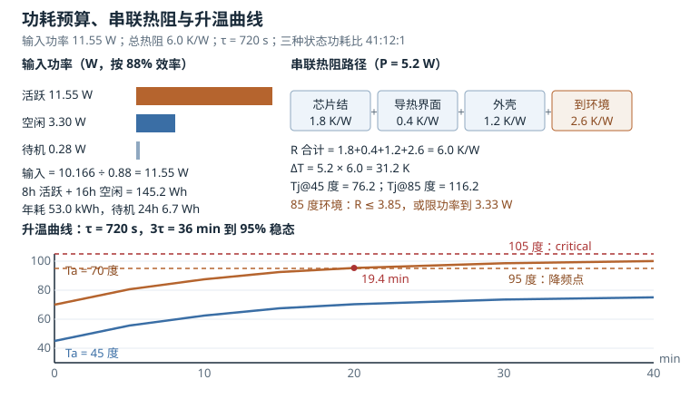

# 功耗与热设计：预算、热阻、降频与安全关机

一块板子在 25 摄氏度的实验室里跑一整天不重启，送到 45 摄氏度的机柜里半小时就降频，一小时后重启——这是嵌入式项目最经典的一次"环境暴露"。它暴露的不是软件 bug，而是两个账本没算清：**电的账本**（每一轨、每一个状态消耗多少瓦）和**热的账本**（这些瓦要走多大热阻才能到环境）。

这一章把两个账本合成一条链：功耗预算 → 热阻 → 结温 → 降频或关机。所有功耗都能用"电压 × 电流"列出来，所有结温都能用 $\Delta T=P\cdot R_{th}$ 算出来，所有"高温重启"都能落到某一个热阻、某一个 trip 点或某一次降频没生效上。

## 1. 动机：25 度能过，45 度不一定

热问题的可怕之处在于它有**很长的潜伏期**。板子刚上电是环境温度，结温随热时间常数缓慢爬升；实验室空调 25 度、机柜 45 度，差的 20 度会原样加到结温上。于是同一块板子，实验室里结温 76 度、余量 29 度；机柜里结温 96 度、余量只剩 9 度；再叠加一次满载峰值，就越过 105 度的降频点。

现场故障按"热链的哪一段"可以分成四类：

| 现象 | 断在哪 | 第一手判据 |
|---|---|---|
| 高温运行一段时间后降频、帧率掉 | 结温到 trip 点 | `thermal_zone*/temp` 与 `cooling_device*/cur_state` |
| 高温下直接重启，无 panic | 硬件热保护（PMIC/THERMTRIP） | PMIC 故障寄存器、`dmesg` 无记录 |
| 外壳烫手但内核报 55 度 | 传感器位置或 polling | 红外热像 vs `thermal_zone` 读数 |
| 关机过程掉电，eMMC 损坏 | 保持时间不足 | 超级电容电压曲线、关机时序 |

四类问题的共同点是：**它们都不在"功能"里，而在"余量"里**。功能测试永远测不出余量，只有预算和高温测试能。

::: motivation 一台户外机柜里的"随机重启"
某边缘计算盒子在南方夏季的户外机柜里随机重启，现场温度记录显示机柜内最高 52 摄氏度。研发在实验室 25 度环境下复现不了，老化房 45 度跑 8 小时也正常。

带上红外热像仪去现场，发现三个事实：机柜内实际环境温度 52 度（不是 45）；盒子满载时 SoC 外壳 91 度；重启前一分钟 SoC 外壳升到 103 度，随后整机掉电，`dmesg` 里没有任何 thermal 记录。

回到实验室按 52 度环境重测，复现了：SoC 结温 = 52 + 5.2 × 6.0 = 83.2 度，看起来还有余量；但**满载峰值功率不是 5.2 W，而是 6.8 W**（CPU 4 核 + GPU + ISP 同时跑），结温 = 52 + 6.8 × 6.0 = 92.8 度；再加上 PMIC 与 DDR 的热耦合，壳内局部环境比机柜高 6 度，结温到 98.8 度，逼近 PMIC 的硬件过温点 100 度。PMIC 触发保护，直接切断系统电源，所以内核什么都没留下。

修复做了三件事：把壳到环境的热阻从 3.8 K/W 降到 2.1 K/W（结温降约 10 度）、把 CPU 的可持续功率从 6.8 W 限到 5.2 W（boost 时间限 10 秒）、给 PMIC 的过温保护加 5 度回差，避免在 100 度附近反复切断。三周后同一机柜再测，满载壳温 78 度，再没重启过。

**问题从来不是"温度太高"，而是"没人算过最坏情况下的温度"。**
:::

## 2. 直观：电的账本与热的账本



图的左侧是三种状态下的输入功率，中间是从芯片结到环境的四段串联热阻，右侧是两条不同环境温度下的升温曲线与 95/105 度两条阈值线。

### 2.1 功耗预算表：按轨、按状态

功耗预算不是"整机 10 瓦"，而是一张二维表：**行是电源轨，列是工作状态**。三个状态足够覆盖绝大多数判断：

- **活跃（active）**：所有功能满负荷，包括 CPU 全核、GPU、ISP、无线发射、USB 供电；
- **空闲（idle）**：系统起来、业务空闲、屏幕关闭、无线待关联；
- **待机（suspend）**：系统挂起，只保留唤醒源与 RTC。

每一格填的是"这一轨在这个状态下最大可能消耗的功率"，不是平均值。原因很简单：**热设计看峰值，能量设计看平均**。用平均值算散热，峰值一来就越界；用峰值算电池，容量会大到不必要。两者要分开算。

除了轨，还要注意效率。12 V 输入先降到 5 V，再降到 3.3 V、1.1 V、0.9 V，每一级都有损耗。总输入功率是

$$P_{in}=\frac{P_{load}}{\eta}$$

$\eta$ 是整条链的效率。级联效率是各级相乘：12 V 到 5 V 取 0.92、5 V 到 0.9 V 取 0.88，则核心轨的总效率是 $0.92\times0.88=0.81$；5 V 到 3.3 V 取 0.93，总效率 $0.92\times0.93=0.856$。**用 0.9 的统一效率估算，会低估 5% 到 10% 的输入功率**，在 10 瓦量级就是 1 瓦，正好是一个小散热器的余量。

### 2.2 散热路径：四段串联热阻

热量从芯片结（junction）到环境，要穿过四段串联的热阻：

| 段 | 符号 | 典型值 | 影响因素 |
|---|---|---|---|
| 结到外壳 | $R_{jc}$ | 1.5 到 2.5 K/W | 封装、die 面积、散热焊盘 |
| 外壳到散热器 | $R_{TIM}$ | 0.3 到 2.0 K/W | 导热垫/硅脂厚度与面积 |
| 散热器到壳体 | $R_{hs}$ | 1.0 到 3.0 K/W | 散热器体积、翅片、接触压力 |
| 壳体到环境 | $R_{amb}$ | 1.5 到 6.0 K/W | 自然对流/强制风冷、开孔、机柜 |

四段相加就是总热阻 $R_{th}$。结温是环境温度加上"功率乘热阻"：

$$T_j=T_a+P\cdot R_{th}$$

这个式子是线性近似，忽略了辐射、热耦合与温度对材料参数的影响，但在工程误差范围内足够用。**它的价值在于把"烫不烫"变成一个可以手算的数**：5.2 W 乘 6.0 K/W 是 31.2 K，环境 45 度时结温 76.2 度，环境 85 度时 116.2 度——后者直接超过 105 度的上限。

### 2.3 thermal zone 与 cooling device

Linux 的热管理框架把"测温"和"降温"拆成两个对象：

- **thermal zone**：一个温度传感器加一组 trip point（触发点）。trip 分四级：`passive`（开始降频）、`active`（开风扇）、`hot`（进一步限制）、`critical`（关机）。
- **cooling device**：能降温的东西，可以是 CPU 频率（`cpufreq`）、GPU 频率（`devfreq`）、风扇（`pwm-fan`）、或者厂商自定义的限流器。每个 cooling device 有一组离散状态（`cur_state` 从 0 到 `max_state`）。

两者通过 **cooling map** 绑定：某个 zone 的某个 trip 触发时，把某个 cooling device 拉到某个状态。绑定的策略由 `policy` 决定：

| policy | 行为 | 适用 |
|---|---|---|
| `step_wise` | 每轮调一档，简单粗暴 | 大多数嵌入式 |
| `bang_bang` | 超过就开、低于就关 | 风扇 |
| `power_allocator` | 按功率预算分配（IPA） | 手机、复杂 SoC |
| `user_space` | 交给用户态 | 自定义策略 |

`step_wise` 的问题是"每轮一档"：如果温度上升很快，一轮一轮加档追不上，结温会冲过 trip 点再回落。所以 trip 点要留出**过冲余量**，通常把 passive 设在比目标结温低 5 到 10 度。

### 2.4 降频与降压：为什么是电压的平方

CMOS 的动态功耗是

$$P_{dyn}=\alpha C V^{2} f$$

$\alpha$ 是翻转活动因子，$C$ 是等效电容，$V$ 是供电电压，$f$ 是频率。频率和电压通常联动（DVFS）：降频时必须降压，否则高频下的时序余量浪费成功耗；降压又限制了最高频率。两者一起变，功耗按

$$P=P_{s}+\alpha C V_0^{2}f_0\left(\frac{f}{f_0}\right)\left(\frac{V}{V_0}\right)^{2}$$

$P_s$ 是静态功耗（漏电），它不随频率下降。**这一项是"降频省电"最常见的误判来源**：动态功耗减半，整机功耗可能只降三成，因为静态功耗还在。

### 2.5 热失控：一个正反馈回路

漏电功耗随温度指数上升，温度又由功耗决定，于是形成正反馈：

$$P_{leak}(T)=P_{leak,0}\cdot 2^{(T-T_0)/\Delta T_d}$$

$\Delta T_d$ 是漏电翻倍的温度间隔，先进工艺大约 10 到 15 K。把漏电对温度求导，乘上热阻，得到环路增益：

$$G=R_{th}\frac{dP_{leak}}{dT}$$

$G<1$ 时系统稳定：温度升高带来的额外功耗，会被散热能力吃掉；$G\geq1$ 时发散：温度升高产生更多功耗，更多功耗产生更高温度，直到某个硬件保护动作或器件损坏。**这就是为什么高温下"降频没生效"比"风扇坏了"更危险**：前者会把系统推进发散区。

### 2.6 安全关机：最后一道闸

当软件降频已经压不住温度，剩下的手段只有关机。关机分三级：

1. **有序关机（orderly）**：通知业务保存、卸载文件系统、`sync`、断电。需要几秒时间，靠超级电容或电池撑住。
2. **强制关机（forced）**：内核直接 `poweroff`，不保证文件系统一致，但至少不再加热。
3. **硬件切断（hardware）**：PMIC 或 SoC 的 THERMTRIP 直接断电源，什么都不保证，只保证不着火。

三级之间的切换点由 trip 点决定：`critical` 触发有序关机，PMIC 的过温保护作为硬件兜底，两者之间要留 5 到 10 度的间隔，避免"软件刚要关机、硬件先断了"。

## 3. 定量：热阻、温升与保持时间

### 3.1 串联热阻与结温

$$R_{th}=R_{jc}+R_{TIM}+R_{hs}+R_{amb},\qquad T_j=T_a+P R_{th}$$

$R_{jc}$ 由封装决定，数据手册给出；$R_{TIM}$ 由导热界面材料与接触面积决定；$R_{hs}$ 与 $R_{amb}$ 由散热器与环境决定。四段里**最容易失控的是 $R_{TIM}$**：一层 0.5 mm 的导热垫热导率 3 W/(m·K)、面积 20 mm × 20 mm，热阻是

$$R_{TIM}=\frac{L}{kA}=\frac{0.5\times10^{-3}}{3\times20\times20\times10^{-6}}=0.42\ \text{K/W}$$

如果换成 2 mm 厚的垫片，热阻变成 1.67 K/W，结温直接多 6.5 度（按 5.2 W 算）。**散热器买贵了，被一层厚垫片吃掉**，是硬件调试里最常见的浪费。

### 3.2 升温曲线与热时间常数

把芯片、散热器、外壳看成一个集总热容 $C_{th}$，升温是指数过程：

$$T(t)=T_a+\Delta T\left(1-e^{-t/\tau}\right),\qquad \tau=R_{th}C_{th}$$

$\Delta T=P R_{th}$ 是稳态温升，$\tau$ 是热时间常数。初始斜率是

$$\left.\frac{dT}{dt}\right|_{t=0}=\frac{P}{C_{th}}$$

$t=\tau$ 时到达稳态温升的 63.2%，$t=3\tau$ 时到达 95.0%。**这就是"热测试要跑多久"的答案：至少 3 个时间常数**。一个 $\tau=720$ 秒的系统，跑 36 分钟才到 95%，跑 10 分钟只到 56%，此时的读数不能用来判断稳态。

### 3.3 降频的收益与静态功耗的天花板

把 DVFS 前后的功耗比记作

$$\frac{P_{dyn}}{P_{dyn,0}}=\frac{f}{f_0}\left(\frac{V}{V_0}\right)^{2}$$

频率降到 2/3、电压降到 0.895 倍，动态功耗比是 $0.667\times0.801=0.534$。如果整颗 SoC 的动态功耗是 4.0 W、静态 1.2 W，则降频后是 $1.2+4.0\times0.534=3.33$ W，而不是 $5.2\times0.534=2.78$ W。**静态功耗让"省 47%"变成"省 36%"**，温度降幅也从 14.5 K 缩到 11.2 K。

### 3.4 热失控判据

漏电翻倍间隔取 15 K，$P_{leak,0}=0.15$ W（25 度时），则在 105 度时漏电是

$$P_{leak}=0.15\times2^{(105-25)/15}=6.05\ \text{W}$$

对温度求导：$dP/dT=6.05\times\ln2/15=0.279$ W/K。环路增益 $G=6.0\times0.279=1.68>1$，系统在该温度点不稳定。要稳定，热阻必须满足

$$R_{th}<\frac{1}{dP_{leak}/dT}=\frac{1}{0.279}=3.58\ \text{K/W}$$

这个数比"结温不超过 105 度"更严格：即使平均结温算下来只有 100 度，只要热阻大于 3.58 K/W，局部热点仍可能进入发散。**热失控的判据不是温度，是斜率。**

### 3.5 掉电保持时间

有序关机需要能量，能量由电容或电池提供。电容从 $V_1$ 放到 $V_2$ 释放的能量是

$$E=\frac{1}{2}C\left(V_1^{2}-V_2^{2}\right),\qquad t_{hold}=\frac{E}{P_{in}}$$

$C=2$ F、从 12 V 放到 9 V，释放 63 J；输入功率 11.55 W 时能撑 5.45 秒。这个时间要覆盖"检测到 critical → 业务保存 → 卸载 → sync → 断电"，通常需要 3 到 5 秒，**5.45 秒只是刚够，没有余量**。电容老化后容量下降 20%，保持时间就掉到 4.4 秒，正好卡在边界上。

## 4. 算例：12 V 供电的边缘盒子

一台 12 V 输入的边缘盒子，四核 SoC，带 WiFi、双网口、USB 供电，要求 45 度环境长期运行、85 度环境不损坏。

**第一步：列功耗预算。** 四条主要电源轨，三个状态：

| 轨 | 电压 | 活跃电流 | 空闲电流 | 待机电流 | 活跃功率 | 空闲功率 | 待机功率 |
|---|---|---|---|---|---|---|---|
| VDD_CORE | 0.9 V | 3.20 A | 0.35 A | 12 mA | 2.880 W | 0.315 W | 0.0108 W |
| VDD_DDR | 1.1 V | 0.90 A | 0.15 A | 3 mA | 0.990 W | 0.165 W | 0.0033 W |
| 3V3 | 3.3 V | 0.62 A | 0.28 A | 25 mA | 2.046 W | 0.924 W | 0.0825 W |
| 5V | 5.0 V | 0.85 A | 0.30 A | 30 mA | 4.250 W | 1.500 W | 0.1500 W |
| 合计 | | | | | 10.166 W | 2.904 W | 0.2466 W |

按 88% 的整链效率，输入功率是

$$P_{in}=\frac{10.166}{0.88}=11.55\ \text{W}$$

这里用统一的 0.88 是为了手算方便；逐轨效率其实不同（核心轨约 0.81、3V3 轨约 0.86），统一值会低估 5% 左右，做散热余量时正好当保守量吃掉。空闲 3.30 W，待机 0.280 W。三个数字的比值是 41:12:1，说明**待机功耗不是小问题**：如果设备 24 小时待机，一年也要 2.45 kWh。

**第二步：算每日能量与电费。** 8 小时活跃、16 小时空闲：

$$E_{day}=11.55\times8+3.30\times16=145.2\ \text{Wh}$$

一年 $145.2\times365=53.0$ kWh，按 0.6 元/kWh 是 31.8 元。**单台电费不高，但一万台就是 31.8 万元/年**，这是"待机功耗优化"的真实驱动力。

**第三步：算结温。** SoC 满载功率 5.2 W，总热阻 6.0 K/W（$1.8+0.4+1.2+2.6$）：

| 环境温度 | 温升 | 结温 | 余量（上限 105 度） |
|---|---|---|---|
| 25 度 | 31.2 K | 56.2 度 | 48.8 度 |
| 45 度 | 31.2 K | 76.2 度 | 28.8 度 |
| 55 度 | 31.2 K | 86.2 度 | 18.8 度 |
| 70 度 | 31.2 K | 101.2 度 | 3.8 度 |
| 85 度 | 31.2 K | 116.2 度 | -11.2 度 |

45 度环境余量 28.8 度，看起来充裕；但**机柜内局部温度通常比环境高 10 到 15 度**，按壳内 60 度算，结温已经 91.2 度，余量只剩 13.8 度。再叠加峰值功率 6.8 W（CPU + GPU + ISP 同时满载），结温变成 $60+6.8\times6.0=100.8$ 度——离 105 度只差 4.2 度。

**第四步：算 85 度环境要什么。** 结温不超过 105 度，热阻必须满足

$$R_{th}\leq\frac{105-85}{5.2}=3.85\ \text{K/W}$$

现有 6.0 K/W 差 2.15 K/W，相当于要把"壳到环境"那段从 3.8 K/W 降到 1.65 K/W 以下——体积翻倍，很多盒子装不下。另一条路是限功率：

$$P\leq\frac{105-85}{6.0}=3.33\ \text{W}$$

也就是把 SoC 从 5.2 W 限到 3.33 W，等于降频。

**第五步：算降频后的功耗与结温。** 静态 1.2 W、动态 4.0 W（1.8 GHz / 0.95 V 下）：

| 频率 | 电压 | 动态比 | 动态功耗 | 总功耗 | 85 度结温 |
|---|---|---|---|---|---|
| 1.8 GHz | 0.95 V | 1.000 | 4.00 W | 5.20 W | 116.2 度 |
| 1.5 GHz | 0.90 V | 0.748 | 2.99 W | 4.19 W | 110.2 度 |
| 1.2 GHz | 0.85 V | 0.534 | 2.13 W | 3.33 W | 105.0 度 |
| 1.0 GHz | 0.80 V | 0.394 | 1.58 W | 2.78 W | 101.7 度 |
| 0.6 GHz | 0.75 V | 0.208 | 0.83 W | 2.03 W | 97.2 度 |

降到 1.2 GHz 刚好卡在 105 度，没有余量；**工程上取 1.0 GHz，结温 101.7 度，留 3.3 度余量**。注意 1.2 GHz 时纯动态模型会算成 $5.2\times0.534=2.78$ W，比实际少 0.55 W——静态功耗这一项不能漏。

**第六步：算热时间常数与测试时长。** 集总热容取 120 J/K：

$$\tau=R_{th}C_{th}=6.0\times120=720\ \text{s}=12\ \text{min}$$

初始温升斜率 $5.2/120=0.0433$ K/s，即 2.6 K/min。45 度环境升到 70 度（稳态 31.2 K 的 80%）需要

$$t=-\tau\ln\left(1-\frac{25}{31.2}\right)=1163\ \text{s}=19.4\ \text{min}$$

到 95% 稳态要 $3\tau=2160$ 秒，即 36 分钟。**高温测试只跑 30 分钟，读数还在往上爬，结论会系统性偏乐观。**

**第七步：算关机保持时间。** 2 F 超级电容从 12 V 放到 9 V：

$$E=\frac{1}{2}\times2\times(12^{2}-9^{2})=63\ \text{J},\qquad t_{hold}=\frac{63}{11.55}=5.45\ \text{s}$$

5.45 秒覆盖"检测 + 保存 + 卸载 + sync"是紧的。若电容老化到 1.6 F，只剩 4.36 秒；若输入功率因为 USB 满载升到 13 W，只剩 4.85 秒。**保持时间要按"最坏功率 + 老化后容量"设计，不能按标称值。**

## 5. 工程含义：预算、配置与实测

### 5.1 预算表怎么落地

预算表要能回答三个问题：最坏情况多少瓦、哪个状态最费电、哪一轨最该优化。模板如下：

| 项目 | 活跃 | 空闲 | 待机 | 备注 |
|---|---|---|---|---|
| SoC 核心 | 2.88 W | 0.315 W | 0.011 W | DVFS 可调 |
| DDR | 0.99 W | 0.165 W | 0.003 W | 自刷新 |
| 3V3 外设 | 2.05 W | 0.924 W | 0.083 W | 网口、WiFi |
| 5V 外设 | 4.25 W | 1.50 W | 0.150 W | USB、硬盘 |
| 转换损耗 | 1.38 W | 0.40 W | 0.034 W | 按 88% 反推 |
| 输入合计 | 11.55 W | 3.30 W | 0.280 W | 热设计取此列 |

三个纪律：**每一格都要有测量或数据手册依据**；峰值要注明持续时间（boost 10 秒和持续 10 分钟，热设计完全不同）；转换损耗单独一行，避免被"负载合计"掩盖。

### 5.2 读 thermal zone 与 cooling device

```bash
# 所有温度传感器：type 与当前温度（毫摄氏度）
grep -H "" /sys/class/thermal/thermal_zone*/type
grep -H "" /sys/class/thermal/thermal_zone*/temp

# 某个 zone 的 trip 点与策略
grep -H "" /sys/class/thermal/thermal_zone0/trip_point_*_type
grep -H "" /sys/class/thermal/thermal_zone0/trip_point_*_temp
cat /sys/class/thermal/thermal_zone0/policy

# cooling device：类型、当前档位、最大档位
grep -H "" /sys/class/thermal/cooling_device*/type
grep -H "" /sys/class/thermal/cooling_device*/cur_state
grep -H "" /sys/class/thermal/cooling_device*/max_state
```

`temp` 和 `trip_point_*_temp` 的单位是**毫摄氏度**，读到 `76200` 是 76.2 度，不是 76200 度。这个单位错在自定义脚本里非常常见：把 trip 写成 `95000`（正确）和 `95`（错误）的行为完全不同，后者等于"上电就降频"。

### 5.3 设备树里的 thermal 绑定

thermal 的绑定关系写在设备树里：zone 定义传感器与 trip，cooling map 把 trip 连到 cooling device。下面是典型的四核 SoC 片段（用 `dtc` 反编译运行中的树可以看到实际值）：

```bash
# 把运行中的设备树反编译出来，确认 trip 与 map 是否与设计一致
dtc -I fs -O dts /proc/device-tree > /tmp/live.dts
grep -A 20 "thermal-zones" /tmp/live.dts | head -40
```

需要检查四件事：

1. **传感器节点真的被 probe 了**：`thermal_zone*/type` 里应该出现 SoC 的名字，而不是只有 `cpu-thermal` 一个孤零零的默认值；
2. **trip 温度与设计一致**：passive 比目标结温低 5 到 10 度，critical 比 PMIC 硬件点低 5 到 10 度；
3. **cooling map 绑到了正确的 cdev**：CPU 的 cdev 应该绑到 `cpufreq`，而不是绑到风扇；
4. **polling 延迟合理**：默认 1000 ms 对慢热系统够用，对功率阶跃大的系统要降到 250 到 500 ms。

### 5.4 降频策略与回差

降频策略要解决两个问题：**什么时候降**和**什么时候恢复**。只用单点阈值会抖动：温度到 95 度降频，降频后掉到 94.9 度又升频，再冲上 95 度，形成振荡。标准做法是加回差（hysteresis）：

- 降频点 95 度，恢复点 90 度（5 度回差）；
- 每档频率的停留时间不少于 30 秒，避免频繁切换；
- 恢复时逐档升，不一次跳到最高。

内核的 `step_wise` 已经实现了"逐档 + 回差"，但它的回差是内置的固定值，不够时可以换 `power_allocator`，用功率预算而不是温度阈值来控制。**降频的目标不是"把温度压到阈值以下"，而是"把温度稳定在阈值以下且性能损失最小"。**

### 5.5 安全关机与看门狗联动

系统起不来或热关机时，先确认关机目标与 thermal 消息：

```bash
# 检查 thermal 相关内核消息
dmesg | grep -i "thermal\|critical\|throttl"

# 看 poweroff 目标依赖了哪些单元，确认关机路径里没有 90 秒的网络超时
systemctl list-dependencies --reverse poweroff.target | head -20
```

设计要点：`critical` trip 触发后，内核调用 `orderly_poweroff()`，由用户态完成保存与卸载；如果用户态在超时内没有响应，硬件兜底断电。**这个超时必须小于超级电容的保持时间**——算例里只有 5.45 秒，所以常规的 30 秒甚至 90 秒服务停止超时都不可接受，必须把热关机路径压缩到 5 秒以内，否则电容先没电，文件系统半写。

### 5.6 实测方法

| 方法 | 测什么 | 精度 | 注意 |
|---|---|---|---|
| 热电偶 | 外壳/散热器表面 | ±1.5 度 | 贴片要压紧，导线要细 |
| 红外热像仪 | 全场热点分布 | ±2 度 | 发射率按材质设 0.95 |
| thermal zone | 芯片内部传感器 | ±2 到 3 度 | 位置不在热点，需校准 |
| 功耗仪 | 输入功率 | ±0.5% | 采样率至少 1 Hz，抓峰值 |
| hwmon | 板载功率监测 | ±2% | INA226 一类，注意分流电阻温漂 |

测试流程固定为四步：**稳态（3 个时间常数）→ 记录（结温、壳温、环境、输入功率）→ 阶跃（满载/空载切换，看超调）→ 降额（按最坏环境温度重算）**。只测稳态不测阶跃，会漏掉"满载瞬间冲到 trip 点"这一类问题；只测阶跃不测稳态，会漏掉"慢慢爬升最后越界"。

### 5.7 常见热点

- **PMIC**：转换效率最低的那一轨最热，通常是 12 V 降到 0.9 V 的大电流轨；结温上限 125 度，但壳内局部环境可能比机柜高 15 度。
- **DDR**：宽温 DDR 的刷新率随温度翻倍，高温下功耗反而上升；颗粒表面温度不能只看环境。
- **WiFi/BT 功放**：发射时功率密度最高，天线附近的外壳是最热点，也最容易烫手。
- **eMMC**：写入时的峰值电流叠加高温，会触发内部热保护降速；高温还会加速数据保持失效。
- **DC-DC 电感**：DCR 损耗随温度上升（铜电阻正温度系数），形成小的正反馈。
- **连接器与线缆**：接触电阻在高温下上升，压降变大，输入电压跌到欠压点导致重启。

## 6. 常见坑：现象、原因与解决

::: pitfall 坑一：实验室 25 度一切正常，机柜 45 度半小时后重启
**现象**：高温环境下运行 20 到 40 分钟后整机重启，`dmesg` 无 panic、无 thermal 记录，只有一条非正常关机；实验室同负载跑 8 小时正常。

**原因**：热设计只按"环境 45 度 + 平均功率"算，没算三件事：壳内局部温升（比机柜高 10 到 15 度）、峰值功率（比平均高 30%）、以及 PMIC 的硬件过温点（比 SoC 的 105 度更低，可能 100 度）。三者叠加后结温越过硬件保护点，电源被直接切断，内核来不及记录。

**解决**：用红外热像仪在真实机柜里测壳内环境温度，按"壳内温度 + 峰值功率 + 最坏热阻"重算结温；把 boost 时间限制在 10 秒以内；给 PMIC 的过温点加 5 度回差；最后按 3 个时间常数做高温满载测试，确认稳态结温低于降频点 5 度以上。
:::

::: pitfall 坑二：外壳烫手，`thermal_zone` 只报 55 度
**现象**：手指放在外壳上坚持不了 3 秒，`thermal_zone0/temp` 稳定在 55000 左右；降频从不触发。

**原因**：传感器位置不在热点。SoC 的温度传感器通常在 CPU 集群边缘或靠近 DDR 接口，而最热的是 GPU、ISP 或 PMIC；另外 polling 间隔太长（默认 1000 ms），负载阶跃时的峰值被平均掉。

**解决**：增加独立的热点传感器（或把 PMIC 的裸片温度接进 thermal zone）；用红外热像仪做一次"传感器读数 vs 实际壳温"的标定，得到固定偏移；把 polling 降到 250 到 500 ms；在软件上用"最高温 zone"而不是"某个固定 zone"做策略输入。
:::

::: pitfall 坑三：降频配置写了但从不生效
**现象**：设备明显发烫、频率却没降；`cooling_device*/cur_state` 一直是 0；`dmesg` 里能看到 thermal zone 注册成功。

**原因**：cooling map 没绑上，或者 trip 温度单位写错（写成 95 而不是 95000），或者 `policy` 是 `user_space` 但没有用户态守护进程。也可能是 cpufreq 的 `scaling_max_freq` 被别处锁死，冷却设备"拉了档"但驱动拒绝执行。

**解决**：按 5.2 节的命令逐项核对：zone 的 trip 类型与温度、cdev 的 `type` 与 `max_state`、map 是否出现在 `/sys/class/thermal/thermal_zone0/cdev*_type`；把 `policy` 临时切成 `step_wise` 验证；用 `cpupower frequency-info` 看 `scaling_max_freq` 是否被改。**验证标准是"满载时 `cur_state` 会变"，不是"设备树里有这个节点"。**
:::

::: pitfall 坑四：热关机时掉电，eMMC 分区损坏
**现象**：高温保护关机后，下次启动 `fsck` 报错、部分配置丢失；日志显示关机流程走到了 `sync`，但没走完。

**原因**：保持时间不足。超级电容按标称容量和平均功率算，实际电容老化 20%、关机瞬间 USB 满载又拉高了功率；更常见的是关机脚本里有网络卸载或服务停止的超时（默认 90 秒），远大于电容能撑的 5 秒。

**解决**：把 critical 之后的关机路径压缩到"停业务 → 卸载数据分区 → `sync` → 断电"，绕过常规的 90 秒服务停止；给关键分区改成只读或 `sync` 挂载；按"老化容量 + 峰值功率"重算电容，留 50% 余量；在电容电压上做欠压检测，低于阈值直接硬断电，避免半写。
:::

::: pitfall 坑五：把 LDO 当降压用，3.3 V 转 1.8 V 白烧 0.45 W
**现象**：1.8 V 轨电流 0.3 A，LDO 表面温度比周围高 20 度；整机待机功耗比预期高 0.5 W。

**原因**：线性稳压器的效率等于输出电压除以输入电压，3.3 V 转 1.8 V 只有 54.5%，损耗 $(3.3-1.8)\times0.3=0.45$ W 全变成热。同样负载用 90% 的 buck，损耗只有 0.06 W。

**解决**：压差大、电流大的轨一律用 buck；LDO 只留给"低噪声、小电流"的模拟轨；已经用 LDO 的，把输入从 3.3 V 改到更低的中间轨（例如 2.5 V），效率能从 54.5% 提到 72%。**每一瓦的损耗都要在预算表里出现，不能只写"负载"。**
:::

## 7. 自测题

<details><summary>题一：四条轨的活跃电流分别是 3.20 A/0.9 V、0.90 A/1.1 V、0.62 A/3.3 V、0.85 A/5 V，整链效率 88%。活跃负载功率与输入功率各是多少？8 小时活跃 + 16 小时空闲（空闲 2.904 W）每天耗多少电？</summary>

逐轨：$3.20\times0.9=2.880$ W，$0.90\times1.1=0.990$ W，$0.62\times3.3=2.046$ W，$0.85\times5.0=4.250$ W。

合计 $2.880+0.990+2.046+4.250=10.166$ W。

输入 $10.166/0.88=11.55$ W。

每天 $11.55\times8+3.30\times16=92.4+52.8=145.2$ Wh，一年 $53.0$ kWh，按 0.6 元/kWh 是 31.8 元。

注意 5 V 轨占了 4.25 W，是最大单项；优化顺序应该从它开始，而不是从 SoC 核心。
</details>

<details><summary>题二：SoC 功率 5.2 W、总热阻 6.0 K/W。环境 45 度和 85 度时结温各是多少？85 度环境要满足 105 度上限，热阻最多多少？若热阻不变，功率要限到多少？</summary>

45 度：$T_j=45+5.2\times6.0=76.2$ 度。

85 度：$T_j=85+31.2=116.2$ 度，超上限 11.2 度。

热阻上限：$R\leq(105-85)/5.2=3.85$ K/W。

功率上限：$P\leq(105-85)/6.0=3.33$ W。

两条路的代价不同：换散热器要把 3.8 K/W 降到 1.65 K/W 以下（体积翻倍），限功率要降频到 1.2 GHz 左右。工程上通常两条一起用：散热器改善一半，剩下的靠限频。
</details>

<details><summary>题三：1.8 GHz/0.95 V 时动态功耗 4.0 W、静态 1.2 W。降到 1.2 GHz/0.85 V，动态功耗比是多少？总功耗多少？如果只按 $P\propto fV^{2}$ 估算会得到什么错误结论？</summary>

$$\frac{P_{dyn}}{P_{dyn,0}}=\frac{1.2}{1.8}\left(\frac{0.85}{0.95}\right)^{2}=0.667\times0.801=0.534$$

动态功耗 $4.0\times0.534=2.13$ W，总功耗 $1.2+2.13=3.33$ W。

只按比例估算会得到 $5.2\times0.534=2.78$ W，少算 0.55 W。少算的部分就是静态功耗：它不随频率下降，占比从 23% 升到 36%。

这个 0.55 W 在 6.0 K/W 的热阻上等于 3.3 度，足以让"刚好 105 度"变成"102 度"或反过来。**降频收益必须用含静态项的模型算。**
</details>

<details><summary>题四：总热阻 6.0 K/W、热容 120 J/K、功率 5.2 W。时间常数多少？初始温升斜率多少？环境 45 度时升到 70 度要多久？为什么高温测试至少要跑 36 分钟？</summary>

$$\tau=6.0\times120=720\ \text{s}=12\ \text{min}$$

初始斜率 $5.2/120=0.0433$ K/s $=2.6$ K/min。

稳态温升 31.2 K，升到 70 度即完成 $25/31.2=80.1\%$：

$$t=-720\ln(1-0.801)=720\times1.615=1163\ \text{s}=19.4\ \text{min}$$

3 个时间常数 $=2160$ 秒 $=36$ 分钟，到 95% 稳态。跑 30 分钟只到约 91.8%，读数还在爬，结论会偏乐观；跑 10 分钟只到 56.5%，偏差更大。

所以高温测试的时长不是"跑一晚就行"，而是"至少 3τ，且最后 10 分钟温升小于 1.5 K"。
</details>

<details><summary>题五：漏电在 25 度时 0.15 W、每 15 K 翻倍，热阻 6.0 K/W。105 度时漏电多少？环路增益多少？要多大的热阻才稳定？2 F 电容从 12 V 放到 9 V，11.55 W 负载能撑多久？</summary>

105 度：$P=0.15\times2^{(105-25)/15}=0.15\times40.3=6.05$ W。

导数 $dP/dT=6.05\times\ln2/15=0.279$ W/K，环路增益 $G=6.0\times0.279=1.68>1$，不稳定。

稳定条件 $R<1/0.279=3.58$ K/W。

电容能量 $E=0.5\times2\times(144-81)=63$ J，$t=63/11.55=5.45$ s。

两个结论：高温柔性设计的关键指标是热阻而不是平均温度；关机保持时间只有 5.45 秒，任何 90 秒的服务停止超时都会让关机变成半写。
</details>

## 8. 参考资料

- Linux 内核文档 `Documentation/driver-api/thermal/sysfs-api.rst`：thermal zone、trip point、cooling device 的 sysfs 接口。
- Linux 内核文档 `Documentation/driver-api/thermal/power_allocator.rst`：IPA 功率分配算法与 PID 参数。
- Linux 内核文档 `Documentation/admin-guide/pm/cpufreq.rst`：governor、OPP 表与频率电压约束。
- Linux 内核文档 `Documentation/devicetree/bindings/thermal/thermal-zones.yaml`：trips 与 cooling-maps 的绑定规则。
- Linux 内核文档 `Documentation/hwmon/sysfs-interface.rst`：功率、电压、温度传感器的标准属性。
- Linux 内核文档 `Documentation/power/runtime_pm.rst`：运行时电源管理与自动挂起对功耗预算的影响。
- JEDEC JESD51 系列：结温测量、$R_{jc}$ 与 $R_{ja}$ 的定义与测试条件。
- IEC 62368-1：音视频与信息技术设备的可触摸表面温度限值（金属外壳通常按 55 度控制）。
- ARM《Power and Thermal Management》白皮书与 Linux thermal framework 文档：降频、限频与热保护策略。
- 器件数据手册中的降额曲线（电解电容每升 10 度寿命减半、eMMC 的壳温上限 85 度）：选型时的输入。
