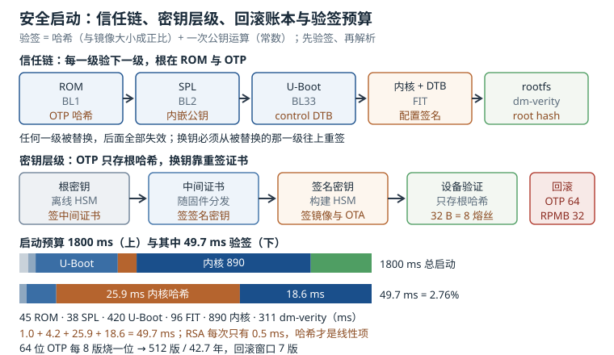

# 安全启动：信任链、密钥层级、防回滚与验签预算

安全启动（Secure Boot）解决的问题只有一句话：**设备只运行被授权的代码**。它不加密、不隐藏、不防拆机，只保证"从复位向量开始，每一段代码在跳过去之前都验过签名"。一旦这一步做错，后果往往不是"功能少了"，而是整批设备停在 bootloader，连串口都进不去。

这一章按"链、钥、账、时"四个字展开：信任链怎么串、密钥怎么分层、回滚账本记在哪、验签占多少启动预算。所有时间都能用"镜像大小 ÷ 哈希速率 + 一次公钥运算"算出来，所有计数器容量都能用"熔丝位数 × 粒度"算出来。

## 1. 动机：验不过、验过了起不来、验过了但被降级

安全启动相关的问题分三类，排查入口完全不同：

| 现象 | 层面 | 第一手证据 |
|---|---|---|
| 上电就停，串口无输出或只打印 `HAB` 失败 | ROM 与 OTP | 熔丝值、SRK 哈希、镜像 IVT 偏移 |
| `Verifying Hash Integrity ... OK` 之后没有下文 | 镜像布局与加载地址 | FIT 配置节点、load/entry、DTB |
| 系统能起，但被刷回了有漏洞的旧版本 | 防回滚策略 | 计数器位置、校验发生在哪一级 |
| 换密钥后新固件装不上 | 密钥层级与分发 | 公钥在哪、证书链是否完整 |
| OTA 包验签通过，重启后挂载失败 | rootfs 完整性 | dm-verity root hash、vbmeta |

第三类最隐蔽：**签名全部通过，设备也正常启动，只是版本是三个月前那个有漏洞的**。攻击者不需要伪造签名，只需要把旧签名镜像原样刷回去。防回滚（anti-rollback）就是为这一类准备的。

::: motivation 一次密钥轮换，两千台设备回不来
某产品在第一版固件里把签名公钥编译进了 U-Boot 的 control DTB，同时把公钥哈希烧进了 OTP。一年后签名私钥需要轮换，团队重新生成了密钥对、重签了内核 FIT，发布 OTA。

结果两千台已出货设备全部升级失败，报 `Signature check failed`。原因很简单：U-Boot 里的公钥还是旧的，而 FIT 是用新私钥签的。OTP 里的哈希锁死了根密钥，U-Boot 又不能原地替换（它自己也被前一级验签），整条链没有"换钥"的入口。

补救办法只有在设计阶段预留：一是把公钥放在可升级的证书链里，根密钥只签中间证书；二是预留密钥撤销熔丝。事后补救的代价是把设备收回来用烧录器重刷。
:::

这个例子说明：**密钥层级不是"多此一举的仪式"，它是唯一让密钥可以轮换的机制**。把公钥直接烧死，等于把"永远不能换密钥"写进了硬件。

## 2. 直观：一条信任链、两把钥匙、一本账



上图从左到右是五段信任链，中间是"根密钥 → 中间证书 → 签名密钥"的层级，右侧是 1.8 s 启动预算里验签占的 49.7 ms，底部是 OTP 粗粒度下限加 RPMB 细计数器的回滚账本。

### 2.1 信任链的五段

信任链（Chain of Trust）的起点是**不可修改的 ROM**。ROM 里固化了一段代码和一把"根公钥的哈希"，它做的事只有一件：把下一级镜像读进来，算哈希，比对签名，通过才跳转。之后每一级重复同样的动作：

| 阶段 | 验证者 | 被验证者 | 验证依据 |
|---|---|---|---|
| 1 | 片内 ROM | SPL（Secondary Program Loader） | OTP 里的根密钥哈希 + 镜像签名 |
| 2 | SPL | U-Boot proper | 内嵌公钥 + FIT 签名 |
| 3 | U-Boot | 内核 + 设备树 | FIT 配置节点的签名 |
| 4 | 内核 | 内核模块 | 模块签名（可选强制） |
| 5 | 内核 | rootfs | dm-verity 哈希树 / AVB |

"验证依据"这一列是关键：**每一级的公钥从哪来**。ROM 的公钥哈希在 OTP 里，不可改；SPL 和 U-Boot 的公钥编译在二进制里，改它就要重签整个二进制；内核的公钥在 U-Boot 的 control DTB 里，可以随 U-Boot 一起升级；rootfs 的 root hash 在内核命令行或 vbmeta 里，可以随启动参数变化。

这条链有一个重要性质：**任何一级被替换，后面全部失效**。所以升级时不能只换内核，必须从被替换的那一级开始重新签，并且保证签名密钥与验证方持有的公钥匹配。

在 ARM 平台上，这条链通常由 Trusted Firmware-A 实现：BL1 在 ROM 之后运行，验证 BL2；BL2 加载 BL31（运行时固件）和 BL33（U-Boot）；BL31 常驻安全世界，负责电源管理与安全服务。i.MX 的 HAB（High Assurance Boot）则用 IVT（Image Vector Table）+ CSF（Command Sequence File）+ DCD（Device Configuration Data）描述镜像布局与验证命令，ROM 按 CSF 里的指令逐段校验。

### 2.2 哈希与签名：两个不同的问题

这两件事经常被混为一谈：

- **哈希**回答"内容有没有变"，对抗的是随机错误与传输损坏；
- **签名**回答"是谁做的"，对抗的是恶意替换。

只做哈希的问题是：攻击者可以同时替换镜像和哈希，两者仍然自洽。只做签名的问题是：签名覆盖的范围可能与实际执行的内容不一致（比如签名只覆盖了头部，数据段没覆盖），或者验证方拿到的"签名"其实是攻击者自己生成的。

正确的组合是**先哈希、再签名、后比对**：

$$\text{signature} = \text{Sign}_{K_{priv}}\big(H(\text{image})\big)$$

设备端用公钥解出签名里的哈希，再自己算一遍镜像哈希，两者相等才接受。这样签名只覆盖 32 字节，与镜像大小无关；镜像再大，公钥运算也只有一次。

这里有个容易被忽略的细节：**哈希算法必须与签名算法一起写进元数据**。U-Boot 的 FIT 里写作 `algo = "sha256,rsa2048"`，如果写成 `sha1,rsa2048` 而构建端用的是 SHA-256，验签会失败，报错却是"签名无效"，很容易误判成密钥问题。

### 2.3 密钥层级

只有一把密钥的系统无法轮换：私钥泄露就只能召回。工程上的标准做法是三层：

| 层级 | 存放位置 | 用途 | 更换频率 |
|---|---|---|---|
| 根密钥（Root Key） | 离线 HSM，哈希烧进 OTP | 签中间证书 | 几乎不换 |
| 中间密钥（Intermediate） | HSM，随固件分发证书 | 签签名密钥 | 数年一次 |
| 签名密钥（Signing Key） | 构建服务器 HSM | 签镜像与 OTA 包 | 每年或按项目 |

设备里只存**根密钥的哈希**（256 位，32 字节，通常占 8 个 32 位熔丝），不存根公钥本身。验证时，镜像里带一条证书链：根证书 → 中间证书 → 签名证书；设备先用自己的哈希验证根证书，再用根证书验证中间证书，逐级往下。这样换签名密钥只需要重新签证书，不需要动 OTP。

比换钥更重要的是**撤销**。私钥泄露时，必须让旧密钥签的所有镜像失效。做法是在 OTP 里预留一组"撤销熔丝"，每一位对应一个密钥版本；烧掉某一位，对应版本的证书就不再被接受。撤销熔丝一旦烧掉不可恢复，所以要在设计时预留足够的位数（常见 4 到 8 位）。

### 2.4 防回滚：账本记在哪

防回滚的核心是一个**只能增大、不能减小**的计数器，以及一条规则：**镜像里的版本号必须大于等于计数器，否则拒绝启动**。

计数器可以放在四个地方：

| 位置 | 位宽 | 可写次数 | 特点 |
|---|---|---|---|
| OTP / eFuse | 通常 32 到 64 位 | 每一位只能烧一次 | 不可逆，最可信，容量最贵 |
| eMMC RPMB | 32 位 | 受闪存寿命限制 | 带 HMAC 认证，防重放 |
| TPM NV 计数器 | 32 位 | 受 TPM 寿命限制 | 需要额外芯片 |
| 普通分区 | 任意 | 无限 | 可被回滚，只能防误操作 |

OTP 的问题是**一次性**：烧掉一位就少一位。如果把版本号按二进制编码写进熔丝，从 3 升到 4 时要把低两位清零，而熔丝不能清零，所以二进制编码在 OTP 上不可行。实际做法有两种：

1. **一元编码**：每个版本烧一位，$B$ 位支持 $B$ 次升级；
2. **粗粒度下限**：OTP 只记录"最低允许版本"的粗粒度值，细粒度计数放在 RPMB。

第二种更实用。设 OTP 有 64 位，每 $G$ 个版本烧一位，则支持 $64 \times G$ 个版本；代价是攻击者最多能把版本回滚 $G - 1$ 个。这个 $G$ 就是"回滚窗口"，第 3.3 节会算它的取值。

## 3. 定量：验签时间、启动预算与计数器窗口

### 3.1 哈希与验签的耗时

一次镜像验证由两段组成：

$$T_{verify} = T_{hash} + t_{sig} = \frac{S}{v_{hash}} + t_{sig}$$

$S$ 是镜像大小（B），$v_{hash}$ 是哈希速率（B/s），$t_{sig}$ 是一次公钥运算的时间（s）。哈希是线性的，签名是常数：

| 操作 | Cortex-A53 上的典型耗时 |
|---|---|
| SHA-256（ARMv8 加密扩展） | 约 250 MB/s |
| SHA-256（纯软件） | 约 60 MB/s |
| RSA-2048 验签 | 约 0.5 ms |
| RSA-3072 验签 | 约 0.9 ms |
| ECDSA P-256 验签 | 约 2 ms |
| Ed25519 验签 | 约 1.5 ms |

代入几个典型镜像：

| 镜像 | 大小 | 哈希（250 MB/s） | 验签合计 |
|---|---|---|---|
| SPL | 128 KiB | 0.52 ms | 1.02 ms |
| U-Boot | 896 KiB | 3.67 ms | 4.17 ms |
| 内核 | 6 MiB | 25.17 ms | 25.67 ms |
| 设备树 | 64 KiB | 0.26 ms | 0.76 ms |
| rootfs 的 verity 元数据 | 1 MiB | 4.19 ms | 4.69 ms |

表中每行按"该镜像单独验签"计。FIT 把内核与设备树放进同一个 `signature` 节点时只做一次公钥运算（见第 4 节第三步），所以两项的哈希相加、签名只算一次。

规律很清楚：**镜像越大，哈希越占主导；镜像越小，签名运算越占主导**。所以"换更强的签名算法"对启动时间几乎没有影响，真正影响启动的是镜像体积和加载速度。

### 3.2 启动预算

启动总时间与验签占比：

$$T_{boot} = \sum_{i} t_i, \qquad \eta_{crypto} = \frac{\sum_i t_{crypto,i}}{T_{boot}}$$

一台典型设备的分段预算：

| 阶段 | 耗时（ms） | 其中校验（ms） |
|---|---|---|
| ROM 验签并加载 SPL | 45 | 1.0 |
| SPL 与 DDR 初始化 | 38 | 4.2 |
| U-Boot proper | 420 | 0 |
| U-Boot 验签并加载内核 FIT | 96 | 25.9 |
| 内核解压与初始化 | 890 | 0 |
| dm-verity 元数据与首批块 | 311 | 18.6 |
| 合计 | 1800 | 49.7 |

$$\eta_{crypto} = \frac{49.7}{1800} = 2.76\%$$

**验签只占 2.76%**。这是一个反直觉但要记住的结论：安全启动慢，通常慢在"多了一次镜像读取"或"关掉了缓存"，而不是慢在密码学运算上。真正需要优化的是加载路径，不是签名算法。

### 3.3 回滚计数器的容量

设 OTP 有 $B$ 位，每 $G$ 个版本烧一位，则能支持的版本总数：

$$N_{versions} = B \times G$$

按每年 $R$ 个版本发布，寿命为

$$T_{life} = \frac{B \times G}{R}$$

可被回滚的版本数（窗口）为

$$W = G - 1$$

因为设备接受"版本号 $\geq$ OTP 记录的下限"，而下限只精确到 $G$ 个版本一组，所以攻击者最多能把版本降到当前组的起始值，即回滚 $G - 1$ 个版本。

代入 $B = 64$、$R = 12$（每月一版）：

- $G = 1$（每个版本烧一位）：$N = 64$，寿命 5.33 年，窗口 0；
- $G = 8$：$N = 512$，寿命 42.7 年，窗口 7；
- $G = 16$：$N = 1024$，寿命 85.3 年，窗口 15。

这是一个明确的权衡：**窗口越大，寿命越长**。车规与工业设备常用 $G = 4$ 到 $8$，消费电子可以取 $G = 1$ 到 $2$（设备寿命本来就短）。

RPMB 计数器是 32 位，理论上限 $2^{32} - 1 = 4{,}294{,}967{,}295$ 次，按每月一次写入，寿命远超设备本身；它的实际约束是闪存写寿命（约 10 万次）与 HMAC 认证开销，而不是位宽。

### 3.4 OTA 包的验签

OTA 包通常分两层签：**清单（manifest）签名**覆盖包内所有文件的哈希，**整包签名**覆盖清单本身。设备端的验证时间：

$$T_{ota} = \max(T_{transfer}, T_{hash}) + t_{sig}$$

$T_{transfer}$ 是下载时间，$T_{hash}$ 是整包哈希时间。如果边下边算，两者重叠，取较大者；如果先下完再算，就是相加。512 MiB 的包：

$$T_{hash} = \frac{512 \times 1{,}048{,}576}{250 \times 10^{6}} = 2.15\ \text{s}$$

按 20 MB/s 的网络，传输时间 $512/20 = 26.8$ s。哈希被传输掩盖，验签对总时长的影响不到 8%。

但如果设备没有 ARMv8 加密扩展，哈希只有 60 MB/s：

$$T_{hash} = \frac{536.9\ \text{MB}}{60\ \text{MB/s}} = 8.95\ \text{s}$$

这时候哈希就不可忽略了。低端 SoC 上常见"OTA 装完要等十几秒"，大部分时间花在这里。

## 4. 算例：1.8 s 启动里的 49.7 ms

**第一步：算 SPL 的验签。** SPL 128 KiB，ROM 用 OTP 里的根密钥哈希验它：

$$T_{hash} = \frac{128 \times 1024}{250 \times 10^{6}} = 0.52\ \text{ms}$$

加一次 RSA-2048 验签 0.5 ms，合计 1.02 ms。ROM 的 45 ms 里，验签只占 1 ms，其余是初始化与加载。

**第二步：算 U-Boot 的验签。** U-Boot 896 KiB，由 SPL 用内嵌公钥验：

$$T_{hash} = \frac{896 \times 1024}{250 \times 10^{6}} = 3.67\ \text{ms}$$

加 0.5 ms 验签，合计 4.17 ms。

**第三步：算内核 FIT 的验签。** 内核 6 MiB、设备树 64 KiB：

$$T_{hash} = \frac{6 \times 1{,}048{,}576}{250 \times 10^{6}} = 25.17\ \text{ms}$$

设备树 0.26 ms；FIT 的 `signature@1` 节点用 `sign-images = "kernel", "fdt"` 一次覆盖内核与设备树，只有一次 RSA 验签 0.5 ms，合计 $25.17 + 0.26 + 0.5 = 25.93 \approx 25.9$ ms。这一项是全部验签里最大的，因为它验的是最大的镜像。

**第四步：算总账。** 1.02 + 4.17 + 25.9 + 18.6 = 49.7 ms，占 1800 ms 的 2.76%。如果换成 RSA-3072，每级验签多 0.4 ms，四级总共多 1.6 ms，占比升到 2.85%——**密钥长度对启动预算几乎无影响**。真正的代价在签名大小（256 B 变 384 B）和签名端耗时，与设备启动无关。

**第五步：算计数器窗口。** 64 位 OTP，每月一版，$G = 8$：

$$N_{versions} = 64 \times 8 = 512, \qquad T_{life} = \frac{512}{12} = 42.7\ \text{年}$$

窗口 $W = 7$，即攻击者最多能把设备降回 7 个版本之前。

若取 $G = 1$：寿命 5.33 年，窗口 0。选哪个取决于产品寿命与漏洞窗口：一台设计寿命 10 年的设备，$G = 1$ 会在第 6 年耗尽熔丝，之后无法再升级版本号，只能原地打补丁（版本号不变）；$G = 8$ 则能撑 42 年，代价是允许回滚 7 个版本。

**第六步：算 OTA 的验签占比。** 512 MiB 包、20 MB/s 网络、250 MB/s 哈希：传输 26.8 s，哈希 2.15 s，验签 0.5 ms。只要边下边算，验签开销可以忽略；如果先落盘再校验，多 2.15 s，占 8%。

## 5. 工程含义：FIT、OTP 与 OTA

### 5.1 用 FIT 把镜像和签名绑在一起

U-Boot 的 FIT（Flattened Image Tree）把内核、设备树、initramfs 打包成一个 itb，签名放在配置节点里：

```dts
/dts-v1/;
/ {
    description = "board kernel";
    #address-cells = <1>;

    images {
        kernel@1 {
            data = /incbin/("Image");
            type = "kernel";
            arch = "arm64";
            os = "linux";
            compression = "none";
            load = <0x40080000>;
            entry = <0x40080000>;
            hash@1 { algo = "sha256"; };
        };
        fdt@1 {
            data = /incbin/("board.dtb");
            type = "flat_dt";
            arch = "arm64";
            compression = "none";
            hash@1 { algo = "sha256"; };
        };
    };

    configurations {
        default = "conf@1";
        conf@1 {
            kernel = "kernel@1";
            fdt = "fdt@1";
            signature@1 {
                algo = "sha256,rsa2048";
                key-name-hint = "board-key";
                sign-images = "kernel", "fdt";
            };
        };
    };
};
```

构建与验签：

```bash
# 生成带签名的 itb，-k 指定私钥目录，-r 要求必须有签名
mkimage -f board.its -k keys/ -r board.itb

# U-Boot 侧需要打开的配置
# CONFIG_FIT=y
# CONFIG_FIT_SIGNATURE=y
# CONFIG_RSA=y
# CONFIG_RSA_VERIFY=y
```

公钥存放在 U-Boot 的 control DTB 里，路径是 `/signature/key-board-key/`，由 `mkimage -K` 或构建脚本写入。**公钥和 U-Boot 二进制是一体的**：换公钥必须重编 U-Boot，而 U-Boot 又被前一级验签，所以换钥必须从被换的那一级往上重新签。

启动时的成功输出长这样：

```
Loading kernel from FIT Image at 0x42000000 ...
   Verifying Hash Integrity ... sha256,rsa2048:board-key+ OK
```

`+` 表示签名验证通过。如果显示 `-`，说明验签失败，原因通常是公钥不匹配或哈希算法不一致。

### 5.2 OTP 与产线烧录

```bash
# 读取熔丝（i.MX 示例）
hexdump -C /dev/mxc_otp 2>/dev/null || cat /sys/fsl_otp/HW_OCOTP_SRK0

# 烧录 SRK 哈希（四组，每组 8 字节）
fuse prog 0 6 0x1a2b3c4d
fuse prog 0 7 0x5e6f7a8b
```

烧录之前必须确认三件事：

1. **哈希是公钥的哈希**，不是私钥的，也不是证书的；
2. **字节序与分组顺序**完全按 SoC 手册，错一个字节就等于换了一把钥匙；
3. **先烧测试板，再烧量产板**。熔丝不可逆，烧错的板子只能报废。

量产通常分两步：先烧"开放配置"（open configuration）做功能测试，最后一道工序再烧"关闭配置"（closed configuration）并置 `SEC_CONFIG`。关闭之后 JTAG 可能被禁用，ROM 也不再输出调试信息。

### 5.3 rootfs 的运行时校验

内核起来之后的校验靠 dm-verity：把 rootfs 按 4 KiB 分块，每块算哈希，哈希再按树状组织，树根就是 32 字节的 root hash。这个 root hash 通过内核命令行或 vbmeta 传给内核，内核在**每次读块时**校验：

```bash
# 内核命令行（简化）
dm-verity.root_hash=3f7a...  verity.hash_dev=/dev/mmcblk0p6
```

dm-verity 的代价是随机读放大：每读一个 4 KiB 块，可能要多读一层哈希块。哈希树的高度是

$$h = \left\lceil \log_{N_{fanout}} \frac{S}{4096} \right\rceil$$

$S$ 是 rootfs 大小，$N_{fanout}$ 是每个哈希块的扇出（4 KiB / 32 B = 128）。1 GiB 的 rootfs 有 262144 个块，$\log_{128} 262144 = 2.57$，树高 3 层。读一个块最坏要再读 3 个哈希块，随机读性能下降明显；顺序读时哈希块被预取，影响很小。

### 5.4 OTA 的验签流程

一个可审计的 OTA 流程是：

1. 构建系统生成镜像，算每个文件的 SHA-256，写进清单；
2. 用签名密钥对清单签名，签名附在包尾；
3. 设备下载时**边下边算**整包哈希；
4. 下载完成后先验清单签名，再用清单逐文件比对；
5. 全部通过才写入备用槽，写完后设置"待试运行"标志。

第 4 步的顺序很关键：**先验签、再解包**。如果先解包再验签，恶意包可以在解包阶段就触发漏洞（zip 路径穿越、symlink 攻击）。验签必须发生在任何解析动作之前。

### 5.5 调试与恢复

安全启动打开后，调试手段会大幅减少：

- ROM 不再打印详细日志，`HAB` 事件要通过 `hab_status` 读取；
- JTAG 可能被熔丝禁用；
- U-Boot 的控制台可能被编译掉，或者只能在"开放配置"下使用。

恢复路径必须在设计时留好：一个不参与验签的恢复分区（或 USB 下载模式），能在设备变砖时重新烧录。恢复镜像本身也要验签，但可以用一把独立的恢复密钥，避免主密钥泄露时连恢复通道也失效。

## 6. 常见坑：签名通过却起不来

::: pitfall 坑一：`Verifying Hash Integrity ... OK` 之后停在 `Starting kernel ...`
**现象**：U-Boot 打印验签通过，然后 `Starting kernel ...`，之后串口没有任何输出；换一个未签名的镜像反而能起。

**原因**：FIT 的 `configurations` 选错了配置节点，或者 `load`/`entry` 与内核实际的加载地址冲突。签名只保证"内容没变"，不保证"布局正确"。常见的是内核被二次压缩（`Image.gz`）但 `compression` 写成 `none`，U-Boot 把压缩数据当裸内核跳进去，第一句指令就非法。

**解决**：先用 `mkimage -l board.itb` 打印配置与各镜像的 load/entry；再用 `iminfo` 在 U-Boot 里确认加载地址没有覆盖 U-Boot 自身或设备树；最后确认 `compression` 字段与实际文件一致。**签名通过只说明字节没被改，不说明这些字节能被正确执行。**
:::

::: pitfall 坑二：换了签名密钥，所有设备报 `Signature check failed`
**现象**：新固件在实验室的全新板上能起，在已出货设备上全部失败；错误码 `-EKEYREJECTED`。

**原因**：公钥编译在 U-Boot 的 control DTB 里，只重签了内核 FIT 而没有重编 U-Boot，验证方手里还是旧公钥。另一种情况是 OTP 里的 SRK 哈希与 U-Boot 里公钥不匹配——ROM 验 SPL 就失败了，根本到不了内核。

**解决**：确认"签名密钥 / U-Boot 内嵌公钥 / OTP 根哈希"三者是一条链；换钥时从最外层开始重签并逐级验证；在产线增加"烧录后自检"，让设备在出厂前就跑一次完整启动链。
:::

::: pitfall 坑三：验签全过，挂载 rootfs 时内核 panic
**现象**：内核启动到挂载根文件系统时 panic，日志里有 `verity: metadata block 0 is corrupted` 或 `dm-verity: root hash mismatch`。

**原因**：rootfs 重新打包后没有更新 root hash，或者 vbmeta 里的哈希与镜像不一致。也可能是 `verity.hash_dev` 指向了错误的分区偏移，读到的是旧哈希树。

**解决**：重新生成 root hash 并同步到内核命令行/vbmeta；确认哈希树分区的偏移与大小；在小批量上先跑 `veritysetup verify` 手工验证，再量产。**dm-verity 的失败是"读的时候才发现"，不会在启动早期报错，所以必须单独做一次全量校验。**
:::

::: pitfall 坑四：先烧了防回滚计数器，镜像还没写进去
**现象**：升级过程中断电，重启后设备拒绝启动，提示"rollback index too low"；新旧两个槽都起不来。

**原因**：升级脚本的顺序是"先写计数器、再写镜像"。计数器只能增大，一旦写进去，旧镜像的版本号就低于下限，被拒绝；新镜像又没写完，两个槽都不可用。

**解决**：顺序必须是"写镜像 → 校验 → 最后写计数器"，并且计数器写入要幂等、可重试。更好的做法是把计数器放在 RPMB，用事务方式提交；OTP 只在跨大版本时更新。**任何"只能前进"的状态，都必须最后写。**
:::

::: pitfall 坑五：安全启动打开后，设备"完全没反应"
**现象**：同一块板子，烧了关闭配置的熔丝后，上电串口无输出，电流正常，JTAG 也连不上；换回开放配置的板子一切正常。

**原因**：关闭配置不仅启用验签，还会关闭 ROM 的调试输出、禁用 JTAG、可能改变启动介质顺序。看起来"没反应"，其实 ROM 已经在跑，只是没有任何可见输出。

**解决**：先在开放配置下确认整条链能启动，再烧关闭配置；保留一个"恢复模式"入口（USB 下载或恢复分区）；用电流波形和 ROM 的启动引脚判断是否在跑。**不要把"没有串口输出"当成"没有启动"。**
:::

## 7. 自测题

<details><summary>题一：6 MiB 内核，SHA-256 在 250 MB/s，RSA-2048 验签 0.5 ms。求验签总时间；若关掉硬件加速（60 MB/s），变成多少？</summary>

硬件加速：

$$T_{hash} = \frac{6 \times 1{,}048{,}576}{250 \times 10^{6}} = 25.17\ \text{ms}$$

加 0.5 ms 验签，合计 25.67 ms。

软件实现：

$$T_{hash} = \frac{6{,}291{,}456}{60 \times 10^{6}} = 104.86\ \text{ms}$$

合计 105.36 ms，是硬件加速的 4.1 倍。

结论：**哈希速率由 CPU 的加密扩展决定，签名算法的影响可以忽略**。低端 SoC 上如果启动慢，先看 `CONFIG_CRYPTO_SHA256_ARM64` 这类选项有没有开。
</details>

<details><summary>题二：启动总时间 1800 ms，其中验签 49.7 ms。占比多少？若哈希全部退化为软件实现，占比变成多少？</summary>

$$\eta = \frac{49.7}{1800} = 2.76\%$$

软件实现时，SHA-256 速率从 250 MB/s 降到 60 MB/s，时间放大 $250/60 = 4.17$ 倍。各级镜像哈希：SPL 2.18 ms、U-Boot 15.29 ms、内核 104.86 ms、设备树 1.09 ms，合计约 123.4 ms；四级验签共 $4 \times 0.5 = 2.0$ ms。

**dm-verity 的 18.6 ms 同样是哈希占主导**，必须按同一倍率放大到 $18.6 \times 250/60 = 77.5$ ms，不能只放大四处镜像哈希。总账：

$$T' = 123.4 + 2.0 + 77.5 = 202.9\ \text{ms} \approx 203\ \text{ms}$$

$$\eta' = \frac{203}{1800} = 11.3\%$$

即使全部用软件哈希，验签也只占 11.3%。**安全启动的时间成本主要不在密码学，而在镜像加载与内核初始化。**
</details>

<details><summary>题三：OTP 有 64 位，每月发布一版。G=1 与 G=8 分别能支撑多少年？回滚窗口多大？</summary>

$G = 1$：$N = 64$ 个版本，$T = 64/12 = 5.33$ 年，窗口 $W = 0$。

$G = 8$：$N = 512$ 个版本，$T = 512/12 = 42.7$ 年，窗口 $W = 7$。

选择依据是产品寿命与漏洞响应窗口：设计寿命 10 年的设备，$G = 1$ 会在第 6 年耗尽熔丝，之后无法再提升版本号；$G = 4$ 能撑 21.3 年，窗口 3，是折中值。
</details>

<details><summary>题四：512 MiB 的 OTA 包，网络 20 MB/s，哈希 250 MB/s。传输与哈希能否重叠？总时长差多少？</summary>

传输：

$$T_{transfer} = \frac{512}{20} = 26.8\ \text{s}$$

哈希：

$$T_{hash} = \frac{536.9}{250} = 2.15\ \text{s}$$

边下边算时总时长 26.8 s；先落盘再校验是 $26.8 + 2.15 = 28.95$ s，多 2.15 s（8%）。

如果哈希退化为 60 MB/s，哈希变成 8.95 s，边下边算仍然被传输掩盖；但如果网络升到 100 MB/s（传输 5.37 s），哈希就成为瓶颈，总时长变成 8.95 s。
</details>

<details><summary>题五：为什么"先写镜像、最后写防回滚计数器"？如果顺序反过来，断电会怎样？</summary>

计数器是单调的：一旦写入新版本号，设备就拒绝所有版本号更低的镜像。如果先写计数器再写镜像，中间断电会出现"下限已提高、新镜像不完整、旧镜像被拒绝"的三重失效，两个槽都不可启动，设备变砖。

正确顺序是"写镜像 → 回读校验 → 写计数器"，并且计数器写入本身要幂等：重复写同一个值不产生副作用。用 RPMB 时还要把"计数器 + 槽状态"放在同一次事务里提交。
</details>

## 8. 参考资料

- NXP，《i.MX Security Reference Manual》HAB 章节：IVT、CSF、SRK 哈希烧录与 open/closed 配置。
- U-Boot 文档 `doc/uImage.FIT/signature.txt`：FIT 签名节点、`key-name-hint` 与公钥写入 control DTB 的方法。
- ARM，《Trusted Firmware-A Design Document》：BL1/BL2/BL31/BL33 的加载与认证顺序。
- Linux 内核文档 `Documentation/admin-guide/device-mapper/verity.rst`：哈希树布局、root hash 传递与校验粒度。
- Android Open Source Project，《Verified Boot 2.0》与 `avbtool`：vbmeta、`rollback_index`、chain partition。
- JEDEC，《JESD84-B51》RPMB 章节：写计数器、HMAC-SHA256 认证与重放保护。
- NIST，《FIPS 186-4》：RSA PKCS#1 v1.5 与 ECDSA P-256 的签名与验签定义。
- RFC 8032：Ed25519 的密钥、签名格式与验签流程。
