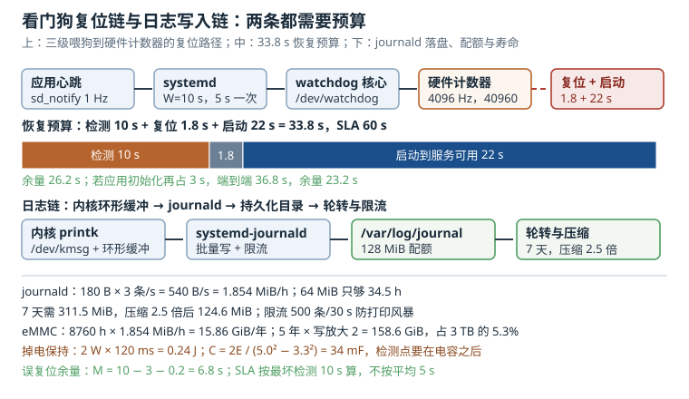

# 看门狗与日志：/dev/watchdog、systemd 集成与 journald 落盘

设备在无人值守的现场死机，通常伴随两个后果：**没有人按复位键**，以及**事后没有日志可查**。看门狗解决第一个问题，持久化日志解决第二个问题，而这两件事在工程上经常一起做错：看门狗被应用"顺手关掉"，日志被放在 tmpfs 里，断电后现场只剩一句"设备重启过"。

这一章把看门狗当成一条**带时间预算的复位链路**，把日志当成一条**带存储预算的写入链路**。两者都需要先算清楚时间与容量，再谈配置。

## 1. 动机：卡死与丢日志是同一类"不可观测"

嵌入式设备的可用性通常用两个指标描述：平均无故障时间（MTBF）和平均修复时间（MTTR）。看门狗压缩的是 MTTR——它把"等人到现场按复位"变成"几十秒内自动复位"；持久化日志压缩的是排障时间——它把"复现一次看看"变成"翻上次的日志"。

现场最常见的三种组合故障：

| 现象 | 底层原因 | 该看哪一层 |
|---|---|---|
| 设备彻底无响应，串口也没输出，但电源正常 | CPU 跑飞、内核死锁、DDR 被踩 | 硬件看门狗是否真的在计时 |
| 设备每隔几十秒自动重启，循环往复 | 看门狗超时短于启动时间，或应用起不来 | 时间预算与启动图 |
| 断电后日志只剩半行，关键报错丢失 | 日志在 page cache 或 tmpfs 里 | journald 落盘与掉电保持 |

这三类问题的共同点是：**平时看不出来**。实验室里不断电、不拔卡、不长时间跑，看门狗和日志都不会暴露问题；一到现场，它们就是决定能不能远程定位的关键。

::: motivation 一次"重启后什么都没有"的现场
某台边缘网关在客户现场每两周死机一次，返修时在实验室连续跑七天不复现。设备本地只有一个 64 MiB 的 tmpfs 日志目录，重启即清空；串口没有引出，SSH 在死机后也进不去。

后来做了两件事：把 rootfs 划出 128 MiB 给 `/var/log` 做持久化，并打开 `pstore/ramoops` 保存最后一段内核日志；同时确认硬件看门狗的超时是 10 秒、systemd 的 `RuntimeWatchdogSec=10`。

下一次现场死机后，`journalctl -b -1` 显示了死机前 40 秒的应用日志，`/sys/fs/pstore/console-ramoops-0` 里有内核的 Oops 栈。根因是驱动在 DMA 完成回调里睡眠，触发调度死锁。没有这两条日志链路，这个问题大概率还要再飞一次现场。
:::

## 2. 直观：一条复位链，一条写入链



上图上半部分是看门狗的复位链路：应用心跳 → systemd → 内核 watchdog 框架 → 硬件计数器 → 复位；中间是"检测 + 复位 + 启动"的时间预算；下半部分是日志从内核到磁盘的写入链路与容量预算。

### 2.1 硬件看门狗：一个只会倒计时的计数器

看门狗的本质是一个**递减计数器**：使能后从设定值开始倒计时，减到 0 就拉复位。喂狗（kick）就是把计数器重新装回初值。它不关心系统在干什么，只关心"有没有人来装弹"。

两种常见实现：

- **SoC 内置**：由芯片内部的看门狗模块实现，时钟来自 32.768 kHz 晶振或总线时钟，计数器通常是 16 位，带预分频；
- **外部芯片**：如 TPS3823 一类，独立于 SoC，靠 GPIO 喂狗，超时时间由外部电容或固定档位决定，抗"SoC 整体跑飞"的能力更强。

两种都要注意一件事：**复位信号是否真的接到 SoC 的复位脚**。有些板子把外部看门狗的输出接到了 PMIC 的使能脚，看起来能复位，实际只是断电重启，启动时间会长很多。

### 2.2 /dev/watchdog 的语义

Linux 把看门狗抽象成字符设备 `/dev/watchdog`，行为有几条硬规则：

1. **打开即启动**。`open()` 成功后计数器开始跑，不需要额外命令；
2. **写任意字节即喂狗**。写什么内容不重要，写这个动作会触发 keepalive；
3. **关闭有讲究**。正常 `close()` 时驱动会写一个 magic 字符 `V`，如果内核编译时没有开 `CONFIG_WATCHDOG_NOWAYOUT`，看门狗会被停止；开了 `nowayout`，`close()` 不会停，设备继续倒计时；
4. **同一时刻只能有一个使用者**。第二个进程再 `open()` 会得到 `EBUSY`，这是"systemd 与应用程序抢看门狗"的根源；
5. **超时可改**。通过 `WDIOC_SETTIMEOUT` 设置，驱动会返回实际生效的值（可能被硬件档位取整）。

常用 ioctl：

| ioctl | 作用 | 典型用途 |
|---|---|---|
| `WDIOC_GETSUPPORT` | 查询支持的选项与型号 | 判断是否支持 pretimeout |
| `WDIOC_SETTIMEOUT` / `GETTIMEOUT` | 设置/读取超时（秒） | 按时间预算配置 |
| `WDIOC_KEEPALIVE` | 喂狗（等价于 write） | 应用心跳 |
| `WDIOC_SETPRETIMEOUT` | 设置预超时（秒） | 超时前抓栈、落盘 |
| `WDIOC_GETBOOTSTATUS` | 读取上次复位原因 | 区分"看门狗复位"与"上电" |
| `WDIOC_GETTIMELEFT` | 读取剩余时间 | 调试喂狗节奏 |

`WDIOC_GETBOOTSTATUS` 返回的 `WDIOF_CARDRESET` 位非常有用：应用启动时读到它，就知道"上次是被看门狗打死的"，可以立即把这条信息写进持久化日志，而不是等到下一次故障。

### 2.3 谁来喂：三级架构

看门狗的使用者可以分成三层，越往下越可靠，越往上越"聪明"：

1. **硬件层**：计数器自己跑，不需要任何软件；
2. **内核层**：watchdog 框架提供 `/dev/watchdog`，也可以由内核线程喂（如 `softdog`、`gpio_wdt` 的 `nowayout` 模式）；
3. **用户空间**：systemd 或应用打开设备、周期性写入。

三级架构的关键是**喂狗的人必须能代表整条链路活着**。如果喂狗线程和应用主线程在同一个进程里，主线程死锁但喂狗线程还活着，看门狗就失效了；反过来，如果喂狗逻辑依赖某个外设（比如要读传感器成功才喂），外设故障会触发整机复位，可能过于激进。

工程上的折中是：**systemd 负责喂硬件看门狗，应用通过 `sd_notify` 报告自己的健康**。systemd 只在"自己还活着"时喂狗，应用的 `WatchdogSec` 超时由 systemd 处理（杀进程、重启服务），两者职责分离。

### 2.4 systemd 集成：两个不同层次的超时

systemd 提供两组容易混淆的配置：

- **`RuntimeWatchdogSec=`**：systemd 自己打开 `/dev/watchdog`，按这个周期喂狗；它通常按超时值的一半喂（比如 10 秒超时，5 秒喂一次）。配置在 `/etc/systemd/system.conf` 的 `[Manager]` 段，作用于整个系统。
- **`WatchdogSec=`**：写在某个 service 的 `[Service]` 段，要求该服务周期性调用 `sd_notify(0, "WATCHDOG=1")`；超过这个时间没收到，systemd 就认为服务挂了，按 `WatchdogSignal=`（默认 `SIGABRT`）杀掉并按 `Restart=` 策略处理。

两者的关系是：`RuntimeWatchdogSec` 管"系统还活着吗"，`WatchdogSec` 管"这个服务还活着吗"。只配前者，应用死锁但 systemd 正常，硬件看门狗永远不会触发；只配后者，systemd 自己死锁时没人喂硬件看门狗。

还有两个相关字段：`RebootWatchdogSec=` 在关机/重启流程中给看门狗设一个较短的超时，防止关机卡死；`KExecWatchdogSec=` 用于 kexec 场景，保证从旧内核跳到新内核的窗口内看门狗仍然有效。

### 2.5 应用心跳：喂狗要代表"整条链路活着"

一个常见的错误实现是：主循环里每轮都喂狗。主循环卡在某个阻塞调用上，喂狗也停了，看起来没问题；但如果主循环里有个"每 100 ms 检查一次"的子任务已经死了，主循环还在空转喂狗，看门狗就完全失效。

正确的心跳设计通常包含三件事：

1. **独立的心跳线程/定时器**，用单调时钟（`CLOCK_MONOTONIC`）计算间隔，不受系统时间调整影响；
2. **健康条件**：不是"线程还活着"，而是"关键子任务在最近一个周期内都完成过"，比如采集线程、网络线程、存储线程各自打时间戳，心跳线程检查所有时间戳都新鲜才 `sd_notify`；
3. **可观测**：心跳失败时先写日志、再停止喂狗，让看门狗复位成为"最后手段"，而不是首选手段。

### 2.6 journald：日志从内核到磁盘

日志链路是：内核 `printk` → `/dev/kmsg` 与环形缓冲区 → `systemd-journald` → `/run/log/journal`（内存）或 `/var/log/journal`（磁盘）。`journald` 的存储位置由 `Storage=` 决定：

- `volatile`：只写 `/run`，重启即丢；
- `persistent`：写 `/var/log/journal`，跨重启保留；
- `auto`：`/var/log/journal` 存在就持久化，否则 volatile（很多发行版的默认值）。

`journald` 不是"来一条写一条立即落盘"：它按批写入，按 `SyncIntervalSec=`（默认 5 分钟）同步到磁盘，同时受内核页回写策略影响。这意味着**断电时最后一段日志可能丢失**，丢多少取决于同步周期、文件系统挂载参数和存储介质。

日志的容量由一组配额控制：`SystemMaxUse=` 限制总占用，`SystemMaxFileSize=` 限制单文件大小，`MaxRetentionSec=` 限制保留时间，`RateLimitIntervalSec=`/`RateLimitBurst=` 限制单位时间的条数。配额是**上限**，不是"写到这么多就停"——journald 会轮转、删除最旧的归档。

### 2.7 断电持久性：从 page cache 到超级电容

要让"最后一条日志"活过断电，需要三层配合：

1. **应用层**：关键事件调用 `fsync()` 或 `fdatasync()`，或者写完后调用 `journalctl --sync`；
2. **文件系统层**：ext4 默认 `commit=5`，即最多 5 秒的元数据/数据在 journal 里未提交；对日志分区可以调小 `commit`，代价是写放大；
3. **硬件层**：掉电保持时间。电源检测到掉电后，系统需要时间把缓存刷下去；这段时间由输入电容或超级电容提供。

如果硬件没有掉电保持，还有一条"事后取证"的路：`pstore`（persistent storage）配合 `ramoops`，把内核日志、控制台输出、panic 信息写进一块保留内存，重启后从 `/sys/fs/pstore` 读出来。它不依赖文件系统，也不怕突然断电，是看门狗复位后最可靠的现场证据。

## 3. 定量关系：时间预算与容量预算

### 3.1 看门狗时间预算

设硬件超时为 $W$，喂狗周期为 $T_{feed}$，复位到启动完成的时间为 $T_{reset}$，系统启动到服务可用的时间为 $T_{boot}$，则从"最后一次喂狗"到"服务恢复"的总时间是

$$T_{recover} = W + T_{reset} + T_{boot}$$

要求它小于服务等级协议（SLA）允许的中断时间：

$$W + T_{reset} + T_{boot} \leq T_{SLA}$$

同时喂狗周期必须显著小于超时，留出调度抖动和瞬时卡顿的余量：

$$W \geq k \times T_{feed}, \qquad k \geq 2$$

$k$ 取 2 是最低要求，工程上常用 3：如果 systemd 按 $W/2$ 喂狗，那么一次超过 $W/2$ 的调度延迟就会误复位，余量并不宽裕。

### 3.2 计数器与时基：W 是怎么配出来的

硬件看门狗的计数器通常是 16 位，时钟经过预分频。设输入时钟 $f_{clk}$、预分频 $P$、计数值 $N$，则超时

$$W = \frac{N \times P}{f_{clk}}, \qquad N \leq 2^{16} - 1$$

反过来，给定 $W$ 要选 $P$ 和 $N$：

$$N = \frac{W \times f_{clk}}{P}$$

以 32.768 kHz 时钟、$P=8$ 为例，计数时钟 4096 Hz；10 秒对应 $N = 40{,}960$，在 16 位范围内；最大可配 $65{,}535/4096 = 16.0$ 秒。如果产品要求 30 秒超时，$P=8$ 不够，要改成 $P=16$（2048 Hz），此时 $N = 61{,}440$，仍在范围内，最大 32 秒。

### 3.3 喂狗抖动与误复位

设喂狗周期 $T$，最坏调度延迟 $J$，则安全余量是

$$M = W - T - J$$

$M$ 必须为正，且建议至少保留一个完整周期。举例：$W=10$ 秒、$T=3$ 秒、$J=0.2$ 秒，则 $M = 6.8$ 秒；如果把 $T$ 改成 5 秒（systemd 的默认喂狗间隔），$M = 4.8$ 秒，仍然安全但余量减半。

误复位的概率无法用单一数字概括，因为它取决于延迟的尾分布。工程上能做的是**测量尾延迟**：在 Flash 擦除、文件系统 GC、网络重连、OTA 下载这些最坏场景下用 ftrace 记录唤醒延迟，取 99.9 分位作为 $J$，再留一倍余量。

### 3.4 journald 存储预算

设平均每条日志 $B$ 字节、每秒 $R$ 条，则每小时写入量

$$S_{hour} = B \times R \times 3600$$

保留时间

$$T_{retention} = \frac{S_{budget}}{S_{hour}}$$

以每条 180 字节、每秒 3 条为例：$S_{hour} = 180 \times 3 \times 3600 = 1{,}944{,}000$ 字节，约 1.854 MiB/h。64 MiB 的配额只能存 34.5 小时；要存 7 天（168 小时）需要 311.5 MiB。

压缩和限流是两把刀。journald 对文本日志的压缩比通常在 2 到 3 倍，取 2.5 倍，7 天需要 124.6 MiB，配 128 MiB 刚好；但如果某天日志量翻倍，配额会先删最旧的归档，**关键故障日志可能被自己的日志刷掉**。所以更稳的做法是：正常日志限流，关键事件单独写一个持久化文件或上报云端。

`RateLimitBurst=` 的默认值是 30 秒 1000 条，即 33.3 条/秒。按 180 字节算，最坏情况 21.6 MB/h，是正常量的 11 倍；如果某个驱动进入打印循环，128 MiB 的配额 6 小时就会被填满。限流不是可选项。

### 3.5 写放大与 eMMC 寿命

日志分区每天的写入量乘以写放大系数，就是闪存的真实消耗：

$$W_{year} = S_{hour} \times 24 \times 365 \times (1 + \alpha) \times 10^{-9}\ \text{GiB}$$

$\alpha$ 是写放大（文件系统日志、GC、块对齐都会贡献），eMMC 上通常取 1 到 3。1.854 MiB/h 对应每年 15.86 GiB；5 年、$\alpha=1$ 时约 158.6 GiB。对照 3 TB 的 TBW，占 5.3%，可以接受；但如果日志量是现在的 10 倍，5 年就是 1.59 TB，已经过半，必须限流或改用外部存储。

### 3.6 掉电窗口与保持时间

设掉电后系统仍需工作的时间 $t_{hold}$、负载功率 $P$、电容从 $V_1$ 放到 $V_2$，需要的能量和电容为

$$E = P \times t_{hold}, \qquad C = \frac{2E}{V_1^2 - V_2^2}$$

举例：负载 2 W、需要 120 ms、从 5.0 V 放到 3.3 V：

$$E = 2 \times 0.12 = 0.24\ \text{J}, \qquad C = \frac{0.48}{25 - 10.89} = 0.034\ \text{F}$$

即约 34 mF。这个容量用两颗 10 mF 的超级电容并联加降额就能覆盖，成本远低于一次现场返修。注意电容要放在**检测点之后**，否则掉电检测一动作，电容已经被负载放空。

## 4. 算例：一台边缘网关的看门狗与日志预算

**第一步：看门狗超时配置。** 硬件是 SoC 内置看门狗，时钟 32.768 kHz，预分频可选 1、8、16、128。取 $P=8$，计数时钟 4096 Hz，10 秒对应 $N=40{,}960$，小于 65,535，合法。

**第二步：systemd 配置。**

```ini
# /etc/systemd/system.conf
[Manager]
RuntimeWatchdogSec=10s
RebootWatchdogSec=60s
```

systemd 会打开 `/dev/watchdog`，把超时设为 10 秒，并按约 5 秒的间隔喂狗。`RebootWatchdogSec=60s` 在关机流程里把超时拉长到 60 秒，避免正常的关机刷盘被误判。

**第三步：应用心跳。** 应用服务的 unit 里写：

```ini
[Service]
Type=notify
NotifyAccess=main
WatchdogSec=5s
Restart=on-watchdog
RestartSec=2s
ExecStart=/usr/bin/gateway
```

应用每 1 秒调用一次 `sd_notify(0, "WATCHDOG=1")`，但只在"采集、上行、存储三个子任务都新鲜"时才发。5 秒的 `WatchdogSec` 对应 5 次心跳机会，允许两次丢失。

**第四步：恢复时间核算。**

$$T_{recover} = 10 + 1.8 + 22 = 33.8\ \text{s}$$

其中复位脉冲与 PMIC 重新上电 1.8 秒，启动到服务可用 22 秒。加上应用初始化 3 秒，端到端 36.8 秒，低于 60 秒的 SLA，余量 23.2 秒。

**第五步：误复位余量。** 喂狗周期 3 秒、最坏调度延迟 0.2 秒，$M = 10 - 3 - 0.2 = 6.8$ 秒。把 Flash 擦除、OTA 下载、网络重连三种场景各压测 2 小时，确认没有超过 6.8 秒的唤醒延迟；如果超过，要么增大 $W$，要么把喂狗线程提到实时优先级。

**第六步：日志容量。** 正常 3 条/秒、每条 180 字节，$S_{hour} = 1.854$ MiB/h；7 天需要 311.5 MiB，压缩 2.5 倍后 124.6 MiB。配置：

```ini
# /etc/systemd/journald.conf
[Journal]
Storage=persistent
SystemMaxUse=128M
SystemMaxFileSize=16M
MaxRetentionSec=7day
SyncIntervalSec=60s
RateLimitIntervalSec=30s
RateLimitBurst=500
```

`SyncIntervalSec=60s` 比默认的 5 分钟更激进，代价是每秒多一次 `fdatasync`（对 eMMC 是额外写放大），换来的是断电最多丢 60 秒日志。`RateLimitBurst=500` 把最坏写入压到 16.7 条/秒，约 10.8 MB/h，128 MiB 至少能撑 12 小时。

**第七步：掉电保持。** 负载 2 W，要求断电后 120 ms 内完成 `fdatasync`。按 3.6 节算得 34 mF；实际选 2 颗 22 mF/5.5 V 的超级电容串联（容量减半、耐压翻倍），得到 11 mF，不够；改为 2 颗 100 mF 并联，得到 200 mF，远超需求，但要注意上电浪涌和均压。更简单的做法是只保证 `pstore` 的保留内存，把"最后一段内核日志"交给它，不追求用户态日志的完整落盘。

**第八步：验证。** 用 `wdctl` 确认超时和设备；用 `echo 1 > /proc/sys/kernel/sysrq; echo c > /proc/sysrq-trigger` 制造内核崩溃，确认 10 秒后复位且 `pstore` 有记录；用 `kill -STOP` 冻结应用，确认 5 秒后 systemd 杀掉并重启；拔电 20 次，确认 `journalctl -b -1` 能看到上一次启动的日志。

## 5. 工程含义：配置、测试与可观测

### 5.1 systemd 与内核的参数边界

- `RuntimeWatchdogSec=0` 表示关闭，这是很多发行版的默认值；产品出厂前必须显式打开。
- 硬件看门狗驱动加载时如果带了 `nowayout=1`，用户空间无法关闭它；生产设备建议打开，调试设备保留可关闭。
- 内核命令行可以传 `nowayout=1`，也可以在驱动模块参数里设；两者冲突时以驱动为准。
- systemd 打开看门狗失败（`EBUSY`）通常意味着另一个进程已经占用，查 `fuser /dev/watchdog` 或 `lsof`。

### 5.2 日志的落盘位置与挂载参数

持久化日志目录建议单独分区或至少单独目录，挂载参数考虑：

- `commit=1` 到 `commit=5`：缩短掉电窗口，代价是写放大；
- `noatime`：避免读操作产生额外写；
- `data=ordered`（ext4 默认）：保证数据先于元数据落盘；
- 如果使用 f2fs，注意 `fsync` 语义与 GC 行为对延迟的影响。

不要把 `/var/log` 放在 tmpfs 上还指望断电后能查日志；也不要把整个 rootfs 做成可写 ext4 然后任由日志写满——日志写满导致 `/var` 不可写，进而让服务启动失败，是现场最常见的"日志引起的故障"。

### 5.3 日志轮转与保留策略

journald 自己会按 `SystemMaxUse`、`SystemMaxFileSize`、`MaxRetentionSec` 轮转，不需要 `logrotate` 再管一遍。但应用自己写的文本日志（比如 `/var/log/gateway/*.log`）需要 `logrotate`：

```
/var/log/gateway/*.log {
    size 10M
    rotate 5
    compress
    delaycompress
    missingok
    notifempty
    postrotate
        systemctl kill -s HUP gateway.service
    endscript
}
```

`size 10M` 与 `rotate 5` 组合的上限是 50 MiB（未压缩），与 journald 的 128 MiB 相加仍在预算内。`delaycompress` 让最近一个归档保持未压缩，便于快速查看。

### 5.4 pstore/ramoops 的保留内存

设备树里给 `ramoops` 划一块保留内存：

```dts
reserved-memory {
    ramoops: ramoops@9ff00000 {
        compatible = "ramoops";
        reg = <0x0 0x9ff00000 0x0 0x100000>;
        record-size = <0x20000>;
        console-size = <0x40000>;
        pmsg-size = <0x20000>;
        ftrace-size = <0x20000>;
    };
};
```

1 MiB 的保留区被切成多个记录区：`console-size` 存控制台输出，`record-size` 存 Oops/panic，`pmsg-size` 存用户态消息，`ftrace-size` 存函数跟踪。重启后从 `/sys/fs/pstore/` 读取，读完可以删除以释放空间。

注意 `ramoops` 的内存必须被内核标记为 reserved，且不能被其他驱动使用；地址要与内存映射和启动参数对齐，否则会出现"重启后 pstore 是空的"。

### 5.5 可观测性清单

上线前至少确认这些能查到：

```bash
wdctl                                   # 看门狗型号、超时、剩余时间
systemctl show -p RuntimeWatchdogUSec   # systemd 实际配置
journalctl --verify                     # 日志文件完整性
journalctl -b -1 -p err                 # 上次启动的错误
ls -l /sys/fs/pstore/                   # 崩溃现场
cat /proc/sys/kernel/printk             # 控制台日志级别
```

`journalctl --verify` 会检查日志文件的哈希链，能发现被截断或损坏的文件；`-b -1` 需要持久化日志才有效，否则只会提示"没有可用的启动记录"。

## 6. 常见坑：现象、原因与解决

::: pitfall 坑一：系统卡死但设备不重启
**现象**：SSH 断开、串口无输出、业务停止响应，但电源灯常亮，设备一直不复位。

**原因**：看门狗没有真正启用。可能是 `RuntimeWatchdogSec=0`、驱动没加载、或者上一位开发者调试时用 `close()` 关掉了看门狗（未开 `nowayout`），而新进程没有重新打开。

**解决**：用 `wdctl` 确认设备存在且超时非零；检查 systemd 配置是否生效（`systemctl show -p RuntimeWatchdogUSec`）；生产固件打开 `nowayout=1`，并在启动脚本里显式打开 `/dev/watchdog` 作为兜底；用 `echo c > /proc/sysrq-trigger` 做一次真实复位演练。
:::

::: pitfall 坑二：设备反复重启，启动到一半又复位
**现象**：设备每隔二三十秒重启一次，串口能看到启动日志但走不到登录提示；有时能启动成功，有时不能。

**原因**：看门狗超时短于"内核启动 + 服务就绪"的时间，或者启动早期没有人喂狗。典型场景是 initramfs 阶段耗时较长、文件系统检查、OTA 校验。

**解决**：按 $T_{recover} = W + T_{reset} + T_{boot}$ 复算，把 $W$ 调到大于启动时间加余量；在 bootloader 和内核早期就启动喂狗（U-Boot 的 `wdt` 命令、内核的 `nowayout` 与 early watchdog）；用 `RebootWatchdogSec` 区分正常关机与异常复位。
:::

::: pitfall 坑三：断电后日志只剩半行，关键报错丢失
**现象**：`journalctl -b -1` 能看到上一次启动，但最后几十秒是空的，或者最后一条日志被截断。

**原因**：journald 按 `SyncIntervalSec`（默认 5 分钟）同步，数据在 page cache 里；ext4 的 `commit=5` 又叠加了一层延迟；如果 `/var/log` 在 tmpfs 上，重启直接清空。

**解决**：确认 `Storage=persistent` 且 `/var/log/journal` 存在；把 `SyncIntervalSec` 调到 60 秒或更短；关键事件在应用层主动 `fsync`；用 `pstore/ramoops` 兜底内核日志；硬件加掉电检测与保持电容，给刷盘留出时间。
:::

::: pitfall 坑四：日志把自己的分区写满，服务起不来
**现象**：设备重启后业务服务启动失败，报 `No space left on device`；登录后发现 `/var` 100% 占用。

**原因**：没有配置 `SystemMaxUse`，或者某个驱动/应用进入打印循环；journald 的限流被关闭，单日写入量远超预算。

**解决**：设置 `SystemMaxUse` 与 `RateLimitBurst`；用 `journalctl --vacuum-size=64M` 立即回收；把应用日志单独放到有配额的目录；加一个开机检查脚本，`/var` 使用率超过 85% 时删除最旧归档并记录告警。
:::

::: pitfall 坑五：应用偶尔"假死"，但看门狗一直不动作
**现象**：业务无响应，进程还在，`ps` 能看到；systemd 显示服务 `active (running)`，硬件看门狗也没复位。

**原因**：喂狗逻辑只看"线程是否在跑"，没有检查子任务；或者 `WatchdogSec` 没有配，systemd 不会判断服务健康；也可能应用在 `sd_notify` 之前就卡住，但主循环仍在喂硬件看门狗。

**解决**：把健康条件改成"关键子任务时间戳新鲜"；配置 `WatchdogSec` 并设置 `Restart=on-watchdog`；在心跳失败时先打日志再停止喂狗；用 `systemd-analyze` 或 `journalctl -u` 确认服务是否真的被判定为不健康。
:::

## 7. 自测题

<details><summary>题一：32.768 kHz 时钟、预分频 8、16 位计数器，最大超时是多少？要配 10 秒，计数值是多少？</summary>

计数时钟 $= 32{,}768/8 = 4096$ Hz。

最大计数值 $65{,}535$，最大超时 $65{,}535/4096 = 16.0$ 秒。

10 秒对应 $N = 10 \times 4096 = 40{,}960$，小于 65,535，合法。若要求 20 秒，$N = 81{,}920$ 超范围，必须把预分频改成 16（2048 Hz），此时 $N = 40{,}960$，最大超时 32 秒。

</details>

<details><summary>题二：硬件超时 10 秒、复位 1.8 秒、启动到服务可用 22 秒、应用初始化 3 秒。端到端恢复时间是多少？SLA 要求 60 秒，余量多少？</summary>

$$T_{recover} = 10 + 1.8 + 22 + 3 = 36.8\ \text{s}$$

余量 $60 - 36.8 = 23.2$ 秒。

注意"检测时间"取最坏情况，即最后一次喂狗后立刻卡死，要等满 10 秒才复位；平均检测时间约为 $W/2$，但不能用平均值做 SLA 核算。

</details>

<details><summary>题三：日志每条 180 字节、每秒 3 条，journald 配额 64 MiB，能存多久？要存 7 天，压缩比 2.5，需要多大配额？</summary>

每小时 $180 \times 3 \times 3600 = 1{,}944{,}000$ 字节 $= 1.854$ MiB。

64 MiB 可存 $64/1.854 = 34.5$ 小时。

7 天 $= 168$ 小时，未压缩 $168 \times 1.854 = 311.5$ MiB；压缩 2.5 倍后 $311.5/2.5 = 124.6$ MiB，配 128 MiB 刚好，建议再留 20% 余量取 160 MiB。

</details>

<details><summary>题四：喂狗周期 3 秒、硬件超时 10 秒，最坏调度延迟 0.2 秒，安全余量多少？如果把喂狗周期改成 5 秒呢？</summary>

$$M = W - T - J = 10 - 3 - 0.2 = 6.8\ \text{s}$$

改成 5 秒后 $M = 10 - 5 - 0.2 = 4.8$ 秒。余量仍然为正，但只剩不到一个喂狗周期；一旦出现 5 秒以上的调度延迟（比如大块 Flash 擦除），就会误复位。这也是 systemd 默认按 $W/2$ 喂狗时，建议把 $W$ 调大的原因。

</details>

<details><summary>题五：负载 2 W、掉电后需要 120 ms 刷盘、电容从 5.0 V 放到 3.3 V。需要多大电容？</summary>

能量 $E = 2 \times 0.12 = 0.24$ J。

$$C = \frac{2E}{V_1^2 - V_2^2} = \frac{0.48}{25 - 10.89} = 0.034\ \text{F}$$

即 34 mF。考虑电容容差、ESR 和降额，实际取 2 到 3 倍，约 100 mF；同时要确认掉电检测点到电容之间没有其他负载，否则有效保持时间会明显缩短。

</details>

## 8. 参考资料

- Linux 内核文档 `Documentation/watchdog/watchdog-api.rst`：`/dev/watchdog` 的打开、喂狗、magic close 与 ioctl 语义。
- Linux 内核文档 `Documentation/watchdog/watchdog-kernel-api.rst`：`watchdog_device`、pretimeout 与 governor 的注册方式。
- `systemd-system.conf(5)`：`RuntimeWatchdogSec=`、`RebootWatchdogSec=`、`KExecWatchdogSec=` 的默认值与行为。
- `systemd.service(5)`：`WatchdogSec=`、`WatchdogSignal=`、`NotifyAccess=` 与 `sd_notify` 协议。
- `journald.conf(5)`：`Storage=`、`SystemMaxUse=`、`SystemMaxFileSize=`、`SyncIntervalSec=`、`RateLimitBurst=`。
- `journalctl(1)`：`--verify`、`--sync`、`--vacuum-size`、`-b` 的用法。
- Linux 内核文档 `Documentation/admin-guide/ramoops.rst`：`ramoops` 保留内存与各记录区的大小含义。
- JEDEC JESD84-B51：eMMC 的 TBW 定义与寿命估算口径。
- util-linux `wdctl(8)`：查看看门狗型号、超时与剩余时间的命令行工具。
