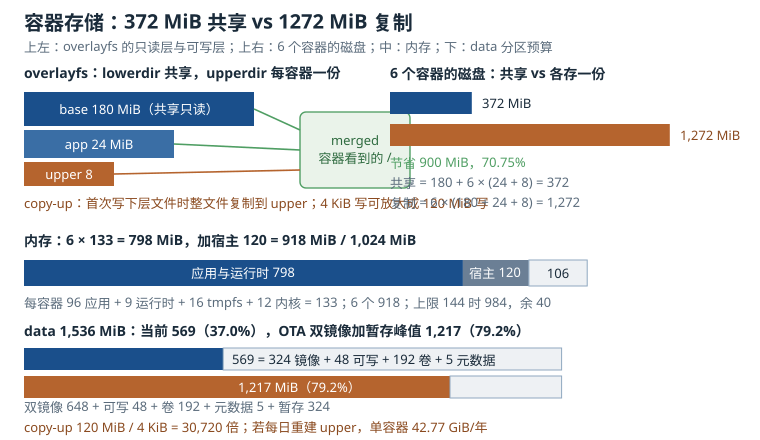

# 容器与沙箱：namespace、cgroup 与只读 rootfs

网关、机器人控制器、车载盒子这类设备，常常要同时跑三到十个应用：协议转换、视频取流、日志上传、远程运维、第三方算法。这些应用由不同团队开发，依赖不同版本的 libc、OpenSSL、Python，甚至要求不同的内核参数。把它们全部塞进同一个根文件系统（rootfs），最后会变成“谁也不敢升级”的依赖泥潭。

容器（container）提供了一种折中：应用带着自己的用户空间依赖打包成镜像，运行时由命名空间（namespace）隔离视图、由控制组（cgroup）限制资源、由只读 rootfs 保证不可漂移。它比虚拟机轻，因为没有自己的内核；代价是隔离强度弱于虚拟机，而且对嵌入式环境提出了几个特殊问题：rootfs 是只读的 squashfs，容器存储放哪；1 GiB 内存怎么分；GPIO、摄像头、DMA heap 怎么给容器；容器镜像怎么跟 A/B OTA 一起升级。

这一章从命名空间（namespace）和控制组（cgroup）的基础讲起，落到只读 rootfs 上的容器、资源限制、设备访问、联合文件系统（overlayfs）存储预算，以及容器化与 OTA 的关系。所有内存和磁盘开销都给可复算的模型。

## 1. 动机：容器解决的是“依赖与生命周期”，不是“更酷的部署”

先看不用容器的场景。一个网关 rootfs 里有三个应用：

- 应用 A 用 OpenSSL 1.1，因为它的 SDK 只支持这个版本；
- 应用 B 用 OpenSSL 3.0，因为它的合规扫描要求新版本；
- 应用 C 是第三方算法，静态链接了自己的 libc，还要求 `/usr/lib` 下有一个特定版本的库。

把三者装进同一个 rootfs，只有三种结果：升级 OpenSSL 导致 A 崩溃；保留两个版本导致 `LD_LIBRARY_PATH` 变成地雷；或者永远不升级，把漏洞留在现场。容器的做法是给每个应用一份自己的 `/usr/lib`，它们看到的是不同的文件树，互不覆盖。

容器还解决生命周期问题。传统 OTA 升级整个 rootfs，改一个应用也要走完整的 A/B 流程：下载几百 MiB、写备用槽、重启、试运行。容器化后，应用镜像可以单独更新：拉取新镜像、切换标签、重启对应的 systemd unit，失败就切回旧标签。内核、驱动、容器运行时仍然走 A/B OTA，两层更新的粒度不同。

但容器不是免费的。它带来四类新成本：

1. **存储**：镜像层、可写层、卷、镜像缓存都要占 data 分区；联合文件系统（overlayfs）的写时复制（copy-up）会把一次小写放大成整个文件。
2. **内存**：每个容器有自己的运行时、临时文件系统（tmpfs）、页表、socket、页缓存；1 GiB 内存的设备，六个容器就可能把余量吃光。
3. **设备**：容器默认看不到 `/dev/gpiochip0`、`/dev/video0`、`/dev/dri/renderD128`；给错了是功能缺失，给多了是安全漏洞。
4. **升级**：应用镜像和 OS 镜像的版本矩阵、数据格式迁移、回滚兼容性，都比单层 OTA 复杂。

::: motivation 一次“把 /var/lib/containers 放在只读 rootfs 上”的深夜救火
某团队把容器运行时搬上设备，rootfs 是 squashfs 只读挂载，`/var/lib/containers` 自然也是只读。`podman run` 报 `read-only file system`，工程师临时 `mount -o remount,rw /`，把容器跑了起来，然后忘了改回去。

两周后 OTA 升级，rootfs 的 squashfs 被写坏，设备无法挂载根文件系统。返厂后发现，`/var/lib/containers` 里有 300 多 MiB 的镜像层和可写层，全部写进了本应只读的 rootfs；OTA 写入时又和这些文件抢空间，最终把文件系统写崩。

正确的做法从一开始就很清楚：容器存储必须放在 data 分区，`storage.conf` 的 `graphroot` 指向 `/data/containers/storage`，`runroot` 指向 tmpfs；rootfs 保持只读，OTA 只更新 rootfs 的 A/B 槽。这个团队不是“不会用容器”，而是把“容器的可写性”默认成了“宿主 rootfs 的可写性”。
:::

这个故事的教训是：**容器的可写层是容器自己的，不是宿主 rootfs 的**。在只读 rootfs 上跑容器，第一件事是把存储、运行时目录、日志目录全部搬到可写分区，第二件事才是跑 `podman run`。

## 2. 直观：namespace 管“看见什么”，cgroup 管“能用多少”

### 2.1 namespace：隔离视图，不隔离内核

namespace 把一类全局资源包装成“每个命名空间一份”。进程只能看到自己所在 namespace 里的资源。Linux 目前有八类：

| namespace | 隔离的资源 | 典型表现 | 创建标志 |
|---|---|---|---|
| mount | 挂载表 | 容器有自己的 `/`、`/proc`、`/sys` | `CLONE_NEWNS` |
| PID | 进程 ID 空间 | 容器内 PID 1 是应用，看不到宿主进程 | `CLONE_NEWPID` |
| network | 网络设备、路由、端口 | 容器有自己的 `eth0`、回环、iptables | `CLONE_NEWNET` |
| IPC | SysV IPC、POSIX 消息队列 | 容器间的共享内存互不可见 | `CLONE_NEWIPC` |
| UTS | 主机名、域名 | 容器可以有自己的 hostname | `CLONE_NEWUTS` |
| user | UID/GID 映射、能力（capability） | 容器内 root 映射到宿主普通用户 | `CLONE_NEWUSER` |
| cgroup | cgroup 根视图 | 容器只看到自己的 cgroup 子树 | `CLONE_NEWCGROUP` |
| time | 单调时钟、启动时钟偏移 | 容器可以有自己的 boottime 偏移 | `CLONE_NEWTIME` |

一个最小的隔离实验：

```bash
unshare --mount --pid --net --uts --ipc --user --map-root-user --fork --mount-proc /bin/sh
```

进入后，`hostname` 可以随便改，`ps` 只看到自己的进程，`ip link` 只有回环。退出后宿主不受影响。`lsns` 可以列出当前进程的 namespace，`nsenter` 可以进入已有 namespace：

```bash
lsns -t mnt,pid,net
nsenter -t 1234 -m -p -n
```

几个容易误解的点：

- **PID namespace 里，第一个进程是 PID 1**。如果它是应用而不是 init，它要负责回收孤儿进程；否则容器里会出现僵尸。`--init` 会在应用前放一个极小的 init（如 tini），专门做信号转发和回收。
- **network namespace 默认只有回环，而且回环是 down 的**。容器运行时通常会创建 veth pair、配置地址、启用回环；手工 `unshare --net` 后要自己 `ip link set lo up`。
- **user namespace 让容器内的 root 不是宿主 root**。它把 UID 0 映射到宿主的一个普通 UID，capability 也只在这个 namespace 内有效。这是 rootless 容器的基础，但不是“万无一失”：内核漏洞仍可能逃逸。
- **mount namespace 的传播属性很重要**。通常应设为 `private`，避免容器挂载泄漏到宿主；如果设成 `shared`，容器里的 `mount` 可能影响宿主。
- **time namespace 不是“改系统时间”**。它只调整 `CLOCK_MONOTONIC` 和 `CLOCK_BOOTTIME` 的偏移，`CLOCK_REALTIME` 仍然共享；适合热迁移场景，不适合“让容器以为现在是 2020 年”。

namespace 的核心是“视图隔离”，它不限制 CPU、内存、磁盘 I/O。一个容器可以看到自己的 `/proc/meminfo`，但那个数字仍然是宿主的内存；要限制用量，需要 cgroup。

### 2.2 cgroup v2：限制、计量与回收

cgroup（control group）把进程分组，并对每组计量和限制资源。cgroup v2 是统一层级（unified hierarchy），所有控制器挂在一棵树上；v1 的多层级模型在嵌入式新内核上基本不再使用。

常用控制器和文件：

| 控制器 | 关键文件 | 语义 |
|---|---|---|
| memory | `memory.max`、`memory.high`、`memory.current`、`memory.events` | 硬上限、软限流、当前用量、OOM 事件 |
| cpu | `cpu.max`、`cpu.weight`、`cpu.stat` | 配额/周期、相对权重、节流统计 |
| pids | `pids.max`、`pids.current`、`pids.events` | 任务数上限、当前任务数、命中事件 |
| io | `io.max`、`io.stat` | 按设备限制 rbps/wbps/riops/wiops |
| cpuset | `cpuset.cpus`、`cpuset.mems` | 绑定 CPU 与 NUMA 节点 |

`cpu.max` 的格式是“配额 周期”，单位微秒。`50000 100000` 表示每 100 ms 最多用 50 ms CPU，即 0.5 个 CPU。`memory.max` 的单位是字节，`134217728` 就是 128 MiB。`pids.max` 限制的是任务（线程）数，不是进程数；一个多线程应用很容易把 64 用完。

用 systemd 临时起一个受限 scope：

```bash
systemd-run --scope --unit=app1 \
  -p MemoryMax=128M -p CPUQuota=50% -p TasksMax=64 \
  /usr/bin/app
```

对应的 cgroup 文件可以直接读：

```bash
cat /sys/fs/cgroup/app1/memory.current
cat /sys/fs/cgroup/app1/memory.events
cat /sys/fs/cgroup/app1/cpu.stat
```

cgroup v2 有一条“无内部进程”规则：一个 cgroup 如果有子 cgroup，就不能直接放进程（根 cgroup 例外）。systemd 和容器运行时会自动处理；手工建 cgroup 时，要先把进程放到叶子节点，再在父节点打开 `cgroup.subtree_control`。

cgroup v1 和 v2 的差异在设备访问上尤其明显。v1 有 `devices.allow` / `devices.deny` 文件，v2 的设备控制器用 eBPF 程序实现，没有这两个文件。所以“在 v2 上找 `devices.allow`”是徒劳的；容器运行时的 `--device` 会编译一条 eBPF 规则，把设备的 major/minor 放行。

### 2.3 只读 rootfs 上的容器：存储必须搬家

嵌入式设备的 rootfs 通常是 squashfs 或 erofs，只读挂载。这样做的好处是：掉电不会写坏根文件系统、OTA 可以整槽替换、运行时不会被改得面目全非。坏处是：容器运行时默认要把镜像层、可写层、元数据写到 `/var/lib/containers`，而这个路径在只读 rootfs 上。

正确的布局是：

- **rootfs**：只读，放 OS、容器运行时、基础镜像的只读副本（可选）。
- **data 分区**：可写，放容器存储、卷（volume）、镜像缓存、日志。
- **临时文件系统（tmpfs）**：放运行时临时文件、`/run`、`/tmp`、`/dev/shm`。

Podman 的 `storage.conf` 可以这样写：

```ini
[storage]
driver = "overlay"
graphroot = "/data/containers/storage"
runroot = "/run/containers/storage"
```

`graphroot` 是镜像层和可写层的持久化位置，必须在可写分区；`runroot` 是运行时状态，放 tmpfs 即可，重启后重建。也可以用命令行覆盖：

```bash
podman --root /data/containers/storage --runroot /run/containers/storage info
```

`podman info` 会显示实际的 `graphRoot`、`runRoot`、`graphDriver`，部署后第一件事就是核对这三个字段，而不是假设配置生效了。

容器的 rootfs 默认是可写的：镜像层只读，运行时在上面加一个可写层。如果应用不需要写 rootfs，用 `--read-only` 把合并后的根挂载改成只读，再显式给 `/run`、`/tmp` 挂 tmpfs：

```bash
podman run -d --name app1 \
  --read-only \
  --tmpfs /run:size=16m \
  --tmpfs /tmp:size=32m \
  --volume /data/app1:/data:rw \
  localhost/app:1.4
```

注意 `--read-only` 只读的是“容器根文件系统”，不是卷和 tmpfs。应用要写配置、缓存、数据库，应该挂卷或绑定挂载到 data 分区，而不是写进容器可写层。可写层里的数据在容器删除后就没了，也不适合放需要备份的业务数据。

### 2.4 overlayfs：共享只读层，写时复制



图中上半部分是 overlayfs 的 lowerdir/upperdir/merged 关系，以及 6 个容器“共享 372 MiB”与“各自复制 1,272 MiB”的对比。中间是 1 GiB 内存的分配：应用与运行时 798 MiB、宿主 120 MiB、余量 106 MiB。下半部分是 data 分区：稳态 569 MiB（37.0%），OTA 双镜像加暂存峰值 1,217 MiB（79.2%）。

overlayfs 把多个只读目录（lowerdir）和一个可写目录（upperdir）合并成一个视图（merged）。容器镜像的每一层都是一个 lowerdir；容器的可写层是 upperdir；`workdir` 是 overlayfs 的内部工作目录，必须和 upperdir 在同一个文件系统上。

```bash
mount -t overlay overlay \
  -o lowerdir=/data/images/base:/data/images/app,upperdir=/data/app1/upper,workdir=/data/app1/work \
  /run/app1/merged
```

读文件时，overlayfs 从最上层往下找，找到第一个版本返回。写文件时，如果文件在 lowerdir，overlayfs 先把整个文件复制到 upperdir（copy-up），再在 upperdir 上修改。删除文件时，在 upperdir 创建一个白障（whiteout，字符设备 0/0），让下层文件“消失”。这些机制对应用透明，但带来了两个工程后果：

1. **copy-up 是整文件复制**。修改一个 120 MiB 数据库文件的 4 KiB，第一次写会复制 120 MiB 到 upperdir。`metacopy=on` 可以只复制元数据、数据仍从下层读，但真正写数据时仍要复制；它优化的是“只改属性”的场景，不是“随机写大文件”。
2. **upperdir 会持续增长**。容器运行越久，写过的文件越多，upperdir 越大；删除文件只产生 whiteout，不会立刻释放下层镜像的空间。需要定期重建容器或清理 upperdir。

overlayfs 还支持 `volatile` 挂载选项，跳过一些同步操作，适合“掉了也无所谓”的临时数据；但数据库、升级包、日志不能用 `volatile`，否则掉电后可能拿到不一致的文件。`userxattr` 用于 rootless 场景，让 overlayfs 把 xattr 存在用户命名空间里；`fuse-overlayfs` 则是完全在用户态实现的替代品，兼容性好但性能低。

### 2.5 资源限制：内存、CPU、PIDs、I/O

容器的资源限制最终都落到 cgroup 文件。以内存为例：

- `memory.max`：硬上限。超过时内核先回收页缓存，回收不动就触发 OOM，杀掉 cgroup 里的进程。
- `memory.high`：软上限。超过时内核节流分配、加回收压力，但一般不直接杀进程；适合“允许短时超一点，但别长期超”的场景。
- `memory.current`：当前用量，包含匿名页、文件页缓存、tmpfs、部分内核内存。
- `memory.events`：`high`、`max`、`oom`、`oom_kill` 的累计次数；排查 OOM 先看这里。

一个常见的误解是“`memory.current` 只算应用自己的堆”。实际上页缓存也记在 cgroup 账上：应用读了一个 100 MiB 的文件，页缓存可能让 `memory.current` 涨 100 MiB，虽然这些页在压力下可以回收。所以 `memory.max` 不能按“应用 RSS + 一点余量”设置，要留出页缓存和 tmpfs 的空间。

CPU 限制用 `cpu.max`。`--cpus=0.5` 等价于 `50000 100000`；六个容器各 0.5，合计 3.0 个 CPU，在四核设备上还剩 1.0 个 CPU 给宿主和其他服务。`cpu.weight` 是相对权重，不是硬上限；它只在 CPU 争用时起作用。`cpu.stat` 的 `nr_throttled` 和 `throttled_usec` 能看出容器是否被节流；如果业务对延迟敏感，硬配额可能比权重更合适。

PIDs 限制用 `pids.max`。它限制的是任务数（线程），不是进程数。一个 Go 程序可能起几十个线程，一个 Java 程序可能上百个；`pids.max=64` 对 Java 容器通常太小。命中限制时，`fork` 返回 `EAGAIN`，日志里会出现“resource temporarily unavailable”。

I/O 限制用 `io.max`，按块设备的 major:minor 设置 `rbps`、`wbps`、`riops`、`wiops`。嵌入式 eMMC 的随机写寿命有限，给日志容器限制 `wbps` 可以避免它把整个设备的写带宽吃满。但 `io.max` 作用在块层，对已经进入页缓存的写不一定立刻生效，不能替代应用层的限流。

### 2.6 设备访问：给“这一个节点”，不是给“整个 /dev”

容器默认的 `/dev` 是一个最小集合：`/dev/null`、`/dev/zero`、`/dev/random`、`/dev/tty` 等。GPIO、I2C、SPI、摄像头、GPU 这些设备节点默认不可见。给容器设备访问有三种做法：

1. **`--device`**：把指定设备节点绑定进容器，并在设备 cgroup 里放行。推荐。
2. **`--device-cgroup-rule`**：只放行一类设备（按 major/minor），节点仍要自己挂或由 udev 创建。适合设备数量动态变化的场景。
3. **挂载整个 `/dev` 或 `--privileged`**：把所有设备都给容器。方便，但等于放弃设备隔离；生产环境不要用。

```bash
podman run --rm \
  --device /dev/gpiochip0 \
  --device /dev/i2c-1 \
  --device /dev/video0 \
  --device /dev/dri/renderD128 \
  localhost/camera:2.0
```

设备访问不只需要 cgroup 放行，还需要文件权限。常见做法是 udev 规则把设备分到一个组：

```text
SUBSYSTEM=="gpio", KERNEL=="gpiochip*", GROUP="gpio", MODE="0660"
SUBSYSTEM=="video4linux", GROUP="video", MODE="0660"
```

容器用户通过 `--group-add gpio` 加入组；rootless 容器还要考虑 user namespace 的 UID 映射，设备节点的宿主 UID 与容器内 UID 不一定对得上。rootless 下 `mknod` 通常被禁止，`--device` 的绑定挂载能否成功取决于运行时的权限和 cgroup 委派；不要假设“rootless 一定能访问 GPIO”。

几个具体设备的注意事项：

- **GPIO**：用 `/dev/gpiochipN` 字符设备，不要用已废弃的 sysfs `/sys/class/gpio`。容器内用 libgpiod 打开 chip，按 line 操作；`--device /dev/gpiochip0` 足够，不需要给整个 `/sys`。
- **I2C/SPI**：`/dev/i2c-1`、`/dev/spidev0.0`；注意总线编号在设备树变化后可能变，最好用 udev 符号链接固定名称。
- **摄像头**：`/dev/video0` 是采集节点，可能还有 `/dev/video1` 是元数据节点；只给采集节点可能不够，要按驱动实际暴露的节点给。
- **GPU/VPU**：`/dev/dri/renderD128` 是渲染节点，`/dev/dri/card0` 是显示控制节点；只做计算/编码的容器给 render 节点，不要给 card0。
- **DMA heap**：`/dev/dma_heap/*` 用于零拷贝缓冲区；摄像头、视频编码容器可能需要，按实际 heap 给。
- **`/dev/shm`**：默认 64 MiB，很多应用（浏览器、数据库、PyTorch DataLoader）会用它；`--shm-size=128m` 可以调大，但它计入内存 cgroup，别和 `memory.max` 打架。

热插拔是另一个坑。容器启动时绑定 `/dev/video0`，之后摄像头重新枚举变成 `/dev/video1`，容器里仍然指向旧的节点（如果节点被删除，就是悬空引用）。解决办法是：用 udev 稳定符号链接（`/dev/camera0`）并在启动时绑定；或者接受“设备变化后重启容器”；不要把整个 `/dev` 挂进去求省事。

### 2.7 沙箱（sandbox）：容器之外还要什么

容器提供的是“资源视图隔离”，不是完整的沙箱。一个容器逃逸漏洞可以拿到宿主内核权限；一个 `--privileged` 容器几乎等于宿主 root。要把容器当沙箱用，至少叠加以下机制：

- **capabilities**：默认丢弃大部分 capability，只保留应用真正需要的。`--cap-drop=ALL --cap-add=NET_BIND_SERVICE` 比默认集合更小。
- **安全计算模式（seccomp）**：过滤系统调用。容器运行时自带默认 profile，能挡掉一批危险调用；高安全场景可以写应用专用的 allowlist。
- **LSM**：SELinux 或 AppArmor 给容器打标签，限制它访问宿主文件；嵌入式系统常常没启用，但一旦启用，`--security-opt label=...` 要配对。
- **user namespace**：rootless 容器把容器内 root 映射到宿主普通用户，降低逃逸后的权限。
- **no-new-privileges**：禁止 setuid 程序提权；`--security-opt no-new-privileges`。
- **只读 rootfs**：减少容器内被植入持久化后门的面。
- **Landlock（无特权文件系统沙箱）**：可以在容器内再限制应用能读写的路径；适合“应用只需要 /data 和 /tmp”的场景。

如果威胁模型要求“恶意代码不能逃逸到宿主”，容器不是正确答案。Kata Containers、Firecracker、gVisor 这类方案用轻量虚拟机或用户态内核提供更强隔离，代价是内存开销、启动时间和设备直通复杂度。嵌入式设备通常没有嵌套虚拟化，gVisor 的用户态内核又会增加系统调用开销；选型时要按威胁模型和资源预算权衡，而不是默认“容器等于沙箱”。

### 2.8 容器化与 OTA：两层更新

容器化把更新分成两层：

- **OS 层**：内核、驱动、容器运行时、基础工具。仍然用 A/B 整槽 OTA，保证内核起不来时能回滚。
- **应用层**：业务容器镜像。可以单独拉取、单独切换标签、单独回滚，不必重启整个系统。

一个可回滚的应用更新流程是：

1. 把新镜像拉到 data 分区的镜像存储，校验签名和 digest。
2. 给当前镜像打 `previous` 标签，给新镜像打 `current` 标签。
3. 重启对应的 systemd unit（或 Quadlet 生成的 unit），让容器用新镜像启动。
4. 健康检查通过后，保留 `previous` 一段时间；失败则把 `current` 切回 `previous`，重启 unit。
5. 确认稳定后，清理更旧的镜像和可写层。

这个流程的关键是**镜像不可变**：标签可以移动，digest 不能变。回滚时按 digest 启动，而不是按标签，避免“标签被重新指向”导致回滚到另一个版本。容器运行时通常支持 `image@sha256:...` 的引用方式；把 digest 写进部署配置，比只写 `:latest` 可靠。

应用层更新和 OS 层更新有一个交叉约束：**应用镜像必须能在回滚后的旧 OS 上运行**。如果新应用用了新内核才有的系统调用、新 glibc 的符号，OS 回滚后应用就起不来。发布矩阵至少要覆盖“新应用 + 当前 OS”和“新应用 + 上一版 OS”两种组合；数据格式的迁移也要向前兼容，不能在新版本启动时就把旧版本需要的数据删掉。

## 3. 定量关系：磁盘、内存与写放大

### 3.1 磁盘开销：共享层与可写层

设基础镜像大小 $B$，每个应用层大小 $A$，每个容器可写层大小 $W$，容器数 $N$，且所有容器共享同一个基础镜像。镜像与可写层的总占用为

$$S_{\mathrm{shared}}=B+N(A+W)$$

如果每个容器都独立存一份基础镜像（例如用 `vfs` 存储驱动，或每个容器来自不同基础镜像），总占用为

$$S_{\mathrm{naive}}=N(B+A+W)$$

节省比例：

$$\rho=1-\frac{S_{\mathrm{shared}}}{S_{\mathrm{naive}}}$$

这个模型假设基础层完全共享。如果容器来自不同的基础镜像，$B$ 要换成“所有唯一基础层之和”，节省比例会下降。`vfs` 驱动不做层共享，每个容器复制一份完整镜像，是最费的方案；`overlay` 驱动共享 lowerdir，是嵌入式上更合适的选择。

### 3.2 内存开销：应用、运行时、tmpfs、内核

设第 $i$ 个容器的应用 RSS 为 $M_{\mathrm{app},i}$，运行时与监控进程为 $M_{\mathrm{rt}}$，tmpfs 为 $M_{\mathrm{tmpfs},i}$，内核侧记账（页表、socket、dentry 等）为 $M_{\mathrm{k},i}$，宿主自身占用为 $M_{\mathrm{host}}$，则

$$M_{\mathrm{total}}=\sum_{i=1}^{N}\left(M_{\mathrm{app},i}+M_{\mathrm{rt}}+M_{\mathrm{tmpfs},i}+M_{\mathrm{k},i}\right)+M_{\mathrm{host}}$$

页缓存不直接出现在这个式子里，但它会计入 `memory.current`，在压力下可回收。工程上要区分“不可回收的匿名页 + tmpfs + 内核”与“可回收的页缓存”；`memory.max` 应该覆盖前者并留出页缓存余量，而不是把 `memory.current` 的瞬时峰值当成永久占用。

### 3.3 overlayfs 写放大

设文件大小 $S_{\mathrm{file}}$，首次写入的字节数 $S_{\mathrm{write}}$，copy-up 放大倍数为

$$A_{\mathrm{copy}}=\frac{S_{\mathrm{file}}}{S_{\mathrm{write}}}$$

如果容器每天重建一次 upperdir，一个 $S_{\mathrm{file}}$ 的文件每年产生的写入量为

$$W_{\mathrm{year}}=365\,S_{\mathrm{file}}$$

这个模型解释了两个现象：第一，数据库、日志、大配置放在 overlay 的 upperdir 里，写放大可能是几万倍；第二，容器重启后 upperdir 被丢弃，下一次启动会重新 copy-up，写入量按天累积。把这类文件放到卷（volume）或绑定挂载上，绕过 overlay，是最直接的修法。

### 3.4 CPU 与 PIDs

设 `cpu.max` 的配额为 $q$ 微秒、周期为 $p$ 微秒，则该 cgroup 的 CPU 上限为

$$Q_{\mathrm{cpu}}=\frac{q}{p}$$

$q=50{,}000$、$p=100{,}000$ 时 $Q_{\mathrm{cpu}}=0.5$。$N$ 个容器各 0.5，合计 $0.5N$ 个 CPU；如果宿主有 $C$ 个核，剩给宿主的是 $C-0.5N$。当 $0.5N$ 接近 $C$ 时，宿主自己的网络、存储、日志会被容器挤占；要给宿主留至少 20% 的 CPU。

PIDs 上限是任务数。$N$ 个容器各 `pids.max=64`，总任务上限 $64N$；宿主的 `pids.max` 要大于这个和，否则新进程在宿主层就被拒绝。对多线程应用，按“峰值线程数 × 1.5”设置，而不是按进程数。

### 3.5 data 分区预算

设镜像存储 $S_{\mathrm{img}}$、可写层 $S_{\mathrm{w}}$、卷 $S_{\mathrm{vol}}$、元数据 $S_{\mathrm{meta}}$、升级暂存 $S_{\mathrm{stage}}$，则当前占用和 OTA 峰值为

$$S_{\mathrm{data}}=S_{\mathrm{img}}+S_{\mathrm{w}}+S_{\mathrm{vol}}+S_{\mathrm{meta}}$$

$$S_{\mathrm{peak}}=2S_{\mathrm{img}}+S_{\mathrm{w}}+S_{\mathrm{vol}}+S_{\mathrm{meta}}+S_{\mathrm{stage}}$$

这里假设 OTA 保留两套镜像（当前 + 上一版），并在切换前暂存一套新镜像。$S_{\mathrm{peak}}$ 必须小于 data 分区大小减去应用数据和日志的预留。很多团队只算“镜像多大”，忘了暂存和双份，结果升级到 80% 时 data 满了。

## 4. 算例：6 个容器、1 GiB 内存、1.5 GiB data

### 4.1 磁盘：372 MiB 共享，1,272 MiB 复制

基础镜像 180 MiB，每个应用层 24 MiB，每个容器可写层 8 MiB，6 个容器共享基础镜像：

$$S_{\mathrm{shared}}=180+6\times(24+8)=180+192=372\ \mathrm{MiB}$$

如果每个容器独立存一份基础镜像：

$$S_{\mathrm{naive}}=6\times(180+24+8)=6\times212=1{,}272\ \mathrm{MiB}$$

节省：

$$\rho=1-\frac{372}{1{,}272}=1-0.2925=0.7075=70.75\%$$

节省 900 MiB。这个数字是“共享基础层”的收益；如果六个容器来自六个不同的基础镜像，收益会小得多。选基础镜像时，尽量让同一设备上的容器共享同一个 distroless 或 Alpine 基底，减少层数。

### 4.2 内存：918 MiB 已用，106 MiB 余量

每个容器：应用 96 MiB、运行时 9 MiB、tmpfs 16 MiB、内核记账 12 MiB，合计 133 MiB。6 个容器：

$$6\times133=798\ \mathrm{MiB}$$

宿主自身 120 MiB：

$$M_{\mathrm{total}}=798+120=918\ \mathrm{MiB}$$

1 GiB = 1,024 MiB，余量：

$$1{,}024-918=106\ \mathrm{MiB},\qquad \frac{106}{1{,}024}=10.35\%$$

10.35% 的余量不算宽裕。如果每个容器设 `memory.max=144 MiB`，六个上限之和是 864 MiB，加宿主 120 MiB 是 984 MiB，余 40 MiB。这个“上限之和”不是实际占用，但它说明：**不能给每个容器都设 144 MiB，还指望宿主有足够余量应对峰值**。`memory.max` 是硬上限，不是预留；但多个容器同时接近上限时，宿主会先被页缓存和网络栈拖慢。

页缓存的影响可以算一笔账：如果每个活跃容器平均有 20 MiB 文件页缓存，六个就是 120 MiB；`memory.current` 会涨到 $918+120=1{,}038$ MiB，超过 1 GiB。这些页缓存理论上可回收，但在回收之前，新分配可能触发直接回收，表现为延迟抖动；如果回收不及时，就 OOM。所以 `memory.max=144` 的容器，实际可用的匿名内存只有 $144-9-16-12=107$ MiB，应用 RSS 96 MiB 只剩 11 MiB 余量，页缓存一挤就危险。

如果把 tmpfs 从 16 MiB 降到 8 MiB：

$$6\times(96+9+8+12)+120=6\times125+120=750+120=870\ \mathrm{MiB}$$

余量 154 MiB，明显更健康。**tmpfs 不是免费的**：它占内存，而且 `--tmpfs /tmp:size=32m` 的 32 MiB 会计入容器的 memory cgroup；给每个容器 32 MiB 的 `/tmp`，六个就是 192 MiB。

### 4.3 overlay 写放大：30,720 倍与 42.77 GiB/年

一个 120 MiB 的数据库文件，应用每次只写 4 KiB：

$$A_{\mathrm{copy}}=\frac{120\times1{,}024}{4}=30{,}720$$

第一次写就会把整个 120 MiB 复制到 upperdir。如果容器每天重建一次 upperdir，一年写入：

$$120\times365=43{,}800\ \mathrm{MiB}=42.77\ \mathrm{GiB}$$

三个这样的容器一年 128.32 GiB。对 eMMC 的 TBW 来说，这个数字不一定致命，但它是**无谓的写放大**：应用只想改 4 KiB，却写了 120 MiB。把数据库放到卷上，overlay 只保留镜像层和少量配置，写放大就回到“实际写入量”。

如果 upperdir 不重建，copy-up 只发生一次，之后写同一文件只写变化的块；但 upperdir 会持续增长，删除文件只产生 whiteout，不会释放下层镜像的空间。定期重建容器、清理 upperdir，是控制存储增长的必要操作。

### 4.4 data 分区：569 MiB 当前，1,217 MiB 峰值

镜像存储 324 MiB（180 基础 + 6×24 应用），可写层 48 MiB（6×8），卷 192 MiB（6×32），元数据 5 MiB：

$$S_{\mathrm{data}}=324+48+192+5=569\ \mathrm{MiB}$$

占 1,536 MiB 的 $569/1{,}536=37.04\%$。

OTA 保留两套镜像（648 MiB），加可写层、卷、元数据和暂存 324 MiB：

$$S_{\mathrm{peak}}=648+48+192+5+324=1{,}217\ \mathrm{MiB}$$

占 $1{,}217/1{,}536=79.23\%$，只剩 319 MiB 给应用数据和日志。这个余量在“双镜像 + 暂存”时已经偏紧；如果应用数据增长，或者镜像从 324 MiB 涨到 400 MiB，就会击穿。**容器化设备的 data 分区预算，必须把 OTA 峰值算进去，而不是只算稳态占用**。

这里假设两套镜像完全独立复制。如果两套镜像共享同一个基础层，实际占用会低于 648 MiB；但 OS 大版本升级时基础层可能不同，按最保守的完整复制算，预算更安全。

### 4.5 CPU 与 PIDs：3.0 个 CPU、384 个任务

六个容器各 0.5 CPU：

$$6\times0.5=3.0$$

四核设备还剩 1.0 个 CPU 给宿主。如果六个容器同时满负荷，`cpu.max` 会把它们限制在 3.0，宿主仍能跑网络、存储、日志；但如果宿主自己需要 1.5 个 CPU（例如做软件编解码），就会争抢。CPU 配额要按“峰值并发”算，不是按平均值。

PIDs：六个容器各 64，合计 384；宿主 `pids.max` 至少 1,024，给 systemd、日志、SSH 留余量。一个 Java 容器可能起 200 个线程，`pids.max=64` 会让它启动失败；按实际峰值线程数设置，并用 `pids.events` 监控命中。

## 5. 工程含义：把容器当成“有预算的进程组”

### 5.1 运行时选型：少一个守护进程，多一份内存

嵌入式上常见的运行时有三类：

- **Podman**：无守护进程，按需启动 `conmon` + `crun`，空闲时几乎没有常驻开销；支持 rootless、Quadlet、systemd 集成。适合“几个容器、由 systemd 管理”的设备。
- **containerd + nerdctl**：containerd 常驻，功能完整，适合需要 CRI、镜像分发、复杂编排的场景；常驻内存比 Podman 高。
- **Docker**：开发体验好，但 `dockerd` + `containerd` 常驻，内存和启动时间对 1 GiB 设备不友好；除非团队已有成熟运维体系，否则不建议作为嵌入式默认。

“无守护进程”不等于“没有开销”：Podman 每次 `run` 都会启动 `conmon` 和 `crun`，容器运行期间 `conmon` 常驻（每个几 MiB），`crun` 在容器启动后退出。六个容器合计约 54 MiB（9 MiB/容器）的运行时开销，已经算在上一节的 133 MiB 里。Docker 的 `dockerd` 常驻通常几十到上百 MiB，差距主要在这里。

存储驱动优先 `overlay`。`vfs` 不做层共享，六个容器会把磁盘吃光；`fuse-overlayfs` 适合 rootless，但性能低于内核 overlay；`btrfs` 快照在嵌入式上不常用。选驱动后，用 `podman info` 确认 `graphDriverName` 和 `graphRoot`，不要只看配置文件。

### 5.2 rootfs 布局：只读、可写、临时三层

一个可维护的布局是：

| 层 | 挂载 | 内容 | 写入策略 |
|---|---|---|---|
| rootfs | squashfs，只读 | OS、运行时、基础工具 | OTA 整槽替换 |
| data | ext4/f2fs，可写 | 容器存储、卷、日志、升级包 | 应用与 OTA 共用，需配额 |
| tmpfs | tmpfs | `/run`、`/tmp`、`/dev/shm` | 重启丢失，容量受限 |

rootfs 里的 `/var/lib/containers`、`/var/lib/docker` 不应该存在；如果运行时默认路径指向那里，用 `storage.conf` 或 `--root` 改到 data。`/etc/containers` 可以留在 rootfs（只读），但其中的 `storage.conf` 要在构建时写好，不能在设备上改；需要按设备调整的配置放 data，通过 `--root` 或环境变量传入。

日志也要规划。容器的 stdout/stderr 默认由运行时写到日志文件；如果日志落在 rootfs，要么写失败，要么把 rootfs 写满。用 journald 的 `ForwardToJournal`、`--log-driver=journald`，把日志落到 data 或远程；本地日志轮转限制大小。

### 5.3 镜像构建：小、可复现、可验证

嵌入式容器镜像的构建原则和 rootfs 类似：

- **多阶段构建**：编译阶段用完整工具链，运行阶段只拷贝产物；镜像里不要留编译器、头文件、包管理器缓存。
- **distroless 或 Alpine**：基础镜像越小，共享层越小，copy-up 越少；但要注意 musl 与 glibc 的差异，第三方二进制可能不兼容。
- **strip 与压缩**：去掉调试符号，按需压缩；镜像层本身有压缩，重复压缩收益有限。
- **可复现**：固定基础镜像 digest、固定构建参数、固定时间戳；否则每次构建的层 hash 不同，差分和缓存都失效。
- **签名**：用 cosign/sigstore 或镜像仓库的签名机制，部署时校验 digest 和签名；不要只依赖“内网仓库”这种网络边界。

镜像大小要进预算。一个 180 MiB 的基础镜像，六个容器共享只算一次；但如果每个应用都带一个 180 MiB 的基础镜像，磁盘会按 $6\times180$ 增长。构建时用 `podman image ls`、`podman history` 看层大小，找出“哪一层把镜像撑大”。

### 5.4 设备访问策略：白名单、权限、审计

设备访问应该按“最小必要”原则：

1. 列出应用真正需要的设备节点（GPIO chip、I2C 总线、摄像头节点、render 节点）。
2. 用 udev 规则固定名称、组、权限，避免 `/dev/video0` 漂移。
3. 容器启动时用 `--device` 逐个给，不用 `--privileged`、不挂整个 `/dev`。
4. 容器用户加入对应组，rootless 场景确认 UID 映射。
5. 记录“哪个容器拿了哪些设备”，升级或迁移时能审计。

安全上要避免的组合：`--privileged` + 挂 `/dev` + 挂 `/sys` + 宿主网络。这四项叠加，容器基本等于宿主 root。即使业务需要访问多个设备，也优先用 `--device` 和 `--device-cgroup-rule`，而不是直接给全部。

### 5.5 可观测性：看 cgroup，不只看应用日志

容器出问题，第一现场往往不是应用日志，而是 cgroup：

- `memory.current` 是否接近 `memory.max`；
- `memory.events` 的 `oom_kill` 是否增长；
- `cpu.stat` 的 `nr_throttled` 是否增长；
- `pids.current` 是否接近 `pids.max`；
- `io.stat` 的读写量是否异常。

`podman stats --no-stream` 能给一个快照，但它不保留历史；生产设备应该把关键指标定期采到日志或监控系统。OOM 发生后，`dmesg` 里会有 `oom-kill` 记录，包含 cgroup 路径和被杀的进程；把 cgroup 路径与应用名对应起来，才能知道“是哪个容器被杀”。

### 5.6 更新与回滚：标签、digest、数据格式

应用容器更新的最小流程：

```bash
podman pull registry.example.com/app@sha256:0123456789abcdef
podman tag registry.example.com/app@sha256:0123456789abcdef localhost/app:current
systemctl restart app.service
```

回滚时把 `current` 指回旧 digest，重启 unit。关键点：

- 用 digest 固定版本，不用 `:latest`；
- 保留上一版镜像，直到新版本通过健康检查；
- 数据迁移向前兼容，旧版本能读新数据；
- 清理旧镜像前确认没有容器或回滚计划依赖它。

如果应用镜像和 OS 一起升级，先升 OS 还是先升应用？通常先升 OS（保持应用兼容），再升应用；回滚时先回滚应用，再回滚 OS。这个顺序不是绝对的，但要有明确的矩阵和测试，而不是“现场看”。

### 5.7 安全边界：容器不是虚拟机

最后再强调一次：容器共享宿主内核，namespace 和 cgroup 不是完整的安全边界。一个内核漏洞、一个 `--privileged` 配置、一个挂进容器的 `/dev/mem`，都可能让攻击者拿到宿主权限。容器安全的核心是“减少攻击面”：

- 只读 rootfs、最小镜像、无 shell；
- 丢弃不需要的 capabilities；
- 启用 seccomp 和 Linux 安全模块（LSM）；
- 不用 `--privileged`、不挂宿主 `/dev`、不挂 `/proc/sys`；
- 及时更新内核和运行时；
- 对高风险应用使用虚拟机或 gVisor。

这些措施不能保证“绝对不会逃逸”，但能把“一个应用被攻破”限制在“一个容器被攻破”的概率提高很多。安全是分层防御，不是某一个开关。

## 6. 常见坑

::: pitfall 坑一：容器存储落在只读 rootfs，`read-only file system`
**现象**：`podman run` 或 `docker run` 报 `read-only file system`，日志指向 `/var/lib/containers/storage`；`mount` 显示 `/` 是 `squashfs (ro)`；临时 `remount,rw` 后能跑，但 OTA 后 rootfs 损坏。

**原因**：容器运行时的默认 `graphroot` 在 `/var/lib/containers/storage`，而 `/var` 属于只读 rootfs。运行时会尝试创建目录、写元数据、解压镜像层，全部失败。临时 `remount,rw` 把只读 rootfs 变成可写，OTA 写入时与容器存储争空间，squashfs 被写坏。

**解决**：把 `graphroot` 指到 data 分区，`runroot` 指到 tmpfs；用 `podman info` 核对 `graphRoot`、`runRoot`、`graphDriver`；rootfs 保持只读，OTA 只写 A/B 槽；容器日志也落到 data 或 journald，不写 rootfs。
:::

::: pitfall 坑二：`memory.max` 设得太紧，应用被 OOM
**现象**：容器运行几分钟后被杀，`dmesg` 有 `oom-kill`，`memory.events` 的 `oom_kill` 增加；应用日志没有异常，宿主内存看起来还有余量。

**原因**：`memory.max` 只按应用 RSS 设置，忽略了运行时、tmpfs、页缓存和内核记账。应用读一个大文件，页缓存记在 cgroup 账上；`/tmp` 或 `/dev/shm` 的 tmpfs 也计入。匿名页 + 不可回收内存超过上限时，内核触发 OOM，即使宿主还有可回收页。

**解决**：用 `memory.current` 和 `memory.stat` 观察真实构成；`memory.max` 按“匿名页峰值 + tmpfs + 运行时 + 20% 余量”设置；把 `/tmp`、`/dev/shm` 调小或挂到卷；对可回收页缓存不要过度限制；用 `memory.high` 做软限流，避免直接 OOM。
:::

::: pitfall 坑三：一个大文件写穿 overlay，data 分区满了
**现象**：容器运行几天后 data 分区满，`du` 显示 `/data/containers/storage/overlay/*/diff` 里有一个 120 MiB 的数据库文件；应用只改了配置里的几行。

**原因**：数据库文件在镜像层（lowerdir），容器第一次写时 overlayfs 做 copy-up，把整个 120 MiB 文件复制到 upperdir；之后每次容器重建，upperdir 丢弃，下一次又复制一遍。写放大 30,720 倍，data 分区很快被吃满。

**解决**：数据库、日志、大配置用卷或绑定挂载，绕过 overlay；`--volume /data/db:/var/lib/db:rw`；容器 rootfs 保持只读；定期清理旧 upperdir 和未使用镜像；给 data 分区设配额和告警。
:::

::: pitfall 坑四：为了访问 GPIO 给了 `--privileged`
**现象**：容器里能操作 GPIO 了，但安全扫描报“容器以特权模式运行”；进一步发现容器可以挂载宿主 `/dev`、修改内核参数、访问所有设备。

**原因**：`--privileged` 给容器所有 capabilities、所有设备、关闭 seccomp/AppArmor，等于把宿主 root 交给容器。工程师只是为了拿 `/dev/gpiochip0`，却用了最大权限。

**解决**：用 `--device /dev/gpiochip0` 只给这一个节点；需要一类设备时用 `--device-cgroup-rule`；用 udev 规则设组和权限，容器用户加入组；丢弃不需要的 capabilities，启用默认 seccomp；定期审计容器的设备与 capability 清单。
:::

::: pitfall 坑五：容器 PID 1 不回收僵尸，进程数涨到上限
**现象**：容器运行一段时间后 `ps` 里出现大量 `<defunct>`，`pids.current` 接近 `pids.max`，新进程 `fork` 失败；应用本身没有明显泄漏。

**原因**：容器里的 PID 1 是应用进程，它不负责回收孤儿进程；子进程退出后变成僵尸，占用 PID 和 task 结构。应用如果还会 `fork` 子进程但不 `wait`，僵尸会持续累积。

**解决**：启动容器时加 `--init`，让 tini 之类的 init 做 PID 1，转发信号并回收僵尸；应用自身也要正确 `wait` 子进程；用 `pids.current` 和 `ps` 监控僵尸数量；`pids.max` 按峰值线程数设置，不要卡得太紧。
:::

::: pitfall 坑六：OS 回滚后应用镜像起不来
**现象**：OS 升级到新版本后应用正常；OS 因故障回滚到旧版本，应用容器启动报 `symbol not found` 或 `invalid argument`；重新部署旧应用镜像才恢复。

**原因**：新应用镜像依赖新 OS 的 glibc、内核系统调用或设备驱动；OS 回滚后，这些依赖不存在。发布矩阵只测了“新应用 + 新 OS”，没有测“新应用 + 旧 OS”。

**解决**：应用镜像保持对 N-1 OS 的兼容；发布前跑“新应用 + 当前 OS”和“新应用 + 上一版 OS”两组测试；数据迁移向前兼容，旧版本能读新数据；回滚顺序先回滚应用，再回滚 OS；在 OTA 元数据里记录应用与 OS 的兼容矩阵。
:::

## 7. 自测题

<details><summary>题一：namespace 和 cgroup 分别解决什么问题？主机名、网络、PID、内存限制分别由哪个机制负责？</summary>

namespace 解决“看见什么”：它把全局资源包装成每个命名空间一份，进程只能看到自己 namespace 里的视图。cgroup 解决“能用多少”：它把进程分组，对 CPU、内存、I/O、PIDs 等资源计量和限制。

- 主机名：UTS namespace（`CLONE_NEWUTS`）。
- 网络：network namespace（`CLONE_NEWNET`），包括网卡、路由、端口、iptables。
- PID：PID namespace（`CLONE_NEWPID`），容器内 PID 1 是应用。
- 内存限制：cgroup v2 的 memory 控制器（`memory.max`、`memory.current`、`memory.events`）。

namespace 不限制资源用量，cgroup 不隔离视图；两者要配合使用。容器运行时通常同时创建多类 namespace 和 cgroup 子树，但它们是两套独立的内核机制。
</details>

<details><summary>题二：基础镜像 180 MiB、应用层 24 MiB、可写层 8 MiB、6 个容器共享基础镜像。共享存储与各自复制的总占用各是多少？节省比例是多少？</summary>

共享：

$$S_{\mathrm{shared}}=180+6\times(24+8)=180+192=372\ \mathrm{MiB}$$

各自复制：

$$S_{\mathrm{naive}}=6\times(180+24+8)=6\times212=1{,}272\ \mathrm{MiB}$$

节省：

$$\rho=1-\frac{372}{1{,}272}=1-0.2925=0.7075=70.75\%$$

节省 900 MiB。这个收益来自 overlayfs 的 lowerdir 共享；如果六个容器来自不同基础镜像，或者用 `vfs` 驱动，收益会大幅下降。基础镜像的选择要按“共享层最大”来优化，而不是只看单个镜像大小。
</details>

<details><summary>题三：6 个容器，每个应用 96 MiB、运行时 9 MiB、tmpfs 16 MiB、内核 12 MiB；宿主 120 MiB。总内存多少？1 GiB 余量多少？若每个 `memory.max=144 MiB`，上限之和加宿主是多少？tmpfs 降到 8 MiB 呢？</summary>

每个容器：

$$96+9+16+12=133\ \mathrm{MiB}$$

六个加宿主：

$$6\times133+120=798+120=918\ \mathrm{MiB}$$

1 GiB = 1,024 MiB，余量：

$$1{,}024-918=106\ \mathrm{MiB},\qquad 10.35\%$$

`memory.max=144`：

$$6\times144+120=864+120=984\ \mathrm{MiB}$$

余 40 MiB。注意这是上限之和，不是实际占用；多个容器同时接近上限时，宿主仍可能被页缓存和网络栈拖慢。

tmpfs 降到 8 MiB：

$$6\times(96+9+8+12)+120=6\times125+120=750+120=870\ \mathrm{MiB}$$

余 154 MiB。tmpfs 会计入 memory cgroup，给每个容器 32 MiB 的 `/tmp`，六个就是 192 MiB；调小 tmpfs 往往比调小应用内存更安全。
</details>

<details><summary>题四：120 MiB 文件，应用每次写 4 KiB。overlay copy-up 放大多少倍？若容器每天重建 upperdir，单容器一年写多少 GiB？三个容器呢？怎么避免？</summary>

放大倍数：

$$A_{\mathrm{copy}}=\frac{120\times1{,}024}{4}=30{,}720$$

一年：

$$120\times365=43{,}800\ \mathrm{MiB}=\frac{43{,}800}{1{,}024}=42.77\ \mathrm{GiB}$$

三个容器：

$$3\times42.77=128.32\ \mathrm{GiB}$$

避免方法：把数据库、日志、大配置放到卷或绑定挂载，绕过 overlay；容器 rootfs 保持只读；不要每天重建 upperdir，除非确实需要；定期清理旧镜像和 upperdir；用 `du` 和 `df` 监控 data 分区。

这个数字的意义不是“eMMC 一定坏”，而是“应用只改 4 KiB，却写了 120 MiB”的写放大完全没有必要；旁路 overlay 是最直接的修法。
</details>

<details><summary>题五：data 1,536 MiB，镜像 324、可写层 48、卷 192、元数据 5、OTA 暂存 324。当前占用多少？双镜像峰值多少？占比多少？剩下多少给应用数据？</summary>

当前：

$$S_{\mathrm{data}}=324+48+192+5=569\ \mathrm{MiB}$$

占比：

$$\frac{569}{1{,}536}=37.04\%$$

双镜像峰值：

$$S_{\mathrm{peak}}=2\times324+48+192+5+324=648+48+192+5+324=1{,}217\ \mathrm{MiB}$$

占比：

$$\frac{1{,}217}{1{,}536}=79.23\%$$

剩下：

$$1{,}536-1{,}217=319\ \mathrm{MiB}$$

319 MiB 要留给应用数据、日志、文件系统元数据和未来增长，已经偏紧。如果镜像从 324 涨到 400，峰值会变成 $2\times400+48+192+5+324=1{,}369$ MiB，占 89.1%，只剩 167 MiB；再遇到日志增长就会失败。容器化设备的 data 预算必须按 OTA 峰值算，不能只算稳态。
</details>

## 8. 参考资料

- Linux 内核文档 `Documentation/admin-guide/cgroup-v2.rst`：memory、cpu、io、pids 控制器，`memory.max`/`memory.high`/`memory.current`/`memory.events`，`cpu.max` 与 `cgroup.subtree_control`。
- Linux 内核文档 `Documentation/filesystems/overlayfs.rst`：lowerdir/upperdir/workdir、copy-up、whiteout、metacopy、volatile 与 rootless 相关选项。
- Linux 内核文档 `Documentation/driver-api/gpio/using-gpio.rst`：GPIO 字符设备 `/dev/gpiochipN`、libgpiod 与 sysfs 的取舍。
- Linux 内核文档 `Documentation/userspace-api/landlock.rst`：无特权文件系统访问控制，以及它与容器沙箱的叠加方式。
- Open Container Initiative Runtime Specification：容器配置、namespace、capabilities、device 与 cgroup 的运行时约定。
- Podman 文档 `podman-run(1)`、`podman-storage.conf(5)`、`podman-info(1)`：`--read-only`、`--tmpfs`、`--device`、`--memory`、`--cpus`、`graphroot`/`runroot` 的语义。
- containerd 与 runc 文档：shim、cgroup v2、rootless 模式与容器生命周期；`runc` 的 `config.json` 与 OCI 运行时规范对应关系。
- Linux 手册页 `namespaces(7)`、`cgroups(7)`、`unshare(1)`、`nsenter(1)`、`overlay(5)`：namespace、cgroup、overlayfs 的系统调用与命令行语义。
