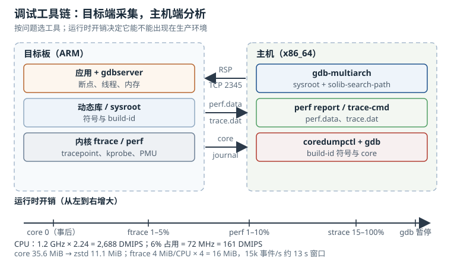

# 调试工具链：gdb、strace、perf、ftrace 与 core dump

嵌入式调试的难点不是“没有工具”，而是**工具很多，问题只有一个，选错工具就会得到错误的证据**。用 `strace` 查偶发延迟，会把时序扰动当成根因；用 `gdb` 查已经消失的竞态，只能看到“现在正常”；用 `perf` 查没有符号的二进制，只能得到一堆地址。

本章按“问题 → 工具 → 开销 → 结论”的方式组织：先建立工具分层，再给出每类工具的定量开销，最后用算例把 CPU、内存、core 和存储预算串起来。

## 1. 动机：先问问题，再选工具

调试工具可以按它回答的问题分成四类：

| 你想知道 | 首选工具 | 备选 | 代价 |
|---|---|---|---|
| 程序现在卡在哪个系统调用 | `strace -p` | `perf trace` | 高（ptrace 暂停） |
| 崩溃时内存和调用栈是什么 | core dump + `gdb` | `pstore`、日志 | 事后，零运行时开销 |
| CPU 时间花在哪个函数 | `perf record` | `ftrace function_graph` | 中低（采样） |
| 内核里谁关了中断这么久 | `ftrace irqsoff` | `perf sched` | 低（内核 tracing） |
| 服务为什么没起来 | `journalctl -u` | `dmesg` | 零 |
| 内存被谁吃了 | `smaps_rollup`、`smem` | `valgrind massif` | 低到高 |

选错工具的典型代价：

- 用 `strace` 查延迟毛刺，trace 本身把毛刺抹平或放大，最后得出“系统很正常”；
- 用 `gdb` 连接一个已经恢复的竞态，进程停在断点时其他线程继续跑，问题不再复现；
- 用 `perf` 但没有符号和 `vmlinux`，报告里全是 `[unknown]`；
- 用 `top` 的 1 秒采样判断 6% CPU：USER_HZ=100 时 1 s 只有 100 个 tick，6% 对应 6 个 tick，±1 tick 的量化误差就是 ±1 个百分点，相对误差约 $1/6\approx17\%$。

::: motivation 每 6 小时一次的 4.8 ms 抖动
某采集设备每 6 小时出现一次 4.8 ms 的采样丢失。应用侧 `strace -T` 看了半小时，系统调用都很快；`perf top` 也没有明显热点；`top` 的 CPU 占用一直在 8% 左右。

最后用 `ftrace` 的 `irqsoff` tracer 抓到：eMMC 驱动在垃圾回收路径里关中断 4.8 ms，正好覆盖了采样中断的窗口。`strace` 看不到它，因为问题不在系统调用；`perf` 的采样频率是 99 Hz，4.8 ms 的事件大概率落在两个采样点之间。

这个例子说明：**工具的观测窗口和事件的时间尺度必须匹配**。99 Hz 的采样看不见 5 ms 的毛刺；`strace` 的 ptrace 暂停又会改变毛刺的出现条件。先用低开销、高时间分辨率的内核 tracer 定位时间窗口，再用应用工具解释窗口内的行为，顺序不能反。
:::

## 2. 定义与直观：四层可观测性

### 2.1 编译期、运行时、内核与事后

| 层 | 提供什么 | 典型接口 | 前提 |
|---|---|---|---|
| 编译期 | 符号、行号、类型、宏 | `-g`、`.debug` 文件、build-id | 构建时保留，不能 strip 掉 |
| 运行时 | 进程控制、系统调用、内存映射 | `ptrace`、`/proc`、`gdbserver` | 权限、`ptrace_scope` |
| 内核 | 函数、tracepoint、kprobe、PMU | tracefs、`perf_event_open` | 内核配置、debugfs/tracefs |
| 事后 | core、panic 日志、pstore | `core_pattern`、`/sys/fs/pstore` | 预留存储/内存、策略开启 |

这四层不是替代关系。一个完整的现场证据链通常是：`journalctl` 给出时间线，`pstore` 保留崩溃前内核日志，core 给出用户态现场，`perf`/`ftrace` 解释性能问题，`gdb` 把 core 翻译成源码行。

### 2.2 gdb 与 gdbserver：让目标板停在想停的地方

`gdb` 是主机端的调试器，`gdbserver` 是目标端的小型代理。两者通过 GDB Remote Serial Protocol 通信，默认走 TCP：

```bash
# 目标板
gdbserver :2345 ./telemetry-gw --config /etc/telemetry-gw.conf
gdbserver --attach :2345 812

# 主机
gdb-multiarch ./telemetry-gw
```

在 `gdb` 里：

```text
set pagination off
set confirm off
set sysroot /opt/rootfs
set solib-search-path /opt/rootfs/lib:/opt/rootfs/usr/lib
target remote 192.168.1.10:2345
break telemetry_gw_start
continue
info sharedlibrary
thread apply all bt
```

几个关键点：

- `set sysroot` 指向目标根文件系统的本地副本，`gdb` 从那里加载共享库的符号；没有它，`bt` 只能显示地址。
- `set solib-search-path` 是补充搜索路径，适合库不在标准目录的情况。
- `info sharedlibrary` 确认每个库的加载地址和符号文件是否匹配；如果显示 `No symbol table`，说明 sysroot 或 build-id 对不上。
- 多线程程序用 `thread apply all bt` 一次性抓所有线程栈，避免逐个切换时状态变化。
- `gdbserver` 没有认证和加密，任何能连到 2345 端口的人都能控制进程。生产镜像不要带它；调试时用 SSH 隧道或只绑定 `127.0.0.1`。

交叉调试最常见的失败不是“连不上”，而是“连上了但符号不对”。原因通常是主机上的库与目标板上的库不是同一次构建：目标板升级了库，主机 sysroot 还是旧的；或者二进制被 `strip` 过，只剩动态符号。用 build-id 对齐：

```bash
readelf -n ./telemetry-gw
readelf -n /opt/rootfs/usr/bin/telemetry-gw
```

两个 build-id 必须一致。主机的调试符号通常放在 `/usr/lib/debug/.build-id/xx/yyyy.debug`，`gdb` 会按 build-id 自动查找；也可以显式 `symbol-file`。

### 2.3 strace 与 ltrace：系统调用和库调用的显微镜

`strace` 通过 `ptrace` 让目标进程在每次系统调用入口和出口停下来，读取寄存器与参数。它回答的是“程序向内核要了什么、内核返回了什么”。

```bash
strace -f -tt -T -s 128 -o /tmp/trace.txt ./telemetry-gw
strace -f -c ./telemetry-gw
strace -f -e trace=%network -p 812
strace -f -y -e trace=openat,read,write -p 812
```

- `-f` 跟踪子进程和线程；多线程程序必须加，否则只看到主线程。
- `-tt` 打印绝对时间，`-T` 打印每个系统调用的耗时；两者结合能看出“哪个调用慢”。
- `-s 128` 限制字符串长度，避免日志爆炸；默认 32 字节经常不够看路径。
- `-e trace=%network` 只跟网络相关调用，减少噪声；`%file`、`%process`、`%signal`、`%desc` 同理。
- `-y` 把文件描述符翻译成路径，`-yy` 还会显示协议地址；排查“操作了哪个文件/套接字”时非常有用。
- `-c` 只输出统计摘要，但**仍然跟踪所有系统调用**，开销不会因为输出少而消失。

`ltrace` 跟踪动态库函数调用（通过 PLT 断点），回答“程序调了哪个库函数、参数是什么”。它对静态链接二进制无效，对 `-O2` 内联/裁剪过的调用也可能漏；开销通常比 `strace` 更高。能用 `strace` 解决的问题，优先用 `strace`。

`strace` 的最大副作用是**改变时序**。每次系统调用至少两次上下文切换和一次 tracer 唤醒；高频系统调用的程序会明显变慢，竞态可能因此消失或变形。它适合定位“卡在哪个调用”，不适合做性能基准。

### 2.4 perf：用 PMU 回答“时间花在哪”

`perf` 基于内核的 `perf_event_open`，既能计数（`perf stat`），也能采样（`perf record`）。计数模式开销很低，适合做基线；采样模式按频率抓调用栈，适合找热点。

```bash
perf stat -e cycles,instructions,cache-references,cache-misses,branch-misses ./telemetry-gw
perf stat -a -e cycles,instructions,task-clock,context-switches,page-faults sleep 10
perf record -F 99 -g --call-graph fp -o /tmp/perf.data ./telemetry-gw
perf report --stdio --sort dso,symbol -i /tmp/perf.data
perf top
perf sched record -- sleep 10
perf sched latency
```

- `cycles`、`instructions` 来自硬件 PMU；`task-clock`、`context-switches`、`page-faults` 是软件事件，没有 PMU 也能用。
- `-F 99` 是采样频率，99 Hz 是常见折中：足够抓热点，又不会产生太多样本。
- `--call-graph fp` 依赖帧指针，需要 `-fno-omit-frame-pointer` 编译；`--call-graph dwarf` 不依赖帧指针，但采样开销和存储都更大。
- `perf report` 需要符号：用户态二进制、共享库、内核 `vmlinux`、模块 `.ko`。没有符号时，先解决符号，不要急着解读地址。
- `perf sched latency` 看调度延迟，适合“线程该跑但没跑”的问题；`perf sched record` 先记录，再分析。

嵌入式上常见的坑是“PMU 不存在或被内核关掉”。检查：

```bash
ls /sys/bus/event_source/devices
cat /proc/sys/kernel/perf_event_paranoid
perf list | head -40
```

如果 `cpu`/`armv7_cortex_a7` 一类的 PMU 设备不存在，硬件事件会报 `not supported`；改用 `task-clock`、`cpu-clock` 或 tracepoint。`perf_event_paranoid` 限制非 root 用户采集，调试时可临时调低，生产上不要长期放开。

### 2.5 ftrace：内核里的低开销示波器

`ftrace` 是内核自带的 tracing 框架，接口在 tracefs（新内核 `/sys/kernel/tracing`，旧内核 `/sys/kernel/debug/tracing`）。它不需要额外守护进程，开销比 `ptrace` 低得多，适合抓“短、快、偶发”的内核事件。

常用 tracer：

| tracer | 回答的问题 | 备注 |
|---|---|---|
| `function` | 哪些内核函数被调用了 | 只记录函数名，开销低 |
| `function_graph` | 调用关系与每个函数的耗时 | 开销高，必须过滤 |
| `irqsoff` | 中断被关了多久 | 抓实时性毛刺的首选 |
| `preemptoff` | 抢占被关了多久 | 抓调度延迟 |
| `wakeup` / `wakeup_rt` | 高优先级任务多久被调度 | 抓唤醒延迟 |
| `blk` | 块设备请求队列 | 抓 IO 延迟 |

最基本的手工操作：

```bash
mount -t tracefs nodev /sys/kernel/tracing
cd /sys/kernel/tracing
echo 0 > tracing_on
echo function_graph > current_tracer
echo emmc_issue_request > set_graph_function
echo 1 > tracing_on
sleep 5
echo 0 > tracing_on
cat trace
```

更常用的是 tracepoint 和 kprobe：

```bash
echo 1 > events/sched/sched_switch/enable
echo 1 > events/net/netif_receive_skb/enable
echo 'p:my_open do_sys_open' > kprobe_events
echo 1 > events/kprobes/my_open/enable
```

- `events/` 下是静态 tracepoint，稳定、开销低，优先使用。
- `kprobe_events` 可以给任意内核函数加探针，适合没有 tracepoint 的路径；`uprobe_events` 给用户态函数加探针。
- `set_ftrace_filter`/`set_graph_function` 是控制开销的关键。全量 `function_graph` 会把系统拖慢数倍，甚至改变问题本身。
- `trace_clock` 建议设为 `global` 或 `mono`，多核 correlation 时不要用 per-CPU 的 `local`。
- `buffer_size_kb` 是**每个 CPU** 的缓冲区大小，总内存要乘以 CPU 数。

`trace-cmd` 是 ftrace 的封装，适合记录后离线分析：

```bash
trace-cmd record -p function_graph -g emmc_issue_request -l 'emmc_*' -- sleep 5
trace-cmd report
trace-cmd stat
```

`-p` 选 tracer，`-g` 选 graph 的根函数，`-l` 过滤函数列表。记录文件是 `trace.dat`，可以在主机上用同版本 `trace-cmd report` 打开。

### 2.6 dmesg 与 journalctl：把日志变成时间线

`dmesg` 读的是内核环形缓冲区，容量由 `CONFIG_LOG_BUF_SHIFT` 或启动参数 `log_buf_len=` 决定。1 MiB 的缓冲区按每条 150 字节算，大约只能存 7,000 条消息；启动风暴时几秒就写满。

```bash
dmesg -w
dmesg -l err,warn
dmesg --time-format=mono
journalctl -k -b -o short-monotonic
journalctl -u telemetry-gw -b --since '10 min ago'
journalctl -b -1 -p err
journalctl --list-boots
```

- `dmesg -T` 把单调时间换算成墙钟时间，但换算基于“当前时间减开机时长”；如果期间发生过 NTP 跳变或 suspend，显示的时间会偏。做跨设备 correlation 时用 `-o short-monotonic` 或 `--time-format=mono`。
- `journalctl -b` 只看本次启动，`-b -1` 看上一次，`--list-boots` 列出所有 boot ID。
- `journalctl -k` 只看内核消息；`-u` 按 unit 过滤；`-p err` 按优先级过滤。
- 持久化日志要求 `/var/log/journal` 存在且可写；只读根文件系统上默认落到 `/run/log/journal`，重启即丢。
- 日志速率限制（`RateLimitIntervalSec`/`RateLimitBurst`）会丢消息；排查“日志缺了一段”时先看 `journalctl --disk-usage` 和 unit 的 `DropIn`。

内核 panic 或看门狗复位后，内存里的日志已经没了。`pstore`/`ramoops` 用一段保留内存保存 crash log，下一次启动从 `/sys/fs/pstore` 取：

```bash
ls -l /sys/fs/pstore
cat /sys/fs/pstore/console-ramoops-0
cat /sys/fs/pstore/dmesg-ramoops-0
```

`ramoops` 需要在设备树里预留内存并配置 `record_size`、`console_size`、`ftrace_size`。它比 kdump 轻得多，适合内存紧张的嵌入式设备。

### 2.7 core dump：崩溃现场的快照

core 文件是进程崩溃时内核写出的 ELF 文件，包含寄存器、栈、堆、匿名映射和映射表。分析流程：

```bash
ulimit -c unlimited
cat /proc/sys/kernel/core_pattern
./telemetry-gw
gdb ./telemetry-gw core
```

在 `gdb` 里：

```text
bt full
info registers
info threads
thread apply all bt
info proc mappings
```

如果系统使用 `systemd-coredump`：

```bash
coredumpctl list
coredumpctl info 812
coredumpctl gdb 812
coredumpctl dump 812 --output /tmp/core.812
```

几个决定“有没有 core”的因素：

- `RLIMIT_CORE`：`ulimit -c 0` 时不会产生 core；systemd 服务的 `LimitCORE=` 也会限制。
- `core_pattern`：可以是文件路径，也可以是管道（`|/usr/lib/systemd/systemd-coredump ...`）。管道程序不存在或失败，core 就丢了。
- `coredump_filter`：默认 `0x33`，只包含匿名私有/共享页、ELF 头和私有大页；文件-backed 的代码段不写入。这解释了“VSZ 180 MiB，core 只有 35 MiB”。
- 只读根文件系统：core 写不到 `/`，要导到数据分区或通过网络发走。
- 进程 `dumpable` 标志：setuid 程序在默认 `fs.suid_dumpable=0` 时，或显式 `prctl(PR_SET_DUMPABLE, 0)`，会禁止 dump。

core 不是越小越好，也不是越大越好。太小可能缺少关键映射；太大则写盘时间长、占存储、还可能把密钥/令牌写进去。`systemd-coredump` 的 `ProcessSizeMax=` 和 `ExternalSizeMax=` 是两道上限，超过上限的进程直接不 dump。

### 2.8 CPU 与内存：从“占用高”到“哪一行”

CPU 占用定位的常用命令：

```bash
top -H -p 812
ps -eLo pid,tid,psr,stat,pcpu,rss,comm
pidstat -u -t -p 812 1
vmstat 1
mpstat -P ALL 1
cat /proc/stat
```

`top -H` 展开线程，`ps -L` 看线程亲和性，`pidstat -t` 看每个线程的 CPU。`/proc/stat` 的时间单位是 USER_HZ（通常 100 Hz，即 10 ms），对 6% 这样的低占用，1 秒采样的量化误差可达 17%；要精确到百分点，用 `perf stat` 的 `task-clock` 或应用自己打点。

内存占用定位：

```bash
cat /proc/PID/status
cat /proc/PID/smaps_rollup
pmap -x 812
smem -tk
free -m
cat /proc/meminfo
slabtop
```

- **RSS**：进程实际驻留的物理页，共享库会被每个进程重复计算。
- **PSS**：共享页按共享进程数均摊，多个进程求和更接近真实占用。
- **USS**：进程独占的页，释放该进程能真正回收的内存。
- `smaps_rollup` 一次给出 Pss、Private_Clean、Private_Dirty、Shared_Clean、Shared_Dirty，比手工累加 `smaps` 快。
- `free` 的 `buff/cache` 是页缓存，不是“泄漏”；`MemAvailable` 才是应用还能拿到的估计值。
- `slabtop` 看内核 slab；`kmemleak` 查内核泄漏；用户态泄漏先用 `valgrind massif`/`heaptrack`，再回到 `smaps_rollup` 验证增长趋势。

OOM 的判据不是“内存用了 90%”，而是分配失败和回收失败。看：

```bash
dmesg | grep -i -E 'oom|out of memory'
cat /proc/PID/oom_score
cat /sys/fs/cgroup/.../memory.events
```

cgroup v2 下 `memory.max`、`memory.current`、`memory.events` 能区分“接近上限”和“已经触发 OOM kill”。`systemd-cgtop` 按 slice/service 展示，比全局 `top` 更容易定位是哪个服务。



图中上半部分把“目标端采集”和“主机端分析”分开：目标板只负责产生 `perf.data`、`trace.dat`、core 和日志，耗时的符号解析、调用栈还原和报告生成放到主机。下半部分是按运行时开销排列的谱系，core 是事后证据、开销为零，`strace` 和 `gdb` 会暂停进程，不能长期开着。

## 3. 定量关系：CPU、采样、缓冲区与存储

### 3.1 CPU 占用、IPC 与 DMIPS

CPU 占用率定义为

$$U = \frac{T_{\mathrm{cpu}}}{T_{\mathrm{wall}}}$$

$T_{\mathrm{cpu}}$ 是进程实际占用 CPU 的时间，$T_{\mathrm{wall}}$ 是墙钟时间。多核系统上，$U$ 可以超过 1（按核累加），也可以按单核归一化，报告时必须说明口径。

CPU 时间与指令数的关系：

$$T_{\mathrm{cpu}} = \frac{I}{f \times \mathrm{IPC}}$$

$I$ 是执行的指令数，$f$ 是主频，$\mathrm{IPC}$ 是每周期指令数。IPC 由程序、编译器和微架构共同决定；优化 IPC 和减少指令数是两条不同的路。

DMIPS 是 Dhrystone 基准的常用换算：

$$\mathrm{DMIPS} = f_{\mathrm{MHz}} \times \mathrm{DMIPS/MHz}$$

Cortex-A53 约 2.24 DMIPS/MHz，Cortex-A7 约 1.9 DMIPS/MHz。DMIPS 是合成基准，受编译器优化影响很大，只适合做数量级和余量估算，不能直接等同于实际业务吞吐。

### 3.2 ptrace 的开销

`strace` 的额外 CPU 时间近似为

$$T_{\mathrm{strace}} = N_{\mathrm{syscall}} \times t_{\mathrm{stop}}$$

$N_{\mathrm{syscall}}$ 是每秒系统调用次数，$t_{\mathrm{stop}}$ 是每次停下、读寄存器、恢复的平均开销。$t_{\mathrm{stop}}$ 与架构、内核、是否 `-f` 有关，通常在几微秒量级。

如果 $T_{\mathrm{strace}}$ 接近 1 秒/秒，程序就被 tracer 拖到满负荷，测到的时间不再是原来的时间。判断方法是：先不带 `strace` 测一遍基线，再带 `strace -c` 测一遍，比较总耗时和系统调用总数；差异超过 20% 就不要用这次结果做性能结论。

### 3.3 perf 采样的统计误差

采样得到的是统计估计。设某函数占比为 $p$，总样本数为 $N$，则其样本数的相对标准差约为

$$\sigma_{\mathrm{rel}} \approx \frac{1}{\sqrt{Np}}$$

要区分“5%”和“6%”两个热点，$Np$ 需要足够大；否则两次测量的差异可能只是采样噪声。99 Hz 采样 10 秒只有 990 个样本，5% 的函数约 50 个样本，相对误差约 14%。

采样开销与频率近似成正比：99 Hz 通常可接受，999 Hz 会明显增加中断和 ring buffer 压力。先用低频率找大方向，再对可疑函数提高频率或改用计数模式。

### 3.4 ftrace 缓冲区能装多久

设每个 CPU 的缓冲区为 $B$（MiB），CPU 数为 $n$，事件产生速率为 $r$（事件/秒），每条事件大小为 $s$（字节），则可记录的时间窗口为

$$T_{\mathrm{buf}} = \frac{B \times n}{r \times s}$$

注意 $B$ 是每 CPU 的大小，总内存是 $B \times n$。如果事件只集中在一个 CPU，实际可用窗口是全局窗口的 $1/n$。

`function_graph` 的事件比 tracepoint 大得多，速率也高得多；同样缓冲区，窗口可能从几十秒降到一两秒。这就是“抓不到”的常见原因：不是 tracer 没工作，而是缓冲区被覆盖了。

### 3.5 core 大小与存储预算

core 的主体是匿名映射的可读页，加上 ELF 头、notes 和映射表。近似为

$$S_{\mathrm{core}} \approx \sum_{i \in \mathcal{A}} R_i + H$$

$\mathcal{A}$ 是 `coredump_filter` 允许写入的映射集合，$R_i$ 是第 $i$ 个映射的驻留大小，$H$ 是 ELF 头、notes 和映射表的开销。文件-backed 的代码段默认不写入，所以 core 远小于 VSZ。

压缩后的存储需求为

$$S_{\mathrm{stored}} = \frac{S_{\mathrm{core}}}{r_{\mathrm{comp}}}$$

$r_{\mathrm{comp}}$ 是压缩比。若每周产生 $k$ 个 core、保留 $D$ 周，总占用为

$$S_{\mathrm{total}} = k D S_{\mathrm{stored}}$$

写 core 的时间为

$$T_{\mathrm{write}} = \frac{S_{\mathrm{core}}}{B_{\mathrm{write}}}$$

它必须小于看门狗超时和崩溃处理超时，否则设备可能在写 core 的过程中被复位，留下半个文件。

### 3.6 内存口径与泄漏时间

对进程集合 $P$，RSS 求和会重复计算共享页：

$$M_{\mathrm{RSS}} = \sum_{p \in P} \mathrm{RSS}_p$$

PSS 求和则不重复：

$$M_{\mathrm{PSS}} = \sum_{p \in P} \mathrm{PSS}_p$$

页表本身也占内存。对 $M$ 字节的映射，4 KiB 页、8 字节 PTE（ARM64 或 ARM32 LPAE），页表项数约 $M/4096$，页表开销约

$$M_{\mathrm{PTE}} \approx \frac{M}{4096} \times 8 = \frac{M}{512}$$

100 MiB 的映射约 200 KiB 页表；1 GiB 约 2 MiB。ARM32 短描述符的 PTE 是 4 字节，同一映射的页表开销约为一半；多级页表只分配实际用到的部分，但这个量级可以用来判断“大映射”的隐藏成本。

泄漏到 OOM 的时间为

$$T_{\mathrm{OOM}} = \frac{M_{\mathrm{free}}}{r_{\mathrm{leak}}}$$

$r_{\mathrm{leak}}$ 是净泄漏速率。注意 allocator 的元数据、对齐和碎片会让实际可分配量小于名义空闲量。

## 4. 典型计算：从 6% CPU 到 35.6 MiB core

### 4.1 6% CPU 意味着多少 DMIPS

某 Cortex-A53 设备主频 1.2 GHz，DMIPS/MHz 取 2.24：

$$\mathrm{DMIPS} = 1200 \times 2.24 = 2{,}688$$

应用占用单核 6%：

$$0.06 \times 1200 = 72\ \mathrm{MHz}$$

换算成 DMIPS：

$$72 \times 2.24 = 161\ \mathrm{DMIPS}$$

如果应用每秒处理 2,000 个事件，每个事件 30 µs：

$$2{,}000 \times 30\ \mu\mathrm{s} = 60{,}000\ \mu\mathrm{s} = 60\ \mathrm{ms}$$

即 6%。每个事件消耗的周期数：

$$\frac{0.06 \times 1.2\times10^9}{2{,}000} = 36{,}000\ \mathrm{cycles}$$

把单事件优化到 18 µs：

$$2{,}000 \times 18\ \mu\mathrm{s} = 36\ \mathrm{ms} = 3.6\%$$

对应 43.2 MHz、96.8 DMIPS，CPU 余量翻倍。这个换算的价值在于：**6% 不是“很小”，它对应 36,000 周期/事件**；如果事件率涨 5 倍，占用就到 30%，必须提前做容量规划。

### 4.2 IPC 与缓存缺失：3.1 s 里 0.6 s 在等内存

某程序执行 $2.4\times10^9$ 条指令，主频 1.2 GHz，理想 IPC 0.8：

$$T = \frac{2.4\times10^9}{1.2\times10^9 \times 0.8} = 2.5\ \mathrm{s}$$

实测 3.1 s，实际周期数：

$$3.1 \times 1.2\times10^9 = 3.72\times10^9\ \mathrm{cycles}$$

有效 IPC：

$$\mathrm{IPC}_{\mathrm{eff}} = \frac{2.4\times10^9}{3.72\times10^9} = 0.645$$

多出的 $0.72\times10^9$ 周期约 0.6 s。`perf stat` 显示 1,200 万次 cache miss，若每次 miss 的额外延迟约 50 ns：

$$12\times10^6 \times 50\ \mathrm{ns} = 0.6\ \mathrm{s}$$

与差值吻合。优化方向不是“换更快的 CPU”，而是减少 miss：改善数据局部性、把热数据放进连续内存、避免链表随机跳转。若把 miss 降到 400 万次，可省

$$8\times10^6 \times 50\ \mathrm{ns} = 0.4\ \mathrm{s}$$

总时间降到 2.7 s。

### 4.3 strace 把 25k 次/秒放大成多少 CPU

设程序每秒 25,000 次系统调用，每次 ptrace 停靠开销 6 µs：

$$25{,}000 \times 6\ \mu\mathrm{s} = 0.15\ \mathrm{s/s} = 15\%$$

如果程序有 4 个线程，每个线程各 25,000 次，总共 100,000 次：

$$100{,}000 \times 6\ \mu\mathrm{s} = 0.6\ \mathrm{s/s} = 60\%$$

这时 `strace -f` 会让程序慢一倍以上，延迟毛刺可能被完全掩盖。正确做法是先用 `perf trace` 或 ftrace 的低开销 tracepoint 定位大致范围，再在实验室里用 `strace` 看具体参数。

### 4.4 ftrace：4 MiB/CPU 能看几秒

4 核设备，每 CPU 4 MiB 缓冲区：

$$B_{\mathrm{total}} = 4 \times 4\ \mathrm{MiB} = 16\ \mathrm{MiB} = 16{,}777{,}216\ \mathrm{B}$$

tracepoint 事件 15,000 个/秒，每个 80 字节：

$$r \times s = 15{,}000 \times 80 = 1{,}200{,}000\ \mathrm{B/s} = 1.2\ \mathrm{MB/s}$$

窗口：

$$T_{\mathrm{buf}} = \frac{16\ \mathrm{MiB}}{1.2\ \mathrm{MB/s}} = \frac{16{,}777{,}216\ \mathrm{B}}{1{,}200{,}000\ \mathrm{B/s}} = 13.98\ \mathrm{s} \approx 14.0\ \mathrm{s}$$

如果换成 `function_graph`，150,000 事件/秒、每个 100 字节：

$$r \times s = 15{,}000{,}000\ \mathrm{B/s} = 15\ \mathrm{MB/s}$$

窗口只剩 $16.777216\ \mathrm{MB}/15\ \mathrm{MB/s}=1.118\ \mathrm{s} \approx 1.12\ \mathrm{s}$。这就是为什么抓 `function_graph` 必须过滤函数：不过滤时，缓冲区几秒就被覆盖，看到的只是最后一段。

### 4.5 core：35.6 MiB 的现场与 8 GiB 的存储

某进程 VSZ 180 MiB、RSS 46 MiB，其中匿名私有 32 MiB、栈 1 MiB、匿名共享 2 MiB、ELF 头 0.1 MiB、文件-backed 10.9 MiB。默认 `coredump_filter=0x33` 不写文件-backed 页，core 大小约

$$32+1+2+0.1+0.5 = 35.6\ \mathrm{MiB}$$

其中 0.1 MiB 是 ELF 头，0.5 MiB 是 notes、映射表与对齐余量。zstd 压缩比取 3.2：

$$S_{\mathrm{stored}} = \frac{35.6}{3.2} = 11.1\ \mathrm{MiB}$$

每周 20 个 core、保留 4 周：

$$S_{\mathrm{total}} = 20 \times 4 \times 11.1 = 888\ \mathrm{MiB}$$

如果数据分区只剩 2 GiB，占 43.4%，接近一半；再叠加日志和升级包就会紧张。写 core 的时间：eMMC 写入 20 MiB/s 时

$$T_{\mathrm{write}} = \frac{35.6}{20} = 1.78\ \mathrm{s}$$

慢速 flash 只有 5 MiB/s 时：

$$T_{\mathrm{write}} = \frac{35.6}{5} = 7.12\ \mathrm{s}$$

如果看门狗超时是 10 s，7.12 s 已经接近危险区；写 core 期间如果还有日志 flush，可能触发复位。设计时要么限制 core 大小，要么把 core 先写到内存再异步压缩/上传。

通过网络回传 11.1 MiB，10 Mbit/s 链路需要

$$T_{\mathrm{tx}} = \frac{11.1 \times 8}{10} = 8.9\ \mathrm{s}$$

1 Mbit/s 链路需要 89 s。现场 4G 信号差时，core 回传可能比设备重启还慢，要有本地缓存和断点续传。

### 4.6 内存泄漏：200 B/请求，5 小时到 OOM

某服务每个请求泄漏 200 字节，请求速率 50 次/秒：

$$r_{\mathrm{leak}} = 200 \times 50 = 10{,}000\ \mathrm{B/s}$$

每小时：

$$10{,}000 \times 3{,}600 = 36{,}000{,}000\ \mathrm{B} = 36\ \mathrm{MB/h}$$

若应用可用内存 180 MB：

$$T_{\mathrm{OOM}} = \frac{180}{36} = 5\ \mathrm{h}$$

考虑 allocator 元数据（每次分配多 16 字节），速率变成 $216 \times 50 = 10.8\ \mathrm{KB/s}$，约 38.9 MB/h，OOM 提前到 4.6 h。这个量级说明：**200 字节的“小泄漏”在高频路径上足以在半天内打爆设备**，不能因为单次小就忽略。

## 5. 工程含义：把调试能力做进产品

### 5.1 工具选择矩阵

| 问题 | 第一选择 | 前提 | 不要用 |
|---|---|---|---|
| 进程卡住 | `strace -p`、`/proc/PID/stack` | ptrace 权限 | `perf` 猜 |
| 崩溃现场 | core + `gdb` | core 策略、符号 | 只看日志 |
| CPU 热点 | `perf record` | PMU 或软件事件、符号 | `top` 的 1 s 采样 |
| 内核延迟毛刺 | `ftrace irqsoff` | tracefs、内核配置 | `strace` |
| 系统调用参数 | `strace` | 实验室、可复现 | 生产长期开启 |
| 内核函数耗时 | `function_graph` + 过滤 | 已知可疑函数 | 全量 tracing |
| 启动失败 | `journalctl -u`、`dmesg` | 日志持久化 | 反复重启试 |
| 内存增长 | `smaps_rollup`、`smem` | `/proc` | 只看 `free` |

### 5.2 符号与构建

- 发布构建保留一份未 strip 的二进制和 `.debug` 文件，按 build-id 归档；不要只留版本号。
- 编译加 `-g`，优化级别用 `-Og` 或 `-O2 -g`；`-O0` 会改变时序，不一定能复现线上问题。
- 需要 `perf` 调用图时加 `-fno-omit-frame-pointer`；需要看宏时加 `-g3`。
- 用 `objcopy --only-keep-debug` 分离调试信息，`--add-gnu-debuglink` 把链接写回二进制；`strip` 只去掉调试段，不要连符号表一起丢。
- 内核保留 `vmlinux` 和模块的未 strip 版本，`perf report -k vmlinux` 才能解析内核栈。
- 交叉工具链的 `gdb` 版本要与目标库的 ABI 匹配；`gdb-multiarch` 可以省去多套工具链，但要注意 Python 脚本和架构支持。

### 5.3 线上可观测性

- 开 `pstore`/`ramoops`，让 panic 和看门狗复位留下证据；这是不依赖磁盘的崩溃日志。
- core 策略要明确：写到哪、保留多久、是否压缩、是否上传、是否包含敏感数据。
- journald 持久化到数据分区，设置 `SystemMaxUse=`；只读根上至少保留 volatile 日志并支持一键导出。
- 关键服务记录启动/停止/重启事件和版本号；`journalctl -u` 的时间线比应用日志更可靠。
- 给现场留一个“诊断包”脚本：`dmesg`、`journalctl -b`、`ip addr`、`nft list ruleset`、`ps`、`free`、`/proc/PID/smaps_rollup`、`coredumpctl list`，统一打包。

### 5.4 开销预算

| 手段 | 典型运行时开销 | 适用阶段 |
|---|---|---|
| `perf stat` 计数 | <1% | 常态基线 |
| `perf record -F 99` | 1–5% | 实验室/短期线上 |
| `ftrace` tracepoint | 1–5% | 短期抓取 |
| `function_graph` 全量 | 数倍 | 只在实验室，且必须过滤 |
| `strace -f` | 15–100% | 实验室，短时间 |
| core dump | 崩溃瞬间，写盘 1–8 s | 事后 |
| `valgrind` | 10–50 倍 | 实验室，短用例 |

“常态开启”和“故障时开启”要分开设计。计数类指标可以常开；采样和 tracing 只在需要时开，并设置自动关闭，避免忘记关掉把设备拖慢。

### 5.5 复现与实验设计

- 一次只改一个变量，记录改前/改后的完整命令和输出。
- 先建立基线：同样的负载、温度、存储状态、网络条件；否则数字不可比。
- 对偶发问题，记录“发生了多少次/观察了多久”，不要用一次复现下结论。
- 保留原始数据（`perf.data`、`trace.dat`、core、日志），分析结论可以后补，原始证据不能重造。
- 注意 Heisenbug：调试手段本身会改变时序；如果加上工具就不复现，先换低开销工具，而不是宣布“问题解决了”。

### 5.6 安全边界

- `gdbserver` 无认证，调试口不能暴露在业务网络；用完即关，生产镜像不包含。
- `ptrace` 可以读写目标进程内存，等同该进程权限；`ptrace_scope` 和用户权限要收紧。
- core 可能包含密钥、令牌、用户数据；传输和存储要加密，保留期限要明确。
- `/sys/kernel/tracing` 和 `perf_event_open` 能泄露内核地址与行为；生产上限制挂载和 `perf_event_paranoid`。
- 调试 shell、`gdbserver`、全量日志都属于“出厂前必须关闭”的开关，应该有构建期检查，而不是靠人工记得。

## 6. 常见坑

::: pitfall 坑一：gdb 连上了，但 `bt` 全是地址，变量显示 `optimized out`
**现象**：`target remote` 成功，断点能停，但 `bt` 只有 `??`，`info sharedlibrary` 显示 `No symbol table`；或者源码行对不上。

**原因**：主机 sysroot 里的库与目标板不一致；二进制被 strip；`-O2` 把变量优化掉；源码路径在构建机和调试机上不同。

**解决**：用 build-id 对齐目标库与主机 sysroot；`set sysroot` 指向正确的 rootfs；保留未 strip 的二进制和 `.debug` 文件；用 `set substitute-path` 修正源码路径；需要看变量时用 `-Og` 重新编译，或接受 `-O2` 下用寄存器和反汇编分析。
:::

::: pitfall 坑二：一加 `strace` 问题就消失，或者程序慢到不可用
**现象**：线上偶发卡顿，加上 `strace -f` 后不再复现；或者 `strace` 下程序 CPU 从 10% 涨到 80%，超时暴增。

**原因**：`ptrace` 在每次系统调用入口/出口暂停进程，改变时序并增加上下文切换；多线程程序被 `-f` 跟踪时，线程间的相对速度被重排。高频系统调用场景下，开销可以超过 100%。

**解决**：不要用 `strace` 做性能基准；先用 `perf trace`、ftrace tracepoint 或应用埋点定位大致范围，再在实验室用 `strace` 看参数；缩小 `-e trace=` 范围；用 `-c` 只取统计；设置超时并确保能干净退出。
:::

::: pitfall 坑三：进程崩了，但没有 core
**现象**：`dmesg` 有 `segfault`，`coredumpctl list` 为空，或者 `/var/lib/systemd/coredump` 里没有新文件。

**原因**：`ulimit -c 0` 或服务 unit 的 `LimitCORE=0`；`core_pattern` 指向不存在的管道程序；只读根文件系统写不进去；进程 `dumpable=0`（setuid 或显式设置）；`ProcessSizeMax` 小于进程 VSZ，systemd-coredump 直接跳过。

**解决**：检查 `/proc/PID/limits` 的 `Max core file size`；`cat /proc/sys/kernel/core_pattern`；确认 `systemd-coredump` 存在且可执行；把 core 目录指到可写分区；调整 `ProcessSizeMax=`；对 setuid 程序用 `prctl` 或改为非 setuid + capability。
:::

::: pitfall 坑四：`perf` 报 `not supported`，或者报告里全是 `[unknown]`
**现象**：`perf stat -e cycles` 报 `not supported`；`perf record` 能跑但 `perf report` 没有函数名，只有地址。

**原因**：SoC 没有 PMU，或内核没开 `CONFIG_HW_PERF_EVENTS`/`CONFIG_PERF_EVENTS`；`perf_event_paranoid` 限制；用户态二进制/库被 strip；内核 `vmlinux` 和模块符号没提供；`perf` 版本与内核不匹配。

**解决**：用 `ls /sys/bus/event_source/devices` 确认 PMU；没有硬件事件就改用 `task-clock`、`cpu-clock` 或 tracepoint；调低 `perf_event_paranoid` 只用于调试；提供未 strip 的二进制、`vmlinux`、模块和 sysroot；用 `perf report -k vmlinux --symfs` 指定符号路径。
:::

::: pitfall 坑五：开了 `function_graph`，系统变慢且 trace 只有最后两秒
**现象**：打开全量 `function_graph` 后，系统响应明显变慢；`trace` 里只有最近一小段，之前的记录不见了。

**原因**：`function_graph` 对每个函数入口/出口都记录，事件速率极高；`buffer_size_kb` 是每 CPU 的容量，总量有限；默认 `overwrite` 模式会用新事件覆盖旧事件。

**解决**：用 `set_graph_function`/`set_ftrace_filter` 只跟踪可疑函数；降低 `max_graph_depth`；增大 `buffer_size_kb` 并确认总内存；用 `trace_pipe` 实时消费或 `trace-cmd` 落盘；抓完立即 `tracing_on=0`，避免长期开启。
:::

::: pitfall 坑六：看到 RSS 一直涨就认定内存泄漏
**现象**：`ps` 的 RSS 从 40 MiB 涨到 120 MiB，但系统 `MemAvailable` 没有明显下降；重启服务后 RSS 回落，过一段又涨。

**原因**：RSS 包含页缓存、共享库、mmap 文件页；应用顺序读大文件会把 file-backed 页算进 RSS，但它们是可回收的。真正的泄漏要看匿名页（`Private_Dirty`/`Anonymous`）和 PSS 的增长趋势。

**解决**：用 `smaps_rollup` 看 `Anonymous`、`Private_Dirty`、`Pss`；用 `smem` 对比 PSS 与 RSS；在相同负载和时间窗口下采样，画趋势而不是看单点；确认增长来自堆（`brk`/`mmap`）还是页缓存；用 `valgrind massif` 或 `heaptrack` 定位分配点。
:::

## 7. 自测题

<details><summary>题一：1.2 GHz Cortex-A53、2.24 DMIPS/MHz，应用占单核 6%，每秒 2,000 个事件。求等效 MHz、DMIPS、单事件周期数；优化到 18 µs 后是多少？</summary>

等效频率：

$$0.06 \times 1200 = 72\ \mathrm{MHz}$$

DMIPS：

$$1200 \times 2.24 = 2{,}688\ \mathrm{DMIPS}$$

$$72 \times 2.24 = 161\ \mathrm{DMIPS}$$

单事件周期数：

$$\frac{0.06 \times 1.2\times10^9}{2{,}000} = 36{,}000\ \mathrm{cycles}$$

优化到 18 µs 后：

$$2{,}000 \times 18\ \mu\mathrm{s} = 36\ \mathrm{ms} = 3.6\%$$

$$0.036 \times 1200 = 43.2\ \mathrm{MHz}$$

$$43.2 \times 2.24 = 96.8\ \mathrm{DMIPS}$$

注意 DMIPS 是合成基准，这里的换算只用于数量级和余量判断，不等于业务吞吐。

</details>

<details><summary>题二：进程 RSS 46 MiB，匿名私有 32 MiB、栈 1 MiB、匿名共享 2 MiB、ELF 头 0.1 MiB、文件-backed 10.9 MiB。默认 core 多大？zstd 3.2 倍压缩后多大？20 个/周、保留 4 周占多少存储？</summary>

默认 `coredump_filter=0x33` 不写文件-backed 页，core 主体：

$$32+1+2+0.1+0.5 = 35.6\ \mathrm{MiB}$$

其中 0.1 MiB 是 ELF 头，0.5 MiB 是 notes、映射表与对齐余量。压缩后：

$$S_{\mathrm{stored}} = \frac{35.6}{3.2} = 11.1\ \mathrm{MiB}$$

4 周 80 个 core：

$$80 \times 11.1 = 888\ \mathrm{MiB}$$

写盘时间（20 MiB/s）：

$$35.6/20 = 1.78\ \mathrm{s}$$

慢速 flash（5 MiB/s）：

$$35.6/5 = 7.12\ \mathrm{s}$$

7.12 s 已经接近 10 s 看门狗窗口，写 core 期间要避免额外的 flush 和同步操作。

</details>

<details><summary>题三：程序每秒 25,000 次系统调用，每次 ptrace 停靠 6 µs。`strace` 的额外 CPU 占比是多少？4 个线程各 25,000 次呢？为什么不能用来做性能结论？</summary>

单线程：

$$25{,}000 \times 6\ \mu\mathrm{s} = 0.15\ \mathrm{s/s} = 15\%$$

4 线程：

$$100{,}000 \times 6\ \mu\mathrm{s} = 0.6\ \mathrm{s/s} = 60\%$$

`strace` 不仅增加 CPU，还改变了系统调用的时序：每次停靠都引入上下文切换，多线程的相对速度被重排，竞态可能消失或变形。因此它适合定位“卡在哪个调用”，不适合测吞吐、延迟和 CPU 占用；性能结论要用 `perf stat`、`perf record` 或应用埋点。

</details>

<details><summary>题四：设备每 6 小时出现一次 5 ms 采样丢失，`strace` 和 `perf top` 都正常。给出排查顺序和每步判据。</summary>

1. **确认时间尺度**：5 ms 远小于 `top` 的 1 s 采样和 99 Hz perf 的 10 ms 间隔，先换高时间分辨率工具。
2. **抓内核延迟**：`ftrace` 的 `irqsoff`/`preemptoff`，设置 `tracing_max_latency`，记录最坏关中断/关抢占时长。判据是最大延迟是否接近 5 ms。
3. **定位代码路径**：用 `function_graph` 过滤可疑驱动函数（如 eMMC、DMA、锁），看延迟落在哪个函数；用 `trace_clock=global` 做多核 correlation。
4. **看调度**：`perf sched latency` 或 `wakeup` tracer，确认采样线程是否被延迟调度，而不是中断被关。
5. **验证假设**：在实验室复现负载（eMMC 写入、GC、温度），一次只改一个变量；用 `pstore` 保留复位前日志。
6. **回到应用**：内核窗口确定后，再用 `strace`/应用埋点看窗口内应用在做什么；不要一开始就用高开销工具改变时序。

判据的核心是“延迟出现在内核还是用户态、是中断关闭还是调度延迟”。`perf top` 看不到 5 ms 毛刺，不代表没有热点，只代表采样窗口不匹配。

</details>

## 8. 参考资料

- GDB 官方手册 *Remote Debugging* 与 *Core File Generation*：`target remote`、`set sysroot`、`solib-search-path`、core 文件加载与 `bt full`。
- `gdbserver(1)`：启动、`--attach`、`--multi`、远程协议与安全边界。
- `strace(1)`：`-f`、`-tt`、`-T`、`-e trace=`、`-c`、`-y` 的语义与 ptrace 开销。
- `perf(1)`、`perf-stat(1)`、`perf-record(1)`：事件选择、采样频率、调用图、符号解析与 `perf sched`。
- Linux 内核文档 `Documentation/trace/ftrace.rst`、`tracepoints.rst`、`kprobetrace.rst`、`uprobetracer.rst`：tracer、tracepoint、kprobe/uprobe、tracefs 与环形缓冲区。
- `journalctl(1)`、`systemd-coredump(8)`、`coredumpctl(1)`、`core(5)`：日志持久化、`core_pattern`、`coredump_filter`、core 文件格式与 `ProcessSizeMax=`。
- `proc(5)` 与 `Documentation/admin-guide/sysctl/kernel.rst`：`/proc/PID/smaps`、`/proc/PID/status`、`core_pattern`、`perf_event_paranoid`、`oom_score_adj`。
- `trace-cmd(1)`：`record`/`report`/`stat` 的常用参数与 `trace.dat` 的读取。
