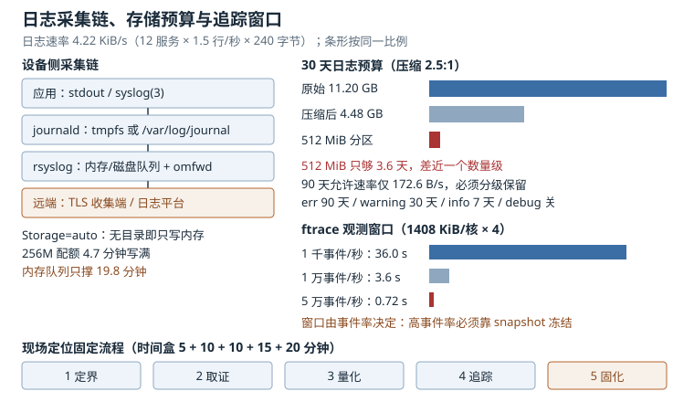

# 日志与可观测性：journald、远程上报与现场定位流程

设备出了问题，工程师能拿到的只有三样东西：它留下的日志、它当时的指标、以及它做过什么事的追踪。三样都缺，剩下的只有猜。嵌入式设备比服务器更依赖这三样，因为它没有带外管理、没有随时可登的 SSH、断电就是常态，而且 flash 的写入寿命逼着你不能什么都记。

这一章按"采集 → 存储 → 上报 → 消费"的顺序讲清楚三件事：日志怎么在本地不丢、怎么在断网时不炸、怎么在现场把问题定位到一条时间线上。所有容量都能用"速率 × 保留期 ÷ 压缩比"算出来，所有丢日志的故障都能落到某一个缓冲、某一条限速或某一次时间跳变上。

## 1. 动机：现场只有一次机会

嵌入式设备的故障有一个残酷的特点：**大多数现场不可复现，而且只发生一次**。设备重启了，内存里的东西没了；flash 分区满了，最需要的日志恰好被轮转掉了；时间被 NTP 校正跳了 8 分钟，日志顺序错乱，因果看起来是反的。这三件事任意一件发生，排查就会从"看数据"退化成"听描述"。

现场问题按"缺什么证据"可以分为四类：

| 现象 | 缺的证据 | 第一手动作 |
|---|---|---|
| 重启后 `journalctl` 一片空白 | 持久化存储 | 确认 `Storage` 与 `/var/log/journal` 是否存在 |
| 日志只到三天前，正好缺故障那一刻 | 保留期与轮转 | 算存储预算，调整 `SystemMaxUse` 与分级 |
| 断网恢复后平台缺了几个小时的日志 | 上报队列 | 看 rsyslog 队列类型与 `queue.size` |
| 日志里有 token、手机号，合规打回 | 脱敏 | 在采集端做字段白名单与假名化 |

四类问题对应四个不同的配置面，混在一起调只会互相打架。

::: motivation 一次重启，三份日志，零个现场
某车载终端在高速上偶发重启，回传平台只收到一条"设备上线"。团队远程登上去看：

```bash
journalctl -b | tail -50
# -- No entries --
journalctl --list-boots
#  0 8f3c... Thu 2024-05-16 09:12:03 CST—Thu 2024-05-16 09:12:03 CST
```

只有一次 boot，而且只有 0 秒。查配置发现 `journald.conf` 里 `Storage=auto`，而镜像里根本没有 `/var/log/journal` 目录——journald 判定"系统没有持久化日志目录"，于是只往 `/run`（tmpfs）写，重启即失。同一台设备上 rsyslog 倒是配了，但 `omfwd` 用的是内存队列，断网 20 分钟后队列溢出，恰好把重启前那一段丢了。

三处修补：建 `/var/log/journal` 并设 `Storage=persistent`；给 rsyslog 配磁盘辅助队列；打开内核 `pstore`/`ramoops`，把最后一次 panic 的 dmesg 留在保留内存里。三周后同一个故障再出现，拿到的证据是：重启前 4 秒内核报了 `mmc0: card stuck`，重启前 1 秒 `watchdog: BUG: soft lockup`。

**不是问题变简单了，是终于有证据了。**
:::

## 2. 直观：四条采集链与三个时间轴



图的左侧是设备侧的四段采集链，右上是用 30 天预算把"原始量、压缩后、分区容量"画在同一坐标上的对比，右下是 ftrace 环形缓冲在不同事件率下能留下多久的现场，底部是现场定位的固定五步。

### 2.1 日志的两种形态

**syslog 形态**是半结构化的文本行，一行一条，前缀是"时间 主机 标识[PID]: 消息"，严重级别用 0 到 7 表示：

| 级别 | 名称 | 典型用途 | 是否该进持久日志 |
|---|---|---|---|
| 0 | emerg | 系统不可用 | 是 |
| 1 | alert | 必须立即处理 | 是 |
| 2 | crit | 关键条件 | 是 |
| 3 | err | 错误 | 是 |
| 4 | warning | 警告 | 是 |
| 5 | notice | 正常但重要 | 视情况 |
| 6 | info | 信息 | 默认不长期保留 |
| 7 | debug | 调试 | 只在排障时临时打开 |

**journald 形态**是二进制加索引，每条记录带一组可信字段：`_PID`、`_UID`、`_SYSTEMD_UNIT`、`_BOOT_ID`、`PRIORITY`、`SYSLOG_IDENTIFIER`、`MESSAGE`，以及调用方自己加的 `KEY=value`。二进制的价值不在"省空间"，而在**字段可索引**：可以按 `_BOOT_ID` 精确取"上一次启动"，按 `PRIORITY` 过滤，按 `_SYSTEMD_UNIT` 聚合，而纯文本只能靠正则扫。

代价是 journal 文件不能直接用 `grep` 读，必须走 `journalctl`。这在救援场景下是负担：系统起不来时，你只有 busybox 和一个只读的 squashfs，`journalctl` 可能都不在。所以工程上常见的做法是**两份都留**：journald 负责结构化与按启动查询，rsyslog 负责把文本落到一个"任何工具都能读"的地方，或者直接上报。

### 2.2 journald 的写入路径与持久化开关

journald 的落盘位置由 `Storage=` 决定：

- `volatile`：只写 `/run/log/journal`，位于 tmpfs，重启即失；
- `persistent`：写 `/var/log/journal`，目录必须存在且属主为 `root:systemd-journal`、权限 `2755`；
- `auto`（默认）：目录存在就持久化，不存在就只写内存；
- `none`：全丢，只做转发。

`auto` 是嵌入式上最常见的坑：**镜像里没有 `/var/log/journal`，于是"默认持久化"从来没有生效过**。要持久化，必须显式建目录或显式设 `Storage=persistent`。

journal 文件是追加写的，单个文件达到上限就换新文件，旧文件按 `SystemMaxUse` 的总配额淘汰。默认配额是"所在文件系统容量的 10%、上限 4 GiB"，同时保留至少 15% 的空闲（`SystemKeepFree`）。单文件上限默认是总配额的 1/8。写入不是每条都 `fsync`，而是按 `SyncIntervalSec`（默认 5 分钟）批量同步——**这意味着掉电仍可能丢最后几分钟的日志**，这是性能与可靠性的显式交换。

### 2.3 rsyslog 与远程上报

journald 只解决"本地"，跨设备聚合要靠 rsyslog。典型链路是：

1. `imjournal` 从 journal 读（保留结构化字段），或 `imuxsock` 从 `/dev/log` 读；
2. 规则集做过滤、限速、脱敏；
3. `omfwd` 用 TCP 或 TLS 转发，或 `omrelp` 用 RELP（可靠事件日志协议，带应用层确认）；
4. action 自带队列，断网时先缓冲，恢复后重发。

关键在队列。rsyslog 的 action 队列有两种：纯内存队列（`queue.type="LinkedList"`）和磁盘辅助队列（加 `queue.filename` 与 `queue.saveOnShutdown="on"`）。内存队列在断网时能撑多久，完全由"队列条数 × 单条大小 ÷ 日志速率"决定；一旦溢出，rsyslog 默认丢**新**消息（可配 `queue.dropMsgWhenFull`），于是断网期间最关键的现场反而最先丢。

### 2.4 指标：/proc、cgroup 与 node_exporter

指标解决"日志说不清的量"。三类来源各有分工：

| 来源 | 典型文件 | 能回答的问题 | 采样成本 |
|---|---|---|---|
| `/proc` | `stat`、`meminfo`、`loadavg`、`diskstats` | 整机 CPU、内存、IO 总量 | 极低，读文件即可 |
| cgroup v2 | `memory.current`、`cpu.stat`、`io.stat`、`pids.current` | 某个服务吃了多少 | 低，按层级聚合 |
| 设备节点 | `/sys/class/thermal/`、`/sys/class/power_supply/` | 温度、电压、电池 | 低 |

Prometheus 的模型是**拉取（pull）**：服务端按固定间隔来抓 `/metrics`，而不是设备主动推。这对嵌入式的含义是：设备只需要暴露一个 HTTP 端点，采集频率、保留期、聚合规则都在服务端控制；代价是设备必须能被服务端访问到，NAT 后面的设备需要一层网关或 pushgateway。

`node_exporter` 是标准的"把上面三类来源翻译成 Prometheus 文本格式"的进程，单机常驻内存约 10 到 20 MiB，CPU 占用在 0.1% 到 0.3% 量级。它支持 textfile collector：业务自己把指标写成 `*.prom` 文件放到一个目录，exporter 每次抓取时读进来，**业务进程不需要嵌 Prometheus 客户端库**——这在资源紧张的设备上很实用。

### 2.5 追踪：ftrace 与 perf 的分工

日志是"发生了什么"，指标是"整体多忙"，追踪是"时间花在哪一行"。嵌入式的追踪工具主要是两个：

- **ftrace**：内核内置，通过 tracefs 控制。可以按函数（`function` tracer）、按事件（tracepoint、kprobe）、按延迟（`irqsoff`、`preemptoff`）采集。它的缓冲是**每 CPU 一个环形缓冲**，写满覆盖最旧的记录，所以它天然是"最近 N 秒的现场"。开销低，适合长时间挂着的场景。
- **perf**：基于 PMU 的采样，能给出"哪个函数占了多少 CPU"的统计画像，也能记录调用链。开销比 ftrace 高，数据量大，适合短时间、定向的性能分析。

两者的选择可以用一句话概括：**要知道"刚刚发生了什么"用 ftrace，要知道"时间花在哪"用 perf**。前者是示波器，后者是火焰图的原料。

### 2.6 三个时间轴必须对齐

日志、指标、追踪来自三个不同的时钟，对不齐就没有因果：

- **CLOCK_REALTIME**：墙上时间，会被 NTP 前后跳变。日志时间戳用它，所以校正瞬间会出现"时间倒流"。
- **CLOCK_MONOTONIC**：开机以来的单调时间，不受 NTP 影响。`dmesg`、ftrace 的 `mono` 时钟用它，适合算间隔。
- **_BOOT_ID**：每次启动唯一。跨重启对齐必须靠它，而不是靠时间戳。

工程做法：日志里同时记 `_BOOT_ID` 与 monotonic 时间戳（journald 默认就带 `__MONOTONIC_TIMESTAMP`），分析时先按 boot 分组，再在 boot 内按 monotonic 排序。**跨重启的因果只能靠 boot 顺序，不能靠墙上时间。**

## 3. 定量：存储预算、限速与缓冲

### 3.1 日志存储预算

日志占用的空间由三个量决定：

$$C_{log}=R\times T$$

$R$ 是日志速率（字节/秒），$T$ 是保留期（秒）。journald 会压缩，实际落盘是

$$C_{disk}=\frac{R\times T}{\rho_{comp}}$$

$\rho_{comp}$ 是压缩比，文本日志用 zstd 或 LZ4 时通常在 2.5 到 3.5 之间。反过来，给定分区容量和保留期，能承受的平均速率是

$$R_{allow}=\frac{C_{disk}\times\rho_{comp}}{T}$$

这个式子是所有日志配置的出发点：**先算允许速率，再决定记什么级别**，而不是先打开 `debug` 再发现盘满了。

### 3.2 journald 的限速

journald 对每个服务有独立的限速：`RateLimitIntervalSec`（默认 30 秒）内最多 `RateLimitBurst` 条（默认 10000）。超出的消息被丢弃，并记一条"suppressed"提示。允许的持续速率是

$$r_{max}=\frac{N_{burst}}{T_{interval}}$$

$N_{burst}=10000$、$T_{interval}=30$ 秒时是 333 条/秒。单条 240 字节，折合 78 KiB/s。一个服务进入崩溃循环、每秒打 333 行错误，一天就能写 6.9 GB——**限速不是防单条日志，是防循环**。

### 3.3 队列与断网缓冲

上报队列能撑多久，等于队列容量除以日志速率：

$$T_{buf}=\frac{N_{msg}\times s_{msg}}{R}$$

$N_{msg}$ 是队列条数，$s_{msg}$ 是单条大小。10000 条、每条 512 字节是 5.12 MB；4.22 KiB/s 的速率下能撑 19.8 分钟（约 1185 秒）。要撑过小时级断网，必须上磁盘队列，或者接受"断网期间的日志降级为只记错误"。

### 3.4 指标样本与磁盘

Prometheus 的磁盘占用由"序列数 × 抓取次数 × 每样本字节"决定：

$$N_{sample}=\frac{N_{series}\times T}{\Delta t},\qquad B_{disk}=N_{sample}\times b_{sample}$$

$N_{series}$ 是时间序列数，$\Delta t$ 是抓取间隔，$b_{sample}$ 是压缩后每样本字节数（TSDB 通常在 1 到 2 字节）。600 条序列、15 秒间隔、30 天，是 1.0368 亿个样本，按 1.5 字节算约 155.5 MB。这个量级单机可以接受，但 500 台设备集中起来就是 77.8 GB——**集中式指标的第一道设计题是保留期，不是采集器**。

### 3.5 ftrace 的观测窗口

ftrace 的每 CPU 环形缓冲大小是固定的，能留多久的现场由事件率决定：

$$T_{obs}=\frac{B_{buf}}{r_{event}\times b_{event}}$$

$B_{buf}$ 是缓冲字节数（默认每 CPU 1408 KiB），$r_{event}$ 是每秒事件数，$b_{event}$ 是单条记录字节数（原始事件约 40 字节）。4 核共 5.5 MiB；每核每秒 1 万条事件时，只能留 3.6 秒；降到每秒 1000 条，能留 36 秒。**这就是为什么 ftrace 必须配 snapshot：故障发生时冻结缓冲，而不是事后回放已经被覆盖的数据。**

### 3.6 脱敏的开销与不可逆性

脱敏（redaction）的成本很低：一条正则替换约 2 微秒，4.22 KiB/s 的日志量约 18 行/秒，总开销 36 微秒/秒，可以忽略。真正的成本是**判断哪些字段敏感**，以及**脱敏不可逆**：一旦把手机号哈希掉，后续就无法按原号码关联工单。工程做法是分级：

- 密钥、token、密码：直接删除，永不记录；
- 个人标识（手机号、IMEI、MAC、位置）：HMAC 假名化，保留可关联性但不保留原值；
- 业务参数：白名单记录，其余不落盘。

## 4. 算例：4 核网关的日志、指标与追踪预算

一台 4 核 ARM 网关，跑 12 个服务，镜像给它 512 MiB 的日志分区。目标是"故障后能查到 30 天前的那一次"。

**第一步：算现状的日志速率。** 12 个服务，平均每服务 1.5 行/秒，每行 240 字节：

$$R=12\times1.5\times240=4320\ \text{B/s}=4.22\ \text{KiB/s}$$

30 天的原始量：

$$C_{log}=4320\times86400\times30=1.12\times10^{10}\ \text{B}=11.20\ \text{GB}$$

按 2.5:1 压缩，落盘 4.48 GB。**512 MiB 的分区只够 3.6 天**，与"30 天"差近一个数量级。

**第二步：反推允许速率。** 512 MiB、2.5:1、90 天：

$$R_{allow}=\frac{512\times1024^{2}\times2.5}{90\times86400}=172.6\ \text{B/s}$$

172.6 B/s 折合每服务 0.06 行/秒，也就是**每分钟不到 4 行**。显然不可能全量保留 90 天，只能分级：`err` 及以上保留 90 天，`warning` 保留 30 天，`info` 只留 7 天，`debug` 默认关闭。分级之后，长期保留的部分只占总量的一小部分，预算立刻回得来。

**第三步：算限速能不能兜住崩溃循环。** 默认 `10000 条 / 30 秒` 给出 333 行/秒，单服务 78 KiB/s。如果 12 个服务全部进入循环：

$$12\times333\times240=936.6\ \text{KiB/s}$$

一天就是 82.86 GB。256 MiB 的 `SystemMaxUse` 在 936.6 KiB/s 下 **4.7 分钟**写满，然后开始淘汰——最老的历史日志（包括上次故障）会被挤掉。所以 `SystemMaxUse` 必须配合"按服务限速"和"按级别转发"，让循环只污染短期数据。

**第四步：算断网缓冲。** rsyslog 内存队列 10000 条、每条 512 字节：

$$T_{buf}=\frac{10000\times512}{4320}=1185\ \text{s}\approx19.8\ \text{分钟}$$

只能撑 20 分钟。换成 256 MB 磁盘队列：

$$T_{buf}=\frac{256\times10^{6}}{4320}=59\,259\ \text{s}\approx16.5\ \text{小时}$$

16.5 小时覆盖了绝大多数基站回传中断，代价是磁盘写入。**队列类型的选择本质是"愿意为断网付多少 flash 寿命"。**

**第五步：算集中上报的带宽。** 500 台设备：

$$R_{fleet}=500\times4320=2.16\ \text{MB/s}=186.62\ \text{GB/天}$$

按 4:1 压缩后仍有 46.66 GB/天。这个量级决定了后端必须做采样或分级：**不是所有设备的 `info` 都值得上传**，通常是"本地全量、上行只传 warning 及以上 + 指标"。

**第六步：算指标存储。** 每台 600 条序列、15 秒抓取、30 天：

$$N_{sample}=\frac{600\times30\times86400}{15}=1.0368\times10^{8}$$

按 1.5 字节/样本，155.5 MB。500 台是 77.8 GB；保留期缩到 7 天，降到 18.1 GB。**保留期从 30 天砍到 7 天，磁盘降 4.3 倍**，而大部分排障只需要最近 7 天。

**第七步：算 ftrace 能留多久。** 每 CPU 1408 KiB、每核 1 万事件/秒、每事件 40 字节：

$$T_{obs}=\frac{1408\times1024}{10000\times40}=3.6\ \text{s}$$

3.6 秒。一个"偶发卡顿 2 秒"的问题，靠回放是抓不到的，必须用 `snapshot`：平时只开着缓冲，触发条件（看门狗告警、业务超时）一到就冻结。把事件率降到 1000 条/秒，窗口变成 36 秒，代价是丢失细节。**追踪的设计不是"开哪个 tracer"，而是"用什么条件冻结"。**

## 5. 工程含义：配置、上报与固定流程

### 5.1 journald 的四个开关

```bash
# 建持久化目录：属主与权限不对，journald 会拒绝写入
sudo mkdir -p /var/log/journal
sudo chown root:systemd-journal /var/log/journal
sudo chmod 2755 /var/log/journal

# 用 drop-in 覆盖，不要改主配置（升级会被覆盖）
sudo mkdir -p /etc/systemd/journald.conf.d
sudo tee /etc/systemd/journald.conf.d/10-embedded.conf >/dev/null <<'EOF'
[Journal]
Storage=persistent
Compress=yes
SystemMaxUse=256M
SystemKeepFree=64M
SystemMaxFileSize=32M
MaxRetentionSec=90day
SyncIntervalSec=1min
RateLimitIntervalSec=30s
RateLimitBurst=2000
EOF

sudo systemctl restart systemd-journald
journalctl --disk-usage
```

四个数字的来历：`SystemMaxUse=256M` 是按第三步的预算给的，保证崩溃循环 4.7 分钟写满时只淘汰短期数据；`SystemMaxFileSize=32M` 是总配额的 1/8，让轮转粒度与保留策略匹配；`SyncIntervalSec=1min` 把掉电丢失窗口从默认 5 分钟压到 1 分钟，代价是每秒多几次小块写；`RateLimitBurst=2000` 比默认的 10000 更严，因为嵌入式设备的服务数少，单服务 2000 条/30 秒已经足够。

### 5.2 rsyslog 的可靠上报

```bash
sudo tee /etc/rsyslog.d/50-upstream.conf >/dev/null <<'EOF'
module(load="imjournal" StateFile="imjournal.state")

template(name="jsonLine" type="string"
  string="{\"host\":\"%hostname%\",\"ts\":\"%timereported:::date-rfc3339%\",\"sev\":%syslogseverity%,\"app\":\"%programname%\",\"msg\":%msg:::json%}\n")

action(type="omfwd"
  target="log.example.com" port="6514" protocol="tcp"
  template="jsonLine"
  StreamDriver="gtls" StreamDriverMode="1" StreamDriverAuthMode="x509/name"
  queue.type="LinkedList" queue.size="50000" queue.dequeueBatchSize="256"
  queue.filename="fwdq" queue.saveOnShutdown="on"
  action.resumeRetryCount="-1" action.resumeInterval="30")
EOF
sudo systemctl restart rsyslog
```

五个参数决定断网行为：

1. `queue.filename` 一旦出现，队列就变成磁盘辅助，断网时消息落盘而不是丢；
2. `queue.size` 是内存中的条数上限，落盘后仍受磁盘空间约束；
3. `action.resumeRetryCount="-1"` 表示无限重试，否则重试若干次后动作被禁用，后续日志全丢；
4. `action.resumeInterval="30"` 是重试间隔，太短会在断网时打满 CPU；
5. `StreamDriverAuthMode="x509/name"` 校验服务端证书主体名，避免把日志发到冒充的收集端。

### 5.3 日志级别与脱敏纪律

级别的纪律只有一条：**级别描述的是"读者该做什么"，不是"我觉得重要"**。`err` 表示需要人介入，`warning` 表示系统自己处理了但值得记录，`info` 表示正常流程的里程碑。把"用户点了按钮"打成 `err`，会让真正的 `err` 淹没在噪音里。

脱敏必须在采集端做，不能指望后端：

```bash
# 用 systemd 的 StandardOutput 把敏感字段在源头掐掉
sudo systemctl edit myapp
# [Service]
# StandardOutput=journal
# Environment=LOG_REDACT=1

# 检查最近一分钟有没有疑似凭证泄漏（排障用，不用于生产扫描）
journalctl --since "-1min" -o cat | grep -nE "(token|password|secret)=[^ ]+" | head
```

命令里的正则只用于"验证脱敏规则是否生效"，不能反向用于"提取凭证"。真正的规则应该写在应用的日志封装里：字段白名单 + 正则兜底 + HMAC 假名化，三层都过一遍才落盘。

### 5.4 指标采集

```bash
# node_exporter：只开必要 collector，textfile 目录给业务写指标
node_exporter --web.listen-address=:9100 \
  --collector.textfile.directory=/var/lib/node_exporter/textfile \
  --no-collector.wifi --no-collector.bcache

# cgroup v2 的关键文件：某服务的实时内存与 CPU
cat /sys/fs/cgroup/system.slice/myapp.service/memory.current
cat /sys/fs/cgroup/system.slice/myapp.service/cpu.stat
cat /sys/fs/cgroup/system.slice/myapp.service/io.stat

# 整机视角
awk '/^(cpu|ctxt|procs_running)/' /proc/stat
grep -E "MemAvailable|Dirty|Writeback" /proc/meminfo
```

三个口径容易混：`memory.current` 含页缓存，`memory.stat` 里的 `anon` 才是匿名内存；`cpu.stat` 的 `usage_usec` 是累计值，要两次采样做差才是占用率；`io.stat` 的字段随内核版本变化，脚本里要判空。**指标口径比指标本身更容易出错。**

### 5.5 触发式的追踪采集

```bash
# ftrace：只开关心的几个事件，缓冲调大，等触发
cd /sys/kernel/tracing
echo 0 > tracing_on
echo 8192 > buffer_size_kb
echo 1 > events/sched/sched_switch/enable
echo 1 > events/block/block_rq_issue/enable
echo mono > trace_clock
echo 1 > tracing_on

# 触发条件满足时冻结现场（例如业务超时脚本里调用）
echo 1 > snapshot
cat snapshot > /var/log/trace.frozen

# perf：短时间高采样，拿 CPU 画像
pidof myapp                       # 先取 PID，例如 1234
perf record -F 99 -g -p 1234 -- sleep 30
perf report --stdio | head -40
```

`snapshot` 是 ftrace 最有价值的功能：它把当前环形缓冲复制到独立的 snapshot 缓冲，之后继续采集也不会覆盖已冻结的现场。**没有 snapshot 的 ftrace 只是一台会遗忘的示波器。**

### 5.6 现场问题定位的固定流程

现场排障最怕"上来就试"。固定流程的价值是让不同的人在同一份证据上得出同一个结论：

1. **定界（5 分钟）**：单台还是批量？固件版本、`_BOOT_ID`、uptime、是否掉电、是否换过硬件。批量问题先查版本与配置，单台问题先查硬件与数据。
2. **取证（10 分钟）**：`journalctl -b -1 -p warning`、`dmesg`、pstore、core dump、上一次启动的指标快照。**先保存再分析**，很多证据会在下一次重启时消失。
3. **量化（10 分钟）**：把指标按同一时间轴对齐，看 CPU、内存、IO、温度有没有到拐点；看 cgroup 里哪个服务在涨。日志说"超时"，指标要回答"超时时系统在忙什么"。
4. **追踪（15 分钟）**：能复现就上 ftrace/perf 定向采；不能复现就把 snapshot 触发条件做成常驻，等下一次。
5. **固化（20 分钟）**：把假设写成可证伪的实验，改完加回归测试与告警规则；把这次用到的查询语句沉淀进 runbook。

时间盒的意义在于防止"在一个假设上耗掉半天"。**每步结束都要写下"当前最可能的三个原因"，并按可验证性排序。**

## 6. 常见坑：现象、原因与解决

::: pitfall 坑一：重启后 `journalctl` 显示 `-- No entries --`
**现象**：设备重启后查不到上一次启动的日志，`journalctl --list-boots` 只有当前一次；`/run/log/journal` 里有文件，`/var/log/journal` 不存在。

**原因**：`Storage=auto` 加上镜像里没有 `/var/log/journal` 目录。journald 认为系统不要求持久化，只写 tmpfs。也可能目录存在但属主不是 `root:systemd-journal`，写入被拒绝。

**解决**：建目录并设 `2755`、属主 `root:systemd-journal`；drop-in 里显式写 `Storage=persistent`；重启后 `journalctl --disk-usage` 应显示已用空间，`journalctl -b -1` 能列出上次启动。**验证标准是"重启后还能查到上一次"，不是"配置里有 persistent"。**
:::

::: pitfall 坑二：日志把 512 MiB 分区写满，系统进入紧急模式
**现象**：运行几天后 `/var` 使用率 100%，`systemd-journald` 报 `Failed to write entry, ignoring: No space left on device`，其他服务写配置失败。

**原因**：只设了 `Storage=persistent`，没设 `SystemMaxUse`，journald 按默认"文件系统 10%"配额吃到 4 GiB 上限；小分区上这等于没有上限。另一个来源是某个服务进入崩溃循环，每秒几百行。

**解决**：显式设 `SystemMaxUse` 与 `SystemMaxFileSize`，按 3.1 节的公式先算预算；用 `journalctl --vacuum-size=200M` 立即回收；按服务加限速或把高频日志改成采样；给 `/var` 单独分区，避免日志挤占 rootfs。
:::

::: pitfall 坑三：断网两小时后恢复，平台缺了那两小时的日志
**现象**：网络恢复后设备正常上报，但收集端那段时间是空白；设备本地 `journalctl` 里日志齐全。

**原因**：rsyslog 用了纯内存队列（或默认的 `queue.type="FixedArray"`），断网期间队列满，按默认策略丢弃新消息；恢复后只发送队列里残留的旧消息，中间一段永久缺失。

**解决**：给 action 配磁盘辅助队列（`queue.filename` + `queue.saveOnShutdown="on"`），并把 `queue.size` 调到能覆盖最长断网时间；`action.resumeRetryCount="-1"` 防止重试耗尽后动作被禁用；监控队列深度，超过 80% 时降级上报级别而不是丢消息。**断网缓冲的容量要按"最长断网时长"设计，不是按平均值。**
:::

::: pitfall 坑四：日志里出现 token，安全审计不通过
**现象**：日志平台检索到完整的 Bearer token、手机号、身份证号；这些内容来自某个 SDK 的 `debug` 日志或异常堆栈里的请求体。

**原因**：脱敏只做在应用自己的日志封装里，第三方库直接写 stdout，绕过了封装；或者异常堆栈把整个 HTTP 请求体打了出来。

**解决**：在 journald/rsyslog 侧加一层兜底正则（token、手机号、身份证、银行卡），把命中部分替换为 `***`；把第三方库的日志级别调到 `warning`；对确实需要关联的字段用 HMAC 假名化而不是明文；用 `journalctl -o json` 抽取 `MESSAGE` 做定期抽查。**兜底层不能替代源头治理，但能兜住"忘了改"的那一次。**
:::

::: pitfall 坑五：日志时间戳倒流，因果看起来是反的
**现象**：同一秒内先出现"连接失败"再出现"开始连接"；或用 `journalctl --since` 查一段故障，结果漏掉了关键行。

**原因**：设备没有 RTC 电池，上电时间是 1970 或上次关机时间，NTP 同步后时间向前跳几分钟；`journalctl --since` 用墙上时间过滤，跳变前的日志落在窗口之外。systemd 的时间跳变会让 journal 里出现"未来"的条目。

**解决**：分析时按 `_BOOT_ID` 分组、按 `__MONOTONIC_TIMESTAMP` 排序，不用墙上时间做因果推断；设备上电后先 `timedatectl set-ntp true` 再启动业务；对没有 RTC 的设备，把首次 NTP 同步前的日志单独标记。**跨重启的因果只能靠 boot 顺序。**
:::

## 7. 自测题

<details><summary>题一：12 个服务、每服务 1.5 行/秒、每行 240 字节。30 天原始日志多少？压缩 2.5:1 后多少？512 MiB 分区能存几天？</summary>

$$R=12\times1.5\times240=4320\ \text{B/s}$$

$$C_{log}=4320\times86400\times30=1.12\times10^{10}\ \text{B}=11.20\ \text{GB}$$

压缩后 $11.20/2.5=4.48$ GB。

512 MiB 分区：$512\times1024^{2}\times2.5/(4320\times86400)=3.6$ 天。

结论：30 天保留与 512 MiB 分区差近一个数量级，必须分级保留或提高压缩比。按 3.5:1 也只能到 3.2 GB/30 天，仍然放不下。
</details>

<details><summary>题二：journald 默认 `RateLimitBurst=10000`、`RateLimitIntervalSec=30`。单服务持续速率上限是多少？12 个服务同时崩溃循环，一天写多少？256 MiB 配额能撑多久？</summary>

$$r_{max}=\frac{10000}{30}=333\ \text{行/s}$$

单服务字节率 $333\times240=78$ KiB/s。

12 个服务：$12\times333\times240=936.6$ KiB/s，一天 $936.6\times1024\times86400=8.286\times10^{10}$ B $=82.86$ GB。

256 MiB 配额：$256\times1024^{2}/(12\times333\times240)=280$ 秒 $\approx4.7$ 分钟。

这说明限速的默认值只适合"单服务偶发刷屏"，不适合"多服务同时循环"。生产上要么把 burst 调小，要么加"同一条消息去重"。
</details>

<details><summary>题三：每台 600 条序列、15 秒抓取、保留 30 天，样本数多少？按 1.5 字节/样本占多少磁盘？500 台呢？保留期改 7 天呢？</summary>

$$N_{sample}=\frac{600\times30\times86400}{15}=1.0368\times10^{8}$$

磁盘 $=1.0368\times10^{8}\times1.5=1.555\times10^{8}$ B $=155.5$ MB。

500 台：$155.5\times500=77\,750$ MB $=77.8$ GB。

保留 7 天：$77.8\times7/30=18.1$ GB。

注意这是"原始样本"的估算，实际还要加索引与 WAL，通常再乘 1.2 到 1.5。设计时要按上限留余量。
</details>

<details><summary>题四：ftrace 每 CPU 缓冲 1408 KiB、每事件 40 字节、4 核。每核 1 万事件/秒能留多久？降到 1000 条/秒呢？5 万条/秒呢？这对排障意味着什么？</summary>

单核缓冲 1408 KiB $=1\,441\,792$ B。

1 万条/秒：$1\,441\,792/(10000\times40)=3.6$ 秒。

1000 条/秒：36.0 秒。

5 万条/秒：0.72 秒。

含义：高事件率下 ftrace 只能留"最近几秒"，靠事后回放抓不到持续几分钟的偶发问题；必须用 `snapshot` 在触发条件满足时冻结，或者把事件过滤到只关心的一两个，把事件率降下来。**窗口大小是设计出来的，不是默认值给的。**
</details>

<details><summary>题五：rsyslog 内存队列 10000 条、每条 512 字节，日志 4.22 KiB/s。断网能缓冲多久？换成 256 MB 磁盘队列呢？如果要撑 48 小时，队列至少多大？</summary>

内存队列：$10000\times512=5.12$ MB，$5.12\times10^{6}/4320=1185$ 秒 $\approx19.8$ 分钟。

磁盘队列 256 MB：$256\times10^{6}/4320=59\,259$ 秒 $\approx16.5$ 小时。

48 小时需要的容量：$4320\times48\times3600=7.46\times10^{8}$ B $\approx746$ MB。

结论：靠队列硬扛 48 小时不现实，正确做法是"断网时降级"——只保留 `warning` 及以上，容量需求立刻降一到两个数量级，恢复后再补传汇总指标。
</details>

## 8. 参考资料

- Linux 内核文档 `Documentation/trace/ftrace.rst`：环形缓冲、事件开关、`snapshot` 与 `trace_clock`。
- Linux 内核文档 `Documentation/trace/events.rst`：tracepoint 定义与 tracefs 结构。
- Linux 内核文档 `Documentation/admin-guide/cgroup-v2.rst`：`memory.current`、`cpu.stat`、`io.stat` 的字段语义。
- Linux 内核文档 `Documentation/filesystems/proc.rst`：`/proc/stat`、`/proc/meminfo`、`/proc/loadavg` 字段。
- Linux 内核文档 `Documentation/admin-guide/sysctl/kernel.rst`：`printk`、`dmesg_restrict` 与环形缓冲。
- Linux 内核文档 `Documentation/admin-guide/perf-security.rst`：`perf_event_paranoid` 与采样权限。
- systemd 手册 `journald.conf(5)`、`journalctl(1)`：`Storage`、`SystemMaxUse`、`RateLimitBurst`、`--vacuum-size`。
- rsyslog 文档 `rsyslog.conf(5)` 与 `omfwd`、`omrelp` 模块手册：action queue、TLS 与重试策略。
- Prometheus 文档《Configuration》与 node_exporter README：`scrape_interval`、TSDB 保留、textfile collector。
- Google SRE Book 的《Monitoring Distributed Systems》：四个黄金信号与告警设计原则。
