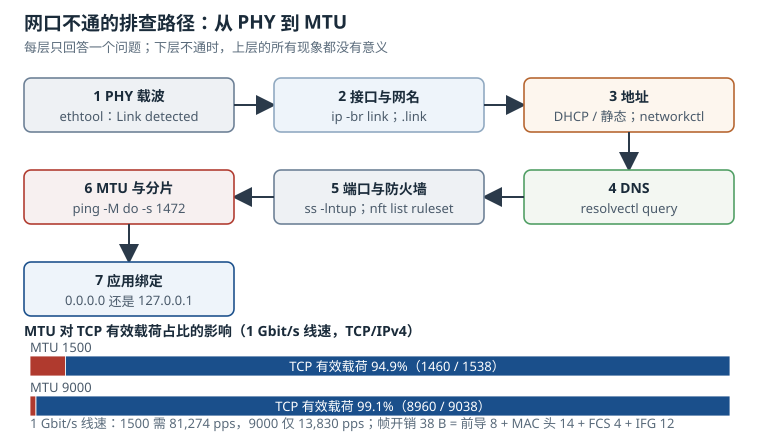

# 网络配置：接口命名、地址、防火墙与 NTP

嵌入式设备的网络问题，现场表现往往只有一句“网口不通”。但“不通”可能发生在物理层、接口命名、地址分配、路由、DNS、防火墙、MTU 或应用绑定中的任何一层。有效的排查不是把命令从头敲一遍，而是**按层建立判据，每层只回答一个问题**。

本章按“名字 → 地址 → 管理器 → 防火墙 → 时间 → 排查顺序”组织，所有吞吐、租期、漂移的数字都给出可复算的公式。

## 1. 动机：网络故障最贵的是“改错层”

一个网口不通，工程师通常会先换网线、再换交换机、再怀疑运营商。这些动作覆盖的是物理层和二层，而嵌入式设备上更常见的原因在别处：内核升级后接口名从 `eth0` 变成了 `enp3s0`，配置文件还在匹配旧名字；只读根文件系统上 `/etc/resolv.conf` 指向了一个没有启动的 stub resolver；防火墙默认拒绝，把 DHCP 回复或 ICMP 的“需要分片”报文丢了；MTU 不匹配，小包能通、大包全丢。

| 观察到的现象 | 更可能出问题的层 | 第一条命令 |
|---|---|---|
| 网口灯不亮，`ethtool` 显示 Link detected: no | 物理层/PHY | `ethtool eth0`、`ip -s link` |
| 灯亮，但没有地址 | 接口名/管理器和 DHCP | `ip addr`、`networkctl status` |
| 有地址，ping 网关不通 | 二层/VLAN/路由 | `ip route`、`ip neigh`、`bridge fdb` |
| ping IP 通，域名不通 | DNS | `resolvectl query`、`cat /etc/resolv.conf` |
| 小包通，大包卡死 | MTU/PMTU/防火墙 | `ping -M do -s 1472` |
| 时间不对，TLS 报证书未生效 | NTP/RTC | `timedatectl`、`chronyc tracking` |

::: motivation 换了三根网线，问题在 `[Match]` 里
某台壁挂式控制器升级内核后，现场反馈“网口不通”。技术支持到现场换了网线、换了交换机端口，`ethtool` 显示链路 1000 Mb/s 全双工，灯也正常，但设备就是拿不到地址。

登录串口后发现接口叫 `enp4s0`，而 `/etc/systemd/network/10-lan.network` 里写的是：

```ini
[Match]
Name=eth0
```

配置文件没有匹配到任何接口，networkd 把它当成“未管理的链路”，自然没有 DHCP。老内核上这颗 PCIe 网卡枚举在总线 3，新内核加了一个桥，枚举变成总线 4，可预测网名从 `enp3s0` 变成 `enp4s0`；`eth0` 这个名字则从来没有出现过。

修复不是把配置改成 `enp4s0`——下次硬件拓扑再变还会坏——而是用 MAC 地址匹配，并用 `.link` 文件把名字固定成 `lan0`。现场三根网线的成本，远高于写一条 `MACAddress=`。
:::

## 2. 定义与直观：从名字到时间的六层

### 2.1 可预测网名：名字是拓扑的函数

传统内核按探测顺序给网卡编号：`eth0`、`eth1`。探测顺序受驱动加载顺序、PCI 枚举顺序、设备树 probe 顺序影响，同一块板子换一个内核版本就可能对调。两块网卡对调，意味着所有写死 `eth0` 的配置、防火墙规则、应用绑定全部指向错误的接口。

systemd 的“可预测网络接口名”（Predictable Network Interface Names）用**位置或身份**生成名字，常见前缀：

| 前缀 | 含义 | 例子 |
|---|---|---|
| `eno` | 主板板载（onboard），编号来自固件 | `eno1` |
| `ens` | 热插拔槽位（slot） | `ens2` |
| `enp` | PCI 总线位置：bus/slot/function | `enp3s0f0` |
| `enx` | MAC 地址（去掉冒号） | `enx001122334455` |
| `wl` | 无线 | `wlp2s0` |
| `ww` | 蜂窝/WWAN | `wwan0` |

名字由 udev 的 `net_setup_link` builtin 在设备出现时计算，规则来自 `/usr/lib/systemd/network/*.link` 与 `/etc/systemd/network/*.link`。关键字段是 `[Link]` 段的 `NamePolicy=`，默认顺序大致是 `keep`、`kernel`、`database`、`onboard`、`slot`、`path`：先尊重已经存在的名字，再尝试固件、槽位、PCI 路径；`mac` 策略需要显式加入。

```ini
# /etc/systemd/network/10-lan.link
[Match]
MACAddress=00:11:22:33:44:55

[Link]
Name=lan0
```

这段配置把 MAC 为 `00:11:22:33:44:55` 的网卡固定命名为 `lan0`，不再受 PCI 枚举顺序影响。显式 `Name=` 的优先级高于 `NamePolicy=` 推导出的名字；如果既要固定名字又要保留内核已给的名字，才需要仔细组合 `NamePolicy=keep`。

几个边界条件：

- **接口名最长 15 个字符**（`IFNAMSIZ` 为 16，含结尾 NUL）。`enp3s0f0` 这类名字已经接近上限，自定义名字要留余量。
- **MAC 地址不一定稳定**。廉价模组可能每次上电生成随机 MAC，或者一批设备烧了同一个 MAC；这时 `enx` 名字和 MAC 匹配都会失效，只能按 PCI 路径或设备树路径匹配。
- **`net.ifnames=0` 会关闭可预测命名**，回到 `eth0`。它适合“单网口、固定拓扑”的设备，不适合多网口或可插拔网卡。
- **`.link` 只在设备出现时应用**。改完 `.link` 后要重启或重新触发 udev，不能只 `networkctl reconfigure`；后者重配的是地址，不是名字。

```bash
ip -br link
udevadm test-builtin net_setup_link /sys/class/net/enp4s0
networkctl status
```

`udevadm test-builtin` 会打印命名规则的匹配过程，是确认“为什么叫这个名字”的直接手段。

### 2.2 地址：DHCP 与静态的分工

接口名解决“对谁配置”，地址解决“配置成什么”。IPv4 地址用 CIDR 表示：`192.168.10.20/24` 中的 `/24` 表示前 24 位是网络号，后 8 位是主机号。一个 `/24` 有 $2^8=256$ 个地址，扣除网络地址和广播地址，可用主机地址 254 个。

DHCP 客户端通过 DORA 四步拿到地址：

1. **Discover**：客户端从 `0.0.0.0:68` 广播到 `255.255.255.255:67`，寻找服务器；
2. **Offer**：服务器从地址池选一个地址，连同租期、网关、DNS 一起提供；
3. **Request**：客户端广播请求该地址，告知所有服务器自己的选择；
4. **Ack**：服务器确认，客户端配置地址并开始使用。

租期 $L$ 有两个定时器：$T_1=0.5L$ 时单播续租，$T_2=0.875L$ 时广播重绑定；到期仍未续上就释放地址。这个设计让客户端在租期过半时就开始续租，避免“最后一刻才发现服务器不在了”。

静态地址适合固定设备：网关、交换机、服务器、需要被固定访问的控制器。它的缺点是地址冲突只能靠人工管理；DHCP 适合批量设备，缺点是依赖服务器，且租约、客户端标识、地址池耗尽都会引入新的故障面。

systemd-networkd 的静态配置：

```ini
# /etc/systemd/network/10-lan.network
[Match]
Name=lan0

[Network]
Address=192.168.10.20/24
Gateway=192.168.10.1
DNS=192.168.10.1
Domains=corp.example
```

DHCP 配置：

```ini
# /etc/systemd/network/20-wan.network
[Match]
Name=wan0

[Network]
DHCP=ipv4
IPv6AcceptRA=yes

[DHCPv4]
UseDNS=yes
RouteMetric=100
ClientIdentifier=mac
```

`ClientIdentifier=mac` 让租约与 MAC 绑定，而不是与 systemd 生成的 DUID 绑定；换系统、重装 rootfs 后仍能拿到同一个地址。前提是 MAC 本身稳定。`RouteMetric=` 在多网口设备上决定默认路由优先级，数值越小优先级越高。

IPv6 通常同时使用链路本地地址、路由器通告（RA）的 SLAAC 前缀和可选的 DHCPv6。`IPv6AcceptRA=yes` 让 networkd 接受 RA；如果设备不需要 IPv6，显式关闭比“让它自己决定”更可控：

```bash
sysctl -w net.ipv6.conf.all.disable_ipv6=1
```

### 2.3 两个网络管理器：networkd 与 NetworkManager 的取舍

Linux 用户空间有两个主流的网络管理器，它们不是“谁替代谁”，而是面向不同场景：

| 维度 | systemd-networkd | NetworkManager |
|---|---|---|
| 配置模型 | `/etc/systemd/network/*.network` 声明式文件 | keyfile + D-Bus API，`nmcli`/`nmtui` |
| 依赖 | systemd 基础组件，无 D-Bus 客户端也可运行 | D-Bus、polkit、更多插件 |
| 常驻内存 | 约 4–6 MiB | 约 15–25 MiB（含插件） |
| Wi-Fi/蜂窝 | 不直接管理，需要 wpa_supplicant/ModemManager 配合 | 原生集成 |
| 漫游/多连接 | 能力弱，适合固定拓扑 | 强，适合笔电、网关、移动设备 |
| 只读根 | 配置可放 `/usr/lib/systemd/network`，状态在 `/run` | 连接配置默认可写 `/etc`，需额外设计 |
| 可观测性 | `networkctl`、journal | `nmcli`、D-Bus、日志 |
| 适用 | 固定网口的嵌入式设备、容器、精简系统 | 有 Wi-Fi/4G、需要用户交互或频繁切换网络的设备 |

选择规则可以简化为三句话：

1. **固定网口、无 Wi-Fi、追求小体积和确定性 → networkd**。
2. **有 Wi-Fi/蜂窝、需要漫游、需要 D-Bus 接口给上层应用 → NetworkManager**。
3. **两者不要同时管理同一个接口**。确需混用时，用 NetworkManager 的 `unmanaged-devices` 或 networkd 的 `[Match]` 明确划分边界。

NetworkManager 的混用边界：

```ini
# /etc/NetworkManager/NetworkManager.conf
[keyfile]
unmanaged-devices=interface-name:lan0;interface-name:wan0
```

这表示 `lan0`、`wan0` 交给 networkd，NetworkManager 只管 Wi-Fi 和蜂窝。反过来，如果 NetworkManager 管全部接口，就不要同时启用 `systemd-networkd.service`，否则两边会互相覆盖地址和路由。

如果选用 NetworkManager，等价的静态地址可以用 `nmcli` 一次写入：

```bash
nmcli connection add type ethernet ifname lan0 con-name lan \
  ipv4.method manual ipv4.addresses 192.168.10.20/24 \
  ipv4.gateway 192.168.10.1 ipv4.dns 192.168.10.1
nmcli connection up lan
nmcli device status
```

连接配置默认写到 `/etc/NetworkManager/system-connections/`；只读根上要把这份配置在首次启动时写入数据分区，或使用较新版本支持的 `/usr/lib/NetworkManager/system-connections/` 只读配置源。

一个常见的误区是“networkd 更轻，所以所有设备都该用它”。如果设备有 Wi-Fi，networkd 仍然需要 `wpa_supplicant` 和额外的 `.network` 配置，漫游、扫描、企业认证都要自己拼；这时 NetworkManager 的整体复杂度反而更低。

### 2.4 防火墙：默认拒绝，按需放行

嵌入式设备的防火墙目标通常不是“挡住互联网攻击”这么宏大，而是三件具体的事：只暴露必要的服务端口、允许自己发起的连接返回、在做网关时控制转发。

Linux 上现在应优先使用 nftables。它用 table → chain → rule 的层次组织规则，chain 通过 hook 挂在 `input`、`forward`、`output` 上，policy 决定默认动作。一个最小可用的主机防火墙：

```bash
nft add table inet filter
nft add chain inet filter input '{ type filter hook input priority 0; policy drop; }'
nft add chain inet filter output '{ type filter hook output priority 0; policy drop; }'
nft add rule inet filter input iif lo accept
nft add rule inet filter output oif lo accept
nft add rule inet filter input ct state established,related accept
nft add rule inet filter output ct state established,related accept
nft add rule inet filter input ip protocol icmp accept
nft add rule inet filter input meta l4proto ipv6-icmp accept
nft add rule inet filter output ip protocol icmp accept
nft add rule inet filter output meta l4proto ipv6-icmp accept
nft add rule inet filter input udp dport 68 accept
nft add rule inet filter output udp dport 67 accept
nft add rule inet filter output udp dport 53 accept
nft add rule inet filter output tcp dport 53 accept
nft add rule inet filter output udp dport 123 accept
nft add rule inet filter input tcp dport 22 accept
nft add rule inet filter input tcp dport 443 accept
nft add rule inet filter output tcp dport 443 accept
nft list ruleset
```

逐条解释关键点：

- `ct state established,related` 让“自己发起的连接的回包”通过，不需要为每个客户端端口开洞。
- `udp dport 68` 是 DHCP 客户端接收回复；`udp dport 67` 是客户端发送请求。只开其中一个，DHCP 会半通。
- ICMP 不能全禁。IPv4 的 `fragmentation needed`（type 3 code 4）和 IPv6 的 `packet too big`（type 2）是路径 MTU 发现的基础；禁掉它们，大包会在中间设备静默丢弃。
- 默认 `drop` 的 `output` 链会挡住 NTP、DNS、HTTPS 等主动出站流量，必须逐项放行；很多“时间不同步”“云端连不上”的根因就在这里。
- 规则加载要用原子方式。逐条 `nft add` 在远程操作时，中间状态可能已经把 SSH 自己挡掉；生产上用 `nft -f ruleset.nft` 一次性加载，并准备带超时的回滚任务。

防火墙的另一个常见盲区是**转发**。设备做网关时，`input` 链只处理发给本机的包；跨网段的包走 `forward` 链。只配 `input` 会发现“本机上网正常，下游设备上不了网”。

### 2.5 时间：NTP、RTC 与“没有电池”的板子

时间看起来是小事，直到 TLS 证书报 `certificate is not yet valid`、日志时间戳全部落到 1970 年、OAuth token 因为时钟偏差被拒。嵌入式设备的时间来源通常有三层：

1. **RTC**（实时时钟芯片）：有纽扣电池时，断电后继续走；没有电池时，上电值可能是随机的或 1970。
2. **NTP**：网络可用后，从服务器同步。`chrony` 适合间歇联网、需要长期守时的设备；`systemd-timesyncd` 是轻量 SNTP 客户端，适合“能对上就行”的设备。
3. **fake-hwclock / 时间戳文件**：没有 RTC 时，启动时从文件恢复上次关机时间，再等 NTP 校正。它只能保证时间“大致向前”，不能保证准确。

NTP 客户端与服务器交换四个时间戳：$T_1$ 客户端发送、$T_2$ 服务器接收、$T_3$ 服务器发送、$T_4$ 客户端接收。偏移和往返延迟为

$$\theta = \frac{(T_2-T_1)+(T_3-T_4)}{2}$$

$$\delta = (T_4-T_1)-(T_3-T_2)$$

$\theta$ 是“服务器时间减本地时间”，为正表示本地慢了；$\delta$ 是网络往返延迟。这个估计假设去程和回程对称；不对称时，误差约为单程不对称量的一半。

chrony 的关键配置：

```ini
# /etc/chrony.conf
server ntp1.example.net iburst
server ntp2.example.net iburst
driftfile /var/lib/chrony/chrony.drift
makestep 1.0 3
rtcsync
logdir /var/log/chrony
```

- `iburst` 在启动时快速发几个包，缩短首次同步时间；
- `driftfile` 记录晶振频率偏差，下次启动可以更快收敛；
- `makestep 1.0 3` 表示前 3 次更新中，如果偏移超过 1 秒就直接步进，之后只用 slew；
- `rtcsync` 定期把系统时间写回 RTC（有 RTC 时）。

systemd-timesyncd 的配置更简单：

```ini
# /etc/systemd/timesyncd.conf
[Time]
NTP=ntp1.example.net ntp2.example.net
FallbackNTP=pool.ntp.org
```

```bash
timedatectl set-ntp true
timedatectl status
```

`timedatectl` 会显示 `System clock synchronized: yes/no`、`NTP service: active`、`RTC in local TZ: no`。最后一项应为 `no`：RTC 存 UTC，用户空间按本地时区显示；把 RTC 设成本地时间会在夏令时和跨时区时出问题。

### 2.6 排查顺序：从物理层往上，每层只回答一个问题

“网口不通”的高效排查顺序是固定的，因为下层不通时，上层的所有现象都没有意义：

1. **物理层**：网线、接头、PoE、PHY 供电、链路速率。判据是 `ethtool` 的 `Link detected: yes`、`ip -s link` 的 CRC/errors 计数。
2. **接口与驱动**：接口是否存在、名字是否匹配配置、驱动是否绑定。判据是 `ip -br link`、`dmesg | grep -i eth`、`networkctl status`。
3. **二层**：VLAN、桥、MAC 学习、双工/速率不匹配。判据是 `bridge fdb`、`ip neigh`、`ethtool -S`。
4. **地址**：DHCP 是否拿到租约、静态地址是否冲突。判据是 `ip addr`、`journalctl -u systemd-networkd`。
5. **路由**：默认网关、策略路由、多网口 metric。判据是 `ip route get 8.8.8.8`。
6. **名字解析**：`/etc/resolv.conf` 指向、DNS 服务器可达、search domain。判据是 `resolvectl query`。
7. **端口与防火墙**：服务是否监听、规则是否放行、conntrack 是否建立。判据是 `ss -lntup`、`nft list ruleset`。
8. **MTU/PMTU**：小包通、大包丢。判据是 `ping -M do -s 1472`。
9. **应用**：绑定地址是 `0.0.0.0` 还是 `127.0.0.1`、是否只监听了 IPv6、权限与 capability。

每一步都要记录“改之前是什么、改之后是什么”。同时改两个变量，会让下一次故障无法复现。



图中上半部分是按层排查的顺序，下半部分把 MTU 对有效吞吐的影响画成条形图：同样 1 Gbit/s 线速，MTU 1500 需要约 81,000 个帧/秒，MTU 9000 只需要约 13,800 个帧/秒，协议栈和中断的开销相差近 6 倍。

## 3. 定量关系：地址、帧、窗口与时间

### 3.1 子网与地址预算

对 IPv4 前缀长度 $p$（$p \le 30$），可用主机地址数为

$$N_{\mathrm{host}} = 2^{32-p} - 2$$

减 2 是去掉网络地址和广播地址。$p=24$ 时 254 个，$p=26$ 时 62 个，$p=28$ 时 14 个，$p=30$ 时 2 个。点对点链路可以用 `/31`（RFC 3021），两个地址都可用，不需要广播地址；`/32` 表示单个主机路由。

做地址规划时，除了“够不够”，还要留三类空间：网络设备与网关、DHCP 动态池、静态保留地址。一个常见的分配比例是网关与基础设施占 10%，静态保留占 20%，DHCP 池占 70%。

### 3.2 帧开销、MTU 与有效吞吐

以太网帧在线上传输时，除了载荷，还有前导码/SFD 8 字节、MAC 头 14 字节、FCS 4 字节、帧间隙 12 字节，共 38 字节。设 MTU 为 $M$（IP 层最大载荷），则一个满帧的线上长度为 $M+38$。

TCP over IPv4 的有效载荷是 $M-40$（20 字节 IP 头 + 20 字节 TCP 头），有效吞吐率为

$$\eta_{\mathrm{TCP}} = \frac{M-40}{M+38}$$

UDP over IPv4 的有效载荷是 $M-28$（20 字节 IP 头 + 8 字节 UDP 头），

$$\eta_{\mathrm{UDP}} = \frac{M-28}{M+38}$$

线速 $R_{\mathrm{line}}$ 下的帧率为

$$N_{\mathrm{pps}} = \frac{R_{\mathrm{line}}}{8(M+38)}$$

这三个式子解释了为什么 MTU 和 pps 总是绑在一起：MTU 越小，同样带宽需要的帧越多，中断、协议栈、内存分配的次数越多，CPU 占用越高。

### 3.3 带宽时延积与窗口限制

一条链路的带宽时延积（BDP）为

$$B = R \times \mathrm{RTT}$$

它表示“在途数据”的容量。TCP 的发送窗口 $W_{\mathrm{win}}$ 必须至少覆盖 BDP，才能跑满带宽；窗口受限时的吞吐为

$$R_{\mathrm{win}} = \frac{W_{\mathrm{win}}}{\mathrm{RTT}}$$

嵌入式设备的默认 socket 缓冲区往往很小，在低 RTT 局域网里看不出问题，一旦跨公网或走 4G，窗口就成了瓶颈。

### 3.4 DHCP 与 NTP 的报文预算

DHCP 租期 $L$ 的续租时刻为

$$T_1 = 0.5L,\quad T_2 = 0.875L$$

每次续租至少一来一回两个报文。续租发生在 $T_1=L/2$，所以设备每天大约产生 $2\times86400/L$ 次续租，报文数为 $4\times86400/L$。租期越短，地址变化响应越快，但服务器和网络的报文负载越高。

NTP 的漂移模型为

$$\Delta t = \epsilon T$$

$\epsilon$ 是晶振的频率偏差（ppm，$10^{-6}$），$T$ 是自由运行时间。把偏差 slew 回来所需时间为

$$T_{\mathrm{slew}} = \frac{|\theta|}{r_{\mathrm{slew}}}$$

$r_{\mathrm{slew}}$ 是允许的最大 slew 速率。Linux 内核通过 `adjtimex` 提供的频率调整范围通常在 $\pm 500\ \mathrm{ppm}$ 量级；超过这个范围的偏差，靠 slew 要等很久，启动时直接 step 更合理。

### 3.5 防火墙的 CPU 与连接表预算

规则链的 CPU 开销近似为

$$C_{\mathrm{fw}} = N_{\mathrm{rules}} \times N_{\mathrm{pps}} \times c_{\mathrm{rule}}$$

$N_{\mathrm{rules}}$ 是规则数，$N_{\mathrm{pps}}$ 是包速率，$c_{\mathrm{rule}}$ 是单条规则的平均周期数。连接跟踪表的内存为

$$M_{\mathrm{ct}} = N_{\mathrm{conn}} \times s_{\mathrm{entry}}$$

$N_{\mathrm{conn}}$ 是连接表条目数，$s_{\mathrm{entry}}$ 是单条 conntrack 记录的近似大小。嵌入式设备上，连接表被打满的表现是“新连接随机失败”，而不是“防火墙报错”；要同时监控 `nf_conntrack_count` 与 `nf_conntrack_max`。

## 4. 典型计算：从 /24 到 NTP 漂移

### 4.1 一个 /24 切给三个网段

某设备有三个网络：管理网、业务网、调试网。拿到 `192.168.10.0/24`，切成四个 `/26`：

| 子网 | 网络地址 | 可用范围 | 广播地址 | 用途 |
|---|---|---|---|---|
| 0 | 192.168.10.0/26 | .1–.62 | .63 | 管理网 |
| 1 | 192.168.10.64/26 | .65–.126 | .127 | 业务网 |
| 2 | 192.168.10.128/26 | .129–.190 | .191 | 调试网 |
| 3 | 192.168.10.192/26 | .193–.254 | .255 | 预留 |

每个子网可用地址 $2^{32-26}-2=62$ 个。管理网把 `.1` 留给网关，`.2–.9` 留给交换机、服务器等基础设施，`.10–.62` 作为 DHCP 池；业务网同样处理；调试网可以全部静态，方便现场固定访问。

验算广播地址：`192.168.10.64/26` 的主机位是 6 位，广播地址是 `192.168.10.64 + 63 = 192.168.10.127`。下一个子网从 `.128` 开始，边界不重叠。

### 4.2 100 Mbit/s 链路上的 TCP 有效吞吐

取 MTU 1500、TCP over IPv4：

$$\eta_{\mathrm{TCP}} = \frac{1500-40}{1500+38} = \frac{1460}{1538} = 0.9493$$

有效吞吐

$$100 \times 0.9493 = 94.93\ \mathrm{Mbit/s}$$

帧率

$$N_{\mathrm{pps}} = \frac{100\times10^6}{8\times1538} = 8{,}127\ \mathrm{pps}$$

如果每个帧的协议栈与中断处理平均 3 µs，CPU 占用为

$$8{,}127 \times 3\times10^{-6} = 0.0244 = 2.44\%$$

按单核 1 GHz 计算，约 24.4 M 周期/秒。

换成 MTU 9000：

$$\eta_{\mathrm{TCP}} = \frac{8960}{9038} = 0.9914$$

帧率降到

$$\frac{100\times10^6}{8\times9038} = 1{,}383\ \mathrm{pps}$$

同样 3 µs/帧，CPU 占用降到 0.41%。这就是 jumbo frame 在高吞吐设备上的价值；代价是整条路径（网卡、交换机、对端）都必须支持 9000，且任何一段回落到 1500 都会导致分片或丢包。

### 4.3 窗口限制：64 KiB 在 20 ms RTT 上只有 26 Mbit/s

100 Mbit/s、RTT 20 ms 的链路，BDP 为

$$B = 100\times10^6 \times 0.02 = 2\times10^6\ \mathrm{bit} = 250{,}000\ \mathrm{B}$$

默认窗口 64 KiB = 65,536 B，窗口受限吞吐为

$$R_{\mathrm{win}} = \frac{65{,}536}{0.02} = 3{,}276{,}800\ \mathrm{B/s} = 26.2\ \mathrm{Mbit/s}$$

只有线速的 26%。把窗口开到 256 KiB：

$$R_{\mathrm{win}} = \frac{262{,}144}{0.02} = 13{,}107{,}200\ \mathrm{B/s} = 104.9\ \mathrm{Mbit/s}$$

超过线速，实际受限于 94.93 Mbit/s。结论是：跨公网或 4G 的设备必须开启 TCP window scaling，并把 `net.core.rmem_max`/`wmem_max` 调到与 BDP 匹配的量级；局域网内 64 KiB 往往够用。

### 4.4 MTU 不匹配：从 ping 到 MSS

用 iputils 的 ping 做路径 MTU 探测：

```bash
ping -M do -s 1472 -c 3 192.168.10.1
ping -M do -s 1400 -c 3 192.168.10.1
```

`-s 1472` 加 8 字节 ICMP 头和 20 字节 IP 头正好 1500。如果 1472 全部超时、1400 正常，说明路径 MTU 小于 1500；1400 对应的实际 MTU 是 $1400+28=1428$，可以先把接口 MTU 设成 1400 留余量：

```bash
ip link set dev lan0 mtu 1400
```

如果是 VPN 场景，先算封装开销：WireGuard over IPv4 的外层是 20 字节 IP + 8 字节 UDP + 32 字节 WireGuard 头，共 60 字节，隧道 MTU 约 $1500-60=1440$；再叠加 PPPoE 的 8 字节，实际应设 1420 左右。PPPoE 本身的 MTU 是 1492，VLAN 标签占 4 字节，这些都要从 1500 里扣。

比“改 MTU”更稳的做法是 **MSS clamping**：在转发路径上把 TCP SYN 的 MSS 改成路径能承受的值，端主机不需要改配置。但 clamping 只对 TCP 有效，UDP 大包仍然要靠应用自己分片或走 QUIC 的 PMTU 发现。

### 4.5 NTP：5 ms 偏移、30 ms 延迟与 50 ppm 漂移

设四个时间戳（单位：秒）：

$$T_1=1000.000,\quad T_2=1000.010,\quad T_3=1000.011,\quad T_4=1000.031$$

偏移：

$$\theta = \frac{(0.010)+(-0.020)}{2} = -0.005\ \mathrm{s}$$

延迟：

$$\delta = 0.031 - 0.001 = 0.030\ \mathrm{s}$$

偏移为 −5 ms，表示本地时钟比服务器快 5 ms；往返 30 ms。如果去程 5 ms、回程 25 ms，不对称量 20 ms，偏移估计的误差约为 $20/2=10\ \mathrm{ms}$。这就是为什么 NTP 在不对称路由、缓冲区膨胀的链路上精度会下降。

晶振偏差 50 ppm 时，自由运行一天（86,400 s）漂移

$$\Delta t = 50\times10^{-6}\times86{,}400 = 4.32\ \mathrm{s}$$

30 天漂移 129.6 s。若用 500 ppm 的速率 slew 2 s：

$$T_{\mathrm{slew}} = \frac{2}{500\times10^{-6}} = 4{,}000\ \mathrm{s} \approx 66.7\ \mathrm{min}$$

把 129.6 s 全部 slew 回来要 72 小时。因此启动时偏移很大就应该 step，而不是慢慢追；`makestep 1.0 3` 的作用就是在前几次更新里允许步进。

### 4.6 防火墙：200 条规则、10k pps 与 3% CPU

设 200 条规则、10,000 pps、每条规则平均 15 个周期：

$$C_{\mathrm{fw}} = 200 \times 10{,}000 \times 15 = 30{,}000{,}000\ \mathrm{cycles/s}$$

在 1 GHz 单核上占 3%。如果规则涨到 2,000 条，就是 30%，这时应该用 nftables 的 set/map 做一次查找，而不是线性遍历。

连接表 10,000 条、每条约 320 B：

$$M_{\mathrm{ct}} = 10{,}000 \times 320 = 3{,}200{,}000\ \mathrm{B} \approx 3.05\ \mathrm{MiB}$$

如果是 50,000 条，约 15.3 MiB，对 128 MiB 的设备已经不可忽略。`nf_conntrack_max` 要按内存和业务连接数设置，不能沿用桌面发行版的默认值。

### 4.7 DHCP 租期：1 小时与 5 分钟的差别

1 小时租期，$T_1=1800\ \mathrm{s}$，每台设备每天续租

$$\frac{86400}{1800}=48$$

即每天 48 次。每次 2 个报文：

$$48 \times 2 = 96\ \mathrm{packets/day}$$

1,000 台设备就是 96,000 个报文/天，平均 1.11 pps。5 分钟租期，$T_1=150\ \mathrm{s}$，每天续租 576 次：

$$576 \times 2 = 1{,}152\ \mathrm{packets/day}$$

1,000 台设备就是 1,152,000 个报文/天，平均 13.3 pps。对 DHCP 服务器来说仍然不大，但租期越短，地址回收越快，适合频繁上下线的设备；固定设备用 1 小时甚至 24 小时租期更稳。

## 5. 工程含义：让网络配置可维护

### 5.1 命名与匹配的稳定性

- **不要用 `eth0` 作为唯一匹配条件**。用 MAC 或 `Path=` 匹配，或者用 `.link` 固定名字。
- **MAC 不稳定时用路径**。`[Match] Path=pci-0000:03:00.0` 比 MAC 更可靠，但换插槽会变；要结合产品结构选择。
- **把“接口名 → 物理口 → 用途”写进接线图和 provisioning 记录**。现场工程师需要知道 `lan0` 对应面板上的哪个 RJ45。
- **`udevadm test-builtin net_setup_link` 是命名问题的第一诊断命令**，它能显示规则匹配和最终名字。

### 5.2 管理器选型

| 设备形态 | 建议 | 理由 |
|---|---|---|
| 固定双网口网关，无 Wi-Fi | networkd | 配置声明式、内存小、启动快 |
| 带 Wi-Fi 的消费设备 | NetworkManager | 扫描、漫游、企业认证、D-Bus 接口 |
| 4G 路由器 | NetworkManager + ModemManager | 蜂窝状态机与连接管理复杂 |
| 容器/虚拟化宿主 | networkd | 与 systemd 集成好，依赖少 |
| 需要用户手动配网 | NetworkManager | `nmcli`/`nmtui` 和上层 GUI 支持 |

选型之后要**关闭另一个管理器对同一接口的管理**，否则地址、路由、DNS 会互相覆盖，表现为“重启后地址偶尔变”。

### 5.3 地址规划与可维护性

- 基础设施用静态地址，终端设备用 DHCP 保留（按 MAC 固定分配）；两者结合，既有确定性又不需要逐台配置。
- 管理网、业务网、调试网分 VLAN 或物理口；不要让调试口和业务口在同一广播域。
- 给每台设备留一个链路本地地址作为“最后手段”；IPv4 的 `169.254.0.0/16` 可以配置为 DHCP 失败时的回退地址（networkd 的 `LinkLocalAddressing=ipv4` 或 `avahi-autoipd`），用来直连诊断。
- DNS 至少有主备两个服务器；`/etc/resolv.conf` 的写入者只能有一个（networkd、NetworkManager、resolvconf 或手工），否则会被反复覆盖。
- 记录每个网段的网关、DHCP 池、保留地址、NTP 服务器、防火墙开放端口；这些信息应该和代码一起进版本库。

### 5.4 防火墙的生命周期

- 规则文件进版本库，用 `nft -f` 原子加载；不要在生产上逐条 `nft add`。
- 默认拒绝，显式放行；先放行管理通道，再放行业务端口，最后才收紧。
- 远程改防火墙前，先起一个“5 分钟后恢复上一版规则”的定时任务；确认新规则可用后再取消。
- 监控 `nft list ruleset` 的哈希、conntrack 使用率、被丢弃的包计数；规则漂移和连接表打满都要告警。
- 容器或 VPN 可能插入自己的链；用 `nft list ruleset` 看最终结果，不要只看自己写的那一段。

### 5.5 时间同步策略

- 有 RTC 的设备：启动先读 RTC，NTP 同步后用 `rtcsync` 写回；RTC 存 UTC。
- 无 RTC 的设备：用 `fake-hwclock` 或 `systemd-timesyncd` 的时间戳文件恢复“大致时间”，但 TLS 校验前必须等到 NTP 同步。
- 间歇联网的设备用 chrony，配置 `makestep` 和 `driftfile`；长期离线时接受漂移，联网后 step。
- 监控 `chronyc tracking` 的 offset、frequency、stratum；offset 持续增大通常意味着 NTP 被防火墙挡住或服务器不可达。
- 不要把 NTP 服务器写成域名再依赖 DNS 启动顺序；用 IP 或确保 DNS 在 NTP 之前可用。

### 5.6 现场排查清单

| 步骤 | 命令 | 判据 |
|---|---|---|
| 链路 | `ethtool lan0` | `Link detected: yes` |
| 接口 | `ip -br addr` | 名字存在、状态 UP |
| 驱动 | `dmesg` | 无 probe 失败、无 CRC 错误 |
| 地址 | `networkctl status lan0` | 有地址、租约有效 |
| 路由 | `ip route get 8.8.8.8` | 走正确的出口和网关 |
| 邻居 | `ip neigh` | 网关 MAC 可达 |
| DNS | `resolvectl query example.com` | 返回正确 IP |
| 端口 | `ss -lntup` | 服务监听在预期地址 |
| 防火墙 | `nft list ruleset` | 无意外 drop |
| MTU | `ping -M do -s 1472` | 大包可达 |

这张表按“从下往上”排列，现场按顺序执行，能在几分钟内把问题压缩到一层。

## 6. 常见坑

::: pitfall 坑一：链路灯亮、`ethtool` 正常，但设备拿不到地址
**现象**：网口灯正常，`ethtool` 显示 1000 Mb/s 全双工，`ip addr` 只有链路本地地址；`journalctl -u systemd-networkd` 没有 DHCP 日志，或者显示 `Could not find matching connection`。

**原因**：接口名与配置文件不匹配。内核升级、PCIe 拓扑变化、设备树 aliases 调整、`net.ifnames=0` 被移除，都可能让 `eth0` 变成 `enp4s0`；配置文件还在匹配旧名字。另一种情况是接口被 NetworkManager 和 networkd 同时管理，双方互相清地址。

**解决**：`ip -br link` 看真实名字；`networkctl status` 看是否 `unmanaged`；`udevadm test-builtin net_setup_link` 看命名规则；用 MAC 或 `Path=` 匹配，或用 `.link` 固定名字；用 `unmanaged-devices` 划清两个管理器的边界。
:::

::: pitfall 坑二：DHCP 拿到了地址，但 DNS 解析失败
**现象**：`ping 8.8.8.8` 通，`ping example.com` 报 `Temporary failure in name resolution`；`/etc/resolv.conf` 指向 `127.0.0.53`，但 `resolvectl status` 连不上。

**原因**：`/etc/resolv.conf` 是指向 `systemd-resolved` stub 的符号链接，但 `systemd-resolved.service` 没有启动或被裁掉；或者只读根文件系统上 `/etc/resolv.conf` 不可写，DHCP 客户端无法更新它；或者防火墙挡住了到 DNS 服务器的 53 端口。

**解决**：确认 `systemd-resolved` 是否启用；不用它就把 `/etc/resolv.conf` 改成静态 DNS 或指向 networkd 生成的 `/run/systemd/resolve/resolv.conf`；只读根上把 DNS 配置放到 `/run` 或由 provisioning 写入；用 `resolvectl query` 逐级验证，再用 `nft` 检查 53 端口。
:::

::: pitfall 坑三：小包通、大包丢，SSH 登录后卡住
**现象**：`ping` 默认 56 字节正常，`ping -s 1472` 全丢；SSH 能完成握手，但执行 `ls` 或传输文件时卡死；HTTP 小页面能开，大文件下载中断。

**原因**：路径 MTU 小于 1500，且 ICMP `fragmentation needed` 被防火墙丢弃，导致路径 MTU 发现（PMTUD）失效。TCP 握手用小包能完成，进入数据传输后大包在中间设备被静默丢弃，表现为“连接建立但不动”。

**解决**：用 `ping -M do -s 1472` 和逐级减小包长定位路径 MTU；把接口 MTU 调到实测值以下（如 1400）；在转发设备上放行 ICMP type 3 code 4 和 IPv6 type 2；对 TCP 做 MSS clamping。VPN 场景先扣掉封装开销，再留 20–40 字节余量。
:::

::: pitfall 坑四：防火墙默认拒绝后，DHCP、NTP、DNS 全部失效
**现象**：加了一条“默认 drop”的防火墙规则后，设备重启拿不到地址，时间停在 1970，域名解析失败；但 `ping` 网关是通的（如果手动配了地址）。

**原因**：只考虑了入站端口，没有放行出站 DHCP 请求（UDP 67）、NTP（UDP 123）、DNS（UDP/TCP 53）；或者 `output` 链默认 drop，连回包都被挡住。DHCP 还需要入站 UDP 68 接收 Offer/Ack。

**解决**：按“自己发起的连接 + 必要入站”逐项放行：output 67/53/123，input 68；用 `ct state established,related` 覆盖回包；先 `nft -f` 原子加载，保留串口或带外管理通道；用 `nft list ruleset` 和 `conntrack -L` 验证。
:::

::: pitfall 坑五：NTP 显示同步，但时间仍然差几分钟
**现象**：`timedatectl` 显示 `System clock synchronized: yes`，但日志时间与上级系统差几分钟；TLS 仍然偶发证书错误。

**原因**：时区配置错误（RTC 存本地时间，用户空间又按 UTC 解释）；或者 NTP 只同步了系统时钟，没有写回 RTC，重启后又回到旧时间；或者设备长期离线，NTP 从未真正同步，`synchronized` 来自上次启动的状态缓存。

**解决**：`timedatectl` 确认 `RTC in local TZ: no`；用 `chronyc tracking` 看实际 offset 和 stratum，而不是只看服务状态；配置 `rtcsync` 或 `hwclock -w` 写回 RTC；无 RTC 的设备用时间戳文件恢复并在联网后强制 step；把 NTP 服务器写成 IP，避免依赖 DNS 启动顺序。
:::

## 7. 自测题

<details><summary>题一：把 192.168.10.0/24 切成四个 /26，写出每个子网的网络地址、可用范围、广播地址；每个子网可用多少个地址？</summary>

`/26` 的主机位是 6 位，块大小 $2^6=64$，可用地址 $2^6-2=62$ 个。

| 子网 | 网络地址 | 可用范围 | 广播地址 |
|---|---|---|---|
| 0 | 192.168.10.0 | .1–.62 | .63 |
| 1 | 192.168.10.64 | .65–.126 | .127 |
| 2 | 192.168.10.128 | .129–.190 | .191 |
| 3 | 192.168.10.192 | .193–.254 | .255 |

验算：子网 1 的广播地址是 $64+63=127$，下一个子网从 128 开始，没有重叠。每个子网 62 个可用地址，四个子网共 248 个，加上 4 个网络地址和 4 个广播地址正好 256 个。

</details>

<details><summary>题二：MTU 1500 与 9000 下，1 Gbit/s 线速的 TCP 有效吞吐和帧率各是多少？为什么 jumbo frame 能省 CPU？</summary>

MTU 1500：

$$\eta=\frac{1460}{1538}=0.9493,\quad 1000\times0.9493=949.3\ \mathrm{Mbit/s}$$

$$N_{\mathrm{pps}}=\frac{10^9}{8\times1538}=81{,}274\ \mathrm{pps}$$

MTU 9000：

$$\eta=\frac{8960}{9038}=0.9914,\quad 1000\times0.9914=991.4\ \mathrm{Mbit/s}$$

$$N_{\mathrm{pps}}=\frac{10^9}{8\times9038}=13{,}830\ \mathrm{pps}$$

帧率下降 $81{,}274/13{,}830\approx5.88$ 倍。每个帧都要经历中断、DMA 描述符、协议栈分层和内存分配；帧数减少近 6 倍，同样带宽下的 CPU 开销也近似降到 1/6。代价是整条路径必须一致支持 9000，且任何一段回落到 1500 都会导致分片或丢包。

</details>

<details><summary>题三：四个 NTP 时间戳为 T1=1000.000、T2=1000.010、T3=1000.011、T4=1000.031。求偏移与延迟；若去程 5 ms、回程 25 ms，偏移误差约多少？</summary>

偏移：

$$\theta=\frac{(1000.010-1000.000)+(1000.011-1000.031)}{2}=\frac{0.010-0.020}{2}=-0.005\ \mathrm{s}$$

延迟：

$$\delta=(1000.031-1000.000)-(1000.011-1000.010)=0.031-0.001=0.030\ \mathrm{s}$$

偏移 −5 ms 表示本地时钟比服务器快 5 ms。去程 5 ms、回程 25 ms 时，路径不对称量 20 ms，NTP 假设往返对称，偏移误差约为 $20/2=10\ \mathrm{ms}$。因此在高不对称的链路上，NTP 的精度会从毫秒级退化到十毫秒级。

</details>

<details><summary>题四：现场“网口灯亮、ping 网关不通”，给出前五步排查顺序、每步的命令和判据。</summary>

1. **物理层与链路**：`ethtool lan0`，判据 `Link detected: yes`，速率/双工与对端一致；`ip -s link` 看 errors/dropped 是否增长。
2. **接口与驱动**：`ip -br link` 确认接口存在且 UP；`dmesg | grep -i lan` 确认驱动 probe 成功；`networkctl status` 确认接口被管理器接管而不是 `unmanaged`。
3. **二层**：`ip neigh` 看网关 MAC 是否可达；`bridge fdb` 看桥表；`ethtool -S` 看是否有 CRC、alignment 错误；确认 VLAN ID 与对端一致。
4. **地址与路由**：`ip addr` 确认地址和掩码；`ip route` 确认默认网关；`ip route get <网关>` 确认出口接口正确；多网口时检查 metric 和策略路由。
5. **防火墙与 MTU**：`nft list ruleset` 看 input 链是否放行 ICMP 和已建立连接；`ping -M do -s 1472` 排除 MTU；`conntrack -L` 看是否有状态。

如果五步都正常，再查 ARP 欺骗/重复 IP、交换机端口隔离、上游 ACL。每一步只改一个变量，并记录改动前后的输出。

</details>

## 8. 参考资料

- `systemd.network(5)`：`[Match]`、`[Network]`、`[Address]`、`[Route]`、`[DHCPv4]`、`[IPv6AcceptRA]` 的字段语义与配置优先级。
- `systemd.link(5)` 与 systemd.io 的 *Predictable Network Interface Names*：`NamePolicy=`、`MACAddressPolicy=`、`eno/ens/enp/enx` 的生成规则与 `.link` 文件位置。
- `NetworkManager.conf(5)`、`nm-settings(5)`、`nmcli(1)`：keyfile 格式、`unmanaged-devices`、连接与设备管理边界。
- `nft(8)` 与 nftables 官方文档 *Building ruleset*：table/chain/hook、conntrack、set/map、原子加载与 NAT。
- `chrony.conf(5)`、`chronyc(1)`：`makestep`、`rtcsync`、`driftfile`，以及 `tracking`/`sources` 的输出字段。
- `systemd-timesyncd.service(8)`、`timedatectl(1)`：SNTP 客户端配置、RTC 同步与时间状态。
- RFC 2131（DHCP）：DORA、租期、T1/T2 定时器与客户端标识；RFC 5905（NTP）：offset/delay 公式、stratum 与时钟过滤。
- Linux 内核文档 `Documentation/networking/ip-sysctl.rst`：`rp_filter`、`accept_ra`、`forwarding`、`nf_conntrack_*` 等网络栈开关。
