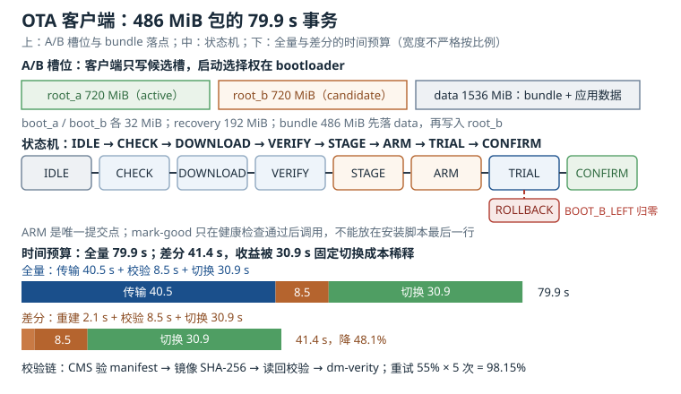

# OTA 客户端：RAUC/SWUpdate 的槽位、状态机与回滚

设备出厂后的第一次远程升级，通常会把“升级客户端”从一个脚本变成系统里最关键的组件。它要在弱网、断电、存储将满、服务器 503 的条件下，把几百 MiB 的镜像写到正确的位置，验完签名，改对启动标志，再在重启后确认新系统真的能用。任何一步少做，故障都会以“设备变砖”的形式出现在现场。

这一章讨论 OTA（Over-The-Air）客户端的工程结构，以 RAUC 与 SWUpdate 这两个主流实现为参照：槽位（slot）怎么划、状态机（state machine）怎么设、签名与校验链怎么闭合、差分怎么省流量、断电后怎么恢复、进度怎么上报、失败怎么重试，以及它和 A/B 分区、引导加载器（bootloader）的启动计数怎么配合。

## 1. 动机：升级客户端不是“下载器”

一个能用的升级客户端，至少要同时承担六类职责：

1. **传输**：从 HTTP(S)、hawkBit、私有协议或 U 盘拿到升级包；支持断点续传、限速、代理、证书校验。
2. **准入**：确认包是给这块板子的、版本号合法、包完整、签名可信、存储空间够、电量够。
3. **落盘**：把镜像写到非活动槽，处理坏块、写入错误、掉电、文件系统缓存。
4. **切换**：改启动元数据，让 bootloader 下次从新槽启动，并设置试运行次数。
5. **确认或回滚**：新系统起来后做健康检查，通过则 `mark-good`，失败则让 bootloader 回滚。
6. **可观测**：上报下载进度、安装进度、错误码、当前槽位、剩余重试次数；服务端能据此判断“这批设备升到哪了”。

手写脚本通常只做第 1 和第 3 步，然后把“改启动标志”交给一个 `fw_setenv`，把“确认”交给“安装脚本最后一行”。这类脚本在实验室里能跑通，到现场就会暴露三个结构性问题：

- **没有事务边界**：写到一半断电，脚本不知道上次写到哪，重启后可能从头发送，也可能把半个包当完整包。
- **没有准入**：错误板型的包、旧版本包、签名不匹配的包，可能被写进备用槽，直到重启才发现起不来。
- **没有确认语义**：安装脚本最后一行就 `mark-good`，等于告诉 bootloader“新系统一定没问题”，试运行和回滚形同虚设。

RAUC 与 SWUpdate 的价值，不是“帮你下载”，而是把这些职责固化成状态机、包格式和 bootloader 协议。代价是你要理解它们的槽位模型、签名链和失败语义；不理解就上线，事故只是换一种形式出现。

::: motivation 一次“安装成功”的批量变砖
某团队用自研脚本做 OTA：下载 `.img`，`dd` 到 `/dev/mmcblk0p5`，`fw_setenv boot_part 5`，重启。脚本最后打印 `upgrade ok`。

一次版本发布后，约 3% 的设备在现场重启后停在 U-Boot。排查发现，这批设备的 eMMC 有个别坏块，`dd` 写入时没有报错（写缓存尚未刷出），但重启后读到的是旧数据；bootloader 按新分区启动，内核校验失败。更糟的是，脚本在 `dd` 返回后就把 `boot_part` 改成了新分区，旧分区也被覆盖，设备没有可回退的系统。

改成 RAUC 后，同样的坏块只会让备用槽写入后的读回校验失败；RAUC 拒绝切换，设备继续从旧槽启动，并把失败原因上报。坏块仍然是坏块，但它不再等于“变砖”。
:::

这个故事的教训是：**升级的“成功”不是写入系统调用返回 0，而是新系统通过健康检查并确认**。OTA 客户端的所有设计，都应该围绕这个定义展开。

## 2. 直观：一个包、两个槽、三份状态

### 2.1 槽位：把“当前系统”和“候选系统”分开

A/B 布局把存储分成两组可启动分区：`boot_a` / `root_a` 与 `boot_b` / `root_b`。任意时刻只有一个槽是“当前启动槽”，另一个是“候选槽”。OTA 客户端只写候选槽，bootloader 决定下次从哪个槽启动。

一个 4 GiB eMMC 的布局可以写成：

| 分区 | 起始 MiB | 大小 MiB | 结束 MiB | 用途 |
|---|---|---|---|---|
| GPT 保留 | 0 | 1 | 1 | 主/备分区表 |
| bootloader | 1 | 4 | 5 | SPL + U-Boot |
| env | 5 | 1 | 6 | U-Boot 环境（双备份） |
| boot_a | 6 | 32 | 38 | 内核 + DTB + initramfs |
| boot_b | 38 | 32 | 70 | 备用槽引导 |
| root_a | 70 | 720 | 790 | 根文件系统 A |
| root_b | 790 | 720 | 1510 | 根文件系统 B |
| recovery | 1510 | 192 | 1702 | 恢复系统 |
| data | 1702 | 1536 | 3238 | 升级包、容器存储、应用数据 |
| 预留 | 3238 | 858 | 4096 | 备份 GPT、坏块、未来功能 |

求和：$1+4+1+32+32+720+720+192+1536=3{,}238$ MiB，剩余 $4{,}096-3{,}238=858$ MiB。所有起始偏移都是 1 MiB 的整数倍，对应 2,048 个 512 字节扇区。`root_a` 从 70 MiB 开始，即扇区 $70\times2{,}048=143{,}360$。

槽位不能靠 `/dev/mmcblk0p6` 这种编号识别。编号会随分区表调整、SD 卡枚举顺序、内核版本变化；正确做法是用 `PARTLABEL` 或 `PARTUUID`：

```bash
lsblk -o NAME,SIZE,PARTLABEL,PARTUUID
blkid /dev/disk/by-partlabel/root_a
```

RAUC 的 `system.conf` 和 SWUpdate 的 `sw-description` 都应该用 `/dev/disk/by-partlabel/root_a` 这类稳定路径，而不是裸设备号。这样即使分区顺序变了，升级仍然写到正确的槽。

### 2.2 槽位状态：good、bad、active、trial

“哪个槽是当前槽”只是第一层信息。一个可回滚的系统还需要记录：

- **active**：当前 bootloader 正在使用的槽。
- **good**：这个槽曾经成功启动并通过健康检查，可以再次启动。
- **bad**：这个槽启动失败或健康检查失败，不应再被选中。
- **trial / pending**：这个槽刚写入，尚未确认；bootloader 允许尝试有限次。
- **remaining attempts**：还剩几次试运行机会。

这些状态通常存在 bootloader 的环境变量里。以 U-Boot 的启动选择器（bootchooser）为例，常见变量是 `BOOT_ORDER`、`BOOT_A_LEFT`、`BOOT_B_LEFT`：

```text
BOOT_ORDER=a b
BOOT_A_LEFT=3
BOOT_B_LEFT=0
```

`BOOT_ORDER=a b` 表示优先尝试 A，再尝试 B；`BOOT_A_LEFT=3` 表示 A 还可以试 3 次。每次从 A 启动，计数减 1；健康检查通过后，用户空间调用 `mark-good` 把计数恢复到 3，并把 B 的计数清零或标记为 bad。若计数减到 0，bootchooser 跳过 A，转向 B。

RAUC 把这套交互封装成 `rauc status mark-good`；SWUpdate 通过 `bootenv` handler 或外部脚本改 U-Boot 变量。无论用哪个，**用户空间不能自己决定“当前槽”**，它只能“请求下次启动某个槽”和“确认某个槽是好的”；真正的选择权在 bootloader，因为只有 bootloader 能在内核起不来时执行回退。

### 2.3 RAUC 的包与槽位模型

RAUC 的升级包（bundle）的扩展名是 `.raucb`，本质是一个 squashfs 镜像，里面包含：

- 清单（manifest）文件 `manifest.raucm`：版本、兼容板型、每个镜像的文件名、大小、SHA-256。
- `manifest.raucm.sig`：对 manifest 的 CMS（Cryptographic Message Syntax）签名。
- 一个或多个根文件系统镜像（rootfs）与引导镜像：`rootfs.ext4`、`boot.vfat` 等。

一个简化的 manifest 如下：

```ini
[update]
compatible=my-board
version=1.4.2
description=Gateway firmware 1.4.2

[bundle]
format=verity

[image.rootfs]
filename=rootfs.ext4
sha256=6f1c0d0e8f7a9b2c3d4e5f60718293a4b5c6d7e8f90123456789abcdef012345
size=754974720

[image.boot]
filename=boot.vfat
sha256=9a8b7c6d5e4f30211203f4e5d6c7b8a9908172635445362718495061726354
size=18874368
```

`[update]` 里的 `compatible` 是板型兼容字符串，RAUC 会把它与 `system.conf` 里的 `compatible` 比较；不匹配就拒绝安装。这是防止“把 A 板的包刷到 B 板”的第一道闸。`[bundle] format=verity` 表示 bundle 使用 dm-verity 格式，读取时按块校验；不使用 verity 时，bundle 仍靠 manifest 签名和镜像 hash 保护。

`system.conf` 描述槽位与 bootloader：

```ini
[system]
compatible=my-board
bootloader=uboot
mountprefix=/run/rauc

[keyring]
path=/etc/rauc/ca.cert.pem

[slot.rootfs.0]
device=/dev/disk/by-partlabel/root_a
type=ext4
bootname=A

[slot.rootfs.1]
device=/dev/disk/by-partlabel/root_b
type=ext4
bootname=B
```

构建、检查、安装、确认：

```bash
rauc bundle --cert=dev-cert.pem --key=dev-key.pem rootfs-dir update-1.4.2.raucb
rauc info update-1.4.2.raucb
rauc install /data/update-1.4.2.raucb
rauc status --output-format=json
rauc status mark-good
```

`rauc bundle` 的输入目录里要有 `manifest.raucm` 和镜像文件；`--cert` 与 `--key` 是签名证书和私钥。`rauc info` 会显示 bundle 的版本、兼容性、签名状态和镜像 hash；`rauc install` 负责校验、写非活动槽、设置试运行；`rauc status mark-good` 必须在健康检查通过后调用。

RAUC 的强项是**槽位语义完整**：它知道 A/B 两个槽、bootchooser 的剩余次数、当前启动槽，能把“安装”和“确认”拆成两个明确动作。它的包格式也适合做离线签名和产线烧录，因为 bundle 是一个自包含的文件。

### 2.4 SWUpdate 的包与处理器（handler）模型

SWUpdate 的升级包叫 `.swu`，本质是一个 cpio 归档，里面包含：

- `sw-description`：libconfig 风格的描述文件，声明版本、硬件兼容性、镜像列表、目标设备、handler。
- `sw-description.sig`：对 `sw-description` 的签名（RSA，部分配置用 CMS）。
- 镜像文件：`rootfs.ext4.gz`、`boot.vfat` 等。
- 可选的脚本、差分补丁、配置文件。

一个简化的 `sw-description` 如下：

```text
software = {
  version = "1.4.2";
  hardware-compatibility = ["my-board"];

  stable = {
    rootfs = {
      filename = "rootfs.ext4.gz";
      device = "/dev/disk/by-partlabel/root_b";
      sha256 = "6f1c0d0e8f7a9b2c3d4e5f60718293a4b5c6d7e8f90123456789abcdef012345";
      handler = "raw";
    };

    boot = {
      filename = "boot.vfat";
      device = "/dev/disk/by-partlabel/boot_b";
      sha256 = "9a8b7c6d5e4f30211203f4e5d6c7b8a9908172635445362718495061726354";
      handler = "raw";
    };
  };
};
```

`software` 下的 `stable` 是一个“软件集合”（collection），安装时用 `-e stable` 选择；`hardware-compatibility` 防止错误板型；`handler = "raw"` 表示把镜像原样写到 `device`。其他常用 handler 包括 `bootenv`（改 U-Boot 环境）、`uboot`（写 U-Boot 环境分区）、`rdiff`（应用差分补丁）、`shellscript`（执行脚本）。

示例把目标槽写成 `root_b`，实际应由 bootloader 变量或安装脚本选择非活动槽，不能写死；否则一次错误的安装就可能覆盖当前槽。

```bash
swupdate -i /data/update-1.4.2.swu -e stable -l 4
```

SWUpdate 的强项是**handler 生态和流式安装**：它可以在下载的同时解包、解压、写盘，适合大镜像和慢网络；`sw-description` 能把“写哪个分区、用什么 handler、什么时候改 bootenv”描述得很细。代价是描述文件本身变成一段需要 review 的“安装程序”，写错一个 `device` 就可能覆盖当前槽。

### 2.5 状态机：每一步都要能回答“断电会怎样”



图中上半部分是 A/B 槽位与 bundle 的落点：客户端只写候选的 `root_b`，data 分区存放 bundle 与应用数据。中间是状态机，`ARM` 是唯一的提交点，`TRIAL` 失败后进入 `ROLLBACK`。下半部分是时间预算，全量 77.1 s、差分 41.4 s，两者都要支付 30.9 s 的固定切换成本。

一个可断电恢复的 OTA 状态机，状态要少、动作要幂等、每步的持久化要明确。下面是一个可落地的版本：

| 状态 | 动作 | 断电后的结果 |
|---|---|---|
| `IDLE` | 无任务，等待轮询 | 正常启动当前槽 |
| `CHECK` | 校验板型、版本、空间、电量、签名 | 未开始写，重试即可 |
| `DOWNLOAD` | 下载 bundle 到 data 分区的临时文件 | 临时文件不完整，下次续传或重下 |
| `VERIFY` | 验 bundle 签名与镜像 hash | 包不可信，删除临时文件 |
| `STAGE` | 把镜像写入非活动槽 | 非活动槽不完整，当前槽完好 |
| `ARM` | 写启动元数据：试运行、计数清零 | 元数据双备份，取有效者 |
| `TRIAL` | 重启进入新槽，bootcount 自增 | 计数达上限后回滚 |
| `CONFIRM` | 健康检查通过，`mark-good` | 已确认，清理旧包 |
| `ROLLBACK` | bootloader 切回旧槽，标记新槽 bad | 旧槽仍可启动 |

关键设计点有四个：

1. **`STAGE` 只写非活动槽**。当前槽保持只读或至少不被写；即使用户在升级中拔电，当前系统仍然完整。
2. **在这个状态机里，`ARM` 是唯一的“提交点”**。在 `ARM` 之前，任何失败都可以丢弃临时文件；`ARM` 之后，bootloader 才可能尝试新槽。提交点越少，状态越容易推理。
3. **`ARM` 的元数据必须双备份 + 序号 + CRC**。两块 4 KiB 记录区，先写 B 再写 A，启动时选序号最大且 CRC 正确的记录。这样在“写 A 的中途断电”时，B 仍然有效。
4. **`CONFIRM` 必须在健康检查之后**。安装成功不等于系统可用；只有业务健康检查通过，才能 `mark-good`。

`DOWNLOAD` 和 `STAGE` 可以流水线化：边下边写，减少总时间；也可以先落盘再写，减少对当前槽的 I/O 干扰。选哪种取决于网络带宽、写入带宽和 CPU 余量。流水线化的代价是“下载失败时已经写了一部分非活动槽”，需要能回退到 `IDLE` 并清理；非流水线则多占一份临时空间。两种都可以，但状态机必须明确“失败后非活动槽是否可信”。

### 2.6 签名与校验：三道闸，顺序不能错

“校验”和“签名”经常被混为一谈。它们对抗的威胁不同：

- **哈希（hash）** 对抗随机损坏：传输比特翻转、闪存坏块、写入截断。
- **签名（signature）** 对抗恶意替换：攻击者替换镜像，同时替换包里的 hash。
- **dm-verity（device-mapper verity）** 对抗运行时篡改：系统启动后 rootfs 被改写。

正确的校验顺序是：

1. **验签名**：用设备上的公钥/证书链验证 manifest（RAUC）或 `sw-description`（SWUpdate）的签名。签名不通过，后面的字段一个都不信。
2. **读 manifest**：从已验签的 manifest 里取镜像文件名、大小、SHA-256。
3. **边写边算 hash**：下载/解压镜像时计算 SHA-256，写完后与 manifest 比较；不一致就丢弃。
4. **读回校验**：对写入的块设备再读一遍，确认写入没有静默错误。读回校验可以只抽样，也可以全量；全量更稳，但时间要算进预算。
5. **运行时校验**：bootloader 把 dm-verity 的 root hash 传给内核，内核在读取 rootfs 块时校验。它保护的是“启动后”的完整性，和升级时的校验互补。

只做 hash 不做签名，攻击者可以同时改镜像和 hash；只做签名不校验镜像 hash，签名覆盖的 manifest 可能指向一个被替换的镜像；只做升级校验不做运行时校验，系统启动后仍可能被改写。**三道闸缺一不可，但它们的成本差别很大**：签名验证是毫秒级，hash 是秒级，读回是十秒级，dm-verity 是持续的块级开销。

签名格式上，RAUC 用 CMS（Cryptographic Message Syntax，RFC 5652）对 manifest 签名，证书链可以追溯到设备 keyring 里的 CA；SWUpdate 主要用 RSA 对 `sw-description` 签名，公钥在编译时嵌入，部分配置支持 CMS。两者都支持 SHA-256；Ed25519 的签名只有 64 字节，验证约 2.5 ms，但证书链和密钥管理不如 RSA 普及。

签名开销可以忽略。720 MiB 的 rootfs，SHA-256 在 240 MB/s 的 ARMv8 加密扩展上约 3.0 s；RSA-2048 验签约 0.8 ms；CMS 签名本身约 1 到 2 KiB，占 bundle 体积不到 0.001%。真正耗时的是读回校验：eMMC 读 85 MB/s，720 MiB 要 8.47 s。**不要把“签名很慢”当成不做签名的理由**，慢的是 I/O，不是密码学。

### 2.7 差分升级：省的是流量，不一定是时间

差分升级（delta update）只传新旧镜像的差异。块级差分的典型流程是：

1. 服务端按固定块大小（如 4 KiB 或 64 KiB）比较新旧镜像，找出变化的块。
2. 生成补丁：变化块的索引 + 新数据（压缩后）+ 元数据。
3. 设备端读旧槽的对应块，与补丁合并，重建新镜像，写入非活动槽。
4. 对重建后的镜像做整体 hash 校验；失败则回退全量。

差分包大小近似为

$$S_{\mathrm{delta}}\approx\frac{r\,S}{c}+m$$

其中 $S$ 是完整镜像大小，$r$ 是变化块占比，$c$ 是补丁数据压缩比，$m$ 是块索引与元数据。$r$ 越小、$c$ 越大，收益越大。系统小版本升级通常 $r=5\%$ 到 $15\%$，大版本或更换 rootfs 时 $r$ 可能超过 50%，此时差分包接近全量，应该直接回退全量。

RAUC 的 adaptive 更新（具体后端随版本变化）和 SWUpdate 的 `rdiff` 等差分 handler 都走这个思路，但实现细节不同：RAUC 通过块索引复用旧槽数据，SWUpdate 常用 librsync 的 rdiff 算法在设备上打补丁。**不要假设“用了 RAUC 就自动有差分”**；差分是否启用、基线怎么管理、补丁在哪里生成，都要在项目里明确。

差分最容易踩的坑是基线不匹配。设备上的旧槽如果被手工改过（改了配置、装了调试工具、上次升级没完成），它的 hash 就与服务端假设的基线不同；补丁可能“打得上”，但重建出的镜像不是预期的。正确做法是：升级前先校验当前槽的完整 hash，与差分包声明的基线比对；不一致就回退全量。差分不是“省流量的免费午餐”，它把“镜像版本管理”变成了硬前提。

### 2.8 进度上报与失败重试

进度上报的价值不是“让进度条好看”，而是让服务端和现场人员能判断“卡在哪”。一个可用的进度模型至少分四段：

| 阶段 | 进度区间 | 依据 | 失败语义 |
|---|---|---|---|
| 下载 | 0% 到 60% | 已接收字节 / bundle 大小 | 可续传 |
| 校验 | 60% 到 70% | 已验签/已算 hash 的镜像 | 包不可信，删除 |
| 写入 | 70% 到 95% | 已写字节 / 镜像大小 | 槽不完整，可重试 |
| 切换 | 95% 到 100% | 元数据提交、重启 | 交给 bootloader |

进度必须**单调**。不要因为“校验失败后重新下载”把进度从 70% 退回 0%，否则服务端会以为设备在反复重启。正确做法是发一个“阶段回退”事件，进度条停在当前阶段，状态改成 `retrying`。hawkBit 的部署状态、RAUC 的 `rauc status --output-format=json`、SWUpdate 的日志/状态接口都可以承载这些字段。

失败要分类，不能一律重试：

- **可重试（transient）**：连接超时、HTTP 5xx、DNS 失败、下载中断、服务器 429。用指数退避加抖动。
- **不可重试（permanent）**：签名不匹配、板型不兼容、版本被拒绝、存储空间不足、镜像 hash 不匹配、硬件写入错误。直接上报错误码，停止重试。

指数退避的常见参数是首次 2 s、倍率 2、最大 5 次：等待 2、4、8、16 s，总等待 30 s；加 0 到 20% 的随机抖动，避免一批设备同时重连把服务器打垮。重试成功率模型在下一节给出。

电源策略也属于重试逻辑：电量低于 30% 不开始写；写入过程中电量低于 15% 暂停并上报；温度超过阈值降速。这些策略要在 `CHECK` 阶段读取，而不是写到一半才发现。

### 2.9 与 A/B 分区、bootloader 的配合

OTA 客户端和 A/B 的分工可以用一句话概括：**客户端负责“把候选槽准备好”，bootloader 负责“决定从哪个槽启动”**。具体配合点有六个：

1. **只写非活动槽**。当前槽的 rootfs 不挂载可写，升级过程中业务继续从当前槽运行。
2. **用稳定的分区标识**。`PARTLABEL`/`PARTUUID`，不用 `/dev/mmcblk0pN`。
3. **提交启动元数据**。设置“下次启动候选槽”“候选槽 pending”，把 `bootcount` 清零、候选槽的剩余尝试设为 `bootlimit`；写完后 `fsync`，确保 bootloader 能读到。
4. **让 bootloader 计数**。每次从候选槽启动，bootcount 自增；达到 `bootlimit` 仍未被 `mark-good`，执行 `altbootcmd` 回滚。
5. **健康检查后确认**。`mark-good` 清计数、清 pending、把当前槽标 good；`mark-bad` 立即让 bootloader 放弃候选槽。
6. **清理旧包**。确认成功后删除旧 bundle，保留上一版用于手动回滚；不要在 `ARM` 之前删，否则回滚后没有包可重装。

一个常见的错误是“升级完成后立刻把旧槽格式化”。旧槽是最直接的回滚退路；只有新系统 `mark-good` 且稳定运行一段时间后，才能考虑复用旧槽。另一个错误是“升级时挂载当前 rootfs 为可写，顺便改配置”。这会让当前槽的 hash 与发布版本不一致，下一次差分的基线就错了；配置应该放 data 分区，而不是改 rootfs。

## 3. 定量关系：时间、流量与概率

### 3.1 升级时间

设 bundle 大小为 $S$，网络吞吐 $B_{\mathrm{net}}$，写入吞吐 $B_{\mathrm{write}}$，校验读回吞吐 $B_{\mathrm{verify}}$，切换时间为 $T_{\mathrm{switch}}$。流水线（边下边写）的总时间为

$$T_{\mathrm{up}}=\max\left(\frac{S}{B_{\mathrm{net}}},\frac{S}{B_{\mathrm{write}}}\right)+\frac{S}{B_{\mathrm{verify}}}+T_{\mathrm{switch}}$$

非流水线（先下载再写）为

$$T_{\mathrm{up}}=\frac{S}{B_{\mathrm{net}}}+\frac{S}{B_{\mathrm{write}}}+\frac{S}{B_{\mathrm{verify}}}+T_{\mathrm{switch}}$$

切换时间包括提交元数据、重启、健康检查：

$$T_{\mathrm{switch}}=T_{\mathrm{commit}}+T_{\mathrm{reboot}}+T_{\mathrm{health}}$$

这个模型解释了流水线的收益边界：**当网络是瓶颈时，流水线把“下载 + 写入”压成“下载”，省掉的是写入时间**；当写入是瓶颈时，压成“写入”，省掉的是传输时间。只有两者接近时，收益才小。对 486 MiB 的包、12 MB/s 网络、38 MB/s 写入，网络 40.5 s 大于写入 12.8 s，所以流水线省掉写入的 12.8 s，而不是把两者相加。

校验时间取决于读回吞吐，而不是 hash 计算速度：

$$T_{\mathrm{verify}}=\frac{S}{\min\left(B_{\mathrm{read}},B_{\mathrm{hash}}\right)}$$

$B_{\mathrm{hash}}=240$ MB/s、$B_{\mathrm{read}}=85$ MB/s 时，读回是瓶颈，$T_{\mathrm{verify}}=S/85$。如果 hash 在下载时同步计算，则下载阶段已经完成 hash，不需要额外时间；但读回校验仍然要做，因为它检查的是“写入是否成功”，不是“下载是否完整”。

### 3.2 差分包大小与收益

差分包大小为

$$S_{\mathrm{delta}}\approx\frac{r\,S}{c}+m$$

差分升级的总时间为

$$T_{\mathrm{delta}}=\max\left(\frac{S_{\mathrm{delta}}}{B_{\mathrm{net}}},\frac{rS}{B_{\mathrm{read}}}+\frac{rS}{B_{\mathrm{write}}}\right)+\frac{S}{B_{\mathrm{verify}}}+T_{\mathrm{switch}}$$

注意第二项：重建只需要读写“变化的块”，但**校验通常要覆盖完整镜像**，因为补丁只保证变化块正确，不能证明未变化块没有被破坏。若使用块级哈希树（类似 dm-verity），可以只校验变化块和树路径，把校验时间从 $S/B_{\mathrm{verify}}$ 降到 $S_{\mathrm{delta}}/B_{\mathrm{verify}}$；代价是镜像格式要支持哈希树，构建和签名流程更复杂。

收益定义为

$$\eta=1-\frac{T_{\mathrm{delta}}}{T_{\mathrm{full}}}$$

它小于“流量节省比例”，因为切换时间是固定的。差分把下载从 40.5 s 降到 1.7 s，但切换仍要 30.9 s；当包变小时，固定成本占比上升，收益会被稀释。

### 3.3 重试成功率与退避

设单次尝试成功的概率为 $q$，独立重试 $n$ 次，则至少成功一次的概率为

$$P_{\mathrm{success}}=1-(1-q)^{n}$$

期望尝试次数为

$$E[N]=\frac{1}{q}$$

若首次退避 $t_0$、倍率 2、最多 $n$ 次尝试，总等待时间为

$$T_{\mathrm{backoff}}=t_0\left(2^{n-1}-1\right)$$

$q=0.55$、$n=5$ 时，$P_{\mathrm{success}}=1-0.45^5=0.9815$，即 98.15%；期望尝试 1.82 次；$t_0=2$ s 时总等待 $2(2^4-1)=30$ s。这个模型假设失败独立；如果是“服务器持续 503”或“签名永久不匹配”，$q$ 不是常数，重试没有意义。**重试逻辑必须能区分这两种情况**，否则只是把故障延迟到电池耗尽。

### 3.4 数据分区预算

升级包、旧包、临时文件、日志、容器存储共享 data 分区。设分区大小 $S_{\mathrm{data}}$，保留包数 $k$，单包大小 $S$，其他占用 $S_{\mathrm{other}}$，则

$$kS+S_{\mathrm{other}}\leq S_{\mathrm{data}}$$

工程上至少保留“当前包 + 上一版包”，即 $k=2$；如果支持回滚到更早版本，$k$ 要相应增加。临时文件 `.part` 与最终包同时存在时，峰值是 $kS+S$，不是 $kS$。这个细节经常被忽略：下载时先写 `.part`，完成后 `rename`，在 `rename` 之前，磁盘上同时有旧包、新包和临时文件。

## 4. 算例：4 GiB eMMC 上的 486 MiB 升级

### 4.1 布局与容量

按 2.1 节的表，4 GiB eMMC 的分区总和为 3,238 MiB，剩余 858 MiB。两个 rootfs 各 720 MiB，两个 boot 各 32 MiB，data 1,536 MiB。这个布局的约束是：

- rootfs 720 MiB 要能放下压缩后的系统；如果实际 rootfs 超过 720 MiB，A/B 就要重新规划。
- data 1,536 MiB 要同时容纳升级包、应用数据和容器存储；升级包不能把 data 吃满。
- 预留 858 MiB 覆盖 GPT 备份、坏块和未来功能；不要把它当成“可以随便用”的空间。

### 4.2 全量升级：后台 47.1 s，总 77.1 s

bundle 486 MiB，网络 12 MB/s，写入 38 MB/s，读回 85 MB/s，提交 0.9 s，重启 22 s，健康检查 8 s。

传输：

$$T_{\mathrm{net}}=\frac{486}{12}=40.5\ \mathrm{s}$$

写入：

$$T_{\mathrm{write}}=\frac{486}{38}=12.79\ \mathrm{s}$$

读回校验：

$$T_{\mathrm{verify}}=\frac{486}{85}=5.72\ \mathrm{s}$$

切换：

$$T_{\mathrm{switch}}=0.9+22+8=30.9\ \mathrm{s}$$

流水线总时间：

$$T_{\mathrm{up}}=\max(40.5,12.79)+5.72+30.9=40.5+5.72+30.9=77.12\ \mathrm{s}$$

后台阶段（业务不停机）是 $40.5+5.72+0.9=47.12$ s；用户感知的停机主要是重启和健康检查 30 s。非流水线则多出 12.79 s 的下载后写入，总时间 $40.5+12.79+5.72+30.9=89.91$ s。

注意 hash 计算：486 MiB / 240 MB/s = 2.03 s，但它在下载过程中完成，不额外增加 2.03 s；读回校验的 5.72 s 才是额外成本。如果读回也做 hash，hash 计算 2.03 s 被 5.72 s 的读时间掩盖，实际增加仍是 5.72 s。

### 4.3 差分升级：后台 11.4 s，总 41.4 s

720 MiB 的 rootfs，变化块占比 $r=7.5\%$，压缩比 $c=2.8$，元数据 $m=1.5$ MiB：

$$S_{\mathrm{delta}}=\frac{0.075\times720}{2.8}+1.5=\frac{54}{2.8}+1.5=19.29+1.5=20.79\ \mathrm{MiB}$$

传输：

$$T_{\mathrm{net}}=\frac{20.79}{12}=1.73\ \mathrm{s}$$

重建：读旧块 $54/85=0.64$ s，写新块 $54/38=1.42$ s，合计 2.06 s；与传输取较大者 2.06 s。

完整镜像读回校验：

$$T_{\mathrm{verify}}=\frac{720}{85}=8.47\ \mathrm{s}$$

总时间：

$$T_{\mathrm{delta}}=2.06+8.47+30.9=41.43\ \mathrm{s}$$

后台阶段 $2.06+8.47+0.9=11.43$ s，相对全量 47.12 s 降低 75.75%；但总时间只从 77.12 s 降到 41.43 s，降低 46.28%。**固定切换成本 30.9 s 吃掉了大部分收益**。

如果用块级哈希树，只校验 20.79 MiB 的补丁数据：

$$T_{\mathrm{verify}}=\frac{20.79}{85}=0.24\ \mathrm{s}$$

总时间变成 $2.06+0.24+30.9=33.20$ s，相对全量降低 56.95%。这说明差分的真正瓶颈不是传输，而是“重建后的校验策略”：全量校验安全但慢，块级校验快但要求镜像格式支持哈希树。

### 4.4 重试：5 次尝试覆盖 98.15% 的瞬时失败

单次成功率 $q=0.55$，5 次尝试：

$$P_{\mathrm{success}}=1-(1-0.55)^5=1-0.45^5=1-0.01845=0.9815$$

期望尝试 $1/0.55=1.82$ 次。退避 2、4、8、16 s，总等待 30 s；加 20% 抖动，最坏 36 s。这个策略适合“弱网但服务器健康”的场景；如果服务器持续 503，$q$ 接近 0，5 次尝试只是浪费 30 s，应该直接上报 `server_unavailable`，等下一轮轮询。

### 4.5 data 分区：两个包占 63.3%

单包 486 MiB，保留当前包和上一版包：

$$2\times486=972\ \mathrm{MiB}$$

占 1,536 MiB 的 $972/1{,}536=63.28\%$。如果下载时同时存在 `.part`，峰值是 $3\times486=1{,}458$ MiB，占 94.92%，只剩 78 MiB 给应用数据和日志，风险很高。正确做法是：

- 下载前删除最旧的包，保持“当前 + 上一版 + 临时”不超过 3 份；
- `.part` 放在单独目录，完成后原子 `rename`；
- 给 data 分区留至少 10% 给应用数据和文件系统元数据；
- 监控 `df` 与 inode，空间不足时在 `CHECK` 阶段拒绝升级，而不是写到一半失败。

## 5. 工程含义：把升级做成可测试的事务

### 5.1 构建与签名流水线

一个可审计的 OTA 包，构建流水线至少要包含：

1. **可复现构建**：同一份源码、同一份配置，产出逐字节相同的镜像；否则差分基线无法稳定。
2. **镜像 hash**：对每个镜像算 SHA-256，写进 manifest；hash 在签名之前生成。
3. **manifest 签名**：用离线私钥或 HSM 签 manifest；签名私钥不进构建机。
4. **bundle 组装**：按 RAUC/SWUpdate 的格式打包；bundle 本身可以再做一次签名或 verity。
5. **兼容性检查**：板型字符串、版本号、分区大小、依赖版本；不匹配的包在构建时就拒绝。
6. **归档**：bundle、manifest、签名证书、构建日志、SBOM 一起归档，保留到产品生命周期结束。

签名私钥的管理是这条流水线里最容易被低估的部分。私钥放在构建机的 `~/.ssh` 或 CI 变量里，等于把“固件信任根”交给了任何能读构建机的人。更稳妥的做法是：私钥在 HSM 或离线签名机里，构建机只提交 manifest 的 hash，签名机返回 CMS 签名；签名机有审计日志，每次签名都记录“谁、何时、签了哪个版本”。

密钥轮换也要提前设计。设备 keyring 里可以放多张证书：旧证书用于验证旧包，新证书用于验证新包。轮换顺序是“先让新证书进入设备 keyring，再用新私钥签包，最后在下一版固件里移除旧证书”。如果设备只认一张证书，轮换那天就是所有旧设备失联的那天。

### 5.2 客户端配置：存储、网络、电源

客户端的配置项通常比算法更容易出错：

- **存储路径**：bundle 临时目录、RAUC/SWUpdate 的工作目录、日志目录都要在 data 分区，不能在只读 rootfs 上。
- **网络**：TLS CA、代理、超时、重试、限速；不要用 `--insecure` 跳过证书校验。
- **电源**：低电量阈值、写入过程的最低电量、温度阈值；升级前读电池和温度，不满足就推迟。
- **并发**：同一时间只允许一个升级任务；用文件锁或 systemd unit 的 `ConditionPathExists` 防重入。
- **清理**：确认成功后删除旧 bundle；保留上一版用于手动回滚；清理 `.part` 和日志。

一个常见的部署错误是把 OTA 客户端做成 `cron` 每分钟跑一次，没有锁。两个实例同时下载同一个包，写同一个 `.part`，最后得到一个 hash 不匹配的文件；更糟的是两个实例同时写非活动槽。用 `flock` 或 systemd 的 `ExecStart` 单实例约束，成本很低。

### 5.3 健康检查与 mark-good

`mark-good` 是整条链上最危险的一个动作：它告诉 bootloader“这个槽可信，不要再回滚”。调用得太早，回滚机制失效；调用得太晚，设备可能在“已经正常”之后又被回滚。

健康检查应该覆盖四类信号：

1. **系统层**：关键服务在跑（systemd `is-active`）、没有持续重启、`dmesg` 没有致命错误。
2. **网络层**：默认路由存在、DNS 可解析、到升级服务器的 TLS 握手成功。
3. **存储层**：data 分区可读写、剩余空间足够、文件系统没有只读挂载。
4. **业务层**：设备自检接口返回成功、关键外设（摄像头、传感器、蜂窝模组）可访问。

检查通过后，用一次性 oneshot 服务调用 `mark-good`：

```ini
[Unit]
Description=Confirm OTA slot after health check
After=network-online.target gateway.service
Wants=gateway.service

[Service]
Type=oneshot
ExecStart=/usr/bin/health-check --timeout 60
ExecStartPost=/usr/bin/rauc status mark-good
```

`health-check` 失败时退出非零，`ExecStartPost` 不会执行，bootcount 继续累加，最终由 bootloader 回滚。注意 `mark-good` 只能调用一次；重复调用通常无害，但会掩盖“健康检查被跳过”的问题。日志里要记录“哪一次启动、哪个槽、什么检查通过”，否则现场无法判断回滚是健康检查失败还是别的原因。

### 5.4 可观测性：状态、日志与指标

OTA 客户端要暴露的最小状态集：

- 当前槽、候选槽、bootcount 剩余次数；
- 当前任务 ID、阶段、进度、已传输字节、总字节；
- 最近一次错误码、错误阶段、重试次数、下次重试时间；
- bundle 版本、构建时间、签名证书指纹；
- data 分区剩余空间、inode 剩余量。

RAUC 可以用 `rauc status --output-format=json` 取槽位状态；SWUpdate 可以用日志、`/var/log/swupdate` 或 `suricatta` 的状态接口。上报到 hawkBit 时，把“下载中”“安装中”“已安装待重启”“成功”“失败”映射到部署状态，失败时带上错误码和阶段。不要只上报“失败”两个字；现场需要知道是网络、签名、空间还是硬件写失败。

### 5.5 测试：每个状态都要注入断电

OTA 的测试不能只测“升级成功”。至少要在这些点各断电 10 次：

- `DOWNLOAD` 进行到 10%、50%、99%；
- `VERIFY` 刚开始、签名通过但 hash 未完成；
- `STAGE` 写入 10%、50%、99%；
- `ARM` 写完第一块元数据、第二块之前；
- `TRIAL` 第一次启动、第二次启动；
- `CONFIRM` 刚调用 `mark-good` 之后。

每次断电后，设备都必须满足三条：能启动到某个可用系统；`rauc status` 或 `swupdate` 状态能正确显示当前槽和尝试次数；不会把不完整的包当成完整包。用可编程电源加脚本就能做，成本远低于一次现场返厂。

还要测试“非断电”的失败：错误板型、签名不匹配、版本降级、data 分区满、网络超时、服务器 503、DNS 失败、证书过期。每一种都要有明确的错误码和用户可见的提示，而不是统一落到“升级失败，请重试”。

### 5.6 RAUC 与 SWUpdate 的选型

| 维度 | RAUC | SWUpdate |
|---|---|---|
| 包格式 | squashfs `.raucb`，manifest + 镜像 | cpio `.swu`，`sw-description` + 镜像 |
| 签名 | CMS 对 manifest 签名，支持证书链 | RSA 对 `sw-description` 签名，部分配置用 CMS |
| 槽位模型 | `system.conf` 声明 slot、bootname、bootloader | `sw-description` + `bootenv`/`uboot` handler |
| bootloader | U-Boot、barebox、GRUB 的 bootchooser | U-Boot 环境、自定义脚本 |
| 差分 | adaptive 更新，依赖版本与后端 | `rdiff` 等差分 handler，librsync |
| 流式安装 | 以 bundle 为单位，verity 格式按块校验 | 支持下载同时解包/解压/写盘 |
| 服务器 | hawkBit（rauc-hawkbit-updater） | hawkBit（suricatta） |
| 强项 | 槽位语义完整、bundle 自包含、verity | handler 丰富、流式安装、更新场景灵活 |
| 弱项 | 包格式定制空间小 | `sw-description` 复杂，写错设备路径风险高 |

选型的判断顺序是：

1. **bootloader 生态**：U-Boot bootchooser 成熟、团队熟悉，RAUC 的槽位模型更省心；需要复杂的分区/脚本/handler，SWUpdate 更灵活。
2. **镜像大小与网络**：大镜像、慢网络，SWUpdate 的流式安装更有优势；小镜像、强槽位语义，RAUC 更简单。
3. **团队能力**：RAUC 的 `system.conf` 更容易 review；SWUpdate 的 `sw-description` 更强大，但需要更多测试。
4. **服务端**：两边都能接 hawkBit；如果已有 hawkBit 体系，选与现有运维更匹配的一方。

两者都不是“装完就安全”。签名密钥、分区布局、健康检查、断电测试仍然要自己做；工具只提供结构，不提供你的业务正确性。

## 6. 常见坑

::: pitfall 坑一：安装脚本最后一行就 `mark-good`
**现象**：升级后第一次启动进入新系统，运行几分钟后自动重启，之后一直停在旧版本；`rauc status` 显示新槽 “bad”，但安装日志写着“升级成功”。

**原因**：安装脚本在 `rauc install` 返回 0 后立刻调用 `mark-good`，跳过了试运行和健康检查。新系统可能有确定性的启动缺陷（某个服务起不来、网络配置错、存储挂载失败），但 bootloader 已经收到“确认”，不再回滚；看门狗复位后仍然进新系统，形成重启循环，直到人工干预。

**解决**：把 `mark-good` 从安装脚本里删掉，放到健康检查通过的 oneshot 服务里；`health-check` 覆盖系统、网络、存储、业务四类信号；安装脚本只负责“写候选槽 + ARM”，不负责“确认”。测试时故意让健康检查失败，确认 bootloader 会在 `bootlimit` 次后回滚。
:::

::: pitfall 坑二：验了 bundle 签名，却没验镜像 hash
**现象**：bundle 签名验证通过，安装也成功，但新系统启动后某个库版本不对，或者 rootfs 挂载报 hash 错误；重新下载同一个 bundle 又正常。

**原因**：安装流程只验证了 bundle/manifest 的签名，没有把 manifest 里的 `sha256` 与真正写入的镜像比对；或者下载器在解压时算 hash，但写入块设备时又做了一次转换（如解压、截断、填充），写入的内容与 hash 覆盖的内容不是同一份。另一种原因是 manifest 里的 hash 是旧镜像的，构建流水线没有更新。

**解决**：把校验链写成固定顺序：验签 → 读 manifest → 边写边算 hash → 写完后与 manifest 比对 → 读回校验。任何一步失败都丢弃候选槽，不进入 `ARM`。在 CI 里加一个“故意篡改镜像一个字节”的负向测试，确认安装会失败；不要只测正常包。
:::

::: pitfall 坑三：data 分区满了，升级包写了一半
**现象**：升级进度停在 70% 到 90% 之间，日志报 `No space left on device`；重启后设备仍从旧槽启动，但 data 分区只剩几百 KiB，应用写日志失败。

**原因**：下载前没有检查空间，或者保留了太多旧 bundle；`.part` 临时文件与最终包同时存在，峰值空间是“旧包 + 新包 + 临时文件”。另一个常见原因是日志和 core dump 把 data 吃满，升级时才发现。

**解决**：`CHECK` 阶段用 `statvfs` 检查可用空间，要求“新包大小 + 临时文件 + 10% 余量”；下载前删除最旧 bundle，保留“当前 + 上一版”；`.part` 完成后再 `rename`；日志轮转和 core dump 限额放进系统配置。空间不足时上报 `insufficient_storage`，不要重试到把分区写满。
:::

::: pitfall 坑四：差分基线不匹配，设备被刷成“四不像”
**现象**：差分升级后系统能启动，但部分文件版本不对，应用报符号未定义；重新全量升级后恢复；日志里差分应用“成功”。

**原因**：设备上的旧槽被手工改过（改配置、装调试工具、上次升级中断），或者上一次升级没有真正完成，导致旧镜像的 hash 与服务端假设的基线不同；差分包只保证“补丁能应用”，不保证“应用后得到预期镜像”。有些实现只校验补丁本身的 hash，不校验重建后的完整镜像。

**解决**：升级前校验当前槽的完整 hash，与差分包声明的基线比对；不一致就回退全量。差分重建后必须做完整镜像 hash 校验；失败则整槽重写。生产设备禁止手工修改 rootfs，配置放 data 分区；构建流水线保证同一版本镜像可复现。
:::

::: pitfall 坑五：无限重试把电池和服务器一起拖垮
**现象**：一批设备在服务器维护期间反复重连，日志里每几十秒一次 `retry`；电池电量从 80% 掉到 20%，服务器恢复后又被瞬时请求打满。

**原因**：重试逻辑没有区分瞬时失败和永久失败，也没有退避和抖动；所有设备用相同的固定间隔重试，形成“惊群”。另一种原因是客户端把“签名不匹配”也当成可重试错误，永远重试一个永远不会成功的包。

**解决**：错误分类：网络/5xx/429 可重试，签名/板型/空间/版本不可重试；可重试错误用指数退避加 0 到 20% 抖动，最多 5 次；低电量或高温时暂停；服务端返回 `Retry-After` 时优先遵守。永久失败要上报明确错误码并停止，等人工处理。
:::

## 7. 自测题

<details><summary>题一：bundle 486 MiB，网络 12 MB/s、写入 38 MB/s、读回 85 MB/s、提交 0.9 s、重启 22 s、健康检查 8 s。求流水线总时间、后台时间与非流水线总时间。</summary>

切换时间：

$$T_{\mathrm{switch}}=0.9+22+8=30.9\ \mathrm{s}$$

传输 $486/12=40.5$ s；写入 $486/38=12.79$ s；读回 $486/85=5.72$ s。

流水线：

$$T_{\mathrm{up}}=\max(40.5,12.79)+5.72+30.9=40.5+5.72+30.9=77.12\ \mathrm{s}$$

后台（业务不停机）是 $40.5+5.72+0.9=47.12$ s。

非流水线：

$$T_{\mathrm{up}}=40.5+12.79+5.72+30.9=89.91\ \mathrm{s}$$

流水线省掉 12.79 s 的“下载后再写”，因为写入被网络传输掩盖。若网络升到 50 MB/s，传输 9.72 s，写入 12.79 s 变成瓶颈，流水线总时间变为 $12.79+5.72+30.9=49.41$ s。
</details>

<details><summary>题二：720 MiB rootfs，变化块 7.5%，压缩比 2.8，元数据 1.5 MiB，网络 12 MB/s、读 85 MB/s、写 38 MB/s。求差分包大小、传输、重建、全量校验与总时间；为什么总收益远小于流量收益？</summary>

变化块：

$$0.075\times720=54\ \mathrm{MiB}$$

差分包：

$$S_{\mathrm{delta}}=\frac{54}{2.8}+1.5=19.29+1.5=20.79\ \mathrm{MiB}$$

传输 $20.79/12=1.73$ s；重建读 $54/85=0.64$ s、写 $54/38=1.42$ s，合计 2.06 s；取较大者 2.06 s。

完整校验 $720/85=8.47$ s；加切换 30.9 s：

$$T_{\mathrm{delta}}=2.06+8.47+30.9=41.43\ \mathrm{s}$$

全量是 77.12 s，总收益 $1-41.43/77.12=46.28\%$；流量从 486 MiB 降到 20.79 MiB，节省 95.72%。收益被 30.9 s 的固定切换成本稀释。

若用块级哈希树只校验 20.79 MiB，校验 0.24 s，总时间 $2.06+0.24+30.9=33.20$ s，收益 56.95%。这说明差分的瓶颈往往不是传输，而是“重建后怎么校验”。
</details>

<details><summary>题三：单次重试成功率 55%，最多 5 次，首次退避 2 s、倍率 2。求至少成功一次的概率、期望尝试次数、总退避时间；哪些错误不应重试？</summary>

$$P_{\mathrm{success}}=1-(1-0.55)^5=1-0.45^5=1-0.01845=0.9815$$

期望尝试：

$$E[N]=\frac{1}{0.55}=1.82$$

退避 2、4、8、16 s，总等待 $2+4+8+16=30$ s，即 $2(2^4-1)=30$ s。

不应重试的错误：签名不匹配、板型不兼容、镜像 hash 不匹配、版本被拒绝（降级）、存储空间不足、硬件写入错误（坏块、只读设备）。这些错误重试不会改变结果，只会延长设备不可用时间并消耗电量。网络超时、HTTP 5xx、429、DNS 失败可以重试，但要加抖动并遵守 `Retry-After`。
</details>

<details><summary>题四：4 GiB eMMC，GPT 1 MiB、bootloader 4、env 1、boot_a/b 各 32、root_a/b 各 720、recovery 192、data 1536。求总占用与剩余；两个 486 MiB 包占 data 多少？峰值三份呢？</summary>

总占用：

$$1+4+1+32+32+720+720+192+1{,}536=3{,}238\ \mathrm{MiB}$$

剩余：

$$4{,}096-3{,}238=858\ \mathrm{MiB}$$

两个包：

$$2\times486=972\ \mathrm{MiB},\qquad \frac{972}{1{,}536}=63.28\%$$

三份（旧包 + 新包 + 临时 `.part`）：

$$3\times486=1{,}458\ \mathrm{MiB},\qquad \frac{1{,}458}{1{,}536}=94.92\%$$

只剩 78 MiB 给应用数据和日志，风险很高。正确策略是下载前删除最旧包，保持“当前 + 上一版 + 临时”不超过三份，并留至少 10% 给应用数据和文件系统元数据；空间不足时在 `CHECK` 阶段拒绝升级。
</details>

<details><summary>题五：为什么“只验 bundle 签名”不够？完整的校验链应该包含哪些步骤？dm-verity 在这条链里起什么作用？</summary>

只验 bundle 签名，只能证明“这个 bundle 的 manifest 是可信的”，不能证明“manifest 指向的镜像真的被完整写入”。攻击者可以在签名之后替换镜像文件（如果签名不覆盖镜像 hash），或者利用解压/截断/填充让写入内容与 hash 覆盖内容不一致；随机损坏也不会被签名发现。

完整链条：

1. 用设备 keyring 验 manifest 的 CMS/RSA 签名，确认 manifest 可信。
2. 从 manifest 取镜像文件名、大小、SHA-256。
3. 边下载/解压边算 hash，写完后与 manifest 比对。
4. 读回块设备，确认写入没有静默错误。
5. `ARM` 提交启动元数据，bootloader 试运行。
6. 健康检查通过后 `mark-good`。
7. 运行时用 dm-verity 按块校验 rootfs，root hash 由 bootloader 通过内核命令行传入。

dm-verity 保护的是“启动后”的 rootfs 完整性：它把哈希树放在单独分区或镜像尾部，内核读每个块时校验，发现篡改就返回 I/O 错误。它不能替代升级时的签名和读回校验，因为 dm-verity 的 root hash 本身也要由可信的 bootloader 传递；三者是互补的三层，不是互相替代。
</details>

## 8. 参考资料

- RAUC 文档 `Using RAUC`、`Bundle Format`、`Adaptive Updates`：bundle 的 squashfs 结构、`manifest.raucm` 字段、CMS 签名、slot 状态、`mark-good` 与 bootchooser 的交互。
- SWUpdate 文档 `Double Copy`、`Delta Update`、`suricatta`：`.swu` 的 cpio 结构、`sw-description` 与 `sw-description.sig`、`raw`/`bootenv`/`rdiff` handler、hawkBit 轮询与状态上报。
- Linux 内核文档 `Documentation/admin-guide/device-mapper/verity.rst`：dm-verity 哈希树、root hash、块级校验与启动参数。
- Linux 内核文档 `Documentation/block/writeback_cache_control.rst`：write cache、FUA/flush 与断电一致性的关系。
- U-Boot 文档 `doc/README.bootcount`、`doc/README.distro`：`bootcount`、`bootlimit`、`altbootcmd` 与 distro boot 的启动选择。
- RFC 5652 `Cryptographic Message Syntax (CMS)`：SignedData 结构、证书链与签名属性；RFC 8032 `EdDSA`：Ed25519 签名格式与验证。
- Eclipse hawkBit 文档：软件模块、部署动作、设备状态上报与轮询模型；RAUC 的 `rauc-hawkbit-updater` 与 SWUpdate 的 `suricatta` 都实现这套接口。
- Android Open Source Project `A/B Updates`：slot metadata、`boot_control` HAL、`max_retries` 与 `slot-successful` 语义，可作为 A/B 状态机的对照实现。
