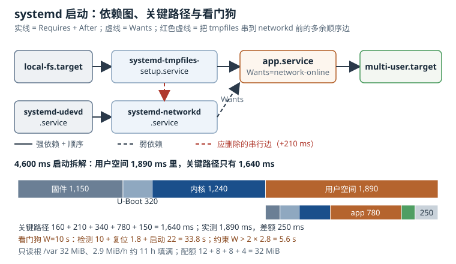

# systemd 与启动管理：unit 依赖、启动耗时与看门狗

systemd 在嵌入式设备里承担的角色，比“把进程拉起来”要多得多：它是 PID 1，是依赖关系的求解器，是失败策略的执行者，也是硬件看门狗在用户空间的最后一道接管者。理解它的模型，才能回答三个现场问题：**服务为什么起晚了、为什么死了不重启、系统卡死为什么没人复位**。

本章围绕 unit 类型与依赖、启动顺序与失败处理、启动耗时分析、只读根文件系统与看门狗集成展开。所有时间数字都给出拆解口径，所有依赖结论都能落到 `systemctl` 与 `systemd-analyze` 的输出上。

## 1. 动机：启动问题很少出在“启动脚本”里

传统的 SysV init 用一串顺序执行的脚本启动系统。它的问题是**顺序被写死**：网络脚本在前，应用脚本在后，应用就“一定”能拿到地址。到了 systemd，顺序由依赖图推导，并行度由 CPU 和依赖共同决定；这带来了更快的启动，也带来了一个新的故障类别——**图写错了，服务会在错误的时刻启动**。

嵌入式现场最常见的四类启动故障，恰好对应 systemd 的四个核心概念：

| 现象 | 根因所在 | 对应机制 |
|---|---|---|
| 应用启动时 DNS 解析失败，几秒后自行恢复 | 启动时刻早于地址就绪 | `After=`、`Wants=`、`network-online.target` |
| 进程退出后再也没起来，或每 2 秒重启一次把 CPU 打满 | 失败策略 | `Restart=`、`RestartSec=`、`StartLimitBurst=` |
| 根文件系统只读，服务报 `Read-only file system` | 写路径没有集中 | `StateDirectory=`、overlay、`tmpfiles.d` |
| 系统彻底卡死，串口无输出，设备一直不复位 | 看门狗没有真正接管 | `RuntimeWatchdogSec=`、`WatchdogSec=`、`/dev/watchdog` |

::: motivation 一次“DNS 故障”其实与 DNS 无关
某台边缘网关升级后，云端连接在开机后前 20 秒经常失败一次，之后自动恢复。现场把 DNS 服务器、上游交换机、运营商线路都换了一遍，问题依旧。抓 `journalctl -u gateway -b` 才看到：`gateway.service` 在 `systemd-networkd.service` 完成之前就启动了，第一次解析发生在 `127.0.0.53` 还没开始监听的时候；20 秒后应用的重试逻辑成功。

unit 文件里写的是 `After=network.target`。`network.target` 只是一个同步点，不表示地址已经配好、DNS 已经可用。真正表达“在线”的同步点是 `network-online.target`，而且必须有 `wait-online` 服务把它撑住。一个词的差别，让团队多花了三天。
:::

这一章不讨论如何编写业务进程，只讨论**如何把进程正确地放进启动图**，以及当它失败或系统挂死时，如何让设备回到可服务状态。

## 2. 定义与直观：unit 是声明，依赖图是程序

### 2.1 unit 的类型：PID 1 管理的资源不止“进程”

systemd 把“被管理的东西”统一抽象为 unit。每种后缀代表一种资源，常用类型如下：

| 类型 | 管理对象 | 嵌入式典型用途 |
|---|---|---|
| `.service` | 进程或一组进程 | 应用主程序、守护进程、一次性初始化 |
| `.socket` | 监听套接字 | 按连接拉起服务，减少常驻内存 |
| `.target` | 一组 unit 的同步点 | `multi-user.target`、`network-online.target` |
| `.timer` | 定时器 | 周期采集、日志轮转、延时启动 |
| `.mount` / `.automount` | 挂载点 | 数据分区、按需挂载 U 盘 |
| `.path` | 文件或目录变化 | 配置文件变更触发重载 |
| `.slice` / `.scope` | cgroup 分组 | 限制应用的内存与 CPU |
| `.device` | 内核设备 | 由 udev 生成，通常只作为依赖 |
| `.swap` | 交换分区 | 少用，flash 上通常关闭 |

一个 unit 文件由若干段组成：`[Unit]` 描述身份与依赖，`[Service]` 描述进程如何启动与停止，`[Install]` 描述 `systemctl enable` 时挂到哪个 target 下。厂商提供的 unit 放在 `/usr/lib/systemd/system/`，本地修改应通过 `/etc/systemd/system/<unit>.d/*.conf` 的 drop-in 完成，而不是直接改厂商文件——直接改会在下一次镜像升级时被覆盖，且很难在版本对比中发现。

```bash
systemctl cat telemetry-gw.service
systemctl edit telemetry-gw.service
systemctl daemon-reload
systemctl restart telemetry-gw.service
```

`systemctl edit` 会自动创建 drop-in 并调用 `daemon-reload`。`systemctl cat` 会把主文件和所有 drop-in 按顺序拼出来，是确认“最终生效配置”的最快方式。

### 2.2 依赖的两个正交维度：要不要，以及先后

这是 systemd 最容易混淆、也最值得先讲清楚的一点：**依赖关系**和**顺序关系**是两件事。

- `Requires=`、`Wants=`、`Requisite=`、`BindsTo=` 回答“要不要把它拉起来”；
- `After=`、`Before=` 回答“谁先谁后”。

两者必须配合使用。只写 `After=network-online.target` 而不写 `Wants=` 或 `Requires=`，当目标不在本次事务里时，`After=` 不会把对方拉进事务，应用可能照常启动；只写 `Wants=network-online.target` 而不写 `After=`，两者会并行启动，应用仍然可能跑在地址配置之前。

| 指令 | 强度 | 启动行为 | 停止/失败传播 |
|---|---|---|---|
| `Wants=` | 弱 | 尝试启动，失败不阻止本单元 | 不传播 |
| `Requires=` | 强 | 被依赖单元启动失败时，本单元不启动 | 被依赖单元被显式停止时，本单元停止 |
| `Requisite=` | 强且“已存在” | 被依赖单元当前未激活则立即失败，不尝试启动它 | 不传播 |
| `BindsTo=` | 最强 | 与 `Requires=` 类似 | 被绑定单元消失或失败时，本单元立即停止 |
| `PartOf=` | 单向 | 不影响启动 | 只把停止/重启传播给本单元 |
| `Upholds=` | 持续拉起 | 不建立顺序 | 被拉起单元失败后会被反复重启 |
| `Conflicts=` | 互斥 | 启动本单元会先停止对方 | 双向 |

几个容易忽略的细节：

1. **`Requires=` 不隐含 `After=`**。官方建议是“`Requires=` 与 `After=` 一起写”，否则两个单元可能同时启动，被依赖方还没就绪，依赖方已经开始执行。
2. **`Wants=` 的失败不会阻止本单元**。被 `Wants=` 拉起的单元失败，不会让本单元失败，只会让本单元多等一段启动超时；这也是“应用起来了但功能不全”的常见来源。
3. **`BindsTo=` 适合硬件或网络链路**。例如一个绑定在特定网卡上的采集服务，用 `BindsTo=` 加 `After=` 指向该网卡的 `.device`，网卡被拔出或驱动重载时服务会停止，而不是继续对不存在的接口读写。
4. **`Conflicts=` 常用于关机图**。系统默认给服务加上 `Conflicts=shutdown.target` 和 `Before=shutdown.target`，保证关机时先停服务；自己写的早期 unit 如果设了 `DefaultDependencies=no`，要记得补回这些约束。

systemd 会给服务补上一组默认依赖：`Requires=sysinit.target`、`After=sysinit.target basic.target`、`Conflicts=shutdown.target`、`Before=shutdown.target`。这解释了为什么一个“什么都没写”的服务也能在基本文件系统和 udev 之后启动。只有在写早期启动、initramfs 或需要绕开默认图的 unit 时，才使用 `DefaultDependencies=no`。

target 是这张图的骨架。典型顺序是：`sysinit.target`（文件系统、udev、tmpfiles）→ `basic.target`（基础服务、套接字、定时器）→ `multi-user.target`（业务服务、getty）→ `graphical.target`（显示）。`network.target` 是网络管理服务的同步点，不表示地址已经配好；`network-online.target` 才是“地址可用”的同步点，并且需要 `systemd-networkd-wait-online.service` 或 `NetworkManager-wait-online.service` 真正参与等待。

```bash
systemctl list-dependencies --reverse telemetry-gw.service
systemctl list-dependencies network-online.target
systemctl show -p After -p Wants -p Requires telemetry-gw.service
```

`--reverse` 回答“谁在等我”，正向回答“我在等谁”。排查启动顺序时，先看反向依赖，能找到被自己拖慢的下游。

### 2.3 事务：依赖图如何变成一组作业

systemd 不是按文件顺序执行，而是把“启动某个 target”翻译成一次**事务**（transaction）：从锚点 unit 出发，沿依赖边收集需要激活的 unit，给每个 unit 生成一个 job（start/stop/restart/reload/verify），再按 `After=`/`Before=` 做拓扑排序，能并行的并行执行。

这带来两个直接后果：

- **环会被检测出来**。`A After=B` 且 `B After=A` 时，事务无法排序，systemd 会报 `Found ordering cycle`，并尝试删除一条边来打破环；被删掉的那条边往往就是“看起来能启动，但顺序不对”的原因。
- **失败会沿依赖边传播**。一个 `Requires=` 的被依赖单元启动失败，依赖它的 job 会被取消；`Wants=` 的失败则只留下一条日志。`systemctl list-jobs` 能看到正在运行的事务，`systemctl --failed` 能看到失败单元。

`systemd-analyze verify` 可以在不改动系统的情况下静态检查 unit 语法、依赖环和明显错误：

```bash
systemd-analyze verify /etc/systemd/system/telemetry-gw.service
```

它不能替代运行时验证，但能在打包阶段拦下“拼错指令名”“引用了不存在的 unit”这类低级错误。

### 2.4 服务生命周期：Type 决定“什么时候算启动成功”

`Type=` 是服务 unit 里最容易被随手写成 `simple` 的字段，但它直接决定了 systemd 何时认为服务“已启动”，进而决定依赖它的 unit 何时继续。

| Type | 判定“启动成功”的时机 | 适用场景 | 风险 |
|---|---|---|---|
| `simple` | 进程 fork 后立即认为成功 | 前台常驻进程 | `execve` 失败也可能被当成已启动 |
| `exec` | `execve` 成功之后 | 绝大多数现代服务 | 需要较新的 systemd |
| `forking` | 父进程退出，且 `PIDFile=` 可读 | 传统自行 daemonize 的程序 | PID 文件写晚、写错会超时 |
| `oneshot` | 进程退出且退出码为 0 | 初始化脚本、一次性迁移 | 默认不重启，常配 `RemainAfterExit=` |
| `notify` | 收到 `sd_notify(READY=1)` | 需要“真正就绪”才对外服务 | 程序必须集成 sd_notify |
| `dbus` | 总线名出现 | D-Bus 服务 | 需要总线与权限 |
| `idle` | 其他 job 派发完之后 | 不希望拖慢控制台的终端服务 | 仅延迟，不改变依赖 |

`Type=notify` 与 `WatchdogSec=` 是一对：程序在初始化完成后发送 `READY=1`，之后按 `WatchdogSec` 的一半周期发送 `WATCHDOG=1`；如果看门狗周期内没有收到，systemd 会认为服务卡死，按 `Restart=` 策略处理。相比“进程还在就算活着”，这种**语义看门狗**能发现死锁、事件循环阻塞、线程池耗尽等“进程在、服务死”的状态。

失败处理的核心是三个字段：

- `Restart=`：`no`、`on-success`、`on-failure`、`on-abnormal`、`on-abort`、`on-watchdog`、`always`。`on-failure` 覆盖非零退出、信号致死、超时和看门狗超时。
- `RestartSec=`：两次重启之间的等待。设 0 会在快速崩溃时形成忙循环，通常至少 1–2 秒。
- `StartLimitIntervalSec=` / `StartLimitBurst=`：在窗口内允许的启动次数。默认约 10 秒内 5 次；超过后 unit 进入 failed，不再自动重启，需要 `systemctl reset-failed` 或人工干预。

一个可直接落地的服务 unit 示例：

```ini
[Unit]
Description=Telemetry gateway
Wants=network-online.target
After=network-online.target
StartLimitIntervalSec=60
StartLimitBurst=5

[Service]
Type=notify
ExecStart=/usr/bin/telemetry-gw --config /etc/telemetry-gw.conf
WatchdogSec=30
Restart=on-failure
RestartSec=2
StateDirectory=telemetry-gw
RuntimeDirectory=telemetry-gw
ProtectSystem=strict
ProtectHome=yes
PrivateTmp=yes
NoNewPrivileges=yes
User=telemetry
Group=telemetry

[Install]
WantedBy=multi-user.target
```

`StateDirectory=telemetry-gw` 会创建 `/var/lib/telemetry-gw` 并以可写方式 bind mount 进服务的命名空间；`RuntimeDirectory=` 对应 `/run/telemetry-gw`。这两个字段让服务在 `ProtectSystem=strict` 的只读视图里仍然有合法的写位置，是只读根文件系统设计的关键接口。

### 2.5 启动耗时：先分清“谁慢”和“谁在关键路径上”

`systemd-analyze` 是最常用的入口，但它能回答的问题有边界。典型输出：

```text
Startup finished in 1.240s (kernel) + 1.890s (userspace) = 3.130s
```

在嵌入式板上，这个 3.130 s 往往小于从上电到应用可用的真实时间，因为 U-Boot 和更早的固件阶段不在 systemd 的统计范围内。`firmware` 与 `loader` 两段只有在引导器通过 EFI 变量（如 `LoaderTimeInitUSec`、`LoaderTimeExecUSec`）把时间交给系统时才有数；U-Boot 通常不提供，所以嵌入板的这两段经常显示为 0。真实的上电到内核时间要用 GPIO 翻转、U-Boot `bootstage` 或可编程电源的电流曲线单独测。

三个常用子命令的分工：

- `systemd-analyze blame`：按 unit 的激活耗时排序。它统计的是每个 unit 自己花了多久，**不是墙钟关键路径**；并行执行的 unit 会被重复计入，所以“blame 第一名”不一定是拖慢启动的元凶。
- `systemd-analyze critical-chain`：从目标 unit 反向追溯耗时最长的依赖链，输出的 `@` 是激活时刻，`+` 是本 unit 的耗时。它才回答“删掉哪条边能缩短总时间”。
- `systemd-analyze plot > boot.svg`：把整张启动时序画成 SVG，适合看并行度和长尾。

```bash
systemd-analyze
systemd-analyze blame | head -20
systemd-analyze critical-chain multi-user.target
systemd-analyze plot > /tmp/boot.svg
systemd-analyze verify telemetry-gw.service
```

`critical-chain` 的输出可以直接读出关键路径。例如：

```text
multi-user.target @1.640s
└─telemetry-gw.service @710ms +780ms
  └─systemd-networkd.service @370ms +340ms
    └─systemd-tmpfiles-setup.service @160ms +210ms
      └─systemd-udevd.service @0ms +160ms
```

这表示 udevd 用了 160 ms，tmpfiles 在其后用了 210 ms，networkd 又用了 340 ms，应用再用 780 ms，最后 target 与事务开销合计 150 ms，总计 1,640 ms 的关键路径；实测 userspace 1,890 ms，差额 250 ms 来自事务求解、cgroup 创建、日志写入和 fork/exec 等不可见开销。



图中上半部分是依赖图，下半部分把 4,600 ms 拆成固件、引导器、内核、用户空间四段，再把用户空间的 1,890 ms 拆成关键路径与事务开销。看门狗的时间预算也画在同一张图上：检测、复位、重启到应用是三段独立的等待，不能用“看门狗超时”一个数字概括。

### 2.6 只读根文件系统：把“写”集中到少数位置

只读根文件系统（read-only rootfs）在嵌入式里越来越常见，原因不是“省空间”，而是**可验证性与抗掉电**：squashfs/erofs 镜像配合 dm-verity 可以做块级完整性校验；A/B 双分区升级时，当前根分区不被运行时修改，回滚才有意义；意外掉电不会留下半写的根文件系统。

但大量软件默认“根文件系统可写”：SSH 首次启动要生成 host key，systemd 要写 machine-id 和随机种子，NetworkManager 要把连接配置写进 `/etc`，journald 要写 `/var/log/journal`。只读根文件系统上的服务失败，往往不是程序 bug，而是**写路径没有设计**。

可写位置应该收敛到少数几处：

| 路径 | 内容 | 典型实现 |
|---|---|---|
| `/run` | 运行时状态、PID、套接字 | tmpfs，重启即失 |
| `/tmp` | 临时文件 | tmpfs 或 `/run/tmp` |
| `/var` | 日志、缓存、应用状态 | 独立可写分区，或 tmpfs + 配额 |
| `/etc` 的少量文件 | machine-id、SSH key、网络配置 | overlay 上层，或首次启动写入后固化 |
| 应用数据 | 数据库、采集缓存 | 独立数据分区，挂到 `/data` |

systemd 提供了一组“声明式可写目录”，让服务不需要自己处理路径：

- `StateDirectory=` → `/var/lib/<name>`，持久状态；
- `RuntimeDirectory=` → `/run/<name>`，运行时状态；
- `CacheDirectory=` → `/var/cache/<name>`；
- `LogsDirectory=` → `/var/log/<name>`；
- `ConfigurationDirectory=` → `/etc/<name>`。

这些目录由 PID1 在启动服务前创建，并以可写 bind mount 的方式映射进服务的 mount namespace。配合 `ProtectSystem=strict`，服务看到的是“除了这些目录之外全部只读”的文件系统；即使它尝试写 `/etc`，也会得到 `EROFS`，而不是悄悄污染根镜像。

首次启动需要生成的持久标识，要在设计上明确归属：

- **machine-id**：`/etc/machine-id` 必须每台设备唯一。共享只读镜像不能预置同一个值；应在首次启动时于可写 overlay 中生成，然后提交到设备数据分区，后续启动复用。`systemd-machine-id-setup` 默认要写 `/etc`，纯只读根上需要 overlay 或数据分区，否则会失败或每次启动生成新 ID。
- **SSH host key**：首次启动生成到 `/etc/ssh`，或生成到 `/data/ssh` 并在 `/etc/ssh` 放符号链接；不要每次启动重新生成，否则客户端会报 host key 变更。
- **随机种子**：`systemd-random-seed.service` 默认读写 `/var/lib/systemd/random-seed`；只读根上要把它指到可写分区，否则每次启动的熵池都从很差的状态开始。
- **网络配置**：NetworkManager 的连接配置默认在 `/etc/NetworkManager/system-connections`；只读根上可以把厂商预置配置放到 `/usr/lib/NetworkManager/system-connections`（只读），运行时状态放 `/run`，或让配置由 provisioning 服务写入数据分区。

`tmpfiles.d` 负责在启动时创建目录、修正权限、清理过期文件。只读根上它仍然有用：它可以把 `/var` 下的目录骨架在 tmpfs 上搭出来。

```bash
systemd-tmpfiles --create
systemd-tmpfiles --clean
```

overlayfs 是最常见的折中：lower 是只读的 squashfs/erofs，upper 是 tmpfs 或可写数据分区，merged 挂到 `/`。写少、读多的设备用 tmpfs 做 upper，重启即恢复出厂；需要保留日志或配置的设备用数据分区做 upper，但要处理掉电一致性和空间上限。`systemd-volatile-root` 可以在 initramfs 阶段完成这类切换，把“只读镜像 + 易失上层”变成标准的启动路径。

### 2.7 看门狗：从“进程还活着”到“系统还能恢复”

看门狗是一条从硬件到用户空间的责任链：

1. **硬件看门狗**在 SoC 或 PMIC 内部，超时未喂就复位芯片。它不依赖 CPU 是否还能调度，是最后一道复位手段。
2. **内核驱动**把硬件暴露成 `/dev/watchdog`，支持 `WDIOC_SETTIMEOUT` 设置超时、`WDIOC_KEEPALIVE` 喂狗、`WDIOC_SETPRETIMEOUT` 设置预超时中断。`nowayout` 模块参数让看门狗一旦打开就无法停止；`magic close` 允许在关闭设备前写入字符 `V` 来主动停狗（未开 `nowayout` 时）。
3. **PID 1（systemd）** 可以通过 `RuntimeWatchdogSec=` 接管 `/dev/watchdog`：systemd 设置超时并周期性喂狗，如果 PID 1 本身卡死，硬件复位。`RebootWatchdogSec=` 则给重启过程设置一个更长的超时，避免关机/重启时被误复位。
4. **业务服务**通过 `WatchdogSec=` 与 `sd_notify(WATCHDOG=1)` 接受 systemd 的语义看门狗；超时后 systemd 按 `Restart=` 处理服务，而不是复位整机。

这三层要分开设计。只开 `RuntimeWatchdogSec=`，能覆盖“PID 1 或内核调度卡死”，但覆盖不了“应用死锁而 PID 1 正常”；只开服务级 `WatchdogSec=`，能重启应用，但覆盖不了“systemd 自己卡死”或“内核挂起”；只靠外部硬件看门狗而没有人喂，则会在正常启动阶段就复位。

```ini
# /etc/systemd/system.conf
RuntimeWatchdogSec=10s
RebootWatchdogSec=90s
```

```ini
# 服务 unit 的 [Service] 段
WatchdogSec=30s
Restart=on-watchdog
RestartSec=2s
```

看门狗超时不是越小越好。systemd 按超时时间的一半安排下一次喂狗；如果某次调度延迟超过半个周期，喂狗就可能落在超时之后。因此可用条件近似为

$$S_{\max} < \frac{W}{2}$$

其中 $S_{\max}$ 是最坏情况下的调度停顿，$W$ 是看门狗超时。eMMC 的垃圾回收、flush 抖动、长时间关中断都可能造成秒级停顿；在消费级 eMMC 上把 $W$ 设成 2 s，误复位概率会明显上升。工程上更稳的做法是先用 `ftrace` 的 `irqsoff` 或 `preemptoff` 测出最坏停顿，再留 2 倍以上余量。

复位之后还要能解释“为什么复位”。硬件看门狗复位通常不会留下原因寄存器（部分 SoC 有），串口日志也来不及落盘。`pstore`/`ramoops` 把 panic、console、ftrace 的一小段留在保留内存里，下一次启动可以从 `/sys/fs/pstore` 取出；这比反复猜“是不是电源问题”有效得多。

## 3. 定量关系：时间、内存与恢复窗口

### 3.1 启动时间的加性分解

把上电到应用可用的时间拆成四段：

$$T_{\mathrm{boot}} = T_{\mathrm{fw}} + T_{\mathrm{loader}} + T_{\mathrm{kernel}} + T_{\mathrm{user}}$$

其中 $T_{\mathrm{fw}}$ 是 ROM/SPL/固件，$T_{\mathrm{loader}}$ 是 U-Boot 等引导器，$T_{\mathrm{kernel}}$ 是内核解压、初始化和驱动 probe，$T_{\mathrm{user}}$ 是从 PID 1 开始到目标 unit 激活的用户空间时间。四段之间可能有少量重叠（例如内核异步 probe 与 initramfs 并行），做预算时先按串行相加，再用实测修正。

用户空间部分不是所有 unit 时间之和，而是依赖图上最长路径：

$$T_{\mathrm{user}} = \max_{p \in \mathcal{P}} \sum_{u \in p} t_u + \varepsilon$$

$\mathcal{P}$ 是从启动锚点到目标 unit 的所有路径集合，$t_u$ 是 unit $u$ 的激活耗时，$\varepsilon$ 是事务求解、cgroup 创建、日志写入、fork/exec 等公共开销。这个式子是 `critical-chain` 的数学表达：**只有关键路径上的时间才决定总时长**。

### 3.2 并行度与加速上限

设用户空间总工作量为 $W=\sum_u t_u$，有 $m$ 个可用 CPU，关键路径长度为 $L$，则

$$T_{\mathrm{user}} \ge \max\left(L,\frac{W}{m}\right)$$

这个下界说明两件事：增加 CPU 只能把 $W/m$ 压小，压不到 $L$ 以下；减少 unit 数量但不缩短 $L$，总时间也不会变。优化的顺序应该是：先删关键路径上的边，再考虑并行化，最后才做单 unit 的内部优化。

加速比定义为

$$S = \frac{T_{\mathrm{boot}}^{(0)}}{T_{\mathrm{boot}}^{(1)}}$$

它衡量的是整机启动，而不是某个 unit。一个 unit 从 780 ms 优化到 500 ms，如果它不在关键路径上，整机加速比仍然是 1。

### 3.3 看门狗的检测与恢复预算

从故障发生到设备恢复服务，时间由四段组成：

$$T_{\mathrm{rec}} = T_{\mathrm{det}} + T_{\mathrm{rst}} + T_{\mathrm{boot}} + T_{\mathrm{app}}$$

$T_{\mathrm{det}}$ 是看门狗检测时间（最坏接近 $W$），$T_{\mathrm{rst}}$ 是硬件复位与引导器启动，$T_{\mathrm{boot}}$ 是内核启动，$T_{\mathrm{app}}$ 是应用初始化到可服务。若关心长期可用性，稳态可用度为

$$A = \frac{\mathrm{MTBF}}{\mathrm{MTBF} + T_{\mathrm{rec}}}$$

其中 MTBF 是两次需要复位的故障之间的平均时间。$T_{\mathrm{rec}}$ 通常只有几十秒，相比以天为单位的 MTBF，对 $A$ 的影响是 $10^{-5}$ 量级；真正影响体验的是**恢复期间业务中断**，而不是年可用度的小数点。

### 3.4 只读根文件系统的内存预算

用 tmpfs 做 `/var` 或 overlay upper 时，写入直接消耗 RAM。设第 $i$ 类写入的速率为 $r_i$（MiB/h），可用容量为 $C$（MiB），则无清理时填满时间为

$$T_{\mathrm{fill}} = \frac{C}{\sum_i r_i}$$

有配额时，稳态占用是各类上限之和：

$$M_{\mathrm{steady}} = \sum_i \min\left(r_i T,\ C_i\right) + M_{\mathrm{base}}$$

$C_i$ 是第 $i$ 类目录的配额，$M_{\mathrm{base}}$ 是基础占用。设计时要让 $M_{\mathrm{steady}}$ 小于 tmpfs 容量，并留出 20% 余量给突发写入；否则写满后应用会收到 `ENOSPC`，表现为“服务随机崩溃”，而不是“磁盘满”。

### 3.5 unit 的常驻内存

所有 unit 的 RSS 之和会重复计算共享库。更准确的口径是 PSS：

$$M_{\mathrm{PSS}} = \sum_{p} \mathrm{PSS}_p$$

$\mathrm{PSS}_p$ 是进程 $p$ 的 proportional set size，共享页按共享进程数均摊。嵌入式上常见的基础服务 RSS 量级如下（实测值随版本与配置变化）：

| 单元 | RSS 量级 | 说明 |
|---|---|---|
| `systemd`（PID 1） | 4–6 MiB | 含 unit 解析、cgroup、D-Bus |
| `systemd-journald` | 8–15 MiB | 与日志量和缓冲区有关 |
| `systemd-udevd` | 5–8 MiB | 设备数量多时上升 |
| `systemd-networkd` | 4–6 MiB | 不含 `resolved` |
| `systemd-resolved` | 5–8 MiB | 不用可关 |
| `systemd-timesyncd` | 1–2 MiB | 轻量 SNTP |
| `systemd-logind` | 3–5 MiB | 无登录会话可关 |

这些数字看起来不大，但在 64 MiB 内存的板子上，7 个基础单元就能吃掉一半内存。裁剪原则是：**只保留提供必要语义的单元**，例如固定 IP 的采集设备可以不要 `resolved` 和 `logind`，用静态 `/etc/hosts` 或很小的 DNS 转发器。

## 4. 典型计算：4,600 ms 启动怎么拆、怎么省

### 4.1 四段拆解

某 Cortex-A7 网关实测从上电到应用可服务 4,600 ms，拆解如下：

| 阶段 | 时间 (ms) | 观测手段 | 备注 |
|---|---:|---|---|
| 固件（ROM + SPL） | 1,150 | 电流曲线、GPIO 翻转 | DDR 训练占主要部分 |
| 引导器（U-Boot） | 320 | `bootstage report` | 含 USB/网络初始化 |
| 内核 | 1,240 | `initcall_debug`、内核日志时间戳 | 驱动 probe 占 60% |
| 用户空间 | 1,890 | `systemd-analyze` | 见下 |
| 合计 | 4,600 | | |

用户空间的关键路径是

$$T_{\mathrm{user}} = 160 + 210 + 340 + 780 + 150 + 250 = 1{,}890\ \mathrm{ms}$$

前五项是 udevd 160、tmpfiles 210、networkd 340、应用 780、target 与公共开销 150；最后 250 ms 是事务求解、cgroup 与日志写入等不落在单个 unit 上的开销。验算：$160+210+340+780+150=1{,}640$，加 250 得 1,890。

`systemd-analyze` 只报内核加用户空间：

$$1{,}240 + 1{,}890 = 3{,}130\ \mathrm{ms}$$

与真实的 4,600 ms 相差 1,470 ms，正好是固件加引导器。这个差额提醒我们：**不要拿 `systemd-analyze` 的总数当整机启动时间**。

### 4.2 关键路径优化：删两条边，省 550 ms

第一条边是 `systemd-networkd.service` 上的 `After=systemd-tmpfiles-setup.service`。tmpfiles 与应用、网络并没有数据依赖，这条边只让 networkd 白等 210 ms。删掉后，networkd 与 tmpfiles 在 udevd 之后并行：

$$T_{\mathrm{chain}} = \max(160+210,\ 160+340) + 780 + 150 = 1{,}430\ \mathrm{ms}$$

省 210 ms。

第二条边是应用对 `network-online.target` 的强等待。应用真正需要的是本地链路与监听套接字，不是 DHCP 地址；把启动依赖改成“本地链路就绪”，地址由应用在后台重试获取：

$$T_{\mathrm{chain}} = 160 + 780 + 150 = 1{,}090\ \mathrm{ms}$$

再加 250 ms 公共开销，userspace 降到 1,340 ms，比原来的 1,890 ms 省 550 ms。整机变成

$$1{,}150 + 320 + 1{,}240 + 1{,}340 = 4{,}050\ \mathrm{ms}$$

这一步有前提：应用必须能容忍“启动时没有地址”。如果应用在 `main()` 里同步解析域名、失败就退出，那么删掉等待只会把“启动慢”换成“启动失败”。正确做法是把网络相关初始化放到重试循环里，或者保留强依赖但把 DHCP 改成静态地址/快速失败。

继续压缩内核与引导器：关闭不用的 USB、减少内置驱动、去掉 `initcall_debug`，内核从 1,240 ms 降到 1,060 ms；U-Boot 去掉网络与 USB 初始化，从 320 ms 降到 190 ms。最终

$$1{,}150 + 190 + 1{,}060 + 1{,}340 = 3{,}740\ \mathrm{ms}$$

总节省 $4{,}600-3{,}740=860\ \mathrm{ms}$，加速比

$$S = \frac{4{,}600}{3{,}740} = 1.23$$

即缩短 18.7%。这三刀的顺序很重要：先删关键路径上的边，再动内核和引导器；如果先花两周裁内核，关键路径上的 550 ms 仍然在那里。

### 4.3 看门狗窗口：10 s 还是 4 s

设系统实测最坏调度停顿 $S_{\max}=2.8\ \mathrm{s}$（eMMC 垃圾回收期间），要求

$$W > 2 S_{\max}$$

则 $W>5.6\ \mathrm{s}$。取 $W=10\ \mathrm{s}$，喂狗周期约 5 s，留有 4.4 s 余量；取 $W=4\ \mathrm{s}$，喂狗周期 2 s，小于实测停顿，存在误复位风险。

恢复时间按

$$T_{\mathrm{rec}} = W + T_{\mathrm{rst}} + T_{\mathrm{boot}}$$

计算。取 $T_{\mathrm{rst}}=1.8\ \mathrm{s}$、$T_{\mathrm{boot}}=22\ \mathrm{s}$：

$$T_{\mathrm{rec}} = 10 + 1.8 + 22 = 33.8\ \mathrm{s}$$

若平均 30 天发生一次需要复位的故障，年不可用时间为

$$\left(1 - \frac{30\times86400}{30\times86400+33.8}\right)\times 365\times 1440 \approx 6.9\ \mathrm{min}$$

把 $W$ 降到 4 s 只能把恢复时间压到 27.8 s，年不可用时间减少约 1.2 分钟，却把误复位风险从“需要 10 s 级停顿”降到“2 s 级停顿”。在 eMMC 设备上，这笔交换通常不划算。

### 4.4 只读根文件系统：32 MiB 的 `/var` 能撑多久

设三类写入：journald 1.2 MiB/h、应用日志 1.5 MiB/h、应用状态 0.2 MiB/h，合计

$$r = 1.2 + 1.5 + 0.2 = 2.9\ \mathrm{MiB/h}$$

32 MiB 的 tmpfs 无清理时

$$T_{\mathrm{fill}} = \frac{32}{2.9} \approx 11.0\ \mathrm{h}$$

也就是说，如果只给一个 32 MiB 的 `/var` 而不做轮转，半天就会写满。写满后 journald 可能丢日志，应用写状态失败，表现为“运行十几个小时后随机崩溃”。

合理的配额是：journal 12 MiB、应用日志 8 MiB、状态 8 MiB、基础目录 4 MiB，合计 32 MiB。此时应用日志约 5.3 h 触顶（$8/1.5$），journal 约 10 h 触顶（$12/1.2$），状态约 40 h 触顶（$8/0.2$）。前两者靠轮转维持稳态，状态目录必须在 40 h 内清理或转存到数据分区。若设备要求 30 天无人维护，状态写入速率必须降到 $8/(30\times24)=0.011\ \mathrm{MiB/h}$ 以下，或者把状态放到独立可写分区。

### 4.5 systemd 自身的内存

按上表取中值：PID 1 4.2、journald 12.5、udevd 6.0、networkd 4.8、resolved 6.5、timesyncd 1.5、logind 3.0 MiB，RSS 合计

$$4.2+12.5+6.0+4.8+6.5+1.5+3.0 = 38.5\ \mathrm{MiB}$$

在 128 MiB 设备上占 30.1%，在 64 MiB 设备上占 60.2%。考虑共享库后 PSS 大约 31 MiB，仍然是大头。裁掉 `resolved` 与 `logind` 可省 9.5 MiB；把 journald 的 `RuntimeMaxUse=` 限制到 8 MiB，还能再压几 MiB。对 64 MiB 的设备，这些裁剪不是“优化”，而是能否留下足够内存给应用的问题。

## 5. 工程含义：把启动图当成设计产物

### 5.1 unit 设计规则

- **一个服务一个主进程**，前台运行，不自行 daemonize；需要后台化时用 `Type=forking` 加 `PIDFile=`，但优先改程序。
- **显式写依赖**。需要地址就写 `Wants=network-online.target` 与 `After=network-online.target`；只写 `After=` 是常见错误。
- **不要依赖 `network.target` 判断地址就绪**。它只表示网络管理服务启动；地址是否可用要用 `network-online.target` 或应用内重试。
- **给失败留策略**。`Restart=on-failure`、`RestartSec=2`、`StartLimitBurst=5` 是安全起点；对不可恢复错误，用 `OnFailure=` 拉起诊断单元，而不是无限重启。
- **限制资源**。`MemoryMax=`、`CPUQuota=`、`TasksMax=` 能防止一个服务拖垮整机；配合 cgroup v2 的 `memory.events` 观测 OOM。
- **只读根上使用 `StateDirectory=`/`RuntimeDirectory=`**，不要在服务里硬编码 `/var/lib/...` 然后假设可写。
- **用 drop-in 做板级差异**。同一份应用 unit 在不同产品上只改 `/etc/systemd/system/<unit>.d/`，不要把产品差异写进厂商 unit。

### 5.2 启动预算与回归

启动时间应该像其他性能指标一样进版本管理：

| 阶段 | 预算 (ms) | 测量方法 | 回归阈值 |
|---|---:|---|---|
| 固件 | 1,150 | GPIO/电流 | +5% |
| 引导器 | 190 | `bootstage` | +10% |
| 内核 | 1,060 | `initcall_debug` | +5% |
| 用户空间 | 1,340 | `systemd-analyze` | +5% |
| 合计 | 3,740 | 端到端 | +5% |

端到端测量最好用硬件信号：在应用可服务的那一刻翻转一个 GPIO，用示波器或逻辑分析仪记录从复位释放到该边沿的时间。它不受日志缓冲、NTP 跳变和串口波特率影响，是能跨版本比较的口径。

### 5.3 只读根文件系统的落地布局

一个可维护的分区方案：

| 分区 | 文件系统 | 挂载点 | 作用 |
|---|---|---|---|
| boot | FAT/ext4 | `/boot` | 内核、DTB、U-Boot 环境 |
| rootfs A/B | squashfs/erofs + dm-verity | `/` | 只读系统，A/B 各一份 |
| data | ext4/f2fs | `/data` | 应用数据、日志、配置 |
| overlay upper | tmpfs 或 data 子目录 | `/var`、`/etc` 上层 | 运行时写入 |

关键决策是“哪些写入必须跨重启保留”。日志和采集缓存通常要保留，放 data；machine-id、SSH key 要保留，首次启动写入 data 后固化；临时文件不保留，放 tmpfs。把这三类分开，才能既保证根镜像可验证，又不在每次重启后丢掉设备身份。

### 5.4 看门狗的分层策略

- **硬件层**：SoC WDT 或外部 PMIC WDT，超时 10–30 s，`nowayout=1`，生产镜像必须打开。
- **PID 1 层**：`RuntimeWatchdogSec=10s`，由 systemd 喂狗；它覆盖 PID 1 卡死和内核对用户空间完全失去调度的情况。
- **服务层**：`WatchdogSec=30s`，由业务事件循环喂狗；它覆盖应用死锁，触发的是重启服务而不是复位整机。
- **外部层**：对安全关键设备，再加一颗独立看门狗芯片，由 GPIO 翻转喂狗；它不依赖 SoC 的任何软件状态。

四层不是越多越好。两个喂狗者同时打开 `/dev/watchdog` 会得到 `EBUSY`；一个喂狗者用 `magic close` 关掉狗，另一个还在等复位，就会出现“看门狗装了但不工作”。上线前要用 `systemctl show -p RuntimeWatchdogUSec`、`wdctl`、`/sys/class/watchdog/watchdog0/` 下的 `state`/`timeout`/`nowayout` 一类的接口确认到底谁在喂、超时是多少。

### 5.5 失败处理策略矩阵

| 故障类型 | 例子 | 首选动作 | 次选动作 |
|---|---|---|---|
| 瞬时错误 | 网络闪断、临时 `EAGAIN` | 应用内重试 | `Restart=on-failure` |
| 持续错误 | 配置损坏、依赖服务不存在 | 停止并告警 | `OnFailure=` 诊断单元 |
| 启动期错误 | 地址未就绪、数据分区未挂载 | 修依赖图 | 延时重试 |
| 系统级挂死 | PID 1 无响应、内核软锁 | 硬件看门狗复位 | 外部看门狗 |
| 升级后无法启动 | 新镜像损坏 | A/B 回滚 | 看门狗 + bootcount |

这张表的价值是避免“所有失败都重启”。重启能解决瞬时错误，但对配置错误只会形成重启循环；对系统级挂死，只有硬件看门狗有效。

## 6. 常见坑

::: pitfall 坑一：写了 `After=` 却没写 `Wants=`，服务照样起早
**现象**：应用 unit 里明明有 `After=network-online.target`，但开机日志显示应用在地址配置完成前就开始解析域名，首次请求失败。

**原因**：`After=` 只约束顺序，不把对方拉进事务。如果 `network-online.target` 没有被任何东西 `Wants=`，它根本不会成为本次启动的锚点，`After=` 等于没有生效。另一种情况是目标被拉进来了，但没有 `wait-online` 服务，target 在地址就绪前就到达。

**解决**：同时写 `Wants=network-online.target` 与 `After=network-online.target`；确认 `systemd-networkd-wait-online.service` 或 `NetworkManager-wait-online.service` 已启用，并用 `systemctl list-dependencies network-online.target` 核对。对启动时间敏感的设备，改为应用内重试，别把整机启动卡在 DHCP 上。
:::

::: pitfall 坑二：`Type=simple` 配自行 daemonize 的程序，PID 1 管错了进程
**现象**：`systemctl status` 显示服务 active，但主进程已经退出；`systemctl stop` 之后仍有一个孤儿子进程在跑；重启服务时出现“地址已被占用”。

**原因**：程序自己 fork 到后台，父进程退出，systemd 按 `Type=simple` 把最初 fork 出来的进程当成主进程；真正的 daemon 已经脱离 cgroup 的主进程跟踪。`KillMode=control-group` 通常还能兜住子进程，但如果程序又 setsid 逃出 cgroup，就会留下孤儿。

**解决**：优先把程序改成前台运行并使用 `Type=exec`/`Type=notify`；不能改时用 `Type=forking` 加正确的 `PIDFile=`，并在程序里保证 PID 文件在父进程退出前写好。用 `systemctl status` 的 Main PID 与 `ps -ef` 对照，确认 PID 1 跟踪的就是实际工作进程。
:::

::: pitfall 坑三：只读根文件系统上服务报 `Read-only file system`
**现象**：镜像改成 squashfs 只读根后，SSH 登录报 `Host key verification failed`，journald 不写盘，应用启动时报 `EROFS`，但同样的程序在开发板上正常。

**原因**：程序默认写 `/etc`、`/var/lib` 或 `/var/log`。只读根上这些路径不可写；`systemd-machine-id-setup`、SSH host key 生成、NetworkManager 连接配置、随机种子都受影响。`ProtectSystem=strict` 还会把服务自己的写路径进一步收紧。

**解决**：用 `StateDirectory=`/`RuntimeDirectory=`/`CacheDirectory=` 声明可写目录；把 machine-id、SSH key、网络配置在首次启动写入可写分区；journald 改 `Storage=volatile` 或把 `/var/log/journal` 放到数据分区；用 `systemd-tmpfiles` 在 tmpfs 上搭 `/var` 骨架。改完后用 `systemd-run -p ProtectSystem=strict -p StateDirectory=test` 做最小复现。
:::

::: pitfall 坑四：看门狗装了却不复位，或者正常启动时反复复位
**现象**：一种情况是系统彻底卡死，串口无输出，设备一直不复位；另一种是开机过程中或 eMMC 忙时随机复位，日志停在某次 flush 之后。

**原因**：前者常见于看门狗根本没被打开（`RuntimeWatchdogSec=0`、驱动没加载、`/dev/watchdog` 不存在），或者有人用 `magic close` 把狗关了；后者常见于超时设得太短，喂狗周期小于最坏调度停顿，或者两个进程同时喂狗、其中一个先关闭设备。

**解决**：用 `systemctl show -p RuntimeWatchdogUSec` 确认 PID 1 已接管；用 `wdctl` 或驱动 sysfs 确认超时；用 `ftrace` 的 `irqsoff` 测最坏停顿，按 $W>2S_{\max}$ 选超时；生产镜像设 `nowayout=1`，只保留一个喂狗者。复位后从 `/sys/fs/pstore` 取日志，确认是看门狗还是电源/内核 panic。
:::

::: pitfall 坑五：服务崩溃后进入 failed，`Restart=` 再也不生效
**现象**：服务第一次崩溃后自动重启了几次，之后 `systemctl status` 一直是 failed，日志里只有 `start request repeated too quickly`。

**原因**：`StartLimitIntervalSec=`/`StartLimitBurst=` 触顶后，systemd 停止自动重启，unit 进入 failed。很多现场只看到“服务没起来”，没注意到启动限速已经生效；`OnFailure=` 如果没配，也不会有额外动作。

**解决**：先修根因，再 `systemctl reset-failed <unit>` 恢复；把 `StartLimitBurst=` 调到能覆盖正常的重启次数，配合 `RestartSec=` 做退避；对不可恢复错误用 `OnFailure=` 拉起诊断或回滚单元，而不是无休止重试。
:::

## 7. 自测题

<details><summary>题一：依赖图如下，目标 unit 的关键路径是多少？删掉 tmpfiles 到 networkd 的 `After=` 后是多少？</summary>

已知各 unit 激活耗时：udevd 160 ms、tmpfiles 210 ms、networkd 340 ms、应用 780 ms、target 与公共开销 150 ms；依赖链为 udevd → tmpfiles → networkd → 应用 → target。

原关键路径：

$$160+210+340+780+150=1{,}640\ \mathrm{ms}$$

删掉 tmpfiles 到 networkd 的顺序边后，两者在 udevd 之后并行，取较长的分支：

$$\max(160+210,\ 160+340)+780+150=500+780+150=1{,}430\ \mathrm{ms}$$

节省 $1{,}640-1{,}430=210\ \mathrm{ms}$。注意这里假设 networkd 不依赖 tmpfiles 创建的目录；如果它确实依赖 `/var` 下的某个目录，就必须保留依赖，改为让 tmpfiles 只创建该目录的轻量 subset，而不是整段串行。

</details>

<details><summary>题二：看门狗超时 10 s、复位 1.8 s、启动到应用 22 s。求恢复时间与年不可用时间；若最坏调度停顿 2.8 s，4 s 超时是否安全？</summary>

恢复时间：

$$T_{\mathrm{rec}}=10+1.8+22=33.8\ \mathrm{s}$$

设平均 30 天发生一次需要复位的故障，年不可用时间：

$$\left(1-\frac{30\times86400}{30\times86400+33.8}\right)\times365\times1440\approx6.9\ \mathrm{min}$$

安全性判据：

$$W>2S_{\max}=2\times2.8=5.6\ \mathrm{s}$$

4 s 小于 5.6 s，不安全；10 s 满足，且有 4.4 s 余量。这里的 2 倍来自 systemd 按 $W/2$ 周期喂狗：如果停顿从一次成功喂狗后开始，下一次喂狗被推迟 $S$，必须在 $W$ 之前完成，因此 $S<W/2$。

</details>

<details><summary>题三：只读根上 `/var` 是 32 MiB tmpfs，写入速率 2.9 MiB/h。不做轮转多久写满？给出一个带配额的布局并验算。</summary>

无轮转：

$$T_{\mathrm{fill}}=\frac{32}{2.9}\approx11.0\ \mathrm{h}$$

带配额布局：journal 12 MiB、应用日志 8 MiB、状态 8 MiB、基础 4 MiB，合计 32 MiB。验算：

- 应用日志触顶 $8/1.5\approx5.3\ \mathrm{h}$；
- journal 触顶 $12/1.2=10\ \mathrm{h}$；
- 状态触顶 $8/0.2=40\ \mathrm{h}$。

前两者靠轮转维持稳态；状态目录必须在 40 h 内清理或转存。若要求 30 天免维护，状态速率上限为

$$\frac{8}{30\times24}\approx0.011\ \mathrm{MiB/h}$$

否则应把状态放到独立数据分区，而不是继续挤 tmpfs。

</details>

<details><summary>题四：为什么 `After=network.target` 不能保证应用启动时地址已就绪？给出两种正确做法及各自代价。</summary>

`network.target` 只是一个同步点，表示网络管理服务已经启动；它不等待 DHCP 租约、不等待路由、不等待 DNS。即使写了 `Wants=network.target`，target 到达时地址仍可能为空。另外，只写 `After=` 而不写 `Wants=` 时，target 甚至不会进入本次事务。

正确做法一：`Wants=network-online.target` + `After=network-online.target`，并确保 `systemd-networkd-wait-online.service` 或 `NetworkManager-wait-online.service` 已启用。代价是启动时间被网络等待拉长；DHCP 慢或网线未插时会拖到超时。

正确做法二：应用内重试。启动时只要求本地链路，地址与 DNS 在后台异步获取，业务请求失败后按退避重试。代价是应用必须能处理“暂时没有地址”的状态，代码复杂度上升；对必须联网才能工作的设备，还要设计离线告警。

两种做法可以组合：用 `network-online.target` 保证首屏功能，后台任务用重试兜底。

</details>

## 8. 参考资料

- `systemd.unit(5)`：`After=`、`Before=`、`Requires=`、`Wants=`、`Requisite=`、`BindsTo=`、`PartOf=`、`Upholds=`、`Conflicts=` 的完整语义，默认依赖与 `DefaultDependencies=`。
- `systemd.service(5)`：`Type=` 各取值、`Restart=` 矩阵、`RestartSec=`、`WatchdogSec=`、`ExecStart=` 与 `ExecStop=` 的时序。
- `systemd.target(5)` 与 `bootup(7)`：`sysinit.target`、`basic.target`、`multi-user.target` 的同步点，以及 `network.target` 与 `network-online.target` 的区别。
- `systemd-analyze(1)`：`time`、`blame`、`critical-chain`、`plot`、`verify` 的统计口径与时间来源。
- `systemd.exec(5)` 与 `tmpfiles.d(5)`：`StateDirectory=`、`RuntimeDirectory=`、`CacheDirectory=`、`ProtectSystem=`、`ReadOnlyPaths=` 与只读根文件系统下的可写目录。
- `systemd-system.conf(5)`：`RuntimeWatchdogSec=`、`RebootWatchdogSec=` 与 PID 1 对 `/dev/watchdog` 的接管。
- Linux 内核文档 `Documentation/watchdog/watchdog-api.rst`：`/dev/watchdog`、`WDIOC_SETTIMEOUT`、`WDIOC_KEEPALIVE`、`WDIOC_SETPRETIMEOUT`、magic close 与 `nowayout`。
