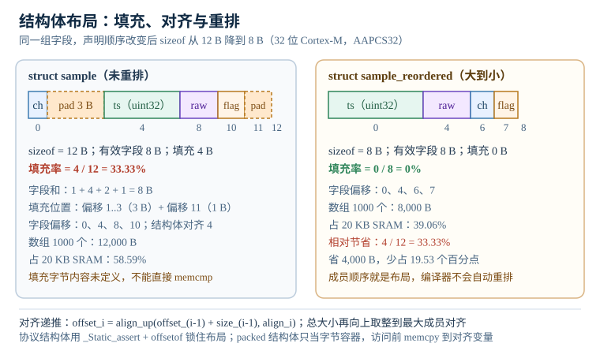

# C 语言与内存模型：对齐、严格别名与编译优化

C 语言在嵌入式领域的地位，一半来自"能直接操作地址"，另一半来自"编译器可以按标准假定程序员不撒谎"。这两件事叠在一起，就形成了 C 语言的内存模型（memory model）在嵌入式里的主题：对象在内存里究竟占多少字节、对齐（alignment）与填充（padding）如何决定字段偏移、编译器在什么条件下可以删掉你写的代码，以及哪些写法在 `-O0` 下能跑、在 `-O2` 下必然出事。

很多"玄学 bug"并不玄。结构体多出 4 字节填充，直接存储器访问（Direct Memory Access，DMA）就按错误的长度搬运；一个标志位没加 `volatile`，轮询循环就被优化成死循环；一次 `float` 指针强转踩中严格别名（strict aliasing）规则，读回的是上一次的旧值。这些现象都能在标准条文、ABI 文档和反汇编里找到确定的原因。本章把原因拆成可计算的量：偏移、填充、对齐损失、栈深度、竞态窗口，并给出每个量的复算过程。

> 本章所有结构体大小、偏移与百分比均由 Python 3.14 的 `ctypes` 按 AAPCS32 规则复算；目标机为 32 位 Cortex-M，`sizeof(int)=4`、`sizeof(long)=4`、`sizeof(void*)=4`、`double` 按 8 字节对齐。不同编译器或 `#pragma pack` 会改变结果，文中会单独标注。

## 1. 动机：三个"编译器没错"的现场

::: motivation 三个深夜现场
**现场一：DMA 多搬了 3 个字节。** 协议帧定义成 `struct { uint8_t cmd; uint32_t arg; }`，工程师按字段大小算出 5 字节，`dma_setup(..., 5)`。实际 `sizeof` 是 8：`cmd` 在偏移 0，偏移 1 到 3 是填充，`arg` 在偏移 4。DMA 只搬 5 字节，`arg` 的高 3 字节永远是 0，接收端校验和每隔几帧就错一次。编译器没有报错，因为结构体布局完全符合应用二进制接口（Application Binary Interface，ABI）。

**现场二：等标志位的循环消失了。** 代码写 `while ((*(uint32_t *)0x40021000 & 1u) == 0u) { }`，等外设的 READY 位。`-O0` 一切正常，`-O2` 下程序直接往下跑。原因是这个指针没有 `volatile` 限定，编译器有权假定那块内存不会被外部改变，于是把循环优化成"读一次，条件为假就跳过"甚至整段删除。外设寄存器不是 C 抽象机里的普通对象，必须用 `volatile` 告诉编译器"每次都要真的读"。

**现场三：浮点数读出了上一次的值。** 代码用 `float f = *(float *)&u;` 把 `uint32_t` 的位模式解释成 `float`。在 `-O0` 下结果正确，`-O2` 下 `f` 偶尔是旧值。原因是 `u` 的有效类型（effective type）是 `uint32_t`，通过 `float` 左值访问违反了 C11 6.5p7 的别名规则，编译器可以假定这两个指针不重叠，从而把读操作提前或复用寄存器里的旧值。这类未定义行为（undefined behavior，UB）不是"结果不确定"，而是"编译器可以假定它永不发生"。
:::

把常见现象、第一检查点和判据放在一张表里：

| 你看到的现象 | 先查什么 | 判据 |
|---|---|---|
| 结构体大小与字段之和对不上 | 字段偏移、填充、`#pragma pack` | `offsetof` 与 `sizeof` 和 ABI 计算一致 |
| 全局变量初值随机、十台里坏一两台 | `.data` 拷贝、启动代码 | 见链接脚本一章的 `_sidata` 检查 |
| `-O2` 下轮询循环不退出 | 指针有没有 `volatile` | 反汇编里每次循环都有一次 `ldr` |
| 中断里改的计数偶尔少 1 | 读改写是否原子 | 用临界区或 `_Atomic`，不是只加 `volatile` |
| 强转指针后浮点值不对 | 严格别名、`-fstrict-aliasing` | 改用 `memcpy` 或 union，或该编译单元关别名优化 |
| 结构体指针传给 DMA 后数据错位 | 对齐、packed、总线宽度 | 地址按 4 字节对齐，长度按 `sizeof` 而非字段和 |

**不算会摔在哪**，四个带数字的代价：

1. **填充浪费被数组放大。** `struct sample` 是 12 B，有效字段只有 8 B，填充率 $4/12=33.33\%$。1000 个元素的数组占 12,000 B；重排后只要 8,000 B。在 20 KB 的 SRAM 上，前者占 58.59%，后者占 39.06%，相差 19.53 个百分点。这个差距足以决定"能不能再放一个 4 KB 的采样缓冲"。
2. **竞态窗口按指令数放大。** `tick++` 在 Cortex-M 上通常是 `LDR`、`ADD`、`STR` 三条指令，约 5 个周期。72 MHz 下窗口是 69.44 ns；10 kHz 中断下每次自增撞上中断的概率是 $6.944\times10^{-4}$，平均 1,440 次丢一次。连续跑一小时（3600 万次）期望丢 25,000 次。
3. **非对齐访问在 Cortex-M0 上通常直接进 HardFault。** 把一个 `packed` 结构体的 `uint32_t` 成员取地址再解引用，地址可能是 `0x20000001`。M0/M0+ 通常不支持普通数据的非对齐字访问，总线会报错（具体以内核手册为准）；M3/M4 对 `LDR/STR` 有硬件支持，但 `LDM/STM`、`LDRD/STRD` 和 Device 内存仍然要求对齐。
4. **栈溢出 160 B 就够毁掉现场。** 2 KB 栈、每层 40 B、预留 384 B 给中断和库函数，最多 41 层。若实际递归到 45 层，需要 $45\times40+384=2,184$ B，超出 136 B；到 50 层超出 336 B。溢出的字节会覆盖相邻的 `.bss`，表现是"某个无关的全局变量偶尔变成 0x20004F20"。

## 2. 定义与直观：对象、对齐、填充与限定符

### 2.1 对象表示与有效类型

C 标准把"对象"定义为执行环境中一块有确定内容、有类型、有生命周期的存储区域。一个 `uint32_t` 对象占 4 字节，但这 4 字节的**对象表示（object representation）**不等于它的**值表示（value representation）**：前者是内存里的位模式，后者是这些位模式中真正参与取值的那部分。结构体里字段之间的填充字节属于对象表示，但不属于任何字段的值，标准只保证它们"存在"，不保证被初始化成什么。

这解释了一个常见误区：不能用 `memcmp` 比较两个结构体是否"逻辑相等"。两个 `struct sample` 的字段完全一样，填充字节却可能是栈上的残留值，`memcmp` 会返回不等。正确做法是逐字段比较，或者先用 `memset` 清零再赋值。反过来，也不能把结构体直接写进 Flash 当配置格式：填充字节的内容取决于编译器、优化等级和调用路径，换一次构建就可能变。

C11 还引入**有效类型（effective type）**：通过 `malloc` 得到的内存没有声明类型，第一次写入时所用的左值类型成为它的有效类型；通过 `memcpy` 拷贝进来的对象，源对象的有效类型会成为目标的有效类型。有效类型决定了后续用哪些类型访问是合法的，这是严格别名规则的根。

### 2.2 对齐要求

每个类型有一个**对齐要求（alignment requirement）**，通常等于它的自然对齐：`uint8_t` 是 1，`uint16_t` 是 2，`uint32_t` 是 4，`uint64_t` 和 `double` 在 AAPCS32 下是 8。一个对象的地址必须是其对齐要求的整数倍；结构体的对齐要求等于其成员中最大的对齐要求，除非用 `_Alignas` 或编译器属性提高。

对齐不是"性能建议"，而是硬件契约。Cortex-M 的 AHB 总线按字（32 位）组织，非对齐的字访问会被拆成两次总线传输，或者由内核的 unaligned 支持逻辑处理；Device 内存、`LDM/STM`、`LDRD/STRD`、独占访问（`LDREX/STREX`）则直接要求对齐。C 标准把"指针没有正确对齐就解引用"归为未定义行为，原因就在这里。

C11 提供了 `_Alignof(type)` 和 `_Alignas(n)`；C++11 对应 `alignof` 和 `alignas`。GCC 还提供 `__attribute__((aligned(n)))` 和 `__attribute__((packed))`。`max_align_t` 是所有标量类型中最大的对齐要求，`malloc` 返回的指针至少满足它；在 32 位 Cortex-M 上通常是 8。

### 2.3 结构体布局

C 标准保证结构体成员按声明顺序排列，但允许在成员之间和结构体末尾插入未命名的填充。布局规则可以写成三步：

1. 第一个成员从偏移 0 开始。
2. 后续每个成员放在"当前偏移向上取整到该成员对齐要求"的位置。
3. 结构体总大小向上取整到结构体对齐要求，末尾多出的字节就是尾部填充。

标准明确禁止在结构体开头填充（C11 6.7.2.1p15），也允许末尾填充（p17）。编译器不会为了省空间重排成员——这是 C 与一些托管语言的重要区别，也是很多协议结构体"看起来能对上、实际对不上"的根源。

下图把 `struct sample` 的 12 字节逐字节画出来：`ch` 占 1 字节，后面 3 字节填充；`ts` 占 4 字节；`raw` 占 2 字节；`flag` 占 1 字节；末尾再补 1 字节。同一组字段按"大到小"重排后只要 8 字节，填充为零。



### 2.4 位域

位域（bit-field）让结构体成员按位分配，例如 `unsigned int mode : 3;`。标准对位域的规定留了很多实现空间：分配单元（storage unit）用哪种整数类型、位域能否跨分配单元、位在单元内从低位还是高位开始、`int` 位域是否有符号，都由实现定义（implementation-defined）。C11 6.7.2.1p5 只要求相邻位域尽可能紧凑，具体怎么紧凑由 ABI 决定。

AAPCS32 规定小端模式下第一个位域占分配单元的最低有效位，大端模式下占最高有效位；但分配单元大小、是否允许跨越、`packed` 后的行为仍要看编译器版本和选项。一个可复现的例子：

```c
struct flags {
    unsigned int a : 3;   /* 低 3 位 */
    unsigned int b : 5;   /* 接着 5 位 */
    unsigned int c : 9;
    unsigned int d : 15;
};
```

在 GCC ARM EABI、小端、`unsigned int` 为 4 字节的配置下，`a=5`、`b=17` 时第一个字节是 `0x8D`：`a` 占 bit0 到 bit2，值为 `101`；`b` 占 bit3 到 bit7，值为 `10001`；把 `b` 左移 3 位再或上 `a`，得到 `10001101`。这个结果依赖位序，换到大端或换一个编译器就可能变成 `0xA2`。

位域的工程结论很直接：**只用于芯片寄存器映射，且必须用 `static_assert` 锁死 `sizeof` 和关键偏移；不要用于跨设备协议、持久化格式或任何需要跨编译器复现的场合。** 协议字段用移位和掩码，字节序显式处理，代码多几行，但不会因为编译器升级而变。

### 2.5 字节序与类型双关

**字节序（endianness）** 是多字节对象在内存里的排列顺序。Cortex-M 绝大多数器件配置为小端（little-endian）：`0x12345678` 在地址 `p` 处是 `78 56 34 12`。ARMv7-M 架构也支持 BE8（大端指令、小端数据），但具体芯片是否实现、如何配置，要看数据手册；不要假设"ARM 就是小端"。

网络协议、Flash 里的配置块、跨芯片的 CAN 负载通常约定为大端。把本机字节序转成网络字节序要用 `htons/htonl`，反向用 `ntohs/ntohl`；自己写移位也行，但要注意 `uint8_t` 提升为 `int` 后的符号问题。

**类型双关（type punning）** 指用另一种类型解释同一块内存的位模式。常见写法有三种：

```c
uint32_t u = 0x3F800000u;
float f1 = *(float *)&u;              /* 未定义行为：违反严格别名 */
union { uint32_t u; float f; } pun;   /* C 允许，结果依赖表示；C++ 不行 */
float f3;
memcpy(&f3, &u, sizeof f3);            /* 标准保证，GCC 会优化掉调用 */
```

第一种写法在 `-O0` 下通常"能用"，是因为编译器还没利用别名假设；`-O2` 下它可以把 `u` 的读提到前面，或者把 `f1` 的读替换成寄存器里的旧值。第三种是唯一在所有符合标准的编译器上都成立的写法；GCC 在 `-O2` 下会把 4 字节 `memcpy` 折叠成一条 `ldr` 或 `vmov`，没有函数调用开销。第二种在 C 里被脚注允许（C11 6.5.2.3 的脚注），但结果可能是陷阱表示（trap representation），且 C++ 里是未定义行为；跨语言代码不要用。

### 2.6 volatile 的真实语义

`volatile` 常被误解成"万能并发关键字"。它真正保证的事情只有一件：**对 volatile 对象的访问，必须严格按照抽象机的规则发生，不能被删除、合并或相对于其他 volatile 访问重排。** 它不保证原子性，不保证与其他线程/中断的同步，不保证 CPU 不重排，也不保证缓存一致。

C11 6.7.3p6 的措辞是：volatile 对象的值可能以实现未知的方式被修改，因此任何引用该对象的表达式都必须严格按抽象机规则求值；什么构成一次"访问"由实现定义。标准没有说 `volatile` 是内存屏障（memory barrier），也没有说 `volatile int` 的自增是原子的。

三个典型用途：

- **内存映射 I/O（memory-mapped I/O，MMIO）寄存器**：每次读写都要真的上总线，不能被缓存到寄存器里。写法是 `volatile uint32_t *const reg = (volatile uint32_t *)0x40021000;`，注意 `volatile` 修饰的是被指对象，不是指针本身。
- **中断与主循环共享的标志**：`static volatile uint8_t g_ready;`。中断服务程序（Interrupt Service Routine，ISR）置位，主循环轮询；没有 `volatile`，主循环可能只读一次。
- **DMA 描述符和缓冲区**：DMA 在 CPU 之外改内存，CPU 侧的描述符字段要 `volatile`，缓冲区在启动 DMA 前要清理缓存（Cortex-M7），完成后要无效化缓存；`volatile` 不能替代 cache maintenance。

`volatile` 不能做的事：

- 不能保证 `g_tick++` 原子。读、加、写三步之间可以进中断，结果丢更新。
- 不能保证两个 volatile 变量之间的业务顺序对别的核可见。多核或 DMA 场景要 `__DMB()`/`__DSB()`。
- 不能替代 C11 的 `_Atomic`。需要原子性和内存序时用 `stdatomic.h`，或者用临界区。
- 不能阻止 CPU 乱序执行。Cortex-M3/M4 的单核执行模型让普通内存的顺序较直观，但 Device 内存、写缓冲以及多核/DMA 场景仍需要屏障。

还有一个容易写错的声明：`volatile uint32_t *p` 是"指向 volatile 的指针"，`uint32_t *volatile p` 是"volatile 指针"。前者用于寄存器地址，后者用于"指针变量本身可能被外部改"的场合。两者含义不同，编译器生成的代码也不同。

### 2.7 restrict 的承诺

`restrict` 是 C99 引入的指针限定符，意思是：**在这个指针的生命周期内，通过它访问的对象，不会通过其他指针访问。** 这是程序员对编译器的承诺，不是编译器的检查。违反承诺是未定义行为，编译器不会报错。

最典型的例子是 `memcpy` 与 `memmove` 的区别。`memcpy` 的原型是 `void *memcpy(void *restrict s1, const void *restrict s2, size_t n);`，两个指针都带 `restrict`，所以源和目标重叠时行为未定义；`memmove` 没有这个承诺，可以处理重叠。标准库用 `restrict` 换来了更激进的向量化。

在 DSP 循环里，`restrict` 能显著改善代码：

```c
void scale(int n, float *restrict dst, const float *restrict src, float k)
{
    for (int i = 0; i < n; ++i) {
        dst[i] = src[i] * k;
    }
}
```

如果调用时 `dst == src`，行为未定义；编译器可以假定两者不重叠，从而把循环展开、用 `LDM/STM` 批量搬运，甚至在读 `src[i]` 之前就写 `dst[i]`。正确性不能靠"我传进去的指针刚好不重叠"来保证，要靠接口文档、断言或单元测试。GCC 的 `-Wrestrict` 能在编译期发现一部分明显重叠的 `memcpy` 调用，但覆盖不了所有路径。

`restrict` 只约束"通过该指针访问的对象"，不约束指针本身的值，也不意味着只读。`const float *restrict src` 是"指向只读数据的受限指针"，`float *restrict dst` 是"指向可写数据的受限指针"。

### 2.8 严格别名与未定义行为

C11 6.5p7 规定，对象的存储值只能由以下类型的左值访问：

- 与对象有效类型兼容的类型；
- 与有效类型兼容的限定版本（`const`、`volatile`、`restrict`）；
- 与有效类型对应的有符号或无符号类型；
- 包含上述类型的聚合体或联合体；
- 字符类型（`char`、`signed char`、`unsigned char`）。

除此之外的访问都是未定义行为。这就是**严格别名（strict aliasing）**规则。GCC 在 `-O2` 默认开启 `-fstrict-aliasing`，它会假定 `int *` 和 `float *` 不指向同一块内存；如果程序员违反了这个假定，优化后的代码可能读旧值、写丢数据，甚至把整个循环删掉。

几个常见判断：

- `float f = *(float *)&u;`：`u` 的有效类型是 `uint32_t`，用 `float` 左值访问，不允许。
- `uint32_t *p = (uint32_t *)&f;`：`f` 的有效类型是 `float`，用 `uint32_t` 左值访问，不允许。
- `unsigned char *p = (unsigned char *)&f;`：字符类型是例外，允许逐字节检查对象表示。
- `struct S { int a; } s; int *p = &s.a;`：成员访问是允许的，`p` 指向的是 `int` 子对象。
- `memcpy(&f, &u, sizeof f);`：标准库函数按字符数组访问，允许。

如果必须保留旧代码的强转写法，可以对该编译单元加 `-fno-strict-aliasing`，代价是编译器不能再做基于别名的优化，某些循环可能变慢。更局部的做法是给类型加 `__attribute__((may_alias))`，或者用 `memcpy` 把位模式搬到正确类型的对象里。

严格别名只是未定义行为的一种。嵌入式 C 里常见的 UB 还包括：

- 有符号整数溢出（`int` 加法超出范围），编译器可以假定不发生，从而删掉溢出检查；
- 移位位数大于等于类型宽度，或对负数左移；
- 解引用空指针、越界指针、已释放指针；
- 未对齐的指针解引用；
- 读取未初始化的自动变量；
- 多个 `malloc` 后 `free` 两次，或 `free` 非堆指针；
- `printf` 格式串与参数类型不匹配。

UB 的危险在于它把"运行时错误"变成了"编译期假设"。编译器不会在运行时检查这些条件，而是反过来利用它们做优化：`if (p == NULL) return;` 后面的 `*p` 会让编译器直接删掉这个检查，因为"解引用空指针是 UB，所以 `p` 一定非空"。

### 2.9 优化为什么会删代码

C 编译器遵循 **as-if 规则**：只要最终可观察行为与抽象机一致，怎么改都行。可观察行为包括 `volatile` 访问、`stdio` 输出、`signal` 处理等；普通内存读写不在其中。于是：

- 空循环 `for (volatile int i = 0; i < 1000; ++i) { }` 如果 `i` 不是 volatile，整个循环会被删掉；加了 volatile 才会保留。
- `memset(buf, 0, sizeof buf);` 如果 `buf` 之后没被读，编译器可以删掉这次清零（dead store elimination）。
- `if (x + 1 < x) { /* 溢出处理 */ }` 对有符号 `x` 是 UB，编译器可以假定永不溢出，直接删掉分支。
- 通过 `int *` 和 `float *` 访问同一块内存，编译器可以把两次读合并成一次。

这些优化在 `-O0` 下通常不生效，所以"我调试时好好的"不能作为代码正确的证据。发布构建要用与交付一致的优化等级做回归；涉及时序的代码要用 `volatile`、屏障或硬件定时器，而不是空循环。

## 3. 定量关系：对齐、填充、栈与竞态

### 3.1 对齐与填充公式

给定地址 $x$ 和对齐 $a$（$a$ 是 2 的幂），向上取整到 $a$ 的倍数：

$$
A(x,a)=\left\lceil\frac{x}{a}\right\rceil a
$$

其中 $x$ 是字节地址，$a$ 是对齐字节数，$A$ 是满足 $A \bmod a = 0$ 且 $A \geq x$ 的最小地址。对第 $i$ 个成员，设其大小为 $s_i$、对齐为 $a_i$，偏移 $o_i$ 递推为：

$$
o_0=0,\qquad o_i=A(o_{i-1}+s_{i-1},a_i)
$$

结构体总大小 $S$ 是最后一个成员结束位置向上取整到结构体对齐 $a_{\text{struct}}=\max_i a_i$：

$$
S=A(o_n+s_n,a_{\text{struct}})
$$

填充字节数 $W$ 和填充率 $\eta$ 为：

$$
W=S-\sum_{i=0}^{n}s_i,\qquad \eta=\frac{W}{S}
$$

$s_i$ 是成员大小（字节），$o_i$ 是偏移（字节），$S$ 是 `sizeof` 结果（字节），$W$ 是填充字节数，$\eta$ 是无量纲比值。公式的适用条件是编译器不重排成员、不使用 `packed`、不使用 `_Alignas` 改变成员对齐；这些条件正是 C 标准默认提供的。

### 3.2 数组与 RAM 占用

$N$ 个元素的结构体数组占：

$$
B_N=N\cdot S
$$

两种布局 $S_1$、$S_2$ 的差值：

$$
\Delta B=N(S_1-S_2)
$$

占 SRAM 的比例为 $B_N/M$，其中 $M$ 是可用 SRAM 字节数。这个式子是"结构体填充为什么值得管"的最直接量化：单个结构体省 4 B 不起眼，乘上 1000 就是 4 KB。

### 3.3 栈深度公式

设栈区大小 $S_{\text{stack}}$（字节），为中断、库函数和启动代码预留 $R$ 字节，每层调用平均帧 $F$ 字节，则最大安全深度：

$$
D_{\max}=\left\lfloor\frac{S_{\text{stack}}-R}{F}\right\rfloor
$$

$D_{\max}$ 是层数（无量纲），$S_{\text{stack}}$ 与 $R$ 是字节，$F$ 是字节/层。实际深度超过 $D_{\max}$ 时，超出量为：

$$
O=D\cdot F+R-S_{\text{stack}}
$$

$O>0$ 表示溢出 $O$ 字节。公式假设每层帧大小固定；有变长数组（VLA）、`alloca`、递归分叉或大局部缓冲时，要按最坏路径取 $F$。

### 3.4 volatile 竞态窗口

一个非原子的读改写操作占 $C$ 个 CPU 周期，CPU 频率 $f_{\text{cpu}}$，则窗口：

$$
t_w=\frac{C}{f_{\text{cpu}}}
$$

若中断/竞争事件频率为 $f_{\text{irq}}$，每次操作撞上事件的概率近似：

$$
p=t_w f_{\text{irq}}
$$

在 $N_{\text{events}}$ 次操作中期望丢失的更新次数：

$$
N_{\text{lost}}=N_{\text{events}}p
$$

$C$ 是周期数（无量纲），$f_{\text{cpu}}$ 是 Hz，$t_w$ 是秒，$f_{\text{irq}}$ 是 Hz，$p$ 是无量纲概率，$N$ 是次数。这个模型假设事件均匀分布且窗口内必然丢失更新；实际硬件可能因为流水线、写缓冲而略有偏差，但数量级可用。

### 3.5 非对齐访问的周期模型

对不支持非对齐字访问的内核，一次跨字边界的 32 位读要拆成两次总线传输：

$$
C_{\text{unaligned}}\approx 2C_{\text{aligned}}
$$

$C$ 是总线周期数。Cortex-M0/M0+ 通常会把普通数据非对齐访问送入 HardFault（具体看内核实现）；Cortex-M3/M4 对 `LDR/STR` 有硬件支持，但仍有额外周期，且 `LDM/STM`、`LDRD/STRD`、独占访问和 Device 内存要求对齐。这个式子只用于估算，具体周期看内核 TRM 的总线时序表。

### 3.6 位域打包公式

小端、低位优先的位域，字段 $i$ 从位偏移 $p_i$ 开始、宽度 $w_i$，其值 $b_i$ 对所在分配单元的贡献是：

$$
B=\sum_i \left(b_i \bmod 2^{w_i}\right)2^{p_i}
$$

$B$ 是分配单元的整数值，$b_i$ 是字段值，$w_i$ 是位宽，$p_i$ 是起始位偏移。这个式子只在"低位优先、不跨单元"的布局下成立；跨单元、大小端混合、有符号位域都要按具体 ABI 修正。

## 4. 典型计算：三个完整的算例

### 4.1 结构体大小与对齐损失

定义采样结构体：

```c
#include <stdint.h>

struct sample {
    uint8_t  ch;    /* 通道号 */
    uint32_t ts;    /* 时间戳 */
    uint16_t raw;   /* 原始采样值 */
    uint8_t  flag;  /* 标志 */
};
```

按 2.3 的规则逐字段计算：

| 字段 | 类型 | 大小/B | 对齐/B | 偏移/B | 说明 |
|---|---|---:|---:|---:|---|
| `ch` | `uint8_t` | 1 | 1 | 0 | 从 0 开始 |
| 填充 | — | 3 | — | 1 | 为了让 `ts` 4 字节对齐 |
| `ts` | `uint32_t` | 4 | 4 | 4 | 偏移 4 是 4 的倍数 |
| `raw` | `uint16_t` | 2 | 2 | 8 | 偏移 8 是 2 的倍数 |
| `flag` | `uint8_t` | 1 | 1 | 10 | 紧接 `raw` |
| 尾部填充 | — | 1 | — | 11 | 总大小向上取整到 4 |

因此 `sizeof(struct sample) = 12`，有效字段和 $1+4+2+1=8$ B，填充 $W=12-8=4$ B：

$$
\eta=\frac{4}{12}=0.3333=33.33\%
$$

把字段按"大到小"重排：

```c
struct sample_reordered {
    uint32_t ts;
    uint16_t raw;
    uint8_t  ch;
    uint8_t  flag;
};
```

偏移依次是 0、4、6、7，结束位置 8，结构体对齐 4，8 已经是 4 的倍数，所以 `sizeof = 8`，填充 $W=0$，$\eta=0\%$。单个结构体省 4 B，相对节省：

$$
\frac{12-8}{12}=0.3333=33.33\%
$$

1000 个元素的数组：

$$
B_{1000}=1000\times12=12{,}000\ \text{B},\qquad B'_{1000}=1000\times8=8{,}000\ \text{B}
$$

节省 4,000 B。在 20,480 B 的 SRAM 上：

$$
\frac{12{,}000}{20{,}480}=58.59\%,\qquad \frac{8{,}000}{20{,}480}=39.06\%
$$

相差 19.53 个百分点。这个例子说明：**结构体成员顺序不是审美问题，是 RAM 预算问题。**

再看一个 64 位成员的例子：

```c
struct cfg {
    uint8_t  mode;
    uint64_t serial;
    uint32_t baud;
    uint16_t crc;
};
```

`mode` 在 0，偏移 1 到 7 填充（`serial` 要 8 字节对齐），`serial` 在 8，`baud` 在 16，`crc` 在 20，结束于 22，结构体对齐 8，向上取整到 24，尾部填充 2。有效字段和 $1+8+4+2=15$ B，填充 $9$ B：

$$
\eta=\frac{9}{24}=37.5\%
$$

重排为 `serial`、`baud`、`crc`、`mode` 后，偏移 0、8、12、14，结束于 15，向上取整到 16，只填 1 B，$\eta=1/16=6.25\%$。从 24 B 降到 16 B，节省 33.33%。

如果协议要求紧凑布局，可以用 `__attribute__((packed))`：

```c
struct __attribute__((packed)) sample_wire {
    uint8_t  ch;
    uint32_t ts;
    uint16_t raw;
    uint8_t  flag;
};
```

`sizeof` 变成 8，但对齐变成 1，`ts` 的偏移是 1。取 `&s->ts` 得到奇地址，解引用在 Cortex-M0 上通常会 HardFault，在 M3/M4 上也可能生成非对齐访问。正确做法是把 packed 结构体只当"字节容器"，用 `memcpy` 把字段搬到对齐的局部变量：

```c
struct sample_wire w;
uint32_t ts;
memcpy(&ts, (const uint8_t *)&w + 1, sizeof ts);
```

这段代码不依赖 `ts` 的对齐，也不会触发严格别名问题。编译器在 `-O2` 下通常把它优化成一次非对齐 `ldr` 或两次字节读，具体看内核支持。

用 `static_assert` 把布局锁死，是防止"换编译器后悄悄变大"的最低成本手段：

```c
#include <stddef.h>
_Static_assert(sizeof(struct sample) == 12, "sample size");
_Static_assert(offsetof(struct sample, ts) == 4, "ts offset");
_Static_assert(offsetof(struct sample, raw) == 8, "raw offset");
```

C11 的 `_Static_assert` 在编译期求值，不占运行时代码；C++11 用 `static_assert`。把断言放在头文件里，所有包含它的编译单元都会检查，ABI 变了立刻编译失败。

### 4.2 栈溢出阈值

设定：任务栈 2,048 B，最深调用链每层 40 B，为中断嵌套、`printf`、`memcpy` 等库函数预留 384 B。按 3.3 的公式：

$$
D_{\max}=\left\lfloor\frac{2{,}048-384}{40}\right\rfloor=\left\lfloor\frac{1{,}664}{40}\right\rfloor=41
$$

41 层用掉 $41\times40=1{,}640$ B，加预留 384 B 共 2,024 B，还剩 24 B。这个"还剩 24 B"不是安全裕量，而是"再多一层就溢出"的边界。

若实际递归到 45 层：

$$
O=45\times40+384-2{,}048=2{,}184-2{,}048=136\ \text{B}
$$

溢出 136 B。到 50 层：

$$
O=50\times40+384-2{,}048=2{,}384-2{,}048=336\ \text{B}
$$

溢出 336 B。Cortex-M 的栈向下增长，溢出的字节落在栈底以下的低地址，通常正好是 `.bss` 里排在前面的全局数组。表现是"某个与递归无关的全局变量被改成栈上的值"，而且改的是哪一块取决于链接顺序，换一次构建就变。

如果某层函数有 64 B 的局部缓冲，帧变成约 80 B：

$$
D_{\max}=\left\lfloor\frac{2{,}048-384}{80}\right\rfloor=20
$$

只有 20 层。这不是"递归不能用"，而是"递归深度必须按最坏帧算，不能按平均帧算"。

工程上获取 $F$ 的办法：

- GCC 加 `-fstack-usage`，编译时生成 `.su` 文件，列出每个函数的静态栈帧；
- 链接时加 `-Wl,--print-memory-usage` 看 RAM 总量，但它不告诉你栈峰值；
- 运行时在栈底放金丝雀（canary），启动时填 `0xDEADBEEF`，定期检查是否被改写；
- 用 MPU 把栈底下面 32 B 设成不可访问，溢出立刻进 MemManage Fault；
- 用调试器在 `main` 入口填栈区，跑最坏路径后看最深被改写的地址。

最后一种最接近真实：静态分析给的是上界，实测给的是这条路径的峰值。两者都要，不能只信一个。

### 4.3 volatile 竞态窗口

假设 `g_tick++` 编译成 `LDR`、`ADDS`、`STR` 三条指令，共 5 个周期；CPU 72 MHz；一个 10 kHz 的定时中断也会修改 `g_tick`。按 3.4 的公式：

$$
t_w=\frac{5}{72\times10^{6}}=69.44\ \text{ns}
$$

$$
p=69.44\times10^{-9}\times10^{4}=6.944\times10^{-4}
$$

平均每 $1/p=1{,}440$ 次自增丢一次。若主循环每秒自增 10,000 次，一小时 3,600 万次：

$$
N_{\text{lost}}=36{,}000{,}000\times6.944\times10^{-4}=25{,}000
$$

期望丢 25,000 次。这不是"概率极低可以忽略"，而是"每小时少 25,000 个计数"。如果这个计数用于里程、流量或脉冲累加，误差是系统性的。

修法有三种，按代价从低到高：

1. **临界区**：`__disable_irq()` / `__enable_irq()` 包住读改写。简单，但会拉长中断延迟；临界区里不要放长操作。
2. **原子指令**：C11 `_Atomic uint32_t`，或 Cortex-M 的 `LDREX/STREX`。前者可移植，后者需要编译器支持；注意 `_Atomic` 在 32 位 Cortex-M 上可能仍然用关中断实现，具体看工具链。
3. **单写者**：让只有中断写、主循环只读，或者反过来。读 32 位对齐变量在 Cortex-M 上是单次 `LDR`，天然原子；只要没有第二个写者，就不需要锁。

只加 `volatile` 不解决任何原子性问题。它只保证"每次都真的读写内存"，而读和写之间仍然可以插进中断。

### 4.4 类型双关的代码生成

把 4 字节 `memcpy` 和指针强转放在同一优化等级下比较：

```c
float pun_memcpy(uint32_t u)
{
    float f;
    memcpy(&f, &u, sizeof f);
    return f;
}

float pun_cast(uint32_t u)
{
    return *(float *)&u;   /* 未定义行为 */
}
```

GCC 13 在 `-O2 -mcpu=cortex-m3 -mthumb` 下，`pun_memcpy` 通常是两条整数搬运（`ldr`/`str`）；带 FPU 的目标上可能生成一条 `ldr` 加一条 `vmov`，把 32 位位模式搬进浮点寄存器。`pun_cast` 也生成类似的搬运指令，但语义上它是 UB，换一个上下文（比如 `u` 来自一个 `uint32_t` 数组、旁边还有 `float` 写操作）就可能被优化错。

`memcpy` 版本没有运行时函数调用开销，这是很多人不敢用它的原因，也是误解。GCC 把固定长度的 `memcpy` 当作内建函数（builtin），长度是编译期常量时直接展开；只有长度可变或目标机没有合适指令时才调用 `memcpy`。在 Cortex-M 上，4 字节搬运就是 `LDR`/`STR` 或 `VLDR`/`VMOV`。

如果整个编译单元都必须保留旧式强转，可以加 `-fno-strict-aliasing`。代价不是"慢一点"这么简单：编译器不能再假定不同类型的指针不重叠，循环向量化、公共子表达式消除、寄存器分配都会受影响。对 DSP 内核这种热循环，性能损失可能到 10% 到 30%，具体要用基准测试量。更划算的做法是改代码，而不是关优化。

## 5. 工程含义：写代码时的取舍

**ABI 是契约，不是建议。** 交叉编译时，主机（host）和目标机（target）的 `long`、指针、`double` 对齐可能不同。x86-64 Linux 上 `long` 是 8 B，Cortex-M 上是 4 B；同一个结构体在 PC 上测试通过，烧到板子上就错位。跨平台协议结构体一律用 `<stdint.h>` 的固定宽度类型，不用 `long`、`unsigned long`、`size_t` 当字段类型；用 `_Static_assert` 锁大小和偏移；序列化时逐字段写字节，不直接 `memcpy` 整个结构体。

**packed 只放在边界上。** `__attribute__((packed))` 适合描述"线上格式"或"Flash 里的旧格式"，不适合描述"我要在代码里频繁访问的数据"。 packed 结构体的成员可能非对齐，取地址传给别的函数、做原子操作、用 DMA 都会出问题。推荐做法：packed 结构体只用于接收/发送缓冲，进入业务逻辑前用 `memcpy` 逐字段搬到对齐的 `struct sample`。多一次拷贝，换掉一整类 HardFault。

**volatile 的使用要有清单。** 只在这几类对象上加：MMIO 寄存器、ISR 与主循环共享的标志、DMA 描述符、由硬件修改的状态字。加之前问三个问题：这个对象会被谁改？读写是否要求真的上总线？是否需要原子性？如果答案是"多个执行流、需要原子"，`volatile` 不够，要加临界区或原子类型。反过来，给普通局部变量加 `volatile` 只会阻止寄存器分配，让代码变慢，不解决任何并发问题。

**restrict 只在证明不重叠后用。** 在库函数、DSP 内核、`memcpy` 包装这类"调用者明确知道缓冲区关系"的接口上用；在业务代码里，先加断言 `assert(dst != src)`，再用 `restrict`。不要因为"编译器提示可以加"就加，违反承诺是 UB，不是运行时断言失败。

**别用位域做协议。** 寄存器映射可以用位域，但要用 `_Static_assert(sizeof(...))` 和 `offsetof` 锁布局，且只在单一工具链、单一 ABI 下使用。跨设备协议用移位和掩码：

```c
static inline uint32_t get_bits(uint32_t w, unsigned pos, unsigned width)
{
    return (w >> pos) & ((1u << width) - 1u);
}
```

这段代码在任何字节序、任何编译器上都可复现；代价是每次多一两条指令，换来的是"十年后换编译器还能解出同样的帧"。

**字节序在接口处显式转换。** 本机是小端，网络是大端，CAN 负载的约定由协议文档定义。不要在结构体里直接放多字节字段然后 `memcpy` 到发送缓冲；写 `put_u16_be(buf, v)`、`get_u32_le(buf)` 这类函数，把字节序问题收敛到几个函数里。代码审查时只看这几个函数，不用逐帧推。

**优化等级要与交付一致。** 调试期用 `-Og` 或 `-O0`，发布期用 `-O2` 或 `-Os`；两者行为不同，尤其是依赖 UB 的代码。CI 里至少跑一遍发布优化等级的单元测试和 HIL 测试。对时序敏感的代码，用硬件定时器、`DWT->CYCCNT` 或 `volatile` 计数器，不要用空循环；空循环在 `-O2` 下可能消失，在 `-Os` 下可能变短。

**工具能提前发现的，不要留到现场。** 一张表：

| 选项/工具 | 作用 | 局限 |
|---|---|---|
| `-Wall -Wextra -Wpedantic` | 基础警告 | 不检查别名和填充 |
| `-Wcast-align=strict` | 指针强转导致对齐提升 | 对 `void *` 和 packed 结构体有误报 |
| `-Wpadded` | 结构体插入填充时警告 | 噪声大，适合库头文件，不适合全工程 |
| `-Wstrict-aliasing=2` | 严格别名可疑写法 | 有漏报，不是证明 |
| `-fstack-usage` | 生成每函数栈帧 `.su` | 不覆盖间接调用和递归峰值 |
| `-fsanitize=undefined` | 主机侧 UB 检测 | 目标机不一定能跑，覆盖率有限 |
| `-fsanitize=address` | 主机侧越界/释放后使用 | 同上，资源开销大 |
| `_Static_assert` | 编译期锁大小/偏移 | 需要人工写期望值 |
| `pahole` / `objdump` | 查看实际布局 | 需要 ELF 和调试信息 |

**C 标准之外还有 ABI。** 同一个 `struct` 在 GCC 和 IAR 下可能大小相同、传参方式不同；AAPCS32 规定大于 4 字节的结构体通过隐藏指针返回，小于等于 4 字节的可能拆进寄存器。跨编译器链接的库，接口不要传结构体，传指针和固定宽度标量；非要传，统一用同一套头文件和 ABI 选项。

## 6. 常见坑（现象、原因与解决）

::: pitfall 六个高频坑
- **PC 上结构体 16 B，板子上 12 B**：现象——同一份协议代码在 PC 单元测试通过，目标板解析错位，字段整体偏移 4 B。原因——结构体里用了 `long` 或 `size_t`，PC 是 64 位、目标是 32 位；或者 PC 上用了不同的 `#pragma pack`。解决——字段改用 `uint32_t` 等固定宽度类型；用 `_Static_assert(sizeof(...))` 和 `offsetof` 锁布局；协议序列化逐字段写字节。

- **轮询标志位的循环在 `-O2` 下不退出**：现象——`while (!(REG & MASK)) { }` 在调试构建正常，发布构建直接跳过或卡死。原因——寄存器指针没有 `volatile`，编译器假定内存不会被外部改，把读操作提出循环。解决——用 `volatile uint32_t *const` 指向寄存器；检查反汇编，确保循环体里每次都有 `ldr`；必要时加 `__DMB()`。

- **中断里改的计数偶尔少 1**：现象——主循环和定时中断都执行 `g_tick++`，长时间运行后计数比预期少，且误差随中断频率增加。原因——`volatile` 只保证每次访问内存，不保证读改写原子；`LDR/ADD/STR` 之间可以进中断。解决——用临界区、C11 `_Atomic` 或 `LDREX/STREX`；或者改成单写者模型。

- **浮点值在 `-O2` 下读旧值**：现象——`float f = *(float *)&u;` 在 `-O0` 正确，`-O2` 偶尔返回上一次的值。原因——违反 C11 6.5p7 的严格别名规则，编译器假定 `uint32_t *` 和 `float *` 不重叠。解决——改用 `memcpy`；C 里可以用 union（但 C++ 不行）；旧代码可对该编译单元加 `-fno-strict-aliasing`，但要评估性能。

- **packed 结构体一取地址就 HardFault**：现象——`struct __attribute__((packed))` 的 `uint32_t` 成员取地址后解引用，Cortex-M0 上通常进 HardFault，M3/M4 上对普通 `LDR/STR` 可能正常，但换成 `LDM/STM`、`LDRD/STRD`、独占访问或 Device 内存就可能 fault 或读错值。原因——成员偏移不是 4 的倍数，指针非对齐；M0 通常不支持普通数据非对齐访问，M3/M4 也有指令和内存类型限制。解决——packed 结构体只当字节容器，用 `memcpy` 搬到对齐的局部变量；不要取 packed 成员的地址传给其他函数。

- **位域协议换个编译器就解错**：现象——同一帧数据在 GCC 下解析正确，换 IAR 或换大端配置后字段值错位。原因——位域的分配单元、位序、是否跨单元由实现定义，C 标准没有统一规定。解决——协议字段改用移位和掩码；寄存器映射用位域时加 `_Static_assert` 锁 `sizeof`，并在目标编译器上做字节级测试。

- **空循环延时在发布构建里消失**：现象——`for (int i = 0; i < 1000; ++i);` 在 `-O0` 下延时约几十微秒，`-O2` 下外设还没准备好就发下一条命令。原因——循环没有可观察副作用，编译器按 as-if 规则删除。解决——用硬件定时器或 `DWT->CYCCNT` 做延时；非要用循环，把计数器声明为 `volatile`，并意识到延时长度仍随编译器和主频变化。

- **有符号溢出让边界检查失效**：现象——`if (x + 1 < x)` 的溢出保护在 `-O2` 下被删掉，异常输入直接越界。原因——有符号整数溢出是 UB，编译器假定不发生。解决——用无符号类型做回绕判断，或在加法前检查 `x > INT_MAX - 1`；打开 `-ftrapv` 只适合调试，不适合发布。
:::

## 7. 自测题

<details><summary>结构体 `struct S { uint8_t a; uint32_t b; uint16_t c; uint8_t d; };` 在 32 位 Cortex-M 上的大小、各字段偏移和填充率是多少？把成员按大到小重排后呢？</summary>

按对齐规则逐字段算：

- `a`：偏移 0，大小 1。
- `b`：对齐 4，当前偏移 1，向上取整到 4，偏移 4；占 4 到 7。
- `c`：对齐 2，当前偏移 8，已是 2 的倍数，偏移 8；占 8 到 9。
- `d`：对齐 1，偏移 10；占 10。
- 结束位置 11，结构体对齐 $\max(1,4,2,1)=4$，向上取整到 12。

所以 `sizeof = 12`，偏移分别是 0、4、8、10，有效字段和 $1+4+2+1=8$ B，填充 $4$ B：

$$
\eta=\frac{4}{12}=33.33\%
$$

重排为 `uint32_t b; uint16_t c; uint8_t a; uint8_t d;` 后，偏移是 0、4、6、7，结束位置 8，8 是 4 的倍数，`sizeof = 8`，填充 0，$\eta=0\%$。单个结构体省 4 B，相对节省 $4/12=33.33\%$。

</details>

<details><summary>2,048 B 的任务栈，每层调用帧 48 B，为中断和库函数预留 320 B。最多能安全递归多少层？如果实际递归 40 层，溢出多少字节？</summary>

按 3.3 的公式：

$$
D_{\max}=\left\lfloor\frac{2{,}048-320}{48}\right\rfloor=\left\lfloor\frac{1{,}728}{48}\right\rfloor=36
$$

36 层用 $36\times48=1{,}728$ B，加预留 320 B 正好 2,048 B，边界没有余量；实际工程应再留 10% 到 20%，所以按 32 层设计更稳。

40 层时：

$$
O=40\times48+320-2{,}048=1{,}920+320-2{,}048=192\ \text{B}
$$

溢出 192 B。这 192 B 会落在栈底以下的低地址，通常覆盖相邻的 `.bss` 变量；表现取决于链接顺序，可能是一个计数器变成 0，也可能是一个指针变成栈地址。

</details>

<details><summary>72 MHz 下，一个 5 周期的读改写操作被 10 kHz 中断打断的概率是多少？连续运行一小时（每秒 10,000 次操作）期望丢多少次更新？如果只加 `volatile`，结果会变吗？</summary>

窗口：

$$
t_w=\frac{5}{72\times10^{6}}=69.44\ \text{ns}
$$

概率：

$$
p=69.44\times10^{-9}\times10^{4}=6.944\times10^{-4}
$$

一小时的的操作次数 $10{,}000\times3{,}600=36{,}000{,}000$，期望丢失：

$$
N_{\text{lost}}=36{,}000{,}000\times6.944\times10^{-4}=25{,}000
$$

只加 `volatile` 不会改变结果。`volatile` 保证每次读、写都真的访问内存，但不保证 `LDR/ADD/STR` 三条指令作为一个整体执行；中断仍然可以在读和写之间插入，覆盖刚写回的值。要消除丢失，必须用临界区、原子指令或单写者模型。

</details>

<details><summary>为什么 `float f = *(float *)&u;` 是未定义行为？改成 `memcpy` 后会不会多一次函数调用？</summary>

`u` 的有效类型是 `uint32_t`，用 `float` 左值访问它，不属于 C11 6.5p7 允许的兼容类型、限定版本、对应有符号/无符号类型、聚合体/联合体或字符类型，因此是 UB。编译器可以假定 `uint32_t *` 和 `float *` 不指向同一对象，从而把 `u` 的读提前、把 `f` 的读替换成寄存器里的旧值，或者删掉相关的存储。

改成：

```c
float f;
memcpy(&f, &u, sizeof f);
```

`memcpy` 按字符数组访问，标准保证合法。GCC 在 `-O2` 下，长度是编译期常量 4，会把 `memcpy` 内建展开成一条 `LDR` 加一条 `VMOV`（或等价的搬运指令），不会调用 `memcpy` 函数。只有在长度可变、目标机没有合适指令或关闭内建时才可能生成函数调用。所以正确性和性能可以同时拿到。

</details>

<details><summary>小端 Cortex-M 上，`struct flags { unsigned a:3; unsigned b:5; }`，`a=5`、`b=17`，第一个字节的十六进制值是多少？如果同一段代码跑在大端配置上，值可能变成什么？</summary>

小端、低位优先时，`a` 占 bit0 到 bit2，值为 `101`；`b` 占 bit3 到 bit7，值为 `10001`。把 `b` 左移 3 位再或上 `a`：

$$
B=(17\ll 3)\ |\ 5=136+5=141=0x8D
$$

二进制是 `10001101`。

大端、高位优先时，`a` 可能占 bit7 到 bit5，`b` 占 bit4 到 bit0。把 `a` 左移 5 位再或上 `b`：

$$
B=(5\ll 5)\ |\ 17=160+17=177=0xB1
$$

也可能是 `0xA2` 之类的其他排列，取决于编译器把哪个字段放在高位、分配单元多大。这个例子说明位域布局不能跨编译器/跨字节序假设；协议字段要用移位和掩码显式定义位序。

</details>

## 8. 参考资料

- ISO/IEC 9899:2011, *Programming languages — C*：6.2.8 节定义对象的对齐要求；6.5 节第 6、7 段给出有效类型与严格别名规则；6.7.2.1 节规定结构体填充与位域；6.7.3 节与 6.7.3.1 节分别给出 `volatile` 与 `restrict` 的语义。本章 2.2、2.3、2.6、2.7、2.8 节的条文依据均来自这些章节。
- ARM, *Procedure Call Standard for the Arm Architecture*（AAPCS32，ARM IHI 0042）：4.1 节列出基本数据类型的大小与对齐，5.1 节规定参数传递和 8 字节栈对齐，5.4 节规定结构体按值传递的规则。本章 2.2 的类型表和 4.1 的 64 位对齐例子按此整理。
- Free Software Foundation, *GCC 13.2 Manual*：[`-fstrict-aliasing`](https://gcc.gnu.org/onlinedocs/gcc/Optimize-Options.html) 与 `-fno-strict-aliasing` 说明别名优化的开关；`-Wcast-align`、`-Wpadded`、`-fstack-usage` 分别用于对齐、填充和栈帧检查；`__attribute__((packed))`、`__attribute__((aligned))`、`__attribute__((may_alias))` 见 "Common Type Attributes" 与 "Variable Attributes"。
- Arm, *ARMv7-M Architecture Reference Manual*（ARM DDI 0403E）：A3.2 节定义对齐与未对齐访问的规则，A3.4 节定义内存字节序与 BE8；B3.2 节涉及异常与栈对齐。本章 2.2、2.5 与 3.5 节关于非对齐访问和字节序的结论依据此手册。
- MISRA, *MISRA C:2012 Guidelines for the use of the C language in critical systems*：Rule 11.3 限制指针与不兼容类型的转换，Rule 19.2 限制 union 的使用，Rule 1.3 要求避免未定义行为。本章 5 节的编码约束与这些规则一致。
- SEI, *CERT C Coding Standard*：[EXP39-C](https://wiki.sei.cmu.edu/confluence/display/c/EXP39-C.+Do+not+access+a+variable+through+a+pointer+of+an+incompatible+type) 讨论不兼容类型访问，[INT32-C](https://wiki.sei.cmu.edu/confluence/display/c/INT32-C.+Ensure+that+operations+on+signed+integers+do+not+result+in+overflow) 讨论有符号溢出，[EXP33-C](https://wiki.sei.cmu.edu/confluence/display/c/EXP33-C.+Do+not+read+uninitialized+memory) 讨论未初始化内存。本章 2.8、2.9 节的 UB 清单按这些条目整理。
- Joseph Yiu, *The Definitive Guide to Arm Cortex-M3 and Cortex-M4 Processors*（第 3 版）的 "Memory System" 与 "Exception and Interrupts" 两章：对齐、总线接口与异常栈帧的硬件背景，可用于核对本章 2.2、4.2 与 4.3 的工程结论。
- Compiler Explorer（[godbolt.org](https://godbolt.org/)）：用于核对 `memcpy` 与指针强转在 `-O2` 下的实际代码生成；本章 4.4 节的"没有函数调用"结论可用 `arm-none-eabi-gcc 13.2 -O2 -mcpu=cortex-m3` 复现。
