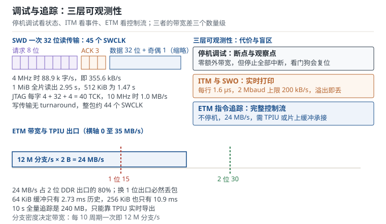

# 调试与追踪：SWD/JTAG、ITM/SWO 与 ETM 指令追踪

嵌入式调试有三个层次：**停下来看状态**（断点与观察点）、**不停机看事件**（ITM 与 SWO 打印）、**不停机看控制流**（ETM 指令追踪）。三者的侵入性依次降低、带宽依次上升，代价差着三个数量级：一个断点几乎不占资源，但会把整个系统冻结；一行打印要 1.6 µs 的 CPU 和一条 200 kB/s 的链路；全量指令追踪是 24 MB/s，必须靠并行追踪口或片上缓冲才能导出。这一章从 SWD 的 45 个时钟周期讲起，把链路吞吐、打印开销、追踪带宽与周期计数的误差都算成数字，最后讨论量产阶段为什么必须关掉调试口、以及关掉之后靠什么做失效分析。

## 1. 设计动机（三个被调试手段本身害死的现场）

::: motivation 三个真实的调试现场
**现场一：加了打印，故障消失。** 某无刷电机驱动器在客户现场偶发过流保护误动作。工程师在电流环里加了一行 `printf`，故障不再复现；删掉打印，故障回来。原因不是"打印修好了 bug"，而是串口发送是阻塞的：115200 baud 下发 32 字节要 $32\times10/115200=2.78$ ms，而电流环周期只有 1 ms——控制环路被硬生生拉长到 3.8 ms，原本的时序竞态被掩盖了。更糟的是这行打印放在中断里，发送期间其他中断全部被推迟，脉宽调制（Pulse Width Modulation，PWM）更新出现抖动。

**现场二：断点一打，看门狗就咬。** 某车载网关用外部看门狗芯片，超时 100 ms。工程师在内核异常处理里下断点，停下来分析调用栈，40 秒后看门狗把整机复位，调试会话断开，现场信息全部丢失。断点停的是 CPU，不是世界：看门狗有自己的时钟和电源，CAN 控制器还在收报文，收发器的错误计数器还在累加。这类问题只能靠不停机的追踪手段解决。

**现场三：调试口没关，固件被整片读走。** 某消费类产品的样机流出后两周，市面上出现了克隆板。拆解发现调试口处于出厂默认的开放状态，4 MHz 的 SWD 时钟下读出 512 KiB 固件只要 1.47 s，1 MiB 也只要 2.95 s。读出保护（Readout Protection，RDP）等级为 0，等于把源码和标定数据一起送人。
:::

把调试阶段的典型现象、第一检查项与判据列成表：

| 现象 | 先查什么 | 判据 |
|---|---|---|
| 加打印后故障消失 | 打印是否阻塞、是否在中断里 | 单行耗时远小于控制周期；发送非阻塞 |
| 断点一停就复位 | 看门狗时基是否独立 | 调试时暂停看门狗或改用追踪 |
| 断点数量不够、部分不触发 | 硬件断点比较器数量 | FPB 6 个指令 + 2 个字面量；超出即失效 |
| 睡眠后调试器连不上 | 调试时钟是否被关 | DBGMCU 保持调试；唤醒后再 attach |
| 追踪数据丢包 | 追踪口带宽与缓冲深度 | 峰值带宽小于出口的 80% |
| 样机固件被读出 | 读出保护与调试认证 | RDP 等级、调试口熔丝、认证挑战 |

**不算清楚会摔在哪**，三个带数字的代价：

1. **时序被改变。** 2.78 ms 的阻塞打印插进 1 ms 的控制环，等于把系统换了一个工况；这类"修好了"的假象平均要花 3 人周才能重新定位。
2. **现场信息丢失。** 断点触发看门狗复位，一次现场复现机会作废；按每次出差 2 人天计，三次就是 6 人天。
3. **固件泄露。** 克隆板的物料成本只有原品的 60%，一旦上市，原厂的价格体系在 3 个月内就会被打穿。

## 2. 定义与直观

### 2.1 两种物理接口：JTAG 与 SWD

**JTAG（Joint Test Action Group，IEEE 1149.1）** 是四线或五线接口：TCK（时钟）、TMS（模式选择）、TDI（数据输入）、TDO（数据输出），可选 nTRST（复位）。它内部是一个 16 状态的**测试访问端口状态机（Test Access Port，TAP）**，通过指令寄存器（Instruction Register，IR）选择要访问的数据寄存器（Data Register，DR）。JTAG 的强项是**边界扫描**与**多器件菊花链**：一块板上的多个芯片可以串在同一条扫描链上，逐个访问。

**SWD（Serial Wire Debug）** 是 Arm 定义的两线接口：SWDIO（双向数据）、SWCLK（时钟），可选 SWO（单向追踪输出）与 nRESET。它把 JTAG 的"扫描移位"换成了**打包传输**：主机发 8 位请求（含奇偶校验），目标回 3 位应答（OK、WAIT、FAULT），随后是 32 位数据加 1 位奇偶。SWD 的访问对象是**调试端口（Debug Port，DP）** 与**访问端口（Access Port，AP）**，AP 再映射到芯片内部的总线。

| 维度 | JTAG | SWD |
|---|---|---|
| 引脚数 | 4 至 5（+ 电源地） | 2（+ 可选 SWO、复位） |
| 多器件 | 菊花链，天然支持 | 需要多路复用或hub |
| 边界扫描 | 支持 | 不支持 |
| 典型时钟 | 10 至 30 MHz | 4 至 24 MHz |
| 每 32 位访问 | 约 40 个 TCK | 约 45 个 SWCLK（读） |
| 引脚复用冲突 | 常与 JTAG 复用 | 通常只占 2 个引脚 |

### 2.2 断点与观察点

**断点（breakpoint）** 是"执行到某个地址就停下来"。Cortex-M 的实现有两类：**硬件断点**由闪存补丁与断点单元（Flash Patch and Breakpoint，FPB）提供，典型配置是 6 个指令地址比较器加 2 个字面量比较器；**软件断点**是把指令替换成 `BKPT`（16 位，编码 `0xBE00`），代价是要改写 Flash 或 RAM。

**观察点（watchpoint）** 是"某个地址被读或写就停下来"，由数据观察点与追踪单元（Data Watchpoint and Trace，DWT）提供，典型 4 个比较器，可以匹配地址、数据或程序计数器。观察点比断点更贵（数量更少），但对"谁踩了我的变量"这类问题几乎是无替代的。

两类断点都有**数量上限**，而且超限时的行为往往是静默的：调试器可能报一句警告就继续，也可能悄悄把硬件断点换成软件断点，改写了 Flash 里的一条指令——直到你发现"断点位置变了"。

### 2.3 ITM 与 SWO：不停机的打印通道

**指令追踪宏单元（Instrumentation Trace Macrocell，ITM）** 提供 32 个激励端口（stimulus port），软件往端口写一个字，硬件就把它打包送到追踪出口。**单线输出（Serial Wire Output，SWO）** 是这个出口的一种物理形式：一根线，用异步串行（NRZ）或曼彻斯特编码把数据送出，调试探针只需要接这一根线就能收到打印。

ITM 的价值在于**便宜且不占外设**：不需要 UART，不占引脚（复用 SWO），而且可以带时间戳。它的代价是带宽有限：SWO 的波特率由 SWCLK 分频得到，探针侧至少需要每个比特两个 SWCLK 采样，所以波特率上限约为 SWCLK 的一半；8 MHz 的 SWCLK 最多给 4 Mbaud，也就是 400 kB/s。

### 2.4 ETM 与 TPIU：不停机的控制流

**嵌入式追踪宏单元（Embedded Trace Macrocell，ETM）** 记录**指令执行流**：每个分支的目标地址、是否跳转、异常入口与返回，都被压缩成追踪包。它不停机、不改变时序，是分析"偶发死循环""中断风暴""栈溢出"的利器。

ETM 的输出要经过**追踪端口接口单元（Trace Port Interface Unit，TPIU）** 才能在引脚上导出，宽度 1、2 或 4 位，可单沿或双沿（DDR）。没有追踪口的小封装器件，通常把追踪写进片上的**嵌入式追踪缓冲（Embedded Trace Buffer，ETB）** 或**微追踪缓冲（Micro Trace Buffer，MTB）**，容量从几 KB 到几百 KB，只能保留最后几毫秒的历史。

### 2.5 周期计数与性能剖析

**数据观察点与追踪单元（DWT）** 里的 `CYCCNT` 是一个 32 位自由运行的周期计数器，时钟就是内核时钟。读它只要几条指令，是最便宜的性能剖析手段：在函数入口读一次、出口读一次，差值就是周期数。

剖析（profiling）有两条路：**插桩**（instrumentation）精确但改变时序、需要改代码；**采样**（sampling）用调试器周期性读程序计数器，开销小但统计误差大。两者的选择取决于"你要的是精确周期还是热点分布"。

### 2.6 三层可观测性的取舍

| 层次 | 手段 | 额外带宽 | 是否停机 | 主要盲区 |
|---|---|---|---|---|
| 状态 | 断点、观察点、寄存器与内存读写 | 几乎为零 | 是 | 时序相关缺陷、长周期竞态 |
| 事件 | ITM、SWO 打印、DWT 计数 | 几十至几百 kB/s | 否 | 高频事件溢出、代码侵入 |
| 控制流 | ETM、ETB、MTB | 几至几十 MB/s | 否 | 需要追踪口或大缓冲 |

## 3. 定量关系

**SWD 的每次访问。** 一次 32 位读传输包含：8 位请求、1 个转向周期、3 位应答、32 位数据、1 位奇偶，合计 45 个 SWCLK。于是吞吐为

$$
R_{\text{SWD}}=\frac{f_{\text{SWCLK}}}{45}\times4\ \text{B/s}
$$

**JTAG 的每次访问。** 一条 4 位指令加 32 位数据加 4 位状态开销，约 40 个 TCK：

$$
R_{\text{JTAG}}=\frac{f_{\text{TCK}}}{40}\times4\ \text{B/s}
$$

**SWO 的字节吞吐。** 8N1 帧格式下每个字节占 10 个比特，且波特率由 SWCLK 分频得到：

$$
R_{\text{SWO}}=\frac{f_{\text{SWCLK}}/N}{10},\qquad N\geq2
$$

其中 $N$ 是分频系数。ITM 每个包还有 1 字节包头（最多携带 4 字节数据），所以有效载荷约为链路的 $4/5$。

**ETM 的带宽。** 设平均每 $c$ 个周期出现一条分支、每条分支压缩后占 $L$ 字节，则

$$
R_{\text{ETM}}=\frac{f_{\text{CPU}}}{c}\times L
$$

Cortex-M 的 ETM 分支地址包在"压缩地址"模式下典型 2 字节，$L$ 取 1.5 到 2。

**TPIU 的出口能力。** 宽度 $W$ 位、双沿、频率 $f_{\text{tpiu}}$：

$$
R_{\text{TPIU}}=\frac{W\times2\times f_{\text{tpiu}}}{8}
$$

**缓冲能留住多长时间。** 容量 $B$ 字节、追踪速率 $R$：

$$
T_{\text{hist}}=\frac{B}{R}
$$

**周期计数的误差。** 测量本身要花 $c_{\text{ov}}$ 个周期（读计数器、减法、保存），被测函数耗时 $c_{\text{fn}}$，相对误差为 $c_{\text{ov}}/c_{\text{fn}}$。批量测量 $m$ 次可以把误差摊薄到 $c_{\text{ov}}/(m\,c_{\text{fn}})$。

**打印的 CPU 成本。** 格式化并写出 $L$ 字节，每字节约 $c_b$ 个周期，则单行 CPU 时间为 $C=L\,c_b/f$。

**覆盖率的分辨率。** 代码段大小 $S$、平均指令长度 $\ell$、平均每 $m$ 条指令一个分支，则分支点数量为

$$
N_{\text{br}}=\frac{S}{\ell\,m}
$$

## 4. 典型计算

### 4.1 SWD 与 JTAG 的吞吐和全片读出时间

| 接口 | 时钟 | 每字时钟数 | 吞吐 | 512 KiB 读出 | 1 MiB 读出 |
|---|---|---|---|---|---|
| SWD | 1 MHz | 45 | 88.9 kB/s | 5.90 s | 11.80 s |
| SWD | 4 MHz | 45 | 355.6 kB/s | 1.47 s | 2.95 s |
| SWD | 10 MHz | 45 | 888.9 kB/s | 0.59 s | 1.18 s |
| JTAG | 10 MHz | 40 | 1.0 MB/s | 0.52 s | 1.05 s |
| JTAG | 30 MHz | 40 | 3.0 MB/s | 0.17 s | 0.35 s |

SWD 在 4 MHz 下搬 1 MiB 需要 2.95 s，这个数字有两个含义：调试时"读一遍全部内存"是可以接受的；而对攻击者来说，物理接触设备后读出全部固件也只是几秒钟的事——所以读出保护不是"增加难度"，而是"物理上禁止"。

### 4.2 SWO 波特率与 printf 吞吐

取 SWCLK 为 8 MHz、SWO 波特率 2 Mbaud（分频 4），链路字节吞吐为 $2\times10^{6}/10=200$ kB/s。若每行日志 32 字节：

$$
\frac{200\times10^{3}}{32}=6250\ \text{行/s}
$$

即每 160 µs 一行。相同的一行如果走 115200 baud 的串口，需要 $32\times10/115200=2.78$ ms，是 SWO 的 17.4 倍。

CPU 侧的开销：按每字节 6 个周期格式化，32 字节需要 192 个周期，在 120 MHz 下是 1.6 µs，只占链路上那 160 µs 的 1%——**瓶颈在链路而不在 CPU**。这也解释了为什么"多打几行"不会让 CPU 变慢，却会让日志丢包。

把场景放大：8 个通道、每个通道 1 kHz、每行 32 字节，总需求 $8\times1000\times32=256$ kB/s，是 200 kB/s 链路的 1.28 倍，必然溢出。考虑 ITM 包头开销后有效载荷只有 160 kB/s，超载比例变成 1.6 倍。解决办法有三个：降低频率（每 10 个周期打一行）、压缩字段（二进制而非文本）、或者换 4 Mbaud（400 kB/s，超载消失但仍无余量）。

### 4.3 ETM 的带宽与缓冲深度

设 120 MHz、平均每 10 个周期一条分支，则分支率 $120\times10^{6}/10=12\times10^{6}$ 条/s；每条 2 字节，追踪速率 24 MB/s。

出口能力：TPIU 2 位 DDR、60 MHz 时为 $2\times2\times60\times10^{6}/8=30$ MB/s，负载率 80%；1 位 DDR 只有 15 MB/s，负载率 160%，必然丢包；4 位 DDR 为 60 MB/s，负载率 40%，有足够余量。

缓冲深度：64 KiB 的 ETB 只能留住 $\frac{65536}{24\times10^{6}}=2.73$ ms；128 KiB 为 5.46 ms；256 KiB 为 10.92 ms。要记录 10 秒的完整执行流需要 240 MB，只能靠 TPIU 实时导出，缓冲只适合"抓崩溃前最后几毫秒"。

### 4.4 用 ETM 做覆盖率统计

64 KiB 的代码段，平均指令 2.5 字节，约 26214 条指令；平均每 6 条指令一个分支，约 4369 个分支点。每条分支的 ETM 包 2 字节，全部覆盖一次只需 8.5 KiB 的追踪数据——这就是 ETM 适合做结构覆盖证据的原因：它记录的是"哪些分支真的走过"，而不是"哪些行被执行过"。

对比插桩方案：在 4369 个分支点插桩，每个桩 8 字节代码与 5 个周期开销，命中一次的总开销 $4369\times5=21845$ 周期；1 kHz 的控制环在 120 MHz 下每个周期只有 $120\times10^{6}/1000=120000$ 周期，这笔开销相当于 $21845/120000=18.2\%$ 的负载。2.2% 要主频约 1 GHz 才成立（$21845\times1000/0.022\approx9.9\times10^{8}$ Hz）。ETM 方案是零侵入，插桩全开却要付近两成的 CPU，只能按需开关或只插关键路径。

### 4.5 CYCCNT 的精度与批量测量

`CYCCNT` 是 32 位，在 120 MHz 下 $\frac{2^{32}}{120\times10^{6}}=35.79$ s 回绕一次，一个 tick 为 8.33 ns。

读取与计算开销约 3 个周期。测一个 100 周期的函数，误差 3%；测 50 周期的函数，误差 6%；测 20 周期的函数，误差 15%——已经不能用了。解决办法是批量：把同一个函数调用 1000 次再测总时间，开销只算一次，误差降到 $3/(1000\times20)=0.015$%。

还有两个陷阱：编译器可能把被测代码优化掉（需要 `volatile` 或内存屏障），以及流水线与分支预测会让"相同代码不同数据"的周期数不同（需要多次取中位数而不是均值）。

### 4.6 量产禁用调试口的强度

若调试认证用 64 位口令，攻击者每秒尝试 $10^{6}$ 次，一年可试 $3.15\times10^{13}$ 次，命中概率为

$$
\frac{3.15\times10^{13}}{2^{64}}=1.71\times10^{-6}
$$

看起来很低，但 64 位在专用硬件面前并不安全：按 $10^{9}$ 次/s 计算，穷举只需 $1.845\times10^{19}/10^{9}=1.845\times10^{10}$ s，约 585 年——仍不可行，但如果口令有结构（比如 8 位 ASCII），实际熵可能只有 40 位，几分钟就能破。128 位口令在同样速率下一年命中概率 $9.27\times10^{-26}$；而 32 位口令按 $10^{6}$ 次/s 只需 71.6 分钟。

结论：**调试认证的口令必须来自真随机数、长度不低于 128 位，且尝试次数要有限制**（失败计数存 OTP，超过阈值锁定）。仅靠"口令长"而不限制尝试次数，等于把安全性交给攻击者的耐心。

## 5. 工程含义

**接口选型看引脚预算。** 引脚紧张的产品用 SWD（2 线），把 SWO 与 nRESET 也省掉就是 2 个引脚；需要多器件边界扫描或板级互连测试的产品保留 JTAG。两者可以复用同一组引脚，通过 TAP 状态机的特殊序列切换，但切换逻辑要写进启动代码并测试，否则会出现"接上调试器就启动不了"。

**减少侵入的顺序：先换手段，再改代码。** 能用观察点解决的不要用断点（不停机）；能用 DWT 计数的不要用打印（零带宽）；能用 ETM 的不要用打印（完整控制流）。这条顺序的理由在 4.2 与 4.3 节：打印的链路开销比 CPU 开销大两个数量级，而 ETM 虽然带宽高，却完全不改变时序。

**断点是稀缺资源，要预算。** 6 个指令断点、2 个字面量断点、4 个观察点，超了就会静默降级。调试复杂问题时，先规划"哪几个断点必须硬件、哪几个可以用观察点替代"，比事后发现断点不触发要省时间。

**低功耗调试有副作用。** 为了让调试器在睡眠模式下不断线，需要让 DBGMCU 保持调试时钟与部分外设时钟，这会让待机电流从微安级涨到毫安级。测功耗时必须拔掉调试器并复位，否则测到的是"调试模式下的功耗"。这个坑在低功耗项目里几乎每次都会踩一次。

**追踪是认证证据的一部分。** DO-178C 的 A 级目标、IEC 61508-3 的表 A.5 都要求结构覆盖（语句、分支、修正条件判定覆盖 MC/DC）的证据。用 ETM 采集的分支序列可以直接生成覆盖率报告，而且不改变被测代码；用插桩则要额外证明"插桩没有改变行为"。

**量产禁用是分级的。** 第一级是读出保护（RDP），阻止通过调试口读 Flash；第二级是调试认证，用挑战应答把调试口重新打开，供授权维修使用；第三级是熔丝，物理上永久关闭。三级的选择取决于"失效分析要不要留后路"：完全熔断的产品，现场失效只能靠日志与 ETM 缓冲的事后转储，所以量产的固件必须自带"崩溃时把关键状态写进非易失存储"的能力。

## 6. 常见坑（现象、原因、解决）

::: pitfall printf 放在中断里，且是阻塞发送
**现象：** 加上打印后通信超时、控制环抖动，甚至看门狗复位；去掉打印一切正常。日志本身还经常缺行。

**原因：** 阻塞式发送在中断上下文里等待整个帧发完，115200 baud 下 32 字节要 2.78 ms，把中断的 worst case 执行时间放大了三个数量级；同时高优先级中断被推迟，PWM 更新与采样时刻错位。

**解决：** 中断里只把定长记录写进环形缓冲（几十个周期），由后台任务或 DMA 发送；或者改用 ITM，只写激励端口、不等待。任何在中断里调用变长格式化函数的写法都要在评审时拦下来。
:::

::: pitfall 断点数量超限，调试器静默降级
**现象：** 设了 8 个断点，其中 3 个从不触发；或者断点触发位置与源码行号对不上，重新编译后又正常。

**原因：** 硬件断点只有 6 个指令比较器（外加 2 个字面量），超出的断点被调试器改成软件断点；软件断点要改写 Flash 里的指令，遇到只读区、正在执行的代码或带缓存的区域就会失败或错位。

**解决：** 先减少断点，把"看变量变化"的需求改用观察点；需要看执行路径时改用 ETM。工程上可以在调试脚本里断言"硬件断点数不超过 6"，超限直接报错而不是静默替换。
:::

::: pitfall 睡眠后调试器连不上
**现象：** 程序进入低功耗模式后调试会话断开，复位后能连上，但一下载就又断；有时表现为"下载成功但校验失败"。

**原因：** 睡眠时内核时钟停止，调试端口失去时钟；部分器件的调试引脚在低功耗模式下被重新复用为普通 GPIO，探针无法维持连接。

**解决：** 在 DBGMCU 的调试保持寄存器里打开"低功耗时保持调试"与"调试时冻结看门狗"，并在进入低功耗前确认调试引脚没有被重映射。注意这会改变功耗测量结果，量产测试脚本要区分"调试模式"与"正常模式"两套阈值。
:::

::: pitfall 量产固件保留开放的调试口
**现象：** 样机流出后出现克隆板；拆解发现调试口可以直接读出全部 Flash，标定参数与算法一览无余。

**原因：** 出厂固件没有开启读出保护，或者为了产线测试方便把保护关掉后忘记在生产流程里重新打开；也有的产品只做了"软件层禁用"，硬件上仍然可以 halt。

**解决：** 产线流程的最后一步固定为"烧保护字 → 复位 → 尝试读取并断言失败"，把"读不出来"作为一条测试项写进工单；同时保留基于挑战应答的授权调试通道，用于失效分析，并把挑战密钥保存在受控的服务器上，而不是写在产线脚本里。
:::

## 7. 自测题

题一：SWD 一次 32 位读传输为什么是 45 个 SWCLK？在 4 MHz 下读出 512 KiB 需要多久？若换成 10 MHz 的 JTAG，又是多久？

逐段数：8 位请求（起始位、APnDP、RnW、两位地址、奇偶、停止、驻留）+ 1 个转向周期（主机释放 SWDIO）+ 3 位应答 + 32 位数据 + 1 位奇偶 = $8+1+3+32+1=45$。

4 MHz 下每字时间 $\frac{45}{4\times10^{6}}=11.25$ µs，吞吐 $4\times10^{6}/45=88889$ 字/s，即 $88889\times4=355.6$ kB/s。512 KiB 需要 $524288/355556=1.47$ s。

JTAG 每字 $4+32+4=40$ 个 TCK，10 MHz 下吞吐 $10^{7}/40\times4=1.0$ MB/s，512 KiB 需要 0.52 s。注意 JTAG 的时钟通常更高，但 SWD 的引脚更省；写传输没有转向周期，整包约 44 个 SWCLK。

题二：8 个 ITM 通道、每通道 1 kHz、每行 32 字节，SWO 为 2 Mbaud。判断是否溢出；给出两种可行的整改方案并各算一次负载率。

需求：$8\times1000\times32=256$ kB/s。链路：$2\times10^{6}/10=200$ kB/s，负载率 $256/200=1.28$，超载 28%，必然丢包。考虑 ITM 每包 1 字节包头（4 字节数据），有效载荷 $200\times0.8=160$ kB/s，负载率升到 1.6。

方案一：把打印频率降到 500 Hz。需求 128 kB/s，按有效载荷 160 kB/s 计负载率 0.80，可以接受但余量小。

方案二：波特率提到 4 Mbaud（SWCLK 至少 8 MHz）。链路 400 kB/s，有效载荷 320 kB/s，负载率 $256/320=0.80$。

方案三：改二进制编码，每行从 32 字节压到 12 字节。需求 96 kB/s，负载率 0.60，且保留 1 kHz 采样率。

三种方案可以叠加；工程上一般要求稳态负载不超过 80%，给突发日志留余量。

题三：120 MHz、平均每 10 周期一条分支、每条分支 2 字节，ETM 速率是多少？TPIU 选几位？64 KiB 的 ETB 能留多久？

$R_{\text{ETM}}=120\times10^{6}/10\times2=24$ MB/s。

TPIU 2 位 DDR、60 MHz：$2\times2\times60\times10^{6}/8=30$ MB/s，负载率 $24/30=0.8$，可用但偏紧；4 位 DDR 为 60 MB/s，负载率 0.4，推荐；1 位 DDR 为 15 MB/s，负载率 1.6，必然丢包。

ETB 历史深度：$\frac{65536}{24\times10^{6}}=2.73$ ms。若分支密度升到每 6 周期一条，速率变成 40 MB/s，深度降到 1.64 ms，2 位出口会直接超载——所以"选追踪口宽度"必须按最坏分支密度而不是平均值算。

题四：用 CYCCNT 测一个约 20 周期的函数，直接测的误差是多少？如何把误差降到 0.1% 以下？说明两个会让测量失真的因素。

读计数器与计算开销约 3 周期，误差 $3/20=15\%$。

批量法：循环调用 $m$ 次，只在外层测一次，误差 $3/(20m)$。要求低于 0.1%，需 $20m>3000$，即 $m\geq150$；取 $m=1000$ 时误差 0.015%。

两个失真因素：其一，编译器优化——被测函数可能被内联、消除或提前计算，需要用 `volatile` 累加结果或加编译屏障；其二，流水线与缓存——首次执行与后续执行的周期数不同（指令缓存预热、分支预测器学习），应丢弃前若干次并取中位数而非均值。另外要注意 35.79 s 的回绕：长时间测量的前后两次读数之差若为负，说明发生了回绕，需要用无符号减法而不是有符号比较。

## 8. 参考资料

- Arm, *ARMv7-M Architecture Reference Manual*（ARM DDI 0403E），Chapter C1 "The Debug Architecture" 与 Chapter C2 "Debug ITM and DWT"：2.2 节断点与观察点的寄存器语义、2.3 节 ITM 激励端口的写入协议，以及 6 节断点数量超限的行为依据。
- Arm, *CoreSight Architecture Specification*（ARM IHI 0029），Chapter 2 "CoreSight components"：2.4 节 ETM、TPIU、ETB 的连接关系与 3 节追踪漏斗的带宽模型。
- Arm, *Cortex-M4 Technical Reference Manual*（ARM DDI 0439），Chapter 9 "Debug" 与 Chapter 10 "Debug and trace components"：FPB 的 6 个指令比较器加 2 个字面量比较器、DWT 的 4 个比较器、ETM-M4 的分支地址包格式，本文 2.2 与 4.3 节的数字直接取自此处。
- Arm, *CoreSight ETM-M4 Technical Reference Manual*，Section 3 "Trace packet generation" 与 Section 5 "Trace port"：3 节 ETM 带宽公式中每分支 1.5 至 2 字节的取值依据。
- Arm, *Debug Interface Architecture Specification ADIv5.2*（ARM IHI 0031），Section B4 "Serial Wire Debug"：2.1 节 8 位请求、3 位 ACK、32 位数据加奇偶的包结构，4.1 节 45 个 SWCLK 的逐段计数以此为准。
- IEEE, *IEEE 1149.1-2013*，Clause 4 "TAP controller" 与 Clause 6 "Instruction register"：2.1 节 JTAG 的 16 状态机、IR 与 DR 的关系，以及 4.1 节 40 个 TCK 的估算。
- STMicroelectronics, *RM0090 Reference Manual*（STM32F4），Chapter 38 "Debug support (DBG)"：DBGMCU 的低功耗调试保持位与跟踪引脚复用，5 节"低功耗调试有副作用"与 6 节第三个坑的整改依据。
- Arm, *PSA Certified Level 2* 与 *Cortex-M33 Technical Reference Manual*，"Debug authentication" 一节：5 节量产禁用的三级策略（读出保护、认证重开、熔丝）与 4.6 节口令强度的计算口径。
