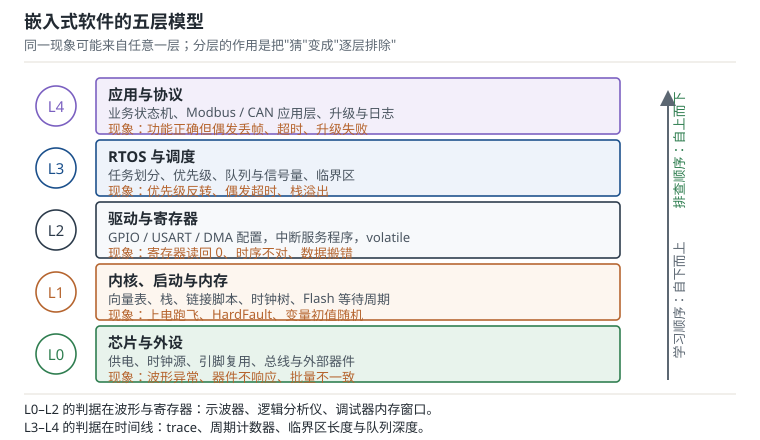

# 嵌入式软件全景：从寄存器到 RTOS

这本手册要解决的不是"会不会写代码"，而是"知不知道硬件此刻在做什么"。外设寄存器写对了没有、中断为什么没进、DMA 为什么搬错半包、RTOS（Real-Time Operating System，实时操作系统）里为什么偶尔丢一帧——这些问题的答案分散在芯片手册、启动文件、驱动代码和调度器里，只有先有一张分层的地图，才知道该往哪一层看。本章给出这张地图：五层模型、每层的判据、以及从现象定位到层的顺序。

## 1. 设计动机（为什么需要一张分层地图）

::: motivation 三个"知识断层"的现场
**现场一：会点灯，不会定位。** 照着例程点亮了 LED，换成自己写的 UART 接收就收不到数据。于是改波特率、换引脚、换中断优先级，每次只改一个地方，试了三天。真正的问题在另一层：`SystemInit` 里 HSE 没起振，芯片跑在 8 MHz 的 HSI 上，波特率分频值却按 72 MHz 算，差了 9 倍。点灯不需要精确时钟，所以这个断层在点灯阶段完全看不见。

**现场二：会用 HAL，看不懂 map。** 工程加到 60 KB，链接报 `region FLASH overflowed`，第一反应是"删点功能"。实际上 map 文件显示 `.rodata` 里有一张 8 KB 的字库表被链接进来却从没被调用，用 `--gc-sections` 加上 `KEEP` 的精确控制就能回收。不知道"哪一层负责地址"，就只能靠删功能解决容量问题。

**现场三：RTOS 里的偶发超时。** 任务优先级排好了、队列也加了，压力测试仍偶发超时。示波器看中断响应正常，最后用周期计数器发现：一个低优先级任务持有互斥量时被中优先级任务抢占，高优先级任务等锁等了 3 ms——典型的优先级反转。这是调度层的问题，但在驱动层怎么查都查不出来。
:::

把常见现象、它最可能所属的层、以及第一检查项列成表：

| 现象 | 最可能所属层 | 第一检查项 |
|---|---|---|
| 上电跑飞、进 HardFault | 内核与启动 | 向量表前两项、MSP 是否在 RAM 内 |
| 串口乱码、定时器周期不对 | 内核与启动 | `RCC->CFGR` 的 SWS、Flash 等待周期 |
| 寄存器读回全 0 | 驱动与寄存器 | 外设时钟使能位、复位状态 |
| 数据搬错半包、偶发丢字节 | 驱动与寄存器 | DMA 配置、缓冲区对齐、cache 一致性 |
| 偶发超时、优先级反转 | RTOS 与调度 | 临界区长度、互斥量使用、栈水位 |
| 功能对但通信偶发失败 | 应用与协议 | 超时重传、帧边界、状态机异常分支 |

**不算会摔在哪**，三个可以量化的代价：

1. **没有分层，排查是线性枚举。** 一个现象背后若有 32 个候选原因，逐个试平均要 16 次才能撞对；按层二分只要 $\lceil\log_2 32\rceil=5$ 次。差距不是"快一点"，是 3 倍以上的时间。
2. **跳过启动与内存直接学 RTOS。** 栈溢出踩坏 `.bss` 的表现是"某个任务偶尔不跑"，很容易被误判成调度器 bug。实际上把栈加大 512 B 就好了——但不知道栈在哪一层，就会去读调度器源码。
3. **只看功能不看时序。** 1 kHz 控制环里放一条 64 字节的阻塞打印，占用 5.56 ms，等于连续丢掉 5 个控制周期。功能测试全过，装到电机上就抖。

## 2. 定义与直观（原理：五层模型）

### 2.1 五层与两条箭头

把嵌入式软件从下往上分成五层，每层只回答一类问题：

- **L0 芯片与外设**：供电、时钟源、引脚复用、总线时序、外部器件。这一层的判据在示波器和数据手册上。
- **L1 内核、启动与内存**：向量表、栈、链接脚本、时钟树、Flash 等待周期。这一层的判据在 map 文件、寄存器值和复位后的第一条指令里。
- **L2 驱动与寄存器**：GPIO/USART/DMA 的配置、中断服务程序、`volatile` 与内存屏障。这一层的判据在寄存器读回值和波形上。
- **L3 RTOS 与调度**：任务划分、优先级、队列、信号量、临界区。这一层的判据在时间线上。
- **L4 应用与协议**：业务状态机、Modbus/CAN 应用层、升级与日志。这一层的判据在协议一致性和用户体验上。

图上有两条方向相反的箭头。**学习顺序自下而上**：先能解释复位后发生了什么，再谈驱动；先能写好中断，再谈调度。**排查顺序自上而下**：先确认应用层输入输出是否符合预期，再往下逐层缩小范围。两条箭头不矛盾——建知识是打地基，查问题是找裂缝。

### 2.2 每一层回答什么问题

| 层 | 核心问题 | 最小可交付能力 | 典型失败 |
|---|---|---|---|
| L0 | 电平和时序对不对 | 能看波形判断空闲/起止/采样点 | 上拉电阻缺失、晶振负载电容不匹配 |
| L1 | 复位后发生了什么 | 能读 map、能改链接脚本、能配时钟 | 向量表错位、栈溢出、等待周期不足 |
| L2 | 外设怎么被正确驱动 | 能不看 HAL 写一个轮询/中断驱动 | 时钟没开、读改写竞态、DMA 配置错 |
| L3 | 多个任务如何共享 CPU | 能算利用率和阻塞时间、能设优先级 | 优先级反转、死锁、栈不够 |
| L4 | 业务如何正确表达 | 能把协议状态机画成表并验证异常分支 | 帧边界错、重传风暴、升级变砖 |

这张表也是"学到什么程度算过关"的验收标准。每一层都有可观察的产出：L1 的产出是一份能解释每个段地址的 map，L2 的产出是一段不依赖 HAL 也能跑的驱动，L3 的产出是一张带最坏阻塞时间的优先级表，L4 的产出是一份覆盖异常分支的状态机。

### 2.3 层间接口

层与层之间不是靠"感觉"连接的，而是靠明确的接口：

- **L0–L1**：芯片的存储器映射与复位行为。厂商用启动文件、链接脚本、`SystemInit` 把这一层固定下来。
- **L1–L2**：CMSIS（Cortex Microcontroller Software Interface Standard）的内核访问接口（`NVIC_EnableIRQ`、`SysTick_Config`）与外设寄存器定义。CMSIS 只规定内核，外设由厂商头文件定义。
- **L2–L3**：中断与临界区。RTOS 通过 `PendSV` 做上下文切换，通过 `SVC` 提供系统调用，通过关中断保护临界区。
- **L3–L4**：任务、队列、信号量、事件组。应用层不应该直接操作寄存器，否则换芯片时整层重写。

接口清楚的好处是"可替换"：L2 的驱动换成另一颗芯片的，只要接口不变，L3/L4 不用动；L3 从裸机前后台换成 RTOS，L4 的任务划分可以保留。

### 2.4 从现象到层

定位的第一步不是读代码，而是问"这个现象能在哪一层被观察到"。三个例子：

- **串口收到乱码**：L0 能看到波形位宽不对，L1 能读到时钟配置，L2 能读到 BRR。三层都"能看"，但最快的路径是先用示波器量一位宽度：位宽对，问题在 L2 以上；位宽不对，直接查 L1 的时钟。
- **DMA 搬错半包**：L2 看 DMA 配置与缓冲区，L1 看内存布局（缓冲区是否跨了不能 DMA 访问的区域），L0 看总线仲裁。先查 L2 的传输长度与对齐，再查 L1 的 MPU/缓存配置。
- **任务偶发不跑**：L3 看优先级与栈，L1 看 MSP/PSP 与栈溢出，L2 看中断是否长时间关着。先量"关中断的最长时间"，再谈调度。

## 3. 定量关系（公式：定位次数、延迟与利用率）

### 3.1 二分定位的期望次数

若一个现象有 $N$ 个互斥的候选原因，按层二分（每次把范围砍一半）的次数上界是

$$
k=\left\lceil\log_2 N\right\rceil
$$

其中 $N$ 是候选原因数，$k$ 是最坏情况下的验证次数。$N=32$ 时 $k=5$；$N=64$ 时 $k=6$。线性枚举的期望次数是 $N/2$，32 个原因平均 16 次。这解释了为什么"分层"不是审美问题：它把排查从 $O(N)$ 降到 $O(\log N)$。

当然，二分的前提是"每个原因可独立验证"，而现实中验证本身有成本。所以工程上的做法是**先按层二分，再在层内按概率排序**：先验证最容易、最便宜的那个假设。

### 3.2 中断延迟预算

中断从触发到处理函数第一条指令执行，时间由三部分组成：

$$
t_{\text{lat}}=\frac{C_{\text{entry}}}{f_{\text{cpu}}}+t_{\text{block}}+t_{\text{fetch}}
$$

其中 $C_{\text{entry}}$ 是异常进入的周期数（Cortex-M3 典型 12 个周期），$t_{\text{block}}$ 是最高优先级中断被屏蔽的最长时间（关中断临界区），$t_{\text{fetch}}$ 是取指与流水线填充的额外时间。72 MHz 下 12 个周期是 $12/72\times10^{6}=0.167\ \mu\text{s}$，相比毫秒级的控制周期可以忽略；真正决定延迟的是 $t_{\text{block}}$。

这条式子给出一个可执行的规则：控制环周期 1 ms 时，关中断临界区不应超过周期的 1%（10 µs），否则最坏延迟就会吃掉控制精度。

### 3.3 RTOS 的任务利用率

周期任务的可调度性先看利用率：

$$
U=\sum_{i=1}^{n}\frac{C_i}{T_i}+U_{\text{isr}}
$$

其中 $C_i$ 是第 $i$ 个任务的最坏执行时间，$T_i$ 是它的周期，$U_{\text{isr}}$ 是中断服务程序占用的比例。$U<1$ 是必要条件，不是充分条件——优先级安排不当，即使 $U$ 只有 0.3 也可能超时。

### 3.4 队列深度与 Little 定律

平均在途的帧数由到达率与服务时间决定：

$$
L=\lambda W
$$

其中 $\lambda$ 是到达率（帧/秒），$W$ 是平均处理时间（秒），$L$ 是平均在途数。$\lambda=250$ 帧/秒、$W=2$ ms 时 $L=0.5$，平均不到一帧在途，队列深度 1 就够；但突发到达时队列要按"峰值到达率 × 处理时间"设计，不能按平均值。

### 3.5 五层的资源预算

把 Flash 与 RAM 按层分账：

$$
S_{\text{flash}}=\sum_{i=0}^{4}S_{\text{flash},i},\qquad S_{\text{ram}}=\sum_{i=0}^{4}S_{\text{ram},i}
$$

其中 $S_{\text{flash},i}$ 与 $S_{\text{ram},i}$ 分别是第 $i$ 层占用的 Flash 与 RAM 字节数，$i$ 从 0 到 4 对应五层。这两条式子的意义不在计算本身，而在"分账"：一旦某层超支，能在早期发现，而不是等到链接报错才删功能。

::: advanced 速率单调调度的利用率上界
对 $n$ 个周期任务、按周期越短优先级越高（Rate Monotonic，RM）的固定优先级调度，Liu 与 Layland 给出的充分条件是

$$
U\le n\left(2^{1/n}-1\right)
$$

$n=3$ 时上界是 $3\times(1.2599-1)=0.7798$，即 77.98%；$n\to\infty$ 时趋近 $\ln 2=0.693$。这是充分条件而非必要条件：$U$ 超过上界仍可能可调度（取决于具体周期），但低于上界一定可调度。工程上用它做快速筛查，超过上界再算精确的响应时间分析。
:::

## 4. 典型计算（64 KB 设备的五层预算）

设定一颗 64 KB Flash、20 KB SRAM、72 MHz 的 Cortex-M3，带一个 RTOS 和三条任务。按层分账：

| 层 | Flash | RAM | 说明 |
|---|---|---|---|
| L1 启动与内核 | 1.2 KB | 0.3 KB | 向量表、启动代码、时钟初始化 |
| L2 驱动 | 7.0 KB | 3.0 KB | UART/DMA/定时器与缓冲区 |
| L3 RTOS | 9.0 KB | 1.5 KB | 内核、就绪表、任务控制块 |
| L4 应用与协议 | 24.0 KB | 2.2 KB | 状态机、协议栈、日志 |
| 栈与堆 | — | 4.0 KB | MSP 2 KB、堆 2 KB |

**问题一：Flash 与 RAM 各用了多少？**

$$
S_{\text{flash}}=1.2+7.0+9.0+24.0=41.2\ \text{KB}
$$

$41.2/64=64.4\%$，剩余 22.8 KB。RAM 合计 $0.3+3.0+1.5+2.2+4.0=11.0$ KB，$11.0/20=55\%$，剩余 9.0 KB。两边的余量都够一次功能迭代，但不够同时加字库和文件系统。

**问题二：CPU 利用率是多少？**

三条任务：1 ms/10 ms、2 ms/20 ms、5 ms/100 ms；中断每秒 1000 次、每次 2 µs。

$$
U=\frac{1}{10}+\frac{2}{20}+\frac{5}{100}+\frac{1000\times2\times10^{-6}}{1}=0.1+0.1+0.05+0.002=0.252
$$

利用率 25.2%，空闲 74.8%。这个数字说明 CPU 不是瓶颈，问题更可能出在阻塞与优先级上——这也是为什么 3.3 节强调"利用率低不等于不会超时"。

**问题三：中断延迟是多少？占控制周期的多少？**

12 个周期进入异常：

$$
t_{\text{entry}}=\frac{12}{72\times10^{6}}=0.167\ \mu\text{s}
$$

若最长关中断临界区是 5 µs，则最坏延迟约 $0.167+5=5.17\ \mu\text{s}$。相对 1 ms 的控制周期：

$$
\frac{5.17}{1000}=0.517\%
$$

低于 1% 的经验阈值，可以接受。若临界区涨到 30 µs，延迟占比 3%，控制环的采样抖动就会体现在输出纹波上。

**问题四：接收队列要多深？**

平均到达 250 帧/秒、每帧处理 2 ms：

$$
L=250\times0.002=0.5
$$

平均半帧在途，队列深度 1 就够。但突发时一毫秒内可能到 4 帧，队列深度至少 4。设计时按"峰值到达率 × 最坏处理时间"取，再留一倍余量，得到 8。

**问题五：32 个候选原因，二分几次能定位？**

$$
k=\left\lceil\log_2 32\right\rceil=5
$$

线性枚举平均 16 次。这个差距就是"分层地图"的直接收益。

## 5. 工程含义（实践：学习路径与验收标准）

### 5.1 六段学习路径

| 阶段 | 内容 | 产出 |
|---|---|---|
| 阶段一 | 工具链、内存模型、启动流程 | 能独立把裸机工程跑起来，能看 map 定位问题 |
| 阶段二 | Cortex-M 内核与外设 | 能写不依赖 HAL 的 GPIO/中断/定时器驱动 |
| 阶段三 | 通信接口 | 能用示波器/逻辑分析仪定位时序问题 |
| 阶段四 | RTOS | 能设计任务划分、优先级与同步策略 |
| 阶段五 | 存储与升级 | 能做 bootloader 与 OTA 升级 |
| 阶段六 | 工程实践 | 能做低功耗、可靠性与量产测试 |

每一阶段的产出都必须"可演示、可测量"：阶段一的产出是一份能逐段解释地址的 map；阶段二的产出一段拔掉 HAL 也能跑的驱动；阶段三的产出一次用逻辑分析仪抓到的完整帧；阶段四的产出一张带最坏阻塞时间的优先级表；阶段五的产出一次断电续传的升级记录；阶段六的产出一次高低温循环的测试报告。

### 5.2 每层的验收标准

- **L1**：能回答"复位后第一条指令在哪、栈顶是多少、`.data` 从哪拷到哪"。
- **L2**：能回答"这个外设的时钟来自哪条总线、寄存器写入什么时候生效"。
- **L3**：能回答"最坏情况下高优先级任务要等多久、谁持有锁"。
- **L4**：能回答"协议异常分支怎么处理、重传上限是多少"。

回答不了的问题，就是还没学透的那一层。

### 5.3 与其他分册的关系

硬件部分（电源、信号完整性、EMC）见同站的《硬件工程师手册》分册；本手册只讨论软件如何正确驱动硬件，以及软件侧能看到的现象与排查手段。两本分册的分工是"现象与器件"和"寄存器与代码"：同一块板子上的同一个故障，硬件分册教你怎么量，本分册教你怎么读寄存器、怎么改代码。

### 5.4 三遍读法

第一遍只读每章的"定义与直观"，建立词汇表；第二遍读"定量关系"与"典型计算"，把公式代进自己的工程；第三遍在读代码时回头查"常见坑"，把别人的教训变成检查项。不要从头到尾逐字读——手册的价值在查阅，不在通读。

## 6. 常见坑（现象、原因与解决）

::: pitfall 五个学习与工程上的坑
- **只学 HAL，不碰寄存器**：现象——库函数一换版本就编译不过，或者配置项看不懂；出问题时只能猜。原因——HAL 把"外设时钟、位域、时序"藏在函数里，跳过寄存器就不知道它在做什么。解决——至少完整手写一遍 GPIO 与 UART 的轮询驱动，对照参考手册逐位核对；再用 HAL 时能说出它替你写了哪几位。

- **跳过启动与内存直接学 RTOS**：现象——任务偶发不跑、全局变量被改，怀疑调度器有 bug。原因——栈溢出、向量表错位、`.data` 没拷贝这些问题，在 RTOS 下表现得更隐蔽；调度器只是背锅。解决——先能独立解释 map 文件与启动文件，再学任务切换；RTOS 出问题先量栈水位与关中断时间。

- **用断点调 RTOS 竞态**：现象——单步时一切正常，全速跑就复现；或者加了断点反而不出现。原因——断点停住 CPU 会改变时序，竞态窗口被拉长或消除。解决——用 GPIO 翻转、周期计数器、trace 记录事件顺序，尽量不停 CPU；必须停时用观察点而不是断点。

- **只做功能测试，不做时序预算**：现象——实验室全过，现场偶发丢包。原因——没有算过最坏中断延迟、队列深度、总线占用率，裕量在温度与负载变化时被吃光。解决——每个关键路径写一个"预算表"：延迟、队列、栈、CPU 利用率各留多少余量，用示波器与计数器验证。

- **照抄例程不看时钟配置**：现象——例程能跑，自己的板子串口乱码、定时器周期差 9 倍。原因——例程按 72 MHz 写死了分频值，自己的板子跑在 8 MHz HSI 上，或晶振频率不同。解决——所有分频值都用宏从实际时钟推导，启动时读回 `RCC->CFGR` 确认，波特率先用示波器量一位宽度再下结论。
:::

## 7. 自测题

为什么先学内存模型和启动流程，而不是直接点灯？

点灯成功只能证明"某一条路径通了"：GPIO 时钟开了、引脚配置对了、输出寄存器写对了。它不能证明三件事：向量表正确、栈在合法范围、`.data` 被正确初始化。一旦进入中断、DMA、Cache、多任务，出问题的往往不是外设配置，而是启动时没有初始化时钟/向量表/栈，或者内存布局与链接脚本不符。

从分层模型看，点灯是 L2 的一个点，而 L1 是整张地图的坐标系。先有坐标系，后面的现象才能定位到具体一层；没有坐标系，每次排查都是重新猜。

裸机和 RTOS 的调试手段有什么本质区别？

裸机可以靠断点和大循环定位：程序是单线程的，断点停在哪里，状态就停在哪里，因果关系清楚。

RTOS 下断点会改变时序：停住 CPU 期间其他任务不再运行，竞态窗口被拉长或消除，于是"单步正常、全速复现"。更麻烦的是优先级反转、死锁这类问题，只有在特定抢占顺序下才出现。所以 RTOS 调试必须依赖 trace、周期计数器、事件记录和临界区分析，尽量不停 CPU；断点只用于确认"某条路径是否被走到"，不用于复现时序问题。

三条任务：1 ms/10 ms、3 ms/20 ms、8 ms/100 ms；中断每秒 500 次、每次 4 µs。利用率多少？按 RM 上界判断是否可调度？

$$
U=\frac{1}{10}+\frac{3}{20}+\frac{8}{100}+\frac{500\times4\times10^{-6}}{1}
$$

$$
U=0.1+0.15+0.08+0.002=0.332
$$

$n=3$ 的 RM 上界：

$$
U_{\text{bound}}=3\left(2^{1/3}-1\right)=3\times(1.2599-1)=0.7798
$$

$0.332<0.7798$，满足充分条件，因此按周期越短优先级越高的调度一定可调度。注意这是充分条件：即使超过 0.7798，也可能仍然可调度，需要进一步算响应时间。

某现象有 48 个候选原因，按层二分最坏要几次？如果每次验证要 10 分钟，比线性枚举省多少时间？

$$
k=\left\lceil\log_2 48\right\rceil=6
$$

因为 $2^5=32<48\le64=2^6$。二分 6 次，每次 10 分钟，共 60 分钟。

线性枚举的期望次数是 $48/2=24$ 次，即 240 分钟；最坏 48 次、480 分钟。相比期望值节省 180 分钟，相比最坏值节省 420 分钟。

这个模型假设"每次验证能排除一半原因"，现实中做不到这么理想，但"先分层"仍然能把候选集从几十个压到几个，收益的量级不变。

中断进入 12 个周期、主频 72 MHz、最长关中断临界区 8 µs，最坏中断延迟是多少？占 1 ms 控制周期的多少？临界区上限应该定多少？

进入异常的时间：

$$
t_{\text{entry}}=\frac{12}{72\times10^{6}}=0.167\ \mu\text{s}
$$

最坏延迟：

$$
t_{\text{lat}}=0.167+8=8.17\ \mu\text{s}
$$

占 1 ms 周期：

$$
\frac{8.17}{1000}=0.817\%
$$

若要求延迟不超过周期的 1%，临界区上限是 $10-0.167=9.83\ \mu\text{s}$，工程上取 8 µs 留余量。超过这个值就要拆分临界区、把耗时操作移到中断下半部，或者提高控制环优先级。

## 8. 参考资料

- Arm, *ARMv7-M Architecture Reference Manual*（ARM DDI 0403E），Chapter A3 "Programmer's Model" 与 Chapter B1 "System Level Architecture"：异常模型、栈帧、向量表与复位行为，是 L1 层全部结论的体系结构依据。
- Arm, *Cortex-M3 Technical Reference Manual*（ARM DDI 0337I），Chapter 2 "Programmer's Model"、Chapter 6 "Cortex-M3 Memory Map"、Chapter 8 "Debug"：MSP/PSP、内存映射与调试单元，本章 2.1、2.2 节的分层与 3.2 节的延迟模型参考此三章。
- STMicroelectronics, *RM0008 Reference Manual*（Rev 21），Chapter 3 "Memory and bus architecture" 与 Chapter 7 "Reset and clock control"：启动配置、Flash 等待周期与时钟树，第 4 节的资源分账与 5.3 节的工程口径以此为准。
- Barry, *Mastering the FreeRTOS Real Time Kernel*（FreeRTOS 官方教程，2016），Chapter 1 "Task Management" 与 Chapter 3 "Queue Management"：任务状态、优先级与队列语义，本章 3.3、3.4 节与第 4 节问题四的队列深度估算参考该书。
- Elecia White, *Making Embedded Systems*（O'Reilly, 2nd ed.），Chapter 1 "Introduction" 与 Chapter 8 "Doing More with Less"：嵌入式系统的分层思维与资源受限下的取舍，本章 2.2 节的"最小可交付能力"表述参考该书。
- Arm, *CMSIS-Core*（CMSIS 5.x）文档："Core Peripheral Access" 与启动文件约定：`NVIC_EnableIRQ`、`SysTick_Config`、`SCB->VTOR` 的接口定义，本章 2.3 节的层间接口按此整理。