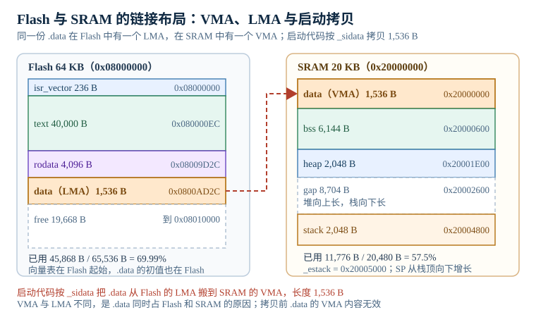

# 链接脚本与内存布局：VMA、LMA 与启动拷贝

链接器（linker）是嵌入式构建里最容易被当成"配置文件"的一环。编译器把每个 `.c` 变成 `.o`，链接器把 `.o` 里的节（section）摆到芯片地址空间里，再把所有符号的地址定下来。它只回答两个问题：**放在哪、放不放得下**。至于放的位置对不对、启动代码会不会把初值搬过去、堆和栈会不会撞上，链接器不知道，也不负责。链接器生成的映射文件（map file，通常简称 map 文件）是这件事的账本。

这就是"编译链接全绿、板子一上电就随机"的根源。`.data` 的加载地址写错，全局配置结构体会保持上电的随机 SRAM 值；`_estack` 和向量表的初始 SP 不一致，复位后第一条压栈就进 HardFault；堆和栈之间没有保留区，跑几个小时之后堆顶覆盖栈底，现场只剩一个复位。本章把链接脚本拆成可检查的地址账本，并给出每个数字的复算方法。

> 本章以一颗 64 KB Flash、20 KB SRAM 的 Cortex-M3 为例：Flash 起始 `0x08000000`，SRAM 起始 `0x20000000`，页大小 1 KB，页擦除 20 ms，半字编程 50 µs。所有地址、容量与百分比用 Python 复算；不同芯片的 `ORIGIN`/`LENGTH` 要按数据手册替换。

## 1. 动机：链接器不报错，板子会报错

::: motivation 四个现场
**现场一：全局配置结构体一半是随机值。** 工程从别的项目抄来链接脚本，`.data` 只写了 `> RAM`，没有 `AT> FLASH`。链接器把 `.data` 的 VMA 和 LMA 都定在 SRAM 地址，启动代码却仍按 `_sidata` 去 Flash 拷贝。结果拷贝源指向一段空白 Flash，`g_config` 的初值全是 `0xFF`；有些板子因为 SRAM 上电残留，碰巧能跑。map 文件里 `.data` 那一行没有 `load address`，就是最直接的线索。

**现场二：复位后第一条指令就 HardFault。** 链接脚本把 `_estack` 定义成 `ORIGIN(RAM) + LENGTH(RAM) - 0x400`，而启动文件里的向量表第一个字仍指向旧的 `_estack` 符号，或者干脆写死成 `0x20005000`。复位时内核从向量表取初始 MSP，若这个值与实际栈区不一致，第一次异常压栈或第一次函数调用就会写到非法地址。Cortex-M 的复位序列不检查栈指针是否合法，它只是把这个值装进 MSP。

**现场三：32 KB 的 bootloader 把应用挤爆。** 产品要求 bootloader 占前 32 KB，应用从 `0x08008000` 开始。链接脚本仍按整片 64 KB 写 `FLASH` 的 `LENGTH = 64K`，应用镜像 45,868 B 链接通过，烧写时把 bootloader 覆盖掉。正确写法是把应用区的 `ORIGIN` 改成 `0x08008000`、`LENGTH` 改成 `32K`，链接器立刻报 "region FLASH overflowed by 13100 bytes"。

**现场四：堆和栈在半夜撞上。** `.bss` 结束于 `0x20001E00`，堆从 `0x20001E00` 向上长，栈从 `0x20005000` 向下长，中间有 8,704 B 空隙。看起来很远，但 `_sbrk` 只检查"堆顶是否超过 `_estack`"，不检查"是否接近当前 SP"。一个 9 KB 的 `malloc` 就能让堆顶进到栈区，写坏栈上的返回地址；表现是"运行几小时后随机 HardFault"，而单步调试永远复现不了。
:::

把现象、第一检查点和判据放在一张表里：

| 你看到的现象 | 先查什么 | 判据 |
|---|---|---|
| 全局变量初值随机、部分板子正常 | `.data` 的 LMA、`_sidata`、启动拷贝循环 | map 中 `.data` 有 `load address`，且等于 `_sidata` |
| 复位即 HardFault、停在 `Default_Handler` | 向量表第一个字与 `_estack` | 两者相等，且 8 字节对齐 |
| 链接通过但烧写后不运行 | `MEMORY` 的 `LENGTH` 与真实芯片 | 所有段结束地址不超过芯片容量 |
| 中断进 `Default_Handler` | 向量表是否被 `--gc-sections` 收走 | `KEEP(*(.isr_vector))` 存在 |
| 运行一段时间后随机跑飞 | 堆顶、栈底、`_sbrk` 边界 | 堆上限不超过 `_estack - 栈保留` |
| 变量被无关代码改掉 | 段是否重叠、`NOLOAD` 段是否被清零 | `ASSERT` 与 map 地址连续 |
| 应用跳转后进错中断 | `VTOR` 是否指向应用向量表 | `SCB->VTOR = 0x08008000` |

**不算会摔在哪**，四个带数字的代价：

1. **1,536 B 的 `.data` 拷贝错，整机配置失效。** 拷贝 1,536 B 只需 $384\times2/72\times10^6=10.67\ \mu\text{s}$，但这 10.67 µs 决定了几十个全局结构体的初值。拷贝源偏移 4 B，第一个字就错；拷贝长度算成 0，所有初值都保持 SRAM 上电值。
2. **32 KB 应用区放 45,868 B 镜像，超出 13,100 B。** 这不是"优化一下就能塞进去"的量：13,100 B 相当于镜像的 28.6%，需要删功能或换更大 Flash 的型号。链接期就报错，比现场变砖便宜得多。
3. **堆栈间隙 8,704 B 看着多，实际只够 4 次 2 KB 分配。** 每次 `malloc(2048)` 占 2 KB，4 次就是 8 KB；第 5 次越过栈底。若栈峰值 1,200 B，堆的上限还应再减 1,200 B。
4. **`.data` 跨两个 1 KB 页，多擦一次。** 1,536 B 从 `0x0800AD2C` 开始，落在页 131115 和 131116，擦除两页要 40 ms，不是 20 ms。批量生产时每台多 20 ms，一万台就是 200 s。

## 2. 定义与直观：段、VMA/LMA 与启动拷贝

### 2.1 节、段与镜像

编译器把代码和数据分成**节（section）**：`.text` 放指令，`.rodata` 放只读常量，`.data` 放有初值的可写全局变量，`.bss` 放零初始化的可写全局变量。链接器把这些输入节合并成**输出节（output section）**，再按链接脚本放到地址空间里。可执行与可链接格式（Executable and Linkable Format，ELF）文件里还有**段（segment）**的概念，一个段可以包含多个节；`objcopy -O binary` 只导出可加载段，所以 `.bin` 通常比 `.elf` 小很多。

几个在嵌入式里经常打交道的节：

| 节 | 内容 | 典型位置 | 启动时动作 |
|---|---|---|---|
| `.isr_vector` | 向量表，第一个字是初始 SP | Flash 起始 | 硬件读取，不拷贝 |
| `.text` | 指令、内联常量 | Flash | 不需处理 |
| `.rodata` | 字符串、`const` 数组 | Flash | 不需处理 |
| `.data` | 有初值的可写变量 | Flash（LMA）+ RAM（VMA） | 从 LMA 拷到 VMA |
| `.bss` | 零初始化的可写变量 | RAM | 清零 |
| `.noinit` | 复位后保留的变量 | RAM | 不清零、不拷贝 |
| `.ARM.exidx` | 异常展开索引 | Flash | 不需处理 |
| `.init_array` | C++ 全局构造、`__attribute__((constructor))` | Flash | 启动时调用 |

`.bss` 在 ELF 里是 `NOBITS` 类型，不占文件空间，只占运行时内存；`.data` 的初值必须存在 Flash 里，所以它同时占 Flash 和 RAM。这个"双地址"特性是理解 VMA/LMA 的入口。

### 2.2 MEMORY 命令

`MEMORY` 描述芯片有哪些存储区、起始地址、长度和属性：

```ld
MEMORY
{
  FLASH (rx)  : ORIGIN = 0x08000000, LENGTH = 64K
  RAM   (xrw) : ORIGIN = 0x20000000, LENGTH = 20K
}
```

`ORIGIN` 是起始地址，`LENGTH` 是长度，属性 `r` 可读、`w` 可写、`x` 可执行、`a` 可分配、`i` 已初始化、`l` 同 `i`、`!` 取反。属性主要用于诊断：把只读数据放进 `(rw)` 区，链接器会警告。`LENGTH` 必须按**实际芯片型号**填，不能按同系列最大型号抄；链接器只检查段是否超出 `LENGTH`，不检查 `LENGTH` 是否超出芯片。

### 2.3 SECTIONS 与位置计数器

`SECTIONS` 决定每个输出节放在哪个区、地址是多少：

```ld
SECTIONS
{
  .isr_vector : {
    KEEP(*(.isr_vector))
  } > FLASH

  .text : {
    *(.text*)
    *(.rodata*)
  } > FLASH

  .data : {
    _sdata = .;
    *(.data*)
    _edata = .;
  } > RAM AT > FLASH

  .bss : {
    _sbss = .;
    *(.bss*)
    *(COMMON)
    _ebss = .;
  } > RAM

  .noinit (NOLOAD) : {
    *(.noinit*)
  } > RAM

  _estack = ORIGIN(RAM) + LENGTH(RAM);
}
```

几个关键语法：

- `.` 是**位置计数器（location counter）**，表示当前地址。`_sdata = .;` 把当前地址赋给符号 `_sdata`，启动代码用它当拷贝目标。
- `> RAM` 指定 VMA 所在区；`AT > FLASH` 指定 LMA 所在区。`.data` 的 VMA 在 RAM、LMA 在 Flash，就是这一行造成的。
- `KEEP(*(.isr_vector))` 阻止 `--gc-sections` 把向量表当垃圾收走。向量表里的中断处理函数地址不是普通引用，链接器的垃圾回收看不到，必须 `KEEP`。
- `NOLOAD` 表示这个节不占加载镜像，启动时也不会被拷贝；`.noinit` 用它保留复位前的 RAM 内容。
- `PROVIDE(symbol = expression)` 只在符号未定义时提供默认值，适合给启动文件提供可覆盖的弱符号。
- `ASSERT(expr, "message")` 在链接期检查表达式，失败就报错。把容量检查写成 `ASSERT`，比事后看 map 更可靠。

### 2.4 VMA 与 LMA

**VMA（Virtual Memory Address，运行地址）** 是程序运行时看到的地址，也就是指针的值。**LMA（Load Memory Address，加载地址）** 是这段内容在烧写镜像里的地址，也就是它实际存放在 Flash 的位置。对 `.text` 和 `.rodata`，VMA 和 LMA 通常相同，都在 Flash；对 `.data`，VMA 在 RAM、LMA 在 Flash。

启动代码要做的第一件事，就是把 `.data` 从 LMA 搬到 VMA：

```c
extern uint32_t _sidata;   /* .data 的 LMA */
extern uint32_t _sdata;    /* .data 的 VMA 起点 */
extern uint32_t _edata;    /* .data 的 VMA 终点 */
extern uint32_t _sbss;
extern uint32_t _ebss;

void Reset_Handler(void)
{
    uint32_t *src = &_sidata;
    uint32_t *dst = &_sdata;
    while (dst < &_edata) {
        *dst++ = *src++;
    }
    for (dst = &_sbss; dst < &_ebss; ++dst) {
        *dst = 0;
    }
    main();
}
```

这段循环的正确性依赖三个符号：`_sidata` 必须等于 `LOADADDR(.data)`，`_sdata` 必须等于 `ADDR(.data)`，`_edata - _sdata` 必须等于 `SIZEOF(.data)`。任何一个不对，`.data` 就是错的。用链接脚本表达式写，比在汇编里手算地址可靠：

```ld
_sidata = LOADADDR(.data);
_sdata  = ADDR(.data);
_edata  = ADDR(.data) + SIZEOF(.data);
```

下图把 Flash 和 SRAM 的布局画在一起：左边 Flash 里的 `.data` 是 LMA，右边 SRAM 里的 `.data` 是 VMA，中间箭头表示启动拷贝。`.bss`、堆、栈都只在 SRAM 里，不占 Flash。



### 2.5 堆与栈的放置

栈（stack）通常放在 SRAM 的最高地址，向下增长；堆（heap）从 `.bss` 结束处向上增长。链接脚本用符号把边界固定下来：

```ld
_estack = ORIGIN(RAM) + LENGTH(RAM);   /* 栈顶，8 字节对齐 */
_heap_start = _ebss;
_heap_end = _estack - _Min_Stack_Size;
```

`_estack` 同时要写进向量表的第一个字。启动文件通常用 `ldr sp, =_estack` 或向量表里的 `.word _estack`；两者必须是同一个符号，不能一个用符号、一个写死常数。`_estack` 还要满足 AAPCS32 的 8 字节栈对齐：如果 SRAM 末尾不是 8 的倍数，要写成 `_estack = (ORIGIN(RAM) + LENGTH(RAM)) & ~7;`。

`_sbrk` 的实现决定堆能不能长到栈里：

```c
void *_sbrk(ptrdiff_t incr)
{
    static uint8_t *heap = &_heap_start;
    uint8_t *prev = heap;
    if (heap + incr > &_heap_end) {
        errno = ENOMEM;
        return (void *)-1;
    }
    heap += incr;
    return prev;
}
```

关键是 `_heap_end` 要减去栈保留量，而不是直接等于 `_estack`。只检查 `_estack` 的实现，等于允许堆长到栈顶，冲突只是时间问题。

### 2.6 map 文件的结构

链接时加 `-Wl,-Map=build/app.map`，链接器会生成一张地址账本。map 文件通常分四段：

1. **Memory Configuration**：列出每个 `MEMORY` 区的名字、`ORIGIN`、`LENGTH`、属性。先核对这里，确认长度和芯片一致。
2. **Linker script and memory map**：按输出节列出 VMA、大小、LMA（如果与 VMA 不同，会多一列 `load address`），以及每个输入节来自哪个 `.o`。
3. **Discarded input sections**：被 `--gc-sections` 或 `KEEP` 规则丢弃的节。这里出现 `.isr_vector` 就是危险信号。
4. **Cross Reference Table**：符号被谁引用，排查"这个函数为什么被链接进来"时有用。

一个输出节的样子：

```text
.data           0x20000000      0x600 load address 0x0800ad2c
                0x20000000                _sdata = .
 *(.data*)
 .data          0x20000000      0x600 build/main.o
                0x20000600                _edata = .
```

读法是：VMA 是 `0x20000000`，大小 `0x600`（1,536 B），LMA 是 `0x0800AD2C`。`_sdata` 在 VMA 起点，`_edata` 在 VMA 终点。启动代码从 `0x0800AD2C` 拷贝 1,536 B 到 `0x20000000`。

### 2.7 向量表、VTOR 与 bootloader

Cortex-M 的向量表第一个字是初始 MSP，第二个字是复位处理函数地址，后面是异常和中断向量。复位时内核从 `0x00000000` 或 `VTOR` 指向的地址取这两个字。`VTOR`（Vector Table Offset Register）的低 7 位保留，所以向量表至少 128 B 对齐；大多数芯片要求更严格，按数据手册。

带引导加载程序（bootloader）的系统里，应用通常从 `0x08008000` 开始，链接脚本要把 `FLASH` 的 `ORIGIN` 改成这个地址，启动代码在跳转前设置 `SCB->VTOR = 0x08008000`。如果应用仍按 `0x08000000` 链接，镜像会覆盖 bootloader；如果 `VTOR` 没设，中断会跳到 bootloader 的向量表，表现是"应用能跑，但一进中断就复位"。

### 2.8 常见节属性与 C++ 构造

- `.text` 里的函数如果只被向量表引用，必须 `KEEP`；否则 `--gc-sections` 会把中断处理函数删掉，向量表指向 `Default_Handler`。
- `.init_array` 放 C++ 全局对象的构造函数和 `__attribute__((constructor))` 函数。启动代码要在 `.data` 拷贝、`.bss` 清零之后调用 `__libc_init_array()`；链接脚本要把 `.init_array` 放进 Flash 并 `KEEP`，它不需要可写。
- `.ARM.exidx` 是 ARM 的异常展开索引，C++ 异常和 `backtrace` 会用到。用 `-fno-exceptions` 可以减小，但不要盲目删，调试工具可能依赖它。
- `.noinit` 用 `(NOLOAD)` 标记，启动代码不清零。掉电后 SRAM 内容通常丢失，所以 `.noinit` 只适合"复位保留、掉电不保留"的现场日志；需要掉电保留用备份寄存器或 Flash。

## 3. 定量关系：容量、对齐、栈阈值与拷贝

### 3.1 Flash 与 RAM 容量

Flash 占用是所有加载到 Flash 的输出节之和，加上对齐填充：

$$
F=\sum_{i\in\text{Flash}} S_i+P_{\text{flash}}
$$

RAM 已分配占用是所有运行时占 RAM 的节、堆和栈之和：

$$
R=\sum_{j\in\text{RAM}} S_j+H+T
$$

堆和栈之间还必须留出保护间隙 $G$，因此可用性判据是 $R+G\leq R_{\text{total}}$。

$S_i$ 是第 $i$ 个节的大小（字节），$P_{\text{flash}}$ 是对齐填充（字节），$H$ 是堆大小，$T$ 是栈大小，$G$ 是堆栈保护间隙（字节）。占用率为 $F/F_{\text{total}}$ 与 $R/R_{\text{total}}$；后者不含间隙，所以"占用率 57.5%"不等于"还剩 42.5% 可以随便用"，其中 8,704 B 的间隙要同时吸收堆和栈的增长。这个式子把"镜像大小"和"运行内存"分开：`.data` 同时出现在两边，`.bss` 只在 RAM，`.text/.rodata` 只在 Flash。

### 3.2 LMA、VMA 与拷贝长度

对 `.data`，设链接脚本给它的 VMA 起点为 $V_0$，LMA 起点为 $L_0$，大小为 $S_d$，则：

$$
V_0=\text{ADDR}(.data),\qquad L_0=\text{LOADADDR}(.data)
$$

启动拷贝的源地址、目标地址和长度分别是：

$$
\text{src}=L_0,\qquad \text{dst}=V_0,\qquad n=S_d
$$

拷贝时间按字搬运估算：

$$
t_{\text{copy}}=\frac{(S_d/4)C_w}{f_{\text{cpu}}}
$$

$C_w$ 是每字搬运的等效周期数（普通 `LDR/STR` 约 2 个周期，`LDM/STM` 可低到 1 周期/字），$f_{\text{cpu}}$ 是主频。$S_d/4$ 是 32 位字数。这个式子只算搬运，不算 Flash 等待周期；从 Flash 读有额外等待，实际时间可能高 20% 到 50%。

### 3.3 对齐填充

把地址 $x$ 向上对齐到 $a$ 的填充字节数：

$$
P(x,a)=\left(a-\left(x\bmod a\right)\right)\bmod a
$$

$P$ 是填充字节数，$x$ 是当前地址，$a$ 是对齐要求。若 $x$ 已经对齐，$P=0$；否则补到下一个 $a$ 的倍数。链接脚本里的 `ALIGN(a)` 就是做这件事，并在填充处写入 `FILL` 指定的字节（默认 0）。

### 3.4 栈阈值

设栈区大小 $S_{\text{stack}}$，为中断、库函数和启动代码预留 $R$，每层调用帧 $F$，最大安全深度：

$$
D_{\max}=\left\lfloor\frac{S_{\text{stack}}-R}{F}\right\rfloor
$$

超出量：

$$
O=D\cdot F+R-S_{\text{stack}}
$$

符号含义同前：$D$ 是实际深度，$O>0$ 表示溢出字节数。链接脚本能保证"栈区有 $S_{\text{stack}}$ 这么大"，但保证不了"最深调用只用 $D_{\max}$ 层"；后者要靠静态分析和实测。

### 3.5 堆的上限

若堆从 $H_0$ 开始，栈顶为 $E$，栈保留 $S_{\text{stack}}$，则堆的安全上限：

$$
H_{\max}=E-H_0-S_{\text{stack}}
$$

$H_{\max}$ 是堆可用的最大字节数。若 `_sbrk` 只检查 $E$ 而不减 $S_{\text{stack}}$，它能分配的上限是 $E-H_0$，比安全值多：

$$
\Delta H=S_{\text{stack}}
$$

也就是整整一个栈区。这个差值不是理论上的：栈在运行中会向下长，堆向上长，两者相遇时没有任何硬件报警（除非用 MPU 栈保护区）。

### 3.6 页数与擦写时间

Flash 按页擦除，一段数据跨越的页数：

$$
N_{\text{page}}=\left\lfloor\frac{x+S-1}{P_{\text{page}}}\right\rfloor-\left\lfloor\frac{x}{P_{\text{page}}}\right\rfloor+1
$$

$N_{\text{page}}$ 是页数，$x$ 是起始地址，$S$ 是大小，$P_{\text{page}}$ 是页大小。擦写时间：

$$
t_{\text{flash}}=N_{\text{page}}t_{\text{erase}}+\frac{S}{2}t_{\text{prog}}
$$

$t_{\text{erase}}$ 是页擦除时间，$t_{\text{prog}}$ 是半字编程时间，$S/2$ 是半字数。这个式子用于估算烧写节拍和 OTA 窗口；实际还要加校验、握手和重试。

### 3.7 map 地址核对

相邻输出节的地址关系：

$$
A_{i+1}=A_i+S_i+P(A_i+S_i,a_{i+1})
$$

$A_i$ 是第 $i$ 节的 VMA，$S_i$ 是大小，$P$ 是对齐填充，$a_{i+1}$ 是下一节的对齐。用这个式子从 map 的第一行一路加到最后一行，能发现"看起来连续、实际有洞"或"两节重叠"的问题。LMA 用同样的式子单独核一遍。

## 4. 典型计算：一张 map 的完整核对

设工程各节如下（单位字节，数字取自一份实际 map，已去掉 `.ARM.exidx` 等元数据）：

| 节 | VMA | LMA | 大小 |
|---|---|---|---:|
| `.isr_vector` | `0x08000000` | `0x08000000` | 236 |
| `.text` | `0x080000EC` | `0x080000EC` | 40,000 |
| `.rodata` | `0x08009D2C` | `0x08009D2C` | 4,096 |
| `.data` | `0x20000000` | `0x0800AD2C` | 1,536 |
| `.bss` | `0x20000600` | — | 6,144 |
| 堆 | `0x20001E00` | — | 2,048 |
| 栈 | `0x20004800` | — | 2,048 |

### 4.1 段地址与容量

Flash 各节大小之和：

$$
F=236+40{,}000+4{,}096+1{,}536=45{,}868\ \text{B}
$$

占 64 KB 的比例：

$$
\frac{45{,}868}{65{,}536}=0.69989=69.99\%
$$

剩余 $65{,}536-45{,}868=19{,}668$ B，即 30.01%。地址核对：

- `.isr_vector` 从 `0x08000000` 开始，236 B，结束于 `0x080000EC`。
- `.text` 从 `0x080000EC` 开始，40,000 B，结束于 `0x08009D2C`。
- `.rodata` 从 `0x08009D2C` 开始，4,096 B，结束于 `0x0800AD2C`。
- `.data` 的 LMA 从 `0x0800AD2C` 开始，1,536 B，结束于 `0x0800B32C`。

$45{,}868$ 的十六进制是 `0xB32C`，与 `0x0800B32C - 0x08000000` 一致。所有起始地址都是 4 的倍数，满足 32 位对齐；但不都是 8 或 16 的倍数，若某芯片要求 `.data` 的 LMA 按 16 字节对齐，需要加 4 B 填充。

RAM 各节：

$$
R=1{,}536+6{,}144+2{,}048+2{,}048=11{,}776\ \text{B}
$$

占 20 KB 的比例：

$$
\frac{11{,}776}{20{,}480}=0.575=57.5\%
$$

剩余 8,704 B，即 42.5%。地址核对：

- `.data` VMA `0x20000000` 到 `0x20000600`（1,536 B）。
- `.bss` `0x20000600` 到 `0x20001E00`（6,144 B）。
- 堆 `0x20001E00` 到 `0x20002600`（2,048 B）。
- 栈 `0x20004800` 到 `0x20005000`（2,048 B）。
- 堆顶到栈底的空隙：`0x20004800 - 0x20002600 = 0x2200 = 8,704 B`。

这个空隙不是"空闲可随便用"，而是"堆和栈之间的缓冲"。堆和栈各自还可能增长，空隙要同时吸收两边的峰值。

### 4.2 `.data` 的 LMA、VMA 与启动拷贝

链接脚本给 `.data` 定义：

```ld
.data : {
  _sdata = .;
  *(.data*)
  _edata = .;
} > RAM AT > FLASH
_sidata = LOADADDR(.data);
```

在这个例子里：

$$
\_sidata=0x0800AD2C,\quad \_sdata=0x20000000,\quad \_edata=0x20000600
$$

拷贝长度：

$$
S_d=\_edata-\_sdata=0x20000600-0x20000000=0x600=1{,}536\ \text{B}
$$

字数为 $1{,}536/4=384$ 个 32 位字。按每字 2 个周期、72 MHz：

$$
t_{\text{copy}}=\frac{384\times2}{72\times10^{6}}=\frac{768}{72\times10^{6}}=10.67\ \mu\text{s}
$$

`.bss` 清零 6,144 B，即 1,536 字，同样每字 2 周期：

$$
t_{\text{bss}}=\frac{1{,}536\times2}{72\times10^{6}}=\frac{3{,}072}{72\times10^{6}}=42.67\ \mu\text{s}
$$

两者合计 53.33 µs。这个时间在 1 ms 的启动预算里只占 5.3%，但它是"第一个采样点是否有效"的前提：`.data` 没拷完就开中断，中断里读到的配置可能是旧值。

如果 `_sidata` 写成 `0x0800AD30`（偏移 4 B），第一个字就错位，`g_config` 的第一个 32 位字段会变成 `.data` 的第二个字，后续全部错位。如果 `_edata` 写成 `_sdata`（长度 0），循环一次都不执行，所有有初值的全局变量保持 SRAM 上电值。两种错误在编译期都不会报，只有 map 文件和运行时检查能发现。

### 4.3 栈阈值与堆栈相撞

2,048 B 栈，预留 384 B，每层 40 B：

$$
D_{\max}=\left\lfloor\frac{2{,}048-384}{40}\right\rfloor=41
$$

41 层用 1,640 B，加预留 384 B 共 2,024 B，剩 24 B。若最深路径 45 层：

$$
O=45\times40+384-2{,}048=136\ \text{B}
$$

溢出 136 B。若某层有 64 B 局部缓冲，帧变成 80 B，最大深度只有 20 层。

堆的边界：堆起点 `0x20001E00`，栈顶 `0x20005000`，栈保留 2,048 B，安全堆上限：

$$
H_{\max}=0x20005000-0x20001E00-2{,}048=12{,}800-2{,}048=10{,}752\ \text{B}
$$

如果 `_sbrk` 只检查 `_estack`，上限是 12,800 B，比安全值多 2,048 B。也就是说，堆可以一直长到栈顶，把整个栈区吃掉。一个 `malloc(11,000)` 在安全实现下应该失败，在错误实现下会成功，然后在下一次函数调用时踩坏栈。

### 4.4 对齐与页擦除

`.data` 的 LMA 是 `0x0800AD2C`，大小 1,536 B，结束于 `0x0800B32C`。按 1 KB 页：

- 起始页号 $\lfloor 0x0800AD2C/1024 \rfloor=131{,}115$；
- 结束页号 $\lfloor 0x0800B32B/1024 \rfloor=131{,}116$；
- 跨越 2 页。

擦除两页要 $2\times20=40$ ms，不是 20 ms。如果只按"1,536 B 不到 2 页"估算，会低估 20 ms。批量生产时，这个误差会累积。

对齐填充的例子：`.bss` 里有一个 3 B 的配置结构体，后面跟一个要求 32 字节对齐的 DMA 缓冲。当前地址 `0x20001203`，对齐到 32：

$$
P(0x20001203,32)=(32-(0x20001203\bmod32))\bmod32=29\ \text{B}
$$

29 B 的填充看起来不多，但 100 个这样的缓冲就是 2,900 B，占 20 KB 的 14.16%。正确做法是把所有 DMA 缓冲集中到一个 `ALIGN(32)` 的段里，只在段首付一次填充，而不是每个缓冲各付一次。

### 4.5 map 文件逐行读法

一段简化的 map：

```text
Memory Configuration

Name             Origin             Length             Attributes
FLASH            0x08000000         0x00010000         xr
RAM              0x20000000         0x00005000         xrw

Linker script and memory map

.isr_vector     0x08000000       0xec
 *(.isr_vector)
 .isr_vector    0x08000000       0xec  startup.o

.text           0x080000ec     0x9c40
 *(.text*)
 .text          0x080000ec     0x9c40  main.o

.rodata         0x08009d2c     0x1000
 *(.rodata*)
 .rodata        0x08009d2c     0x1000  main.o

.data           0x20000000      0x600 load address 0x0800ad2c
                0x20000000                _sdata = .
 *(.data*)
 .data          0x20000000      0x600  main.o
                0x20000600                _edata = .

.bss            0x20000600     0x1800
                0x20000600                _sbss = .
 *(.bss*)
 .bss           0x20000600     0x1800  main.o
                0x20001e00                _ebss = .
```

读法：

1. 先看 `Memory Configuration`，确认 `FLASH` 长度 `0x10000`（64 KB）、`RAM` 长度 `0x5000`（20 KB）与芯片一致。
2. 看 `.data` 行：VMA `0x20000000`、大小 `0x600`、`load address 0x0800ad2c`。这三个数就是启动拷贝的三要素。
3. 看 `_sidata` 是否出现在符号表，是否等于 `0x0800ad2c`；`_sdata` 是否等于 `0x20000000`；`_edata` 是否等于 `0x20000600`。
4. 看 `_estack` 是否等于 `0x20005000`，并与向量表第一个字对比。
5. 看 `Discarded input sections` 里有没有 `.isr_vector` 或中断处理函数；如果有，检查 `KEEP`。

`objdump -h` 给的是另一张表：

```text
Idx Name          Size      VMA       LMA       File off  Algn
  0 .isr_vector   000000ec  08000000  08000000  00001000  2**2
  1 .text         00009c40  080000ec  080000ec  00002000  2**2
  2 .rodata       00001000  08009d2c  08009d2c  0000c000  2**2
  3 .data         00000600  20000000  0800ad2c  0000d000  2**2
  4 .bss          00001800  20000600  20000600  0000e000  2**2
```

`VMA` 和 `LMA` 两列对 `.data` 明显不同，这就是"双地址"；`Algn` 列 `2**2` 表示 4 字节对齐。`readelf -S` 还能看节类型（`PROGBITS`/`NOBITS`）和标志（`WA` 表示可写可分配）。

### 4.6 bootloader 的 32 KB 应用区

假设 bootloader 占 `0x08000000` 到 `0x08007FFF`（32 KB），应用从 `0x08008000` 开始，应用区 32 KB。镜像 45,868 B：

$$
45{,}868-32{,}768=13{,}100\ \text{B}
$$

超出 13,100 B，占应用区的：

$$
\frac{45{,}868}{32{,}768}=1.3998=139.98\%
$$

链接器会报 "region FLASH overflowed by 13100 bytes"。三个选项：

1. 把 bootloader 缩到 16 KB，应用区 48 KB，45,868 B 放得下，剩 3,284 B。
2. 换 128 KB Flash 的型号，应用区 96 KB。
3. 删功能，至少减 13,100 B；按 45,868 B 的 28.6% 算，等于砍掉四分之一以上的代码。

无论选哪个，向量表都要放在应用区起始 `0x08008000`，启动时设 `SCB->VTOR = 0x08008000`。`0x08008000` 是 32 KB 对齐，满足 VTOR 的低 7 位为 0；如果应用区起点不是 128 B 对齐，要加填充。

## 5. 工程含义：把链接脚本当代码管理

**链接脚本要进版本库、要 review。** 很多团队把 `.ld` 当成"芯片厂商提供的黑盒"，复制过来就不再看。实际上 `MEMORY` 的 `LENGTH`、`.data` 的 `AT>`、`_estack` 的定义、`KEEP` 的范围，每一条都直接影响现场行为。把 `.ld` 和启动文件、芯片型号放在同一个 review 里，改动时一起看。

**用 `ASSERT` 把容量检查变成链接错误。** 链接脚本末尾加：

```ld
ASSERT(_edata <= ORIGIN(RAM) + LENGTH(RAM), "RAM overflow")
ASSERT(_estack <= ORIGIN(RAM) + LENGTH(RAM), "stack top above RAM")
ASSERT((_estack & 7) == 0, "stack top not 8-byte aligned")
ASSERT(LOADADDR(.data) + SIZEOF(.data) <= ORIGIN(FLASH) + LENGTH(FLASH), "Flash overflow")
```

`ASSERT` 在链接期求值，失败直接非零退出。比"构建成功后看 map"可靠，因为 CI 不会忘记看 map。

**`KEEP` 要覆盖所有"只被硬件引用"的符号。** 向量表、中断处理函数、`__attribute__((section(".isr_vector")))` 的入口、C++ 的 `.init_array`、`__attribute__((constructor))` 的函数，都可能被 `--gc-sections` 收走。用 `KEEP(*(.isr_vector))`、`KEEP(*(.init_array))`，并在 map 的 `Discarded input sections` 里确认没有误删。

**栈的位置要用 MPU 保护。** 只靠链接脚本给栈区，溢出不会立刻报错，只会悄悄改坏相邻内存。用 MPU 把栈底下面 32 B 设成不可访问（No Access），溢出时触发 MemManage Fault，现场能定位到"栈溢出"而不是"随机 HardFault"。Cortex-M3/M4 的 MPU 区域大小必须是 2 的幂、起始地址按大小对齐，32 B 保护区正好是最小区域。

**堆能不用就不用。** 链接脚本给堆留了 2 KB，不代表 `malloc` 安全。堆的碎片、失败路径、线程安全都要额外处理；嵌入式更常见的是静态分配或固定大小内存池。非要用 `malloc`，把 `_heap_end` 设成 `_estack - _Min_Stack_Size`，并在 `_sbrk` 里检查 `heap + incr > _heap_end`。

**`.noinit` 不是"自动保留"。** `(NOLOAD)` 只表示"不加载、不清零"，复位后内容是否还在，取决于芯片和复位类型。看门狗复位、软件复位通常保留 SRAM；掉电复位不保留。用 `.noinit` 存崩溃日志时，要加魔数和 CRC，启动时先验证，不能假定内容有效。

**区分 CCMRAM、DTCM 和普通 SRAM。** 有些 Cortex-M 芯片有零等待的 CCM/TCM，但 DMA 不能访问，或者地址空间独立。链接脚本要单独开一个 `MEMORY` 区，用 `__attribute__((section(".ccmram")))` 放热数据；同时确认 DMA 缓冲没有误放进去，否则 DMA 传输会失败或读到 0。

**C++ 工程要照顾 `.init_array`。** 启动代码在 `.data` 拷贝、`.bss` 清零之后调用 `__libc_init_array()`，链接脚本要 `KEEP(*(.init_array))` 和 `KEEP(*(.fini_array))`。少了这一步，全局对象的构造函数不执行，表现是"单例指针是空的"或"外设没初始化"，但 `main` 里看不出来。

**map 文件要归档、要 diff。** 每次发布保存 `.elf`、`.map`、`.bin` 三件套。地址变了，`.elf` 才能把 HardFault 的 PC 还原成函数名；`.map` 才能解释"为什么这个变量在这个地址"。CI 里可以做 map 的容量趋势检查：`.text` 增长超过 5%、RAM 超过 75%，就提醒 review。

**对齐是链接脚本和 C 代码的共同责任。** 链接脚本用 `ALIGN(n)` 给段对齐，C 代码用 `__attribute__((aligned(n)))` 给变量对齐；DMA 缓冲、MPU 区域、缓存行（Cortex-M7 通常 32 B）都要对齐。只在一处对齐不够：链接脚本把段对齐到 32 B，段内第一个变量仍可能因为前面的 3 B 结构体而偏移 3 B。

## 6. 常见坑（现象、原因与解决）

::: pitfall 七个高频坑
- **`.data` 初值全是 0xFF 或随机值**：现象——全局配置结构体读到 `0xFFFFFFFF`，或者十台板子里有一两台配置错误。原因——`.data` 只有 `> RAM` 没有 `AT> FLASH`，LMA 等于 VMA，启动拷贝源指向 SRAM；或者 `_sidata` 符号名与启动文件不一致，拷贝长度算成 0。解决——map 里确认 `.data` 有 `load address`，`_sidata` 等于该地址；启动代码用 `LOADADDR(.data)` 定义源地址；拷贝后在 `main` 入口读一个已知初值的变量验证。

- **复位后立刻 HardFault**：现象——烧写成功，复位就停在 `Default_Handler` 或 HardFault，调试器显示 MSP 是非法值。原因——向量表第一个字与 `_estack` 不一致，或者 `_estack` 没有 8 字节对齐；也可能是 `MEMORY` 的 `LENGTH` 大于真实 SRAM，`_estack` 指向不存在的地址。解决——对比向量表首字、`_estack` 符号值和 `ORIGIN(RAM)+LENGTH(RAM)`；用 `ASSERT` 锁住；确认芯片真实 RAM 大小。

- **链接通过，烧写后不运行**：现象——`LENGTH` 写成同系列最大型号的 128 KB，实际芯片只有 64 KB；链接器不报错，烧写时地址越界或校验失败。原因——`MEMORY` 只约束链接，不约束芯片；链接器不知道物理容量。解决——按数据手册的型号对照表填 `LENGTH`；加 `ASSERT` 检查段结束地址；CI 里用 `--print-memory-usage` 和 map 双重核对。

- **中断全部进 `Default_Handler`**：现象——使能中断后程序不停复位，map 的 `Discarded input sections` 里有 `.isr_vector` 或 `UART_IRQHandler`。原因——`--gc-sections` 把只被向量表引用的节收走，而链接脚本没有 `KEEP`。解决——`KEEP(*(.isr_vector))`，中断处理函数加 `__attribute__((used))` 或 `KEEP(*(.text.UART_IRQHandler))`；在 map 里确认向量表大小和中断函数地址。

- **bootloader 被应用覆盖**：现象——应用第一次升级后，bootloader 没了，设备无法再进入升级模式。原因——应用链接脚本仍按 `0x08000000` 起始，或者烧写工具按 `.bin` 的偏移写到了 bootloader 区。解决——应用的 `FLASH ORIGIN` 改成 `0x08008000`，`LENGTH` 减去 bootloader 大小；启动时设 `VTOR`；烧写前检查 `.bin` 的起始地址。

- **堆和栈在运行中相撞**：现象——运行几分钟到几小时后随机 HardFault，单步调试不复现；栈上的返回地址被改成堆里的数据。原因——`_sbrk` 只检查 `_estack`，没有减去栈保留；或者堆栈之间没有 `ASSERT`。解决——`_heap_end = _estack - _Min_Stack_Size`；`_sbrk` 检查 `heap + incr > _heap_end`；用 MPU 保护区或栈金丝雀提前发现。

- **`.noinit` 里的崩溃日志是垃圾**：现象——看门狗复位后读日志，魔数不对，长度字段是 0xFFFFFFFF。原因——掉电复位后 SRAM 内容丢失，或者启动代码把 `.noinit` 也清零了；也可能是链接脚本把它放进了 `.bss` 的范围。解决——日志结构加魔数、版本、CRC；启动时先验证再使用；确认 `.noinit` 用 `(NOLOAD)` 且启动代码没有覆盖它。

- **C++ 全局对象没构造**：现象——`main` 里访问单例指针是空的，外设初始化没执行；C 代码正常。原因——`.init_array` 没有被链接脚本保留，或者启动代码没有调用 `__libc_init_array()`。解决——链接脚本 `KEEP(*(.init_array))`，启动代码在 `.data/.bss` 之后调用 `__libc_init_array()`；用 `nm` 确认 `__init_array_start/end` 存在。
:::

## 7. 自测题

<details><summary>已知 `.isr_vector` 236 B、`.text` 40,000 B、`.rodata` 4,096 B、`.data` 1,536 B，Flash 从 `0x08000000` 开始、共 64 KB。求各节地址、Flash 占用率和剩余空间。</summary>

地址：

- `.isr_vector`：`0x08000000` 到 `0x080000EC`（236 B）。
- `.text`：`0x080000EC` 到 `0x08009D2C`（40,000 B）。
- `.rodata`：`0x08009D2C` 到 `0x0800AD2C`（4,096 B）。
- `.data` LMA：`0x0800AD2C` 到 `0x0800B32C`（1,536 B）。

占用：

$$
F=236+40{,}000+4{,}096+1{,}536=45{,}868\ \text{B}
$$

$$
\frac{45{,}868}{65{,}536}=69.99\%
$$

剩余 $65{,}536-45{,}868=19{,}668$ B，即 30.01%。所有起始地址都是 4 的倍数；若芯片要求 `.data` 的 LMA 按 16 字节对齐，`0x0800AD2C` 需要补 4 B 到 `0x0800AD30`。

</details>

<details><summary>map 里有 `.data 0x20000000 0x600 load address 0x0800ad2c`。启动代码应该从哪读到哪、拷多少字节？如果 `_sidata` 被定义成 `0x0800ad30`，会发生什么？</summary>

VMA 是 `0x20000000`，大小 `0x600` = 1,536 B，LMA 是 `0x0800AD2C`。启动代码：

- 源地址 `_sidata = 0x0800AD2C`；
- 目标地址 `_sdata = 0x20000000`；
- 结束地址 `_edata = 0x20000600`；
- 长度 `_edata - _sdata = 0x600 = 1,536 B`，即 384 个 32 位字。

如果 `_sidata` 写成 `0x0800AD30`，源地址偏移 4 B，第一个字读到的是 `.data` 的第二个字，所有字段整体错位 4 B。表现是 `g_config` 的第一个 32 位字段等于本该属于第二个字段的值，后续全部错位；如果结构体里有指针，可能直接 HardFault。编译期不会报错，因为符号定义本身合法。

</details>

<details><summary>2,048 B 栈，预留 320 B，每层 48 B，最多多少层？如果实际 40 层，溢出多少字节？若每层有 32 B 局部缓冲，帧变成 80 B，最多多少层？</summary>

第一问：

$$
D_{\max}=\left\lfloor\frac{2{,}048-320}{48}\right\rfloor=\left\lfloor\frac{1{,}728}{48}\right\rfloor=36
$$

36 层正好用 1,728 B，加 320 B 等于 2,048 B，没有余量；工程上按 32 层设计更稳。

40 层：

$$
O=40\times48+320-2{,}048=1{,}920+320-2{,}048=192\ \text{B}
$$

溢出 192 B。

帧 80 B：

$$
D_{\max}=\left\lfloor\frac{2{,}048-320}{80}\right\rfloor=\left\lfloor\frac{1{,}728}{80}\right\rfloor=21
$$

21 层用 1,680 B，加 320 B 共 2,000 B，剩 48 B。这个例子说明帧大小对深度的影响是线性的：帧翻倍，深度大约减半。

</details>

<details><summary>bootloader 占前 32 KB，应用区从 `0x08008000` 开始，应用镜像 45,868 B。放得下吗？超出多少？有哪几种改法？</summary>

应用区 32 KB = 32,768 B：

$$
45{,}868-32{,}768=13{,}100\ \text{B}
$$

放不下，超出 13,100 B，镜像占应用区的：

$$
\frac{45{,}868}{32{,}768}=139.98\%
$$

三种改法：

1. bootloader 缩到 16 KB，应用区 48 KB，剩余 $49{,}152-45{,}868=3{,}284$ B；
2. 换 128 KB Flash 型号，应用区 96 KB；
3. 删功能，至少减 13,100 B，相当于现镜像的 28.6%。

无论哪种，应用向量表要放在 `0x08008000`，启动时设 `SCB->VTOR = 0x08008000`；这个地址是 32 KB 对齐，满足 VTOR 低 7 位为 0 的要求。

</details>

<details><summary>一个 3 B 的配置结构体后面跟一个 32 字节对齐的 DMA 缓冲，当前地址 `0x20001203`。需要填充多少字节？100 个这样的缓冲浪费多少？怎么减少？</summary>

按对齐填充公式：

$$
P(0x20001203,32)=(32-(0x20001203\bmod32))\bmod32
$$

`0x20001203` 的低 5 位是 3，所以需要 $32-3=29$ B 填充，下一个 32 字节边界是 `0x20001220`。

100 个缓冲：

$$
29\times100=2{,}900\ \text{B}
$$

占 20 KB 的 $2{,}900/20{,}480=14.16\%$。

减少办法：把所有 DMA 缓冲集中到一个 `ALIGN(32)` 的段或结构体里，只在段首付一次 29 B 填充，而不是每个缓冲各付一次；或者按 32 字节的整数倍分配缓冲，让后续缓冲天然对齐。前者的代价是管理复杂度，后者多占一点空间但实现简单。

</details>

## 8. 参考资料

- GNU Binutils 2.42, *GNU ld Reference Manual*：[SECTIONS 命令](https://sourceware.org/binutils/docs/ld/SECTIONS.html) 定义输出节与位置计数器；[Output Section LMA](https://sourceware.org/binutils/docs/ld/Output-Section-LMA.html) 解释 `AT>` 与 `LOADADDR`；[MEMORY 命令](https://sourceware.org/binutils/docs/ld/MEMORY.html) 定义存储区；`PROVIDE`、`KEEP`、`ASSERT` 分别在对应小节。本章 2.2 到 2.5 节的语法依据这些章节。
- GNU Binutils 2.42, *GNU Binary Utilities*：[objdump](https://sourceware.org/binutils/docs/binutils/objdump.html) 的 `-h` 输出 VMA/LMA/文件偏移/对齐，`-t` 输出符号表；[readelf](https://sourceware.org/binutils/docs/binutils/readelf.html) 的 `-S` 看节类型与标志，`-l` 看段映射；`nm -S --size-sort` 按大小列出符号。本章 4.5 节的读表方法按这些工具的输出整理。
- Arm, *ARMv7-M Architecture Reference Manual*（ARM DDI 0403E）：B1.5 节定义异常模型与向量表，复位时从向量表第一个字装载 MSP、第二个字装载 PC；B3.2 节定义 VTOR 寄存器，低 7 位保留，因此向量表至少 128 B 对齐。本章 2.7 与 4.6 节的结论依据此手册。
- Arm, *Procedure Call Standard for the Arm Architecture*（AAPCS32，IHI 0042）：5.2 节要求公共接口处的 SP 8 字节对齐，6.1 节规定参数传递。本章 2.5 节的 `_estack` 对齐与 4.3 节的栈阈值按此整理。
- STMicroelectronics, *STM32F103x8/xB Datasheet*（DS5319 Rev 10）：Table 5 "Memory map" 给出 64 KB Flash 与 20 KB SRAM 的地址范围；*RM0008 Reference Manual* 的 Flash memory 章给出 1 KB 页擦除 20 ms、半字编程 50 µs 的典型值。本章 4.1、4.4 与 4.6 节的容量和擦写时间按此计算。
- Arm, *ARM Compiler armlink User Guide*（ARM DUI 0807）：Scatter File 章用 load region 与 execution region 描述同一件事，`ZI` 段对应 `.bss`，`+0` 与 `AT` 的写法可与 GNU ld 的 VMA/LMA 对照。阅读其他工具链的分散加载文件时，可把本章的地址账本直接套过去。
- Free Software Foundation, *GNU C Library Manual* 与 newlib 文档：`_sbrk`、`__libc_init_array`、`.init_array` 的调用约定；newlib 的 `_sbrk` 需要用户提供，返回值是旧堆顶，失败返回 `(void *)-1` 并设置 `errno`。本章 2.5 与 2.8 节的堆和构造顺序按这些文档整理。
