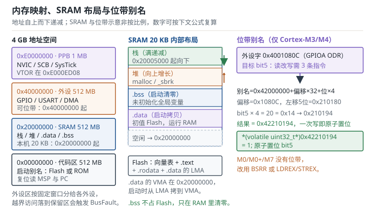

# 存储器与外设寄存器：Flash、SRAM 与寄存器语义 Memory and Peripheral Registers

同一颗芯片上，代码住在 Flash，变量住在 SRAM，外设寄存器则被"伪装"成内存地址。三者共用一条总线、一套地址、一个编译器。于是很多看似随机的问题，根子都在这里：数组越界踩到了相邻变量、编译器把轮询读优化成了只读一次、DMA 写进内存的数据被缓存挡住、写寄存器时外设时钟还没开。本章把 Cortex-M 的内存地图、栈与堆、volatile 与位带、寄存器时序与 barrier 串成一条线，目标是看到现象就能定位到"哪一层内存语义被违反了"。

## 1. 设计动机（为什么变量会自己变）

::: motivation 三个"见鬼"的现场
**现场一：标志位自己变了。** 一个 `volatile uint8_t g_ready` 偶发从 1 变 0，复现率约千分之一。加打印、换编译器、换批次都无效。最后用栈水位法发现：主栈只剩 40 字节，某个 128 字节的局部数组越界写穿了栈底，正好落在 `.bss` 里 `g_ready` 的地址上。变量没"自己变"，是别人写进来的。

**现场二：DMA 收了数据，CPU 读到旧值。** 串口 DMA 把 512 字节收到缓冲区，中断里置标志，主循环读缓冲区却还是上一包的内容。在 Cortex-M3 上这通常是编译器把缓冲区读进了寄存器；在带 D-Cache 的 Cortex-M7 上，还多一层原因：DMA 写的是内存，CPU 读的是缓存，缓存里的旧行没有失效。

**现场三：寄存器写不进去。** `GPIOA->ODR |= (1 << 5)` 执行了，示波器上引脚不动。读回 `ODR` 发现 bit5 仍是 0。原因不是语法，而是 GPIOA 的时钟没使能：外设时钟关闭时，寄存器写入被总线丢弃，读回全 0，且不报错。
:::

把现象、第一检查项和判据列成表：

| 现象 | 先查什么 | 判据 |
|---|---|---|
| 某个全局变量随机变化 | 栈水位、数组越界、堆栈相撞 | 栈峰值 < 栈区大小，且不越过 `.bss` |
| 轮询标志位死循环 | 变量是否 `volatile`、是否开了优化 | 反汇编里循环内有 `LDRB` |
| DMA 数据时好时坏 | 缓冲区是否被缓存、是否按 cache line 对齐 | 传输前后有 clean/invalidate |
| 寄存器读回全 0 | 外设时钟、复位状态、写保护 | `RCC->APB2ENR` 对应位为 1 |
| 多字节寄存器偶发丢位 | 是否用了读改写、是否有并发 | 改用 BSRR 或位带原子写 |

**不算会摔在哪**，三个能算出来的代价：

1. **1 KB 栈跑 4 层带 FPU 的中断嵌套。** 每个异常栈帧 104 B，4 层就是 416 B；主流程 3 层普通调用各 64 B 局部变量，192 B；一次 `snprintf` 再要 512 B。合计 1120 B，已经超过 1 KB。溢出部分写到栈底之外的 `.bss`，表现是"某些全局变量偶尔变成 ASCII 字符"。
2. **漏写 volatile 的轮询。** `-O2` 下编译器把 `while (!(USART1->SR & USART_SR_RXNE))` 优化成只读一次，循环体变成空转。100 万次/秒的轮询变成 0 次，响应延迟从微秒级变成"永远不回"。
3. **拿 Flash 当日志区。** 10 万次擦写寿命，每 10 s 写一次：$10000\times10=100000$ s，即 27.8 小时。一块表跑一天就报废，而且报废是静默的——写入返回成功，读回却是旧数据。

## 2. 定义与直观（原理：一张 4 GB 的地图）

### 2.1 Cortex-M 的 4 GB 地址空间

Cortex-M 是 32 位内核，理论寻址 4 GB。ARMv7-M 把这 4 GB 划成固定用途的若干段，这就是内存映射（memory map），所有厂商的芯片都遵守这套划分：

| 起始地址 | 区域 | 大小 | 用途 |
|---|---|---|---|
| `0x00000000` | 代码区（Code） | 512 MB | Flash 或 ROM 的启动别名 |
| `0x20000000` | SRAM 区 | 512 MB | 栈、堆、`.data`、`.bss` |
| `0x40000000` | 外设区（Peripheral） | 512 MB | GPIO、USART、DMA 等 |
| `0x60000000` | 外部 RAM | 1 GB | SDRAM、PSRAM |
| `0xA0000000` | 外部设备 | 1 GB | LCD、FPGA |
| `0xE0000000` | 私有外设总线（PPB） | 1 MB | NVIC、SCB、SysTick、DWT、ITM |
| `0xE0100000` | 厂商系统区 | 511 MB | 厂商自定义 |

两个地址必须背下来：`0xE000ED08` 是向量表偏移寄存器（Vector Table Offset Register，VTOR），`0xE000ED00` 是系统控制块（System Control Block，SCB）的基址。调试时读这两个地址，能立刻判断"现在用的是哪张向量表、内核处于什么状态"。

厂商在"外设区"里再切分：STM32F103 把 GPIOA 放在 `0x40010800`，USART1 放在 `0x40013800`，每个外设占 1 KB 的地址窗口。窗口内寄存器按 32 位对齐排列，未定义的地址读回 0 或触发 BusFault——这就是"访问了不存在的外设"最常见的报错来源。

### 2.2 Flash 与 SRAM 的物理差异

两者都是"存储器"，但写入方式完全不同，这决定了它们在软件里的用法：

| 特性 | Flash | SRAM |
|---|---|---|
| 读 | 按字/半字随机读，可能需要等待周期 | 单周期随机读写 |
| 写 | 只能 1→0，且必须先擦除整页 | 任意字节随时写 |
| 擦除粒度 | 页（1–2 KB）或扇区（几十 KB） | 无 |
| 寿命 | 约 1 万次擦写 | 无限次 |
| 掉电保持 | 20 年以上 | 掉电即失 |
| 成本 | 低，密度高 | 高，密度低 |

关键推论：**Flash 不能当 RAM 用**。往 Flash 地址直接赋值不会生效（除非调用厂商的编程函数），因为写操作需要"解锁—擦除—编程—锁回"的序列；在只读的代码段上写还会触发 BusFault。所有"运行时要改的变量"都必须放在 SRAM，Flash 只放常量和代码。

### 2.3 栈与堆：两种完全不同的分配方式

**栈（stack）**由编译器自动管理，函数调用时压入返回地址、保存寄存器、分配局部变量，返回时弹出。Cortex-M 的栈是"满递减"（Full Descending，FD）：SP 指向最后一个已压入的元素，压栈先减地址再写。复位时硬件把向量表第 0 项装进主栈指针（Main Stack Pointer，MSP），所以栈顶必须等于 SRAM 末尾。

Cortex-M 有两条栈指针：MSP 和进程栈指针（Process Stack Pointer，PSP）。裸机程序通常只用 MSP；RTOS 用 PSP 跑任务、MSP 跑中断，这样任务栈溢出不会直接毁掉中断栈。

**堆（heap）**由 `malloc/free` 管理，底层是 `_sbrk`，从 `.bss` 之后向上增长。堆的问题是碎片：反复申请释放不同大小的块后，即使总空闲量足够，也可能找不到连续的大块。嵌入式里更常见的做法是砍掉堆，用静态数组或固定大小的内存池。

两种分配的增长方向相反：栈向下、堆向上，中间的空隙就是"堆栈相撞"的缓冲区。这个空隙必须大于最坏栈峰值，否则一次深调用就会写进堆里。

栈帧的大小是可以精确算的。Cortex-M 进入异常时硬件自动压入 8 个字（R0、R1、R2、R3、R12、LR、PC、xPSR），共 32 B；如果内核带 FPU 且异常发生前用过浮点，还会额外压入 S0–S15、FPSCR 和一个填充字，共 26 个字、104 B。这就是为什么"带 FPU 的芯片栈要按 104 B/层估"，而不是 32 B。

### 2.4 volatile：它保证什么，不保证什么

`volatile` 是 C 语言的一个类型限定符，编译器对它的承诺只有三条：

1. 每次源码里出现的访问都必须真实发生，不能因为"值没变"而删除。
2. 访问的宽度和次数与源码一致，不能把两次 8 位读合并成一次 32 位读。
3. 多个 `volatile` 访问之间的顺序不能被调换。

它**不**保证的事情同样重要：

- **不保证原子性。** `g_flag++` 在 `volatile` 下仍然是"读—改—写"三条指令，中断在中间插入就会丢更新。
- **不保证与其他变量的顺序。** 编译器可以把普通变量的读写搬到 `volatile` 访问的另一侧，CPU 也可能乱序执行。跨核、跨 DMA 的场景要额外的内存屏障。
- **不保证缓存一致。** 在带 D-Cache（数据缓存，data cache）的 Cortex-M7 上，`volatile` 只约束编译器，不约束缓存；DMA 写内存后，CPU 仍可能读到缓存里的旧行。

所以 `volatile` 的正确用法是"告诉编译器这个地址会被外部改变"，典型对象是外设寄存器、中断与主循环共享的标志、DMA 描述符。它的代价是每次访问都要真正走一次总线：在 72 MHz 下，一次 `volatile` 读比寄存器缓存多约 2 个周期。

### 2.5 位带：把一个位变成一个字

位带（bit-banding）是 Cortex-M3/M4 的一个硬件特性：把外设区和 SRAM 区各 1 MB 的"位带区"逐位映射到一块 32 MB 的"别名区"，别名区里每个 32 位字对应原位的一个位。往别名字写 1，硬件自动完成"读—改—写"，把原位置 1；写 0 则清零。

映射公式是固定的：

$$
\text{alias}=\text{base}+32\,o+4\,b
$$

其中 $\text{base}$ 是别名区基址（外设 `0x42000000`，SRAM `0x22000000`），$o$ 是目标字节相对位带区起始地址的偏移，$b$ 是位序号（0–7）。系数 32 来自"每个原字节有 8 位、每位占别名区 4 字节"，$8\times4=32$；系数 4 就是别名区每个位占一个 32 位字。

两个例子，后文会复算：

- GPIOA 的输出数据寄存器 `0x4001080C` 的 bit5 → `0x42210194`。
- SRAM 变量 `0x20000100` 的 bit3 → `0x2200200C`。

位带的价值在于**原子性**：`GPIOA->ODR |= (1 << 5)` 编译成三条指令（读、或、写），中断在中间插入就会丢掉其他位的修改；而写别名区是一条 `STR`，硬件保证读改写不被打断。代价是位带只存在于 Cortex-M3/M4，Cortex-M0/M0+ 和 Cortex-M7 都没有这个单元，代码移植时必须换成 BSRR 或 `LDREX/STREX`。



### 2.6 寄存器读写时序与 barrier

外设寄存器不是普通内存，读写有几条必须遵守的规则。

**第一，写是"张贴"的（posted write）。** AHB 总线上的写操作发出后，CPU 不必等外设真正完成就可以继续执行。于是"写完配置立刻读回"可能读到旧值，或者"写完复位寄存器立刻访问外设"会失败。解决办法是写后读回：读一次同一个寄存器，强制总线把写完成，再继续。

**第二，读改写有竞态。** 前面说的 `|=` 是典型；更隐蔽的是"清除中断标志"：先读状态寄存器、再写清除寄存器，两步之间如果来了新中断，可能把新事件的标志一起清掉。正确顺序取决于外设，通常要求"先清标志、再处理数据"，或者用写 1 清零的寄存器避免读改写。

**第三，跨外设的顺序需要内存屏障（memory barrier）。** ARMv7-M 提供三条指令：

| 指令 | 全称 | 保证 | 典型用途 |
|---|---|---|---|
| `DMB` | Data Memory Barrier | 屏障前后的内存访问顺序不被重排 | 共享内存、DMA 描述符 |
| `DSB` | Data Synchronization Barrier | 屏障前的访存全部完成，才执行后面的指令 | 写外设后、复位前、改 VTOR 后 |
| `ISB` | Instruction Synchronization Barrier | 清空流水线，后续指令重新取指 | 改 VTOR/MPU/控制寄存器后 |

CMSIS 把它们封装成 `__DMB()`、`__DSB()`、`__ISB()`。最常用的组合是"改内核配置 → `DSB` → `ISB`"，例如重定位向量表：

```c
SCB->VTOR = 0x08002000;
__DSB();
__ISB();
```

没有 `DSB`，写 VTOR 可能还没到系统控制块，后续中断仍按旧表取向量；没有 `ISB`，流水线里已经预取的旧指令还会继续执行。

需要注意的是，barrier 管的是"顺序与完成"，不是"缓存"。带 D-Cache 的芯片上，DMA 与 CPU 共享缓冲区还需要按 cache line 做 clean/invalidate，barrier 不能替代缓存维护。

## 3. 定量关系（公式、地址与容量）

### 3.1 位带地址的完整推导

把 2.5 的公式写成可代入的形式：

$$
A_{\text{alias}}=A_{\text{base}}+32\left(A_{\text{reg}}-A_{\text{region}}\right)+4b
$$

其中 $A_{\text{alias}}$ 是别名地址，$A_{\text{base}}$ 是别名区基址，$A_{\text{reg}}$ 是目标寄存器地址，$A_{\text{region}}$ 是位带区基址（外设 `0x40000000`，SRAM `0x20000000`），$b$ 是位序号。代入 GPIOA ODR：

$$
A_{\text{alias}}=0x42000000+32\times(0x4001080C-0x40000000)+4\times5
$$

括号内是 `0x1080C`，乘以 32（左移 5 位）得 `0x210180`，加 20（`0x14`）得 `0x210194`，再加基址得到 `0x42210194`。这个地址落在别名区 `0x42000000`–`0x43FFFFFF` 内，合法。

### 3.2 栈深度预算

最坏栈用量的估算式：

$$
S_{\text{stack}}=\sum_{i=1}^{n}\left(F_i+L_i\right)+S_{\text{lib}}+S_{\text{align}}
$$

其中 $n$ 是最坏嵌套层数，$F_i$ 是第 $i$ 层的异常栈帧（32 B，带 FPU 时 104 B），$L_i$ 是该层处理函数的局部变量与调用链开销，$S_{\text{lib}}$ 是库函数（`printf`、`snprintf`、浮点运算）的峰值占用，$S_{\text{align}}$ 是 8 字节对齐的余量。

这个式子的用法是"从最坏情况倒推"：先假设最深嵌套，再给每层一个保守的局部变量估计，最后加库函数。算出来的值要再乘 1.25–1.5 的安全系数，因为编译器的寄存器溢出、中断抢占的时机都会让实际值偏大。

### 3.3 RAM 预算与堆栈间隙

$$
S_{\text{ram}}=S_{\text{data}}+S_{\text{bss}}+S_{\text{heap}}+S_{\text{stack}}+S_{\text{gap}}
$$

$S_{\text{gap}}$ 是堆顶到栈底的空隙，它必须为正，且建议不小于最坏栈峰值的 25%。链接脚本里通常用 `_estack`、`_ebss`、`end` 三个符号把这段空隙"框"出来，启动时检查 `_estack - end` 是否大于阈值，不满足就进错误处理。

### 3.4 Flash 寿命与磨损均衡

单页反复擦写的寿命是固定的。若每 $t_w$ 秒写一条记录、每条记录占 $R$ 字节、页大小 $P$ 字节，则单页写满需要 $P/R$ 条记录，总寿命为

$$
T_{\text{life}}=C_{\text{erase}}\times\frac{P}{R}\times t_w
$$

其中 $C_{\text{erase}}$ 是擦写次数（约 10000），$P$ 是页大小（1024 B），$R$ 是记录大小（64 B），$t_w$ 是写入间隔（1 s）。量纲也对：$\text{次}\times(\text{B}/\text{B})\times\text{s}=\text{s}$。单页：$10000\times(1024/64)\times1=160000$ s，即 44.4 小时。若把 16 页组成环形缓冲轮流写，寿命延长 16 倍，到 29.6 天。要让一块表撑过一年，还需要更大的环形区或"只在变化时写"的策略。

### 3.5 总线带宽与寄存器访问成本

Cortex-M3 的 AHB-Lite 总线宽度 32 位，72 MHz 下的理论峰值带宽：

$$
B_{\text{peak}}=f_{\text{cpu}}\times4=72\times10^{6}\times4=288\ \text{MB/s}
$$

其中 $f_{\text{cpu}}$ 是内核频率，系数 4 是 32 位总线的字节宽度。这是"每个周期都能完成一次 32 位传输"的上限。实际访问外设还要经过总线桥和 APB 分频：APB2 跑 72 MHz 时一个周期 13.89 ns，APB1 跑 36 MHz 时 27.78 ns。一次 `volatile` 读至少占用一个 APB 周期加总线桥延迟，通常按 2 个 HCLK 估算。

把"多 2 个周期"换算成占用率：每秒 100 万次 `volatile` 读，多耗 $2\times10^{6}$ 个周期，占 72 MHz 的 $2\times10^{6}/72\times10^{6}=2.78\%$。每秒 1000 万次就是 27.8%，这时"用寄存器缓存值"不是微优化，而是必须。

### 3.6 缓存行与一致性维护成本

带 D-Cache 的 Cortex-M7，缓存行（cache line）是 32 B。按地址范围做 clean/invalidate 时，操作次数是

$$
N_{\text{line}}=\left\lceil\frac{S}{32}\right\rceil
$$

其中 $S$ 是缓冲区字节数。10 KB 缓冲区需要 $\lceil10240/32\rceil=320$ 行；若每行 clean 花 10 个周期，共 3200 周期，在 72 MHz 下是 44.4 µs。这个数字说明：DMA 缓冲不是越大越好，缓冲区越大，每次传输前后的缓存维护越贵；工程上常把 DMA 缓冲放进 MPU 配置的 non-cache 区，用"绕过缓存"换掉这笔开销。

::: advanced 为什么 32 位数据需要 7 位 ECC
带纠错码（Error Correcting Code，ECC）的 SRAM 常用 SECDED（单位纠错、双位检错）。对 $n$ 位数据，汉明校验位需要能区分"无错"与"$n$ 个单错位置"，即 $2^k\ge n+k+1$；再增加 1 位整体奇偶校验用于区分单错与双错。32 位数据：$2^k\ge32+k+1$，$k=6$ 时 $64\ge39$ 成立，加 1 位整体校验共 7 位，码字 39 位。校验开销 $7/32=21.9\%$。这就是为什么带 ECC 的 SRAM 容量常按"数据位 + 校验位"报，而不是按裸容量。
:::

## 4. 典型计算（64 KB Flash + 20 KB SRAM 的预算）

设定与前一章同一颗芯片：64 KB Flash、20 KB SRAM、72 MHz、带 FPU 的 Cortex-M3。map 文件给出 `.data` 1536 B、`.bss` 6144 B，堆 2048 B，栈 2048 B。

**问题一：栈够不够？**

最坏情况：4 层带 FPU 的中断嵌套，每层栈帧 104 B、处理函数局部变量 48 B；主流程 3 层普通调用，每层 64 B；一次 `snprintf` 峰值 512 B。

$$
S_{\text{stack}}=4\times(104+48)+3\times64+512=608+192+512=1312\ \text{B}
$$

再按 8 字节对齐向上取整到 1312 B（已是 8 的倍数），加 25% 安全系数：

$$
1312\times1.25=1640\ \text{B}
$$

2048 B 的栈还剩 408 B，结论是"够，但不宽裕"。若嵌套变成 5 层：$5\times152+192+512=1464$ B，加安全系数 1830 B，只剩 218 B，此时应该加栈或减少中断嵌套。

**问题二：RAM 还剩多少空隙？**

$$
S_{\text{ram}}=1536+6144+2048+2048=11776\ \text{B}
$$

$20480-11776=8704$ B 空闲。但空闲不等于可用：堆从 `0x20002E00` 向上长，栈从 `0x20005000` 向下长，中间 8704 B 就是间隙。按问题一的最坏栈 1640 B，间隙还剩 $8704-1640-2048=5016$ B（堆按满算）。这个余量健康。

**问题三：位带地址算得对吗？**

GPIOA ODR 的 bit5：

$$
0x42000000+32\times0x1080C+4\times5=0x42000000+0x210180+0x14=0x42210194
$$

SRAM 变量 `0x20000100` 的 bit3：

$$
0x22000000+32\times0x100+4\times3=0x22000000+0x2000+0x0C=0x2200200C
$$

两个结果都可以用调试器 `x/1wx` 读回验证：写别名地址后，原地址的对应位应当变化，其他位不变。

**问题四：日志区能撑多久？**

每 1 s 写一条 64 B 记录，16 页（16 KB）环形区，页大小 1 KB，10000 次擦写寿命。每页容纳 $1024/64=16$ 条，16 页共 256 条，写满一轮 256 s。

$$
T_{\text{life}}=10000\times256=2560000\ \text{s}=29.6\ \text{天}
$$

若不做磨损均衡、只在一页上反复写：$10000\times16=160000$ s，即 44.4 小时。两者相差 16 倍，正好等于页数。

**问题五：每秒 100 万次 volatile 读的 CPU 开销？**

按每次多 2 个周期：

$$
\eta=\frac{2\times10^{6}}{72\times10^{6}}=2.78\%
$$

如果这 100 万次读分布在 1 kHz 的控制环里，每个周期 1000 次读，多耗 2000 周期，占 1 ms（72000 周期）的 2.78%。这个量级可以接受；但若在读里还叠加了函数调用和边界检查，实际开销会翻几倍，应该改成"中断里置标志、主循环批量读"。

## 5. 工程含义（实践中的布局与取舍）

**链接脚本是内存策略的声明。** 除了 `.data/.bss` 的常规放置，工程里常把 DMA 缓冲区、以太网描述符、CCM RAM 单独成段，用 `NOLOAD` 或指定地址的方式放到"不会被缓存、不会被初始化"的区域。Cortex-M3 没有 Cache，但很多芯片有"只有 CPU 能访问"的紧耦合内存（TCM），TCM 不能给 DMA 用，放错就会得到"数据永远为 0"。

**栈水位法是最便宜的运行时检查。** 启动时把整段栈填成 `0xA5A5A5A5`，运行一段时间后从栈底向上扫描，第一个不是 `0xA5A5A5A5` 的字就是峰值边界。注意两个坑：填充值可能恰好出现在正常数据里造成误判，所以扫描时要结合"连续多个字"判断；中断栈帧是 8 字节对齐的，扫描按字进行即可。更严格的做法是用 MPU 把栈底一小段（Cortex-M3 最小 32 B）设为不可访问，越界立刻 MemManageFault。

**堆能不用就不用。** `malloc` 的碎片问题在长时间运行的设备上是必然的，不是概率问题。替代方案：启动时一次性分配固定大小的内存池，用链表管理空闲块；或者干脆全静态分配，链接期就能算出 RAM 占用。如果必须用堆，至少把 `_sbrk` 的边界检查写对，堆撞到栈时返回失败而不是静默越界。

**volatile 的粒度要克制。** 给整个结构体加 `volatile` 会让每个字段访问都走总线，包括循环里的临时变量。正确做法是只给"会被外部改变"的字段加，循环里先读到局部变量再判断；对外设寄存器用 CMSIS 的 `__IO` 宏，语义清晰。

**位带与 BSRR 二选一。** STM32 的 GPIO 有 BSRR 寄存器：低 16 位写 1 置位，高 16 位写 1 复位，一次写完成原子操作且不需要位带。位带的优势是通用（任何支持位带的外设都能用），BSRR 的优势是快且可移植到没有位带的 M0/M7。新代码优先 BSRR，老代码移植时再考虑位带。

**barrier 要放在"语义边界"上，不是到处撒。** 典型位置：改 VTOR/MPU/时钟后（DSB+ISB）、启动 DMA 前（DSB 保证描述符写完）、复位芯片前（DSB 保证外设配置落地）、关中断后访问共享数据（编译器屏障 `__DMB` 或 `asm volatile("" ::: "memory")`）。加多了会拖慢中断响应，加少了会出现"偶发不生效"。

## 6. 常见坑（现象、原因与解决）

::: pitfall 六个高频坑
- **栈溢出踩全局变量**：现象——某个 `.bss` 变量随机变成奇怪的值，或程序在无关函数里 HardFault。原因——局部大数组、深递归、中断嵌套叠加，栈越过栈底写进 `.bss`；栈是向下长的，越界方向正好是低地址的全局区。解决——用 `0xA5` 填充法测峰值、把大数组改 `static`、加大栈、开 MPU 保护栈底，并在链接脚本里留出 `_estack - end` 的检查。

- **漏写 volatile 导致死循环**：现象——`-O0` 正常、`-O2` 卡在 `while` 里；或者中断改了标志、主循环永远看不到。原因——编译器把循环内的读提到循环外，或缓存在寄存器里。解决——共享标志与外设寄存器加 `volatile`；看反汇编确认循环体里有 `LDR`；跨编译单元的共享变量还要注意链接器优化（LTO）下的可见性。

- **volatile 当成原子用**：现象——两个中断/任务同时 `g_count++`，计数偶尔少 1。原因——`volatile` 只保证访问不被优化，不保证读改写是原子的。解决——单核用关中断或 `LDREX/STREX` 临界区；多核用原子指令；能用硬件计数器就不用软件计数。

- **DMA 与 Cache 不一致**：现象——M7 上 DMA 收到的数据时对时错，关掉 D-Cache 就正常。原因——DMA 写的是内存，CPU 读的是缓存行；或者 CPU 写的数据还在缓存里没落到内存，DMA 读到旧值。解决——发送前 clean、接收后 invalidate，缓冲区按 32 B 对齐且不与其他变量共享 cache line；或者把缓冲区放进 MPU 配置的 non-cache 区。

- **位带用在没有位带的内核上**：现象——访问 `0x42xxxxxx` 触发 BusFault 或读出全 0。原因——Cortex-M0/M0+/M7 没有位带单元，别名区是保留地址。解决——改用 BSRR、`LDREX/STREX` 或关中断的读改写；移植时用宏把位带访问封装起来，按内核型号切换实现。

- **外设时钟没开就写寄存器**：现象——配置代码执行了，读回全是 0，外设完全不工作。原因——STM32 的外设默认时钟关闭，写操作被总线丢弃且不报错。解决——先使能 `RCC->APB1ENR/APB2ENR` 对应位，读回确认，再加 `__DSB()` 保证时钟稳定后再配置寄存器；低功耗唤醒后要重新检查时钟门控。
:::

## 7. 自测题

<details><summary>外设字 0x4001080C 的 bit5 用位带访问，别名地址是多少？SRAM 中 0x20000100 的 bit3 呢？写出计算过程。</summary>

外设区基址 `0x40000000`，别名基址 `0x42000000`：

$$
A=0x42000000+32\times(0x4001080C-0x40000000)+4\times5
$$

$$
=0x42000000+32\times0x1080C+0x14=0x42000000+0x210180+0x14=0x42210194
$$

SRAM 区基址 `0x20000000`，别名基址 `0x22000000`：

$$
A=0x22000000+32\times(0x20000100-0x20000000)+4\times3
$$

$$
=0x22000000+32\times0x100+0x0C=0x22000000+0x2000+0x0C=0x2200200C
$$

验证方法：向 `0x42210194` 写 1，读 `0x4001080C` 的 bit5 应为 1，其余位不变；向 `0x2200200C` 写 1，读 `0x20000100` 的 bit3 应为 1。注意这两个地址只在 Cortex-M3/M4 上有效。

</details>

<details><summary>栈 2048 B，最坏 5 层带 FPU 中断嵌套，每层栈帧 104 B、局部变量 48 B；主流程 3 层调用各 64 B；一次 snprintf 峰值 512 B。够不够？给出推导。</summary>

$$
S=5\times(104+48)+3\times64+512=760+192+512=1464\ \text{B}
$$

加 25% 安全系数：

$$
1464\times1.25=1830\ \text{B}
$$

2048 B 的栈剩 218 B。从算术上"刚好够"，但工程上不建议放行：218 B 只相当于 2 个异常帧，任何一次新增的库调用或编译器版本变化都可能击穿。结论：要么把栈加到 3 KB（3072 B，剩 1242 B），要么把 `snprintf` 改成定长格式化、把局部大数组移出栈。

</details>

<details><summary>Flash 擦写寿命 1 万次，页大小 1 KB，每秒写一条 64 B 记录。单页反复写能撑多久？16 页环形缓冲呢？</summary>

单页容纳 $1024/64=16$ 条记录，写满一页 16 s，擦除一次；1 万次擦除：

$$
T=10000\times16=160000\ \text{s}=\frac{160000}{3600}=44.4\ \text{小时}
$$

16 页环形：每页轮流承担，总记录数放大 16 倍：

$$
T=16\times160000=2560000\ \text{s}=\frac{2560000}{86400}=29.6\ \text{天}
$$

这说明"加页数"是最直接的磨损均衡手段，但 29.6 天仍不足以支撑一年。要撑一年（$3.15\times10^{7}$ s），按 1 s 一条需要 $3.15\times10^{7}/16=1.97\times10^{6}$ 次擦除，是 1 万次的 197 倍——只能靠"减少写入频率"或"换用 FRAM/EEPROM"解决。

</details>

<details><summary>10 KB 的 DMA 缓冲区在 Cortex-M7 上做 cache clean，需要操作多少个 cache line？按每行 10 周期、72 MHz 计算耗时。工程上怎么避免这笔开销？</summary>

cache line 32 B：

$$
N=\left\lceil\frac{10240}{32}\right\rceil=320\ \text{行}
$$

周期数 $320\times10=3200$，时间：

$$
t=\frac{3200}{72\times10^{6}}=44.4\ \mu\text{s}
$$

这个开销在每次 DMA 传输前后都要付一次。避免方式有三种：把缓冲区放进 MPU 配置的 non-cache 区（推荐，零维护成本）；减小单次传输的缓冲区（次数变多，总开销未必降）；用硬件一致性总线（部分 Cortex-M7 芯片支持，需查手册）。注意缓冲区必须按 32 B 对齐，否则一次 clean 会波及相邻变量。

</details>

<details><summary>为什么 volatile 不能替代内存屏障？举一个会出错的场景。</summary>

`volatile` 只约束编译器对"该对象"的访问次数与顺序，不约束：其他普通变量的读写位置、CPU 的乱序执行、缓存一致性。

出错场景：CPU 准备一个 DMA 描述符，结构体里有 `buf`、`len`、`own` 三个字段，其中只有 `own` 声明为 `volatile`。代码先填 `buf`、`len`，最后写 `own = 1` 通知 DMA。编译器可以把 `buf`、`len` 的写推迟到 `own` 之后（它们不是 volatile），DMA 看到 `own=1` 时读到的还是旧的长度和缓冲区地址。

正确写法是写 `own` 之前加 `__DMB()`（或把整个描述符声明为 volatile 并配合屏障），保证前面的普通写先完成。同理，读方向在读到 `own` 之后也要 `__DMB()` 再读数据，防止 CPU 提前预取。

</details>

## 8. 参考资料

- Arm, *ARMv7-M Architecture Reference Manual*（ARM DDI 0403E），Chapter A3 "Programmer's Model"：异常进入时的栈帧布局（8 字/26 字）与 MSP/PSP 切换；Chapter B3 "System Level Architecture"：4 GB 内存映射与 DMB/DSB/ISB 的体系结构定义。本章 2.1、2.3、2.6 节按此重写。
- Arm, *Cortex-M3 Technical Reference Manual*（ARM DDI 0337I），Chapter 6 "Cortex-M3 Memory Map"、Chapter 7 "Bit-banding"：位带区与别名区的地址范围、映射公式，本章 2.5、3.1 节的公式与两个算例依据此章。
- STMicroelectronics, *STM32F103x8/xB Datasheet*（DS5319 Rev 10），Table 5 "Memory map"：64 KB Flash 与 20 KB SRAM 的地址范围；*RM0008 Reference Manual*，Chapter 3 "Memory and bus architecture" 与 Chapter 9 "GPIO and AFIO"：APB 分频、BSRR 的原子置位语义。第 4 节与 5 节的工程口径以此为准。
- Arm, *CMSIS-Core*（CMSIS 5.x）文档："Core Peripheral Access" 中的 `__IO` 宏与 `__DSB/__DMB/__ISB` 内建函数；本章 2.6 节的代码示例按 CMSIS 接口书写。
- Ulrich Drepper, *What Every Programmer Should Know About Memory*（Red Hat, 2007），Section 3 "CPU Caches"：缓存行、写回与一致性维护的成本模型，本章 3.6 节与第 4 节问题四的估算参考该节。
- ISO/IEC 9899:2018（C17），6.7.3 "Type qualifiers"：`volatile` 的语义规定；本章 2.4 节"保证什么、不保证什么"的边界按标准原文划分。
- [Arm Cortex-M3 位带应用笔记](https://developer.arm.com/documentation/dui0552/latest/)：位带在 GPIO 原子操作中的典型用法，可用于复现 3.1 节的两个算例。