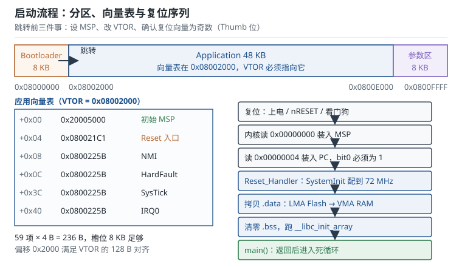

# 启动流程：从复位向量到 main Startup and Boot

按下复位键到 `main` 的第一行执行，中间隔着一段很少有人完整读过的代码：硬件从地址 0 取两个 32 位数，装进栈指针和程序计数器；启动文件把 Flash 里的初值搬进 RAM、把未初始化区清零；`SystemInit` 把 8 MHz 的内部时钟倍频到 72 MHz；C 库跑完全局构造；最后才 `bl main`。这段路只有一两毫秒，却决定了后面所有代码能否正确运行。本章按"复位—向量表—启动文件—时钟树—main—bootloader 交接"的顺序把它拆开，每个环节都给出可复算的时间与地址。

## 1. 设计动机（为什么上电后不是先跑 main）

::: motivation 三个"上电就错"的现场
**现场一：串口输出全是乱码。** 同一份固件在旧板子上正常，新板子上第一帧就是乱码。用示波器量 TX 波形，一位宽度约 78 µs，对应 12800 bit/s，而代码按 115200 配置。原因是新板子的 `SystemInit` 里 HSE 起振失败，程序回退到 8 MHz 的 HSI，但波特率寄存器仍按 72 MHz 算好——分频比差了 9 倍，接收方当然解不出来。

**现场二：全局变量初值随机。** 一个状态机变量 `g_state` 初值写了 0，上电后偶尔从 3 开始跑。查 map 文件发现 `.bss` 的起始地址被链接脚本写成了 `0x20000000`，而启动文件里清零循环用的符号 `_sbss` 与 `_ebss` 相隔 0 字节——清零循环一次都没执行，那段 SRAM 保留着上次掉电前的残留值（SRAM 内容在短时间断电内不会立刻消失）。

**现场三：bootloader 跳转后不进中断。** 升级程序能跳过去，应用的主循环也跑起来了，但串口接收中断永远不进。原因是 bootloader 里开过 USART 中断，跳转前只关了总中断，没有清 NVIC 的使能与挂起位；应用重新初始化时又没重设 VTOR，中断向量仍指向 bootloader 的表，进了别处的处理函数。
:::

把启动阶段的典型现象、第一检查项与判据列成表：

| 现象 | 先查什么 | 判据 |
|---|---|---|
| 上电后完全没反应 | MSP 初值、Reset 向量、BOOT 引脚 | MSP 落在 RAM 范围，Reset 向量为奇数 |
| 时钟频率不对、串口乱码 | `SystemInit` 是否真的切到 PLL | 读 `RCC->CFGR` 的 SWS 位为 PLL |
| 全局变量初值随机 | `.bss` 清零范围、`.data` 拷贝范围 | map 中 `_sbss`/`_ebss` 不相等 |
| 跳转后中断错乱 | VTOR、NVIC 使能与挂起位 | VTOR 等于 app 基址，挂起位已清 |
| 升级后变砖 | 分区表、CRC、看门狗 | 校验失败能回滚到旧分区 |

**不算会摔在哪**，三个带数字的代价：

1. **时钟差 9 倍。** 72 MHz 下 115200 对应的分频值是 39.0625，写进 BRR 是 625；同样的 BRR 在 8 MHz 下得到的波特率是 $8\times10^{6}/625=12800$。一帧 10 位从 86.8 µs 拉长到 781 µs，接收方按 115200 采样，每个位都落在错误的窗口里。
2. **启动多花 1 ms。** 某传感器要求上电后 5 ms 内输出第一帧，而 HSE 起振按 1 ms 估算，加上 PLL 锁定、`.data/.bss` 初始化约 1.18 ms，已经占掉 24% 的预算。若再把两段大 `memcpy` 放进 `main` 开头，第一帧必然迟到。
3. **跳转前没关外设中断。** bootloader 的 SysTick 还在跑，跳转后立刻触发；此时 VTOR 已被改成 app 的表，但 app 的 SysTick 处理函数还没初始化，中断里访问空指针，直接 HardFault。现象是"升级完成后偶尔死机"，且概率与跳转时刻相关。

## 2. 定义与直观（原理：复位那一刻发生了什么）

### 2.1 复位序列：硬件只做三件事

Cortex-M 的复位不是"从 `main` 开始"，而是硬件按固定顺序做三件事：

1. 把地址 `0x00000000` 处的 32 位值装入主栈指针 MSP。
2. 把地址 `0x00000004` 处的 32 位值装入程序计数器 PC。
3. 清空流水线，从新的 PC 取指执行。

注意地址是 `0x00000000`，不是 `0x08000000`。芯片内部有一层地址重映射（alias）：BOOT 引脚或选项字节决定哪块存储被映射到 0 地址。以 STM32F103 为例：

| BOOT0 | BOOT1 | 映射到 0x00000000 的存储 | 典型用途 |
|---|---|---|---|
| 0 | 任意 | 主 Flash（`0x08000000`） | 正常运行 |
| 1 | 0 | 系统存储器（内建引导程序） | ISP 串口下载 |
| 1 | 1 | 内嵌 SRAM | 调试小段代码 |

所以"程序从 Flash 启动"的完整说法是：Flash 被别名到 0 地址，内核从 0 地址读到的其实是 `0x08000000` 处的内容。这也解释了一个常见困惑：为什么向量表既可以说在 `0x00000000`，又可以说在 `0x08000000`——它们是同一块物理存储的两个地址。

PC 装入的值必须是奇数。Cortex-M 只支持 Thumb 指令集，地址的最低位（bit0）用作状态标记：1 表示 Thumb。编译器生成的函数地址本来就是奇数（链接器会给 Thumb 函数地址加 1），如果一个"复位向量"是偶数，内核会尝试进入 ARM 状态，而 Cortex-M 没有 ARM 状态，结果立刻 HardFault。

### 2.2 向量表：一张 4 字节一项的跳转目录

向量表（vector table）是放在 Flash 起始处的一张表，每项 4 字节。前 16 项是内核异常，从第 16 项开始是外设中断：

| 偏移 | 名称 | 说明 |
|---|---|---|
| `+0x00` | 初始 MSP | 复位时装入 SP，不是函数地址 |
| `+0x04` | Reset | 复位处理函数入口 |
| `+0x08` | NMI | 不可屏蔽中断 |
| `+0x0C` | HardFault | 硬件错误 |
| `+0x10` | MemManage | 存储器管理错误（需开 MPU） |
| `+0x14` | BusFault | 总线错误 |
| `+0x18` | UsageFault | 用法错误（未定义指令、非对齐等） |
| `+0x1C`–`+0x28` | 保留 | — |
| `+0x2C` | SVCall | 系统调用 |
| `+0x30` | DebugMon | 调试监控 |
| `+0x34` | 保留 | — |
| `+0x38` | PendSV | 可挂起的系统调用（RTOS 切换上下文用） |
| `+0x3C` | SysTick | 系统节拍定时器 |
| `+0x40` | IRQ0 | 第一个外设中断 |

表的大小由中断数量决定：$16+N$ 项，$N$ 是外设中断数。STM32F103C8 属于中容量型号，有 43 个外设中断，共 59 项、236 字节。表可以放在 Flash 的任何位置，只要 VTOR 指向它，且偏移满足对齐要求。

### 2.3 启动文件：上电后真正执行的第一段代码

启动文件（startup file）通常是厂商提供的汇编文件，名字形如 `startup_stm32f103xb.s`。它由四部分组成：

```asm
.section .isr_vector,"a",%progbits
.word _estack              /* 第 0 项：栈顶 */
.word Reset_Handler        /* 第 1 项：复位入口 */
.word NMI_Handler
.word HardFault_Handler
/* ... 其余向量 ... */

.section .text.Reset_Handler
Reset_Handler:
    bl   SystemInit        /* 先把时钟配到 72 MHz */
    ldr  r0, =_sidata      /* .data 在 Flash 中的源地址 */
    ldr  r1, =_sdata       /* .data 在 RAM 中的目的地址 */
    ldr  r2, =_edata
copy_data:
    cmp  r1, r2
    bcs  copy_done
    ldr  r3, [r0], #4
    str  r3, [r1], #4
    b    copy_data
copy_done:
    ldr  r1, =_sbss
    ldr  r2, =_ebss
    movs r3, #0
zero_bss:
    cmp  r1, r2
    bcs  zero_done
    str  r3, [r1], #4
    b    zero_bss
zero_done:
    bl   __libc_init_array
    bl   main
    b    .
```

四个部分对应四个职责：

1. **向量表**：把 `_estack` 和各处理函数地址按顺序排好，放进 `.isr_vector` 段。链接脚本必须用 `KEEP` 保住这个段，否则 `--gc-sections` 会把它当未引用数据删掉。
2. **复位处理**：先调 `SystemInit`（时钟），再拷贝 `.data`、清零 `.bss`。
3. **默认处理函数**：为每个中断提供 `Default_Handler`（死循环），再用 `.weak` 别名把 `USART1_IRQHandler` 之类的符号指过去。用户在 C 里定义同名函数即可覆盖。
4. **跳转 main**：`__libc_init_array` 跑完 C++ 全局构造与 `__attribute__((constructor))` 函数后，才进入 `main`。

一个容易忽略的细节：`bl main` 之后是 `b .`。标准 C 规定 `main` 返回等同于调用 `exit`，但裸机没有 `exit`，所以启动文件用死循环兜底。如果 `main` 真的返回了，程序不会"重启"，而是停在这条死循环上——看到"程序跑完就卡住"，先确认 `main` 里没有提前 `return`。



### 2.4 .data 与 .bss：两个地址与一段清零

`.data` 段存放"有非零初值的全局/静态变量"。它有一个反直觉的性质：**同一份数据有两个地址**。

- 运行地址（VMA）在 SRAM：变量运行时必须能读写。
- 加载地址（LMA）在 Flash：初值必须在掉电后仍然存在。

链接脚本用 `> RAM AT > FLASH` 表达这一点，启动文件再把数据从 LMA 搬到 VMA。搬运的边界由三个链接符号给出：`_sidata`（Flash 中的源地址）、`_sdata`（RAM 中的起点）、`_edata`（RAM 中的终点）。三者必须满足 `_edata - _sdata == _sidata 之后的数据长度`，否则要么漏拷、要么越界。

`.bss` 段存放"初值为 0 的全局/静态变量"。它不需要在 Flash 里占空间，因为初值恒为 0，启动时直接清零即可。链接脚本里给它加 `NOLOAD`，`.bin` 里就不会包含这段，Flash 占用因此减少。清零的边界是 `_sbss` 与 `_ebss`。

为什么先 `SystemInit` 再拷贝？因为拷贝循环本身是代码，从 Flash 取指；在 72 MHz 下 Flash 需要 2 个等待周期，如果时钟已经切到 72 MHz 而等待周期还按 8 MHz 配置，取指会读到错误数据。`SystemInit` 里"先设等待周期、再切 PLL"的顺序就是为此。反过来，如果时钟还停在 HSI 8 MHz，等待周期设成 0 也能跑，只是慢。

### 2.5 时钟树初始化：8 MHz 到 72 MHz 的每一步

STM32F103 的时钟树（clock tree）有三条可选路径：HSI（内部 8 MHz RC）、HSE（外部 4–16 MHz 晶振）、PLL（把 HSI/2 或 HSE 倍频）。典型配置是 HSE 8 MHz 经 PLL 倍频 9 倍得到 72 MHz：

| 节点 | 配置 | 结果 |
|---|---|---|
| HSE | 外部 8 MHz 晶振 | 8 MHz |
| PLL 源 | HSE（不分频） | 8 MHz |
| PLL 倍频 | ×9 | 72 MHz |
| SYSCLK | PLL | 72 MHz |
| AHB 分频 | /1 | 72 MHz |
| APB1 分频 | /2 | 36 MHz（上限 36 MHz） |
| APB2 分频 | /1 | 72 MHz |
| ADC 分频 | /6 | 12 MHz（上限 14 MHz） |
| USB 分频 | /1.5 | 48 MHz |

`SystemInit` 的执行顺序是有讲究的，写反了就会死机：

1. 使能 HSE，等待 `HSERDY` 置位（超时则回退 HSI）。
2. 设置 Flash 等待周期（72 MHz 需要 2 WS），使能预取缓冲。
3. 配置 PLL 源与倍频系数。
4. 使能 PLL，等待 `PLLRDY`。
5. 切换 SYSCLK 到 PLL，等待 `SWS` 显示 PLL。
6. 配置 AHB/APB 分频。
7. 配置外设时钟使能。

第 2 步必须在第 5 步之前，否则切到 72 MHz 的瞬间 Flash 还没准备好，取指失败直接 HardFault。第 1 步的超时回退也很重要：晶振不起振时不能死等，否则设备永远起不来。

为什么时钟要在 `main` 之前配好？因为 `main` 之前已经可能有代码依赖时钟：`__libc_init_array` 里的构造函数可能初始化 UART、可能调用 `printf`；SysTick 可能在 `SystemInit` 里就被配置。更实际的原因是，几乎所有外设的波特率、定时器周期、采样率都按主频计算，主频没定，后面所有配置都是猜的。

### 2.6 跳转到 main：参数、返回与初始化顺序

`main` 的调用遵循 AAPCS：`r0` 传 `argc`，`r1` 传 `argv`。裸机启动文件通常直接 `bl main`，此时 `r0`、`r1` 是未定义值。如果 `main` 声明为 `int main(void)`，编译器不会读这两个寄存器，没问题；如果写成 `int main(int argc, char **argv)` 并在里面用 `argv`，就会读到随机值。裸机工程的惯例是 `int main(void)`。

进入 `main` 之前，`__libc_init_array` 会遍历 `.init_array` 段，依次调用：

- C++ 全局对象的构造函数；
- 标了 `__attribute__((constructor))` 的 C 函数；
- 部分库的初始化钩子。

顺序是按链接顺序排的，跨编译单元不保证。如果两个构造函数有依赖关系，不要指望链接顺序，改成显式调用。

`main` 返回后，启动文件的 `b .` 会让 CPU 停在那里。此时中断仍然可以响应（如果开着），但主循环已经不存在了。调试时看到 PC 停在一条 `b .` 上，先看调用栈里 `main` 是否已经返回。

### 2.7 Bootloader 与应用的交接

带升级功能的设备通常把 Flash 分成三块：bootloader（引导加载程序）、application、参数区。bootloader 启动后判断"是否进入升级模式"，否则跳到应用。跳转不是一条 `goto`，而是一组必须按顺序完成的操作：

```c
#define APP_BASE  0x08002000u

typedef void (*app_entry_t)(void);

uint32_t sp = *(volatile uint32_t *)APP_BASE;
uint32_t pc = *(volatile uint32_t *)(APP_BASE + 4u);

/* 1. 合法性检查：栈顶在 RAM 内、复位向量是奇数且在 Flash 内 */
if ((sp & 0x2FFE0000u) != 0x20000000u) { return; }
if ((pc & 0xFFFF0000u) != 0x08000000u) { return; }
if ((pc & 1u) == 0u) { return; }

/* 2. 关中断、清挂起、停 SysTick */
__disable_irq();
for (int i = 0; i < 8; i++) { NVIC->ICER[i] = 0xFFFFFFFFu; }
for (int i = 0; i < 8; i++) { NVIC->ICPR[i] = 0xFFFFFFFFu; }
SysTick->CTRL = 0;

/* 3. 改向量表、设栈顶、跳转 */
SCB->VTOR = APP_BASE;
__DSB();
__ISB();
__set_MSP(sp);
((app_entry_t)pc)();
```

四个要点：

- **合法性检查**防止跳到空白 Flash（全 `0xFF`）：`0xFFFFFFFF` 作为栈顶不在 RAM 范围，作为 PC 是奇数但地址不在 Flash，两个检查都能拦住。
- **关中断**必须在设 MSP 之前：如果中断在切换栈指针的瞬间到来，压栈会用到旧栈或新栈，栈帧错位。
- **清挂起位**比关使能更重要：只关 `ICER` 不清 `ICPR`，跳转后一旦重新使能，旧的中断会立刻补触发。
- **VTOR** 必须指向 app 的向量表，否则中断仍走 bootloader 的表。VTOR 写入后要 `DSB` + `ISB`，保证后续中断按新表取向量。

参数区通常放升级标志、版本号、CRC、回滚计数。bootloader 与 app 都要能读写它，且要防止"升级到一半掉电"把参数写坏——常见做法是双备份加序号，读的时候取序号较新的有效副本。

## 3. 定量关系（公式、时钟与启动时间）

### 3.1 向量表大小与偏移约束

向量表的字节数：

$$
S_{\text{vt}}=4\left(16+N_{\text{irq}}\right)
$$

其中 $N_{\text{irq}}$ 是外设中断数，16 是内核异常数，每项 4 字节。STM32F103C8 的 $N_{\text{irq}}=43$，$S_{\text{vt}}=4\times59=236$ 字节。

重定位时有两个约束。第一，偏移必须不小于表本身：$\text{offset}\ge S_{\text{vt}}$，否则表会与 bootloader 的代码重叠。第二，偏移必须满足 VTOR 的对齐要求：Cortex-M3 的 VTOR 只实现 bit[31:7]，低 7 位恒为 0，因此偏移必须是 128 字节的整数倍：

$$
\text{offset}\bmod 128=0
$$

`0x2000` 是 8192，$8192/128=64$，满足；同时 $8192\ge236$，也满足。

### 3.2 时钟与波特率

USART 的波特率由外设时钟分频得到，16 倍过采样下：

$$
\text{baud}=\frac{f_{\text{PCLK}}}{16\,\text{USARTDIV}}
$$

其中 $f_{\text{PCLK}}$ 是该 USART 所在总线的时钟（USART1 在 APB2，USART2/3 在 APB1），$\text{USARTDIV}$ 是写入 BRR 的分频值。BRR 的编码是"整数部分 + 小数部分/16"：

$$
\text{BRR}=16\,M+F,\qquad \text{USARTDIV}=M+\frac{F}{16}
$$

$M$ 是整数部分（0–4095），$F$ 是小数部分（0–15）。代入 72 MHz、115200：

$$
\text{USARTDIV}=\frac{72\times10^{6}}{16\times115200}=39.0625
$$

$M=39$，$F=0.0625\times16=1$，所以 $\text{BRR}=39\times16+1=625$。反过来验算：$72\times10^{6}/(16\times39.0625)=115200$，误差为 0。

### 3.3 Flash 等待周期与最高频率

Flash 的读取速度跟不上 CPU 时，需要插入等待周期（wait state，WS）。72 MHz、2.7–3.6 V 供电时，STM32F103 要求 2 个等待周期。一次取指的有效时间是

$$
t_{\text{acc}}=\frac{\text{WS}+1}{f_{\text{HCLK}}}
$$

其中 WS 是等待周期数，$f_{\text{HCLK}}$ 是 AHB 时钟。72 MHz、2 WS 时 $t_{\text{acc}}=3/72\times10^{6}=41.67$ ns；如果不设等待周期（0 WS），Flash 只有 13.89 ns 的响应时间，实际做不到，取指会读到错误数据。

这张表决定了"频率—等待周期"的档位：0 WS 最高 24 MHz，1 WS 最高 48 MHz，2 WS 最高 72 MHz。超频到 72 MHz 以上不在数据手册保证范围内，即使能跑也不建议。

### 3.4 从复位到 main 的时间

启动时间可以按阶段累加：

$$
t_{\text{boot}}=t_{\text{HSE}}+t_{\text{PLL}}+t_{\text{data}}+t_{\text{bss}}+t_{\text{libc}}+t_{\text{rom}}
$$

其中 $t_{\text{HSE}}$ 是晶振起振时间（典型 1 ms，劣质晶振可能 3–5 ms），$t_{\text{PLL}}$ 是锁相环锁定时间（约 100 µs），$t_{\text{data}}$、$t_{\text{bss}}$ 是内存初始化时间，$t_{\text{libc}}$ 是 C 库初始化，$t_{\text{rom}}$ 是 bootloader 自身的判断与跳转开销。若使用 HSI 直接启动，$t_{\text{HSE}}$ 可以省掉，但 HSI 精度只有 1% 量级，高波特率下误差偏大。

内存初始化时间沿用上一章的模型：

$$
t_{\text{data}}+t_{\text{bss}}=\frac{2\left(N_{\text{data}}+N_{\text{bss}}\right)}{f_{\text{cpu}}}
$$

其中 $N$ 是 32 位字数，系数 2 是每字读写约占的周期数。2 KB 的 `.data` 是 512 字、6 KB 的 `.bss` 是 1536 字，合计 $2\times2048/72\times10^{6}=56.9\ \mu\text{s}$。

### 3.5 跳转前的校验时间

bootloader 在跳转前通常要校验应用完整性。CRC32 按字节计算时，时间与字节数成正比：

$$
t_{\text{crc}}=\frac{N_{\text{byte}}\,C_{\text{byte}}}{f_{\text{cpu}}}
$$

其中 $N_{\text{byte}}$ 是校验字节数，$C_{\text{byte}}$ 是每字节等效周期数。查表法在 Cortex-M3 上约 6 个周期/字节，位运算法更慢。48 KB 应用：$49152\times6/72\times10^{6}=4.10$ ms；若用 1 字节/周期的硬件或优化实现，可降到 0.68 ms。

::: advanced BRR 的小数部分为什么是 1/16
USART 接收端在 16 倍过采样下，每个位被采样 16 次，取第 8、9、10 次的多数作为该位的值。因此分频值可以精确到 $1/16$ 个时钟周期。BRR 的低 4 位就是小数部分 $F$，高 12 位是整数部分 $M$，硬件按 $16M+F$ 解释。

小数部分带来的量化误差最大为半个 $1/16$ 步长，即 $1/32$ 个 USARTDIV，相对误差约 $1/(32\times\text{USARTDIV})$。USARTDIV 越大（波特率越低、时钟越高），相对误差越小。这解释了为什么 72 MHz 下 115200 可以做到零误差（39.0625 恰好是 1/16 的整数倍），而 8 MHz 下同样的波特率误差就到了 0.64%——分频值只有 4.34，量化步长占比太大。
:::

## 4. 典型计算（64 KB Flash 的分区与启动预算）

设定 64 KB Flash、20 KB SRAM、8 MHz 晶振、目标 72 MHz。分区方案：

| 区域 | 起始地址 | 大小 | 结束地址 |
|---|---|---|---|
| Bootloader | `0x08000000` | 8 KB | `0x08001FFF` |
| Application | `0x08002000` | 48 KB | `0x0800DFFF` |
| 参数区 | `0x0800E000` | 8 KB | `0x0800FFFF` |

**问题一：应用最多能有多大？向量表偏移合法吗？**

应用区 48 KB = 49152 B，从 `0x08002000` 到 `0x0800DFFF`。VTOR 偏移是 `0x2000`（8192），向量表 236 B：$8192\ge236$ 且 $8192\bmod128=0$，合法。应用的链接脚本把 `FLASH` 的 `ORIGIN` 设为 `0x08002000`、`LENGTH` 设为 `48K`，`isr_vector` 放在段首，启动文件里的 `_estack` 仍是 `0x20005000`。

**问题二：时钟树的每个节点是多少？**

HSE 8 MHz 直接进 PLL，倍频 9：

$$
f_{\text{SYSCLK}}=8\times9=72\ \text{MHz}
$$

AHB 不分频 72 MHz；APB1 分频 2 得 36 MHz（等于上限，不能再高）；APB2 不分频 72 MHz；ADC 分频 6 得 12 MHz（低于 14 MHz 上限）；USB 分频 1.5 得 48 MHz。Flash 等待周期取 2 WS，单次取指 41.67 ns。

**问题三：USART1 在 72 MHz 和 36 MHz 下的 BRR 与误差？**

72 MHz：

$$
\text{USARTDIV}=\frac{72\times10^{6}}{16\times115200}=39.0625,\quad \text{BRR}=625
$$

实际波特率 $72\times10^{6}/(16\times39.0625)=115200$，误差 0。

36 MHz（USART2/3 挂在 APB1）：

$$
\text{USARTDIV}=\frac{36\times10^{6}}{16\times115200}=19.53125
$$

$M=19$，$F=0.53125\times16=8.5$，只能取 8 或 9。取 8：$\text{BRR}=19\times16+8=312$，实际 $\text{USARTDIV}=19.5$，波特率 $36\times10^{6}/(16\times19.5)=115384.6$，相对误差

$$
\frac{115384.6-115200}{115200}=0.160\%
$$

取 9：$\text{BRR}=313$，实际 $\text{USARTDIV}=19.5625$，波特率 $36\times10^{6}/(16\times19.5625)=115016$，误差 $-0.160\%$。两档的误差绝对值相同，都在 UART 允许范围内（通常要求小于 2%–3%），工程上任选；截断实现自然落在 312。

**问题四：8 MHz 下直接跑 115200 行不行？**

$$
\text{USARTDIV}=\frac{8\times10^{6}}{16\times115200}=4.3403
$$

取 $M=4$、$F=5$ 得 $\text{BRR}=69$，实际 $\text{USARTDIV}=4.3125$，波特率 $8\times10^{6}/(16\times4.3125)=115942$，误差 +0.644%。单看量化误差可以接受，但 HSI 在 25°C 的偏差约 ±1%，全温区可达 ±2.5%；与 0.644% 的量化误差叠加，最坏接近 3.1%，已经逼近甚至超过 UART 常用的 2%–3% 容限，长帧传输容易出错。所以"能用晶振就用晶振"，HSI 只适合低速或短帧。

**问题五：从复位到 main 要多久？**

按 HSE 1 ms、PLL 100 µs、`.data` 2 KB、`.bss` 6 KB、libc 20 µs 估算：

$$
t_{\text{boot}}=1000+100+\frac{2\times2048}{72\times10^{6}}\times10^{6}+20
$$

内存初始化：$2\times2048/72=56.9\ \mu\text{s}$，所以

$$
t_{\text{boot}}\approx1000+100+56.9+20=1176.9\ \mu\text{s}\approx1.18\ \text{ms}
$$

其中 HSE 起振占 85%。要缩短启动时间，优先考虑"用 HSI 先跑、需要精确时钟时再切 HSE"，而不是去优化那 57 µs 的内存初始化。

**问题六：48 KB 应用做 CRC32 要多久？**

查表法按 6 周期/字节：

$$
t_{\text{crc}}=\frac{49152\times6}{72\times10^{6}}=4.10\ \text{ms}
$$

这个时间要计入升级流程的超时判断。如果 bootloader 的"等待升级命令"窗口只有 500 ms，校验本身不会拖慢启动，但如果每次上电都全量校验，1.18 ms 的正常启动就变成 5.28 ms。

## 5. 工程含义（实践：分区、跳转与升级）

**启动时间是产品指标，不是实现细节。** 汽车电子常要求"钥匙转到 ON 后 100 ms 内仪表亮"，工业传感器要求"上电 10 ms 内出第一帧"。测启动时间不能靠示波器看电源，要在 `main` 第一行翻转一个 GPIO，用示波器量复位释放到翻转的间隔。优化顺序通常是：先去掉不必要的全量校验、再把大数组从 `.data` 改成 `.bss`（不占 Flash 拷贝时间）、最后才考虑换晶振或改 PLL 启动顺序。

**分区表要写进两个地方，且必须一致。** bootloader 的链接脚本、应用的链接脚本、参数区的结构体定义，三处都写着 `0x08002000` 和 48 KB。任何一处改了忘记同步，结果都是"升级成功但跑不起来"。工程上的做法是把分区参数抽到一个共享头文件（`partition.h`），两个工程都包含它，再用编译期断言检查地址不重叠。

**跳转前要把"自己的痕迹"擦干净。** 关 NVIC 使能与挂起、停 SysTick、关 DMA、关用过的外设时钟、喂一次看门狗。特别是 DMA：如果 bootloader 用 DMA 收过升级数据，跳转时 DMA 可能还在搬运，目标地址却是应用刚初始化好的 RAM，数据会被覆盖。关 DMA 要等 `EN` 位清零、通道真正停止，不能只清使能位就跳。

**看门狗是双刃剑。** 独立看门狗（Independent Watchdog，IWDG）一旦启动就不能停，只能喂。bootloader 在等待升级命令、校验 Flash 的几毫秒里都要喂狗；跳转前喂一次，让应用有足够时间启动。应用的启动代码必须在超时前完成第一次喂狗，否则会被反复复位——现象是"上电后每隔 2 秒重启一次"（IWDG 的 40 kHz LSI 经 64 分频、重装值 1250，超时 $\frac{64\times1250}{40\times10^{3}}=2$ s）。

**VTOR 的修改要在关中断下进行。** 改 VTOR 的瞬间如果来了中断，内核可能用旧表取向量、用新表压栈，行为未定义。标准做法是 `__disable_irq()` → 改 VTOR → `DSB`/`ISB` → `__enable_irq()`。应用启动时也应主动设一次 VTOR，不依赖 bootloader 的残留状态。

**两套 ELF 要分清。** bootloader 和应用的符号地址完全不同，用 bootloader 的 `.elf` 去解析应用的栈回溯，得到的是错误行号。调试跳转后的应用时，GDB 里先 `add-symbol-file app.elf 0x08002000`，再下断点；或者直接让应用独立运行、用 `monitor reset halt` 后单独加载应用的符号。

## 6. 常见坑（现象、原因与解决）

::: pitfall 六个高频坑
- **`.bss` 没清零**：现象——全局变量初值随机，或状态机从上一次运行的状态继续；复位后多等一会儿又"正常"（残留电荷衰减）。原因——启动文件零清循环的边界符号与链接脚本不匹配，或 `.bss` 被 `NOLOAD` 后误以为不需要清。解决——在 map 文件里核对 `_sbss`/`_ebss` 不相等且落在 RAM 内；在 `main` 开头用一个已知初值的全局变量自检。

- **启动文件与芯片型号不匹配**：现象——某个外设中断一触发就进了错误的中断函数，或直接 HardFault，而调试器里看 NVIC 的使能位又是对的。原因——启动文件的向量表项数与芯片实际中断数不一致，或中断号定义与型号不匹配（不同容量/不同外设集的型号，向量表排布不同），导致某个中断的入口落在了别的处理函数地址上。解决——按型号选启动文件，核对头文件里 `xxx_IRQn` 的最大编号与向量表项数一致；用 `objdump -s -j .isr_vector` 数项数并抽查几个入口地址。

- **BOOT 引脚或选项字节把启动地址改了**：现象——烧写成功但程序不跑，或跑的是厂商内建引导程序；用调试器直接跳 `main` 又正常。原因——BOOT0 被拉高，芯片从系统存储器启动，内建引导程序在等串口命令。解决——确认 BOOT0 接地、选项字节的 `nBOOT0`/`BOOT1` 配置正确；量产时把 BOOT 引脚固定，避免浮空。

- **时钟切到 72 MHz 但 Flash 等待周期没改**：现象——上电偶尔 HardFault，或跑一阵后取指错误；降频到 48 MHz 就正常。原因——`SystemInit` 里先切 PLL 后设 WS，或 WS 设置被优化掉（寄存器写没有 `volatile`）。解决——严格按"设 WS → 使能预取 → 切 PLL"的顺序；用 `volatile` 指针写 `FLASH->ACR`，写完读回确认。

- **跳转后中断不响应或进错函数**：现象——应用主循环正常，但串口/定时器中断永远不进，或进了 bootloader 的处理函数。原因——VTOR 没改、NVIC 挂起位没清、总中断没开（`PRIMASK` 仍为 1）、或外设中断使能位被 bootloader 关掉后没重开。解决——跳转代码里按顺序关中断、清 `ICER`/`ICPR`、改 VTOR、设 MSP、开中断；应用启动时重新初始化 NVIC 与外设。

- **`main` 返回后跑飞**：现象——程序执行完初始化就停住，或 PC 落在一个奇怪地址。原因——`main` 里提前 `return`，启动文件的 `b .` 兜底，或者栈被破坏导致返回地址错误。解决——裸机 `main` 用 `while (1)` 结尾；检查启动文件确实有兜底死循环；用调试器看 `main` 返回后 PC 是否等于启动文件里的标号。
:::

## 7. 自测题

<details><summary>STM32F103C8 有 43 个外设中断，向量表多大？如果要把应用放在 0x08004000，VTOR 偏移合法吗？</summary>

向量表项数 $16+43=59$，每项 4 字节：

$$
S=59\times4=236\ \text{B}
$$

偏移 `0x4000` = 16384 B，满足两个条件：$16384\ge236$；$16384\bmod128=0$（$16384/128=128$）。所以合法。

还要检查应用区是否够：如果总 Flash 64 KB，应用区从 `0x08004000` 到 `0x0800FFFF`，共 48 KB，向量表 236 B 占其中很小一部分。注意 `0x4000` 偏移意味着 bootloader 最多 16 KB，比 8 KB 方案更宽松。

</details>

<details><summary>8 MHz 晶振、PLL 倍频 9 得到 72 MHz；USART1 挂 APB2（72 MHz），USART2 挂 APB1（36 MHz）。两者配置 115200 时 BRR 各是多少？误差多少？</summary>

USART1：

$$
\text{USARTDIV}=\frac{72\times10^{6}}{16\times115200}=39.0625
$$

$M=39$，$F=1$，$\text{BRR}=39\times16+1=625$，实际波特率 115200，误差 0。

USART2：

$$
\text{USARTDIV}=\frac{36\times10^{6}}{16\times115200}=19.53125
$$

$M=19$，$F=0.53125\times16=8.5$，取 8 得 $\text{BRR}=312$，实际 $\text{USARTDIV}=19.5$：

$$
\text{baud}=\frac{36\times10^{6}}{16\times19.5}=115384.6,\qquad \text{误差}=+0.160\%
$$

取 9 得 $\text{BRR}=313$，$\text{USARTDIV}=19.5625$，波特率 115016，误差 $-0.160\%$。精确分频值 19.53125 正好落在 19.5 与 19.5625 中间，所以两档的量化误差大小相同、方向相反；HAL 库默认截断取 312，0.16% 远小于 UART 的容限，可以直接用。

</details>

<details><summary>复位到 main 的时间由哪几段组成？HSE 1 ms、PLL 100 µs、.data 2 KB、.bss 6 KB、libc 20 µs，总计多少？哪一段最值得优化？</summary>

$$
t_{\text{boot}}=t_{\text{HSE}}+t_{\text{PLL}}+t_{\text{data}}+t_{\text{bss}}+t_{\text{libc}}
$$

内存初始化：

$$
t_{\text{data}}+t_{\text{bss}}=\frac{2\times(512+1536)}{72\times10^{6}}=56.9\ \mu\text{s}
$$

$$
t_{\text{boot}}=1000+100+56.9+20=1176.9\ \mu\text{s}\approx1.18\ \text{ms}
$$

HSE 起振 1000 µs 占 85%，是最值得优化的一段。可行手段：用 HSI 先启动、等需要精确时钟时再切 HSE；或选起振更快的晶振与负载电容匹配。优化 `.data/.bss` 只能省几十微秒，收益有限。

</details>

<details><summary>bootloader 跳到应用前要做哪几件事？为什么"先关中断再设 MSP"？</summary>

顺序是：合法性检查（栈顶在 RAM、复位向量为奇数且在 Flash）→ 关总中断 → 清 NVIC 使能与挂起位 → 停 SysTick/DMA → 改 VTOR → `DSB`/`ISB` → 设 MSP → 跳转。

先关中断再设 MSP 的原因：中断到来时硬件会把 8 个字压到当前 MSP 指向的栈上。如果先改 MSP、还没来得及关中断，一个中断可能在"旧栈已弃用、新栈刚设置"的窗口里到来，压栈位置错乱，甚至写到应用还没初始化的 RAM 上。关中断后这个窗口就不存在了。

另外，改 VTOR 要在关中断下做，`DSB` 保证写到达系统控制块，`ISB` 清流水线，之后的中断才按新表取向量。

</details>

<details><summary>为什么应用必须自己再设一次 VTOR，而不能依赖 bootloader 设好？跳转前已经设过 VTOR 了，为什么还要设？</summary>

三个原因。第一，应用可能被调试器直接加载运行（不经 bootloader），此时 VTOR 还是复位默认值（通常是 0 或 Flash 基址），向量表指向错误位置。第二，应用可能被别的 bootloader 或升级流程启动，那个 bootloader 的 VTOR 设置未必与当前应用的分区一致。第三，应用里的中断可能发生在 `main` 之前（`__libc_init_array` 里的构造函数），如果那时 VTOR 还没设，中断会走错表。

所以正确做法是：在应用启动文件或 `SystemInit` 里，用编译期常量（`APP_BASE`）显式写一次 `SCB->VTOR`，再 `DSB`/`ISB`。这样无论从哪种方式启动，应用都用自己的向量表。

</details>

## 8. 参考资料

- Arm, *ARMv7-M Architecture Reference Manual*（ARM DDI 0403E），Chapter B1 "System Level Architecture"："Exception vectors" 一节给出向量表结构、初始 MSP/PC 的装载规则；"Reset behavior" 一节说明复位时的地址重映射与 Thumb 位要求。本章 2.1、2.2 节按此重写。
- Arm, *Cortex-M3 Technical Reference Manual*（ARM DDI 0337I），Chapter 2 "Programmer's Model"（MSP/PSP、异常栈帧）与 Chapter 3 "System Control Block"（VTOR 的可实现位与对齐）：本章 3.1 节的 128 字节对齐约束与 2.7 节的跳转序列依据此两章。
- STMicroelectronics, *RM0008 Reference Manual*（Rev 21），Chapter 3 "Memory and bus architecture"：BOOT0/BOOT1 的启动映射、Flash 等待周期与预取；Chapter 7 "Reset and clock control"：HSI/HSE/PLL 与 APB 分频。本章 2.1、2.5、3.2、3.3 节按此整理。
- STMicroelectronics, *STM32F103x8/xB Datasheet*（DS5319 Rev 10），Table 5 "Memory map" 与 Flash 等待周期表：64 KB Flash、20 KB SRAM、72 MHz 上限、HSE 8 MHz 与 HSI 精度，第 4 节的所有数字以此为准。
- STMicroelectronics, *AN2606 "STM32 microcontroller system memory boot mode"*：内建系统引导程序的进入条件与支持的接口，本章 2.1 节的启动模式表参考此文档；ISP 下载的实现见该文档描述的 DFU/UART 协议。
- GNU Binutils 2.40, *GNU ld Reference Manual*，[Output Section LMA](https://sourceware.org/binutils/docs/ld/Output-Section-LMA.html)：`.data` 的 VMA/LMA 双地址语义与 `AT >` 语法，本章 2.4 节的拷贝模型依据此节。
- [Arm CMSIS-Core 文档](https://arm-software.github.io/CMSIS_5/Core/html/index.html)：`__set_MSP`、`SCB->VTOR`、`NVIC->ICER/ICPR` 的接口定义，本章 2.7 节代码按 CMSIS 书写。