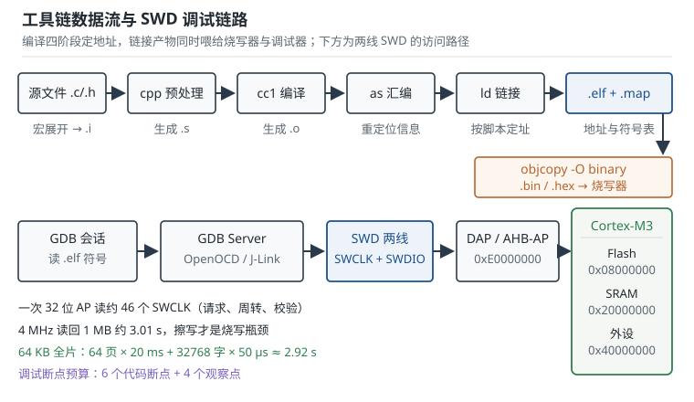

# 工具链与调试：从源码到芯片的最后一公里 Toolchain and Debug

编译器只对"语法能否生成机器码"负责，链接器只对"地址放不放得下"负责。至于这段机器码在真实芯片上能不能被启动、被观察、被写进去，取决于工具链（toolchain）的另外三块：启动文件、调试链路、烧写通道。这三块出问题时，编译日志一行红字都不会有，现象全部发生在板子上。本章把这条链路拆成可检查的环节，并给出每个环节的定量估算。

## 1. 设计动机（为什么"编译通过"离"跑起来"还有很远）

::: motivation 三个典型的深夜现场
**现场一：下载成功，程序停在 Default_Handler。** 编译零警告，调试器显示 "Verify OK"，但一复位就停在一个 `B .` 死循环里。查到最后发现链接脚本（linker script）的 FLASH 长度写的是 128 KB，而手上这颗芯片只有 64 KB：链接器不报错，因为地址确实"放得下"，只是放在了不存在的存储区。阅读 map 文件，`.text` 的结束地址越过了 `0x08010000`。

**现场二：断点打不上。** 前 6 个断点正常，第 7 个变灰，调试器提示无法插入断点。Cortex-M3 的 FPB 单元只有 6 个指令地址比较器、DWT 只有 4 个观察点比较器，多出来的断点要靠改写 Flash 里的指令来实现，而 Flash 断点又受写保护与擦写寿命限制。不知道这个预算，就会在"为什么断点时灵时不灵"上耗掉一晚上。

**现场三：加了打印就丢包。** 串口 115200、8N1，一行 64 字节的调试打印要占用 5.56 ms；主循环 1 kHz 的控制节拍是 1 ms，一条打印直接跨掉 5 个控制周期，Modbus 从站因此超时。把 printf 换成 RTT 或 DMA 发送后问题消失——这不是"printf 有 bug"，而是"CPU 在等串口"。
:::

把常见问题、应该先查什么、判据是什么放在一张表里：

| 你看到的现象 | 先查什么 | 判据 |
|---|---|---|
| 下载成功但停住、进 HardFault | map 文件的段地址、链接脚本的 MEMORY 长度 | 所有段落在真实 Flash/SRAM 范围内 |
| 全局变量初值不对 | 启动文件是否拷贝 `.data`、清 `.bss` | map 中 `_sidata` 等于 `.data` 的 LMA |
| 断点数不够、断点不生效 | 6 个代码断点、4 个观察点的预算 | 同时使用的断点不超过预算 |
| 打印卡死、丢数据 | printf 走的是半主机还是 UART | 无调试器时也能正常输出 |
| 烧写慢、量产节拍不够 | 擦除页数、编程字数、SWCLK | 时间与 3.3 节模型吻合 |

**不算会摔在哪**，三个带具体数字的代价：

1. **把"编译通过"当成"程序正确"。** `.data` 段的初值在 Flash 里，启动时必须拷到 RAM。链接脚本里 `.data` 的加载地址（Load Memory Address，LMA）与运行地址（Virtual Memory Address，VMA）一旦写错，全局配置结构体会保持上电的随机值。一个 1.5 KB 的 `.data` 拷错，表现是"十台板子里有一两台 I2C 从机地址变成 0"，因为那个字节恰好落在未清零的 SRAM 上。
2. **SWD 时钟拉到 10 MHz、排线 20 cm。** 连接成功率下降后，每次烧写要重试 3 次；64 KB 固件单次约 2.9 s，重试一次就多 8.7 s。改回 1 MHz 建立连接、烧完再提速，迭代时间反而更短。
3. **用阻塞 printf 观察 1 kHz 控制环。** 64 字节 5.56 ms，相当于 5.56 个控制周期。控制环里丢失的 5 个周期不是"慢一点"，而是采样点缺失、积分项少算，电机电流会出现肉眼可见的纹波。

## 2. 定义与直观（原理：一条从 .c 到芯片的链路）

### 2.1 名字拆开：交叉编译器到底是什么

`arm-none-eabi-gcc` 这个名字由三段构成，每一段都决定了它能做什么、不能做什么：

- **arm**：目标指令集架构。生成的机器码给 Arm 内核执行，不是给 x86 主机执行。这就是"交叉编译（cross compilation）"的第一层含义：编译发生在主机（host）上，运行发生在目标机（target）上。
- **none**：目标平台没有操作系统。它决定了链接时默认不引入 POSIX 的系统调用，`printf` 最终会落到一个需要用户自己实现的 `_write` 上。
- **eabi**：遵循 Arm 嵌入式应用二进制接口（Embedded Application Binary Interface，EABI）。它规定了参数怎么传（前 4 个整型参数用 r0–r3）、栈怎么对齐（8 字节）、结构体怎么排布。同一份源码用不同 ABI 编译出的 `.o` 不能混链。

还要纠正一个常见误解：`gcc` 本身不是编译器，而是**驱动程序（driver）**。它按后缀和选项去调用真正的工具：`cc1` 做预处理与编译，`as` 做汇编，`collect2` 调 `ld` 做链接。所以"gcc 报错"可能来自这四者中的任何一个。一个完整的 Arm 工具链至少包含：

| 工具 | 作用 | 常用场景 |
|---|---|---|
| `arm-none-eabi-gcc` | 驱动 + 编译 | 编译、链接一步到位 |
| `arm-none-eabi-as` | 汇编器 | 汇编 `.s` 启动文件 |
| `arm-none-eabi-ld` | 链接器 | 按链接脚本定址 |
| `arm-none-eabi-objcopy` | 格式转换 | `.elf` 转 `.bin`/`.hex` |
| `arm-none-eabi-objdump` | 反汇编 | 核对入口处指令 |
| `arm-none-eabi-size` | 段大小统计 | 快速看 Flash/RAM 占用 |
| `arm-none-eabi-nm` | 符号表 | 按大小排序找"谁占了 RAM" |
| `arm-none-eabi-gdb` | 调试器 | 连 GDB Server 下断点 |
| `arm-none-eabi-readelf` | ELF 解析 | 看段属性、对齐、入口 |

典型的编译命令把目标参数写全：

```bash
arm-none-eabi-gcc -mcpu=cortex-m3 -mthumb -O2 -g3 \
  -ffunction-sections -fdata-sections \
  -T stm32f103c8.ld -Wl,-Map=build/app.map,--gc-sections \
  -specs=nano.specs -specs=nosys.specs \
  src/main.c src/uart.c -o build/app.elf
```

其中 `-mcpu` 决定可用的指令与 FPU，`-mthumb` 强制 Thumb-2 编码（Cortex-M 只支持 Thumb），`-specs=nano.specs` 换成体积更小的 newlib-nano，`-specs=nosys.specs` 提供一组"空实现"的系统调用桩，避免链接时找不到 `_write`、`_sbrk`。

### 2.2 从 .c 到 .elf：四个阶段

一条 `gcc` 命令背后是四个阶段，每个阶段的输入输出都能单独观察，这是定位构建问题的基本手段：

| 阶段 | 命令 | 输入 | 输出 | 典型错误 |
|---|---|---|---|---|
| 预处理 | `gcc -E` | `.c/.h` | `.i` | 头文件找不到、宏展开不符合预期 |
| 编译 | `gcc -S` | `.i` | `.s` | 语法/类型错误、内联汇编约束错误 |
| 汇编 | `gcc -c` | `.s` | `.o` | 汇编语法、立即数越界、重定位类型不支持 |
| 链接 | `gcc`（无 `-c/-S/-E`） | `.o` + `.a` + `.ld` | `.elf` | 未定义符号、段溢出、多重定义 |

每个阶段都可能"成功"，但成功只代表本阶段自洽。链接阶段最容易被忽略，因为它不检查语义，只检查地址。用 `-save-temps` 可以把中间文件全部留下，排查"宏到底展开了什么""这条语句编译成了哪几条指令"时非常有用。

`-ffunction-sections -fdata-sections` 让每个函数、每个变量各占一个节，配合 `-Wl,--gc-sections` 就能把没有被引用的节整段删掉。代价是链接变慢，收益是固件变小，具体能省多少要看工程里"写了但没调用"的代码比例。

### 2.3 链接脚本：把段放到物理地址上

链接脚本（linker script）回答两个问题：芯片有哪些存储区、每个段放到哪个区。最小可用的脚本长这样：

```ld
MEMORY
{
  FLASH (rx)  : ORIGIN = 0x08000000, LENGTH = 64K
  RAM   (xrw) : ORIGIN = 0x20000000, LENGTH = 20K
}

_estack = ORIGIN(RAM) + LENGTH(RAM);

SECTIONS
{
  .isr_vector : { KEEP(*(.isr_vector)) } > FLASH
  .text       : { *(.text*) *(.rodata*) } > FLASH
  .data       : {
    _sdata = .;
    *(.data*)
    _edata = .;
  } > RAM AT > FLASH
  _sidata = LOADADDR(.data);
  .bss (NOLOAD) : {
    _sbss = .;
    *(.bss*) *(COMMON)
    _ebss = .;
  } > RAM
}
```

三个关键点：

1. `MEMORY` 里的 `LENGTH` 必须和芯片真实容量一致。链接器只会检查"段有没有超出 LENGTH"，不会检查"LENGTH 有没有超出芯片"。
2. `> RAM AT > FLASH` 是 `.data` 的灵魂：VMA 在 RAM（运行时变量在这里），LMA 在 Flash（初值存在这里）。启动文件靠 `_sidata`、`_sdata`、`_edata` 三个符号把数据从 Flash 搬到 RAM。
3. `_estack` 是栈顶，必须等于 RAM 的末尾。它是向量表的第一项，复位时被硬件装进 MSP。

链接失败时最常见的两条报错都能直接定位问题：`region 'FLASH' overflowed by N bytes` 说明代码真的放不下；`undefined reference to 'xxx'` 说明声明了没实现，或者实现所在的库没参与链接。

### 2.4 map 文件：链接器的账本

`-Wl,-Map=build/app.map` 生成的 map 文件是排查内存问题的第一手资料，至少要看四块：

```text
Memory Configuration
Name             Origin             Length             Attributes
FLASH            0x08000000         0x00010000         xr
RAM              0x20000000         0x00005000         xrw

.data           0x20000000      0x600 load address 0x0800b8ec
.bss            0x20000600     0x1800
```

- **Memory Configuration**：链接脚本实际生效的区域与长度，先确认它和芯片一致。
- **段地址与大小**：`.data` 的 VMA 是 `0x20000000`、大小 `0x600`（1536 B），加载地址是 `0x0800b8ec`。两者必须落在各自区域里。
- **符号地址**：`_estack`、`_sidata`、`Reset_Handler` 的地址都能查到，用来核对向量表前两项。
- **最大的符号**：配合 `nm --size-sort -S app.elf | tail -20` 找出"谁把 RAM 吃掉了"，通常是一两个大数组或日志缓冲区。

map 文件还能暴露一个隐蔽问题：某个 `.o` 被链接进来但所有函数都进了 `.text`，说明 `--gc-sections` 没生效（常见原因是缺少 `-ffunction-sections`，或者中断向量表没有用 `KEEP` 保住处理函数）。

### 2.5 启动文件：第一条指令不在 main

启动文件（startup file）通常是一个 `.s` 汇编文件，它做四件事：

1. 在 `.isr_vector` 节里定义向量表：第 0 项是初始 MSP，第 1 项是 `Reset_Handler`，之后依次是 NMI、HardFault、SVCall、PendSV、SysTick 等系统异常和各个外设中断。
2. 定义 `Reset_Handler`：调用 `SystemInit` 配置时钟，拷贝 `.data`，清零 `.bss`，调用 `__libc_init_array` 跑 C++ 全局构造，最后 `bl main`。
3. 为每个中断提供默认处理函数 `Default_Handler`，内容是死循环；再用 `.weak` 别名把 `USART1_IRQHandler` 等符号指向它。用户在 C 文件里定义同名函数，就会覆盖弱符号。
4. 提供 `_estack`（或直接在向量表第 0 项写栈顶地址）。

用 `objdump` 看复位入口，能确认三件事是否对：向量表第 0 项是不是 RAM 末尾、第 1 项是不是奇数（Thumb 位为 1）、`Reset_Handler` 的第一条指令是不是取符号地址：

```bash
arm-none-eabi-objdump -s -j .isr_vector build/app.elf
# 08000000 00500020 c1010008 ...
# 0x20005000 = 20 KB RAM 的栈顶；0x080001c1 = Reset_Handler + Thumb 位
```

如果第 1 项是偶数，跳转时会被当成 ARM 状态地址，Cortex-M 立即进 HardFault。这是"启动文件与编译器选项不匹配"最典型的表现。

### 2.6 SWD 与 JTAG：两根线还是五根线

串行线调试（Serial Wire Debug，SWD）和联合测试行动组（Joint Test Action Group，JTAG）是两种访问调试访问端口（Debug Access Port，DAP）的物理层。Cortex-M 两者都支持，实际工程里 SWD 占绝对多数：

| 项目 | SWD | JTAG |
|---|---|---|
| 信号线 | SWCLK、SWDIO（双向） | TCK、TMS、TDI、TDO |
| 必需引脚 | 2 + GND，可选 nRESET | 4 + GND，可选 nTRST |
| 多器件 | 需 SWD 多路复用 | 天然支持菊花链 |
| 高速稳定性 | 线短、时钟低时很稳 | 线长时更易受反射影响 |
| 典型用途 | 开发、量产烧写 | 边界扫描、多芯片板 |

SWD 的协议栈是分层的：物理层两根线，链路层传 8 位请求包（含 APnDP、RnW、地址、校验），传输层做 32 位数据加奇偶校验，访问层通过 AHB-AP 读写目标机的 4 GB 地址空间。所以你可以在不运行任何目标代码的情况下，直接读 `0xE000ED08` 的 VTOR、改 RAM 里的变量、甚至把 PC 改成任意地址。

接线排查的顺序是固定的：先确认目标板供电与共地，再降速到 100 kHz 试连接，仍失败就接上 nRESET 用"复位时连接"（connect under reset）。如果代码一上电就进低功耗、关掉调试时钟，普通连接永远失败，只有复位时连接能救回来。

### 2.7 GDB 会话：断点、观察点与符号

GDB 不直接碰硬件，它通过 GDB Server（OpenOCD、J-Link GDB Server、pyOCD 等）把"读内存、写寄存器、下断点"翻译成 SWD 事务。一次典型的会话：

```bash
arm-none-eabi-gdb build/app.elf
(gdb) target extended-remote :3333
(gdb) monitor reset halt
(gdb) load
(gdb) compare-sections
(gdb) break main
(gdb) continue
```

几个高频命令的用途要分清：`load` 把 `.elf` 的可加载段写进 Flash；`compare-sections` 逐段比对目标机与本地文件，是"烧写是否真的成功"的判据；`break` 在 Flash 地址上默认用硬件断点，`hbreak` 强制硬件断点；`watch` 是数据观察点，靠 DWT 实现，数量只有 4 个；`x/16wx 0x20000000` 直接看 RAM；`info registers` 看内核寄存器，其中 `xPSR` 的 bit24 是 Thumb 位，异常时必看。

断点预算必须记住：Cortex-M3 的 FPB 有 6 个指令比较器、DWT 有 4 个观察点比较器。超过预算时 GDB 会尝试把断点写成软件断点（把指令替换成 `BKPT`），在 Flash 上这需要擦写一整页，既慢又伤寿命；在只读区则直接失败。

### 2.8 printf 重定向与 RTT

newlib 的 `printf` 最终调用 `_write(fd, buf, len)`。这个函数在 `nosys.specs` 下是空实现，在半主机（semihosting）下则通过 `BKPT 0xAB` 陷入调试器。四条常见路线：

| 路线 | 机制 | CPU 开销 | 需要额外引脚 | 无调试器时 |
|---|---|---|---|---|
| 半主机 | `BKPT` 交给调试器 | 极高，每字符一次往返 | 无 | 卡死或 HardFault |
| UART 轮询 | `_write` 里死等发送寄存器空 | 高，等于波特率时间 | TX | 正常 |
| UART + DMA | 写入环形缓冲，DMA 发送 | 低，仅入队开销 | TX | 正常 |
| RTT | 目标写 RAM 环形缓冲，调试器轮询读取 | 极低，仅内存拷贝 | 无（走 SWD） | 不可见 |

UART 重定向的最小实现：

```c
int _write(int fd, char *buf, int len)
{
    (void)fd;
    for (int i = 0; i < len; i++) {
        while (!(USART1->SR & USART_SR_TXE)) { }
        USART1->DR = (uint8_t)buf[i];
    }
    return len;
}
```

实时传输（Real Time Transfer，RTT）是 SEGGER 的方案：目标机在 RAM 里放一个带固定标识 `SEGGER RTT` 的控制块和若干环形缓冲区，调试器周期性读内存把数据取走。目标机写缓冲区几乎不等待，适合在中断里打印；代价是必须挂着调试器，且带宽受 SWD 时钟与轮询频率限制。

### 2.9 烧写方式：从调试器到量产

| 方式 | 通道 | 适用阶段 | 速度量级 | 备注 |
|---|---|---|---|---|
| 调试器烧写 | SWD/JTAG | 开发、小批量 | 10–100 kB/s | 可断点、可回读校验 |
| ROM 引导程序（ISP） | UART/CAN/USB | 产线、现场救砖 | 5–50 kB/s | 需 BOOT 引脚进入 |
| 设备固件升级（DFU） | USB | 消费类产品 | 100 kB/s 以上 | 需固件实现 USB 栈 |
| 离线编程器 | 夹具直连 | 大批量 | 数秒/片 | 可脱机、可加密 |
| 空中升级（OTA） | 无线/总线 | 已部署设备 | 受链路限制 | 需 bootloader 与校验 |

开发阶段用调试器最方便，因为它同时提供"烧写 + 校验 + 立刻调试"；量产阶段追求节拍，会把"擦除 + 编程 + 校验"三段并行或分站做。选择哪种方式，取决于产量、是否需要现场升级、以及是否要保护固件不被读回。



## 3. 定量关系（公式、时序与可复算的数字）

### 3.1 串口打印占用多少时间

异步串口一帧的位数由数据位、校验位、停止位决定。8N1 表示 8 个数据位、无校验、1 个停止位，加上 1 个起始位，共 10 位。打印 $N$ 字节的时间为

$$
t_{\text{uart}}=\frac{N\left(1+D+P+S\right)}{f_{\text{baud}}}
$$

其中 $N$ 是字节数，$D$ 是数据位数（8），$P$ 是校验位数（0 或 1），$S$ 是停止位数（1 或 2），$f_{\text{baud}}$ 是波特率（bit/s）。代入 8N1 得每字节 10 位。

115200 bit/s 下，每字节约 $10/115200=86.8\ \mu\text{s}$。不同长度的打印时间，以及换算到 72 MHz 主频的等效周期数（$N_{\text{cyc}}=t f_{\text{cpu}}$）：

| 字节数 | 位数 | 时间 | 72 MHz 等效周期 |
|---|---|---|---|
| 16 | 160 | 1.389 ms | 100000 |
| 64 | 640 | 5.556 ms | 400000 |
| 128 | 1280 | 11.111 ms | 800000 |
| 256 | 2560 | 22.222 ms | 1600000 |

关键在于：这些周期数是**CPU 被占住**的周期数。轮询发送期间 CPU 什么也做不了；如果打印发生在中断里，等于把中断延迟拉长到毫秒级。换算成"控制周期"更直观：1 kHz 的控制环每周期 1 ms，64 字节打印跨 5.56 个周期。

### 3.2 SWD 传输与烧写时间

SWD 线上一次 32 位读事务包括 8 位请求头、1 位周转、32 位数据、1 位奇偶校验，再加上应答与收尾的周转位，工程估算取 46 个 SWCLK。传输 $N_{\text{word}}$ 个 32 位字的时间为

$$
t_{\text{swd}}=\frac{46\,N_{\text{word}}}{f_{\text{swclk}}}
$$

其中 $N_{\text{word}}$ 是 32 位字的个数，$f_{\text{swclk}}$ 是 SWCLK 频率（Hz）。读回 1 MB：$N_{\text{word}}=1048576/4=262144$，$f_{\text{swclk}}=4$ MHz 时 $t=46\times262144/4\times10^{6}=3.015$ s。若降到 1 MHz，同样的数据要 12.06 s。

::: advanced 46 个时钟是怎么来的
一次 AP 读的线上序列可以拆成：8 位请求（1 起始 + 1 APnDP + 1 RnW + 2 地址 + 1 校验 + 1 停止 + 1 空闲）、至少 1 个周转周期让目标机接管 SWDIO、32 位数据、1 位奇偶校验，之后还要留出应答采样与下一次请求的周转余量。8 + 1 + 32 + 1 = 42，再加约 4 个周转/空闲位就是 46。写事务没有读数据的周转，但多了写应答，量级相同。这个数字不是协议规定的常数，而是"按 32 位单次访问、无块传输"的估算值；开启块读（block read）可以连续传多个字，摊薄请求头，实际吞吐能提高 2–4 倍。
:::

烧写时间由擦除和编程两段主导，SWD 只是搬运工。以 64 KB Flash、1 KB/页、页擦除 20 ms（典型值）、16 位字编程 50 µs（典型值）为例：

$$
t_{\text{flash}}=N_{\text{page}}t_{\text{erase}}+N_{\text{half}}t_{\text{prog}}+t_{\text{ov}}
$$

其中 $N_{\text{page}}$ 是擦除页数，$N_{\text{half}}$ 是 16 位半字个数，$t_{\text{ov}}$ 是连接、校验、复位等固定开销。64 KB 全片：$64\times20\ \text{ms}=1.28$ s，$32768\times50\ \mu\text{s}=1.6384$ s，合计 2.92 s（不含 $t_{\text{ov}}$）。可见即使 SWD 跑到 4 MHz，烧写时间仍然由 Flash 物理特性决定。

### 3.3 Flash 擦写时间模型

把 3.2 的式子按实际固件大小重算：固件 48876 B（47.73 KB），向上取整到 48 页，擦除 $48\times20=960$ ms；半字数为 $48876/2=24438$，编程 $24438\times50\ \mu\text{s}=1.2219$ s；合计 2.182 s。这个数字可以直接和调试器日志里的 "Flash download" 耗时对照，偏差超过 30% 就说明擦除策略不同（比如整片擦除只花 20 ms，或者按扇区擦除）。

### 3.4 启动阶段的内存初始化耗时

`.data` 拷贝与 `.bss` 清零都是"按字搬移/写入"，时间与字数成正比：

$$
t_{\text{init}}=\frac{N_{\text{word}}\,C_{\text{word}}}{f_{\text{cpu}}}
$$

其中 $N_{\text{word}}$ 是 32 位字数，$C_{\text{word}}$ 是每字的等效周期数（普通 LDR/STR 约 2 个周期，LDM/STM 批量传输可低到 1 周期/字），$f_{\text{cpu}}$ 是主频。1.5 KB 的 `.data` 是 384 字，$384\times2/72\times10^{6}=10.67\ \mu\text{s}$；6 KB 的 `.bss` 是 1536 字，$1536\times2/72\times10^{6}=42.67\ \mu\text{s}$。两者合计 53.3 µs，在 1 ms 级的启动预算里可以忽略，但在"上电后必须立刻采第一个点"的场景里，这 53 µs 决定了第一个采样点是否有效。

### 3.5 调试通道的可持续带宽

RTT 的吞吐取决于调试器多久轮询一次、每次搬多少字节：

$$
R_{\text{rtt}}=\frac{B_{\text{poll}}\,f_{\text{poll}}}{1024}
$$

其中 $B_{\text{poll}}$ 是每次轮询搬运的字节数，$f_{\text{poll}}$ 是轮询频率（Hz），结果单位是 kB/s。每次 64 B、每 1 ms 轮询一次，得到 $64\times1000/1024=62.5$ kB/s；轮询提到 4 kHz 则是 250 kB/s。ITM 走 SWO 引脚，按异步串行编码每字节 10 位估算，2 MHz 的 SWO 时钟对应 $2\times10^{6}/10=200$ kB/s，4 MHz 对应 400 kB/s。两个数字都远高于 115200 的 11.52 kB/s，这就是"换成 RTT 后打印不再拖慢系统"的定量原因。

## 4. 典型计算（一个完整工程的算例）

设定一颗 64 KB Flash、20 KB SRAM、72 MHz 的 Cortex-M3 芯片，工程构成如下（数字取自 map 文件，单位统一为字节）：

| 项目 | 大小 | 位置 | 说明 |
|---|---|---|---|
| 向量表 | 236 B | Flash | 59 项 × 4 B |
| `.text` | 43008 B | Flash | 代码 |
| `.rodata` | 4096 B | Flash | 常量、字符串 |
| `.data` | 1536 B | Flash（LMA）+ RAM（VMA） | 有初值的全局变量 |
| `.bss` | 6144 B | RAM | 无初值的全局变量 |
| 堆 | 2048 B | RAM | `malloc` 区 |
| 栈 | 2048 B | RAM | MSP 从 `0x20005000` 向下 |

**问题一：Flash 用了多少？还剩多少？**

$$
S_{\text{flash}}=236+43008+4096+1536=48876\ \text{B}
$$

$48876/65536=74.58\%$，剩余 $65536-48876=16660$ B，即 16.27 KB。余量 25.4%，够放一次功能迭代，但不够放两套字库。

**问题二：RAM 用了多少？栈顶在哪？**

$$
S_{\text{ram}}=1536+6144+2048+2048=11776\ \text{B}
$$

$11776/20480=57.5\%$，剩余 8704 B（8.5 KB）。栈顶是 RAM 末尾 `0x20000000 + 0x5000 = 0x20005000`，栈底是 `0x20005000 - 0x800 = 0x20004800`。堆从 `.bss` 结束的 `0x20002E00` 向上长，栈从 `0x20005000` 向下长，两者之间还剩 $0x20005000-0x20002E00-0x800=0x2200$ 即 8704 B 的空隙——这就是"堆栈相撞"的缓冲区。

**问题三：从复位到 main 的初始化花多久？**

`.data` 384 字、`.bss` 1536 字，按每字 2 个周期：

$$
t_{\text{init}}=\frac{(384+1536)\times2}{72\times10^{6}}=\frac{3840}{72\times10^{6}}=53.3\ \mu\text{s}
$$

**问题四：烧写这颗 64 KB 芯片的固件要多久？**

固件 48876 B，按 1 KB 页对齐取 48 页：

$$
t_{\text{flash}}=48\times20\ \text{ms}+\frac{48876}{2}\times50\ \mu\text{s}=960\ \text{ms}+1221.9\ \text{ms}=2.182\ \text{s}
$$

若调试器日志显示 5 s 以上，多半是每页擦除后还做了整页回读校验，或者 SWCLK 只有 100 kHz 让搬运成了瓶颈（见问题五）。

**问题五：SWCLK 降到 100 kHz 后，谁主导烧写时间？**

搬运 12219 个 32 位字：

$$
t_{\text{swd}}=\frac{46\times12219}{100\times10^{3}}=\frac{562074}{10^{5}}=5.62\ \text{s}
$$

此时 SWD 搬运（5.63 s）已经超过 Flash 擦写（2.18 s），总时间接近 7.8 s。这解释了一个常见现象：换用更快的调试器不一定更快，先看 SWCLK 设成了多少。

## 5. 工程含义（实践中的取舍）

**优化等级决定了"能不能看见变量"。** `-O0` 下每个局部变量都在栈上有固定地址，GDB 想看就看；`-O2` 下变量被放进寄存器、常量被折叠、死代码被删除，GDB 只能显示 `<optimized out>`。调试期用 `-Og`（在保持可调试性的前提下做轻度优化），发布期用 `-O2` 或 `-Os`。如果某个变量必须在优化后仍可见，声明为 `static volatile` 并加 `__attribute__((used))`，否则链接器可能把它当垃圾收走。

**`--gc-sections` 的收益要用数字说话。** 假设本工程 `.text` 里"写了但没调用"的函数合计 1.8 KB，回收后占 42 KB 的 $1.8/42=4.3\%$。收益不大时，优先保证链接脚本里 `KEEP(*(.isr_vector))` 和中断处理函数的保留，别为了 4% 引入"中断进 Default_Handler"的风险。

**构建产物要归档三件套。** `.elf`（含符号与调试信息）、`.map`（地址账本）、`.bin`（烧写镜像）。`objcopy -O binary` 只导出可加载段，所以 `.bin` 通常远小于 `.elf`：调试信息（DWARF）在 `.debug_*` 段里，不占目标机地址空间。出问题时，用同一次构建的 `.elf` + `.map` 才能把地址还原成函数名；用错版本的 `.elf` 去解栈回溯，得到的是错误行号。

**依赖跟踪决定增量编译是否可信。** `-MMD -MP` 生成 `.d` 文件，把"每个 `.o` 依赖哪些头文件"写清楚。没有它，改了 `board.h` 里的宏，Make 只重编 `board.c`，其他引用该宏的 `.o` 仍是旧值——这类问题表现为"我明明改了，怎么还是老行为"，而 clean 重编后又好了。

**调试口是安全边界。** 量产时把读保护（Read Protection，RDP）设到 Level 1，调试器就无法再 attach，也无法读 Flash；解锁只能整片擦除，固件一并消失。代价是现场返修无法在线调试，只能靠日志与升级通道。是否开启，取决于固件里有没有密钥、算法或计费逻辑。

**断点不够时换观测手段。** 6 个代码断点、4 个观察点用完后，可以：翻转一个空闲 GPIO 用示波器看时序；在 RAM 里放一个计数器数组，事后再读；用 RTT 打印带时间戳的事件。断点会停住 CPU、改变时序，而计数器与 GPIO 翻转不会——排查偶发问题时，后者往往更接近真相。

## 6. 常见坑（现象、原因与解决）

::: pitfall 六个高频坑
- **链接脚本的容量写大了**：现象——编译链接全部通过，烧写时提示地址越界或校验失败，程序停在 HardFault。原因——`MEMORY` 的 `LENGTH` 按"同系列最大型号"抄的，实际芯片容量更小；链接器只检查段是否超出 `LENGTH`，不检查 `LENGTH` 是否超出芯片。解决——按数据手册的型号对照表填 `LENGTH`，在脚本末尾加 `ASSERT(_edata <= ORIGIN(RAM)+LENGTH(RAM), "RAM overflow")`，并把 map 文件纳入构建检查。

- **`.data` 没被拷贝**：现象——全局变量的初值随机，或者十台板子里有一两台配置错误；有些 `static` 变量看起来正常，只是因为它们的初值恰好是 0（本应落在 `.bss`）。原因——启动文件里的拷贝循环引用了 `_sidata`/`_sdata`/`_edata`，而链接脚本改了符号名或 `.data` 被 `--gc-sections` 搬走，导致拷贝长度算成 0。解决——在 map 文件里核对 `_sidata` 是否等于 `.data` 的加载地址、`_edata - _sdata` 是否等于 `.data` 大小；用调试器在 `Reset_Handler` 之后立刻读一个已知初值的全局变量。

- **半主机 printf 在没有调试器时卡死**：现象——接着调试器一切正常，拔掉调试器上电就停在第一条打印，或直接进 HardFault。原因——`printf` 走到了半主机实现，`BKPT 0xAB` 需要调试器响应，没人响应就异常。解决——重定向 `_write` 到 UART 或 RTT，链接时用 `-specs=nosys.specs`，并在发布构建里用宏把调试打印整体关掉。

- **断点数量超预算**：现象——前几个断点正常，再加一个就提示无法插入，或者程序跑飞。原因——硬件断点只有 6 个（FPB 指令比较器），超出的断点被实现成软件断点，需要改写 Flash 指令。解决——删掉不用的断点、用观察点代替"某变量变化时停"、把断点集中在可疑函数入口；Flash 上优先用 `hbreak`，避免调试器偷偷擦写。

- **SWD 连不上**：现象——调试器报 "Cannot connect to target"，换一块板子又能连。原因——目标板没供电或没共地、SWCLK 太快导致时序余量不足、nRESET 被外部电路拉住、固件一上电就进 STOP 模式关掉了调试时钟。解决——先量目标板 3.3 V 与 GND，把 SWCLK 降到 100 kHz，接上 nRESET 用 connect under reset；确认固件里没有在启动早期关闭调试。

- **优化后变量"消失"**：现象——`-O0` 时变量值正常，切到 `-O2` 后 GDB 显示 `<optimized out>`，或者打印出来是旧值。原因——变量被提升到寄存器、被常量传播、或因为无人读取被整段删除。解决——调试构建用 `-Og`；需要跨断点观察的变量加 `volatile`；检查 `__attribute__((used))` 与 `KEEP` 是否覆盖了该符号。
:::

## 7. 自测题

<details><summary>115200、8N1 下打印 100 字节需要多久？换算成 72 MHz 的周期数是多少？如果这段打印放在 1 kHz 的定时中断里，会带来什么影响？</summary>

每字节 10 位（1 起始 + 8 数据 + 1 停止），100 字节共 1000 位：

$$
t=\frac{1000}{115200}=8.681\ \text{ms}
$$

换算周期：

$$
N_{\text{cyc}}=8.681\times10^{-3}\times72\times10^{6}=625000
$$

1 kHz 中断周期是 1 ms，8.681 ms 相当于 8.68 个中断周期。若在中断里轮询发送，CPU 在这 8.68 ms 内无法响应同级或更低优先级中断，控制环会连续丢失 8 个采样点。正确做法是把打印放进环形缓冲、由 DMA 在后台发送，中断里只做入队。

</details>

<details><summary>SWD 时钟 4 MHz，读回 1 MB 数据需要多久？如果把时钟降到 1 MHz 呢？这两个数字说明什么？</summary>

1 MB 是 1048576 字节，即 262144 个 32 位字。按每次读 46 个 SWCLK：

$$
t_{4\text{MHz}}=\frac{46\times262144}{4\times10^{6}}=\frac{12058624}{4\times10^{6}}=3.015\ \text{s}
$$

$$
t_{1\text{MHz}}=\frac{46\times262144}{1\times10^{6}}=12.059\ \text{s}
$$

时钟降 4 倍，时间涨 4 倍，是严格的线性关系。这说明 SWD 带宽是"搬运上限"，但整片烧写还受 Flash 擦写时间约束：64 KB 固件的擦写约 2.18 s，即使 SWD 再快也降不下去。优化烧写节拍要先看瓶颈在搬运还是在擦写。

</details>

<details><summary>已知 `.data` 1536 B、`.bss` 6144 B、堆 2048 B、栈 2048 B，SRAM 共 20480 B。若 `.bss` 因新增缓冲区涨到 12288 B，还放得下吗？该不该放行？</summary>

新的 RAM 占用：

$$
S=1536+12288+2048+2048=17920\ \text{B}
$$

$17920/20480=87.5\%$，剩余 2560 B。从"算术上放得下"看是的，但工程上要打问号：剩余 2560 B 需要同时容纳最坏中断嵌套的栈帧（每个异常帧 32 B，带 FPU 时 104 B）、`printf` 的临时缓冲、以及堆的碎片。若最深嵌套 4 层、每层 104 B，就是 416 B；再加一次 512 B 的 `snprintf`，只剩 1632 B，安全裕量不足 8%。

判据建议：RAM 静态占用不超过 75%，且剩余空间至少覆盖"最坏栈峰值 × 1.5"。本例已到 87.5%，应把大缓冲区改为静态分配并核算峰值，或者换更大 SRAM 的型号。

</details>

<details><summary>为什么 `objcopy -O binary` 之后文件会明显变小？变小的部分去哪了？这对归档有什么要求？</summary>

`.elf` 是可执行与可链接格式，除了可加载段（`.isr_vector`、`.text`、`.rodata`、`.data` 的初值），还包含不加载到目标机的段：`.debug_info`、`.debug_line`、`.symtab`、`.strtab`。`objcopy -O binary` 只导出 `AT` 地址连续的可加载段，所以 `.bin` 的大小约等于 Flash 占用（本例 48876 B），而 `.elf` 可能有几百 KB。

变小的部分是调试信息与符号表，它们没有消失，只是没进镜像。因此归档时必须同时保留 `.elf` 和 `.map`：只有 `.bin` 时，地址 `0x08000f2c` 只是一个数字；有 `.elf` 才能还原成"`uart_send` 第 42 行"。发布构建也不要 strip 掉 `.elf`，可以单独出一个 strip 过的版本用于分发。

</details>

<details><summary>SWCLK 从 4 MHz 降到 100 kHz，搬运 48876 B 固件需要多久？与 Flash 擦写的 2.18 s 相比谁主导？</summary>

48876 B 是 12219 个 32 位字：

$$
t_{\text{swd}}=\frac{46\times12219}{100\times10^{3}}=\frac{562074}{10^{5}}=5.621\ \text{s}
$$

擦写时间 2.182 s，两者相加约 7.80 s。100 kHz 时搬运成为主导项（占 72%），此时换更快的 Flash 没有意义，应该先提高 SWCLK 或改用块传输。反过来，在 4 MHz 时搬运只要 0.141 s，擦写的 2.18 s 占 94%，这时优化方向是减少擦除页数（比如只擦有改动的页）。

</details>

## 8. 参考资料

- Arm, *GNU Tools for Arm Embedded Processors*（ARM 100617），"Compiler Options" 与 "Linker Options"：`-mcpu`、`-mthumb`、`-specs` 的官方语义，本章 2.1 节的工具清单与编译命令按该手册整理。
- GNU Binutils 2.40, *GNU ld Reference Manual*，[MEMORY 命令](https://sourceware.org/binutils/docs/ld/MEMORY.html) 与 [SECTIONS 与 LMA/VMA](https://sourceware.org/binutils/docs/ld/Output-Section-LMA.html)：本章 2.3 节链接脚本的 `AT >` 用法与 `.data` 双地址语义依据此文档。
- Arm, *CoreSight Architecture Specification*（ARM IHI 0029D），Chapter 2 "Debug Access Port" 与 Chapter 4 "Serial Wire Debug"：SWD 请求包、周转周期与 AP 访问的分层结构，本章 2.6、3.2 节按此重写。
- Arm, *Cortex-M3 Technical Reference Manual*（ARM DDI 0337I），Chapter 10 "Debug"：FPB 的 6 个指令比较器与 DWT 的 4 个观察点比较器；Chapter 14 "Memory Map"：本章 2.7 节断点预算与 3.2 节的地址空间说明依据此章。
- SEGGER, *J-Link User Manual*（UM08001），"RTT — Real Time Transfer"：RTT 控制块、上行/下行缓冲区与轮询读取机制，本章 2.8、3.5 节的带宽模型按该章估算。
- STMicroelectronics, *STM32F103x8/xB Datasheet*（DS5319 Rev 10），Table 5 "Memory map" 与 Flash 特性表：64 KB Flash、20 KB SRAM、1 KB 页大小、页擦除 20 ms 与 16 位字编程 50 µs 的典型值，本章 3.2–3.4 与第 4 节的计算均以此为准。
- [OpenOCD User's Guide](https://openocd.org/doc/html/index.html)：`reset halt`、`flash write_image`、`compare-sections` 等命令的实际行为，可用于复现本章 2.7 节的 GDB 会话。
