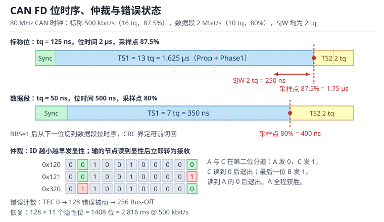

# CAN 与 CAN FD：位时序、仲裁、Bus-Off 与负载率

控制器局域网（Controller Area Network，CAN）是一条差分双绞线上的多主、广播、带优先级的总线。它没有设备地址，每一帧用标识符（Identifier，ID）同时表示"这是什么数据"和"这帧有多急"；所有节点都能听到所有帧，需要的人自己过滤。CAN FD（CAN with Flexible Data-rate）在此基础上把帧长扩到 64 字节，并允许数据段用更高的位速率传输，但仲裁段仍然留在经典速率上。

这三个特性——**按位仲裁（Arbitration）、错误计数、位速率切换**——把 CAN 的绝大多数工程问题压缩成了可计算的时序问题：采样点偏了，低温和长线就会偶发错误帧；优先级排错，最坏响应时间会超过控制周期；总线关闭（Bus-Off）后不恢复，整条总线会静默；CAN FD 只提高了数据段速率，没有改变仲裁规则，也没有自动解决总线负载和传播延迟。本章沿着位时间、仲裁、错误状态机、FD 与负载率五条线展开，每个结论都落到可复算的纳秒、微秒和百分比上。

与 UART 的逐帧采样对照见 [UART 与 USART](uart.md)，SPI 的全双工移位链见 [SPI 总线](spi.md)，DMA 的通道与缓冲见 [DMA：通道映射、双缓冲与带宽](../mcu/dma.md)，收发器与终端电阻的电气细节见 [GPIO 电气与驱动](../mcu/gpio.md)。

## 1. 动机（设计动机：为什么一条双绞线决定整车能否安全停下）

::: motivation 四个现场
**现场一：采样点从 87.5% 改成 75%，低温下偶发错误帧。** 节点在常温台架上跑了一周没问题，装车后零下二十度开始报错误帧。示波器上看到显性位到隐性位的边沿变缓，采样点又偏早，正好落在边沿附近。把采样点从 75% 调回 87.5%、并把 SJW 从 1 调到 2，故障消失。这不是"芯片怕冷"，而是位时序没有给传播延迟和振荡器漂移留余量。

**现场二：两个节点用同一个 ID 发不同数据。** 整车厂定义 0x18F 是车速，某个供应商把它当成自己的私有状态字，总线上偶尔出现两种长度、两种含义的 0x18F。接收方校验和通不过，仪表偶发跳到 0。CAN 没有源地址，ID 冲突不会报"地址冲突"，只会表现为某几帧数据不可解释。

**现场三：错误计数器只读不恢复。** 一台设备因为终端电阻漏装，TEC 一路涨到 256 进入 Bus-Off。固件只打印了错误中断，没有清初始化位，也没有等待 128 次 11 个隐性位，设备从此不再发帧。整车其他节点还在跑，只有这一个节点"失踪"，诊断仪读不到任何故障码。

**现场四：平均负载 40%，最坏响应 8 ms。** 设计者按"每秒帧数 × 帧长"算出总线负载 40%，认为余量很大；但低优先级的控制帧前面排着三帧高优先级数据，最坏响应时间算下来 8 ms，而控制周期只有 5 ms。平均负载描述的是"总线有多忙"，最坏响应描述的是"这一帧最多等多久"，两者不是一回事。
:::

| 你看到的现象 | 先查什么 | 判据（工程经验值，非标准强制） |
|---|---|---|
| 低温、长线或特定节点偶发错误帧 | 采样点、SJW、终端 | 采样点落在 75%~90%，SJW 不小于 1 个 tq |
| 同一 ID 出现两种数据 | ID 分配表、DLC、字节序 | 全网 ID 唯一，DLC 与语义一致 |
| 节点突然不发帧，TEC 停在 255 附近 | Bus-Off 状态、ABOM、初始化位 | 能自动恢复或在 3 ms 内完成恢复 |
| 平均负载不高但控制超时 | 最坏响应、优先级倒置 | $R_m$ 小于控制周期的 50% |
| 只换收发器就变好 | 环路延迟、共模、终端 | 收发器环路延迟小于 PS1 的三分之一 |
| FD 数据段高速时 CRC 错 | DBTP、SP、总线长度 | 数据段 PS1 覆盖往返传播 |

**不算会摔在哪**，四个带数字的代价：

1. **采样点按"默认值"配。** 500 kbit/s、80 MHz CAN 时钟、16 个 tq 时，采样点 87.5% 对应 1.75 µs；如果把 TS1 配成 10、TS2 配成 5，采样点掉到 68.75%，传播延迟和边沿抖动直接吃进采样窗口。
2. **只算平均负载。** 8 字节标准帧不计填充是 111 位，1 kHz 下负载 22.2%；计最坏填充是 135 位，负载 27.0%。再叠加三帧高优先级，8 字节目标帧的最坏响应可以到 1.302 ms，64 字节 FD 目标帧到 1.3685 ms，而不是平均意义上的 270 µs。
3. **Bus-Off 后不恢复。** 500 kbit/s 下 128 次 11 个隐性位只要 2.816 ms，但固件如果不清 CAN_MCR 的 INIT 位，设备会永久停在 Bus-Off；现场表现是"断电重启就好"。
4. **FD 只提高数据段速率。** 64 字节帧在 500 kbit/s/2 Mbit/s 下需要 336.5 µs，比 8 个经典 8 字节帧的 2.16 ms 快 6.42 倍；但如果总线长度 40 m、数据段 PS1 只有 350 ns，2 Mbit/s 的传播预算根本不够。

## 2. 直观（原理图：差分电平、位时间与仲裁）

上图上半部分是 500 kbit/s 标称位的 16 个时间份额：同步段 1 tq、传播段与相位段 1 共 13 tq、相位段 2 为 2 tq，采样点在 87.5% 处；中间是 2 Mbit/s 数据段的 10 个 tq，采样点在 80% 处；下半部分画三个节点同时起跑时的仲裁，以及错误计数器从 0 到 128、256 的门限。读图时抓住一句话：**采样点之前的段负责"等信号到"，采样点之后的段负责"吸收抖动"。**

### 2.1 原理图：一条线与总线、两种位速

CAN 的物理层是一对差分线 CAN_H 与 CAN_L，两端各接一个 120 Ω 终端电阻，特征阻抗约 120 Ω。收发器把逻辑 0 驱动成显性（Dominant，差分电压约 2 V），把逻辑 1 释放成隐性（Recessive，差分电压接近 0）。显性覆盖隐性，所以总线是所有节点输出的"线与"：任何一个节点发 0，整条线就是 0；所有节点都发 1，线才是 1。

这个"线与"是仲裁的物理基础，也是错误检测的物理基础：发送方每发一位就回读总线，如果自己发隐性却读到显性，说明有别的节点在发显性——在仲裁段这是"输掉仲裁"，在数据段这就是位错误（Bit Error）。

位时间被切成若干个时间份额（Time Quantum，tq）。经典 CAN 的位时间由四段组成：

- **同步段（Sync_Seg）**：固定 1 tq，用来对齐总线上的边沿。
- **传播段（Prop_Seg）**：补偿收发器延迟与总线传播延迟，长度按最远节点往返时间选。
- **相位段 1（Phase_Seg1）**：补偿边沿相位误差，可在重同步时被延长。
- **相位段 2（Phase_Seg2）**：补偿边沿相位误差，可在重同步时被缩短。

采样点（Sample Point）位于 Phase_Seg1 结束、Phase_Seg2 开始的位置。多数控制器把 Prop_Seg 与 Phase_Seg1 合并成一个寄存器字段 TS1，所以工程上常说"三段"：Sync、TS1、TS2。采样点

$$
S=\frac{1+N_{\mathrm{TS1}}}{1+N_{\mathrm{TS1}}+N_{\mathrm{TS2}}}
$$

其中 $S$ 是采样点占位时间的比例，$N_{\mathrm{TS1}}$ 与 $N_{\mathrm{TS2}}$ 分别是 TS1、TS2 包含的 tq 数（不含 Sync）。$N_{\mathrm{TS1}}$ 越大，采样点越靠后，留给传播延迟的时间越多；$N_{\mathrm{TS2}}$ 越大，留给重同步的余量越多。

### 2.2 静态分析：帧格式、ID 与 DLC

经典 CAN 的数据帧从帧起始（Start of Frame，SOF）开始，依次是仲裁段、控制段、数据段、CRC 段、应答段（ACK）、帧结束（End of Frame，EOF）与帧间隔（Intermission）。标准帧用 11 位 ID，扩展帧用 29 位 ID；ID 越小优先级越高，因为显性 0 会压过隐性 1。

| 字段 | 标准帧位数 | 扩展帧位数 | 说明 |
|---|---|---|---|
| SOF | 1 | 1 | 显性，硬同步的参考沿 |
| 仲裁段 | 12 | 32 | 11 位 ID + RTR；扩展帧含 SRR、IDE、18 位扩展 ID |
| 控制段 | 6 | 6 | IDE、r0/r1、4 位 DLC；FD 还含 FDF、BRS、ESI |
| 数据段 | $8N$ | $8N$ | 经典 CAN $N\leq8$，FD $N\leq64$ |
| CRC | 15 | 15 | 经典 CAN 的 CRC15 |
| CRC 界定符 | 1 | 1 | 隐性 |
| ACK | 2 | 2 | ACK 槽 + ACK 界定符 |
| EOF | 7 | 7 | 7 个隐性位 |
| 帧间隔 | 3 | 3 | 3 个隐性位 |

CAN FD 在控制段增加了三个关键位：FDF（FD Format）区分经典帧与 FD 帧，BRS（Bit Rate Switch）决定数据段是否切到高速率，ESI（Error State Indicator）告诉接收方发送方当前是错误主动还是错误被动。FD 的 DLC（Data Length Code，数据长度码）也不再是"0~8 直接对应字节数"，9~15 分别映射到 12、16、20、24、32、48、64 字节，这样 4 位 DLC 就能覆盖 64 字节。

位填充（Bit Stuffing）是经典 CAN 的同步手段：发送方在 SOF 到 CRC 序列之间，每遇到 5 个连续相同电平就插入 1 个相反电平；接收方自动删掉。FD 帧在数据段仍使用动态填充，CRC 段则改用固定填充位。填充让帧长不再是常数：8 字节标准帧不计填充是 111 位，最坏情况要加 24 位填充，变成 135 位。计算负载率时如果只用 111 位，会把最坏情况低估 21.6%。

### 2.3 动态分析：仲裁、BRS 与错误状态机

仲裁发生在 SOF 之后的 ID 段。所有要发送的节点同时发 SOF，然后逐位发 ID：发显性的节点继续，发隐性的节点回读到显性，立刻退出仲裁、转为接收。输掉的节点不会破坏赢家的数据，因为它在发隐性时本来就没有驱动总线。ID 越小，越早出现显性，优先级越高。

以三个 ID 为例：0x120 = 001 0010 0000、0x121 = 001 0010 0001、0x320 = 011 0010 0000。0x120 与 0x320 在第二位分道：0x120 发 0，0x320 发 1，0x320 读到 0 后退出；0x120 与 0x121 一直相同到最低位，0x121 发 1 时读到 0x120 的 0，也退出。最终 0x120 获胜。整个过程没有浪费一个位时间，这就是"非破坏性仲裁"。

CAN FD 的 BRS 位在仲裁段之后、数据段之前。BRS 为显性时，发送方从下一位开始切换到数据段位时序（通常由 DBTP 寄存器定义），CRC 界定符之前再切回标称位时序。注意两点：

- **仲裁永远在标称速率下完成**，所以 FD 不会改变优先级，也不会让高速节点"抢"到更多仲裁机会。
- **BRS 只切换位速率，不切换电平标准**；数据段的差分电平、终端和收发器环路延迟仍然约束最高速率。

错误状态机由发送错误计数器（Transmit Error Counter，TEC）与接收错误计数器（Receive Error Counter，REC）驱动：

| 状态 | 条件 | 行为 |
|---|---|---|
| 错误主动（Error Active） | TEC ≤ 127 且 REC ≤ 127 | 检测到错误时发主动错误帧（6 个显性位） |
| 错误被动（Error Passive） | TEC > 127 或 REC > 127 | 发被动错误帧（6 个隐性位），发送后要等额外间隔 |
| 总线关闭（Bus-Off） | TEC > 255 | 停止收发，等待 128 次 11 个隐性位后恢复 |

发送错误使 TEC 加 8，接收错误使 REC 加 1；成功发送使 TEC 减 1，成功接收使 REC 减 1（REC 已为 0 时不变）。所以 16 次连续发送错误就把 TEC 推到 128，进入错误被动；32 次连续发送错误把 TEC 推到 256，进入 Bus-Off。真实总线不会这么整齐，错误之间夹着成功帧，计数器会上下波动，但门限关系不变。

### 2.4 环路：位定时环、应答环与恢复环

CAN 的可靠性可以拆成三个环。

**位定时环**：发送方在自己的采样点之前必须收到最远节点的显性位，才能确认仲裁结果；接收方必须在自己的采样点之前看到稳定的电平。环的总延迟等于"发送器输出延迟 + 总线传播 + 接收器输入延迟 + 比较器延迟"，它必须被 Prop_Seg 覆盖。振荡器漂移则在一个位时间内累积相位误差，由 SJW 在重同步时吸收。传播延迟是"几何"问题，漂移是"时钟"问题，两者不能互相替代。

**应答环**：任何正确接收的节点都会在 ACK 槽发显性，发送方读到显性就知道"至少有一个节点收到了"。ACK 只保证"有人收到"，不保证"目标节点收到"，也不保证数据被应用层处理；需要端到端确认时，必须在应用层再做序号与应答。

**恢复环**：Bus-Off 后，控制器停止发送，等待总线出现 128 次"11 个连续隐性位"。每次 11 个隐性位代表一次总线空闲（EOF 7 位 + 帧间隔 3 位 + 1 位），128 次是协议规定的观察窗口。恢复时间只取决于标称位速率，与数据段速率无关：

$$
T_{\mathrm{rec}}=\frac{128\times 11}{B_{\mathrm{nom}}}
$$

其中 $B_{\mathrm{nom}}$ 是标称位速率（bit/s），$T_{\mathrm{rec}}$ 是恢复窗口（s）。500 kbit/s 时 $T_{\mathrm{rec}}=1408/500000=2.816$ ms。如果总线上还有错误源持续破坏空闲序列，恢复会反复重来，所以"能恢复"不等于"恢复得快"，还要看错误源是否被排除。

## 3. 定量（取值与权衡：位时序、SJW 与负载率）

### 3.1 位时间的四个段与寄存器

设 CAN 时钟频率为 $f_{\mathrm{CAN}}$，波特率预分频（Baud Rate Prescaler，BRP）为整数，则 CAN 的位时序（Bit Timing）由以下两式决定：

$$
t_q=\frac{\mathrm{BRP}}{f_{\mathrm{CAN}}},\qquad
t_{\mathrm{bit}}=t_q\left(1+N_{\mathrm{TS1}}+N_{\mathrm{TS2}}\right)
$$

其中 $t_q$ 是时间份额（s），$t_{\mathrm{bit}}$ 是位时间（s），$N_{\mathrm{TS1}}$、$N_{\mathrm{TS2}}$ 是 TS1、TS2 的 tq 数。位速率 $B=1/t_{\mathrm{bit}}$。

同步跳转宽度（Synchronization Jump Width，SJW）是重同步时一次允许调整的最大 tq 数，必须满足

$$
N_{\mathrm{SJW}}\leq\min\left(N_{\mathrm{Phase1}},N_{\mathrm{TS2}},4\right)\leq\min\left(N_{\mathrm{TS1}},N_{\mathrm{TS2}},4\right)
$$

其中 $N_{\mathrm{SJW}}$ 是 SJW 的 tq 数，$N_{\mathrm{Phase1}}$ 是 Phase_Seg1 的 tq 数。多数控制器只暴露 TS1（Prop_Seg + Phase_Seg1），右边的式子可以作为上界筛选；最终还要按手册确认 Phase_Seg1 不小于 SJW。SJW 太小，晶振漂移和边沿抖动吸收不了；SJW 太大，重同步会把采样点拉过头。工程上常取 $N_{\mathrm{SJW}}=2$，在 500 kbit/s、16 tq 下就是 250 ns 的调整余量。

以 bxCAN 的 CAN_BTR 为例，寄存器编码为

$$
R_{\mathrm{BTR}}=(N_{\mathrm{SJW}}-1)2^{24}+(N_{\mathrm{TS2}}-1)2^{20}+(N_{\mathrm{TS1}}-1)2^{16}+(\mathrm{BRP}-1)
$$

其中 $R_{\mathrm{BTR}}$ 是 32 位寄存器值，各字段都按"实际值减 1"编码。这个式子只适用于 bxCAN 一类控制器；CAN FD 控制器通常把标称段与数据段拆成 NBTP、DBTP 两个寄存器，字段位置不同，不能直接套用。

### 3.2 采样点、SJW 与振荡器容差

采样点不是越靠后越好。采样点之后必须留出 Phase_Seg2，用于吸收"发送方比接收方快"造成的相位超前；采样点之前必须留出 Prop_Seg，用于吸收"信号还没到"。经典 CAN 的经验值是 87.5%，CAN FD 数据段常取 75%~80%，因为数据段位时间更短，传播延迟占比更大。

把振荡器容差做一个简化估算：假设连续 10 个位没有重同步，累计相位误差必须小于 SJW，

$$
\frac{\Delta f}{f}\leq\frac{N_{\mathrm{SJW}}}{10\left(1+N_{\mathrm{TS1}}+N_{\mathrm{TS2}}\right)}
$$

其中 $\Delta f/f$ 是收发两端时钟的相对偏差，右边是允许的相对误差。500 kbit/s、16 tq、SJW=2 时允许 1.25%；2 Mbit/s 数据段、10 tq、SJW=2 时允许 2.0%；5 Mbit/s、16 tq、SJW=4 时允许 2.5%。这个式子忽略了很多细节，但足够说明"为什么 SJW 不能取 1"：SJW=1 时 500 kbit/s 只剩 0.625%，而普通晶振在全温范围内的偏差就可能接近这个量级。

### 3.3 80 MHz 与 42 MHz 的寄存器复算

先看一个 CAN FD 节点，CAN 内核时钟 80 MHz，标称 500 kbit/s，数据段 2 Mbit/s 或 5 Mbit/s。

| 相位 | BRP | tq | N | Sync | TS1 | TS2 | 采样点 | SJW | 位速率 |
|---|---|---|---|---|---|---|---|---|---|
| 标称 | 10 | 125 ns | 16 | 1 | 13 | 2 | 87.5% | 2（250 ns） | 500 kbit/s |
| 数据 2M | 4 | 50 ns | 10 | 1 | 7 | 2 | 80.0% | 2（100 ns） | 2 Mbit/s |
| 数据 5M | 1 | 12.5 ns | 16 | 1 | 11 | 4 | 75.0% | 4（50 ns） | 5 Mbit/s |

复算标称行：$t_q=10/80\,\mathrm{MHz}=125$ ns，$t_{\mathrm{bit}}=125\times16=2000$ ns，$B=500$ kbit/s，采样点 $(1+13)/16=87.5\%$，SJW 上界 $\min(13,2,4)=2$。CAN_BTR 值为

$$
(2-1)2^{24}+(2-1)2^{20}+(13-1)2^{16}+(10-1)=\text{0x011C0009}
$$

按 SJA1000 的字节编码则是 BTR0=0x49、BTR1=0x1C：BTR0 的低 6 位是 BRP-1=9，高 2 位是 SJW-1=1；BTR1 的高 4 位是 TS2-1=1，低 4 位是 TS1-1=12。两种编码都指向同一组时序，可以作为交叉验算。

数据段 2 Mbit/s 行：$t_q=4/80\,\mathrm{MHz}=50$ ns，$t_{\mathrm{bit}}=500$ ns，采样点 $8/10=80\%$，SJW 上界 $\min(7,2,4)=2$。数据段 5 Mbit/s 行：$t_q=12.5$ ns，$t_{\mathrm{bit}}=200$ ns，采样点 $12/16=75\%$，SJW 上界 $\min(11,4,4)=4$。5 Mbit/s 时 1 个 tq 只有 12.5 ns，相当于约 2.5 m 的传播延迟，所以 5 Mbit/s 只适合紧凑节点。

作为对照，42 MHz APB1 的经典 CAN 控制器要跑 500 kbit/s：BRP=6 时 $t_q=142.857$ ns，需要 14 个 tq 才凑出 2 µs，取 TS1=11、TS2=2，采样点 $12/14=85.714\%$，SJW=2（285.7 ns）。此时 $R_{\mathrm{BTR}}=\text{0x011A0005}$。如果坚持 87.5%，需要 $N$ 是 8 的倍数，而 $\mathrm{BRP}\times N=84$ 在 $N=8,16,24$ 时分别要求 BRP=10.5、5.25、3.5，都不是整数——**42 MHz 下 500 kbit/s 无法得到精确的 87.5% 采样点**，只能取 85.7% 或降到 250 kbit/s 再选 8 个 tq。

### 3.4 负载率与帧位数

总线负载率（Bus Load）定义为"单位时间内被帧占用的位时间比例"：

$$
L=\frac{N_b f_b}{B}
$$

其中 $L$ 是无量纲负载率，$N_b$ 是一帧的总位数（含填充），$f_b$ 是帧速率（帧/s），$B$ 是位速率（bit/s）。$L=1$ 表示总线 100% 被占用，实际工程通常把设计上限压在 50%~70%，给错误帧、重传和偶发诊断帧留余量。

标准帧与扩展帧的基准位数可以写成：

$$
N_{\mathrm{std}}=47+8N,\qquad N_{\mathrm{ext}}=67+8N
$$

其中 $N$ 是数据字节数。8 字节时标准帧 111 位、扩展帧 131 位。最坏填充位数按"可填充区每 4 位最多插 1 位"估算：

$$
N_{\mathrm{stuff,max}}=\left\lfloor\frac{N_{\mathrm{stuffable}}-1}{4}\right\rfloor
$$

标准帧 8 字节的可填充区是 SOF 到 CRC 共 98 位，最多 24 位填充，总计 135 位；扩展帧可填充区 118 位，最多 29 位填充，总计 160 位。按 1000 帧/s、500 kbit/s 计算：

| 帧型 | 基准位数 | 最坏位数 | 基准时间 | 最坏时间 | 基准负载 | 最坏负载 |
|---|---|---|---|---|---|---|
| 标准 8 字节 | 111 | 135 | 222 µs | 270 µs | 22.2% | 27.0% |
| 扩展 8 字节 | 131 | 160 | 262 µs | 320 µs | 26.2% | 32.0% |

CAN FD 的负载要分两段算，因为标称段和数据段的位速率不同：

$$
L=f_b\left(\frac{N_{\mathrm{nom}}}{B_{\mathrm{nom}}}+\frac{N_{\mathrm{data}}}{B_{\mathrm{data}}}\right)
$$

其中 $N_{\mathrm{nom}}$ 是标称速率下的位数，$N_{\mathrm{data}}$ 是数据速率下的位数。64 字节 FD 帧不计动态填充是 568 位：标称段 35 位（SOF 到 DLC 共 22 位，加上 CRC 界定符、ACK、EOF、帧间隔 13 位），数据段 533 位（512 位数据 + 21 位 CRC）。500 kbit/s/2 Mbit/s 下

$$
T_{\mathrm{FD64}}=\frac{35}{500000}+\frac{533}{2000000}=70+266.5=336.5\ \mu\mathrm{s}
$$

1000 帧/s 时负载 33.65%。同样内容用经典 CAN 要拆成 8 帧，每帧最坏 135 位，总计 1080 位，500 kbit/s 下 2.16 ms，FD 快了 6.42 倍。若数据段升到 5 Mbit/s，FD 帧时间降到 $70+106.6=176.6$ µs，负载 17.66%，相对 8 帧经典帧快 12.23 倍。

### 3.5 最坏响应时间

平均负载不能回答"这一帧最多等多久"。对固定优先级的 CAN，低优先级帧 $m$ 的最坏响应时间（Worst-Case Response Time，WCRT）满足

$$
R_m=C_m+B_m+\sum_{j\in hp(m)}\left\lceil\frac{R_m+J_j}{T_j}\right\rceil C_j
$$

其中 $R_m$ 是响应时间（s），$C_m$ 是自身传输时间（s），$B_m$ 是被一个低优先级帧阻塞的最长时间（s），$hp(m)$ 是所有优先级高于 $m$ 的帧集合，$T_j$ 是周期（s），$J_j$ 是释放抖动（s），$C_j$ 是高优先级帧传输时间（s）。右边含 $R_m$，所以要迭代：先令 $R_m=C_m+B_m$，代入右边算出新值，直到收敛。

阻塞项 $B_m$ 来自 CAN 的非抢占特性：如果低优先级帧已经开始发送，高优先级帧必须等它发完。所以 $B_m$ 取所有低优先级帧中最大的 $C$。这也是为什么"把长帧放在低优先级"并不总是安全——它会把高优先级帧的响应时间整体抬高一个长帧的时间。

### 3.6 位速率与总线长度

传播段必须覆盖信号从发送端到最远接收端再回来的时间，粗略写成

$$
L_{\max}\leq\frac{t_{\mathrm{PS1}}-t_{\mathrm{loop}}}{2\,t_{\mathrm{prop,unit}}}
$$

其中 $L_{\max}$ 是最大总线长度（m），$t_{\mathrm{PS1}}$ 是 TS1 时间（s），$t_{\mathrm{loop}}$ 是收发器环路延迟（s），$t_{\mathrm{prop,unit}}$ 是单位长度传播延迟（约 5 ns/m）。取 $t_{\mathrm{loop}}=100$ ns：

| 位速率 | 位时间 | TS1 时间（上界） | 最大长度（估算） | 工程取值 |
|---|---|---|---|---|
| 500 kbit/s | 2 µs | 1.625 µs | 152.5 m | 100 m 以内 |
| 2 Mbit/s | 500 ns | 350 ns | 25.0 m | 20 m 以内 |
| 5 Mbit/s | 200 ns | 137.5 ns | 3.8 m | 5 m 以内 |

这张表解释了为什么 CAN FD 的 5 Mbit/s 通常只出现在电池包、域控制器内部的短总线上：不是控制器配不出来，而是传播延迟和收发器环路延迟把长度压到了几米。长线要降速，或者换用支持更高环路延迟预算的收发器与拓扑。

## 4. 算例（设计示例：80 MHz CAN FD 节点的 500 kbit/s 与 2 Mbit/s）

### 4.1 需求

一个域控制器节点，CAN 内核时钟 80 MHz，标称 500 kbit/s，数据段 2 Mbit/s，周期发送 64 字节 FD 帧，帧率 100 Hz；同时接收三帧高优先级数据：

| 报文 | 周期 | 数据长度 | 传输时间 |
|---|---|---|---|
| 目标帧 m | 10 ms | 64 字节 FD | 336.5 µs（含 2 Mbit/s 数据段） |
| 高优先级 A | 10 ms | 8 字节标准帧 | 270 µs |
| 高优先级 B | 20 ms | 8 字节标准帧 | 222 µs |
| 高优先级 C | 100 ms | 8 字节标准帧 | 270 µs |
| 低优先级阻塞帧 | 事件 | 8 字节标准帧 | 270 µs |

要求目标帧的最坏响应小于 10 ms，总线负载率低于 50%。

### 4.2 位时序与寄存器

按 3.3 节的表配置：标称 BRP=10、TS1=13、TS2=2、SJW=2，$t_q=125$ ns，位时间 2 µs，采样点 87.5%；数据段 BRP=4、TS1=7、TS2=2、SJW=2，$t_q=50$ ns，位时间 500 ns，采样点 80%。标称段 CAN_BTR=0x011C0009；数据段写入 FD 控制器的 DBTP，字段值同样是 BRP=4、TS1=7、TS2=2、SJW=2，但寄存器布局要按控制器手册，不能照抄 BTR。

验算采样点余量：标称段采样点在 1.75 µs，Phase_Seg2 为 250 ns；若收发器环路延迟 100 ns、总线 40 m 对应单程 200 ns，传播段 1.625 µs 足够覆盖往返 400 ns 加环路 100 ns，余量 1.125 µs。数据段采样点在 400 ns，TS1 为 350 ns；40 m 总线往返 400 ns 已经超过 TS1，2 Mbit/s 在 40 m 上不成立，必须缩短到 20 m 以内或把数据段降到 1 Mbit/s。

### 4.3 负载率

单看目标帧：$L_m=336.5\,\mu\mathrm{s}\times100\,\mathrm{Hz}=3.365\%$。三帧高优先级按最坏填充计算：

$$
L_A=135\times100/500000=2.70\%,\quad
L_B=111\times50/500000=1.11\%,\quad
L_C=135\times10/500000=0.27\%
$$

合计 $3.365+2.70+1.11+0.27=7.445\%$，远低于 50%。如果目标帧提高到 1000 帧/s，仅它自己就占 33.65%，加上高优先级约 37.7%，仍在 50% 以内，但最坏响应会显著变长。

### 4.4 最坏响应

取 $C_m=336.5$ µs，$B_m=270$ µs（低优先级 8 字节帧），高优先级 A、B、C 各取一次：

$$
R_m=336.5+270+270+222+270=1368.5\ \mu\mathrm{s}
$$

再迭代一次：$R_m=1.3685$ ms 仍小于 10 ms、20 ms、100 ms，所以每个高优先级帧在窗口内最多出现一次，$\lceil R_m/T_j\rceil=1$，结果收敛在 1.3685 ms。相对 10 ms 周期，余量 86.3%。如果目标帧周期改成 1 ms，1.3685 ms 就超期，必须提高目标帧优先级、缩短低优先级阻塞帧，或者把数据段升到 5 Mbit/s。

### 4.5 Bus-Off 恢复与 5 Mbit/s 取舍

假设节点因为终端漏装连续发送失败 32 次，TEC 从 0 涨到 256，进入 Bus-Off。500 kbit/s 下恢复窗口 $128\times11/500000=2.816$ ms。固件应在错误中断里记录 TEC/REC 与最近一次错误类型，然后：

1. 确认总线空闲，等待 128 次 11 个隐性位；
2. 清 CAN_MCR 的 INIT 位（或触发控制器的自动恢复流程）；
3. 重新初始化滤波器与发送队列，避免把旧帧原样重发造成二次风暴；
4. 连续多次 Bus-Off 时降级：先降速到 250 kbit/s，再关闭非安全相关报文。

如果数据段从 2 Mbit/s 升到 5 Mbit/s，帧时间从 336.5 µs 降到 176.6 µs，1000 帧/s 负载从 33.65% 降到 17.66%。但 5 Mbit/s 的 PS1 只有 137.5 ns，按 3.6 节的估算最大总线长度 3.8 m；同时收发器环路延迟、连接器 stub 和终端匹配的容差都被压缩。**先量总线长度和收发器环路延迟，再决定数据段速率**，不要只在配置工具里把 5 Mbit/s 勾上。

## 5. 工程含义（测量与实验）

### 5.1 终端、拓扑与地

高速 CAN 的两端各接 120 Ω，中间节点不接终端；支线（Stub）长度控制在 0.3 m 以内。终端漏装时，信号在末端反射，采样点附近出现振铃，表现是"低速正常、高速偶发错误帧"。用万用表断电测 CAN_H 与 CAN_L 之间电阻，应为 60 Ω 左右（两个 120 Ω 并联）；如果读到 120 Ω，说明只装了一个终端；读到 40 Ω，说明多装了一个。

地回流同样重要。CAN 是差分总线，但共模电压有范围限制（通常 -2 V 到 +7 V）；如果两个节点地电位差太大，收发器会进入保护或输出错误电平。长线应使用双绞线，屏蔽层单点接地，连接器引脚定义统一。

### 5.2 采样点与眼图测量

用示波器同时看 CAN_H、CAN_L 与收发器的 RXD 输出，触发在帧起始沿，测量采样点位置。更直接的方法是用 CAN 分析仪的"采样点"设置逐个试：把分析仪采样点从 75% 调到 90%，如果某个位置开始大量错误帧，说明真实采样点已经偏离。理想情况下，采样点应落在眼图张开最大的位置，且距离两侧边沿都有 20% 位时间的余量。

测量时要注意探头电容与地线长度。差分探头最好；用两个单端探头做数学差分会引入通道 skew，测出来的眼图比真实情况差。长地线还会把开关噪声耦合进来，让采样点判断失真。

### 5.3 错误计数器与恢复策略

错误计数器不是"故障码"，而是状态机的输入。工程上至少记录四类信息：TEC/REC 当前值、最近一次错误类型（位错误、填充错误、CRC 错误、格式错误、ACK 错误）、错误发生时的帧 ID、以及 Bus-Off 次数。只有 TEC 一直涨而 REC 不涨，通常是发送路径问题（终端、收发器、对方不 ACK）；只有 REC 涨，通常是接收路径或对方发送问题。

Bus-Off 恢复要区分"自动"与"手动"。ABOM 打开的控制器会在 128 次 11 个隐性位后自动恢复；ABOM 关闭时需要软件清 INIT 位。无论哪种，都要在恢复后重建发送队列，不能把 Bus-Off 期间积压的旧帧一次性倒出去。连续 Bus-Off 应触发降级策略，而不是无限重试。

### 5.4 与上层协议的分工

CAN 只提供"最多 8 字节（FD 64 字节）的广播帧 + 优先级 + 错误检测"，不提供分片、序号、端到端确认、会话和诊断。CANopen、J1939、UDS 等上层协议在这些基础上补：分片（Segmented Transfer）、节点 ID、服务请求/响应、超时与重传。设计时要明确"哪一层负责可靠性"：如果应用层已经要求端到端确认，就不要在驱动层再做无限重传，否则一次总线故障会变成整网风暴。

## 6. 常见坑（现象 → 原因 → 解决）

::: pitfall 坑一：采样点偏早，低温或长线偶发错误帧
- **现象**：常温台架正常，低温、长线或更换收发器后出现错误帧；示波器上采样点靠近边沿。
- **原因**：TS1 太短、采样点偏早，传播延迟和边沿变缓吃掉了建立时间；或者 SJW=1，晶振漂移吸收不了。
- **解决**：按总线长度重算 TS1，把采样点放到 80%~87.5%；SJW 至少取 2；用示波器确认采样点落在眼图中央。
:::

::: pitfall 坑二：Bus-Off 后不恢复，节点"失踪"
- **现象**：TEC 停在 255 附近，节点不再发帧，但其他节点正常；断电重启后恢复。
- **原因**：ABOM 关闭且软件没有清 INIT 位；或者恢复后立即重发旧帧，再次触发 Bus-Off。
- **解决**：在错误中断里记录状态，等待 128 次 11 个隐性位后清 INIT；恢复后丢弃旧队列，连续 Bus-Off 时降速或关闭非关键报文。
:::

::: pitfall 坑三：只算平均负载，最坏响应超期
- **现象**：总线负载 30%~40%，但某个控制帧偶尔延迟到 5 ms 以上，控制环抖动。
- **原因**：低优先级帧被长帧阻塞，高优先级帧集中到达；平均负载没有覆盖最坏排队。
- **解决**：按 3.5 节迭代算 $R_m$；缩短低优先级长帧、提高关键帧优先级，或把周期错开；给 $R_m$ 留 50% 余量。
:::

::: pitfall 坑四：FD 数据段速率上去了，总线长度没降
- **现象**：2 Mbit/s 或 5 Mbit/s 数据段在台架短线上正常，装车后 CRC 错误、错误帧增多。
- **原因**：数据段 PS1 很短，40 m 总线的往返传播已经超过 PS1；收发器环路延迟和 stub 反射进一步吃掉余量。
- **解决**：按 3.6 节算最大长度；缩短总线、减少 stub、换低环路延迟收发器；必要时把数据段降到 1 Mbit/s 或 2 Mbit/s。
:::

## 7. 自测题（推导）

题一：80 MHz CAN 时钟、500 kbit/s，要求 16 个 tq、采样点 87.5%，求 BRP、TS1、TS2、SJW 与 CAN_BTR。

位时间 $t_{\mathrm{bit}}=1/500000=2$ µs。16 个 tq 时 $t_q=2/16=125$ ns，BRP $=t_q f_{\mathrm{CAN}}=125\,\mathrm{ns}\times80\,\mathrm{MHz}=10$。

采样点 87.5% 表示采样点在 14 个 tq 处：Sync 1 + TS1 13 = 14，所以 TS1=13，TS2=16-1-13=2。SJW 上界 $\min(13,2,4)=2$，取 2。

CAN_BTR $=(2-1)2^{24}+(2-1)2^{20}+(13-1)2^{16}+(10-1)=\text{0x011C0009}$。验算：$125\,\mathrm{ns}\times16=2\,\mu s$，$1/2\,\mu s=500$ kbit/s。

题二：8 字节标准帧、500 kbit/s、1000 帧/s，分别按不计填充和最坏填充算负载率；如果改成扩展帧呢？

标准帧基准位数 $47+8\times8=111$ 位。负载 $L=111\times1000/500000=0.222=22.2\%$。

最坏填充：可填充区 98 位，最多 $\lfloor(98-1)/4\rfloor=24$ 位，总位数 135，负载 $135\times1000/500000=27.0\%$。

扩展帧基准 $67+64=131$ 位，负载 26.2%；可填充区 118 位，最多 29 位填充，总位数 160，负载 32.0%。所以同样 8 字节数据，扩展帧比标准帧多 20~25 位，负载高约 18.5%。

题三：目标帧 $C_m=336.5$ µs，低优先级阻塞 $B_m=270$ µs，高优先级 A=270 µs/10 ms、B=222 µs/20 ms、C=270 µs/100 ms，求最坏响应。

先令 $R_m=C_m+B_m=606.5$ µs，代入：

$$
R_m=336.5+270+270+222+270=1368.5\ \mu\mathrm{s}
$$

再用 1.3685 ms 检查各周期：$1.3685<10$、$<20$、$<100$，所以每个高优先级帧在窗口内最多一次，$\lceil R_m/T_j\rceil=1$，结果收敛在 1.3685 ms。

相对 10 ms 周期余量 $1-1.3685/10=86.3\%$。如果周期是 1 ms，则 1.3685 ms 超期，需要提高目标帧优先级或缩短阻塞帧。

题四：TEC 初始为 0，连续 24 次发送错误后有 10 次成功发送，再连续 10 次发送错误，TEC 是多少？是否 Bus-Off？500 kbit/s 下恢复窗口多长？

24 次错误：$24\times8=192$。10 次成功：每次减 1，$192-10=182$。再 10 次错误：$182+80=262$。

TEC=262>255，进入 Bus-Off。500 kbit/s 下恢复窗口 $128\times11/500000=1408/500000=2.816$ ms。注意这 2.816 ms 只是协议要求的观察窗口，实际恢复还取决于总线是否持续出现 11 个隐性位，以及软件是否清 INIT 位。

## 8. 参考资料

- ISO 11898-1:2015，*Road vehicles — Controller area network (CAN) — Part 1: Data link layer and physical signalling*：经典 CAN 与 CAN FD 的帧格式、位时序、仲裁、错误界定与 Bus-Off 恢复规则，对应 2.2、2.3、2.4 节。
- ISO 11898-2:2016，*Road vehicles — Controller area network (CAN) — Part 2: High-speed medium access unit*：高速收发器电气特性、总线拓扑、终端与传播延迟约束，对应 3.6 与 5.1 节。
- Robert Bosch GmbH，*CAN Specification Version 2.0*，1991：标准帧与扩展帧、位填充、错误计数器、错误主动/被动与 Bus-Off 状态机，对应 2.2 与 2.3 节。
- Bosch，*M_CAN User's Manual*，Revision 3.3.0：CAN FD 的 NBTP/DBTP 位时序寄存器、BRS 位速率切换、CRC17/CRC21 与 FD 帧格式，对应 3.1 与 3.3 节。
- STMicroelectronics，*RM0090 Reference Manual*，Rev 19，Chapter 32 Controller area network (bxCAN)：CAN_BTR 的 BRP/TS1/TS2/SJW 字段、TEC/REC、ABOM 与初始化流程，对应 3.3 与 4.5 节。
