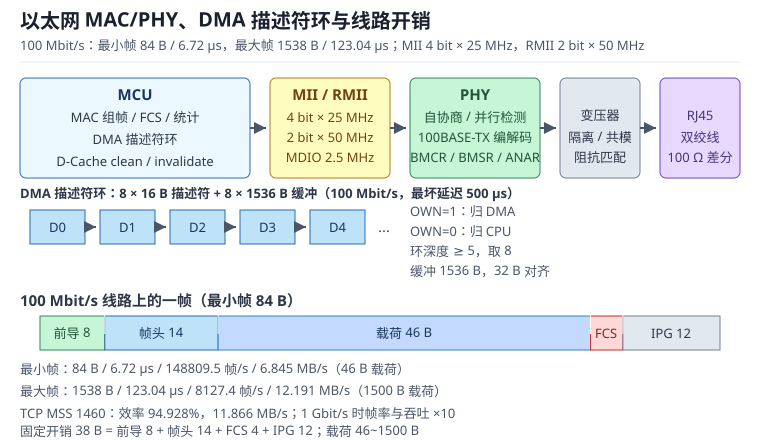

# 以太网：MAC/PHY、DMA 描述符环与 lwIP 零拷贝

以太网（Ethernet）是 IEEE 802.3 定义的有线局域网技术。对 MCU 来说，它并不是"插上网线就能通"的黑盒，而是三段清晰的流水线：**MAC（Media Access Control）组帧与校验、PHY（Physical Layer Transceiver）把数字信号变成差分模拟信号、DMA 描述符环（Descriptor Ring）在内存与 MAC 之间搬运帧**。这三段任何一段配置错误，现象都可能是"Link 灯亮着，但 ping 不通"。

以太网帧本身很简单：目的地址、源地址、类型/长度、46~1500 字节载荷、32 位帧校验序列（Frame Check Sequence，FCS）。复杂的是它周围的预算：前导码、帧间隔、IPG 把线速切成一段段；媒体独立接口（Media Independent Interface，MII）与精简 MII（Reduced MII，RMII）把 100 Mbit/s 拆成 4 位或 2 位宽的并行总线；DMA 描述符环把"帧到达"变成"内存里的一个缓冲"；lwIP 的 pbuf 又决定这帧要不要再复制一次。本章按"MAC/PHY → 描述符环 → lwIP → 吞吐/延迟 → 自协商与排查"展开，每个数字都能用手算复核。

与 CAN 的多主仲裁对照见 [CAN 与 CAN FD](can.md)，USB 的主机调度见 [USB 设备](usb-device.md)，DMA 的通道与双缓冲见 [DMA：通道映射、双缓冲与带宽](../mcu/dma.md)，缓存与内存一致性见 [存储器与外设寄存器](../basics/memory-registers.md)。

## 1. 动机（设计动机：Link 灯亮着，为什么 ping 不通）

::: motivation 四个现场
**现场一：RMII 的 REF_CLK 方向接反。** 硬件把 50 MHz 参考时钟从 MCU 输出给 PHY，软件却按"PHY 提供时钟"配置；PHY 没有时钟，MAC 也没有时钟，Link 灯不亮。换一块板子偶尔能亮，是因为那颗 PHY 恰好支持从 RMII 主模式输出时钟。RMII 的时钟方向不是"随便接都能工作"，必须在原理图阶段定死。

**现场二：描述符所有权没有交回。** 接收描述符的 OWN 位由软件置 1 表示"空缓冲归 DMA"；DMA 收完帧后清 0、把缓冲交回 CPU。驱动在中断里读了帧，却忘了把 OWN 重新置 1，DMA 用完一圈后停在第 8 个描述符上，之后所有帧都丢。现象是"开机几分钟正常，然后突然不通"，复位又能好。

**现场三：D-Cache 没维护。** Cortex-M7 打开了 D-Cache，发送缓冲由 CPU 写入后直接交给 DMA，没有 clean；DMA 读到的是 Cache 里的旧数据或部分旧数据。接收方向反过来，DMA 写入内存后 CPU 读到旧 Cache，校验和错误。现象是"小包正常、大包偶发错"，因为小包恰好落在同一 Cache 行。

**现场四：一端强制 100 Mbit/s 全双工，另一端自协商。** 自协商一端通过并行检测识别出 100 Mbit/s，但检测不到双工能力，默认半双工；强制全双工的一端持续发送，半双工一端遇到冲突就退避，出现 late collision、FCS 错误和吞吐骤降。用户看到的是"能 ping 通，但传文件只有几百 KB/s"。
:::

| 你看到的现象 | 先查什么 | 判据（工程经验值，非标准强制） |
|---|---|---|
| Link 灯不亮 | PHY 供电、复位、参考时钟 | 25/50 MHz 时钟幅度与频率正确 |
| Link 亮但 ping 不通 | RMII/MII 数据线、PHY 地址、MAC 配置 | MDIO 能读到 PHY ID |
| 开机正常，几分钟后不通 | 描述符 OWN 位、环深度 | 描述符全部回到 CPU |
| 大包偶发 CRC 错 | D-Cache、缓冲对齐 | 发送前 clean，接收后 invalidate |
| 能通但吞吐很低 | 双工/速率、late collision | 两端自协商结果一致 |
| 丢包但无错误计数 | 环形缓冲耗尽、pbuf 泄漏 | 空闲描述符数不为 0 |

**不算会摔在哪**，四个带数字的代价：

1. **按"100 Mbit/s 就是 12.5 MB/s"算吞吐。** 100 Mbit/s 的线速是 12.5 MB/s，但 64 字节最小帧加 20 字节前导/IPG 后是 84 字节，帧率 148809.5 帧/s，载荷只有 6.845 MB/s；1500 字节帧的载荷上限也只有 12.191 MB/s。
2. **描述符环按"4 个就够"配。** 100 Mbit/s 下 1518 字节帧每 123.04 µs 一帧，4 个描述符只能缓冲 492 µs；如果中断被更高优先级任务延迟 1 ms，环就溢出。
3. **不做零拷贝（Zero-Copy）。** 100 Mbit/s 的 TCP 上限是 11.866 MB/s，按 168 MHz 主频算，每字节只有 14.16 个时钟周期；一次多余的整帧拷贝就可能把 CPU 吃满。
4. **自协商配置不一致。** 一端强制、一端自协商，常见结果是 100 Mbit/s 半双工；冲突退避让有效吞吐掉到 30%~50%，而 Link 灯仍然是绿的。

## 2. 直观（原理图：从 MAC 到 RJ45）

上图左侧是 MCU 内部的 MAC 与 DMA：发送描述符环把内存中的帧交给 MAC，接收描述符环把 MAC 收到的帧写回内存；中间是 MII 或 RMII 的并行总线与 MDIO 管理通道；右侧是 PHY、网络变压器与 RJ45。下方是帧在线路上的开销：前导码 8 字节、帧头 14 字节、载荷、FCS 4 字节、IPG 12 字节。读图时抓住一句话：**MAC 管帧，PHY 管电平，DMA 管搬运，三者只通过描述符和状态位耦合。**

### 2.1 原理图：MAC、PHY、MII/RMII 与变压器

MAC（Media Access Control）是数字域：它负责组帧、计算 FCS、检测冲突（半双工）、统计错误，并通过 DMA 与内存交互。PHY（Physical Layer Transceiver）是模拟域：它把 MAC 的并行数字信号串行化、编码（100BASE-TX 用 4B/5B + MLT-3，1000BASE-T 用 PAM-5），再经网络变压器送到双绞线。

MAC 与 PHY 之间的接口有三种常见形态：MII、RMII 与千兆精简 MII（Reduced Gigabit MII，RGMII）。

| 接口 | 数据宽度 | 时钟 | 典型引脚 | 适用 |
|---|---|---|---|---|
| MII | 4 位 TX + 4 位 RX | TX_CLK 25 MHz、RX_CLK 25 MHz | 约 16 根 | 10/100 Mbit/s |
| RMII | 2 位 TX + 2 位 RX | 50 MHz REF_CLK | 约 10 根 | 10/100 Mbit/s，省引脚 |
| RGMII | 4 位 DDR | 125 MHz | 约 12 根 | 1000 Mbit/s |

MII 的 4 位数据在 25 MHz 下正好 100 Mbit/s；RMII 用 2 位数据、50 MHz 时钟，同样是 100 Mbit/s。RMII 省下的引脚要以"时钟必须精确、走线等长"为代价：50 MHz 参考时钟的抖动和偏斜会直接变成采样错误。RGMII 在 125 MHz 下用双沿传 4 位，达到 1000 Mbit/s，时序窗口更窄。

MDIO（Management Data Input/Output）是 MAC 读写 PHY 寄存器的两线接口：MDC 是时钟（通常不超过 2.5 MHz），MDIO 是双向数据。一次读操作 64 位：32 位前导、2 位起始、2 位操作码、5 位 PHY 地址、5 位寄存器地址、2 位转向、16 位数据。2.5 MHz 下耗时 25.6 µs，对毫秒级的链路管理来说可以忽略。

### 2.2 静态分析：帧格式、MII/RMII 与 MDIO

以太网帧从目的 MAC 地址（6 字节）开始，依次是源 MAC（6 字节）、类型/长度（2 字节）、载荷（46~1500 字节）、FCS（4 字节）。帧之前有 7 字节前导码和 1 字节帧起始定界符（SFD），帧之后有至少 12 字节帧间隔（Inter-Packet Gap，IPG）。所以线路上的一帧是：

$$
N_{\mathrm{wire}}=8\left(38+P\right)
$$

其中 $N_{\mathrm{wire}}$ 是线路位数（bit），$P$ 是载荷字节数，38 是前导 8 + 帧头 14 + FCS 4 + IPG 12。$P=46$ 时 84 字节、672 位；$P=1500$ 时 1538 字节、12304 位。

MAC 帧的最小长度是 64 字节（不含前导），其中载荷至少 46 字节；如果应用数据不足 46 字节，MAC 会自动填充。最大标准帧是 1518 字节（不含前导），加 VLAN 标签是 1522 字节。巨型帧（Jumbo Frame）不是标准以太网的一部分，跨厂商网络里不要默认开启。

MII/RMII 的静态配置要核对四组信号：

- **发送**：TXD[3:0] 或 TXD[1:0]、TX_EN；MAC 在 TX_CLK/REF_CLK 的上升沿更新。
- **接收**：RXD[3:0] 或 RXD[1:0]、RX_DV（RMII 为 CRS_DV）；PHY 在时钟沿更新，MAC 采样。
- **时钟**：MII 的 TX_CLK/RX_CLK 由 PHY 提供；RMII 的 50 MHz REF_CLK 可由 PHY、MCU 或外部晶振提供，必须在原理图上标明方向。
- **管理**：MDC/MDIO，PHY 地址由硬件引脚或寄存器决定，多个 PHY 不能同地址。

MDIO 的读写要遵循 PHY 手册的寄存器映射。以常见的 100 Mbit/s PHY 为例：

| 寄存器 | 地址 | 关键位 | 用途 |
|---|---|---|---|
| BMCR | 0x00 | bit15 复位、bit12 自协商使能、bit13 速率、bit8 双工 | 强制/重启自协商 |
| BMSR | 0x01 | bit2 Link Up、bit5 自协商完成 | 读链路状态 |
| PHYIDR1/2 | 0x02/0x03 | OUI 与型号 | 确认 PHY 地址 |
| ANAR | 0x04 | 能力位 | 本端自协商广告 |
| ANLPAR | 0x05 | 对端能力 | 读取对端自协商结果 |

### 2.3 动态分析：发送/接收描述符环与中断

DMA 描述符环是 MAC 与软件之间的队列。每个描述符通常 16 字节，包含状态/控制、缓冲长度、缓冲地址和下一个描述符地址。发送时，软件把帧写入缓冲、填写长度与 OWN=1（交给 DMA），MAC 发完后清 OWN 并置完成位；接收时反过来，DMA 把帧写入空缓冲、置 OWN=0 并置帧长度，软件处理完后把 OWN=1 交回。

一个典型的发送流程：

1. 应用把数据写入 `tx_buf[i]`，设置 `desc[i].len`；
2. 清 D-Cache 对应行（M7 等带 Cache 的 MCU）；
3. 设置 `desc[i].own = 1`，写 MAC 的发送轮询（poll）寄存器；
4. MAC 读描述符、取数据、发帧、写回完成位；
5. 中断里回收 `i`，更新 `tx_tail`，唤醒等待队列。

接收流程对称：DMA 发现 `rx_desc[j].own=1`（空缓冲），把帧写进去、清 OWN、置长度；中断里软件按 `rx_tail` 取帧、交给 lwIP、处理完再把 OWN 置 1。这里的关键是**所有权位**：OWN 的方向由硬件约定，软件不能一边让 DMA 写、一边读同一个缓冲。

中断策略有两种：每帧中断，或者 N 帧/半环中断。100 Mbit/s 下最小帧 148809.5 帧/s，每帧中断对 168 MHz MCU 是 1129 个时钟周期/帧，中断开销很大；用 4~8 帧聚合中断，可以把中断率降到 20~40 kHz，但会增加延迟和环深度要求。

### 2.4 环路：自协商环、ARP 环与重传环

以太网的通断可以拆成三个环。

**自协商（Auto-Negotiation）环**：两端 PHY 通过快速链路脉冲（Fast Link Pulse，FLP）交换 16 位链路码字，协商速率、双工、流控。双方都支持自协商时，结果一致；一端强制时，另一端只能靠并行检测识别速率，检测不到双工，常见结果是半双工。这个环不闭合，就会出现"Link 亮、ping 通、吞吐低"。

**ARP 环**：地址解析协议（Address Resolution Protocol，ARP）要把目的 IP 解析成 MAC 地址，发 ARP 请求，等 ARP 应答，再发 ICMP。ARP 表项有老化时间；如果 ARP 请求发不出去或应答被丢，ping 会表现为"第一包超时，后面正常"或者"完全不通但 Link 正常"。

**重传环**：TCP 靠 ACK 和重传保证可靠。链路丢包时，TCP 会减速重传；如果丢包来自 DMA 溢出或 pbuf 泄漏，重传会反复触发，吞吐越来越低。抓包看到"重传、重复 ACK、窗口缩小"，要先查驱动和缓冲，而不是先怀疑网络。

## 3. 定量（取值与权衡：线速、吞吐与延迟）

### 3.1 帧开销与线速

线速 $B$ 是物理层的位速率（100 Mbit/s 或 1 Gbit/s）。帧率由线路位数决定：

$$
f_{\mathrm{frame}}=\frac{B}{8\left(38+P\right)}
$$

其中 $f_{\mathrm{frame}}$ 是帧率（帧/s），$B$ 是线速（bit/s），$P$ 是载荷字节数，38 是前导、帧头、FCS 与 IPG 的总开销。载荷吞吐为

$$
R_{\mathrm{payload}}=P f_{\mathrm{frame}}=\frac{P B}{8\left(38+P\right)}
$$

100 Mbit/s 下两组极值：

| 帧 | 线路字节 | 线路时间 | 帧率 | 载荷吞吐 |
|---|---|---|---|---|
| 最小 64 字节（46 字节载荷） | 84 | 6.72 µs | 148809.5 帧/s | 6.845 MB/s |
| 最大 1518 字节（1500 字节载荷） | 1538 | 123.04 µs | 8127.4 帧/s | 12.191 MB/s |

1 Gbit/s 下帧率与吞吐都乘 10：最小帧 1488095 帧/s、68.452 MB/s；最大帧 81274 帧/s、121.912 MB/s。注意"线速 12.5 MB/s"只是 100 Mbit/s 除以 8，实际载荷上限永远低于它，因为前导、帧头、FCS、IPG 都要占时间。

### 3.2 吞吐上限

TCP 的有效载荷还要再扣 IP 头（20 字节）和 TCP 头（20 字节）。设最大分段大小（Maximum Segment Size，MSS）为 $M$，则每个 TCP 段的线路字节是 $38+M+40=M+78$，效率

$$
\eta_{\mathrm{TCP}}=\frac{M}{M+78}
$$

100 Mbit/s 下 TCP 吞吐

$$
R_{\mathrm{TCP}}=\frac{M}{M+78}\times\frac{100\times10^{6}}{8}
$$

$M=1460$ 时 $\eta=1460/1538=94.928\%$，吞吐 11.866 MB/s；$M=536$ 时 $\eta=536/614=87.296\%$，吞吐 10.912 MB/s。MSS 越小，头部占比越高，吞吐越低；所以路径 MTU 发现和窗口缩放对长肥网络很重要。

UDP 的开销小一些：1472 字节载荷 + 8 字节 UDP + 20 字节 IP + 38 字节链路开销 =1538 字节，效率 95.709%，100 Mbit/s 下 11.964 MB/s。但 UDP 没有重传，丢包直接反映到应用。

### 3.3 延迟预算

端到端延迟可以拆成串行化、PHY、MAC、DMA、协议栈和应用六段：

$$
T_{\mathrm{e2e}}=T_{\mathrm{ser}}+T_{\mathrm{phy}}+T_{\mathrm{mac}}+T_{\mathrm{dma}}+T_{\mathrm{stack}}+T_{\mathrm{app}}
$$

其中各项单位为秒。$T_{\mathrm{ser}}$ 是帧在线路上的串行化时间，1518 字节帧在 100 Mbit/s 下是 123.04 µs，在 1 Gbit/s 下是 12.304 µs；64 字节帧分别是 6.72 µs 和 0.672 µs。PHY 的编解码与收发延迟通常几微秒，MAC 的存储转发（Store-and-Forward）要等整帧收完，直通（Cut-Through）只等目的地址；DMA 与中断延迟取决于负载，协议栈处理取决于 pbuf 拷贝次数。

按"PHY 1 µs + MAC 2 µs + DMA/中断 5 µs + 协议栈 10 µs + 应用 2 µs"估算，1518 字节帧在 100 Mbit/s 下约 143 µs，在 1 Gbit/s 下约 32 µs；64 字节帧在 100 Mbit/s 下约 27 µs。这个预算对工业控制够用，但对"每 100 µs 采一次、要求端到端 50 µs"的场合就不够，需要 cut-through、零拷贝和实时调度。

### 3.4 描述符环深度与缓存

环形缓冲的深度要覆盖"最坏中断延迟"内到达的帧数：

$$
N_{\mathrm{desc}}\geq\left\lceil\frac{T_{\mathrm{lat,max}}}{T_{\mathrm{frame}}}\right\rceil+1
$$

其中 $N_{\mathrm{desc}}$ 是描述符数，$T_{\mathrm{lat,max}}$ 是最坏处理延迟（s），$T_{\mathrm{frame}}$ 是最小帧间隔（s），加 1 是留一个空位区分满/空。100 Mbit/s、1518 字节帧间隔 123.04 µs、最坏延迟 500 µs 时 $N_{\mathrm{desc}}\geq\lceil500/123.04\rceil+1=6$，取 8 个描述符、每个 1536 字节，缓冲 12 KB。1 Gbit/s 下同样 500 µs 需要 $\lceil500/12.304\rceil+1=42$，取 64 个描述符、缓冲 96 KB。

缓冲大小要能放下最大帧 1518 字节，再留对齐余量。1536 字节是常见选择；如果开了 VLAN、时间戳或自定义尾标，要相应加大。Cortex-M7 的 Cache 行通常是 32 字节，缓冲地址按 32 字节对齐，避免一行里混着两个帧，clean/invalidate 时误伤相邻数据。

### 3.5 MII/RMII 与 MDIO 时间

MII 的 4 位数据在 25 MHz 下是 $4\times25=100$ Mbit/s；RMII 的 2 位数据在 50 MHz 下是 $2\times50=100$ Mbit/s。MII 的 TX_CLK/RX_CLK 由 PHY 提供；RMII 的 50 MHz REF_CLK 可由 PHY、MAC（MCU）或外部晶振提供，方向必须在原理图上标明。参考时钟的抖动通常要求 ±50 ppm 以内，具体以 PHY 手册为准。

MDIO 一帧 64 位，2.5 MHz 下 25.6 µs。链路状态轮询不必太频繁：100 ms 读一次 BMSR 足够，链路变化用 PHY 中断或轮询 BMSR 的 Link 位。轮询太快会占用 MDIO 总线，也可能读到尚未稳定的自协商结果。

## 4. 算例（设计示例：100 Mbit/s lwIP 数据采集节点）

### 4.1 需求

一个 168 MHz Cortex-M7 数据采集节点，100 Mbit/s 以太网，每 1 ms 采集 1000 字节并通过 TCP 上传；要求吞吐不低于 8 Mbit/s，端到端延迟小于 500 µs，最坏中断延迟 300 µs；使用 lwIP，带 D-Cache。

### 4.2 帧率与吞吐

TCP MSS 取 1460，线路字节 1538，效率 94.928%，100 Mbit/s 下理论上限 11.866 MB/s。应用数据 1000 字节/ms 即 1 MB/s，正好是 8 Mbit/s，只占 8% 的线速，正好达到 8 Mbit/s 的吞吐要求。若 MSS 取 536，效率降到 87.296%，上限 10.912 MB/s，仍够用，但小包更多、中断更频繁。

每 1 ms 一帧 1000 字节，帧率 1000 帧/s，线路时间约 $8(38+1000+40)/100\,\mathrm{Mbit/s}=86.24$ µs，占 8.6% 带宽。若把采集周期改成 100 µs，帧率 10000 帧/s，线路时间 862.4 µs/ms，已经接近线速，必须合并数据或改用 UDP。

### 4.3 描述符环

按 3.4 节，100 Mbit/s、最大帧间隔 123.04 µs、最坏延迟 300 µs：$N_{\mathrm{desc}}\geq\lceil300/123.04\rceil+1=4$，取 8 个描述符。每个描述符 16 字节，环本身 128 字节；8 个 1536 字节缓冲共 12 KB。发送方向同样 8 个描述符，缓冲 12 KB；总共约 24 KB，对 256 KB SRAM 的 M7 可以接受。

如果中断聚合到 4 帧一次，最坏延迟增加到 4×123.04=492 µs，$N_{\mathrm{desc}}\geq\lceil492/123.04\rceil+1=5$，仍取 8 个；如果聚合到 8 帧，最坏 984 µs，需要 9 个，取 16 个更稳。

### 4.4 延迟

1000 字节帧的线路时间 86.24 µs，加 PHY 1 µs、MAC 2 µs、DMA/中断 5 µs、协议栈 10 µs、应用 2 µs，约 106 µs，小于 500 µs。注意这是"一帧"的延迟，不包括 TCP 等 ACK、应用处理队列和重传；如果应用每 1 ms 才轮询一次 socket，端到端延迟还要加 1 ms。

### 4.5 自协商与排查

上电后先读 BMSR：Link 位为 1 说明物理链路建立；再读 ANLPAR 与 ANAR，确认双方都支持 100 Mbit/s 全双工。如果 BMSR 的 Link 为 1 但 ANLPAR 显示半双工，检查是否一端被强制。用 `ethtool` 或 PHY 寄存器读到的速率/双工必须与 MAC 配置一致；MAC 配 100 全双工、PHY 实际 100 半双工，会出现 late collision 和 FCS 错误。

如果 ping 不通，按"PHY ID → Link → ARP → IP → TCP"的顺序排查：MDIO 读不到 PHY ID，先查 MDIO 地址和时钟；Link 为 0，查参考时钟和变压器；Link 为 1 但 ARP 无应答，查 MAC 地址、VLAN、接收描述符 OWN 位；ARP 通但 TCP 不通，查 IP 地址、端口、防火墙和 pbuf 泄漏。

## 5. 工程含义（测量与实验）

### 5.1 抓包与统计计数器

用支持端口镜像的交换机或 MCU 侧的抓包工具，先确认"帧有没有进出 MAC"。MAC 的统计计数器（IEEE 802.3 Clause 30）能区分 FCS 错误、对齐错误、late collision、丢弃、溢出；如果 FCS 错误持续增长，优先查 PHY、变压器、线缆和双工；如果接收溢出增长，查描述符环深度和中断延迟；如果发送 underrun，查 DMA 带宽和描述符供给。

抓包位置很重要：在 MCU 的 MII/RMII 侧抓，能看到 MAC 发出的原始帧；在 RJ45 侧抓，能看到经过 PHY 和变压器的帧。两边对比可以判断问题在数字域还是模拟域。

### 5.2 零拷贝与 pbuf 生命周期

lwIP 的 pbuf 有四种常见类型：PBUF_POOL 从固定大小的内存池分配，适合接收小包；PBUF_RAM 分配连续内存，适合发送；PBUF_REF/PBUF_ROM 只引用外部内存，不拷贝；`pbuf_alloced_custom` 允许把 DMA 缓冲包装成 pbuf，并注册释放回调。

接收零拷贝的典型做法：DMA 把帧写进 `rx_buf`，驱动用 `pbuf_alloced_custom` 包一层 pbuf，`payload` 指向 `rx_buf + 2`（对齐），释放回调把缓冲还给描述符环；协议栈处理完后 `pbuf_free` 触发回调，驱动再把 OWN 置 1。这样一帧只经过一次 DMA，不再 `memcpy` 到 pbuf。代价是生命周期变复杂：pbuf 在 TCP 重传队列里可能存活很久，期间不能把缓冲还给 DMA。

发送零拷贝：`tcp_write(pcb, data, len, 0)` 不复制，pbuf 引用应用缓冲；应用必须等 ACK 后才能改写这块内存。若应用缓冲是循环队列，ACK 之前被覆盖，重传就会发出错误数据。保守做法是发送方向仍用 `TCP_WRITE_FLAG_COPY`，接收方向做零拷贝；或者用引用计数 + 完成回调管理发送缓冲。

### 5.3 缓存与 DMA

带 D-Cache 的 MCU 要遵守三条规则：发送前 clean（把 CPU 写的数据刷到内存），接收后 invalidate（丢弃 CPU 缓存里的旧行），描述符本身放在非缓存区或每次访问前维护。Cache 行 32 字节，缓冲按 32 字节对齐；如果缓冲跨行，clean/invalidate 要覆盖整行，避免把相邻帧弄脏。

另一个常见问题是写缓冲顺序：CPU 先写数据、再写长度、最后置 OWN；编译器和 CPU 可能重排，必须用内存屏障（DSB/DMB）或 `__DMB()` 保证 DMA 看到的是完整帧。只加 `volatile` 不够，volatile 只保证单次访问不被优化，不保证顺序。

### 5.4 链路与 EMC

网络变压器提供隔离、共模抑制和阻抗匹配；RJ45 的差分对要等长、阻抗 100 Ω，变压器中心抽头按 PHY 手册接电源或电容。雷击、ESD 和共模浪涌会通过网线进入 PHY，量产产品要加 TVS 和保险丝，并做 1.5 kV 或更高的隔离测试。

软件侧能做的 EMC 措施包括：降低 RMII 时钟驱动强度、在 PHY 寄存器里开启扩频（如果支持）、错开采样与 PWM 开关沿、在通信失败时降速重试。硬件侧的地平面和变压器布局才是根本，软件不能替代。

## 6. 常见坑（现象 → 原因 → 解决）

::: pitfall 坑一：RMII 参考时钟方向或频率错，Link 不亮
- **现象**：PHY 供电正常、复位正常，Link 灯不亮；MDIO 读不到 PHY ID 或读数不稳定。
- **原因**：RMII REF_CLK 由 MCU 输出还是 PHY 输出没有定死；50 MHz 时钟被误配成 25 MHz；时钟走线过长、抖动大。
- **解决**：原理图标注时钟方向；用示波器测 REF_CLK 频率与幅度；按 PHY 手册配置 REF_CLK 输出使能；MDIO 地址与硬件引脚一致。
:::

::: pitfall 坑二：描述符 OWN 位没交回，跑几分钟后停住
- **现象**：开机正常，几分钟后完全不通；复位后恢复；发送/接收描述符全部停在 OWN=1 或 0。
- **原因**：中断处理只读帧没有清 OWN；环深度不足，DMA 追尾；中断被更高优先级任务长时间屏蔽。
- **解决**：在中断里成对处理"取帧—交回 OWN"；用空闲描述符计数监控；环深度按 3.4 节加余量；关键区关中断时间控制在几十微秒内。
:::

::: pitfall 坑三：D-Cache 未维护，大包偶发 CRC 错
- **现象**：小包正常，大包偶发 FCS/校验和错误；关掉 D-Cache 后消失；不同编译优化等级表现不同。
- **原因**：发送缓冲未 clean，DMA 读到旧数据；接收缓冲未 invalidate，CPU 读到旧 Cache；描述符与缓冲跨 Cache 行。
- **解决**：发送前 clean、接收后 invalidate；缓冲 32 字节对齐；描述符放非缓存区；加 DMB 保证写顺序。
:::

::: pitfall 坑四：双工不匹配，Link 正常但吞吐很低
- **现象**：ping 通，传大文件只有几百 KB/s；MAC 统计 late collision、FCS 错误、对齐错误增长。
- **原因**：一端强制 100 全双工，另一端自协商；并行检测只能识别速率，不能识别双工，结果半双工。
- **解决**：两端都开自协商，或两端都强制相同的速率/双工；用 PHY 寄存器确认 ANLPAR 的双工位；更换线缆和端口复测。
:::

::: pitfall 坑五：pbuf 生命周期错，零拷贝变成 use-after-free
- **现象**：高负载下偶发数据错乱、死机；`pbuf_free` 后缓冲被 DMA 复用；TCP 重传发出错误数据。
- **原因**：pbuf 还挂在 TCP 重传队列，驱动就把缓冲交回 DMA；或应用在 ACK 前改写了发送缓冲。
- **解决**：用引用计数/释放回调管理缓冲；发送零拷贝要等 ACK；接收零拷贝要等 `pbuf_free`；用断言检查 OWN 与引用计数。
:::

## 7. 自测题（推导）

题一：100 Mbit/s 以太网，64 字节和 1518 字节帧的帧率、载荷吞吐各是多少？为什么不是 12.5 MB/s？

64 字节帧加 20 字节前导/IPG 是 84 字节、672 位，帧率 $100\times10^{6}/672=148809.5$ 帧/s；载荷 46 字节，吞吐 $46\times148809.5=6.845$ MB/s。

1518 字节帧加 20 字节是 1538 字节、12304 位，帧率 $100\times10^{6}/12304=8127.4$ 帧/s；载荷 1500 字节，吞吐 $1500\times8127.4=12.191$ MB/s。

12.5 MB/s 是"所有位都用来传载荷"的理论值；前导 8 字节、帧头 14 字节、FCS 4 字节、IPG 12 字节都要占时间，所以实际载荷上限更低。

题二：TCP MSS=1460 和 MSS=536 时，100 Mbit/s 下的效率与吞吐各是多少？

MSS=1460：线路字节 $1460+20+20+14+4+8+12=1538$，效率 $1460/1538=94.928\%$，吞吐 $0.94928\times12.5=11.866$ MB/s。

MSS=536：线路字节 $536+78=614$，效率 $536/614=87.296\%$，吞吐 $0.87296\times12.5=10.912$ MB/s。

MSS 越小，40 字节 IP/TCP 头和 38 字节链路开销占比越高；长肥网络要用窗口缩放和路径 MTU 发现，避免 MSS 太小。

题三：1 Gbit/s、最坏中断延迟 500 µs、最大帧 1518 字节，描述符环至少多深？

最大帧间隔 $1538\times8/10^{9}=12.304$ µs。$N_{\mathrm{desc}}\geq\lceil500/12.304\rceil+1=41+1=42$。

取 64 个描述符，每个 1536 字节，缓冲 $64\times1536=98304$ 字节，约 96 KB；描述符本身 $64\times16=1024$ 字节。若 SRAM 不够，可以缩短中断延迟或改用更大缓冲减少描述符数，但不能让环深度小于 42。

题四：Link 灯亮、ping 通，但传文件只有 300 KB/s，可能是什么原因？如何用计数器确认？

最常见的是双工不匹配：一端强制 100 全双工、另一端自协商，结果 100 半双工。半双工下发送前要听冲突，冲突后退避重试，有效吞吐掉到 30%~50%，并且 MAC 统计里 late collision、FCS 错误、对齐错误增长。

排查：读两端 PHY 的 ANAR/ANLPAR，确认速率与双工位一致；看 MAC 的 late collision、FCS、alignment error 计数器；用抓包看是否有大量重传和重复 ACK。解决：两端都开自协商，或两端强制相同的 100 全双工；换线缆和交换机端口复测。

## 8. 参考资料

- IEEE 802.3-2018，*IEEE Standard for Ethernet*：Clause 3 MAC 帧格式与 FCS、Clause 22 MII 与 MDIO、Clause 28 自协商、Clause 30 管理对象与计数器，对应 2.2、3.1、3.5 与 6 节。
- IEEE 802.3-2018，Clause 28 *Auto-Negotiation*：16 位链路码字、并行检测、双工不匹配的成因与检测，对应 2.4 与 4.5 节。
- STMicroelectronics，*RM0090 Reference Manual*，Rev 19，Chapter 33 Ethernet (ETH): media access control (MAC) with DMA controller：MAC 配置、DMA 描述符环、MII/RMII、MDIO、统计计数器，对应 2.3、3.4 与 5.3 节。
- lwIP，*A Lightweight TCP/IP stack*，Documentation and pbuf API：pbuf 类型与链式结构、`pbuf_alloced_custom`、`tcp_write` 的拷贝/引用语义，对应 5.2 与 6 节。
- Microchip，*LAN8720A Data Sheet*：RMII 模式、REF_CLK、自协商与 PHY 寄存器（BMCR/BMSR/ANAR/ANLPAR），对应 2.2 与 4.5 节。
