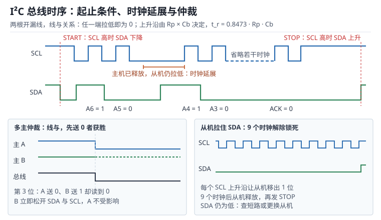

# I²C 总线：起止条件、时钟同步与总线恢复

内部集成电路总线（Inter-Integrated Circuit，I²C）只用两根线：串行数据线（Serial Data，SDA）与串行时钟线（Serial Clock，SCL）。两根线都是**开漏（Open-Drain）加外部上拉**，任何器件只能把线拉低、不能主动拉高，所以总线上的电平是全体器件输出的逻辑"与"——这就是**线与（Wired-AND）**。

线与带来三个别处没有的性质：多主设备可以在同一条线上**仲裁（Arbitration）**而不丢数据；从设备可以拉住时钟**延展（Clock Stretching）**争取时间；而高电平的上升沿只能靠上拉电阻给总线电容充电，上升时间被 $R_pC_b$ 直接限制。这三条性质决定了 I²C 的速率上限、上拉取值与全部故障模式。速率档位分为标准模式（Standard-mode，Sm）100 kbit/s、快速模式（Fast-mode，Fm）400 kbit/s、快速模式+（Fast-mode Plus，Fm+）1 Mbit/s 与高速模式（High-speed mode，Hs）3.4 Mbit/s。

与 UART 的"字节流"不同，I²C 的软件接口是**事务**：起始条件、地址字节、若干数据字节、应答位、停止条件。每一次读写都要检查应答，否则从设备没接上时软件会以为"发送成功"。SPI 的对照见[SPI：四种模式、片选与环形 DMA](spi.md)，UART 的对照见 [UART 与 USART](uart.md)，开漏输出的电气细节见 [GPIO 电气与驱动](../mcu/gpio.md)。

## 1. 动机（设计动机：两根线为什么会锁死）

::: motivation 四个现场
**现场一：4.7 kΩ 上拉跑 400 kHz，偶发无应答。** 总线上挂 8 个器件、走线不长，算下来总线电容约 200 pF。上升时间是 $0.8473\times4700\times200\times10^{-12}=796.5$ ns，而快速模式要求不超过 300 ns。波形上看高电平还没到门限，主机已经发了下一个时钟，从机把这一位采成 0，地址匹配失败，返回非应答（Not Acknowledge，NACK）。把速率降到 100 kHz（上升时间上限 1000 ns）一切正常——"降速就好"几乎总是上拉与电容的问题，而不是从机坏了。

**现场二：从机复位后总线锁死。** 从机在输出数据 0 的瞬间掉电重启，SDA 被它拉住；主机复位后重新初始化，SCL 拉高，但从机还在等时钟把这一位送完。总线上 SDA 永远为低，主机发不出起始条件，扫描所有地址都超时。断电重启能恢复，但现场设备装在高处，没人愿意去拔电。

**现场三：双主系统里仲裁丢了不处理。** 主 A 发地址 0x50，主 B 发 0x52，两位在第 6 位分道：A 送 0、B 送 1，B 读到 0 就知道自己输了。但 B 的驱动代码没有检查仲裁丢失（Arbitration Lost，ARLO）标志，继续按自己的节奏发时钟和数据，把 A 正在发的报文冲掉。现象是"偶发一帧数据错，重发就好"。

**现场四：SCL 配成推挽。** 有人把 SCL 当普通 GPIO 推挽输出，从机延展时钟时把它拉低，于是 3.3 V 经主机 PMOS、从机 NMOS 直接对地，回路电阻只有几十欧，电流可达 60 mA 以上。轻则波形畸变，重则引脚发热、长期可靠性下降。
:::

| 你看到的现象 | 先查什么 | 判据（工程经验值，非标准强制） |
|---|---|---|
| 400 kHz 偶发 NACK，100 kHz 正常 | 上拉电阻、总线电容 | $t_r$ 不超过模式上限的 80% |
| 所有地址都超时 | 空闲时 SDA/SCL 是否为高 | 两条线都能被上拉拉高 |
| 多主系统偶发数据错 | 仲裁丢失标志与重发逻辑 | 丢失后立即停止驱动并退避 |
| 波形正常但从机不应答 | 7 位地址与 R/W 位 | 地址左移一位后再或读/写位 |
| 引脚发热、波形被削顶 | SCL 是否开漏 | 只能用开漏，不能用推挽 |
| 插上示波器探头就出错 | 探头电容抬高 $C_b$ | 按最坏电容重算 $t_r$ |

**不算会摔在哪**，四个带数字的代价：

1. **上拉按经验取 4.7 kΩ。** 4.7 kΩ 在 400 kHz 下只允许 75.3 pF 的总线电容，8 个器件加走线轻松超过 95 pF，上升时间 379 ns 已经出界。
2. **不留恢复路径。** 一次锁死等于整机停机；9 个时钟的恢复流程只有几十行代码，却能把"必须断电"变成"自动恢复"。
3. **SCL 用推挽。** 从机延展时形成低阻通路，3.3 V、50 Ω 回路对应 66 mA，超过多数 MCU 引脚 20 mA 的额定值。
4. **地址算错一位。** 7 位地址 0x50 在总线上是 0xA0（写）或 0xA1（读），把 0xA0 当 7 位地址写进去，等于访问 0x50 之外的器件，表现为"所有寄存器都读回 0xFF"。

## 2. 直观（原理图：线与、起止与应答）

上图上半部分是事务时序：SCL 为高时 SDA 下降是起始条件，SCL 为高时 SDA 上升是停止条件；数据位只在 SCL 低电平期间改变，SCL 高电平期间必须稳定。中间那段长低电平是从机拉住 SCL 造成的时钟延展。下半部分左边是多主仲裁，右边是被从机拉住 SDA 时用 9 个时钟恢复。

### 2.1 原理图：开漏、上拉与线与

每个器件的 SDA 与 SCL 引脚都只是一个 N 沟道 MOS 管：栅极由内部逻辑驱动，漏极接总线，源极接地。输出 0 时管子导通、把线拉到地；输出 1 时管子关断、引脚高阻，线由外部上拉电阻拉高。因此：

- **任何器件拉低，线就是低**；全体都释放，线才是高。这就是线与。
- **不存在"对拉短路"**：两个器件都输出 0 时只是并联导通；一个输出 0、一个释放时，电平整齐为 0，没有大电流通路。前提是双方都真的用开漏。
- **高电平的边沿由外部决定**：上拉电阻与总线电容构成一阶 RC，边沿时间与器件无关。

一次完整事务的次序是：起始条件（Start，S）→ 7 位地址加 1 位读/写（Read/Write，R/W）→ 从机应答（ACK）→ 数据字节与应答（每字节 9 个时钟）→ 停止条件（Stop，P）。读寄存器时通常用**重复起始（Repeated Start，Sr）**把写地址与读地址连成一个事务，中间不发停止条件，这样总线不会在中途被别的（特别是另一个主设备）抢走。

### 2.2 静态分析：空闲电平、门限与总线电容

总线空闲时 SDA 与 SCL 都为高，由上拉电阻维持。输入门限按电源比例定义：$V_{IL}\leq0.3V_{DD}$，$V_{IH}\geq0.7V_{DD}$，3.3 V 供电时分别是 0.99 V 与 2.31 V。输出低电平在规定的灌电流下不超过 0.4 V（标准模式与快速模式为 3 mA，快速模式+为 20 mA）。门限之间的 0.4 倍电源电压就是噪声容限，也是"上拉不能太弱"的定量理由：上拉太弱，高电平在噪声下会跌进门限区。

静态上还有四条容易忽略的约束：

- **上拉只在总线上放一组。** 每个模块自带 4.7 kΩ 上拉是常见做法，8 个模块并起来就是 587 Ω，低电平灌电流约 4.9 mA，既费电又可能超出器件的 $V_{OL}$ 指标。正确做法是整条总线只保留一组。
- **总线电容有上限。** 规范给 400 pF（快速模式+ 550 pF），它来自"上拉电阻不能无限小"与"上升时间不能无限长"的折中，不是可以随便突破的余量。
- **串联电阻保护而非分压。** 在连接器或长线入口串 22 Ω 至 100 Ω，可以限制热插拔浪涌与 ESD 电流；它与上拉串联，会略微抬高总线低电平并拉长上升沿，取值时要一起核算（见 5.2 节）。
- **开漏不等于耐压。** 引脚能否接 5 V 上拉取决于它是否 5 V 容忍，与"输出级是开漏"无关。

### 2.3 动态分析：起止、数据有效性与时钟延展

I²C 的时序规则可以压缩成一句话：**SDA 只在 SCL 低电平期间改变，SCL 高电平期间 SDA 必须稳定**；唯二的例外是起始与停止条件，它们刻意在 SCL 高电平期间改变 SDA。标准模式与快速模式的关键参数如下（数值来自规范，工程上按最坏情况留余量）：

| 参数 | 含义 | 标准模式 100 kHz | 快速模式 400 kHz |
|---|---|---|---|
| $t_{LOW}$ | SCL 低电平最短 | 4.7 µs | 1.3 µs |
| $t_{HIGH}$ | SCL 高电平最短 | 4.0 µs | 0.6 µs |
| $t_{SU;STA}$ | 重复起始的建立时间 | 4.7 µs | 0.6 µs |
| $t_{HD;STA}$ | 起始条件的保持时间 | 4.0 µs | 0.6 µs |
| $t_{SU;DAT}$ | 数据建立时间 | 250 ns | 100 ns |
| $t_{SU;STO}$ | 停止条件的建立时间 | 4.0 µs | 0.6 µs |
| $t_{BUF}$ | 停止到下一次起始的空闲 | 4.7 µs | 1.3 µs |
| $t_r$ / $t_f$ | 上升/下降时间上限 | 1000 ns / 300 ns | 300 ns / 300 ns |

一个字节占 9 个时钟（8 位数据加 1 位应答），400 kHz 下是 22.5 µs，100 kHz 下是 90 µs。

**时钟延展**发生在从机来不及处理时：主机释放 SCL 后，从机继续把它拉低，主机必须采样 SCL 并等待，直到线真的变高才继续。延展没有规范上限，但 SMBus 用 $t_{TIMEOUT}$（25 ms 至 35 ms）来防止死等；工程上应给每次事务设一个远小于它的超时。

### 2.4 环路：时钟同步环、仲裁环与恢复环

I²C 的行为可以拆成三个环，每个环都解释了各类故障现象。

**时钟同步环**：所有主机的 SCL 输出线与。低电平由"低电平最长的那个"决定（谁拉得久听谁的），高电平由"高电平最短的那个"决定（谁先拉低，高电平就结束）。于是总线上慢速主机自然把整体节奏拖慢，而不会出现两个时钟互相穿插。这就是为什么不同速率的主机可以共存于同一条总线。

**仲裁环**：主机每发一位就回读 SDA，与自己发出的值比较。因为线与，只要有一位自己发 1 而读到 0，就说明有别的设备在发 0；此时立即停止驱动并转为从机接收。输的那一方不会破坏赢的那一方的数据，前提是它真的在读 SDA 并真的在输掉后松手。

**恢复环**：如果从机停在半个字节中间并拉住 SDA，主机可以强制打 9 个 SCL 脉冲，让从机把剩下的位（最多 8 个数据位加 1 个应答位）移完并释放 SDA，然后发停止条件把总线拉回空闲。这个环能不能闭合，取决于 SCL 是否被配置成可以单独操作的开漏引脚。

## 3. 定量（取值与权衡：上拉窗口、电容与时间）

### 3.1 上拉上限：上升时间

上拉电阻与总线电容构成一阶 RC。规范把上升时间定义为从 $0.3V_{DD}$ 到 $0.7V_{DD}$，于是：

$$
t_r=R_pC_b\ln\frac{0.7}{0.3}=0.8473\,R_pC_b
$$

反解出上拉上限：

$$
R_{p,max}=\frac{t_{r,max}}{0.8473\,C_b}
$$

其中 $R_p$ 是上拉电阻（$\Omega$），$C_b$ 是总线总电容（F），$t_r$ 是上升时间（s）。系数 0.8473 来自 $\ln(2.333)$，不是 0.69 也不是 2.2；2.2 是 10%~90% 的系数，用错会高估 2.6 倍。表里的上限由"模式规定的 $t_{r,max}$"与"实际 $C_b$"共同决定：

| 模式 | $t_{r,max}$ | $C_b=400$ pF | $C_b=200$ pF | $C_b=100$ pF | $C_b=95$ pF |
|---|---|---|---|---|---|
| 标准模式 100 kHz | 1000 ns | 2.95 kΩ | 5.90 kΩ | 11.80 kΩ | 12.42 kΩ |
| 快速模式 400 kHz | 300 ns | 885 Ω | 1.77 kΩ | 3.54 kΩ | 3.73 kΩ |
| 快速模式+ 1 MHz | 120 ns | 354 Ω | 708 Ω | 1.42 kΩ | 1.49 kΩ |

反过来问"给定上拉能带多大电容"，结论更能说明问题：4.7 kΩ 在 400 kHz 下只允许 75.3 pF，在 100 kHz 下允许 251.1 pF；2.2 kΩ 在 400 kHz 下是 160.9 pF，1.8 kΩ 是 196.7 pF。**常见的"4.7 kΩ 万能上拉"只在 100 kHz、且电容不超过 250 pF 时成立。**

### 3.2 上拉下限：灌电流

低电平时，器件把线拉到 $V_{OL}$，上拉电阻上的电流全部灌进器件：

$$
R_{p,min}=\frac{V_{DD}-V_{OL}}{I_{OL}}
$$

其中 $V_{OL}$ 是低电平最大电压（V），$I_{OL}$ 是低电平灌电流能力（A）。3.3 V 供电、$V_{OL}=0.4$ V、$I_{OL}=3$ mA 时：

$$
R_{p,min}=\frac{3.3-0.4}{3\times10^{-3}}=967\ \Omega
$$

5 V 供电时是 $(5-0.4)/3\ \text{mA}=1533\ \Omega$；快速模式+ 的 $I_{OL}=20$ mA，下限降到 145 Ω。上拉还决定静态功耗：1.8 kΩ 在低电平期间耗散 $(3.3-0.4)^2/1800=4.67$ mW，若总线一半时间被拉低，平均约 2.3 mW；10 条这样的总线就是 23 mW，对电池设备不能忽略。

于是取值必须同时满足：

$$
R_{p,min}\leq R_p\leq R_{p,max}
$$

### 3.3 总线电容与器件数量

总线电容由引脚电容、走线、连接器与探头叠加：

$$
C_b=N\,C_{pin}+C_{trace}+C_{conn}+C_{probe}
$$

其中 $N$ 是器件数，$C_{pin}$ 是单器件引脚电容（典型 10 pF，以数据手册为准），$C_{trace}$ 是走线电容（FR4 上约 1 pF/cm），$C_{conn}$ 是连接器与过孔（每个 1 pF 至 5 pF），$C_{probe}$ 是探头电容（10 pF 至 15 pF）。8 个器件、150 mm 走线、一个连接器：

$$
C_b=8\times10+15+5=100\ \text{pF}
$$

挂上探头就变成 110 pF 至 115 pF，$R_p=1.8$ kΩ 时的上升时间从 152.5 ns 涨到 175 ns——仍在 300 ns 以内，但余量少了四分之一。**"实验室能跑、现场不行"的差异，常常就是探头与线束的几皮法。**

器件数量有两个上限，取小者：规范给出的 $C_b$ 上限（400 pF 或 550 pF），以及由上式反解出的 $N$。1.8 kΩ 在 400 kHz 下的 $C_b$ 上限是 196.7 pF，扣掉走线与连接器 20 pF，按 10 pF/器件只能挂 17 个；4.7 kΩ 同理只能挂 5 个。

### 3.4 时序预算与协议开销

400 kHz 的位时间是 2.5 µs，其中低电平至少 1.3 µs、高电平至少 0.6 µs，两项合计 1.9 µs，剩下 0.6 µs 正好被 0.3 µs 的上升沿与 0.3 µs 的下降沿占满，几乎没有余量。这就是为什么快速模式的时序必须按"最坏 $R_p$、最坏 $C_b$、最坏温度"核算。一个字节 9 个时钟：400 kHz 下 22.5 µs，100 kHz 下 90 µs。

协议开销比 UART 大得多。读一个 16 位寄存器的最短事务是：起始 + 写地址（9 位）+ 寄存器号（9 位）+ 重复起始 + 读地址（9 位）+ 2 字节数据（18 位）+ 停止，共 45 个时钟，有效载荷 16 位：

$$
\eta=\frac{16}{45}=35.6\%
$$

连续读 100 字节时，开销摊薄成"地址 9 位 + 数据 900 位"，但 900 位里含 100 个应答位，有效数据只有 800 位，效率是 $800/909=88\%$；所以 I²C 适合块传输而不适合零散单字节轮询。100 字节块在 400 kHz 下是 $909\times2.5\ \mu\text{s}=2.27$ ms。

### 3.5 仲裁、时钟延展与 9 个时钟

仲裁逐位进行，输的那一方在"自己发 1、总线读回 0"的那一位上立刻退出。以两个主机同时访问 0x50 与 0x52 为例：两个地址的二进制是 1010000 与 1010010，前 5 位相同，第 6 位一个是 0、一个是 1。送 1 的主机读到 0，知道自己输了，必须在本位内停止驱动 SDA，并停止产生 SCL。**仲裁不会丢数据**，因为赢的那一方发出的每一位都已经被总线正确接收；输的一方只需在总线空闲后重发。

9 个时钟的恢复流程针对的是另一种情况：没有第二个主机，但从机停在半个字节里拉住了 SDA。此时 SCL 由主机完全控制，主机按下面的次序操作：

1. 把 SCL 切成普通开漏 GPIO，SDA 保持输入并上拉；
2. 以不超过 100 kHz 的频率打 9 个 SCL 脉冲，每个脉冲后读一次 SDA；
3. 若 SDA 在第 9 个脉冲后变高，发一个停止条件（SCL 高时先拉低 SDA 再释放），总线回到空闲；
4. 若 SDA 仍为低，说明不是"半个字节"问题，而是硬件短路或器件损坏，软件无法恢复。

9 这个数字不是随意取的：从机最多还剩 8 个数据位加 1 个应答位要移出，9 个时钟正好覆盖最坏情况。100 kHz 下这 9 个脉冲占 90 µs，400 kHz 下占 22.5 µs，相对一次断电重启可以忽略。

时钟延展的边界则是另一个数量级：SMBus 规定从机拉低 SCL 超过 $t_{TIMEOUT}$（25 ms 至 35 ms）即视为总线故障；工程上每次事务的超时应设在 5 ms 至 10 ms，既不会误杀正常的延展，也不会让一次故障拖死整个任务。

### 3.6 窗口冲突：1 MHz 时为什么必须换驱动器

把 3.1 与 3.2 两节的条件放在一起，会出现"窗口为空"的情况。快速模式+、$C_b=550$ pF、$t_{r,max}=120$ ns 时：

$$
R_{p,max}=\frac{120\times10^{-9}}{0.8473\times550\times10^{-12}}=257.5\ \Omega
$$

而 3 mA 灌电流给出的下限是 967 Ω——**上限比下限还小，无解**。这不是计算错误，而是规范的暗示：1 MHz 下必须用 $I_{OL}=20$ mA 的快速模式+ 驱动器，此时下限降到 145 Ω，窗口变成 $[145,257.5]$。取 220 Ω 验算：

$$
t_r=0.8473\times220\times550\times10^{-12}=102.5\ \text{ns}<120\ \text{ns}
$$

$$
I_{OL}=\frac{2.9}{220}=13.2\ \text{mA}<20\ \text{mA}
$$

上升时间与灌电流都过，但低电平期间单只上拉就耗散 $2.9\times13.2=38.2$ mW，平均约 19 mW。这解释了为什么高速 I²C 的总线必须短、器件必须少：不是协议不允许，而是上拉电阻的功耗与灌电流不允许。

## 4. 算例（设计示例：3.3 V、8 器件、400 kHz 的一条总线）

### 4.1 需求

一块 3.3 V 的采集板要挂 8 个 I²C 器件（温度、EEPROM、IO 扩展等），总线走线 150 mm，主频要求 400 kHz，每 100 ms 读一轮共 100 字节。

| 需求项 | 数值 | 约束来源 |
|---|---|---|
| 速率 | 400 kHz | 采样周期 |
| 器件数 | 8，每个 10 pF | 原理图 |
| 总线电容 | 约 100 pF（含探头 115 pF） | 3.3 节 |
| 电源 | 3.3 V | 板级 |
| 恢复 | 自动 9 时钟恢复 | 现场不可断电 |

### 4.2 上拉窗口

下限 $R_{p,min}=967\ \Omega$；上限在 $C_b=100$ pF 时是 3.54 kΩ，在 115 pF 时是 3.08 kΩ。取 1.8 kΩ：

$$
t_r=0.8473\times1800\times100\times10^{-12}=152.5\ \text{ns}
$$

$$
I_{OL}=\frac{3.3-0.4}{1800}=1.61\ \text{mA}
$$

上升时间占 300 ns 上限的 51%，灌电流占 3 mA 的 54%，两侧都有余量。挂上探头（115 pF）后 $t_r=175.4$ ns，仍只占 58%。若沿用 4.7 kΩ，$t_r$ 会是 398 ns，直接出界。

### 4.3 总线电容与器件数

按 1.8 kΩ 反算 $C_{b,max}=196.7$ pF，扣掉走线与连接器 20 pF，还能挂 17 个 10 pF 器件；当前 8 个占了约一半。若以后加到 18 个以上，要么减小上拉，要么加总线缓冲器（Buffer）把总线分段，不能靠"再加一个模块自带的上拉"解决。

### 4.4 传输时间与 CPU 占用

100 字节块在 400 kHz 下约 2.27 ms，100 ms 读一轮，占用总线 2.3% 的时间，CPU 侧如果用中断加 DMA 几乎不占。若改成"每个寄存器单独读"（每字节一次事务），45 个时钟/字节会把时间放大到 11.25 ms，占用升到 11%，而且更容易被别的总线活动打断。

### 4.5 多主与恢复

如果板上还有第二个主设备，两个主设备都必须在每次发送后检查 ARLO；输的一方要记录失败次数并退避（例如等待 1 ms 后重试），不能立即重发，否则两个主机会反复撞在同一位上。

恢复流程做成一个函数：置 SCL 为开漏输出、SDA 为输入；循环 9 次，每次拉低 5 µs、释放 5 µs（对应 100 kHz）；每次释放后读 SDA；9 次后若 SDA 为高，拉低 SDA、拉高 SCL、释放 SDA 形成停止条件；整个过程不超过 100 µs。恢复失败则上报硬件故障，而不是无限重试。

## 5. 工程含义（测量与实验）

### 5.1 上拉电阻怎么放

一组上拉、放在总线的一端或靠近主机；不要每个模块都装。取值按"最坏 $C_b$ 满足 $t_r$、最坏 $V_{DD}$ 满足 $I_{OL}$"核算，并在窗口内选最接近的 E24 值：上限 3.5 kΩ 就取 3.3 kΩ（不能取 3.6 kΩ，那已出界），下限 967 Ω 则取 1 kΩ。5 V 器件与 3.3 V 器件混挂时，上拉接到较低电源，并确认高电平仍高于 3.3 V 器件的 $V_{IH}$。

### 5.2 电平转换与串联保护

3.3 V 与 5 V 混挂可以用专用的双向电平转换器，也可以用简单的 MOS 管加两侧上拉；后者依赖开漏与体二极管，速率高时要注意寄生电容。连接器入口串 22 Ω 至 100 Ω 可以限流，但它同时抬高低电平：1.8 kΩ 上拉、100 Ω 串阻时低电平灌电流约 $2.9/(1800+100)=1.53$ mA，串阻上压降 0.15 V，总线低电平从 0.4 V 抬到约 0.55 V，仍在 $0.3V_{DD}=0.99$ V 以内，只是余量变小；上升时间也从 152.5 ns 涨到 161.0 ns（$R$ 从 1800 Ω 变成 1900 Ω）。

### 5.3 超时与恢复策略

每条事务设超时（5 ms 至 10 ms），超时后先尝试停止条件，再尝试 9 时钟恢复，最后才复位 I²C 外设。错误计数器分开统计 NACK、ARLO、BERR、超时四类，因为它们的根因完全不同：NACK 多半是地址或器件不在，ARLO 是多主冲突，BERR 是起止条件错乱，超时是时钟被拉住。

### 5.4 测量与验证

**测上升时间。** 用示波器在总线末端测 SDA，按 30%~70% 读数，与 $0.8473R_pC_b$ 对比。注意探头本身的 10 pF 至 15 pF 已经改变了被测对象，读数偏大是正常的；要精确测就用低电容探头或按已知电容反推。

**测应答。** 逻辑分析仪解码 I²C，逐个事务检查第 9 个时钟的 ACK 位。只看到"发出了地址"不代表器件存在，ACK 为高就是 NACK。

**测总线空闲。** 上电初始化前先读 SDA 与 SCL：只要有一根为低，就先做恢复流程再初始化外设，否则第一次起始条件就发不出去。

**测最坏电容。** 把线束、连接器、探头都接上再测 $t_r$，不要用一块只有 20 pF 的短样板子下结论。

### 5.5 与 SPI 的分工

I²C 用两根线换来了寻址、应答与多主，代价是速率低、上拉功耗、总线锁死风险；SPI 用四根线换来几十兆赫兹的速率与全双工，代价是每个从机一根片选、没有应答。经验分界是：低于 1 Mbit/s、器件多、走线短、需要热插拔识别的场合用 I²C；需要持续高带宽（ADC、显示屏、闪存）的场合用 SPI。

## 6. 常见坑（现象 → 原因 → 解决）

::: pitfall 坑一：4.7 kΩ 上拉直接上 400 kHz
- **现象**：低速正常，400 kHz 下偶发 NACK 或读回全 1；示波器上高电平圆角明显，边沿爬到门限时时钟已经翻转。
- **原因**：$t_r=0.8473\times4700\times C_b$，$C_b$ 超过 75 pF 就超过 300 ns 的快速模式上限，从机在门限附近采到错误的位。
- **解决**：按 3.1 节算 $R_{p,max}$，把上拉降到 1.8 kΩ 或 2.2 kΩ；同时确认全总线只有一组上拉。
:::

::: pitfall 坑二：SCL 配成推挽输出
- **现象**：通信偶发失败，SCL 低电平被抬到 0.8 V 以上；从机延展时主机引脚发热，严重时损坏。
- **原因**：推挽输出在高电平期间主动拉高，从机延展拉低时形成 3.3 V 经两个 MOS 管到地的低阻通路，电流只受导通电阻限制。
- **解决**：SCL 与 SDA 一律配置为开漏复用功能；需要软件模拟或恢复时也必须是开漏输出，绝不能是推挽。
:::

::: pitfall 坑三：总线锁死后只会断电重启
- **现象**：设备运行几天后 I²C 全部超时，重启 MCU 无效，必须整机断电；断电后立刻恢复。
- **原因**：从机停在半个字节中间并拉住 SDA，主机复位后 SCL 空闲为高，从机等不到时钟，永远不释放。
- **解决**：初始化前检测总线空闲；不空闲则执行 9 时钟加停止条件的恢复；把恢复失败计入故障日志，而不是无限重试。
:::

::: pitfall 坑四：7 位地址与 8 位地址混用
- **现象**：数据手册写地址 0x50，代码里也写 0x50，但所有读取都 NACK；换成 0xA0 就通了。
- **原因**：数据手册的 0x50 是 7 位地址，总线上传输的是它左移一位再或上读写位，即 0xA0（写）或 0xA1（读）；有的手册直接给 8 位地址，两种写法混在一起就会错。
- **解决**：统一在驱动层用 7 位地址，收发时由底层左移并或 R/W 位；对外接口注释清楚"7 位地址"。
:::

::: pitfall 坑五：读寄存器不用重复起始
- **现象**：单主系统一切正常，多主系统偶发读到别的器件的数据。
- **原因**：写寄存器号后发停止条件，再发起始条件读数据，中间总线空闲，另一个主设备可以插进来完成一次完整事务。
- **解决**：读寄存器一律用"起始 + 写 + 重复起始 + 读 + 停止"的原子事务；从机侧也要能正确处理重复起始。
:::

## 7. 自测题（推导）

题一：3.3 V、$I_{OL}=3$ mA、$C_b=100$ pF、400 kHz，求上拉窗口并给出一个可行取值。

上限：$R_{p,max}=300\times10^{-9}/(0.8473\times100\times10^{-12})=3.54$ kΩ。

下限：$R_{p,min}=(3.3-0.4)/3\ \text{mA}=967\ \Omega$。

窗口是 967 Ω 至 3.54 kΩ。取 1.8 kΩ 验算：$t_r=0.8473\times1800\times100\times10^{-12}=152.5$ ns，不到 300 ns 的一半；$I_{OL}=2.9/1800=1.61$ mA，不到 3 mA 的六成。取 2.2 kΩ 也成立（$t_r=186.4$ ns、$I_{OL}=1.32$ mA），但余量更小。

题二：为什么模块自带的 4.7 kΩ 上拉在 400 kHz 下经常出问题？给出定量的电容上限。

由 $C_{b,max}=t_{r,max}/(0.8473R_p)$，400 kHz、4.7 kΩ 时 $C_{b,max}=300\times10^{-9}/(0.8473\times4700)=75.3$ pF。

而一个模块的引脚电容 10 pF、排针与短线 20 pF 至 30 pF，再并上另外几个模块的上拉网络与走线，很容易超过 75 pF；挂上探头再加 15 pF 必然出界。降到 100 kHz 时上限变成 251.1 pF，同样硬件就"正常"了——这正是"降速就好"的定量解释。

题三：总线锁死时为什么要打 9 个时钟？如果 9 个之后 SDA 仍为低说明什么？

从机可能停在一次传输的任意一位上，最多还剩 8 个数据位加 1 个应答位没有移出，所以 9 个 SCL 脉冲足以让它把当前字节走完并释放 SDA。

每个脉冲之后都要读 SDA：一旦变高就可以提前结束，然后发停止条件。若 9 个之后仍为低，说明从机不是"等时钟"而是被复位、掉电或引脚短路，软件无法通过时序恢复，只能硬件排查。100 kHz 下 9 个脉冲占 90 µs，可以放在初始化里无条件执行。

题四：两个主机同时发起始，分别访问 0x50 与 0x52，谁在第几位输掉？输的一方应该做什么？

7 位地址二进制：0x50 = 1010000，0x52 = 1010010。两者在第 6 位不同（前者 0，后者 1）。总线是线与，送 1 的主机读到 0，就在这一位输掉仲裁。

输的一方必须在当前位内停止驱动 SDA 并停止产生 SCL，置 ARLO 标志，转为接收或退出；赢的一方完全不受影响，数据不丢。输的一方应在总线空闲（检测到停止条件或超时）后重发，并做随机或固定退避，避免再次同时起步。

题五：1 MHz、$C_b=550$ pF，用 3 mA 器件为什么算不出上拉？换成快速模式+ 器件后取多少？

$R_{p,max}=120\times10^{-9}/(0.8473\times550\times10^{-12})=257.5\ \Omega$，而 3 mA 器件的 $R_{p,min}=2.9/0.003=967\ \Omega$，上限小于下限，窗口为空。

换成 $I_{OL}=20$ mA 的快速模式+ 器件：$R_{p,min}=2.9/0.02=145\ \Omega$，窗口是 145 Ω 至 257.5 Ω。取 220 Ω：$t_r=0.8473\times220\times550\times10^{-12}=102.5$ ns，小于 120 ns；$I_{OL}=13.2$ mA，小于 20 mA。代价是低电平期间每只上拉耗散 38.2 mW，所以 1 MHz 总线必须短、器件必须少。

## 8. 参考资料

- NXP, *UM10204 I2C-bus specification and user manual*, Rev 6.0, 2014：START/STOP、数据有效性、ACK/NACK、时钟同步（§3.1.9）、仲裁（§3.1.10）、时钟延展（§3.1.11）与 Sm/Fm 的 $t_r$、$t_f$、$C_b$、$V_{OL}/I_{OL}$ 参数表。
- NXP, *AN10216 I2C Manual*, 2003：开漏总线、上拉计算、总线锁死成因与 9 个时钟恢复流程，对应 2.1 节与 3.5 节。
- Texas Instruments, *SLVA689 I2C Bus Pullup Resistor Calculation*：$R_{p,max}=t_r/(0.8473C_b)$ 与 $R_{p,min}=(V_{DD}-V_{OL})/I_{OL}$ 的推导，对应 3.1 节与 3.2 节。
- STMicroelectronics, *RM0090 Reference Manual*, Rev 19：Chapter 27 Inter-integrated circuit (I2C) interface，起止检测、时钟延展、ARLO/BERR/AF/OVR 标志与恢复相关寄存器，对应 2.3 节与 5.3 节。
- System Management Bus (SMBus) Specification, Version 2.0：$t_{TIMEOUT}$ 与总线超时复位约定，对应 3.5 节的超时取值。
