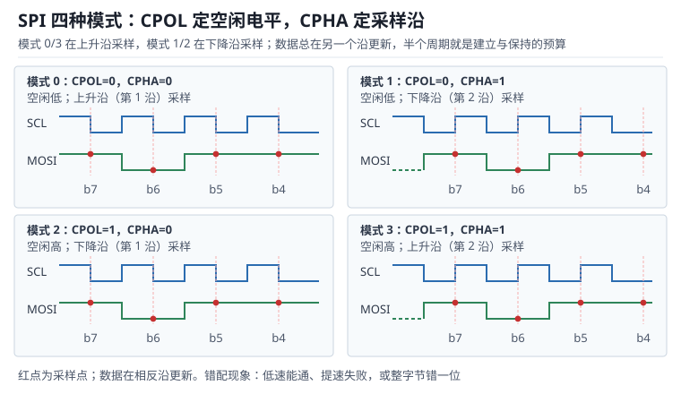

# SPI 总线：四种模式、片选与环形 DMA

串行外设接口（Serial Peripheral Interface，SPI）用四根线完成全双工同步传输：串行时钟（Serial Clock，SCLK）、主出从入（Master Out Slave In，MOSI）、主入从出（Master In Slave Out，MISO）与片选（Chip Select，CS，部分文档写作 SS 或 NSS）。它没有地址、没有应答、没有起始条件，主设备唯一能做的就是把片选拉低、发时钟、同时收一位发一位。

正因为协议层"什么都没有"，所有可靠性都压在三件事上：**时钟极性与相位必须和从机一致**、**片选必须唯一且时序正确**、**时钟与数据的往返时间必须留够**。三者中任何一项出问题，症状都很像：读回 0x00 或 0xFF、数据整体错一位、低速能通高速失败。本章按"模式怎么定、片选怎么管、带宽怎么算、长线怎么收"的顺序展开，并把每个结论落到可复算的纳秒上。

与 I²C 的对照见[I²C 总线：起止条件、时钟同步与总线恢复](i2c.md)；UART 的帧同步问题见 [UART 与 USART](uart.md)；DMA 的通道与双缓冲机制见 [DMA：通道映射、双缓冲与带宽](../mcu/dma.md)；GPIO 复用与输出速度档位见 [GPIO 电气与驱动](../mcu/gpio.md)。

## 1. 动机（设计动机：没有应答的总线，错误都是静默的）

::: motivation 四个现场
**现场一：模式配错，低速能通、高速失败。** 从机手册写"数据在时钟下降沿被锁存、空闲电平为高"，对应模式 2（CPOL=1，CPHA=0），主机的初始化代码却沿用了上一个项目的模式 0。1 MHz 下能读出正确的 ID，20 MHz 下读回的数据整体错一位。原因是模式错配时采样点落在数据跳变的边缘附近，时钟越慢，跳变相对采样点就越远，看起来"能用"。

**现场二：两个从机同时被选中。** 片选用普通 GPIO 控制，初始化时忘记把 CS 拉高，上电瞬间两个从机的 MISO 同时输出。两个推挽输出一个送 1、一个送 0，形成低阻通路，读回的电平由两者的相对驱动强度决定、结果不确定，电流还让其中一个从机发热。查了一周才发现是片选默认电平的问题。

**现场三：只配了发送 DMA。** 主机用 DMA 发 16 字节命令，接收仍用每字节中断。命令发完的瞬间接收中断才处理到第 3 个字节，接收寄存器被覆盖（Overrun，OVR），后面 13 个字节全是同一个旧值。SPI 是全双工的，发多少就收多少，**关闭接收等于每发一帧就丢一帧**。

**现场四：30 cm 排线跑 50 MHz。** 传感器板用 30 cm 杜邦线连到主板，SCLK 上出现明显振铃，MISO 在采样沿附近抖动，偶发错位。缩短到 10 cm 就好，或者在 SCLK 与 MOSI 上各串 33 Ω 电阻也好——这是典型的传输线反射与容性负载问题，不是"芯片不行"。
:::

| 你看到的现象 | 先查什么 | 判据（工程经验值，非标准强制） |
|---|---|---|
| 读回恒为 0x00 或 0xFF | 片选、模式、从机供电 | CS 唯一拉低且时序正确 |
| 低速正常、高速错位 | 模式、建立/保持余量、上升时间 | 半周期大于往返延迟的 1.5 倍 |
| 数据整体错一位 | CPHA 与采样沿 | 采样沿与从机要求一致 |
| 偶发个别位翻转 | 振铃、串扰、地回流 | 过冲小于电源的 20% |
| 两个从机互相干扰 | 片选译码、MISO 三态 | 任一时刻只有一个 CS 有效 |
| DMA 传输后数据重复 | 接收通道、OVR 标志 | 收发通道同时使能 |

**不算会摔在哪**，四个带数字的代价：

1. **只按"最高频率"选时钟。** STM32 的 SPI 可以配到 42 MHz，半周期只有 11.9 ns，而 MISO 往返链路需要 19.0 ns，直接失败；降到 10.5 MHz 后半周期 47.6 ns，余量 28.6 ns。
2. **片选当时钟用。** 用 GPIO 翻转 CS 再发数据，软件延迟 2 µs 至 5 µs，看似"足够慢"，但如果 CS 在两次 DMA 传输之间只拉高 1 个 APB 周期（11.9 ns），从机要求的 50 ns 高电平就不满足，第二帧被当成第一帧的延续。
3. **把 SPI 当"高速 UART"用。** 10.5 MHz 下 8 位帧的净吞吐是 1.31 MB/s，传 640×480、16 位色、30 fps 的图像需要 18.4 MB/s，差 14 倍——SPI 适合寄存器与中小数据块，不适合原始视频流。
4. **长线不做端接。** 30 cm 排线在 50 MHz 下的往返延迟约 3.6 ns，边沿 3.8 ns，反射与容性负载叠加后采样窗口被吃掉一半，误码率随温度与插拔状态变化。

## 2. 直观（原理图：一条环形移位链）

上图把四种模式画成四个小面板：每个面板上方是 SCLK，下方是 MOSI，红点是采样时刻。模式 0 与 3 在上升沿采样，模式 1 与 2 在下降沿采样；数据永远在另一个沿更新，所以"半个周期"就是建立与保持的全部预算。

### 2.1 原理图：全双工就是一条环形移位链

把主设备与从设备各看成一个 8 位移位寄存器，两个寄存器的两端交叉相连：主机的 MOSI 接到从机的输入，从机的 MISO 接到主机的输入，SCLK 与 CS 并联。每来一个时钟沿，两个寄存器同时左移一位，主机移出的位进入从机，从机移出的位进入主机。8 个时钟之后，两个寄存器的内容正好交换——这就是**全双工**的物理含义。

由此可以推出三条常被忽略的规则：

- **发与收是同一个动作。** 主机发 8 位必然收 8 位；不想收的位也要读走，否则接收寄存器溢出。
- **片选是"选中谁参与移位"的开关。** CS 有效期间从机的移位寄存器才接入总线，CS 无效时 MISO 必须高阻，否则多个从机会在 MISO 上对打。
- **没有地址与应答。** 主机不知道从机是否存在，也不知道数据是否被正确接收；协议层的可靠性（CRC、回读校验、超时）必须由软件补上。

### 2.2 静态分析：空闲电平、片选与三态

SCLK 的空闲电平由 CPOL 决定：CPOL=0 时空闲为低，CPOL=1 时空闲为高。CS 空闲为高，且必须有上拉，原因很实际：复位期间 GPIO 处于高阻，没有上拉时 CS 可能被干扰拉低，从机误以为被选中并驱动 MISO。

MISO 的三态是 SPI 能挂多个从机的前提。多数从机的 MISO 在 CS 无效时进入高阻，但有些器件（尤其是老式移位寄存器与部分 ADC）只在 CS 上升沿后才释放，或者干脆没有三态输出。后者必须经缓冲器或改用菊花链，不能直接并到总线上。

| 配置项 | 主设备 | 从设备 | 常见错误 |
|---|---|---|---|
| SCLK 空闲电平 | 由 CPOL 决定 | 必须与主机一致 | 主机 CPOL 与从机相反 |
| 采样沿 | 由 CPHA 决定 | 必须与主机一致 | 只改了 CPOL 没改 CPHA |
| CS 有效电平 | 通常低有效 | 低有效，需上拉 | 复位期间 CS 悬空 |
| MISO | 输入 | CS 有效时输出 | 两个从机同时输出 |
| 数据位序 | 通常 MSB 先 | 多数 MSB 先 | 少数器件 LSB 先 |

### 2.3 动态分析：四种模式与时序

模式编号就是两个参数拼起来：$\text{mode}=2\,\text{CPOL}+\text{CPHA}$。四种模式的采样沿如下：

| 模式 | CPOL | CPHA | 空闲电平 | 采样沿（第几个沿） | 数据更新沿 |
|---|---|---|---|---|---|
| 0 | 0 | 0 | 低 | 上升沿（第 1 个） | 下降沿 |
| 1 | 0 | 1 | 低 | 下降沿（第 2 个） | 上升沿 |
| 2 | 1 | 0 | 高 | 下降沿（第 1 个） | 上升沿 |
| 3 | 1 | 1 | 高 | 上升沿（第 2 个） | 下降沿 |

CPHA=0 时，第一位数据必须在第一个时钟沿到来之前就有效，主机通常在拉低 CS 后立刻把第一位放到 MOSI 上；CPHA=1 时，第一位在第一个时钟沿（边沿）才被移出，之前线上是什么无所谓。这解释了为什么"CPHA 配错"的典型症状是**整体错一位**：从机把主机还没建立好的那一位采走了。

**注意**：模式 0 与模式 3 都在上升沿采样，模式 1 与模式 2 都在下降沿采样。仅仅看"数据在哪个沿变化"无法区分 0 和 3，必须同时看空闲电平。

### 2.4 环路：时钟与数据的往返环

SPI 的时序问题可以归结为一个环：主机在某个沿发出 SCLK → 从机收到时钟 → 从机在同一个沿（或下一个沿）把数据放到 MISO → 数据经 PCB 走线回到主机 → 主机在下一个沿采样。环的总延迟必须小于两个采样沿之间的时间，也就是半个时钟周期。

这个环有两个容易算错的地方：

- **延迟从"从机引脚"算起，不是从"主机引脚"算起。** 主机输出延迟、走线延迟、从机时钟输入电容造成的边沿变缓都要计入。
- **上升时间要算一半。** 数据从 0 变 1 的过程不是瞬间完成，接收端在门限处判决，等效延迟约为上升时间的一半。

菊花链是另一种环：N 个从机串成一条移位链，主机发 N×8 个时钟，数据从第一个从机"流"到最后一个。它的环更长，但片选只有一根，适合 LED 驱动、多路 DAC 这类"顺序更新"的场合。

## 3. 定量（取值与权衡：时钟上限、片选与带宽）

### 3.1 最高时钟：建立时间与往返延迟

设从机在时钟沿之后 $t_V$ 才把数据放到 MISO 上（数据有效时间，Data Valid Time），主机在下一个采样沿之前需要 $t_{SU}$ 的建立时间，PCB 走线延迟 $t_{pcb}$，时钟与数据之间的偏斜 $t_{skew}$，边沿上升时间 $t_r$。半个周期必须容纳整条往返路径：

$$
\frac{T}{2}\geq t_V+t_{pcb}+\frac{t_r}{2}+t_{SU}+t_{skew}
$$

反解出最高时钟：

$$
f_{max}=\frac{1}{2\left(t_V+t_{pcb}+\frac{t_r}{2}+t_{SU}+t_{skew}\right)}
$$

其中 $T$ 是 SCLK 周期（s），$t_V$、$t_{SU}$、$t_r$、$t_{pcb}$、$t_{skew}$ 均为秒。代入一组典型值：$t_V=12$ ns、$t_{SU}=4$ ns、$t_r=3.83$ ns、$t_{pcb}=0.6$ ns（10 cm 走线，信号速度约 6 ns/m）、$t_{skew}=0.5$ ns：

$$
\frac{T}{2}\geq12+0.6+1.92+4+0.5=19.0\ \text{ns}
$$

$$
f_{max}=\frac{1}{2\times19.0\times10^{-9}}=26.3\ \text{MHz}
$$

注意这只是"电气上能跑多快"，从机数据手册给出的 $f_{SCLK,max}$ 往往更低，实际取值要取两者的小值再打折。

### 3.2 边沿与总线电容

SPI 的边沿由驱动器输出电阻、串联端接电阻与负载电容决定，按一阶 RC 估算：

$$
t_r=2.2\,R\,C
$$

其中 $R$ 是驱动路径的总电阻（$\Omega$），$C$ 是总线电容（F），$t_r$ 是 10%~90% 上升时间（s）。STM32 在高速档的输出电阻约 25 Ω，串 33 Ω 后 $R=58\ \Omega$；两个从机加走线与连接器约 30 pF：

$$
t_r=2.2\times58\times30\times10^{-12}=3.83\ \text{ns}
$$

在 10.5 MHz（$T=95.2$ ns）下，上升时间只占周期的 4%；在 42 MHz（$T=23.8$ ns）下占 16%，高电平只有 11.9 ns，上升沿就吃掉了三分之一。挂到 5 个从机（约 50 pF）时：

$$
t_r=2.2\times58\times50\times10^{-12}=6.38\ \text{ns}
$$

42 MHz 下这已经是高电平时间的一半，再叠加反射就没有采样余量了。

### 3.3 吞吐、帧开销与带宽

8 位帧下，净吞吐等于时钟频率除以 8：

$$
R_{8}=\frac{f_{SCLK}}{8},\qquad R_{16}=\frac{f_{SCLK}}{16}
$$

10.5 MHz 时 $R_8=1.31$ MB/s，$R_{16}=0.66$ Mframe/s。但"总线带宽"不等于"有效数据率"，因为每次访问都要发命令或地址：

| 访问方式 | 每次事务位数 | 有效数据 | 效率 |
|---|---|---|---|
| 单字节读寄存器 | 8 命令 + 8 数据 | 8 位 | 50% |
| 双字节读寄存器 | 8 命令 + 16 数据 | 16 位 | 66.7% |
| 突发读 16 字节 | 8 命令 + 128 数据 | 128 位 | 94.1% |
| 只写不读（DAC） | 16 数据 | 16 位 | 100%（忽略帧间隙） |

这就是为什么传感器驱动应尽量用突发读：把命令开销摊薄到多字节上。以 42 MHz 计算，640×480、16 位色、30 fps 需要 $640\times480\times2\times30=18.43$ MB/s，而 42 MHz 只能给 5.25 MB/s，实际帧率降到 8.5 fps；要跑满需要 $18.43\times8=147.5$ MHz 的 SCLK，已经超出多数 MCU 的 SPI 能力，这类应用应改用并口、DVP/MIPI 或带帧缓冲的接口。

### 3.4 片选时序与多从机

片选不是"拉低就行"，从机手册通常给出三个参数：CS 有效到第一个时钟沿的建立时间 $t_{CSS}$、最后一个时钟沿到 CS 无效的保持时间 $t_{CSH}$、两次事务之间 CS 高电平的最短时间 $t_{CSW}$。以 $t_{CSS}=15$ ns、$t_{CSH}=10$ ns、$t_{CSW}=50$ ns 为例：

- 用 GPIO 控制 CS 时，软件从拉低到启动 SPI 至少几微秒，远大于 15 ns，$t_{CSS}$ 不是问题。
- 用硬件 NSS 且在 DMA 模式下连续传输时，两次传输之间 CS 可能只拉高一个 APB 周期（84 MHz 下 11.9 ns），小于 50 ns，第二帧会被从机当成同一帧的延续。
- 解决办法是让 CS 在整个 DMA 传输期间保持低电平（一次事务包含多帧），或者在帧之间插入 1 µs 以上的软件延时。

多从机的拓扑有两种。**独立片选**是每个从机一根 CS，SCLK、MOSI、MISO 共享，软件同一时刻只拉低一根；它的代价是引脚数与从机数成正比。**菊花链**是共用一根 CS，前一个从机的输出接后一个的输入，N 个从机需要 N×8 个时钟；它的代价是延迟随从机数线性增长，但引脚数固定。

片选还决定总线负载：每增加一个从机，SCLK 与 MOSI 上就多一份引脚电容（典型 5 pF 至 10 pF）。5 个从机时总电容约 50 pF，上升时间从 3.83 ns 涨到 6.38 ns，可用的最高时钟随之下降。

### 3.5 环形 DMA：全双工的双通道

SPI 的 DMA 必须**收发成对配置**：发送通道从内存搬数据到数据寄存器，接收通道从数据寄存器搬到内存。只开一个方向，另一个方向的数据会覆盖接收寄存器并置 OVR。

以 1 kHz 采样、每帧 16 字节为例：每帧 128 个时钟，10.5 MHz 下占 12.2 µs；DMA 缓冲区设为 2×8 帧（256 字节），半满中断每 8 ms 一次。CPU 只需要在中断里把半缓冲区拷走或标记为可读，占用不到 1%。

缓冲区深度按"最坏处理延迟"反算：

$$
N_{half}\geq R_{frame}\,T_{latency}
$$

其中 $N_{half}$ 是半缓冲区帧数，$R_{frame}$ 是帧率（帧/s），$T_{latency}$ 是最坏处理延迟（s）。1 kHz、最坏 5 ms 时 $N_{half}\geq5$，取 8 帧留 60% 余量。若半缓冲区小于这个数，DMA 会在 CPU 处理完之前回卷覆盖。

### 3.6 菊花链：延迟与更新

菊花链的传输长度是 $N\times8$ 个时钟，$N$ 个从机就需要 $N$ 个字节的时间把数据推到各自的位置。以 4 片 74HC595 驱动 32 路输出为例，10.5 MHz 下：

$$
t_{update}=\frac{4\times8}{10.5\times10^{6}}=3.05\ \mu\text{s}
$$

从第一个字节移入到最后一个字节到达末级，延迟也是 3.05 µs；如果每 100 µs 更新一次，这点延迟可以忽略。菊花链的问题是**任何一片失效都会截断整条链**，且不能单独读回某一级的状态（除非器件支持回读），所以它适合纯输出场合，不适合需要独立寻址的传感器阵列。

## 4. 算例（设计示例：10.5 MHz 的传感器链路与环形 DMA）

### 4.1 需求

一块 84 MHz 的 MCU 通过 SPI1 读一颗六轴传感器：每 1 ms 读一帧 16 字节，从机要求 $f_{SCLK}\leq20$ MHz、$t_{SU}=4$ ns、$t_{HD}=3$ ns、$t_V=12$ ns、$t_{CSS}=15$ ns、$t_{CSH}=10$ ns、$t_{CSW}=50$ ns，走线 10 cm。

| 需求项 | 数值 | 约束来源 |
|---|---|---|
| 采样率 | 1 kHz，每帧 16 字节 | 控制环 |
| 从机最高时钟 | 20 MHz | 从机数据手册 |
| 往返链路预算 | 19.0 ns | 3.1 节 |
| 片选 | 低有效，$t_{CSW}=50$ ns | 从机数据手册 |
| 总线负载 | 2 个从机，约 30 pF | 原理图 |

### 4.2 时钟选择

SPI1 挂在 84 MHz 的 APB2 上，预分频只能取 2、4、8、16 等 2 的幂：$84/2=42$ MHz、$84/4=21$ MHz、$84/8=10.5$ MHz。逐个核对：

- 42 MHz：半周期 11.9 ns，小于 19.0 ns 的链路预算，失败。
- 21 MHz：半周期 23.8 ns，余量 4.8 ns（20%），电气上勉强，但超过从机 20 MHz 的上限，不允许。
- 10.5 MHz：半周期 47.6 ns，余量 28.6 ns（60%），且低于 20 MHz 上限。

所以取 10.5 MHz。这个例子说明"能配出来的最高频率"和"能可靠工作的频率"是两件事：**先按链路预算算上限，再与从机上限取小，最后留一半余量**。

### 4.3 片选与帧边界

一帧 16 字节在 10.5 MHz 下是 $\frac{16\times8}{10.5\times10^{6}}=12.2$ µs。两种做法：

- **整帧保持 CS 低**：一次 DMA 传完 16 字节再拉高 CS，帧内没有 $t_{CSW}$ 问题，$t_{CSS}$ 与 $t_{CSH}$ 由 GPIO 的微秒级延迟天然满足。
- **每字节翻转 CS**：DMA 相邻两次传输之间 CS 只拉高一个 APB 周期（11.9 ns），小于从机要求的 50 ns，第二字节会被当成第一字节的延续，读回的数据整体错位。

选整帧保持低电平。若必须逐帧翻转，就在两次传输之间插入 1 µs 以上的延时，或把 SCLK 降到 2 MHz 以下，让 50 ns 的相对比例变小——后者是"用降速掩盖时序问题"，不推荐。

### 4.4 环形 DMA 与 CPU 占用

收发两个 DMA 通道都开：发送通道从命令缓冲搬 16 字节，接收通道把 16 字节搬进环形缓冲。环形缓冲设为 2×8 帧 = 256 字节，半满中断每 8 ms 一次（1 kHz 采样、8 帧半缓冲）。每帧 128 个时钟占 12.2 µs，总线占用 $12.2/1000=1.2\%$；CPU 在每次半满中断里做一次指针交换与 CRC 校验，最坏 200 µs，占 2.5%。

若最坏处理延迟涨到 5 ms，半缓冲至少要有 5 帧，取 8 帧后余量 60%；如果把半缓冲设成 4 帧，最坏情况会在处理完之前被 DMA 回卷覆盖，现象是"每隔几帧出现一段重复数据"。

### 4.5 长线与菊花链的取舍

走线从 10 cm 加到 30 cm 时，延迟增加 $0.2\times6=1.2$ ns（可忽略），但电容从 30 pF 涨到约 80 pF，上升时间变成：

$$
t_r=2.2\times58\times80\times10^{-12}=10.2\ \text{ns}
$$

10.5 MHz 下占周期的 10.7%，仍可工作，但振铃与串扰开始显现；此时应在 SCLK 与 MOSI 上各串 33 Ω，并保证每根信号线旁边都有地回流。若改成 4 颗传感器菊花链，一次更新要传 $4\times16=64$ 字节，耗时 48.8 µs，但片选从 4 根减到 1 根，适合引脚紧张的板子；代价是任何一颗失效都会截断整条链。

## 5. 工程含义（测量与实验）

### 5.1 布线与端接

SCLK 是整条总线上最快的信号，应最短、最先布线，并避免与模拟小信号平行走线。串联 22 Ω 至 33 Ω 放在**源端**（主机侧），作用是让驱动阻抗接近走线特性阻抗，抑制反射；放在接收端没有意义。多从机时 MISO 是双向节点，端接要谨慎：从机输出阻抗较高，加端接反而会拉低高电平。

地回流比端接更容易被忽视：30 cm 排线如果只有一根地线，回流路径的电感会让地弹与串扰同时恶化。正确做法是每两根信号配一根地，或者用带地平面的排线。

### 5.2 初始化的顺序

顺序错了会出现"第一帧总是错"的现象：

1. 使能 GPIO 与 SPI 时钟，配置 SCLK、MOSI、MISO 为复用功能；
2. 配置 CPOL、CPHA、数据位序、预分频与帧长；
3. 把 CS 置为高（无效），并确保上电期间不被拉低；
4. 使能 SPI，最后才在传输函数里拉低 CS。

如果先使能 SPI 再配置模式，第一帧会以默认模式（通常是模式 0）发出；如果 CS 没有上拉，复位期间从机可能一直处于选中状态。

### 5.3 错误检测与恢复

SPI 本身没有应答，软件要自己补三层检查：

- **溢出**：读 OVR 标志，一旦置位说明接收数据被覆盖，必须丢弃整帧并重新同步。
- **回读校验**：写配置寄存器后读回比对，确认从机真的收到了；不比对时，从机没接上也会"写成功"。
- **CRC 或帧计数**：对大数据块加 CRC，对周期性数据加帧序号，能发现错位与丢帧。

### 5.4 测量与验证

**看采样沿的位置。** 用四通道示波器同时看 SCLK、MOSI、MISO 与 CS，把触发点放在采样沿上，测量 MISO 相对采样沿的建立时间。要求实测建立时间大于从机手册值加 50% 余量。

**看片选唯一性。** 多从机系统里同时监视两根 CS，确认任何时刻只有一根有效；两根同时为低的瞬间就是 MISO 对打。

**看边沿质量。** 测 SCLK 的上升时间与过冲，过冲超过电源的 20% 就要加串联电阻或缩短走线；同时测 MISO 在 CS 上升沿后的释放时间，确认它真的进入高阻。

**用逻辑分析仪解码。** 把分析仪的模式设成与从机一致（CPOL/CPHA/位序），抓一帧完整事务，逐位核对命令与数据。模式设错时分析仪解出来的同样是错位数据，所以要先确认分析仪配置与主机一致，再用它判断从机。

### 5.5 与 I²C 的分工

需要几十兆赫兹、全双工、持续数据流的场合用 SPI；需要多器件寻址、应答确认、少引脚、可热插拔的场合用 I²C。两者的可靠性模型也相反：I²C 有应答但没有带宽，SPI 有带宽但没有应答。工程上常见的组合是"SPI 接 ADC/闪存/显示屏，I²C 接温度传感器/EEPROM/IO 扩展"。

## 6. 常见坑（现象 → 原因 → 解决）

::: pitfall 坑一：模式配错，低速能通高速失败
- **现象**：1 MHz 下能读出正确的器件 ID，10 MHz 以上读回的数据整体错一位或恒为 0xFF。
- **原因**：CPOL/CPHA 与从机不一致，采样点落在数据跳变附近；时钟越慢跳变相对采样点越远，所以低速"看起来能用"。
- **解决**：按从机手册的时序图确定采样沿与空闲电平，用 $\text{mode}=2\,\text{CPOL}+\text{CPHA}$ 核对；用示波器确认采样沿落在数据的稳定区中央。
:::

::: pitfall 坑二：片选悬空或两个从机同时选中
- **现象**：上电后读回的数据是固定值或两个器件数据的混合；某个从机发热，MISO 上出现中间电平。
- **原因**：CS 没有上拉，复位期间被拉低；或者片选译码错误，两根 CS 同时有效，两个推挽输出在 MISO 上对打。
- **解决**：CS 一律加上拉，初始化第一步就置高；软件保证同一时刻只拉低一根 CS；没有三态输出的从机加缓冲器或改菊花链。
:::

::: pitfall 坑三：只开发送 DMA，接收被覆盖
- **现象**：发送正常、接收数据大量重复或恒为旧值；OVR 标志置位但没人读。
- **原因**：SPI 是全双工，每发一帧必然收一帧；接收通道没开，数据寄存器被新数据覆盖。
- **解决**：收发 DMA 成对配置，长度一致；确实不需要接收数据时，也要把接收寄存器读空或开一个 dummy 接收通道。
:::

::: pitfall 坑四：长排线不加端接、不留地回流
- **现象**：实验室短线一切正常，装到整机上偶发错位；换一根短线就好；温度或插拔状态不同，故障率不同。
- **原因**：长线是传输线，源端阻抗与线阻抗不匹配产生反射；单根地线的回流电感造成地弹与串扰，采样沿附近的噪声把数据翻错。
- **解决**：源端串 22 Ω 至 33 Ω，缩短 SCLK 走线，每两根信号配一根地或使用地平面；必要时降低 SCLK，先保证功能再谈速度。
:::

::: pitfall 坑五：把 CS 当普通 GPIO 随意翻转
- **现象**：连续传输时第二帧被当成第一帧的延续，读回的数据错位；或者每次传输前从机状态机复位，配置丢失。
- **原因**：CS 的高电平时间小于从机要求的 $t_{CSW}$，从机没有识别到帧边界；或者在事务中间翻转 CS，把一帧拆成两帧。
- **解决**：一次事务只翻转一次 CS，整帧保持低电平；必须在帧间翻转时插入大于 $t_{CSW}$ 的延时，并核对从机的帧边界定义。
:::

## 7. 自测题（推导）

题一：某从机要求时钟空闲为高、数据在时钟下降沿被锁存，应配哪种模式？如何用示波器验证？

空闲为高说明 CPOL=1。CPOL=1 时第一个沿是下降沿，若从机在这个沿采样，对应 CPHA=0，即模式 2。

也可以反过来核对：模式 2 的空闲为高、第一个沿为下降沿采样、数据在上升沿更新，与"下降沿锁存"完全一致；若误配成模式 3（空闲高、第二个沿采样），采样点会晚半个周期，数据可能已经换到下一位。

示波器验证：触发在 SCLK 的下降沿，观察 MOSI/MISO 在该沿前后是否稳定；再触发在上升沿，应看到数据正在跳变。两者都符合，模式就对了。

题二：$t_V=12$ ns、$t_{SU}=4$ ns、$t_r=3.83$ ns、$t_{pcb}=0.6$ ns、$t_{skew}=0.5$ ns，最高时钟是多少？若从机上限是 20 MHz，最终取多少？

半周期下限 $=12+0.6+1.92+4+0.5=19.02$ ns，$f_{max}=1/(2\times19.02\times10^{-9})=26.3$ MHz。

从机上限 20 MHz 更小，所以电气上限取 20 MHz；再留一半余量，实际取 10 MHz 左右。若 MCU 的预分频只能给 10.5 MHz，就用 10.5 MHz：半周期 47.6 ns，余量 28.6 ns，占预算的 60%。

注意 42 MHz 时半周期只有 11.9 ns，小于 19.02 ns，无论从机标称多快都不能用。

题三：640×480、16 位色、30 fps 的图像走 SPI，需要多高的 SCLK？42 MHz 下能跑多少帧？

数据率 $=640\times480\times2\times30=18\,432\,000$ B/s，即 18.43 MB/s。

8 位帧下 $f_{SCLK}=18.43\times8=147.5$ MHz，超出多数 MCU 的 SPI 上限。

42 MHz 时净吞吐 $42/8=5.25$ MB/s，帧率 $=5.25/18.43\times30=8.5$ fps。所以原始视频流不适合 SPI，应改用并口、DVP/MIPI 或带帧缓冲的接口；SPI 更适合传寄存器配置与小数据块。

题四：4 片 74HC595 菊花链、10.5 MHz，一次更新需要多久？延迟是多少？如果改成独立片选呢？

菊花链每次要移 $4\times8=32$ 位：$\frac{32}{10.5\times10^{6}}=3.05$ µs。第一位在第一片上是即时的，最后一位到达第四片需要 3.05 µs，所以末级输出的更新延迟也是 3.05 µs。

独立片选时每次只更新一片，每片 8 位 0.76 µs，但四片要分四次传输，且占用四根 CS；总时间相同，引脚更多。菊花链的优势是引脚固定、布线简单，代价是延迟随级数增长、单点失效截断整链。

题五：1 kHz 采样、每帧 16 字节、10.5 MHz，DMA 半缓冲取 8 帧，半满中断间隔多少？最坏处理 5 ms 时够不够？

半缓冲 8 帧，按 1 kHz 采样，中断间隔 $8\times1=8$ ms。每帧 128 个时钟占 12.2 µs，总线占用 1.2%。

最坏处理 5 ms 小于 8 ms，够用，余量 37.5%。若最坏处理涨到 10 ms，8 帧就不够，需要 16 帧（512 字节）；判据是 $N_{half}\geq R_{frame}T_{latency}=1\times0.01=10$ 帧，取 16 帧。

注意这里的时间单位是"采样间隔"，不是"背靠背传输时间"；如果传感器支持突发连续输出，帧间隔会变成 12.2 µs，半缓冲 8 帧只有 97.5 µs，必须按突发速率重算。

## 8. 参考资料

- Motorola, *SPI Block Guide V03.06*, 2003：SPI 移位寄存器结构、CPOL/CPHA 四种模式与模式编号定义，是 2.3 节模式表的依据。
- STMicroelectronics, *RM0090 Reference Manual*, Rev 19：Chapter 28 Serial peripheral interface (SPI)，主从模式、BR 预分频、TXE/RXNE/BSY/OVR、CRC 与 DMA 请求，对应 3.5 节与 5.3 节。
- Analog Devices, *AN-1248 SPI Interface*：SPI 时序、多从机拓扑、菊花链与信号完整性建议，对应 3.4 节与 3.6 节。
- Arm, *CMSIS-Driver SPI Documentation*：SPI 传输 API 的片选控制、全双工交换语义与 DMA 约定，对应 2.1 节与 4.4 节。
- Howard Johnson, Martin Graham, *High-Speed Digital Design: A Handbook of Black Magic*, Prentice Hall, 1993：传输线、反射、串联端接与上升时间的定量关系，对应 3.2 节与 5.1 节。
