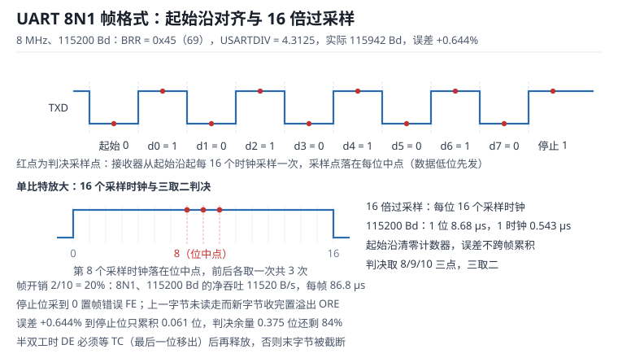

# UART 与 USART：帧格式、波特率误差与收发缓冲

通用异步收发器（Universal Asynchronous Receiver/Transmitter，UART）是一条**没有时钟线的串行链路**。发送端按自己的时钟把并行字节移成帧，接收端用自己的时钟在起始沿之后重建位边界。两条时钟彼此独立，所以 UART 的每个工程问题最后都能写成一份时间预算：分频能不能整除、误差会不会在帧尾越过判决窗口、缓冲区在下一字节到达前能不能被读走、半双工的方向切换会不会削掉最后一位。

通用同步异步收发器（Universal Synchronous/Asynchronous Receiver/Transmitter，USART）在同一套移位寄存器上增加了同步时钟引脚与智能卡、IrDA 等变体；异步模式的行为与 UART 相同，本章只讨论异步模式。下文把"一帧"定义为起始位、数据位、可选校验位与停止位的总称，把"位时间"记为 $T_b$。

时钟源与分频的整体结构见[时钟树与低层初始化](../mcu/clock-tree.md)；收发缓冲用到的 DMA 机制见 [DMA：通道映射、双缓冲与带宽](../mcu/dma.md)；接收中断的优先级与延迟见[中断与 NVIC](../mcu/interrupt-nvic.md)。

## 1. 动机（设计动机：串口总在最后一公里出问题）

::: motivation 四个现场
**现场一：8 MHz 内部 RC 配 115200。** 分频比是 $8\times10^6/(16\times115200)=4.3403$，寄存器只能写 4.3125，实际波特率 115942 Bd，误差 +0.644%。短报文一切正常，连续跑两天后长报文开始偶发校验错。原因是内部 RC 本身有 ±1% 的频差，温度升高后收发两端的总误差接近 1.7%，停止位的采样点已经压到判决窗口边缘。

**现场二：在中断里 `printf` 调试。** 115200 Bd、8N1 下一个字节占 86.8 µs，打印 64 个字符的日志要阻塞 5.6 ms。控制环周期是 1 ms，主循环被串口拖住，现象是"串口日志完整、电机偶尔丢步"——日志越详细，故障越频繁。

**现场三：接收中断被高优先级任务挤掉。** 定时器中断最坏执行 150 µs，而两个接收字节之间只隔 86.8 µs。移位寄存器在第二个字节的停止位结束时已经把第一个字节覆盖，硬件置溢出（Overrun，ORE）标志，但软件只读数据寄存器，丢字节没有任何提示。上位机看到本该 128 字节的包变成 121 字节。

**现场四：RS-485 方向控制切早了。** 发送完成中断里用 TXE 判断"发完了"，随即拉低驱动器使能（Driver Enable，DE）。TXE 只表示数据已从发送寄存器搬进移位寄存器，最后一位还在线上；DE 一撤，驱动器进入高阻，从机采到的停止位是浮空电平，报帧错误。示波器上能看到最后一个字节的停止位被削掉一半。
:::

| 你看到的现象 | 先查什么 | 判据（工程经验值，非标准强制） |
|---|---|---|
| 短报文正常、长报文偶发错 | 两端时钟频差、分频误差 | 总误差不超过接收容差的一半 |
| 换一块同型号板子就好了 | 晶振/RC 批次、分频取整 | 分频误差小于 1%，总误差小于 2% |
| 丢字节但没有报错 | ORE 是否被读取与计数 | 中断最坏延迟小于一帧时间 |
| 最后一字节总错 | DE 由 TXE 还是 TC 控制 | 用 TC，最后一位移出后才释放 |
| 空闲时总线乱码 | 偏置电阻、终端电阻 | 空闲差压不小于 200 mV |
| 打印日志就丢步 | 阻塞式发送、缓冲区深度 | 单次阻塞小于控制周期的 10% |

**不算会摔在哪**，四个带数字的代价：

1. **误差预算算错。** 8 MHz 配 115200 的量化误差 0.644%，接收容差约 3.95%，看起来还有 3.3 个百分点；但两端各 ±1% 的内部 RC 一叠加就是 1.64%，只剩一半余量，温度再漂一点就没有余量了。
2. **中断率算错。** 115200 Bd 每秒 11520 帧，每帧一次中断、每次 3 µs，CPU 占用 3.46%；换成 1 Mbaud 就是 30%，再叠加排队延迟必然丢字节。
3. **缓冲深度算错。** 115200 Bd 下 128 字节需要 11.1 ms 收完，如果主循环最坏 20 ms 才取一次数据，需要 230.4 字节，256 字节的环形缓冲只余 11% 余量，工程上建议 512 字节。
4. **半双工时序算错。** 驱动器从使能到稳定输出需要几十到几百纳秒，接收端从高阻到偏置建立也需要时间；方向切换如果只留 1 µs，在 115200 下还不到 0.12 个位时间，任何抖动都会切进数据位。

## 2. 直观（原理图：一帧数据怎么走完一条线）

上图把一帧 8N1 数据摊在时间轴上：空闲为高，起始位把线拉低，随后 8 个数据位按**低位先发**（Least Significant Bit First，LSB First）依次送出，最后是停止位。红点是接收器的判决采样点，它们都落在每一位的中点；下方放大了单个位时间内的 16 个采样时钟，用于说明三取二判决。

### 2.1 原理图：移位寄存器、采样点与引脚

发送通路是一条单向的寄存器链：软件写数据寄存器（Data Register，DR）→ 发送数据寄存器（Transmit Data Register，TDR）→ 发送移位寄存器 → TX 引脚。写 DR 时如果 TDR 为空，数据立刻进 TDR 并启动移位；TDR 非空则硬件把新数据挡住，此时 TXE 为 0。TXE 在"TDR 搬进移位寄存器"时置 1，传输完成（Transmission Complete，TC）在"最后一位（含停止位）移出"时置 1。**这两个标志差了整整一帧**，是所有方向控制错误的根源。

接收通路是镜像的：RX 引脚 → 起始沿检测 → 16 分频计数器 → 三取二判决 → 接收移位寄存器 → 接收数据寄存器（Receive Data Register，RDR）→ 可选 FIFO → DMA。RXNE 置 1 表示 RDR 里有新字节；如果软件在下一个字节收完前没有读走 RDR，硬件置 ORE，新字节被丢弃而旧字节保留。

半双工时，收发共用一个差分对，需要一个 DE 引脚控制外部驱动器。DE 的时序必须由 TC 而不是 TXE 驱动，原因在 2.4 节的回路里展开。

### 2.2 静态分析：空闲电平、逻辑 1 与电平标准

异步串行把"空闲"定义为**逻辑 1、高电平**，把起始位定义为**逻辑 0、低电平**。这个约定不是随意的：只有空闲为高，起始沿才是一个唯一的下降沿，接收端才能在任意时刻被唤醒并重新对齐；也只有空闲为高，才能用"连续 0 超过一帧"来识别断线（Break）。

同一份帧格式可以跑在完全不同的电气层上，工程上必须分清：

| 电平标准 | 逻辑 1 | 逻辑 0 | 空闲态 | 备注 |
|---|---|---|---|---|
| 3.3 V LVCMOS | 大于 2.0 V | 小于 0.8 V | 高 | MCU 引脚直连，最常用 |
| 5 V TTL | 大于 2.0 V | 小于 0.8 V | 高 | 3.3 V 器件通常可直收 |
| RS-232 | −3 V 至 −15 V | +3 V 至 +15 V | 负电压 | 反相逻辑，需电平转换芯片 |
| RS-485 | A 高于 B 不小于 200 mV | B 高于 A 不小于 200 mV | 由偏置决定 | 差分，共模范围 −7 V 至 +12 V |

三条静态约束值得写在原理图旁边：

- **RX 不能悬空。** 空闲时接收端应当看到确定的 1；悬空引脚会被噪声拉出假的起始沿，表现为"上电就收到一堆 0x00"。半双工总线靠偏置电阻保证空闲差压，点对点链路靠 10 kΩ 上拉。
- **TX 串电阻。** 22 Ω 至 100 Ω 的串联电阻可以抑制长线反射与热插拔时的浪涌，代价是边沿变缓；在 115200 下 100 Ω 配 100 pF 的时间常数只有 10 ns，远小于 8.68 µs 的位时间，不影响判决。
- **5 V 与 3.3 V 直连要看引脚。** 5 V TTL 的 $V_{OH}$ 可达 5 V，非 5 V 容忍引脚会被 ESD 钳位二极管灌电流；RS-232 的正负十几伏直接接 MCU 引脚会立刻损坏。

### 2.3 动态分析：16 倍过采样的位采样与三取二

接收端在检测到起始沿后，把内部 16 倍时钟计数器清零，再等 8 个时钟（半位）到达第一位的中点，此后每 16 个时钟采一次。为了让采样点避开边沿噪声，硬件在名义采样点前后各多采一次，共 3 次，按多数结果判决，这就是**三取二**。

于是第 $k$ 位的采样点相对理想位置的偏移可以写成：

$$
\delta_k=\left(0.5+k\right)\varepsilon T_b
$$

其中 $\varepsilon$ 是收发两端位时间的相对误差（无量纲），$T_b$ 是标称位时间（s），$k$ 从 0（起始位）到 9（8N1 的停止位）。停止位的中心在起始沿后 9.5 个位时间，所以帧尾的偏移最大：

$$
\delta_{9}=9.5\,\varepsilon T_b
$$

在 115200 Bd 下 $T_b=8.68\ \mu\text{s}$，一个 16 倍采样时钟只有 0.543 µs。检测起始沿本身有 1/16 位的量化误差，三取二又有半个采样间隔的余量，这两项加起来是 $2/16=0.125$ 位；判决窗口是半个位，于是允许的最大偏移是 0.375 位。这个数字在 3.3 节会变成容差公式。

### 2.4 环路：位定时环与方向切换环

UART 里有两条闭环，理解它们比记住寄存器位更有用。

**位定时环**：时钟源 → 分频器 → 发送位宽 → 线路 → 接收采样 → 判决。环里每一级都贡献误差，而环的"增益"是帧长：同样 1% 的误差，在第 1 位只造成 0.005 位的偏移，在第 10 位就放大成 0.095 位。这就是为什么误差必须以"帧"为单位核算，而不能只看单个位。

**方向切换环**：软件写数据 → TXE → 移位寄存器 → TC → 释放 DE → 总线回到空闲 → 从机应答。环里任何一处延迟超过一帧，就会切进数据；如果 DE 释放过晚，又会与从机的应答撞车，形成总线对拉。环的稳定条件是"最坏延迟加抖动小于帧间隔"，工程上留一个字节时间（86.8 µs）作为余量。

## 3. 定量（取值与权衡：误差、吞吐与总线）

### 3.1 波特率分频：BRR 怎么算

异步模式的分频关系只有两个式子。16 倍过采样（OVER8=0）时：

$$
\mathrm{USARTDIV}=\frac{f_{CK}}{16\,B}
$$

$$
B=\frac{f_{CK}}{16\,\mathrm{USARTDIV}}
$$

其中 $f_{CK}$ 是 USART 的外设时钟频率（Hz），$B$ 是目标波特率（Bd，即 bit/s），$\mathrm{USARTDIV}$ 是无量纲的分频值。波特率寄存器（Baud Rate Register，BRR）把它拆成整数部分与小数部分：整数部分写进 BRR[15:4]（12 位），小数部分写进 BRR[3:0]，小数部分有 4 位，所以分频步进是 $1/16$。

8 倍过采样（OVER8=1）时把式子里的 16 换成 8，小数部分只剩 3 位，步进变成 $1/8$。代价是三取二的余量从 $2/16$ 位变成 $2/8$ 位：判决窗口从 0.375 位降到 0.25 位，接收容差降到约 $2/3$——这一点在 3.3 节会用数字体现。

分频只能取离散值，所以存在**量化误差**。把小数部分四舍五入引入的相对误差上限是：

$$
\left|\varepsilon_{q}\right|\leq\frac{1}{2}\cdot\frac{1}{16\,\mathrm{USARTDIV}}=\frac{1}{32\,\mathrm{USARTDIV}}
$$

这个上限很实用：算出 USARTDIV 就能立刻知道"最坏能差多少"，不需要试。

### 3.2 8 MHz / 115200 的误差复算

代入 $f_{CK}=8\times10^6$ Hz、$B=115200$ Bd：

$$
\mathrm{USARTDIV}=\frac{8\times10^{6}}{16\times115200}=4.340277
$$

整数部分是 4，小数部分是 $0.340277\times16=5.4444$，四舍五入取 5，于是：

$$
\mathrm{USARTDIV}'=4+\frac{5}{16}=4.3125
$$

$$
BRR=(4\ll4)\,|\,5=0x45=69
$$

反算实际波特率：

$$
B'=\frac{8\times10^{6}}{16\times4.3125}=\frac{8\times10^{6}}{69}=115942.03\ \text{Bd}
$$

$$
\varepsilon=\frac{B'-B}{B}=\frac{115942.03-115200}{115200}=+0.6441\%
$$

用 3.1 节的量化上限验算：$1/(32\times4.3125)=1/138=0.7246\%$，实际误差 0.644% 确实落在半格之内。这说明 0x45 已经是 8 MHz 下能得到的最好结果之一，换 6 做小数部分会得到 114285.7 Bd、误差 −0.794%，反而更差。

| 时钟 | 过采样 | USARTDIV | 实际波特率 | 误差 | 结论 |
|---|---|---|---|---|---|
| 8 MHz | 16 | 4.3125 | 115942.0 | +0.644% | 可用，但吃掉了预算的三分之一 |
| 8 MHz | 8 | 8.625 | 115942.0 | +0.644% | 波特率相同，容差降到约 2/3，不划算 |
| 16 MHz | 16 | 8.6875 | 115107.9 | −0.080% | 误差小 8 倍，推荐 |
| 7.3728 MHz | 16 | 4.0000 | 115200.0 | 0 | 整除，115200 系列全兼容 |

表里 16 MHz 的小数部分是 $0.680556\times16=10.889$，取 11，所以 USARTDIV 是 $8+11/16=8.6875$。7.3728 MHz 之所以"刚好"，是因为 $7372800/(16\times115200)=4$——它是 115200 的整数倍关系，9600、19200、38400、57600 也都能整除。

### 3.3 接收容差与误差预算

接收端并不知道发送端的真实位宽，只能在起始沿之后数自己的 16 分频。帧尾的偏移必须小于判决窗口，窗口由两方面决定：一是采样点距位边界只有半个位，二是起始沿检测有 1/16 位的量化、三取二又占掉 1/16 位。于是可用的偏移是：

$$
\delta_{max}=0.5-\frac{2}{16}=0.375\ \text{位}
$$

把它代入帧尾条件 $9.5\varepsilon\leq0.375$：

$$
\varepsilon_{max}=\frac{0.375}{9.5}=3.947\%
$$

不同帧长的容差随之变化：

| 帧格式 | 帧长（位） | 帧尾位置（位） | 容差上限 |
|---|---|---|---|
| 8N1 | 10 | 9.5 | 3.95% |
| 8E1 | 11 | 10.5 | 3.57% |
| 8E2 | 12 | 11.5 | 3.26% |
| 9N1 | 11 | 10.5 | 3.57% |

如果只扣起始沿量化、不计三取二的半个采样间隔，按同一个 9.5 位帧尾位置重算，会得到 $(0.5-1/16)/9.5=4.605\%$，比 3.947% 高 0.66 个百分点；4.375% 是把分母换成整帧 10 位的结果，不能与 9.5 位口径直接比较。3.947% 与 4.605% 的差别只反映模型的保守程度，不影响工程结论。**无论用哪个口径，收发两端的误差都要合起来算。**

| 误差来源 | 典型值 | 说明 |
|---|---|---|
| 两端晶振频差 | 20 ppm 至 50 ppm（0.002% 至 0.005%） | 有源晶振或晶体 |
| 内部 RC 频差 | ±1%（全温全压） | 出厂校准后仍随温度漂移 |
| 分频量化 | 至多 0.72% | 8 MHz 配 115200 时 0.64% |
| 接收端自身 | 0（已含在容差里） | 不要重复计入 |

按 2% 的工程预算设计：晶振方案的总误差约 0.65%，停止位偏移 $9.5\times0.65\%=0.062$ 位，占判决窗口的 16%，余量充足；内部 RC 方案的总误差 1.64%，偏移 0.156 位，占窗口的 42%，能用但不再适合长帧或宽温。8 倍过采样时把窗口换成 0.25 位，容差降到 2.63%，同样的 1.64% 就占掉了 62%。

### 3.4 帧开销、吞吐与中断率

一帧 8N1 是 1 个起始位 + 8 个数据位 + 1 个停止位 = 10 位，其中只有 8 位是有效数据：

$$
\eta=\frac{8}{10}=80\%,\qquad R=\frac{B}{10}
$$

其中 $\eta$ 是有效载荷比例，$R$ 是净吞吐（B/s）。115200 Bd 对应 11520 B/s、每字节 86.8 µs；9600 Bd 对应 960 B/s、每字节 1.04 ms。加上校验位与停止位，开销继续上升：

| 帧格式 | 每帧位数 | 开销 | 115200 Bd 下的净吞吐 |
|---|---|---|---|
| 8N1 | 10 | 20% | 11520 B/s |
| 8E1 | 11 | 27.3% | 10473 B/s |
| 8N2 | 11 | 27.3% | 10473 B/s |
| 8E2 | 12 | 33.3% | 9600 B/s |

接收侧的中断率等于帧率，这是选择"中断、FIFO 还是 DMA"的主要依据：

| 波特率 | 帧率 | 每帧一次中断（3 µs） | FIFO 阈值 8 | DMA 半缓冲 256 B |
|---|---|---|---|---|
| 115200 | 11520/s | 3.46% CPU | 1440/s，0.43% | 45/s，可忽略 |
| 460800 | 46080/s | 13.8% CPU | 5760/s，1.7% | 180/s |
| 1 Mbaud | 100000/s | 30% CPU | 12500/s，3.75% | 391/s |

判据可以写得很直接：**中断率乘上最坏 ISR 时间不超过 CPU 的 5%**。超过就降 FIFO 阈值，再超过就上 DMA。注意 FIFO 阈值不是越大越好，阈值 8 意味着最坏要等 8 个字节（694 µs）才处理，实时性换的是 CPU 占用。

### 3.5 溢出、帧错误与缓冲深度

溢出（Overrun，ORE）的判据是"新字节收完时旧字节还没被读走"。硬件在停止位结束时把移位寄存器的内容搬到 RDR；如果 RDR 仍满，新字节被丢弃并置 ORE。所以软件从 RXNE 置位到读走数据的允许延迟是**一帧**：

$$
t_{resp,max}=n_{bit}\,T_b=\frac{n_{bit}}{B}
$$

8N1、115200 Bd 时是 86.8 µs；9600 Bd 时是 1.04 ms。工程上取 80% 作为硬上限，即 ISR 最坏延迟小于 69 µs（115200）或 0.83 ms（9600）。

帧错误（Framing Error，FE）在停止位采到 0 时置位，常见原因有四类：波特率误差累积到帧尾、DE 提前释放、总线冲突、线路断开。FE 不会自动重新同步，接收端要等到下一次空闲后的起始沿才恢复，所以软件应当丢弃整帧而不是继续拼接。

缓冲深度按峰值速率与最坏取数间隔估算：

$$
N\geq R_{peak}\,T_{latency}
$$

其中 $N$ 是环形缓冲字节数，$R_{peak}$ 是峰值吞吐（B/s），$T_{latency}$ 是消费者最坏响应时间（s）。115200 Bd、最坏 20 ms 取一次数据：$N\geq11520\times0.02=230$ 字节，取 256 字节只留 11% 余量，实际应取 512 字节。

### 3.6 RS-485 的偏置、终端与方向时序

RS-485 把单端电平换成差分：驱动器在 54 Ω 负载上给出不小于 1.5 V 的差分电压，接收器只要求 200 mV 的差分门限，共模范围 −7 V 至 +12 V。差分的好处是共模噪声被抵消，代价是总线必须**两端终端、空闲偏置**。

终端电阻取 120 Ω 是让电缆特性阻抗（约 100 Ω 至 120 Ω）被匹配，两端各一个，从任一节点看进去是两者的并联：

$$
R_{term}=120\parallel120=60\ \Omega
$$

空闲时所有驱动器都高阻，总线靠偏置电阻维持一个大于 200 mV 的差压，否则接收器输出随机。设偏置为上下各一只 $R_b$，接收器输入电阻并联后为 $R_{in}$：

$$
V_{ab}=V_{CC}\cdot\frac{R_{par}}{2R_b+R_{par}},\qquad R_{par}=R_{term}\parallel R_{in}
$$

要求 $V_{ab}\geq0.2$ V，于是：

$$
R_b\leq\frac{V_{CC}R_{par}}{0.4}-\frac{R_{par}}{2}
$$

一个单位负载（Unit Load，UL）定义为 12 kΩ，标准允许 32 UL。8 个 1 UL 节点并联后 $R_{in}=1500\ \Omega$，$R_{par}=57.69\ \Omega$，代入得每只 $R_b\leq692.3\ \Omega$（即 $2R_b\leq1384.6\ \Omega$），取两只 680 Ω（合计 1360 Ω）：

$$
V_{ab}=5\times\frac{57.69}{1360+57.69}=0.2035\ \text{V}
$$

正好过 200 mV。32 个 1 UL 节点时 $R_{in}=375\ \Omega$、$R_{par}=51.72\ \Omega$，每只 $R_b$ 的上限降到 620.7 Ω，680 Ω 只能给出 183 mV，必须换成两只 560 Ω（1120 Ω）才有 220.7 mV。若用 1/8 UL 的收发器，32 个节点只等效 4 UL，680 Ω 又够用了。

方向切换的时间基准是帧间隔而不是位宽。以 Modbus RTU 为例，按 Modbus over Serial Line V1.02 §2.5.1.1，帧间静默 $t_{3.5}$ 在 $B\leq19200$ Bd 时定义为 3.5 个字符时间（每字符按 11 位计），在 $B>19200$ Bd 时取固定值 1.75 ms（对应的字符间超时 $t_{1.5}$ 固定为 750 µs）：

$$
t_{3.5}=
\begin{cases}
3.5\times\dfrac{11}{B}, & B\leq19200\ \text{Bd},\\[4pt]
1.75\ \text{ms}, & B>19200\ \text{Bd}.
\end{cases}
$$

115200 Bd 属于高波特率档，$t_{3.5}=1.75$ ms，而不是按字符时间算出的 334 µs；9600 Bd 时仍是 4.01 ms。主站释放 DE 之后必须等到至少 $t_{3.5}$ 才能认为总线空闲；从站也在这段时间之后才允许应答。

## 4. 算例（设计示例：8 MHz 器件做 115200 半双工节点）

### 4.1 需求

一块 8 MHz 内部 RC 的板子要做一个 RS-485 从站：115200 Bd、8N1，每 50 ms 收到一帧 128 字节的命令，回 8 字节状态；总线上挂 8 个节点，双端 120 Ω 终端，5 V 供电。

| 需求项 | 数值 | 约束来源 |
|---|---|---|
| 波特率 | 115200 Bd，误差小于 2% | 与其他节点互通 |
| 帧长 | 128 字节，20 帧/s | 上层协议 |
| 接收方式 | DMA + 512 字节环形缓冲 | CPU 占用 |
| 总线 | 8 节点、双端 120 Ω、5 V | RS-485 电气 |
| 方向控制 | TC 中断释放 DE | 末字节完整性 |

### 4.2 波特率与误差

按 3.2 节，$BRR=0x45$，实际 115942.0 Bd，误差 +0.644%。叠加内部 RC 的 ±1%，总误差 1.64%，低于 2% 预算，停止位偏移 0.156 位，判决余量还剩 0.219 位。结论：**这块板子能用 115200，但不适合再往上提速**。

如果非要跑 1 Mbaud，16 倍过采样会算出 $\mathrm{USARTDIV}=0.5$，低于最小值 1，根本配不出来；改 8 倍过采样则 $\mathrm{USARTDIV}=8\times10^6/(8\times10^6)=1.0$，波特率精确，但容差只剩 2.63%，内部 RC 的 ±1% 立刻占掉 38%。这也是工业板普遍放一颗 8 MHz 或 16 MHz 晶振的原因：晶振的 20 ppm 相对 RC 的 1% 几乎可以忽略。

### 4.3 接收链路与 CPU 占用

平均吞吐 $128\times20=2560$ B/s，只占 11520 B/s 的 22%；但一帧 128 字节是连续到达的，突发持续 $128\times86.8\ \mu\text{s}=11.1$ ms。取 512 字节环形缓冲，可覆盖 44.4 ms 的取数延迟；DMA 每填满半个缓冲（256 字节）中断一次，即每 22.2 ms 一次，CPU 占用可以忽略。

若不用 DMA 而用每字节中断：11520 次/s × 3 µs = 3.46%，看似可接受，但加上排队与上下文切换，最坏延迟很容易超过 86.8 µs 的一帧窗口，于是开始丢字节。这就是 3.5 节"80% 上限"的由来。

### 4.4 RS-485 方向与偏置

8 个 1 UL 节点、双端 120 Ω、5 V 供电，按 3.6 节取两只 680 Ω 偏置，空闲差压 203.5 mV，满足 200 mV 门限但只剩 1.7% 余量。若现场还有第 9、第 10 个节点，或改用 32 节点拓扑，应直接换成两只 560 Ω。

方向控制用 TC 中断：TC 在停止位移出后置位，中断延迟约 2 µs，相对 86.8 µs 的帧时间可以忽略。释放 DE 后总线进入空闲，偏置网络的时间常数是 $R_{par}C_{bus}=57.69\times100\times10^{-12}=5.8$ ns，远小于 $t_{3.5}=1.75$ ms，不会影响从站识别帧边界。

### 4.5 校验与误码率

8N1 没有校验，帧错误只能发现"停止位不是 1"，发现不了数据位翻转。假设线路误码率 $10^{-6}$，一帧 132 字节（128 数据 + 2 头 + 2 校验）共 1320 位：

$$
P_{frame}=1-\left(1-10^{-6}\right)^{1320}\approx1.32\times10^{-3}
$$

按 20 帧/s 连续跑一天，约 172.8 万帧，出错约 2280 帧。如果没有 CRC，这 2280 帧会带着错数据被接受；加 CRC-16 后残余错误率约 $2^{-16}=1.53\times10^{-5}$，每天残余 0.03 帧——这才是一个可以接受的失效率。

## 5. 工程含义（测量与实验）

### 5.1 引脚、保护与电平

TX 与 RX 交叉连接是最基本的检查项，但真正让板子"时好时坏"的是电平与保护：3.3 V 器件收 5 V TTL 通常没问题（$V_{OH}$ 高于 $V_{IH}$），反过来的 3.3 V 驱动 5 V 器件要看对方 $V_{IH}$ 是否低于 3.0 V；RS-232 必须经电平转换芯片；RS-485 的 A/B 不能接反，接反时所有帧都是 FE。串联 33 Ω 至 100 Ω 电阻、TVS 与共模电感按现场干扰程度取舍，隔离型收发器用于地电位差大的场合。

### 5.2 FIFO 阈值与中断/DMA 的选择

选择逻辑可以固化成三条：

1. 帧率乘最坏 ISR 时间小于 5% CPU：用每字节中断，代码最简单。
2. 超过 5% 但小于 15%：开 FIFO，阈值取 4 至 8，并保证阈值时间大于最坏 ISR 延迟。
3. 超过 15%，或需要长时间阻塞式处理：上 DMA，用半满/全满双中断驱动环形缓冲。

阈值时间要单独验算：阈值 8 在 115200 下是 694 µs，在 1 Mbaud 下是 80 µs，两者都相当于 8 个帧时间，因此不能据此推出 1 Mbaud 的实时性反而变差。真正收紧的是绝对响应时间：1 Mbaud 下 ISR 与排队总延迟必须小于 80 µs，否则同样会丢字节。

### 5.3 帧错误与溢出的处理约定

处理顺序要固定下来，否则会出现"标志清了但数据还是丢"：

- **ORE**：先读状态寄存器再读数据寄存器，这条序列同时清 ORE 与 RXNE；只读数据寄存器清不掉 ORE，中断会一直重进。
- **FE**：置错误计数，丢弃当前帧并等待下一个空闲后的起始沿；不要在 FE 后继续拼接缓冲。
- **NE**：三取二失败，说明边沿上有噪声；单独计数，连续出现时检查终端与地线。
- **重同步**：发生 ORE 后，硬件仍按位边界继续收，但字节流已经错位，上层必须靠帧头与长度重新同步，或直接等一帧静默。

### 5.4 测量与验证

**测实际波特率。** 用逻辑分析仪抓一段 0x55（位模式 01010101，边沿最密），读单个位的宽度。8.68 µs 对应 115200 Bd；若读到 8.63 µs，实际是 115900 Bd 左右，与 0.644% 的误差吻合。不要用 0x00 或 0xFF 测，它们没有边沿。

**测帧尾余量。** 让发送端连续发 0x55，示波器触发在最后一帧的停止位，观察采样点相对位边界的距离；温度箱里从 −20 °C 扫到 70 °C，看这个距离是否单调缩小。内部 RC 方案的缩小量通常在 0.1 位量级。

**测误码率。** 发 100 万帧递增序列，接收端比对，统计 FE、ORE、CRC 错的数量。这个测试能同时暴露分频误差、DE 时序与总线偏置三类问题。

**测半双工切换。** 双通道示波器同时看 DE 与 A/B 差分，确认 DE 下降沿在最后一个停止位之后至少 1 µs，且从站应答的第一个起始沿在 $t_{3.5}$（115200 Bd 时为 1.75 ms）之后。

### 5.5 与上层协议的分界

UART 只保证"字节流按序到达"，不保证帧边界、不保证不丢字节、不保证内容正确。所有可靠性都来自上层：帧头加长度、CRC-16、超时重传、序号去重。半双工总线上的多机通信还需要一轮"谁先说"的仲裁，通常用主从轮询而不是自由竞争。RTOS 环境下，串口中断只做"搬字节进环形缓冲 + 释放信号量"，解析放在任务里，避免在 ISR 里做协议状态机。

## 6. 常见坑（现象 → 原因 → 解决）

::: pitfall 坑一：8 MHz 配 115200，"能通就行"
- **现象**：实验室短报文一切正常，装到现场跑几小时后长报文偶发 CRC 错；换一批板子故障率不同。
- **原因**：分频量化误差 0.644%，内部 RC 再叠加 ±1%，总误差 1.64%；停止位采样点已经偏移 0.156 位，温度升高后继续向窗口边缘移动。
- **解决**：先算 $\mathrm{USARTDIV}$ 与量化上限 $1/(32\,\mathrm{USARTDIV})$；总误差控制在 1% 以内，或换 7.3728 MHz / 16 MHz 晶振把分频误差压到 0.1% 以下。
:::

::: pitfall 坑二：用 TXE 释放 RS-485 的 DE
- **现象**：单字节命令偶尔生效、多字节帧的最后一字节总错；示波器上最后一个停止位被削平。
- **原因**：TXE 只表示数据从 TDR 搬进了移位寄存器，最后一位还在线上；DE 一撤，驱动器高阻，线上电平由偏置决定，从机把停止位采成 0。
- **解决**：改用 TC 中断释放 DE，并留 1 µs 以上余量；发送期间禁止其他任务改写 DE 引脚。
:::

::: pitfall 坑三：ORE 清不掉，中断反复进
- **现象**：接收中断进入后读 DR 返回旧数据，退出后立刻再次进入；字节流整体错位。
- **原因**：ORE 的清除条件是"读状态寄存器 + 读数据寄存器"这一对操作，只读 DR 或只清 RXNE 都不够；有些系列还要求先读 SR 再读 DR 的顺序。
- **解决**：ISR 里固定按"读 SR → 读 DR"处理；同时统计 ORE 次数，把它当作系统报警而不是可忽略的噪声。
:::

::: pitfall 坑四：半双工总线不装偏置与终端
- **现象**：总线空闲时接收端收到随机字节；通信距离一长就出现反射与误码，缩短线缆后好转。
- **原因**：所有驱动器高阻时差分电压为 0，接收器在门限附近随机判决；没有终端匹配时信号在两端反射，边沿上出现振铃。
- **解决**：两端各 120 Ω 终端，加两只偏置电阻保证空闲差压不小于 200 mV；节点数超过 8 个时按 3.6 节重算偏置。
:::

## 7. 自测题（推导）

题一：8 MHz、115200 Bd、16 倍过采样，求 BRR、实际波特率与误差；并判断误差是否落在量化半格内。

$\mathrm{USARTDIV}=8\times10^6/(16\times115200)=4.340277$。整数 4，小数 $0.340277\times16=5.444$，取 5，故 $\mathrm{USARTDIV}'=4.3125$，$BRR=(4\ll4)|5=0x45=69$。

实际波特率 $B'=8\times10^6/(16\times4.3125)=8\times10^6/69=115942.03$ Bd，误差 $(115942.03-115200)/115200=+0.6441\%$。

量化半格是 $1/(32\times4.3125)=0.7246\%$，0.644% 小于它，说明取 5 已经是最近的一格；取 6 会得到 114285.7 Bd、误差 −0.794%，更远。

题二：若两端总误差为 2.5%，8N1 帧的停止位采样点偏移多少位？还能可靠判决吗？换成 8 倍过采样呢？

偏移 $\delta=9.5\times2.5\%=0.2375$ 位。16 倍过采样下的判决窗口是 0.375 位，0.2375 小于它，仍有余量 0.1375 位（占窗口 37%），可以工作但不宽裕。

8 倍过采样时窗口是 $0.5-2/8=0.25$ 位，0.2375 只比它小 0.0125 位，等于把余量压到 5%，任何噪声或晶振漂移都会越界。结论：2.5% 的总误差应当配 16 倍过采样，并尽量把误差压到 2% 以内。

题三：1 Mbaud、8N1、每字节一次中断、ISR 最坏 3 µs，CPU 占用多少？如果中断排队再增加 2 µs 呢？

帧率 $10^6/10=100000$ 帧/s。每帧 3 µs，占用 $100000\times3\times10^{-6}=30\%$。加上 2 µs 排队，等效 5 µs，占用 50%。

这还没算上下文保存与更高优先级中断的抢占。工程上应改成 DMA 加环形缓冲，或者至少开 FIFO：阈值 8 时中断率降到 12500 次/s，占用 3.75%。

题四：5 V、双端 120 Ω、8 个 1 UL 节点，要求空闲差压不小于 200 mV，偏置电阻上限是多少？32 个节点时呢？

8 个 1 UL 节点：$R_{in}=12000/8=1500\ \Omega$，$R_{par}=120\parallel1500=57.69\ \Omega$。由 $V_{ab}=5R_{par}/(2R_b+R_{par})\geq0.2$ 得 $2R_b\leq5\times57.69/0.2-57.69=1384.6\ \Omega$，每只 $R_b\leq692.3\ \Omega$，取 680 Ω 得 203.5 mV。

32 个节点：$R_{in}=375\ \Omega$，$R_{par}=51.72\ \Omega$，$2R_b\leq1241.4\ \Omega$，每只不超过 620.7 Ω；680 Ω 只能给出 183.2 mV，不达标，应取 560 Ω（220.7 mV）。

题五：8N1、115200 Bd 发 1 KiB 数据要多久？如果改成 1.5 个停止位呢？

8N1 每字节 10 位：$1024\times10/115200=88.9$ ms。若帧内另加 4 字节协议头，总时间按 1028 字节算，为 89.2 ms。

1.5 个停止位时每字节 10.5 位：$1024\times10.5/115200=93.3$ ms，多出 4.4 ms，约 5%。注意 1.5 个停止位在接收端只要求检测到 1 个停止位，多出的半个位是给收发两端留的恢复时间。

## 8. 参考资料

- STMicroelectronics, *RM0008 Reference Manual*, Rev 21：Chapter 27 Universal synchronous asynchronous receiver transmitter (USART)，帧格式、BRR 分频、TXE/TC/RXNE/ORE/FE 标志与 DMA 请求映射。
- STMicroelectronics, *RM0090 Reference Manual*, Rev 19：Chapter 30 USART/UART，16 倍与 8 倍过采样、波特率公式、接收容差、FIFO 与多缓冲 DMA 配置。
- STMicroelectronics, *STM32F407xx Datasheet*, DS8626 Rev 9：USART 引脚复用映射与 I/O 交流特性，用于核算串联电阻与边沿时间。
- TIA/EIA-485-A：驱动器差分输出、接收器 ±200 mV 门限、−7 V 至 +12 V 共模范围与单位负载定义，是 3.6 节偏置计算的依据。
- Texas Instruments, *SLLA272D The RS-485 Design Guide*：终端匹配、fail-safe 偏置与单位负载的工程取值，对应 3.6 节与 4.4 节的电阻计算。
- Modbus Organization, *MODBUS over Serial Line Specification and Implementation Guide* V1.02：RTU 帧间隔 $t_{3.5}$ 与半双工主从时序，对应 3.6 节与 5.4 节的测量判据。
