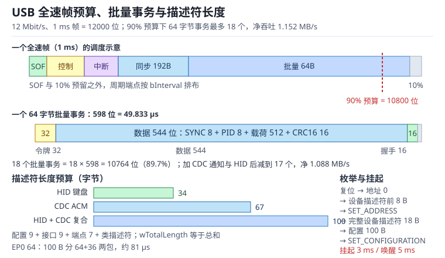

# USB 设备：枚举、端点、描述符与 SOF

通用串行总线（Universal Serial Bus，USB）是主机调度的、分层的、以端点（Endpoint）为基本单位的串行总线。设备不会自己"抢总线"：主机每 1 ms 发一个帧起始（Start of Frame，SOF），在帧内按预算安排控制、中断、批量、同步四类传输；设备能做的，是在自己的端点缓冲里准备好数据，等待主机来取或送来。

这种"主机说了算"的结构把设备侧的复杂度压到了三件事：**描述符（Descriptor）要写对**（否则主机不知道你是谁、要多少带宽）、**端点要配对**（方向、类型、包长、间隔）、**缓冲要跟上**（否则溢出或欠载）。三者中任何一项出错，现象都很像：插上没反应、设备管理器里出现黄色感叹号、能识别但传不动数据、休眠后醒不过来。本章按枚举（Enumeration）、描述符、传输类型（Transfer Type）、CDC（Communications Device Class）/HID（Human Interface Device）、挂起（Suspend）唤醒（Resume）、DMA 双缓冲（Double Buffering）的顺序展开，并给出可直接复算的帧内预算。

与 UART 的异步帧对照见 [UART 与 USART](uart.md)，CAN 的多主仲裁见 [CAN 与 CAN FD](can.md)，DMA 的通道与双缓冲见 [DMA：通道映射、双缓冲与带宽](../mcu/dma.md)，低功耗与唤醒源见 [低功耗设计](../practice/low-power.md)。

## 1. 动机（设计动机：为什么"插上没反应"总是枚举问题）

::: motivation 四个现场
**现场一：设备描述符少写一个字节。** 固件把设备描述符的 bLength 写成 17，主机按 18 字节解析，把最后一个字段读成 0；更常见的是 bMaxPacketSize0 写成 8，而 EP0 实际按 64 字节缓冲，主机第一次取 8 字节设备描述符时设备回了 64 字节，主机认为传输错误，设备在枚举第一步就停了。插拔十次偶尔成功一次，因为复位时序恰好错开。

**现场二：CDC 通知端点漏了。** 设备用 CDC 类做虚拟串口，数据端点收发都正常，但主机驱动打不开串口。抓包发现设备只声明了数据类接口的一个方向，没有声明通知端点，也没有 Union 描述符把通信接口与数据接口关联起来；主机枚举出一个"未知通信设备"，驱动无法绑定。

**现场三：同步端点双缓冲只排了一个包。** 音频设备每 1 ms 发 192 字节，端点配置成双缓冲 2×192 字节，但软件每次只挂一个缓冲，第二个缓冲一直是空的。某次 USB 主机延迟了半帧，第二个缓冲还没填好，端点读到旧数据，听感是周期性的"咔哒"声。逻辑分析仪上能看到数据包重复。

**现场四：挂起后电流超标。** 设备进入挂起后，MCU 只关了 USB 时钟，外部 PHY 和 LED 还在耗电，实测 8 mA，超过总线供电设备 2.5 mA 的挂起上限。主机在合规测试中判定失败，或者移动电源直接断开端口。
:::

| 你看到的现象 | 先查什么 | 判据（工程经验值，非标准强制） |
|---|---|---|
| 插上完全没反应 | D+ 上拉、VBUS、复位 | 设备能被主机复位，D+ 上拉在正确速度 |
| 设备管理器黄色感叹号 | 设备/配置描述符长度 | bLength、wTotalLength 与实际一致 |
| 能识别但打不开串口 | CDC 通知端点、Union、驱动 | 通信接口与数据接口成对声明 |
| 大数据量传不动 | 端点类型、包长、帧预算 | 批量端点每帧不超过预算的 90% |
| 音频周期性咔哒 | 同步端点双缓冲、补充时机 | 下一个缓冲在 SOF 前就绪 |
| 休眠后醒不过来 | 远程唤醒使能、恢复时序 | 挂起 5 ms 后才允许远程唤醒 |
| 挂起电流超标 | 外设供电、PHY 时钟 | 总线供电设备小于 2.5 mA |

**不算会摔在哪**，四个带数字的代价：

1. **帧预算按理论 1.5 MB/s 算。** 全速帧 1 ms、12 Mbit/s，理论 1500 字节；但 64 字节批量事务要 592 位，加 6 位间隔是 598 位，占 49.833 µs。90% 帧预算下只能排 18 个事务，净吞吐 1.152 MB/s，比理论值低 23.2%。
2. **描述符长度写错。** 设备描述符 18 字节、配置 9 字节、接口 9 字节、端点 7 字节；CDC 配置合计 67 字节，复合 HID+CDC 是 100 字节。wTotalLength 少写 7 字节，主机会把最后一个端点描述符截掉，端点直接不存在。
3. **同步端点只排一个缓冲。** 192 字节/ms 的音频，双缓冲 2×192 字节只能覆盖 2 ms；如果软件在 SOF 后 1 ms 才补缓冲，第二次 SOF 就可能读到未更新的数据，现象是每 2 ms 一次的重复包。
4. **挂起不降功耗。** 2.5 mA 是总线供电设备挂起时的上限；8 mA 的超标设备在合规测试中会被判失败，电池供电产品则直接缩短待机时间。

## 2. 直观（原理图：从主机端口到端点缓冲）

上图上半部分是一个 1 ms 的全速帧：SOF 之后依次排控制、中断、同步、批量事务，右侧标出 90% 预算与批量事务（满预算 18 个）；中间是一个 64 字节批量事务的位结构：32 位令牌、544 位数据包、16 位握手，加 6 位间隔共 598 位；下半部分是枚举的请求顺序与挂起/恢复时间轴。读图时抓住一句话：**USB 的带宽是主机按帧分配的，设备侧只能提前把数据放进端点，不能临时插队。**

### 2.1 原理图：主机、设备与端点

USB 不是像 CAN 那样的多主总线，而是"一个主机 + 最多 127 个设备"的星形拓扑。主机控制器每个帧（全速 1 ms、高速 125 µs 微帧）发出 SOF，然后按调度表逐个发起事务。每个事务由三部分组成：令牌包（Token）说明"这次访问哪个设备的哪个端点、方向如何"，数据包（Data）携带载荷，握手包（Handshake）确认收到或忙。

端点不是"引脚"，而是设备内部的一块缓冲区和一套状态。每个端点有四个属性：方向（IN 是设备到主机，OUT 是主机到设备）、传输类型、最大包长（wMaxPacketSize）、轮询间隔（bInterval）。端点 0 固定为控制端点，负责枚举和类请求；其余端点由描述符声明，主机根据描述符分配带宽。

设备侧的数据通路可以画成：应用缓冲 → 端点 FIFO/PMA → 串行接口引擎（Serial Interface Engine，SIE）→ D+ / D-。SIE 负责位填充、CRC、握手和包边界；CPU 只需要在端点缓冲和图像/串口/音频缓冲之间搬运数据。搬运方式有两种：中断逐包搬，或者 DMA 按描述符搬。前者简单但 CPU 占用高，后者适合大数据量，但要把缓冲生命周期和双缓冲管好。

### 2.2 静态分析：描述符与端点表

主机不认识"代码"，只认识描述符。枚举时它按固定顺序读：设备描述符（18 字节）→ 配置描述符（9 字节）→ 配置集合（配置 + 接口 + 端点 + 类描述符）→ 字符串描述符（可选）。每个描述符都以 bLength 和 bDescriptorType 开头，主机靠 bLength 跳转到下一个描述符，所以**长度错一个字节，后面的解析全错**。

| 描述符 | 典型长度 | 关键字段 | 常见错误 |
|---|---|---|---|
| 设备 | 18 | bcdUSB、bDeviceClass、bMaxPacketSize0、idVendor/idProduct | EP0 包长与实际不符 |
| 配置 | 9 | wTotalLength、bNumInterfaces、bMaxPower | wTotalLength 少算类描述符 |
| 接口 | 9 | bInterfaceNumber、bNumEndpoints、bInterfaceClass | 接口号重复或端点数为 0 |
| 端点 | 7 | bEndpointAddress、bmAttributes、wMaxPacketSize、bInterval | 方向位 0x80 写反 |
| HID | 9 | bcdHID、bNumDescriptors、报表类型/长度 | 报表描述符长度不对 |
| CDC 功能 | 5/5/4/5 | Header、Call Management、ACM、Union | Union 的主/从接口号错 |

HID（Human Interface Device）设备的配置集合通常是 34 字节：配置 9 + 接口 9 + HID 9 + 端点 7。CDC（Communications Device Class）ACM 的配置集合是 67 字节：配置 9 + 通信接口 9 + Header 5 + Call Management 5 + ACM 4 + Union 5 + 通知端点 7 + 数据接口 9 + 批量 OUT 7 + 批量 IN 7。把 HID 与 CDC 复合到一个配置里，需要为 CDC 的两个接口加接口关联描述符（Interface Association Descriptor，IAD，8 字节），总长度变成：

$$
9+25+8+58=100\ \text{字节}
$$

其中 25 是 HID 接口 9 + HID 描述符 9 + 端点 7，58 是 CDC 去掉配置描述符后的 9+5+5+4+5+7+9+7+7。这个 100 要写进配置描述符的 wTotalLength；少写 8 字节，主机就会丢掉 CDC 的最后一个批量端点。

端点表同样要自洽：bNumEndpoints 必须等于该接口下实际端点描述符的数量；wMaxPacketSize 不能超过该传输类型与速度的上限；bInterval 对全速中断端点以 ms 为单位，对高速端点则以 2 的幂次个微帧为单位。描述符之间只要有一处不自洽，主机就可能枚举失败，或者枚举成功但驱动拿不到需要的端点。

### 2.3 动态分析：枚举与四种传输

枚举从主机检测到设备插入开始。主机先给总线复位（SE0 至少 10 ms），设备回到默认状态、地址 0、EP0 包长 8 字节。然后主机发 GET_DESCRIPTOR（设备，前 8 字节），确认 bMaxPacketSize0；再发 SET_ADDRESS 分配唯一地址；接着读完整设备描述符（18 字节）、配置描述符（9 字节）、完整配置集合，最后发 SET_CONFIGURATION 选中配置。类驱动随后发类请求，例如 CDC 的 SET_LINE_CODING、SET_CONTROL_LINE_STATE，HID 的 SET_IDLE、GET_REPORT。

| 传输类型（Transfer Type） | 方向 | 带宽/延迟保证 | 典型用途 | 全速最大包 |
|---|---|---|---|---|
| 控制（Control） | 双向 | 每帧预留，尽力而为 | 枚举、类请求、配置 | 64 |
| 批量（Bulk） | 单向 | 无带宽保证，有 CRC 重传 | 大文件、虚拟串口 | 64 |
| 中断（Interrupt） | 单向 | 有界延迟，按 bInterval 轮询 | 键盘、鼠标、状态上报 | 64 |
| 同步（Isochronous） | 单向 | 保证带宽，不重传 | 音频、视频 | 1023 |

控制传输由三个阶段组成：建立阶段（8 字节 SETUP 包）、数据阶段（可选，方向由请求决定）、状态阶段（一个零长度包，方向与数据阶段相反）。建立阶段的数据总是 8 字节，主机用它说明请求类型、请求码、值和索引；设备在状态阶段用 ACK 或 STALL 表示成功或失败。

批量传输用 CRC16 和握手保证可靠，但主机不保证每帧都给带宽；当总线忙时，批量事务会被推迟。中断传输本质上也是"主机定时来问"，但 bInterval 给了上限，所以延迟有界；它适合小数据、低频率的状态上报。同步传输在每个帧里预留固定带宽，没有握手和重传，适合音频这种"宁可丢一包也不能等"的流。

### 2.4 环路：帧调度环、握手环与挂起唤醒环

USB 的运行时行为可以拆成三个环。

**帧调度环**：主机每帧先发 SOF，再按调度表发事务；设备在 SOF 中断里准备下一帧的数据，周而复始。环的周期是全速 1 ms、高速 125 µs。设备的缓冲深度必须覆盖"主机延迟 + 软件响应"的最坏情况，否则同步端点欠载、批量端点溢出。

**握手环**：主机发令牌和数据，设备回 ACK（收到）、NAK（暂时没数据/忙）、STALL（请求不支持或端点出错）。ACK 只表示"这一包在链路上正确"，不表示应用层处理完成；NAK 是正常的流控，不是错误；STALL 才是需要驱动干预的异常。批量端点靠 NAK 实现背压，所以设备不需要额外流控协议。

**挂起唤醒环**：总线连续 3 ms 没有活动，设备进入挂起；主机或设备都可以发起恢复。设备远程唤醒必须先被主机使能（SET_FEATURE DEVICE_REMOTE_WAKEUP），并在挂起至少 5 ms 后才能发唤醒信号；主机随后驱动恢复 signaling，设备在 10 ms 内就绪，主机侧的恢复流程通常持续 20 ms。这个环没闭合，表现就是"休眠后必须拔插"。

## 3. 定量（取值与权衡：帧预算、描述符与 PMA）

### 3.1 全速帧预算

全速 USB 的帧长 1 ms，位速率 12 Mbit/s，所以一帧有 12000 位。一个 64 字节批量事务的位数可以拆成：

$$
N_{\mathrm{tr}}=32+\left(32+8L\right)+16+6=86+8L
$$

其中 $N_{\mathrm{tr}}$ 是一个事务的总位数（bit），$L$ 是数据字节数，32 是令牌包（SYNC 8 + PID 8 + ADDR 7 + ENDP 4 + CRC5 5），$32+8L$ 是数据包（SYNC 8 + PID 8 + 载荷 $8L$ + CRC16 16），16 是握手包，6 是按 3 个 2 位包间隔估算的间隙。$L=64$ 时 $N_{\mathrm{tr}}=86+512=598$ 位，时间 $598/12\,\mathrm{Mbit/s}=49.833$ µs。

USB 主机通常把每帧的 90% 留给周期性传输，10% 留给控制与批量：

$$
n=\left\lfloor\frac{0.9\times12000}{86+8L}\right\rfloor
$$

其中 $n$ 是每帧可排的事务数。$L=64$ 时 $n=\lfloor10800/598\rfloor=18$，每帧净载荷 $18\times64=1152$ 字节，吞吐 $1152\times1000=1.152$ MB/s。18 个事务占 $18\times598=10764$ 位，即帧的 89.7%，刚好在 90% 预算内；第 19 个事务需要 11362 位，已经超过预算。

这个计算没有计入位填充。USB 在连续 6 个 1 后插入 0，最坏情况下数据包会多出约 1/7 的位；随机数据平均填充约 1%~2%，所以 1.152 MB/s 是"预算上限"，实际批量吞吐通常再低 5%~15%。

### 3.2 四种传输的预算

把同样的方法套到其他事务上，可以得到一张设备侧预算表（全速、不计填充）：

| 事务 | 载荷 | 位数 | 时间 | 占 1 ms 帧 |
|---|---|---|---|---|
| 控制 EP0 读 34 字节 | 34 B | 358 | 29.833 µs | 2.98% |
| 中断 IN 8 字节 | 8 B | 150 | 12.500 µs | 1.25% |
| CDC 通知 16 字节 | 16 B | 214 | 17.833 µs | 1.78% |
| 批量 64 字节 | 64 B | 598 | 49.833 µs | 4.98% |
| 同步 192 字节 | 192 B | 1606 | 133.833 µs | 13.38% |

同步 192 字节事务没有握手包，位数是 $32+\left(32+8\times192\right)+6=1606$，时间 $1606/12\,\mathrm{Mbit/s}=133.833$ µs。48 kHz、16 位、双声道音频每秒 192000 字节，每 1 ms 正好 192 字节，所以一个同步事务就够；它占帧的 13.38%，给其他端点留了充足余量。若改成 8 kHz、16 位、单声道，每帧 16 字节，事务 214 位、17.833 µs，占比 1.78%。

### 3.3 描述符长度预算

描述符长度不是"大概写一下"，而是主机解析的边界。把常用配置集合的长度列出来：

| 配置 | 组成 | 总长度 |
|---|---|---|
| HID 键盘 | 配置 9 + 接口 9 + HID 9 + 端点 7 | 34 |
| CDC ACM | 配置 9 + 通信接口 9 + 功能 5+5+4+5 + 通知端点 7 + 数据接口 9 + 批量 OUT 7 + 批量 IN 7 | 67 |
| HID + CDC 复合 | 配置 9 + HID 25 + CDC IAD 8 + CDC 58 | 100 |

其中 HID 的 25 是接口 9 + HID 描述符 9 + 端点 7；CDC 的 58 是通信接口 9 + 功能描述符 19 + 通知端点 7 + 数据接口 9 + 两个批量端点 14。配置描述符的 wTotalLength 必须等于整棵配置树的总字节数，不能只算到接口描述符。

EP0 的最大包长决定一个配置集合要分几包。全速 EP0 通常取 64 字节：34 字节的 HID 配置一包发完；67 字节的 CDC 配置要两包（64+3）；100 字节的复合配置也要两包（64+36）。两包的控制传输时间约为

$$
T_{\mathrm{EP0}}=\frac{598+374}{12\times10^{6}}=81.0\ \mu\mathrm{s}
$$

其中 598 是 64 字节数据包事务的位数，374 是 36 字节数据包事务的位数（$86+8\times36$）。相对 1 ms 帧，枚举期间的这点开销可以忽略，但 wLength 与 wTotalLength 必须一致，否则主机会一直发 IN 令牌等剩余数据，直到超时。

### 3.4 双缓冲、PMA 与 DMA

USB 设备控制器的端点缓冲通常放在一块专用 Packet Memory Area（PMA）里。以 512 字节 PMA 为例，一个 HID+CDC 复合设备的分配可以是：

| 端点 | 方向/类型 | 包长 | 缓冲倍数 | 占用 |
|---|---|---|---|---|
| EP0 | 控制 | 64 | 1 | 64 |
| HID IN | 中断 | 8 | 2 | 16 |
| CDC 通知 IN | 中断 | 16 | 2 | 32 |
| CDC 数据 IN | 批量 | 64 | 2 | 128 |
| CDC 数据 OUT | 批量 | 64 | 2 | 128 |

合计 368 字节，剩余 144 字节。双缓冲的意义是"一个缓冲正在被 SIE 发送/接收，另一个由 CPU 填充/读取"，从而把 USB 的包时间与软件延迟解耦。以 64 字节批量端点为例，一个事务 49.833 µs，两个缓冲可以覆盖约 99.7 µs；如果 CPU 在这段时间内补不上数据，端点就会 NAK，主机下帧再来。

同步端点对缓冲深度更敏感。192 字节/ms 的音频，如果端点包长 192、双缓冲 2×192=384 字节，PMA 占用 384 字节，加上 EP0 64 和 HID 16 共 464 字节，仍能放进 512 字节 PMA；双缓冲覆盖 2 ms，软件在每个 SOF 补一次即可。如果包长只有 64 字节，一帧 192 字节要拆成 3 个事务，双缓冲 2×64=128 字节连一帧都装不下，必须在帧内补充，否则第二个事务就会读到旧数据。这就是"包长、缓冲倍数、补充时机"必须一起算的原因。

DMA 模式下，CPU 不再逐包读写 FIFO，而是给控制器一个描述符链：描述符里放缓冲地址、长度、所有权位。控制器发完一包把所有权交回 CPU，CPU 在中断里回收并挂下一个描述符。双缓冲与 DMA 结合时，要保证"正在被 DMA 使用的缓冲"不会被应用改写；常见做法是每个方向准备 2~4 个描述符，用乒乓指针切换，并在半满/全满中断里处理。

### 3.5 SOF、挂起与唤醒时间

全速 SOF 每 1 ms 一次，高速每 125 µs 一次。SOF 包带 11 位帧号，设备可以用它做时间基准，也可以用它判断总线是否还活着。USB 2.0 的挂起/恢复时间可以记成一组常用值：

| 事件 | 时间 | 说明 |
|---|---|---|
| 进入挂起 | 总线空闲 3 ms | 设备必须降到挂起电流 |
| 挂起电流 | ≤2.5 mA | 总线供电设备的上限 |
| 远程唤醒等待 | ≥5 ms | 挂起后至少等 5 ms 才能发唤醒 |
| 主机恢复 signaling | 20 ms | 主机驱动恢复的时间 |
| 设备恢复就绪 | ≤10 ms | 恢复后主机可访问设备 |
| 高速微帧 | 125 µs | 高速 SOF 周期 |

挂起时，设备要关掉不必要的时钟、外设和 LED，保留能检测总线活动的电路；唤醒时，要重新锁相、恢复端点缓冲。恢复后不要假设原来的配置一定保留：主机可能重新枚举，设备要能重新处理 GET_DESCRIPTOR 与 SET_CONFIGURATION。远程唤醒必须先在配置阶段被主机使能，否则设备发唤醒信号是非法的，主机会忽略甚至复位端口。

## 4. 算例（设计示例：全速 HID+CDC 复合设备）

### 4.1 需求

一个全速 USB 设备，同时提供 HID 键盘和 CDC ACM 虚拟串口；主机供电，最大电流 100 mA；CDC 数据端点 64 字节批量，HID 端点 8 字节中断、bInterval=10 ms；每 1 ms 发送一次 16 字节 CDC 通知；要求批量吞吐不低于 1 MB/s，挂起电流小于 2.5 mA。

### 4.2 描述符与枚举

配置集合按 3.3 节算：配置 9 + HID 25 + CDC IAD 8 + CDC 58 = 100 字节。wTotalLength 写 100；bNumInterfaces 写 3（HID 一个、CDC 通信一个、CDC 数据一个）；bMaxPower 写 50（单位 2 mA，对应 100 mA）。EP0 包长 64，100 字节配置分两包发送（64+36），约 81 µs。

枚举顺序：复位 → 读设备描述符前 8 字节 → SET_ADDRESS → 读完整设备描述符 18 字节 → 读配置 9 字节 → 读完整配置 100 字节 → 读字符串 → SET_CONFIGURATION。主机读配置时 wLength 给 100，设备第一包回 64 字节，第二包回 36 字节；如果设备把 wTotalLength 写成 92（漏掉 IAD），主机会在 92 字节处停止，CDC 的数据接口不会被解析，虚拟串口不会出现。

### 4.3 帧预算

批量 64 字节事务 598 位、49.833 µs；90% 帧预算 10800 位，单看批量最多 18 个事务，净载荷 1152 字节/帧，吞吐 1.152 MB/s。但同一帧里还要排 CDC 通知 16 字节（214 位）和 HID 8 字节（150 位）：18 个批量事务加这两项是 $10764+214+150=11128$ 位，超过 10800；减到 17 个批量事务后是

$$
17\times598+214+150=10166+364=10530\ \text{位}=87.75\%
$$

净批量吞吐变成 $17\times64\times1000=1.088$ MB/s，仍满足 1 MB/s，但余量只有 8.8%。这个例子说明"批量吞吐"不是固定值，必须把同帧内的中断和同步事务先扣掉。

### 4.4 PMA 与双缓冲

按 3.4 节的表分配：EP0 64 + HID 2×8=16 + CDC 通知 2×16=32 + CDC 数据 IN 2×64=128 + CDC 数据 OUT 2×64=128 = 368 字节，512 字节 PMA 还剩 144 字节。CDC 批量端点双缓冲覆盖 2×49.833=99.7 µs；如果 CPU 在这个窗口内不能补包，端点会 NAK，吞吐下降但不丢数据。HID 端点双缓冲 2×8 字节，bInterval=10 ms，余量很大。

同步端点如果以后加音频，192 字节包长、双缓冲 384 字节，加上 EP0 64 和 HID 16 共 464 字节，仍能放进 512 字节 PMA；但 CDC 的 256 字节就放不下了，需要换更大的 PMA 或减少 CDC 缓冲倍数。这就是"功能组合"对 PMA 预算的约束。

### 4.5 挂起与唤醒

挂起后关掉 ADC、LED 和外部 PHY 时钟，只保留 USB 收发器的总线活动检测；实测电流要小于 2.5 mA。远程唤醒先在 SET_CONFIGURATION 后发 SET_FEATURE(DEVICE_REMOTE_WAKEUP)，挂起至少 5 ms 后再拉 D+ 发 K 状态；主机驱动约 20 ms 恢复 signaling，设备在 10 ms 内恢复可访问，随后按主机要求重新枚举。如果设备在挂起 1 ms 内就发唤醒，主机可能还没进入挂起流程，信号会被忽略；如果设备没有使能远程唤醒，主机收到唤醒信号会认为总线错误。

## 5. 工程含义（测量与实验）

### 5.1 枚举抓包

用 USB 协议分析仪抓第一次枚举，重点看四个位置：复位后的设备描述符前 8 字节、SET_ADDRESS 后的完整设备描述符、配置描述符的 wTotalLength、SET_CONFIGURATION 的返回值。如果主机在 GET_DESCRIPTOR 后发 IN 令牌但设备回 NAK，通常是描述符长度大于设备实际准备的字节数；如果设备回 STALL，通常是请求码或 wValue 不支持。

软件上可以在 EP0 回调里打印 setup 包的 bmRequestType、bRequest、wValue、wIndex、wLength，与主机抓包对照。很多"枚举失败"其实是 bMaxPacketSize0 与 EP0 实际缓冲不一致，或者配置描述符的 wTotalLength 与实际返回长度不一致。

### 5.2 端点与 DMA 配置

端点配置要按"类型 → 包长 → 缓冲倍数 → 传输方式"的顺序确定。批量端点优先用 DMA，减少 CPU 逐包搬运；中断端点数据量小，用中断逐包处理更简单；同步端点必须双缓冲，且下一个缓冲要在 SOF 前就绪。DMA 描述符的所有权位、缓冲对齐和缓存一致性要一起检查：Cortex-M7 等带 D-Cache 的 MCU，如果 DMA 缓冲在可缓存区，必须在交给 DMA 前 clean、取回后 invalidate，否则 CPU 看到的是旧数据。

双缓冲的乒乓指针要原子更新。常见错误是 CPU 在中断里改了指针，但 SIE 正在读同一个描述符，结果一包数据被发两次或覆盖。解决办法是用硬件双缓冲寄存器，或者在关中断的临界区里更新指针。

### 5.3 挂起电流与唤醒

挂起电流要在整机状态下测，不是只测 MCU。外部 PHY、EEPROM、LED、传感器都要进入低功耗；如果外部 PHY 不支持挂起，考虑用 GPIO 控制其复位或电源。远程唤醒要先用主机工具（如 USB 协议分析仪）确认主机真的发了 SET_FEATURE(DEVICE_REMOTE_WAKEUP)，再验证设备发出的 K 状态宽度和恢复时间。

唤醒后不要假设配置还在：主机可能重新枚举，设备要能重新处理 GET_DESCRIPTOR 和 SET_CONFIGURATION；如果设备把配置状态写死在 RAM 里，恢复后可能直接进入"已配置"而拒绝主机的重新配置。

### 5.4 与主机驱动的分工

设备侧只负责"按描述符提供端点、按请求返回数据、按帧准备缓冲"；带宽分配、错误重传、电源管理策略由主机和驱动决定。CDC 的线速率、数据位、校验位通过 SET_LINE_CODING 下发，设备不一定要真的改变 UART 波特率，但必须保存并在 GET_LINE_CODING 时返回相同值；HID 的报表描述符决定主机如何解析数据，设备不能只在固件里"约定"格式而不写描述符。

## 6. 常见坑（现象 → 原因 → 解决）

::: pitfall 坑一：描述符长度错，枚举卡在第一步
- **现象**：插上后主机反复复位，设备管理器显示"未知 USB 设备"；抓包看到 GET_DESCRIPTOR 后设备回的数据长度与 wLength 不符。
- **原因**：bLength、wTotalLength 写错；或者 bMaxPacketSize0 与 EP0 实际缓冲不一致；或者配置集合里漏了 IAD/类描述符。
- **解决**：用结构体 sizeof 与手算双重核对；把配置集合按字节打印出来；确保 EP0 包长、wLength、实际返回长度三者一致。
:::

::: pitfall 坑二：CDC 通知端点或 Union 漏写，虚拟串口打不开
- **现象**：设备能被识别，但主机驱动无法绑定；设备管理器里出现两个独立接口，或者一个"未知通信设备"。
- **原因**：CDC 需要通信接口 + 数据接口 + 通知端点 + Union 描述符；只声明数据端点，主机的 CDC 驱动找不到控制通道。
- **解决**：按 CDC 1.2 的 67 字节配置集合补齐；复合设备加 IAD；用抓包确认 bInterfaceClass=0x02/0x0A 与 Union 的主从接口号。
:::

::: pitfall 坑三：同步端点双缓冲欠载，音频周期性咔哒
- **现象**：音频每隔几毫秒重复一段或出现咔哒；逻辑分析仪看到同步包重复或长度不足。
- **原因**：双缓冲只覆盖不到一帧的数据，软件补充时机晚于 SOF；或者包长选得太小，一帧要拆多个事务。
- **解决**：按 192 字节/ms 选 192 字节包长、2×192 双缓冲；在 SOF 中断里提前挂下一个缓冲；用端点欠载中断计数定位。
:::

::: pitfall 坑四：挂起电流超标或远程唤醒非法
- **现象**：合规测试挂起电流失败；或者休眠后主机不响应唤醒，必须拔插。
- **原因**：外部 PHY、LED、传感器没有断电；远程唤醒没使能，或者挂起 5 ms 内就发唤醒；恢复后没有重新枚举。
- **解决**：挂起时关外设时钟与电源，实测整机电流；先发 SET_FEATURE(DEVICE_REMOTE_WAKEUP)，挂起 5 ms 后再发 K 状态；恢复后按复位流程重新处理枚举。
:::

## 7. 自测题（推导）

题一：全速 USB、64 字节批量端点，按 90% 帧预算能排几个事务？净吞吐多少？为什么不是 1.5 MB/s？

一个 64 字节事务位数 $86+8\times64=598$ 位，时间 $598/12\,\mathrm{Mbit/s}=49.833$ µs。

90% 帧预算 $0.9\times12000=10800$ 位，$n=\lfloor10800/598\rfloor=18$，净载荷 $18\times64=1152$ 字节/帧，吞吐 $1152\times1000=1.152$ MB/s。

理论 1.5 MB/s 是"整帧 12000 位全用于数据"的上限，没有算令牌、CRC、握手、包间隔和 10% 预留；把这些开销扣掉就只剩 1.152 MB/s。

题二：HID、CDC、HID+CDC 复合设备的配置集合各多少字节？EP0 包长 64 时各要几包？

HID：配置 9 + 接口 9 + HID 9 + 端点 7 = 34 字节，一包。

CDC：配置 9 + 通信接口 9 + Header 5 + Call Management 5 + ACM 4 + Union 5 + 通知端点 7 + 数据接口 9 + 批量 OUT 7 + 批量 IN 7 = 67 字节，两包（64+3）。

HID+CDC：配置 9 + HID 25 + CDC IAD 8 + CDC 58 = 100 字节，两包（64+36）。两包控制传输时间约 $(598+374)/12\,\mathrm{Mbit/s}=81.0$ µs。

题三：192 字节/ms 的同步音频，包长 192、双缓冲 2×192，PMA 够不够？如果包长改成 64 呢？

包长 192 时，同步事务没有握手包，位数 $32+\left(32+8\times192\right)+6=1606$，时间 133.833 µs，占帧 13.38%。双缓冲 384 字节，加 EP0 64、HID 16 共 464 字节，能放进 512 字节 PMA；384 字节覆盖 2 ms，软件每个 SOF 补一次即可。

包长 64 时，一帧 192 字节要拆 3 个事务，双缓冲 2×64=128 字节连一帧都装不下，必须在帧内补充，否则第二、第三个事务会读到旧数据。正确做法是增大包长到 192，或者把双缓冲改成 3×64 并保证帧内补充。

题四：设备挂起后 2 ms 就发远程唤醒，为什么可能失败？正确的时序是什么？

USB 2.0 要求设备在总线空闲 3 ms 后才进入挂起，挂起后至少等 5 ms 才能发远程唤醒。2 ms 时主机可能还没完成挂起流程，唤醒信号会被忽略；另外远程唤醒必须先在配置阶段通过 SET_FEATURE(DEVICE_REMOTE_WAKEUP) 使能，否则信号非法。

正确时序：总线空闲 3 ms → 进入挂起、降功耗 → 至少 5 ms → 发 K 状态 → 主机驱动 20 ms 恢复 signaling → 设备在 10 ms 内恢复可访问。恢复后还要能重新处理枚举，不能假设配置状态一定保留。

## 8. 参考资料

- USB Implementers Forum，*Universal Serial Bus Specification Revision 2.0*，2000：Chapter 5 数据流模型与四种传输、Chapter 8 令牌/数据/握手与 SOF、Chapter 9 描述符与枚举、§7.1.7.6 挂起/恢复，对应 2.2、2.3、3.5 节。
- USB Implementers Forum，*Class Definitions for Communication Devices*，Revision 1.2，2007：CDC 通信类/数据类接口、功能描述符、通知端点与 Union 描述符，对应 3.3 与 6 节。
- USB Implementers Forum，*Device Class Definition for Human Interface Devices (HID)*，Version 1.11，2001：HID 描述符、报表描述符、SET_IDLE 与中断 IN 传输，对应 2.2 与 3.3 节。
- STMicroelectronics，*RM0090 Reference Manual*，Rev 19，Chapter 33 USB on-the-go full-speed (OTG_FS)：端点 FIFO、PMA 分配、双缓冲、SOF 与挂起/恢复中断，对应 3.4 与 5.2 节。
- Compaq、Intel、Microsoft、NEC，*Universal Serial Bus PC Legacy Compatibility Checklist*：全速帧预算、挂起电流与远程唤醒的工程约定，对应 3.1 与 3.5 节。
