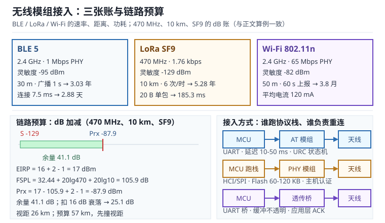

# 无线模组接入：BLE、LoRa 与 Wi-Fi 的三张账、链路预算与合规

无线接入的选型不是"哪个技术先进选哪个"，而是把三张账同时结清：**速率账**决定一次报告要占多少空口时间，**距离账**决定链路预算（Link Budget）够不够，**功耗账**决定电池能不能撑到产品寿命。三张账互相换算：速率越低，同样字节数的空口时间越长，功耗账越差；距离越远，自由空间路径损耗（Free Space Path Loss，FSPL）越大，要么加发射功率、要么降速率、要么加天线增益；而发射功率与占空比（Duty Cycle）又会被认证限值卡住。**把这三张账写成 dB、mA、ms，无线选型就从"感觉"变成了算术。**

本章以一个冷链温湿度节点为例：2000 mAh 的 AA 电池、每 10 分钟上报 20 字节、目标覆盖 10 km、设计寿命 5 年；同一块板还要用低功耗蓝牙（Bluetooth Low Energy，BLE）做近场配置，网关侧用无线局域网（Wireless Local Area Network，WLAN，产品上通常称 Wi-Fi）回传，主链路上行则用远距离扩频（Long Range，LoRa）。三种链路会分别给出代价：LoRa 在 470 MHz、SF9 下单包空口 185.3 ms，6 次每小时的电池侧平均电流 43.2 µA，寿命 5.28 年；BLE 若把连接间隔压到 7.5 ms，纽扣电池 2.9 天就会耗尽；Wi-Fi 每 60 秒上报一次只能撑 3.8 个月。所有数字都可以用纸笔和 Python 复算，读到后面可以对照[低功耗设计](../practice/low-power.md)、[UART 与 USART](uart.md) 和 [EMC 软件设计](../practice/emc-software.md)。

## 1 动机：三张账在立项时就得算清

::: motivation 三个现场
**现场一：BLE 连接间隔 7.5 ms，纽扣电池两天半见底。** 产品说明书写着"BLE 低功耗，CR2032 可用一年"。实测连接建立后平均电流 2.9 mA：每个连接事件发两个 251 字节的包，1M PHY 下单包空口 2096 µs，加 150 µs 帧间隔，一个事件 4342 µs；7.5 ms 的间隔里空口占 57.9%，5 mA 的峰值电流被摊成 2.895 mA。CR2032 的可用容量按 200 mAh 算，寿命只有 $200/2.895=69.1$ 小时，即 2.88 天。**"低功耗"是协议特性，不是产品属性；连接参数没算，低功耗就只是标签。**
**现场二：LoRa 按 SF7 估覆盖，现场要 SF12 才通，单包 1.32 s 超过 400 ms 驻留时间。** 售前用 SF7、125 kHz 带宽算得 56.58 ms 的空口时间，觉得 1% 占空比很宽裕；现场信噪比不够，自适应数据速率（Adaptive Data Rate，ADR）把扩频因子（Spreading Factor，SF）推到 12，同样 20 字节的空口时间变成 1318.91 ms，是 SF7 的 23.3 倍。欧洲 868 MHz 频段的单次驻留时间（Dwell Time）上限是 400 ms，SF12 的包直接超限；同时 1% 占空比下每小时最多 27.3 个包。**距离账和占空比账是同一张纸的两面。**
**现场三：Wi-Fi 透传模组显示"在线"，数据却丢了六个小时。** AT 透传只保证"主机 UART 到模组"这一段，模组到 AP、AP 到云端都没有端到端确认。模组 4 KB 的发送缓冲在 200 字节每 60 秒的速率下只能存 20 分钟；断网后模组静默重连，主机看到的还是"已注册"。恢复后旧数据被新数据覆盖，云端少了 6 小时。**透传把协议栈藏起来，也把失败藏起来了。**
:::

| 你看到的现象 | 先查什么 | 判据（工程经验值，非标准强制） |
|---|---|---|
| 连上后平均电流下不来 | 连接间隔、从机延迟、广播间隔 | 平均电流按 µA 级预算，不用峰值电流估寿命 |
| 标称距离差一半 | 链路预算、天线增益、线损、衰落余量 | 净余量不小于 10 dB，6 dB 对应距离减半 |
| 信号很强却丢包 | 占空比、共存、缓冲溢出、应用层无 ACK | 分组错误率小于 1%，缓冲水位低于 70% |
| 电池寿命只有标称的十分之一 | 唤醒占空比、DC-DC 效率、休眠漏电 | 休眠电流小于 5 µA，平均电流复算到 µA |
| 认证预扫描不过 | EIRP、功率谱密度、占空比、杂散 | 设计留 6 dB 余量，二次谐波低于 -40 dBc |
| 断网恢复时一片设备同时重连 | 退避算法、随机抖动、重连风暴 | 1000 台设备的 offered load 小于 1 |

**不算会摔在哪**，四个带数字的代价：

1. **链路预算差 6 dB，距离就差一倍。** 20 dB 的误差意味着 10 倍距离；把 10 km 写成 30 km，现场不是"信号弱一点"，而是根本收不到。
2. **功耗账差 384 倍。** 2.895 mA 与 7.54 µA 的差别，就是 2.88 天与 3.03 年；同一颗电池、同一颗芯片，只因为连接参数不同。
3. **空口时间算错，认证直接卡住。** SF12 的 1318.91 ms 超过 400 ms 驻留时间，不是"性能差一点"，而是产品不能在欧洲 868 MHz 频段合法销售。
4. **认证是设计输入，不是最后一道工序。** 换天线、换频段、换模组封装都可能触发重新测试；射频预扫描、整改、发证通常要 6 至 10 周，排到量产前才发现就是一次硬延期。

## 2 直观（原理图：从 MCU 引脚到空中的五段链路）

一条无线链路有五个换能环节：**主机接口 → 模组固件（协议栈或透传桥）→ 射频前端（功率放大器 Power Amplifier，PA；低噪声放大器 Low Noise Amplifier，LNA；滤波与匹配）→ 天线 → 自由空间 → 对端天线 → 对端射频前端 → 对端协议栈**。每一段都有自己的增益、损耗和延迟，而且后段的噪声会按前段的增益折算回输入端。工程上把这条链叫"链路预算"：所有项都用 dB 表示，最后只剩加减法。

图中上半部分把三种链路的典型工作点并排：BLE 5 在 2.4 GHz、1 Mbps PHY、30 m、广播 1 s 约 3 年；LoRa SF9 在 470 MHz、1.76 kbps、10 km、6 次每小时约 5.3 年；Wi-Fi 802.11n 在 2.4 GHz、65 Mbps PHY、50 m、60 秒上报约 3.8 个月。下半部分左侧是 470 MHz、10 km 的链路预算瀑布，右侧是三种接入方式里"谁跑协议栈"的分工。

### 2.1 原理图：AT 指令、主机协议栈与透传

三种接入方式的差别，本质是**协议栈放在哪、认证责任归谁、主机还能控制多细**。

| 接入方式 | 谁跑协议栈 | 主机接口 | 典型形态 | 优点 | 代价 |
|---|---|---|---|---|---|
| AT 指令（AT Command） | 模组 | UART | ESP32-AT、蜂窝 Cat.1 模组、LoRa 透传模组 | 主机简单、模组自带认证、上市快 | 命令往返 10 至 50 ms、非请求响应（Unsolicited Result Code，URC）要状态机、吞吐受 UART 限制 |
| 主机协议栈（Host Stack） | 主机 MCU | SPI、SDIO、UART HCI | nRF52 加 NimBLE、SX1262 加 LoRaMac-node | 连接参数、重连、吞吐都可控 | Flash 与 RAM 开销、射频时序要自己保证、认证责任转到主机 |
| 透传（Transparent Transmission） | 模组 | UART | 各类 UART Wi-Fi 透传、LoRa 点对点透传 | 最快出原型、不用懂协议 | 无端到端语义、缓冲与重连不透明、必须自己加应用层 ACK |

BLE 的分层最清楚：**控制器**（Link Layer，链路层）在模组里，负责广播、连接事件、加密；**主机**（Host）在 MCU 里，负责通用访问配置文件（Generic Access Profile，GAP）、通用属性配置文件（Generic Attribute Profile，GATT）和安全管理器（Security Manager，SM）；两层之间用主机控制器接口（Host Controller Interface，HCI）通信。LoRa 更"瘦"：SX1262 只是物理层（PHY），LoRaWAN 的介质访问控制（Medium Access Control，MAC）在 MCU 上，SPI 直接读写寄存器与 FIFO。Wi-Fi 通常把 supplicant、TCP/IP 甚至 TLS 都放在模组里，主机只看到 AT 或透传；一旦把协议栈搬到主机，就要自己承担 lwIP、密钥存储和重连。

**选择依据不是"哪个简单"，而是三条硬约束**：主机 Flash/RAM 够不够、端到端延迟能不能接受、认证责任由谁承担。电池节点用 AT 或透传可以省电省开发，但必须接受"模组说了算"；BLE 外设要做细粒度连接参数控制，通常选主机协议栈；Wi-Fi 网关要吞吐，选主机协议栈或 SDIO 模组。

### 2.2 静态分析：三张账的静态工作点

"静态工作点"指室温、3.3 V、天线匹配良好、无干扰时的标称值。表中的接收灵敏度（Receiver Sensitivity）指满足规定误包率所需的最小接收功率；RSSI（Received Signal Strength Indicator，接收信号强度指示）则是接收机读出的信号强度估计，两者不是一回事。先把三种链路的典型值放在一张表里，后面所有动态分析都从这张表出发。

| 指标 | BLE 5 | LoRa SF9 | Wi-Fi 802.11n |
|---|---|---|---|
| 频段 | 2.4 GHz | 470 MHz（国内）或 868 MHz（欧洲） | 2.4 GHz |
| PHY 速率 | 1 Mbps | 1.758 kbps | 65 Mbps（MCS7，20 MHz） |
| 接收灵敏度 | -95 dBm（1M PHY） | -129 dBm（SF9，125 kHz） | -82 dBm（MCS0） |
| 发射电流 | 5 mA 量级（0 dBm） | 100 mA（16 dBm） | 120 mA 平均（含接收） |
| 典型距离 | 30 m | 10 km | 50 m |
| 电池寿命 | 3.03 年（CR2032，广播 1 s） | 5.28 年（2000 mAh，6 次每小时） | 3.8 个月（2000 mAh，60 秒上报） |
| 每比特能量 | 16.7 nJ（连接态） | 390.8 µJ | 74.3 µJ |

这张表里最容易被误读的是"速率"和"距离"。BLE 的 1 Mbps 是 PHY 速率，不是应用吞吐；100 ms 连接间隔、每事件两个 244 字节的有效载荷，应用吞吐只有 39.04 kbps。LoRa 的 1.758 kbps 也是 PHY 速率，20 字节的包在 SF9 下要占 185.34 ms，6 次每小时的业务吞吐只有 0.267 bps。Wi-Fi 的 65 Mbps 更只是调制速率，MCU 通过 SPI 挂模组时往往只能跑到 5 至 10 Mbps。

**距离账的静态值来自链路预算。** 470 MHz、10 km、16 dBm 发射、2 dBi 天线、1 dB 线损、-129 dBm 灵敏度，链路余量 41.12 dB；2.4 GHz、30 m、8 dBm 发射、-3 dBi PCB 天线、-95 dBm 灵敏度，余量 26.41 dB。两个数字看起来都很大，但前者要扣 16 dB 的衰落、极化和人体损耗，后者也要扣同样的 16 dB；扣完只剩 25.12 dB 与 10.41 dB。**静态余量是"最好情况"，动态余量才是现场。**

### 2.3 动态分析：一次连接、一次上行、一次重连的时间轴

**BLE 连接事件。** 主从双方在连接间隔的锚点（Anchor Point）醒来，主机发一个包，从机在 150 µs 的帧间隔（Inter Frame Space，IFS）后回一个包。1M PHY、251 字节协议数据单元（Protocol Data Unit，PDU）的空口时间是 2096 µs；两个包加一个 IFS 是 4342 µs。若间隔 7.5 ms，事件占 57.9%；若间隔 100 ms，事件占 4.34%。若把间隔放到 100 ms、每事件一包、从机延迟（Slave Latency）设为 4，从机每 5 个间隔才醒一次，平均电流从 2.895 mA 降到 22.96 µA，代价是下行延迟从 7.5 ms 变成 500 ms。

**LoRa 上行。** 以 SF9、125 kHz、20 字节、编码率 4/5 为例：符号时间 4.096 ms，前导 8 个符号，载荷 33 个符号，总空口 185.34 ms。发送结束后，Class A 设备在 1 s 后打开接收窗口 1（RX1），2 s 后打开接收窗口 2（RX2），每个窗口几十毫秒。射频真正工作的时间约 249 ms，其余时间睡眠。平均电流就是把这段面积除以 600 s 的报告周期。

**Wi-Fi 上报。** 已关联的 station 每 100 ms 收到一个信标（Beacon），按交付流量指示消息（Delivery Traffic Indication Message，DTIM）周期醒来收组播；一次上报要经历唤醒、射频校准、信道竞争、TCP 或 TLS 发送、等待 ACK。冷启动重连还要扫描信道（每信道 100 至 300 ms）、关联（1 至 3 s）、DHCP（1 至 3 s）、TLS 握手（Cortex-M 上 2 至 5 s）。**Wi-Fi 的功耗账里，连接维持成本往往比发送本身大。**

### 2.4 环路：重连退避环、占空比环与共存环

无线接入里有三条真正的闭环，理解它们比记住 AT 指令表更有用。

**重连退避环。** 连接失败 → 等待 → 重试 → 再失败。环的"增益"是重试的同步程度：如果所有设备都按固定 5 s 重试，1000 台设备会在同一秒内制造 1000 次尝试，信道瞬间过载，失败率更高，形成正反馈。稳定条件是"退避时间有随机抖动、且总 offered load 小于 1"。工程上用指数退避加全抖动（Full Jitter）：第 $k$ 次等待在 $0$ 到 $w_k$ 之间均匀取值，期望等待是 $w_k/2$。

**占空比环。** 空口时间 → 法规预算 → 下一个包能否发。LoRa 在 868 MHz 的 1% 占空比意味着每小时最多 36 s 空口；SF9 的 185.34 ms 包每小时最多 194 个，SF12 的 1318.91 ms 包每小时最多 27 个。若业务量超过预算，队列会变长，延迟上升；ADR 通过降低 SF 来缩短空口，但降低 SF 又要求更好的信噪比，形成"距离与占空比"的负反馈。环的稳定条件是"平均空口需求小于预算的 70%"，留 30% 给重传和信标。

**共存环。** 2.4 GHz 上 Wi-Fi、BLE、微波炉共享频谱；干扰升高 → 分组错误率（Packet Error Rate，PER）升高 → 重传增多 → 空口更拥挤。BLE 用自适应跳频（Adaptive Frequency Hopping，AFH）把坏信道标记掉，Wi-Fi 与 BLE 同板时用包通信仲裁（Packet Traffic Arbitration，PTA）分时。环的稳定条件是"隔离度加时间分片足以把对端接收机处的干扰压到灵敏度以下"；同板 BLE 发射 10 dBm、Wi-Fi 接收灵敏度 -85 dBm，需要 95 dB 隔离，PCB 上通常只有 20 至 30 dB，所以只能靠分时。

## 3 定量（取值与权衡：链路预算、速率、功耗与退避）

### 3.1 链路预算：dB 加减法

接收功率与链路余量写成：

$$
P_{rx}=P_{tx}+G_{tx}-L_{tx}-L_{fs}+G_{rx}-L_{rx}
$$

$$
M=P_{rx}-S_{rx}
$$

其中 $P_{tx}$ 是发射功率（dBm），$G_{tx}$、$G_{rx}$ 是收发天线增益（dBi），$L_{tx}$、$L_{rx}$ 是馈线与匹配损耗（dB），$L_{fs}$ 是自由空间路径损耗（dB），$S_{rx}$ 是接收灵敏度（dBm），$M$ 是链路余量（dB）。把发射功率与天线增益合并，得到等效全向辐射功率（Equivalent Isotropically Radiated Power，EIRP）：

$$
EIRP=P_{tx}+G_{tx}-L_{tx}
$$

灵敏度的单位是负 dBm，所以"减灵敏度"等价于加它的绝对值；下面的余量一律按 $M=P_{rx}-S_{rx}$ 算。自由空间路径损耗用工程式：

$$
L_{fs}=32.44+20\lg f_{MHz}+20\lg d_{km}
$$

$f_{MHz}$ 是频率（MHz），$d_{km}$ 是距离（km）。这个式子的常数 32.44 已经把光速、$4\pi$ 和单位换算吸收进去，所以频率用 MHz、距离用 km，结果直接是 dB。

把 470 MHz、10 km 代入：$L_{fs}=32.44+20\lg470+20\lg10=32.44+53.44+20=105.88\ \text{dB}$。把 2.4 GHz、30 m 代入：$L_{fs}=32.44+20\lg2402+20\lg0.03=32.44+67.61-30.46=69.59\ \text{dB}$。

| 链路 | 发射 | 天线 | 线损 | FSPL | 接收功率 | 灵敏度 | 余量 |
|---|---|---|---|---|---|---|---|
| LoRa 470 MHz、10 km | 16 dBm | +2 dBi 发、+2 dBi 收 | 1 dB 各端 | 105.88 dB | -87.88 dBm | -129 dBm | 41.12 dB |
| BLE 2.4 GHz、30 m | 8 dBm | -3 dBi 发、-3 dBi 收 | 0.5 dB 各端 | 69.59 dB | -68.59 dBm | -95 dBm | 26.41 dB |
| Wi-Fi 2.4 GHz、50 m | 18 dBm | +2 dBi 发、0 dBi 收 | 1 dB 发、0.5 dB 收 | 74.16 dB | -55.66 dBm | -82 dBm | 26.34 dB |

**余量要扣实现损耗。** 衰落、极化失配、人体遮挡、天线失谐，工程上通常合计 16 dB：室内衰落 10 dB、极化 3 dB、人体 3 dB。扣完后 LoRa 在 10 km 仍有 25.12 dB，BLE 在 30 m 只剩 10.41 dB，Wi-Fi 在 50 m 只剩 6.34 dB。若要求净余量不小于 10 dB，BLE 的可靠距离约 30 m，Wi-Fi 约 30 至 50 m。

由链路预算反算最大距离时，先把允许的路径损耗写成：

$$
L_{allow}=P_{tx}+G_{tx}-L_{tx}+G_{rx}-L_{rx}-S_{rx}-M_{req}-L_{imp}
$$

其中 $M_{req}$ 是要求的净余量（dB），$L_{imp}$ 是实现损耗（dB）。对 LoRa 取 $M_{req}=10\ \text{dB}$、$L_{imp}=16\ \text{dB}$，得 $L_{allow}=121\ \text{dB}$，反算 $d=57.0\ \text{km}$。但 470 MHz、天线高度 10 m 的视距（Line of Sight，LOS）只有 $d_h=4.12(\sqrt{h_1}+\sqrt{h_2})=26.06\ \text{km}$，所以**预算是 57 km、视距先到 26 km**；链路预算不是覆盖承诺，地形、菲涅尔区和地球曲率会先截断。

### 3.2 速率：PHY 速率、空口时间与应用吞吐

BLE 的应用吞吐近似为：

$$
R_{ble}=\frac{N_{pkt}(MTU-3)}{T_{conn}}
$$

$N_{pkt}$ 是每个连接事件的包数，$MTU$ 是最大传输单元（Maximum Transmission Unit，MTU，字节），减 3 是 ATT 头开销，$T_{conn}$ 是连接间隔（s）。MTU 247、每事件 2 包、间隔 100 ms 时，$R_{ble}=2\times244/0.1=4880\ \text{B/s}=39.04\ \text{kbps}$；间隔 7.5 ms 时是 65.07 kB/s，即 520.53 kbps。单包空口时间按 1M PHY 算是：

$$
T_{pkt}=\frac{8(1+4+2+1+PL+3)}{R_{phy}}
$$

$PL$ 是 PDU 有效载荷（字节），1 是前导、4 是接入地址、2 是头、1 是长度、3 是 CRC。251 字节时 $T_{pkt}=2096\ \mu\text{s}$；两个包加 150 µs 帧间隔是 4342 µs。

LoRa 的 PHY 速率与空口时间分别为：

$$
R_{b}=\frac{SF\cdot BW}{2^{SF}}\cdot\frac{4}{4+CR}
$$

$$
T_{sym}=\frac{2^{SF}}{BW},\qquad
n_{payload}=8+\max\left(\left\lceil\frac{8PL-4SF+28+16CRC-20IH}{4(SF-2DE)}\right\rceil(CR+4),0\right)
$$

$$
T_{air}=T_{sym}(n_{pre}+4.25+n_{payload})
$$

$BW$ 是带宽（Hz），$CR$ 取 1 至 4 对应 4/5 至 4/8 编码率，$n_{pre}$ 是前导符号数，$CRC$ 与 $IH$ 是显式/隐式头标志，$DE$ 是低数据速率优化标志。SF9、125 kHz、20 字节、CR 4/5 时：符号时间 4.096 ms，载荷 33 个符号，空口 185.34 ms，PHY 速率 1757.81 bps。SF7 是 56.58 ms、5468.75 bps；SF12 是 1318.91 ms、292.97 bps。SF7 到 SF12，速率降 18.67 倍，空口时间涨 23.31 倍。

| 业务 | 空口时间 | 应用吞吐 | 说明 |
|---|---|---|---|
| BLE，MTU 247，2 包每 100 ms | 4.342 ms 每事件 | 39.04 kbps | 连接态，事件占空比 4.34% |
| BLE，MTU 247，2 包每 7.5 ms | 4.342 ms 每事件 | 520.53 kbps | 事件占空比 57.9%，电池很快耗尽 |
| LoRa SF9，20 字节，6 次每小时 | 185.34 ms 每包 | 0.267 bps | 1% 占空比下最多 194 包每小时 |
| Wi-Fi，200 字节每 60 s | 约 300 ms 每次 | 26.67 bps | PHY 65 Mbps，业务量只有 26.7 bps |

**速率账的结论是"别拿 PHY 速率当业务吞吐"**：BLE 的 1 Mbps 在 100 ms 间隔下只剩 39 kbps，LoRa 的 1.758 kbps 在 20 字节包下只剩 0.267 bps，Wi-Fi 的 65 Mbps 对 200 字节每 60 秒的业务完全过剩。选型时要算的是"每个报告周期占多少空口"，不是"峰值能跑多少"。

### 3.3 功耗：电池寿命 = 容量除以平均电流

电池寿命的基本式子是：

$$
I_{avg}=I_{sleep}(1-D)+\sum_i I_i D_i,\qquad
T_{life}=\frac{C\eta}{I_{avg}}
$$

$I_{sleep}$ 是休眠电流（A），$D$ 是射频与 MCU 的工作占空比，$I_i$ 是第 $i$ 个活动状态的电流（A），$D_i=t_i/T_{report}$ 是对应占空比，$C$ 是电池容量（Ah），$\eta$ 是 DC-DC 与电池可用容量的综合效率，$T_{life}$ 是寿命（h）。**分母必须是平均电流，不是峰值电流；分子必须扣掉 DC-DC 效率和自放电。**

LoRa 节点的电流预算如下（2000 mAh、6 次每小时、SF9）：

| 状态 | 电流 | 每次时间 | 每次电荷 |
|---|---|---|---|
| 休眠 | 2 µA | 600 s | 1.2 mC |
| MCU 唤醒与传感 | 3 mA | 20 ms | 0.06 mC |
| 传感器 | 1 mA | 5 ms | 0.005 mC |
| 发射 16 dBm | 100 mA | 185.34 ms | 18.534 mC |
| 接收 RX1 与 RX2 | 35 mA | 64 ms | 2.24 mC |
| 合计 | — | — | 20.839 mC 每次，加休眠 1.2 mC |

每 600 s 的总电荷是 22.039 mC，平均电流 $22.039\ \text{mC}/600\ \text{s}=36.73\ \mu\text{A}$；除以 0.85 的 DC-DC 效率，电池侧平均电流 43.21 µA；$2000\ \text{mAh}/0.04321\ \text{mA}=46281\ \text{h}=5.28$ 年。再按每年 2% 自放电修正，寿命约 4.80 年。若把 SF 换成 12，单包空口 1318.91 ms，发射电荷 131.891 mC，电池侧平均电流 265.48 µA，寿命掉到 0.86 年。接收一栏按模块加 MCU 唤醒的 35 mA 保守计；SX1262 裸芯片的接收电流约 5 mA 量级，差值是 TCXO、LNA 与主机唤醒。

BLE 与 Wi-Fi 的对比更极端。CR2032 按 200 mAh 可用容量算：广播间隔 1 s、每个广播事件 1308 µs、峰值 5 mA、加 1 µA 休眠，平均 7.54 µA，寿命 3.03 年；连接间隔 7.5 ms、每事件两包，平均 2.897 mA，寿命 2.88 天；连接间隔 100 ms、从机延迟 4、每事件一包，平均 22.96 µA，寿命 0.99 年。Wi-Fi 2000 mAh、每次上报 300 ms、平均 120 mA、休眠 10 µA：60 秒周期下平均 0.61 mA，除 0.85 后 0.7176 mA，寿命 2786.9 小时，即 3.8 个月；600 秒周期下平均 0.07 mA，寿命 2.77 年。

| 链路 | 每次报告能量 | 说明 |
|---|---|---|
| BLE 20 字节单包 | 3.7 µJ | 248 µs、5 mA、3 V，不含连接维持 |
| LoRa SF9 20 字节 | 62.5 mJ | 20.839 mC、3 V |
| Wi-Fi 200 字节 | 118.8 mJ | 36 mC、3.3 V，含连接维持的均摊 |

**每比特能量 LoRa 最贵，但每次报告能量才是电池寿命的分子。** LoRa 的 390.8 µJ/bit 比 BLE 的 16.7 nJ/bit 高约四个数量级，可它每小时只发 6 次；BLE 每比特便宜，却要按连接间隔持续醒来。选型要比"每次报告的能量 × 每天报告次数"，不是"每比特能量"。

### 3.4 取值与权衡

| 参数 | 调大时 | 代价 | 本例取值与理由 |
|---|---|---|---|
| 发射功率 | 链路余量变大、距离变远 | 电流变大、EIRP 可能超限 | 16 dBm，加 2 dBi 天线与 1 dB 线损后 EIRP 17 dBm，正好压在 50 mW 限值上 |
| 天线增益 | EIRP 变大、接收也变好 | 尺寸变大、带宽变窄 | 470 MHz 用 2 dBi 弹簧天线；2.4 GHz PCB 天线约 -3 dBi |
| 扩频因子 SF | 灵敏度变好、距离变远 | 空口时间指数上升 | SF9，20 字节 185.34 ms，低于 400 ms 驻留时间 |
| 带宽 BW | 速率变高、空口变短 | 灵敏度变差、抗噪变弱 | 125 kHz，兼顾灵敏度与占空比 |
| 连接间隔 | 平均电流变小 | 下行延迟变大、吞吐下降 | 100 ms 加从机延迟 4，平均 22.96 µA |
| 从机延迟 | 平均电流变小 | 下行响应变慢 | 4，事件每 500 ms 一次 |
| MTU | 吞吐变高 | RAM 与分包复杂度上升 | 247，单包 244 字节有效载荷 |
| 退避上限 | 重连风暴变小 | 故障恢复变慢 | 单机 60 s，整批设备再加 0 至 300 s 随机初延迟 |
| 接入方式 | AT 最简单、主机栈最可控 | 延迟、Flash、认证责任不同 | 电池节点用 AT 或透传；BLE 外设用主机栈；网关用主机栈 |

**取值不是找"最优"，是找"满足约束的最小代价"。** 先定认证限值（EIRP、占空比），再定灵敏度与空口时间（SF、BW），最后用连接参数和退避把平均电流压到预算内；顺序反过来，通常会在认证或电池寿命上返工。

### 3.5 重连退避：指数、上限与抖动

第 $k$ 次重试的等待时间写成：

$$
w_k=\min(w_{max},w_0 2^{k-1}),\qquad t_k=w_k u_k,\qquad u_k\sim U(0,1)
$$

$w_0$ 是初始等待（s），$w_{max}$ 是上限（s），$u_k$ 是 0 到 1 的均匀随机数。全抖动（Full Jitter）下第 $k$ 次的期望等待是 $w_k/2$。取 $w_0=1\ \text{s}$、$w_{max}=60\ \text{s}$、8 次尝试：

| 次数 | 1 | 2 | 3 | 4 | 5 | 6 | 7 | 8 |
|---|---|---|---|---|---|---|---|---|
| $w_k$（s） | 1 | 2 | 4 | 8 | 16 | 32 | 60 | 60 |
| 期望等待（s） | 0.5 | 1 | 2 | 4 | 8 | 16 | 30 | 30 |
| 示例抖动（s） | 0.8 | 1.6 | 3.2 | 6.4 | 12.8 | 25.6 | 48 | 60 |

名义等待之和 183 s，期望等待之和 91.5 s，示例抖动之和 158.4 s；每次连接尝试再算 10 s 超时，最坏总时长 263 s，期望 171.5 s。**抖动不是"锦上添花"，它是把同步重连的正反馈打断的关键手段。**

BLE 的监督超时（Supervision Timeout）还有一条不等式：监督超时必须大于 $(1+\text{Slave Latency})\times T_{conn}\times2$。100 ms 间隔、延迟 4 时下限是 1 s，工程上取 2 s，给两次丢包留余量。LoRaWAN 的接收窗口固定在 1 s 与 2 s（RECEIVE_DELAY1 与 RECEIVE_DELAY2），join accept 在 5 s 与 6 s；窗口错过只影响下行，不影响已经发出的上行，但会影响 MAC 命令与 ADR。Wi-Fi 的重连要按"扫描 + 关联 + DHCP + TLS"四段预算，冷启动 10 s 量级；MQTT 的 keepalive 60 s 只能检测半开连接，不能替代应用层 ACK。

## 4 算例：冷链节点从需求到 5 年电池

### 4.1 需求与三张账的初算

需求：2000 mAh 的 AA 电池、每 10 分钟上报 20 字节温湿度、覆盖 10 km、寿命 5 年、工作温度 -20 至 60 °C、50 台设备一个片区、整批 1000 台。三种方案的初算如下：

| 方案 | 速率账 | 距离账 | 功耗账 | 结论 |
|---|---|---|---|---|
| BLE 5 | 39.04 kbps（100 ms 间隔） | 30 m（净余量 10.41 dB） | 3.03 年（广播 1 s） | 距离不够，只做近场配置 |
| LoRa SF9 | 0.267 bps（6 次每小时） | 10 km（净余量 25.12 dB） | 5.28 年，含自放电 4.80 年 | 选为主链路 |
| Wi-Fi 802.11n | 26.67 bps（200 字节每 60 s） | 50 m（净余量 6.34 dB） | 3.8 个月（60 s 上报） | 距离与功耗都不够，只做网关回传 |

**选型结论**：LoRa SF9 做 10 km 上行，BLE 广播做近场配置，Wi-Fi 只放在市电供电的网关侧。下面按 LoRa 方案走完整算例。

### 4.2 链路预算：10 km 的余量从哪里来

470 MHz、16 dBm 发射、2 dBi 天线、1 dB 线损，EIRP 为 $16+2-1=17\ \text{dBm}$。10 km 处 FSPL 105.88 dB，接收功率 $17-105.88+2-1=-87.88\ \text{dBm}$，对 -129 dBm 灵敏度的余量是 41.12 dB。扣 16 dB 实现损耗后净余量 25.12 dB。

| 距离 | FSPL | 接收功率 | 余量 | 扣 16 dB 后 |
|---|---|---|---|---|
| 1 km | 85.88 dB | -67.88 dBm | 61.12 dB | 45.12 dB |
| 5 km | 99.86 dB | -81.86 dBm | 47.14 dB | 31.14 dB |
| 10 km | 105.88 dB | -87.88 dBm | 41.12 dB | 25.12 dB |
| 26.06 km（10 m 视距） | 114.20 dB | -96.20 dBm | 32.80 dB | 16.80 dB |

按净余量 10 dB 反算，最大距离 57.0 km；但 10 m 天线高度的视距只有 26.06 km，30 m 塔配 10 m 节点是 35.59 km。**10 km 的净余量 25.12 dB 很宽裕，宽裕的部分应该拿去换更低功耗或更低 SF，而不是写进"覆盖 50 km"的宣传页。**

### 4.3 速率与空口时间：为什么选 SF9 而不是 SF7

| SF | PHY 速率 | 20 字节空口 | 1% 占空比每小时最多包数 | 400 ms 驻留 |
|---|---|---|---|---|
| 7 | 5468.75 bps | 56.58 ms | 636.3 | 通过 |
| 9 | 1757.81 bps | 185.34 ms | 194.2 | 通过 |
| 12 | 292.97 bps | 1318.91 ms | 27.3 | 不通过 |

SF7 的空口最短，但灵敏度最差；SF12 的灵敏度最好，但 1.319 s 超过 400 ms 驻留时间，且 1% 占空比下每小时只能发 27 个包。SF9 在 10 km 的净余量 25.12 dB，空口 185.34 ms 既满足驻留时间，又给重传留了占空比余量。业务占空比是 $6\times185.34/3600=0.0309\%$，只用了 1% 预算的 3.09%，剩下 96.9% 可以给重传、join 和 MAC 命令。

### 4.4 功耗与电池寿命：43.2 µA 怎么来的

按 3.3 节的电流预算，每次报告的电荷是 20.839 mC，加 600 s 休眠的 1.2 mC，总共 22.039 mC；平均电流 36.73 µA。DC-DC 效率 85%，电池侧 43.21 µA；2000 mAh 除以 43.21 µA 得 46281 小时，即 5.28 年；每年 2% 自放电修正后 4.80 年。

| 项目 | 数值 | 折算 |
|---|---|---|
| 每次报告电荷 | 20.839 mC | 发射 18.534 mC，接收 2.24 mC，MCU 与传感器 0.065 mC |
| 休眠电荷（600 s） | 1.2 mC | 2 µA × 600 s |
| 平均电流 | 36.73 µA | 22.039 mC / 600 s |
| 电池侧平均电流 | 43.21 µA | 除以 0.85 |
| 寿命 | 46281 h | 5.28 年 |
| 含 2%/年自放电 | 4.80 年 | 约 96% 目标；DC-DC 效率 90% 时 5.05 年 |

4.80 年与 5 年差 4%，这不是算错，而是 2%/年自放电的代价；把 DC-DC 效率从 85% 提到 90%，或把电池从 2000 mAh 换成 2100 mAh，都能把寿命推过 5 年。若把上报周期改成 60 秒，平均电流约 349 µA，电池侧 411 µA，寿命 0.56 年；若把 SF 改成 12，寿命 0.86 年。**5 年目标不是靠"低功耗模式"实现的，是靠 600 s 的占空比和 185.34 ms 的空口时间共同实现的；最后 4% 的差距则要靠 DC-DC 效率或电池容量补。**

### 4.5 重连退避：从单机到 1000 台设备

单机按 3.5 节的序列，8 次尝试的期望等待 171.5 s（含每次 10 s 超时），最坏 263 s。对 1000 台设备，如果都按固定 5 s 重试，1 秒内产生 1000 次尝试，每次占信道 200 ms，offered load 是 200 Erlang，必然拥塞；把初延迟随机铺到 0 至 300 s，平均 3.33 次每秒，offered load 0.667 Erlang，低于 1，系统能恢复。

| 策略 | 首次重试分布 | 1000 台设备的 offered load | 结果 |
|---|---|---|---|
| 固定 5 s | 全部在 5 s | 200 Erlang | 重连风暴，越重连越失败 |
| 指数退避、无抖动 | 1、2、4、8 s 分层 | 仍可能同步 | 分层内碰撞 |
| 指数退避加全抖动 | 0 至 $w_k$ 均匀 | 小于 1 | 可控恢复 |
| 整批随机初延迟 0 至 300 s | 均匀 | 0.667 Erlang | 推荐用于整批上电 |

### 4.6 仿真与实验：六步验证

1. **传导测试。** 用频谱仪测模组天线口：16 dBm ±1 dB，二次谐波 940 MHz 低于 -40 dBc，EIRP 17 dBm。若谐波只有 -25 dBc，先改匹配与低通，不要急着送认证。
2. **距离与 RSSI。** 1 km 处 RSSI 应在 -67.9 dBm ±6 dB，10 km 处 -87.9 dBm ±6 dB；若 10 km 处好于 -80 dBm，先怀疑天线增益标称值或视距条件。
3. **空口时间。** 用 GPIO 在发射前后翻转，示波器读 SF9 应 185.3 ms ±2 ms，SF12 应 1318.9 ms ±10 ms；与 3.2 节公式对不上，先查前导长度、CRC 和编码率。
4. **电流剖面。** 10 Ω 采样电阻加示波器，测休眠 2 µA、发射 100 mA、平均 43.2 µA；用库仑计积分 1 小时，结果应与 0.0367 mAh 吻合。
5. **共存测试。** 同板 Wi-Fi 跑 20 Mbps 下行，BLE 连接态测 PER；无 PTA 时 PER 可超过 10%，加 PTA 与 AFH 后应低于 1%。Wi-Fi 关闭时 PER 应低于 0.1%。
6. **预认证扫描。** 按 EN 300 220 与 SRRC 的限值预扫 EIRP、功率谱密度、占用带宽、杂散与占空比；设计留 6 dB 余量，正式测试通常 6 至 10 周。

## 5 工程含义：软件边界、共存与合规

### 5.1 接入方式与主机协议栈的软件边界

**AT 指令不是"发字符串"那么简单。** 一个可靠的 AT 层要有四个状态：空闲、命令发送、响应等待、URC 处理；要有行缓冲（至少 256 字节）、超时（100 ms 量级）、重试（3 次）和错误码映射。115200 Bd、8N1 下每字节 86.8 µs，1 kB（1000 字节）数据要 86.8 ms 才能送完；模组若只有 256 字节缓冲，22.2 ms 就溢出，必须开 RTS/CTS 或降低突发长度。URC 可能插在命令响应中间，解析器不能假设"发完命令马上回 OK"。

**主机协议栈要算资源。** BLE 主机栈（NimBLE 量级）通常占 60 至 120 KB Flash、10 至 30 KB RAM；lwIP 加 TCP 占 40 至 60 KB Flash、10 至 20 KB RAM，再加 TLS 要 30 至 60 KB Flash、20 至 40 KB RAM；LoRaMac-node 约 30 至 50 KB Flash、8 至 15 KB RAM。选型时先把这些数字从 MCU 的 Flash/RAM 里扣掉，再谈应用逻辑。

**HCI 与 SPI 的流控是吞吐的隐藏瓶颈。** BLE 主机每发一个 ACL 包要等控制器返还"已完成包数"（Number of Completed Packets）；主机不及时补，吞吐会停在某个平台上。SX1262 用 SPI 加 DIO1 中断，收发切换、FIFO 读写和 TCXO 使能都有时序要求；用 DMA 时要注意 CS 保持和时钟极性。

### 5.2 连接参数与重连策略

BLE 的连接参数是一组不等式：连接间隔 7.5 ms 至 4 s，从机延迟 0 至 499，监督超时 100 ms 至 32 s，且监督超时大于 $(1+\text{Slave Latency})\times T_{conn}\times2$。广播间隔 20 ms 至 10.24 s。间隔越大越省电，但下行延迟越大；延迟越大越省电，但主机下发命令的等待越久。**先定下行延迟上限，再定间隔与延迟，最后用监督超时兜底。**

LoRaWAN Class A 的接收窗口是固定的：上行结束后 1 s 开 RX1，2 s 开 RX2；join accept 在 5 s 与 6 s。终端不能"随时收"，服务器也不能"随时下发"；所有下行都要排到窗口里。ADR 会根据上行链路质量调整 SF，但 SF 变化会改变空口时间与占空比，必须和业务队列一起算。

Wi-Fi 的重连要按四段预算：扫描（每信道 100 至 300 ms）、关联（1 至 3 s）、DHCP（1 至 3 s）、TLS（2 至 5 s）。连接参数里的 DTIM 周期决定休眠 station 多久醒一次；keepalive 60 s 只能发现半开连接，应用层还要有序列号、去重和幂等。**重连策略的目标不是"尽快连上"，而是"在恢复服务的同时不打垮网络"。**

### 5.3 2.4 GHz 共存与干扰

2.4 GHz 频段从 2400 到 2483.5 MHz，共 83.5 MHz。Wi-Fi 的 20 MHz 信道在 2.4 GHz 上只有 1、6、11 三个互不重叠；三个信道合起来 60 MHz，占整个频段的 71.9%。BLE 的 37 个数据信道从 2404 到 2476 MHz、间隔 2 MHz；三个广播信道固定在 2402、2426、2480 MHz。Wi-Fi 信道 1 的中心是 2412 MHz，信道 6 是 2437 MHz，信道 11 是 2462 MHz；BLE 广播信道 37 落在 Wi-Fi 信道 1 的下沿，38 紧贴信道 6 的下沿，39 在信道 11 之上。**BLE 的广播躲不开 Wi-Fi，数据信道也只能躲开一部分。**

AFH 能把被 Wi-Fi 占用的信道标坏，但协议要求至少保留 20 个可用信道；三个 Wi-Fi 信道全忙时，BLE 很难凑够 20 个"干净"信道，只能与 Wi-Fi 共用一部分频谱，靠重传和 PTA 分时。同板 coexistence 的隔离度算例：BLE 发射 10 dBm，Wi-Fi 接收灵敏度 -85 dBm，要让泄漏低于灵敏度需要 95 dB 隔离；PCB 天线之间通常只有 20 至 30 dB，所以必须用 PTA 在时间上错开，或者把 Wi-Fi 与 BLE 分板放置。

470 MHz 的干扰是另一类。470 MHz 的二次谐波是 940 MHz，正好落在 GSM-900 下行频段 925 至 960 MHz 内；三次谐波 1410 MHz、四次谐波 1880 MHz 也靠近蜂窝频段。若功放输出 16 dBm、二次谐波 -30 dBc，谐波功率 -14 dBm；低通只给 20 dB 抑制时还有 -34 dBm，足以在近距离抬升基站接收底噪。**sub-GHz 的认证杂散测试经常卡在二次谐波，匹配网络里要预留低通位置。**

天线尺寸也影响共存与效率。2.4 GHz 的波长约 124.8 mm，四分之一波长 31.2 mm，PCB 天线可以放进 10 mm × 30 mm 的净空；470 MHz 的波长约 637.9 mm，四分之一波长 159.5 mm，只能用弹簧天线或螺旋天线，效率通常比 2.4 GHz PCB 天线低 2 至 5 dB。**频段越低，链路预算越好，但天线越大、带宽越窄、机械与效率的代价越高。**

### 5.4 认证与射频合规：CE、FCC 与 SRRC

CE（Conformité Européenne，欧盟合格评定）、FCC（Federal Communications Commission，美国联邦通信委员会）与 SRRC（中国无线电型号核准）是三套最常见的市场准入；表里的 ERP（Effective Radiated Power，有效辐射功率）与 EIRP 相差 2.15 dB，因为前者以半波偶极子、后者以全向天线为参考。

| 体系 | 适用法规 | 2.4 GHz 限值 | sub-GHz 限值 | 关键测试项 |
|---|---|---|---|---|
| CE（欧盟） | 无线电设备指令 2014/53/EU（RED），EN 300 328、EN 300 220、EN 301 489 | EIRP 20 dBm、功率谱密度 10 dBm/MHz | 868 MHz 典型 14 dBm ERP、1% 占空比 | EIRP、PSD、占用带宽、杂散、频率误差、自适应/占空比 |
| FCC（美国） | 47 CFR Part 15.247、15.249、15.212 | 30 dBm 传导、6 dBi 天线；超过 6 dBi 要等量降功率 | 902 至 928 MHz 按 15.247 或 15.249 | 传导功率、PSD、6 dB 带宽、杂散、模块认证条件 |
| SRRC（中国） | 无线电发射设备型号核准；工信部无〔2019〕52 号 | 100 mW EIRP 量级 | 470 至 510 MHz 微功率设备常见 50 mW EIRP 量级 | EIRP、占用带宽、杂散、频率容限、占空比 |

表里的数字是"常见限值"，具体以现行法规、频段和天线为准。**认证是设计输入**：先选频段与天线，再选模组，最后画板；反过来做，天线一换、屏蔽一改，FCC 模块认证与 CE 的符合性声明（Declaration of Conformity，DoC）都可能失效。

模块认证不等于整机认证。FCC 的模块认证（Modular Approval）有天线、屏蔽、供电等条件；CE 的模块测试报告也不能自动覆盖整机 EMC 与安全；SRRC 的型号核准按型号与天线组合发证。整机厂要确认三件事：模块的认证是否覆盖自己的天线、外壳与供电；频段与功率设置是否被锁死；标签与说明书是否写了正确的法规声明。**换天线是最常见的"认证失效"来源**：同一颗模组，增益从 2 dBi 换成 8 dBi，EIRP 可能超限，杂散也可能变差。

### 5.5 布板与产线测试

射频走线按 50 Ω 控制，天线净空区不铺地、不走线、不放电池；DC-DC 与射频前端分区，晶振与 PA 远离；天线匹配网络留 π 型位置，方便调试。产线至少测四项：传导发射功率、频率误差、接收灵敏度（或 RSSI 一致性）、休眠电流。RSSI 一致性可以用固定衰减器加信号源，在 -80 dBm 处比较读数；休眠电流用源表测，超过 5 µA 就要查漏电。

OTA（Over-the-Air）升级与无线接入共用 Flash 与 RAM，升级包要分片、校验、断点续传；具体流程见 [Bootloader 与 OTA](../storage/bootloader-ota.md)。**射频、协议栈、OTA 三者抢同一块 Flash 时，先在链接脚本里把预算切好。**

## 6 常见坑

::: pitfall BLE 连接间隔 7.5 ms，CR2032 三天耗尽
**现象**：BLE 设备连上手机后，平均电流 2.9 mA，CR2032 从"一年"变成 2.88 天；断开后电流又回到微安级。
**原因**：每个 7.5 ms 连接事件发两个 251 字节包，空口 4342 µs，占空比 57.9%，5 mA 峰值电流被摊成 2.895 mA；设计时只看了广播电流，没有算连接态。
**解决**：把连接间隔放到 100 ms 以上，从机延迟设 4，每事件一包；平均电流降到 22.96 µA，寿命约 1 年；若只需周期上报，改用广播模式，平均 7.54 µA，寿命 3.03 年。
:::

::: pitfall LoRa SF12 的包超过 400 ms 驻留时间
**现象**：欧洲 868 MHz 版本在实验室用 SF12 能通，认证时被判占用时间超限；现场还出现丢包与下行命令收不到。
**原因**：20 字节、SF12、125 kHz 的空口时间是 1318.91 ms，超过 400 ms 的 dwell time 上限；1% 占空比下每小时也只能发 27.3 个包。
**解决**：把 SF 上限锁在 9 或 10，20 字节 SF9 空口 185.34 ms；缩短 payload；把上报周期拉长；用 ADR 但设置最大 SF 上限，不要让网络把设备推到 SF12。
:::

::: pitfall Wi-Fi 透传"在线"但数据丢了六小时
**现象**：云端看到设备最后在线时间是六小时前，但设备本地日志显示"已连接"；恢复后历史数据缺失。
**原因**：AT 透传只保证主机到模组的 UART 段，模组 4 KB 缓冲在 200 字节每 60 秒下只能存 20 分钟；断网期间模组静默重连，主机没有端到端 ACK，旧数据被覆盖。
**解决**：应用层加序列号、ACK、去重与本地补传；缓冲水位超过 70% 就降采样或落 Flash；用 MQTT QoS1 或 HTTPS 加幂等键；把"模组在线"与"业务在线"分成两个状态。
:::

::: pitfall 同板 BLE 与 Wi-Fi 共存，PER 从 0.1% 涨到 30%
**现象**：Wi-Fi 单独跑 20 Mbps 正常，BLE 单独跑 PER 0.1%；两者同时开，BLE PER 超过 30%，Wi-Fi 吞吐也掉一半。
**原因**：BLE 发射 10 dBm，Wi-Fi 接收灵敏度 -85 dBm，需要 95 dB 隔离；PCB 天线之间只有 20 至 30 dB，带外泄漏把 Wi-Fi 接收机压死；BLE 的广播信道又贴着 Wi-Fi 信道 1 与 6 的下沿。
**解决**：加 PTA 分时（Wi-Fi 与 BLE 互通报文边界）；AFH 标记被占用的数据信道；天线拉开距离并加屏蔽；把 BLE 广播间隔拉长，减少与 Wi-Fi 信标的碰撞；必要时把 BLE 与 Wi-Fi 分到两颗芯片、两块板。
:::

::: pitfall 470 MHz 二次谐波 940 MHz 过不了杂散
**现象**：传导功率 16 dBm 合格，辐射杂散在 940 MHz 附近超标；GSM-900 频段的基站侧出现底噪抬升。
**原因**：470 MHz 的二次谐波正好落在 GSM-900 下行 925 至 960 MHz；功放二次谐波 -30 dBc 时是 -14 dBm，低通只给 20 dB 抑制时还有 -34 dBm。
**解决**：匹配网络加低通或带通，二次谐波 Target 低于 -40 dBc；PA 输出加隔离器；天线与外壳的地电流要检查；预扫描时专门看 940 MHz、1410 MHz、1880 MHz 三个点。
:::

## 7 自测题

470 MHz、16 dBm 发射、2 dBi 天线、1 dB 线损、10 km、灵敏度 -129 dBm，接收功率和链路余量是多少？扣 16 dB 实现损耗后还剩多少？

FSPL $=32.44+20\lg470+20\lg10=32.44+53.44+20=105.88\ \text{dB}$。EIRP $=16+2-1=17\ \text{dBm}$。接收功率 $=17-105.88+2-1=-87.88\ \text{dBm}$。余量 $=-87.88-(-129)=41.12\ \text{dB}$。扣 16 dB 后净余量 $41.12-16=25.12\ \text{dB}$。若要求净余量 10 dB，允许的 FSPL 是 $17+2-1+129-16-10=121\ \text{dB}$，反算 $d=10^{(121-85.88)/20}=57.0\ \text{km}$；但 10 m 天线高度的视距只有 26.06 km，所以实际先受视距限制。

2000 mAh 电池、6 次每小时、SF9 单包 185.34 ms、发射 100 mA、接收 35 mA 共 64 ms、MCU 3 mA 共 20 ms、休眠 2 µA，DC-DC 效率 0.85，寿命是多少？

每次报告电荷：发射 $100\times0.18534=18.534\ \text{mC}$；接收 $35\times0.064=2.24\ \text{mC}$；MCU $3\times0.020=0.06\ \text{mC}$；传感器 $1\times0.005=0.005\ \text{mC}$；合计 20.839 mC。加 600 s 休眠的 $2\ \mu\text{A}\times600\ \text{s}=1.2\ \text{mC}$，总 22.039 mC；平均电流 $22.039/600=36.73\ \mu\text{A}$。除以 0.85 得电池侧 43.21 µA；$2000/0.04321=46281\ \text{h}=5.28$ 年；按每年 2% 自放电修正约 4.80 年。

BLE MTU 247、每连接事件 2 包、间隔 100 ms，应用吞吐是多少？单事件空口占多少？间隔改成 7.5 ms 呢？

每包有效载荷 $247-3=244$ 字节，两包 488 字节；吞吐 $488/0.1=4880\ \text{B/s}=39.04\ \text{kbps}$。单包 251 字节 PDU 的空口 $8(1+4+2+1+251+3)/10^6=2096\ \mu\text{s}$；两包加 150 µs 帧间隔是 4342 µs，占 100 ms 的 4.34%。间隔 7.5 ms 时吞吐 $488/0.0075=65066.7\ \text{B/s}=520.53\ \text{kbps}$，事件占 57.9%；这正是 CR2032 三天耗尽的原因。

指数退避 $w_0=1$ s、上限 60 s、8 次尝试，名义等待、全抖动期望等待、加 10 s 超时后的总时长各是多少？为什么 1000 台设备不能都用固定 5 s？

$w_k=1,2,4,8,16,32,60,60$，名义和 183 s；全抖动期望是 $w_k/2$，和 91.5 s；加 8 次 10 s 超时，期望 171.5 s，最坏 263 s。固定 5 s 时 1000 台设备在 1 秒内产生 1000 次尝试，每次占信道 200 ms，offered load $1000\times0.2/1=200$ Erlang，远大于 1，会形成重连风暴；把初延迟随机铺到 300 s，平均 3.33 次每秒，offered load $3.33\times0.2=0.667$，系统才能恢复。

LoRa SF7、SF9、SF12 在 20 字节、125 kHz、CR 4/5 下的空口时间和 1% 占空比每小时最大包数是多少？SF12 为什么不能用于欧洲 868 MHz？

空口时间：SF7 56.58 ms、SF9 185.34 ms、SF12 1318.91 ms；1% 占空比每小时 36 s，最多包数分别是 $36/0.05658=636.3$、$36/0.18534=194.2$、$36/1.31891=27.3$。SF12 的 1318.91 ms 超过 400 ms dwell time，且每小时 27.3 个包很难支撑业务与重传；所以欧洲 868 MHz 要限制最大 SF，或缩短 payload、拉长周期。

## 8 参考资料

- Bluetooth SIG，*Bluetooth Core Specification v5.4*，Vol 6 Part B：连接事件、连接间隔、从机延迟、监督超时与 1M/2M PHY 的包结构；Vol 6 Part B §4.4 广播信道映射，是 7.5 ms 间隔与广播电流计算的依据。
- LoRa Alliance，*LoRaWAN L2 1.0.4 Specification*，帧格式、join 流程、接收窗口与 RECEIVE_DELAY1/2，以及区域参数中的占空比与 dwell time，是 Class A 时序与 400 ms 限制的依据。
- Semtech，*SX1261/SX1262 Datasheet*, Rev 2.1，接收灵敏度表（SF7 至 SF12）、发射功率与电流表、SF/BW/CR 配置，是 LoRa 空口时间与电流预算的依据。
- IEEE Std 802.11-2020，CSMA/CA、2.4 GHz 20 MHz 信道划分与 802.11n MCS，是 Wi-Fi 速率、信道重叠与竞争行为的依据。
- ETSI EN 300 328 V2.2.2 与 EN 300 220-2 V3.3.1，2.4 GHz 宽带与 sub-GHz SRD 的 EIRP、功率谱密度、占空比与自适应要求，是 CE 限值表的依据。
- FCC 47 CFR Part 15.247、Part 15.249 与 Part 15.212，数字调制系统的传导功率、天线增益、杂散与模块认证条件，是 FCC 限值表的依据。
- 工业和信息化部《微功率短距离无线电发射设备目录和技术要求》（工信部无〔2019〕52 号），470 至 510 MHz 与 2400 至 2483.5 MHz 的 EIRP 与占空比要求，是 SRRC 限值表的依据。
- Nordic Semiconductor，*nRF52840 Product Specification*，无线电电流与灵敏度表、RSSI 精度与 1M/2M PHY 灵敏度，是 BLE 电流与灵敏度典型值的依据。
