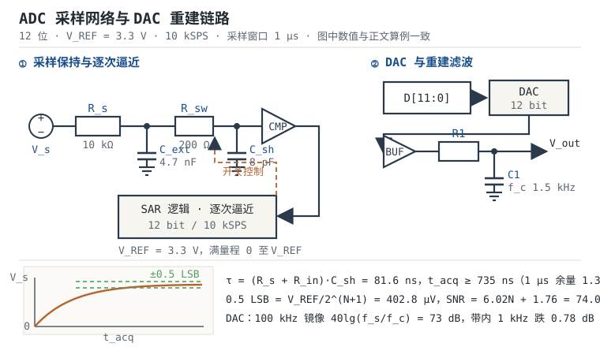

# ADC/DAC：采样保持、量化误差与重建滤波

MCU 里的模拟外设只有两个方向：把电压变成码（模数转换），把码变回电压（数模转换）。两件事看起来都是"读一个数、写一个数"，真正决定精度和稳定性的却是三个常被跳过的环节：**采样网络能不能在采样窗口内把保持电容充到足够准**、**参考电压够不够稳**、**数字码重建回模拟量时有没有把台阶和镜像滤掉**。这三个环节都可以在焊板子之前用纸笔算清楚。

本章用一个 12 位、3.3 V 参考、10 kSPS 的采样链路做主线，把采样时间、量化误差、参考预算、过采样增益和 DAC 重建滤波串成一套可复算的流程。章节导航见[嵌入式软件全景](../basics/embedded-overview.md)。

## 1 动机：三笔必须在画板前算完的账

::: motivation 三笔账
**账一：源阻抗与采样窗口。** 12 位 ADC、保持电容 8 pF、开关导通电阻 200 Ω、源阻抗 10 kΩ，采样窗口 1 µs。时间常数 $\tau=(R_s+R_{in})C_{sh}=81.6\ \text{ns}$，建立到 0.5 LSB 需要 $9.01\tau=735\ \text{ns}$，1 µs 够，余量 1.36 倍。把源阻抗换成 20 kΩ，同样窗口需要 1456 ns，差 1.46 倍，读数会系统性偏低，而且偏低量随信号幅度变化，表现为非线性。**"源阻抗小于 10 kΩ 就能接"不是定律，它随位数、保持电容、采样时间和温度一起变。**

**账二：参考电压不是理想电池。** 直接拿 3.3 V 电源当参考，LDO 初始精度 1% 就是 41 LSB 的增益误差；电源上 10 mV 的开关纹波折合 12.4 LSB，会在读数上直接看到开关频率的包络；再叠加 50 ppm/°C 的温漂，40 °C 温差又是 8.2 LSB。**参考的初始误差可以两点校准，纹波和温漂校准不掉。**

**账三：DAC 之后不滤波，等于把台阶直接送出去。** 12 位 DAC、100 kSPS 更新、一阶 RC 截止 1.6 kHz，在 100 kHz 处只有 36 dB 衰减，镜像仍有满量程的 1.6%，折合 65 LSB。**重建滤波的截止频率、阶数、更新率三者必须一起算。**
:::

| 你想确认 | 先算 | 判据（工程经验值） |
|---|---|---|
| 采样窗口够不够 | $t_{acq}\geq(R_s+R_{in})C_{sh}\ln 2^{N+1}$ | 计算值再留 20% 余量 |
| 源阻抗上限 | $R_s\leq t_{acq}/[C_{sh}\ln 2^{N+1}]-R_{in}$ | 扣除开关电阻与漏电影响 |
| 量化误差多大 | $V_{REF}/2^{N+1}$ | 折合 LSB 的 ±0.5 |
| 参考够不够稳 | $\Delta V_{REF}/V_{REF}\times 2^N$ | 折合误差小于 1 LSB |
| 实际几位有效 | $(SINAD-1.76)/6.02$ | 按实测 SINAD，不按标称位数 |
| 过采样能补几位 | $0.5\log_2 OSR$ | 只补随机噪声，不补 INL 与参考误差 |
| 镜像压到多少 | 二阶 $40\lg(f_s/f_c)$ | 低于 1 LSB 对应电平 |

## 2 直观：采样保持、逐次逼近与码到电压的重建

逐次逼近型模数转换器（Successive Approximation Register ADC，SAR ADC）的工作方式像用天平称重：先放最重的砝码（最高位），重了就拿掉，轻了就留下，然后换下一个砝码，直到最轻的一个。天平每次比较都需要"样品静止"，所以输入必须先被**采样保持（Sample-and-Hold，S&H）**电路"冻结"在保持电容上；比较的砝码则由内部数模转换器（Digital-to-Analog Converter，DAC）逐位拼出来。

采样瞬间并不是理想的：源阻抗、开关电阻、保持电容构成一个 RC 网络，电压按指数规律爬向目标值；采样开关断开时还会把一小包电荷注入保持电容。**采样保持电路的本质是一个带误差预算的 RC 充电问题**，这也是本章所有采样时间公式的来源。

### 原理图：采样网络与重建链路

图中左半部分是采样网络：被测电压 $V_s$ 经源阻抗 $R_s$ 和抗混叠电容 $C_{ext}$ 到达采样开关 $R_{sw}$，再对保持电容 $C_{sh}$ 充电，比较器（Comparator，CMP）把结果送给 SAR 逻辑，SAR 逻辑反过来控制开关并逐位拼出逼近码。右半部分是 DAC 重建链路：数字码 $D[11:0]$ 进入 DAC，输出经缓冲器和 $R_1C_1$ 低通滤波后得到模拟量。

| 图中标号 | 含义 | 典型值 | 对结果的影响 |
|---|---|---|---|
| $R_s$ | 信号源内阻（含分压电阻戴维南等效） | 0 至 20 kΩ | 决定建立时间常数 |
| $C_{ext}$ | 引脚外抗混叠与电荷缓冲电容 | 1 至 100 nF | 抑制混叠，但拖慢多通道切换 |
| $R_{sw}$ | 采样开关导通电阻 | 50 至 500 Ω | 与 $R_s$ 串联计入 $\tau$ |
| $C_{sh}$ | 内部保持电容 | 4 至 10 pF | 越大抗噪越好、建立越慢 |
| $R_1C_1$ | DAC 重建滤波 | 见算例 | 决定镜像衰减与建立时间 |

### 静态分析：电荷分配、漏电与分压误差

开关闭合前，保持电容上残留上一次的电压 $V_{sh,0}$；闭合后电荷在源阻抗与保持电容之间重新分配，电压按

$$V_{sh}(t)=V_s-(V_s-V_{sh,0})\,e^{-t/\tau},\qquad \tau=(R_s+R_{in})C_{sh}$$

变化。式中 $V_s$ 是待测电压（V），$V_{sh,0}$ 是采样前保持电容上的残留电压（V），$R_s$ 是源阻抗（Ω），$R_{in}$ 是开关与内部路径的串联电阻（Ω），$C_{sh}$ 是保持电容（F），$t$ 是采样窗口长度（s）。**这一式是本章所有采样时间计算的出发点**，它同时解释了"多通道轮询时前一个通道会污染后一个通道"。

直流量级的误差有三个来源。第一是输入漏电流在源阻抗上产生的压降：数据手册常给 ±50 nA 典型、±1 µA 最坏，若源阻抗为 7.5 kΩ，50 nA 对应 0.375 mV（0.47 LSB），1 µA 对应 7.5 mV（9.3 LSB）。第二是保持期间的跌落：1 nA 漏电在 1 µs 内让 8 pF 的保持电容损失 $1\ \text{nA}\times1\ \mu\text{s}/8\ \text{pF}=125\ \mu\text{V}$，约 0.16 LSB；保持时间越长越明显。第三是分压电阻的容差：1% 分压比直接变成 1% 增益误差，折合 41 LSB，必须靠 0.1% 电阻或两点校准压下去。

### 动态分析：建立、孔径抖动与混叠

采样窗口内的建立误差按指数衰减，要求残余误差小于 0.5 LSB，就得到 $e^{-t/\tau}\leq 2^{-(N+1)}$，即 $t\geq\tau(N+1)\ln 2$。对 12 位、$\tau=81.6\ \text{ns}$，需要 $9.01\tau=735\ \text{ns}$，取 1 µs 窗口时残余误差 $e^{-12.25}\times3.3\ \text{V}=15.7\ \mu\text{V}$，只有 0.02 LSB。这是"算对了就几乎无误差"的典型例子。

第二个动态误差是**孔径抖动（Aperture Jitter）**：采样时刻不确定 $t_j$，对正弦输入 $v(t)=A\sin 2\pi ft$ 产生的电压误差近似为 $2\pi fAt_j$。取 $A=1.65\ \text{V}$（半量程）、$t_j=1\ \text{ns}$，在 1 kHz 时误差 $2\pi\times10^3\times1.65\times10^{-9}=10.4\ \mu\text{V}$（0.013 LSB），在 100 kHz 时变成 1.04 mV（1.29 LSB）。**输入频率越高，时钟抖动越不能忽略**，这也是高频采样要用地抖动时钟源的原因。

第三个动态误差是**混叠（Aliasing）**。以 10 kSPS 采样，奈奎斯特频率 5 kHz；5.3 kHz 的干扰在带外，却会折叠到 $|5.3-10|=4.7$ kHz，幅度一点不小。若干扰幅度 100 mV、要求折合小于 0.5 LSB（402.8 µV），需要 47.9 dB 衰减；单极点在 5.3 kHz 处要给出 47.9 dB，截止频率得低到 21.3 Hz，这显然不可接受。正确的做法是提高采样率让干扰落在带内，再用数字滤波去掉，或者用二阶以上抗混叠滤波器。

### 环路与稳定性：运放驱动开关电容负载

当信号源是运放缓冲器时，"环路"问题就出现了：SAR 的保持电容在采样瞬间等效为一个突变的容性负载，运放输出端看到的是几十皮法到几纳法的阶跃负载，反馈环路的相位裕度会被拉低。工程做法是在运放输出与 ADC 引脚之间串一个隔离电阻 $R_{iso}$（常见 20 至 100 Ω），它在环路中引入一个零点，把容性负载造成的第二个极点"顶"回去；代价是它与引脚电容又形成一个新的 RC 极点，采样窗口要重新按 $\tau=(R_{iso}+R_{sw})C_{sh}$ 复算。

采样瞬间的电荷反冲（Charge Kickback）也要估：$C_{sh}=8\ \text{pF}$ 在 5 ns 内被拉动 1 V，瞬时电流 $I=C\,dV/dt=1.6\ \text{mA}$。这个尖峰会在源阻抗上产生毛刺，也会激励运放输出级；$R_{iso}$ 与引脚电容把它吸收掉，但 $R_{iso}$ 太大会让建立变慢。**稳定性与建立速度在这里是一对直接冲突的指标**，取值必须用采样窗口反算，而不是抄评估板。

### 取值与权衡

| 参数 | 增大时 | 代价 | 取值建议 |
|---|---|---|---|
| $C_{sh}$ | 抗电荷注入、抗噪更好 | 建立时间线性变长 | 由芯片决定，只能靠加长采样时间适配 |
| $R_s$ | 功耗低、可分压 | $\tau$ 线性变长 | 12 位、1 µs 窗口下不超过 13.7 kΩ |
| $C_{ext}$ | 抗混叠、抑制电荷反冲 | 多通道切换恢复慢 | 单通道 10 至 100 nF，多通道 1 至 10 nF 或加缓冲 |
| $V_{REF}$ | 输入范围大 | LSB 变大、分辨率变差 | 在信号摆幅与分辨率之间取，通常 3.0 至 3.3 V |
| $f_s$ | 抗混叠容易、过采样余量大 | 功耗、存储、处理量上升 | 按信号带宽的 5 至 10 倍取 |
| 过采样率 | SNR 每倍频程 +3 dB | 输出速率按 OSR 下降 | 只在不被 INL 限制时用 |

## 3 定量关系

### 3.1 量化误差

理想 $N$ 位 ADC 把满量程 $V_{REF}$ 分成 $2^N$ 个码，一个最低有效位（Least Significant Bit，LSB）为

$$q=\frac{V_{REF}}{2^N}$$

四舍五入量化时，误差在 $\pm q/2$ 内均匀分布，最大绝对误差与均方根误差分别为

$$e_{q,\max}=\pm\frac{V_{REF}}{2^{N+1}},\qquad e_{q,rms}=\frac{q}{\sqrt{12}}=\frac{V_{REF}}{2^N\sqrt{12}}$$

满量程正弦输入下，仅由量化噪声决定的信噪比为

$$SNR_{ideal}=6.02N+1.76\ \text{dB}$$

三式中 $V_{REF}$ 是参考电压（V），$N$ 是位数，$q$ 是一个 LSB 的电压（V）。12 位、3.3 V 时 $q=805.7\ \mu\text{V}$，$e_{q,\max}=402.8\ \mu\text{V}$，$SNR_{ideal}=74.0\ \text{dB}$。若采用截断而非四舍五入，误差范围变成 $0$ 至 $-q$，均值 $-q/2$，会引入固定的 $-0.5$ LSB 偏置，这一点在校准时要区分。

### 3.2 采样时间与源阻抗

把 $V_{sh}(t)$ 的残余误差限制在 0.5 LSB 以内：

$$\left|V_s-V_{sh}(t)\right|\leq\frac{V_{REF}}{2^{N+1}}\ \Longrightarrow\ e^{-t/\tau}\leq 2^{-(N+1)}$$

两边取对数，得到工程上最常用的一条采样预算式：

$$t_{acq}\geq(R_s+R_{in})\,C_{sh}\,\ln 2^{N+1}=(R_s+R_{in})\,C_{sh}\,(N+1)\ln 2$$

式中 $t_{acq}$ 是采样窗口（s），$R_s$ 是源阻抗（Ω），$R_{in}$ 是开关与内部串联电阻（Ω），$C_{sh}$ 是保持电容（F），$N$ 是位数。注意 $\ln 2^{N+1}$ 与 $(N+1)\ln 2$ 等价，两者都表示"要衰减到 $2^{-(N+1)}$ 需要的时间常数的个数"：8 位是 6.24 个，12 位是 9.01 个，16 位是 11.78 个。**位数每加 4 位，采样时间约多 1.3 倍**，这也是 16 位 ADC 的源阻抗要求比 12 位苛刻得多的原因。

反过来解出允许的源阻抗上限：

$$R_s\leq\frac{t_{acq}}{C_{sh}\,(N+1)\ln 2}-R_{in}$$

寄存器层面的换算同样要落到这条式子上。以 14 MHz 的 ADC 时钟为例，采样时间设 84 个周期就是 $84/14\ \text{MHz}=6\ \mu\text{s}$，转换本身 12.5 个周期是 0.893 µs，单通道周期 6.89 µs，吞吐约 145 kSPS；若把采样时间压到 15 个周期（1.071 µs），周期降到 1.96 µs，吞吐约 509 kSPS，但此时允许的源阻抗只有 $1.071\ \mu\text{s}/(8\ \text{pF}\times9.0109)-200\ \Omega=14.66\ \text{k}\Omega$。**吞吐率与源阻抗预算是同一枚硬币的两面**，改一个必须复算另一个。

保持阶段还有两个非理想项。其一是采样开关断开时的电荷注入（Charge Injection）：开关沟道电荷约几十飞库仑，20 fC 注入 8 pF 就是 2.5 mV 的固定台阶；固定成分可以校准，随输入变化的成分则变成失真。其二是保持电容的介质吸收（Dielectric Absorption）：它让上一次的残留在本次采样时"回流"一小部分，表现为大信号之后的拖尾，多通道轮询时尤其明显。这两项都无法用采样时间公式描述，只能靠芯片选型和差分结构压制。

### 3.3 过采样与有效位数

对白噪声做 $OSR$ 倍过采样再平均，噪声功率降到 $1/OSR$，信噪比提升

$$\Delta SNR=10\lg OSR\ \text{dB},\qquad \Delta N=0.5\log_2 OSR\ \text{bit}$$

式中 $OSR$ 是过采样率（采样率与输出速率之比）。过采样率每翻 4 倍多 1 位，每翻 16 倍多 2 位。实际器件的有效位数（Effective Number of Bits，ENOB）从实测信纳比（Signal-to-Noise and Distortion，SINAD）反算：

$$ENOB=\frac{SINAD-1.76}{6.02}$$

必须强调：过采样平均的是**随机噪声**，对积分非线性（Integral Non-Linearity，INL）、参考漂移、增益误差无效；如果输入噪声本来就低于 1 LSB，量化误差与信号相关，平均也换不来位数，需要抖动（Dither）把量化误差白化。

### 3.4 DAC 重建与滤波

零阶保持（Zero-Order Hold，ZOH）输出的频谱是信号频谱乘以 sinc 包络，并在 $f_s\pm f$、$2f_s\pm f$ 处产生镜像：

$$\left|H_{ZOH}(f)\right|=\left|\frac{\sin(\pi f/f_s)}{\pi f/f_s}\right|$$

式中 $f$ 是信号频率（Hz），$f_s$ 是 DAC 更新率（Hz）。一阶 RC 低通在频率 $f$ 处的衰减为 $20\lg\sqrt{1+(f/f_c)^2}$，二阶巴特沃斯在 $f\gg f_c$ 时近似为 $40\lg(f/f_c)$，其中 $f_c=1/(2\pi R_1C_1)$ 是截止频率（Hz）。把镜像压到 1 LSB 以下需要的衰减量是 $20\lg 2^N=6.02N$ dB：12 位为 72.25 dB。

## 4 算例：12 位、10 kSPS 采样链路的完整预算

### 4.1 需求

被测信号 0 至 12 V，经 30 kΩ/10 kΩ 分压后送入 ADC；ADC 为 12 位 SAR，$V_{REF}=3.300\ \text{V}$，采样率 10 kSPS，采样窗口 1 µs，保持电容 8 pF，开关电阻 200 Ω，源阻抗为分压电阻的戴维南等效。

### 4.2 采样与源阻抗

分压比 $10/(30+10)=0.25$，12 V 对应 3.0 V，落在 0 至 3.3 V 内；戴维南等效电阻 $R_s=30\ \text{k}\Omega\parallel10\ \text{k}\Omega=7.5\ \text{k}\Omega$。时间常数与所需采样时间：

$$\tau=(7500+200)\times8\times10^{-12}=61.6\ \text{ns}$$

$$t_{acq}\geq61.6\ \text{ns}\times9.0109=555\ \text{ns}$$

1 µs 窗口余量 1.80 倍，满足。反过来，1 µs 窗口允许的最大源阻抗是 $1\ \mu\text{s}/(8\ \text{pF}\times9.0109)-200\ \Omega=13.67\ \text{k}\Omega$，7.5 kΩ 只用到 55%，分压电阻还可以再放大一倍以省电，但要注意漏电流压降随源阻抗线性增加。

### 4.3 参考与总误差预算

按 3.3 V 参考、0.1% 初始精度、10 mV 峰峰值纹波、50 ppm/°C 温漂、40 °C 温差、INL ±2 LSB、输入噪声 100 µV 计算，把各项折合到 LSB（$1\ \text{LSB}=805.7\ \mu\text{V}$）：

| 误差项 | 原始值 | 折合 LSB（RMS 或峰峰值） | 备注 |
|---|---|---|---|
| 量化 | $1/\sqrt{12}$ LSB | 0.29 RMS | 不可消除，除非过采样 |
| 参考初始精度 | 0.1% | 4.10 | 可两点校准 |
| 参考纹波 | 10 mV 峰峰值 | 12.41 峰峰值（3.58 RMS） | 按三角波折算 |
| 参考温漂 | 50 ppm/°C × 40 °C | 8.19 | 校准后仍随温度漂 |
| INL | ±2 LSB | 1.15 RMS | 按均匀分布折算 |
| 输入噪声 | 100 µV | 0.12 RMS | 白噪声，可过采样 |
| 采样建立 | 15.7 µV | 0.02 | 可忽略 |

纹波与温漂是峰峰/极值量级，做 RMS 合成时按均匀分布除以 $\sqrt{3}$；把其余各项按均方根合成：

$$e_{total}=\sqrt{0.29^2+4.10^2+3.58^2+1.15^2+0.12^2+0.02^2}=5.57\ \text{LSB}$$

$$ENOB=12-\log_2 5.57=9.52\ \text{bit}$$

**标称 12 位，实际只有 9.5 位有效**，其中参考的初始精度与纹波贡献了 5.4 LSB，是主要矛盾。换成 0.05% 初始精度、1 mV 峰峰值纹波的基准，并把 INL 校准到 ±1 LSB：

$$e_{total}=\sqrt{0.29^2+2.05^2+0.36^2+0.58^2+0.12^2+0.02^2}=2.38\ \text{LSB}$$

$$ENOB=12-\log_2 2.38=10.75\ \text{bit}$$

只换了基准和校准，有效位数就从 9.5 提到 10.75。**参考与校准的投入产出比远高于换一颗更贵的 ADC。**

### 4.4 DAC 重建滤波

DAC 12 位、$V_{REF}=3.3\ \text{V}$、更新率 100 kSPS，输出 0 至 1 kHz 信号，要求 100 kHz 附近的镜像衰减到 1 LSB（72.25 dB）以下。一阶 RC 取 $R_1=1\ \text{k}\Omega$、$C_1=100\ \text{nF}$，$f_c=1/(2\pi\times10^3\times10^{-7})=1591.5\ \text{Hz}$，在 100 kHz 处衰减 36.0 dB，不够；改用二阶巴特沃斯、$f_c=1.5\ \text{kHz}$：

$$A(100\ \text{kHz})\approx40\lg\frac{100000}{1500}=73.0\ \text{dB}$$

$$A(1\ \text{kHz})=20\lg\sqrt{1+(1/1.5)^4}\approx0.78\ \text{dB}$$

镜像刚好压到 1 LSB 附近，带内却有 0.78 dB 的幅度跌落，可以在数字侧预先补偿。若要求输出阶跃在 100 µs 内建立到 0.5 LSB，滤波器的 $f_c$ 必须提高到 $9.01/(2\pi\times100\ \mu\text{s})=14.3\ \text{kHz}$，此时 100 kHz 处二阶衰减只有 $40\lg(6.99)=33.9$ dB；解法是把更新率提到 1 MSPS，让镜像搬到 1 MHz，同样 $f_c=14.3\ \text{kHz}$ 时衰减达到 $40\lg(69.9)=73.8$ dB。**更新率是比滤波器阶数更便宜的杠杆。**

### 仿真与实验

1. 用 SPICE 搭采样网络：`V1 in 0 PWL(0 0 1u 3.3)`、`Rs in a 10k`、`Rsw a b 200`、`Csh b 0 8p`，跑 `.tran 1n 2u`，读 1 µs 时刻 $V(b)$，应看到 3.29998 V 附近（误差 15.7 µV）。
2. 把 $R_s$ 改成 20 kΩ 重跑，1 µs 时刻误差应约 6.77 mV（8.4 LSB），验证公式。
3. 板上实测：DAC 输出（或用 PWM 加 RC 产生）一个 1.000 V 直流，接分压网络后连续采 1024 点，算均值与标准差；均值与理论码 1241 的偏差就是系统误差，标准差折合 LSB 就是噪声。
4. 用信号源加 5.3 kHz、100 mV 正弦，采样率设 10 kSPS，对 1024 点做 FFT，应在 4.7 kHz 处看到峰；把采样率改成 100 kSPS，峰回到 5.3 kHz，证明混叠是折叠而不是"采样率不够"。
5. 过采样验证：同一信号连采 16 点平均，输出速率降为 625 SPS，噪声标准差应降到约 1/4；若几乎不变，说明噪声被 INL 或参考漂移主导。

## 5 工程含义

**数量级。** 12 位、8 pF、1 µs 窗口对应的源阻抗上限是 13.7 kΩ；16 位、同样条件降到 10.5 kΩ（因为需要 11.78 个时间常数）。分压测电池电压时，若用 1 MΩ 级电阻省电，必须加运放缓冲或把采样时间加长到几十微秒，否则读数会偏低几十毫伏。

**多通道轮询的隐性代价。** 8 通道 10 kSPS 意味着每通道只有 12.5 µs 的间隔。若引脚挂 100 nF，通道间切换 3.3 V 时保持电容从外部电容抽走的电荷会让 $C_{ext}$ 跌落

$$\Delta V_{ext}=\Delta V_{in}\frac{C_{sh}}{C_{ext}+C_{sh}}=3.3\times\frac{8}{100000+8}=0.264\ \text{mV}\ (0.33\ \text{LSB})$$

跌落本身可接受，但 $C_{ext}$ 通过 7.5 kΩ 恢复的时间常数是 750 µs，远大于 12.5 µs，误差会逐通道累积。把 $C_{ext}$ 降到 68 nF 后跌落 0.39 mV（0.48 LSB），恢复仍需 4.6 ms；正确解法是加缓冲器（输出阻抗 10 Ω 级），而不是继续加大电容。

**参考与地。** 基准输出端放 100 nF 与 10 µF 并联，前者管高频、后者管负载瞬变；基准的地与 ADC 的 AGND 单点相连，数字回流不能穿过基准地。VDDA 与 VREF+ 分开供电的芯片，不要把 VREF+ 直接短到 VDDA。

**输入保护与量程。** 输入范围是 0 至 $V_{REF}$，负压或超范围要靠钳位与限流：串 100 Ω 加 BAT54 双肖特基到地与电源，正常测量时 100 Ω 引入的误差可忽略，故障时把电流限制在毫安级。双极性信号要么加偏置抬到中点，要么用差分 ADC。

**校准。** 两点校准（0 与满量程附近）能消掉偏移与增益误差，把 4.1 LSB 的参考初始误差压到零点几 LSB；校准系数存 Flash，但要记录校准时的温度，温漂无法用固定系数消掉。

## 6 常见坑

::: pitfall 小信号读数偏低且非线性
**现象**：大信号附近读数正常，小信号（几十毫伏）偏低 5 至 10 LSB，且偏低量随输入变化，看起来像"零点漂移"。
**原因**：源阻抗偏大而采样窗口偏短，保持电容没有建立到 0.5 LSB；误差与初始电压差成正比，所以表现为非线性而非固定偏移。
**解决**：按 $t_{acq}\geq(R_s+R_{in})C_{sh}(N+1)\ln2$ 复算，加长采样时间、降低源阻抗或加运放缓冲；用示波器看采样窗口内的引脚波形，能看到明显的指数爬升。
:::

::: pitfall 读数随 CPU 负载跳动
**现象**：空载时读数稳定，一开 DMA 或无线发射就跳 10 至 20 LSB，跳变与负载同步。
**原因**：参考取的是 VDDA，数字电流在电源与地阻抗上产生压降和纹波，直接调制了参考；采样的时刻又恰好落在开关噪声上。
**解决**：改用独立基准并加 100 nF 加 10 µF 去耦；把采样触发移到噪声安静的时段（如 PWM 中心对齐的谷点）；必要时对同一通道连采多次取中值。
:::

::: pitfall DAC 输出有台阶毛刺、后级听到高频嘶声
**现象**：示波器看 DAC 输出是规则台阶，频谱在 100 kHz 附近有镜像；后级功放有"沙沙"声。
**原因**：重建滤波截止频率过高或阶数不够，镜像没有被压到 1 LSB 以下；或者滤波器截止频率低于信号带宽，把信号本身削掉。
**解决**：按 $6.02N$ dB 的衰减需求反算 $f_c$ 与阶数；优先提高更新率把镜像搬远；用运放缓冲隔离 RC 与负载，避免负载电阻改变截止频率。
:::

::: pitfall 过采样加了却没涨精度
**现象**：16 倍过采样平均后，噪声只降了一点，ENOB 几乎不变。
**原因**：误差被 INL、参考漂移或 50 Hz 工频干扰主导，这些不是白噪声，平均无效；或者输入噪声低于 1 LSB，量化误差与信号相关。
**解决**：先测噪声谱，确认是白噪声再加过采样；对工频干扰用整周期采样或数字陷波；对 INL 只能换器件或做多点校准。
:::

## 7 自测题

3.3 V、12 位 ADC，一个 LSB 是多少？四舍五入量化误差的峰值和均方根各是多少？

$q=3.3/4096=805.7\ \mu\text{V}$；峰值误差 $V_{REF}/2^{13}=402.8\ \mu\text{V}$；均方根 $q/\sqrt{12}=232.6\ \mu\text{V}$。如果换成截断量化，误差范围是 0 至 $-q$，均值 $-q/2=-402.8\ \mu\text{V}$，会表现为固定负偏置。

源阻抗 15 kΩ、保持电容 8 pF、开关电阻 200 Ω、12 位、采样窗口 1 µs，够不够？差多少？

$\tau=(15000+200)\times8\times10^{-12}=121.6\ \text{ns}$，需要 $9.0109\tau=1096\ \text{ns}$，1 µs 差 96 ns（约 9.6%）。1 µs 时刻残余误差 $e^{-1/0.1216}=2.68\times10^{-4}$，折合 $0.884\ \text{mV}=1.10\ \text{LSB}$，超过 0.5 LSB 预算，读数会偏低约 1 LSB。把采样时间加到 1.2 µs 或把源阻抗降到 13.7 kΩ 以下即可。

10 kSPS 采样时，5.3 kHz、100 mV 的干扰会出现在频谱的哪个位置？要压到 0.5 LSB 以下需要多少衰减？

折叠到 $|5.3-10|=4.7\ \text{kHz}$。0.5 LSB 是 402.8 µV，相对 100 mV 需要 $20\lg(100\ \text{mV}/402.8\ \mu\text{V})=47.9\ \text{dB}$ 衰减。单极点滤波器要在 5.3 kHz 给出 47.9 dB，截止频率必须低到 $5300/10^{47.9/20}=21.3\ \text{Hz}$，会牺牲信号带宽；更合理的做法是把采样率提高到 100 kSPS，让 5.3 kHz 落在带内再用数字滤波处理。

12 位 DAC、100 kSPS、二阶巴特沃斯 $f_c=1.5$ kHz，100 kHz 镜像衰减多少？带内 1 kHz 的幅度误差多少？

衰减约 $40\lg(100000/1500)=73.0\ \text{dB}$，刚好达到 12 位所需的 72.25 dB；带内 1 kHz 处 $20\lg\sqrt{1+(1/1.5)^4}=0.78\ \text{dB}$，需要在数字侧预补偿。若要求 100 µs 内建立到 0.5 LSB，$f_c$ 需提到 14.3 kHz，此时 100 kHz 衰减只剩 33.9 dB，必须把更新率提高到 1 MSPS 才能补回来。

为什么 16 倍过采样理论上多 2 位，实测常常只多 1 位左右？

$0.5\log_2 16=2$ 位的前提是误差为白噪声且幅度大于 1 LSB。实际器件的 INL、参考漂移、电源纹波和工频干扰都不是白噪声，平均后不下降；此外 DNL 造成的码宽不均也会留下固定模式。所以过采样只能把"随机噪声"这一项换成位数，换不来精度指标。

## 8 参考资料

- IEEE Std 1241-2010，*Terminology and Test Methods for Analog-to-Digital Converters*，§4 定义 LSB、INL、DNL、SINAD 与 ENOB 的测试条件。
- Analog Devices，MT-021 *ADC Architectures II: Successive Approximation ADCs*，采样保持结构与建立时间分析。
- Analog Devices，MT-022 *ADC Architectures III: Sigma-Delta ADC Basics*，过采样、噪声整形与数字滤波。
- STMicroelectronics，RM0090 *STM32F4 参考手册*，ADC 章（采样时间寄存器、校准、VREF+）与 DAC 章（触发源、输出缓冲、噪声/三角波发生器）。
- STMicroelectronics，AN2834 *How to get the best ADC accuracy in STM32*，源阻抗、采样时间与误差预算的实测数据。
